# 01 · Java 基础

> 适用岗位：Java 资深开发 / 架构师
> 版本基线：JDK 21 / JDK 25（LTS），JDK 8 时代的差异单独标注
> 事实核对：标「已核对」「实测」的结论，均用本机 OpenJDK 25 运行或读取 `-XX:+PrintFlagsFinal` 得到
> 相关分类：[《02 集合类》](02-集合类.md)（HashMap）、[《03 Java 并发》](03-Java并发.md)、[《04 JVM》](04-JVM.md)（类加载、字符串常量池）、[《05 Spring》](../02-框架与容器/05-Spring.md)（AOP 代理）

## 知识地图

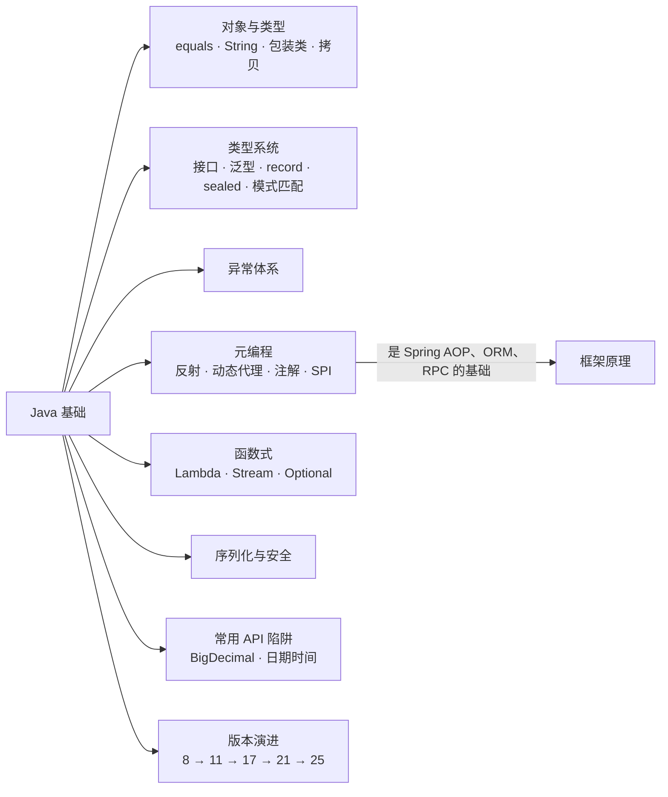

## 题目索引

| 编号 | 题目 | 难度 | 层级 |
| --- | --- | --- | --- |
| 01-01 | `==`、equals、hashCode 的关系？为什么重写 equals 必须重写 hashCode？ | ★ | 资深 |
| 01-02 | String 为什么不可变？常量池与字符串拼接在新版本中如何实现？ | ★★ | 资深 |
| 01-03 | 包装类缓存与自动拆装箱有哪些坑？ | ★ | 资深 |
| 01-04 | Java 是值传递还是引用传递？ | ★ | 资深 |
| 01-05 | 深拷贝与浅拷贝；为什么不推荐 clone？ | ★ | 资深 |
| 01-06 | Object 有哪些方法？finalize 为什么被废弃？ | ★★ | 资深 |
| 01-07 | 抽象类和接口怎么选？default 方法冲突如何解决？ | ★★ | 资深 |
| 01-08 | 泛型的类型擦除、桥方法与通配符 | ★★ | 资深 |
| 01-09 | record 是什么？和 Lombok 的 @Value 有什么区别？ | ★★ | 资深 |
| 01-10 | sealed + record + 模式匹配能解决什么问题？ | ★★★ | 架构师 |
| 01-11 | 异常体系与异常处理的最佳实践 | ★★ | 资深 |
| 01-12 | 反射的原理与性能，JDK 18 之后有什么变化？ | ★★★ | 资深 |
| 01-13 | JDK 动态代理、CGLIB、ByteBuddy 的区别 | ★★★ | 资深 / 架构师 |
| 01-14 | 注解的原理：运行期注解和编译期注解处理器 | ★★ | 资深 |
| 01-15 | SPI 机制是什么？和 Spring、Dubbo 的扩展机制有何不同？ | ★★★ | 架构师 |
| 01-16 | Lambda 表达式的底层原理 | ★★★ | 资深 |
| 01-17 | Stream 的执行原理与 Gatherers | ★★ | 资深 |
| 01-18 | Optional 怎么用才算正确？ | ★ | 资深 |
| 01-19 | Java 序列化机制与反序列化漏洞 | ★★★ | 架构师 |
| 01-20 | BigDecimal 做金额计算有哪些坑？ | ★★ | 资深 |
| 01-21 | 日期时间 API 的坑与 java.time 的正确用法 | ★★ | 资深 |
| 01-22 | Java 8 到 25 的关键演进与升级关注点 | ★★ | 架构师 |

---

## 一、对象与类型

### 01-01 `==`、equals、hashCode 的关系？为什么重写 equals 必须重写 hashCode？

> ★ ｜ 资深 ｜ 高频

**考察意图**：是否理解哈希容器依赖的契约，能否说出违反契约的真实后果。

**30 秒版回答**

- `==` 比较基本类型的值，或者比较两个引用是否指向同一个对象。
- `equals` 比较"逻辑相等"，默认实现就是 `==`，由类自己按业务语义重写。
- `hashCode` 契约：**equals 相等的两个对象，hashCode 必须相等**；反过来不要求。
- 只重写 equals 不重写 hashCode，会导致 HashMap、HashSet 里"明明相等的对象却找不到"。因为哈希容器先用 hashCode 定位桶，再在桶内用 equals 比较，hashCode 不同时根本走不到 equals 这一步。

**深入剖析**

HashMap 查找一个 key 的过程：

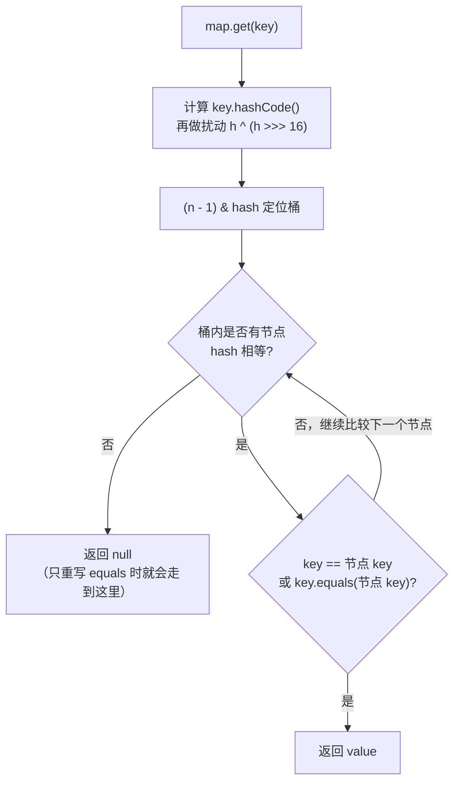

equals 必须满足五条约定：自反性、对称性、传递性、一致性，以及与 null 比较返回 false。最容易被破坏的是**对称性**和**传递性**，典型场景是父类和子类混合比较：

- 用 `instanceof` 判断类型时，`父类对象.equals(子类对象)` 为 true，反过来可能为 false，对称性被破坏。
- 用 `getClass() != o.getClass()` 判断时，满足对称性，但子类对象永远不等于父类对象，违反里氏替换原则。

实践中的选择：值对象优先用 record，或者把类声明为 final；需要继承的实体类，用 `getClass()` 比较。

**追问链**

1. **用可变对象做 HashMap 的 key 会怎样？**
   放进去之后修改了参与 hashCode 计算的字段，对象还在原来的桶里，但用新的 hashCode 去找就定位到另一个桶，于是 `get` 返回 null，`remove` 删不掉，形成"幽灵数据"和内存泄漏。key 应该是不可变对象。
2. **Lombok 的 `@EqualsAndHashCode` 有什么坑？**
   默认不包含父类字段（`callSuper = false`），子类继承了父类的 id 却不比较它，两个 id 不同的对象可能被判为相等。用 `@Data` 时 IDEA 会对此给出提示。
3. **JPA 实体的 equals 怎么写？**
   用数据库 id 比较时，新建对象在持久化之前 id 为 null，放进 HashSet 后再保存，hashCode 会变化。常见做法是用业务主键（如订单号）比较，或者让 hashCode 返回一个固定值（以牺牲哈希性能为代价保证正确性）。

---

### 01-02 String 为什么不可变？常量池与字符串拼接在新版本中如何实现？

> ★★ ｜ 资深 ｜ 高频

**考察意图**：是否了解 String 的内部结构在 JDK 9 之后的变化，能否准确判断对象创建个数。

**30 秒版回答**

- String 是 final 类，内部字段 `private final byte[] value` 不对外暴露，也没有任何修改它的方法，所以不可变。
- 不可变带来的好处：可以安全地放进常量池共享；hashCode 可以缓存；可以安全地作为 HashMap 的 key、类名、文件路径；天然线程安全。
- **JDK 9 的紧凑字符串（JEP 254）**：内部从 `char[]` 改成 `byte[]` 加一个 `coder` 字段。全是 Latin-1 字符时每个字符占 1 字节，否则按 UTF-16 占 2 字节。纯英文数字的字符串内存减半。默认开启（`CompactStrings = true`，已核对）。
- **JDK 9 的字符串拼接（JEP 280）**：`"a" + x` 不再编译成 StringBuilder，而是编译成一条 `invokedynamic`，在运行时由 `StringConcatFactory` 生成最优的拼接策略（已核对 javap 输出：`makeConcatWithConstants`）。
- 字符串常量池（StringTable）从 JDK 7 起放在堆中。

**深入剖析**

`String s = new String("ab");` 创建几个对象？

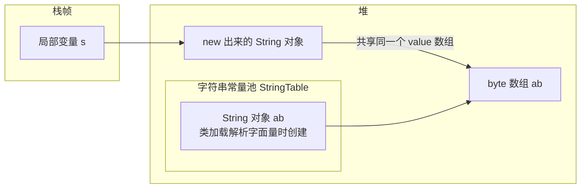

- 如果常量池中还没有 `"ab"`：会创建常量池中的那个 String，再加上 new 出来的一个，共 2 个 String 对象（两者共享底层 byte 数组）。
- 如果常量池中已有 `"ab"`：只创建 new 出来的那 1 个。
- `s.intern()` 返回常量池中的那个对象；`s == "ab"` 为 false，`s.intern() == "ab"` 为 true。

拼接的几种情况：

| 写法 | 编译结果 | 说明 |
| --- | --- | --- |
| `"a" + "b"` | 编译期直接折叠为 `"ab"` | 和字面量 `"ab"` 是同一个对象 |
| `final String a = "a"; a + "b"` | 编译期折叠 | final 局部常量也会参与折叠 |
| `a + b`（变量） | `invokedynamic makeConcatWithConstants` | JDK 9+ 运行时生成拼接逻辑 |
| 循环中 `s += i` | 每次循环都生成新的 String | 仍然要用 StringBuilder |

**追问链**

1. **既然 JDK 9 优化了拼接，循环里还需要 StringBuilder 吗？**
   需要。`invokedynamic` 只优化"一个表达式内的拼接"，循环中每次 `+=` 都会生成一个新的 String 并复制已有内容，整体是 O(n²)。
2. **intern 有什么用？有什么风险？**
   可以用来对大量重复的字符串去重（比如从数据库读出的城市名）。风险是 intern 进去的字符串都由 StringTable 管理，大量 intern 会让表持续增长，并增加 GC 处理这张表的负担。JDK 11 之前 StringTable 的桶数固定，链表变长后查找明显变慢；JDK 11 起它会按负载自动扩容，`StringTableSize`（JDK 25 默认 65536，已核对）只是初始桶数。只想节省内存时，G1 的 `-XX:+UseStringDeduplication`（默认关闭，已核对）更省心：它只合并底层数组，不改变对象身份。
3. **String 真的绝对不可变吗？**
   通过反射修改 `value` 数组可以改变内容，但 JDK 16 起对 JDK 内部类的强封装会让这种反射直接抛 `InaccessibleObjectException`，除非显式加 `--add-opens java.base/java.lang=ALL-UNNAMED`。

---

### 01-03 包装类缓存与自动拆装箱有哪些坑？

> ★ ｜ 资深 ｜ 高频

**考察意图**：是否踩过拆箱空指针、缓存比较这类线上问题。

**30 秒版回答**

- `Integer.valueOf` 缓存了 -128 到 127，所以 `Integer a = 127, b = 127; a == b` 为 true，而 128 时为 false（实测）。缓存上限可以用 `-XX:AutoBoxCacheMax=N` 调大。Long、Short、Byte 固定缓存 -128 到 127，Character 缓存 0 到 127，Float 和 Double 没有缓存。
- **包装类之间比较一律用 equals**，不要用 `==`。
- 拆箱时如果对象为 null，会抛 NullPointerException。最隐蔽的是**三元运算符**和**算术运算**触发的自动拆箱。

**深入剖析**

三个真实的线上坑（均已实测）：

```java
Map<String, Integer> map = new HashMap<>();
boolean flag = true;

// 坑 1：三元运算符的两个分支一个是 Integer、一个是 int，结果类型按 int 处理，
//        于是 map.get("k") 的返回值被自动拆箱，为 null 时抛 NPE
Integer r = flag ? map.get("k") : 0;

// 坑 2：key 类型是 Long，用 int 字面量去查，1 被装箱成 Integer，永远查不到
Map<Long, String> users = new HashMap<>();
users.put(1L, "one");
users.get(1);          // 返回 null

// 坑 3：数据库字段可能为 null，映射成 Integer 后直接参与运算
Integer score = order.getScore();
int total = score + 10;   // score 为 null 时 NPE
```

坑 1 的修复：让两个分支类型一致，写成 `flag ? map.get("k") : Integer.valueOf(0)`，或者直接用 `map.getOrDefault("k", 0)`。

JDK 14 起有了更友好的 NPE 信息（JEP 358，`ShowCodeDetailsInExceptionMessages` 默认开启，已核对），坑 1 实测的异常信息是：

```text
Cannot invoke "java.lang.Integer.intValue()" because the return value of "java.util.Map.get(Object)" is null
```

看到 `intValue()` 这类方法名，就能直接判断是自动拆箱导致的。

**追问链**

1. **POJO 的字段用基本类型还是包装类型？**
   与数据库、RPC 对接的 DTO、PO 用包装类型，因为 null 本身有业务含义（"未填写"和"0"不同），用基本类型会把 null 悄悄变成 0。局部变量和计算过程用基本类型，避免装箱开销。
2. **`new Integer(1)` 还能用吗？**
   包装类的构造函数从 JDK 9 起被废弃，JDK 16 起被标记为待移除。应该用 `Integer.valueOf`。

---

### 01-04 Java 是值传递还是引用传递？

> ★ ｜ 资深 ｜ 中频

**考察意图**：是否理解"引用本身也是一个值"。

**30 秒版回答**

- Java **只有值传递**。基本类型传的是值的副本；引用类型传的是**引用的副本**（对象地址的拷贝）。
- 所以在方法里通过引用修改对象的字段，调用方能看到；但在方法里让参数指向一个新对象，调用方的变量不受影响。

**深入剖析**

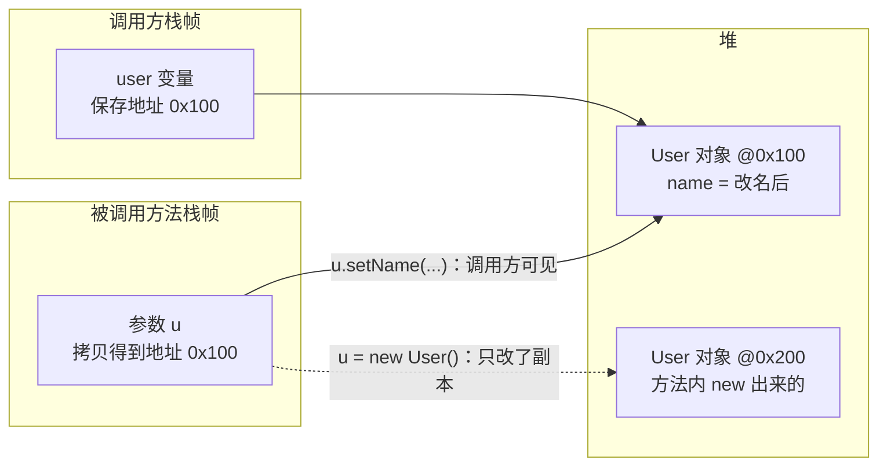

```java
void rename(User u) {
    u.setName("new");     // 修改的是同一个对象，调用方可见
    u = new User();       // 只是让副本指向新对象，调用方的 user 仍指向原对象
    u.setName("other");   // 改的是新对象，调用方看不到
}
```

**追问链**

1. **那 String 作为参数传进去，为什么改不了？**
   String 不可变，方法里所谓的"修改"其实是让参数副本指向一个新的 String，原理和上面的 `u = new User()` 一样。

---

### 01-05 深拷贝与浅拷贝；为什么不推荐 clone？

> ★ ｜ 资深 ｜ 中频

**考察意图**：是否了解 Cloneable 的设计缺陷，能否给出工程上更好的替代方案。

**30 秒版回答**

- 浅拷贝：新对象的引用类型字段与原对象指向同一个子对象。深拷贝：子对象也递归复制一份。
- `Object.clone()` 是浅拷贝，而且设计上有缺陷，《Effective Java》明确建议不要用：
  - Cloneable 是一个没有任何方法的标记接口，却改变了父类 `clone()` 的行为；
  - `clone()` 是 protected 的，返回 Object，需要强转；
  - 不调用构造函数创建对象，构造函数里的校验和初始化逻辑被绕过；
  - 与 final 字段冲突，深拷贝时无法给 final 字段重新赋值。
- 替代方案：拷贝构造函数或静态工厂（`new Order(other)`）；不可变对象根本不需要拷贝；DTO 之间的转换用 MapStruct（编译期生成代码，没有反射开销）。

**追问链**

1. **用序列化做深拷贝可以吗？**
   可以，但慢，而且要求整个对象图都可序列化。只适合偶尔使用的场景，不要放在高频路径上。
2. **`BeanUtils.copyProperties` 有什么坑？**
   它是浅拷贝；基于反射，有性能开销；字段类型不一致时（比如 Integer 和 Long）会静默跳过，出现数据丢失却没有报错；Spring 和 Apache Commons 两个版本的参数顺序相反，混用时容易把方向写反。

---

### 01-06 Object 有哪些方法？finalize 为什么被废弃？

> ★★ ｜ 资深 ｜ 中频

**考察意图**：基础是否完整，是否了解资源回收的现代做法。

**30 秒版回答**

- Object 的方法：`equals`、`hashCode`、`toString`、`getClass`、`clone`、`wait`（三个重载）、`notify`、`notifyAll`、`finalize`。
- `finalize` 从 JDK 9 起废弃，JDK 18 起被标记为待移除（JEP 421，实测注解为 `@Deprecated(forRemoval=true, since="9")`）。原因：
  - **执行时间不确定**：要等 GC 发现对象不可达，再由 Finalizer 线程执行，可能很久以后才执行，甚至不执行；
  - **拖慢 GC**：有 finalize 方法的对象至少要经历两次 GC 才能回收；
  - **可能复活对象**：在 finalize 里把 this 赋给静态变量，对象就"复活"了；
  - **Finalizer 线程只有一个**：某个 finalize 执行很慢或者卡住，后面所有待回收对象都会堆积，最终 OOM。
- 替代方案：显式关闭资源，优先使用 try-with-resources；作为兜底的安全网，用 `java.lang.ref.Cleaner`（JDK 9）。

**深入剖析**

```java
public final class NativeBuffer implements AutoCloseable {
    private static final Cleaner CLEANER = Cleaner.create();

    private final Cleaner.Cleanable cleanable;

    public NativeBuffer(long size) {
        long address = allocate(size);
        // 注意：清理动作不能引用 NativeBuffer 本身，否则对象永远不可达，清理永远不会触发
        this.cleanable = CLEANER.register(this, new FreeAction(address));
    }

    @Override
    public void close() {
        cleanable.clean();          // 主路径：调用方显式关闭，只会执行一次
    }

    private record FreeAction(long address) implements Runnable {
        @Override
        public void run() {
            free(address);
        }
    }

    private static long allocate(long size) { return 0L; }
    private static void free(long address) { }
}
```

**追问链**

1. **线上出现大量 `java.lang.ref.Finalizer` 对象，可能是什么原因？**
   某些类（老版本 JDK 中的 `FileInputStream`、部分第三方库）实现了 finalize，对象创建得多而 Finalizer 线程处理得慢，导致堆积。用 `jmap -histo` 看 Finalizer 数量，用 jstack 看 Finalizer 线程卡在哪里。

---

## 二、面向对象与类型系统

### 01-07 抽象类和接口怎么选？default 方法冲突如何解决？

> ★★ ｜ 资深 ｜ 高频

**考察意图**：能否从"建模意图"而不是语法差异来回答；是否了解 JDK 8 之后接口能力的变化。

**30 秒版回答**

- 语法差异：抽象类可以有构造函数、实例字段、各种访问修饰符的方法，只能单继承；接口只能有常量，方法默认 public，JDK 8 起可以有 default 和 static 方法，JDK 9 起可以有 private 方法，一个类可以实现多个接口。
- 建模意图才是选择依据：
  - **接口表示"能做什么"**（能力、契约），如 `Comparable`、`Runnable`；
  - **抽象类表示"是什么"并提供共同的状态和骨架实现**（模板方法），如 `AbstractList`、`AbstractQueuedSynchronizer`。
- 常见组合是"接口定义契约 + 抽象类提供骨架实现"，调用方依赖接口，实现方继承骨架。
- JDK 17 的 sealed（JEP 409）让接口和抽象类都能限定"允许哪些子类型"，见 01-10。

**深入剖析**

一个类实现的多个接口有同签名的 default 方法时，按下面的规则决定用哪个：

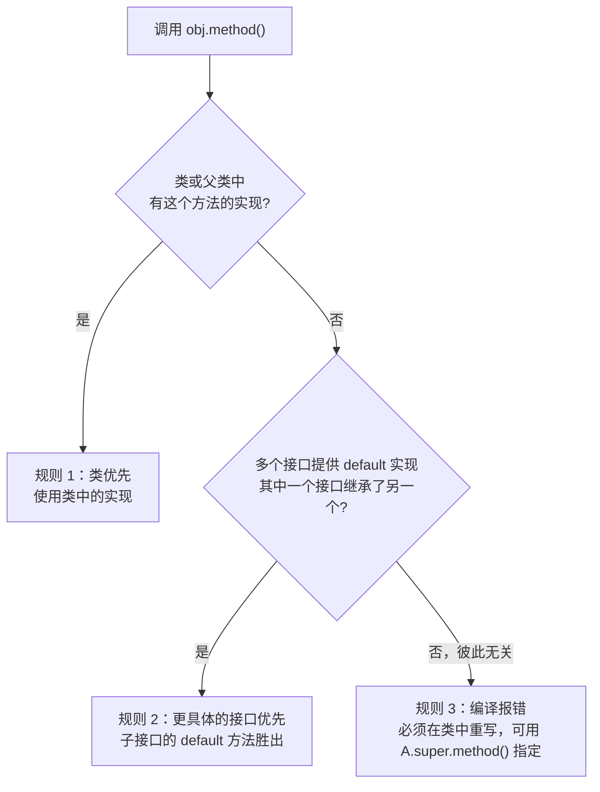

```java
interface Flyable {
    default String move() { return "fly"; }
}

interface Swimmable {
    default String move() { return "swim"; }
}

class Duck implements Flyable, Swimmable {
    @Override
    public String move() {
        return Flyable.super.move() + " & " + Swimmable.super.move();   // 显式选择或组合
    }
}
```

**追问链**

1. **接口的 default 方法有什么设计目的？**
   主要为了接口演进：在不破坏已有实现类的前提下给接口加方法。`Collection.stream()`、`Iterable.forEach()` 都是这样加进来的。不要把 default 方法当作多继承来堆业务逻辑，接口里没有状态，复杂逻辑放进去很难维护。
2. **抽象类里一定要有抽象方法吗？**
   不需要。没有抽象方法的抽象类可以用来阻止直接实例化，例如只提供骨架实现、要求使用者继承后再用。

---

### 01-08 泛型的类型擦除、桥方法与通配符

> ★★ ｜ 资深 ｜ 高频

**考察意图**：是否理解擦除带来的限制，能否用 PECS 原则设计 API。

**30 秒版回答**

- Java 泛型是**编译期**机制：编译器做类型检查并自动插入强制转换，生成的字节码中类型参数被**擦除**为上界（没有上界时擦除为 Object）。
- 擦除带来的限制：不能 `new T()`、不能 `new T[]`、不能 `instanceof List<String>`、不能用基本类型做类型参数、静态字段不能使用类的类型参数。
- 类型信息并没有完全消失：类、字段、方法声明上的泛型信息保存在 class 文件的 Signature 属性里，可以通过反射读取。Jackson 的 `TypeReference`、Gson 的 `TypeToken` 都是利用"匿名子类的父类泛型参数"拿到完整类型。
- 通配符遵循 **PECS**（Producer Extends, Consumer Super）：只从集合里读用 `? extends T`，只往集合里写用 `? super T`。

**深入剖析**

擦除后为了保持多态，编译器会生成**桥方法**：

```java
class Node<T> {
    T data;
    void set(T data) { this.data = data; }
}

class IntNode extends Node<Integer> {
    @Override
    void set(Integer data) { super.set(data); }
}

// 擦除后 Node.set 的签名是 set(Object)，而 IntNode 只有 set(Integer)，两者不构成重写。
// 编译器在 IntNode 中自动生成桥方法：
//   void set(Object data) { set((Integer) data); }
// 所以 node.set("abc") 这种通过原始类型绕过检查的调用，会在桥方法的强转处抛 ClassCastException。
```

PECS 的标准例子是 `Collections.copy`：

```java
public static <T> void copy(List<? super T> dest, List<? extends T> src)
```

`src` 只读（生产者），用 extends；`dest` 只写（消费者），用 super。这样 `List<Integer>` 可以复制进 `List<Number>`。

**追问链**

1. **`List<Object>` 和原始类型 `List` 有什么区别？**
   `List<Object>` 明确表示"可以放任何对象"，编译器会做检查，`List<String>` 不能赋值给它；原始类型 `List` 完全关闭了泛型检查，只为兼容 JDK 5 之前的代码而存在，新代码不要用。
2. **为什么泛型不支持基本类型？**
   擦除后类型参数变成 Object，而基本类型不是 Object，只能装箱。这带来了装箱开销，也是 JDK 提供 `IntStream`、`OptionalInt` 等特化类型的原因。Project Valhalla 的值类型正在尝试从根本上解决，但截至 JDK 25 尚未正式发布。
3. **泛型方法里怎么创建 T 的实例？**
   传入 `Class<T>` 或 `Supplier<T>`，例如 `<T> T create(Supplier<T> factory)`。

---

### 01-09 record 是什么？和 Lombok 的 @Value 有什么区别？

> ★★ ｜ 资深 ｜ 中频（JDK 17 之后高频）

**考察意图**：是否在用新特性，是否理解 record 的语义定位（透明的数据载体），而不只是"少写代码"。

**30 秒版回答**

- record（JDK 16 正式，JEP 395）是**透明的、不可变的数据载体**。声明 `record Point(int x, int y)`，编译器自动生成 private final 字段、规范构造函数、同名访问方法 `x()`、`equals`、`hashCode`、`toString`。
- 限制：隐式 final，不能继承其他类（隐式继承 `java.lang.Record`），不能声明额外的实例字段，可以实现接口、可以有静态字段和方法。
- 与 Lombok `@Value` 的区别：
  - record 是语言特性，不依赖注解处理器，IDE 和编译器原生理解；
  - record 能参与**模式匹配解构**（`case Point(int x, int y)`），见 01-10；
  - record 的**反序列化一定经过规范构造函数**，构造函数里的校验不会被绕过，比普通类的 Java 序列化更安全；
  - `@Value` 更灵活（可以控制访问方法名、可以用 `@Builder`），record 的访问方法名固定，没有 getXxx 前缀。

**深入剖析**

用紧凑构造函数做参数校验和规范化：

```java
public record Money(BigDecimal amount, Currency currency) {
    public Money {
        Objects.requireNonNull(amount, "amount");
        Objects.requireNonNull(currency, "currency");
        if (amount.signum() < 0) {
            throw new IllegalArgumentException("amount must be non-negative");
        }
        amount = amount.setScale(currency.getDefaultFractionDigits(), RoundingMode.HALF_UP);   // 给参数重新赋值，最终写入字段
    }

    public Money add(Money other) {
        if (!currency.equals(other.currency)) {
            throw new IllegalArgumentException("currency mismatch");
        }
        return new Money(amount.add(other.amount), currency);
    }
}
```

**追问链**

1. **record 能当 JPA 实体吗？**
   不能。JPA 实体需要无参构造函数、可变字段，并且要被代理（懒加载），这与 record 的不可变语义冲突。record 适合做 DTO、值对象、查询投影结果、方法的多返回值。
2. **record 里的 List 字段是不可变的吗？**
   不是。record 只保证字段引用不变，List 本身仍可修改。需要在紧凑构造函数里做防御性拷贝：`items = List.copyOf(items);`。
3. **Jackson、MyBatis 支持 record 吗？**
   Jackson 2.12 起支持 record 的序列化和反序列化；MyBatis 可以通过构造函数映射（`<constructor>` 或按参数名自动映射）支持 record 作为查询结果。

---

### 01-10 sealed + record + 模式匹配能解决什么问题？

> ★★★ ｜ 架构师 ｜ 中频，区分度高

**考察意图**：是否理解这三个特性组合起来的建模能力（代数数据类型），能否说清它在领域建模中的价值。

**30 秒版回答**

- **sealed**（JDK 17，JEP 409）：限定一个类或接口的子类型只能是 `permits` 列出的几个。
- **record**：不可变的数据载体。
- **模式匹配**：`instanceof` 模式（JDK 16）、switch 模式匹配（JDK 21，JEP 441）、record 解构模式（JDK 21，JEP 440）、未命名变量 `_`（JDK 22，JEP 456）。
- 三者组合就是**代数数据类型**：用 sealed 接口表达"或"（支付结果要么成功、要么失败、要么处理中），用 record 表达"且"（成功包含流水号和金额）。switch 匹配 sealed 类型时，编译器能检查**是否覆盖了所有子类型**，新增一个子类型时，所有没处理它的 switch 都会编译失败。
- 价值：把"状态的所有可能性"交给编译器检查，取代容易遗漏的 `if-else + instanceof` 和魔法字符串状态码。

**深入剖析**

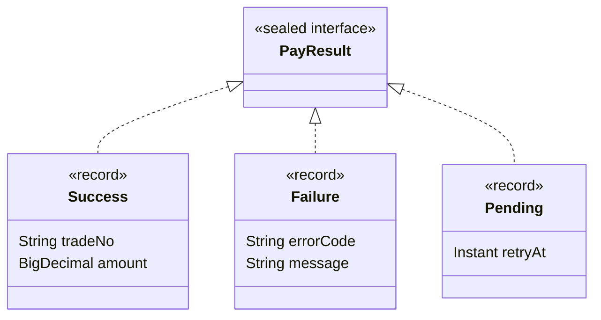

```java
public sealed interface PayResult permits PayResult.Success, PayResult.Failure, PayResult.Pending {
    record Success(String tradeNo, BigDecimal amount) implements PayResult { }
    record Failure(String errorCode, String message) implements PayResult { }
    record Pending(Instant retryAt) implements PayResult { }
}

public String handle(PayResult result) {
    // 穷尽性检查：不需要 default 分支；以后新增子类型时，这里会编译失败，提醒补上处理逻辑
    return switch (result) {
        case PayResult.Success(String tradeNo, BigDecimal amount) when amount.signum() == 0 -> "zero-amount:" + tradeNo;
        case PayResult.Success(String tradeNo, var amount) -> "paid:" + tradeNo;
        case PayResult.Failure(String code, String ignored) -> "failed:" + code;
        case PayResult.Pending(Instant retryAt) -> "retry at " + retryAt;
    };
}
```

实现上，对 sealed 类型的 switch 会被编译成 `invokedynamic typeSwitch`，由 `SwitchBootstraps` 在运行时生成匹配逻辑（已核对 javap 输出）。

**追问链**

1. **switch 模式匹配和访问者模式比有什么优势？**
   访问者模式为了在不修改类的前提下增加操作，要写一套 accept / visit 的双分派样板代码。sealed + switch 同样能保证穷尽性，代码量少得多，操作逻辑也集中在一处。
2. **`case` 的顺序有要求吗？**
   有。更具体的模式必须写在更宽泛的模式前面（带 `when` 守卫的写在不带的前面），否则编译器会报"被支配"（dominated）错误。
3. **sealed 的子类有什么要求？**
   必须在同一个模块中（未使用模块时在同一个包中），并且必须声明为 `final`、`sealed` 或 `non-sealed` 之一。

**架构师加分点**

在 DDD 中，状态机、领域事件、命令结果都非常适合用 sealed + record 建模。它让非法状态在类型层面就无法表达（make illegal states unrepresentable），比在运行时做状态校验更早发现问题。

---

## 三、异常

### 01-11 异常体系与异常处理的最佳实践

> ★★ ｜ 资深 ｜ 高频

**考察意图**：是否有清晰的异常设计原则，是否踩过 finally、异常栈丢失等坑。

**30 秒版回答**

- 体系：`Throwable` 下分 `Error`（JVM 层面的严重问题，如 OOM、StackOverflowError，一般不捕获）和 `Exception`。`Exception` 又分**受检异常**（编译器强制处理，如 IOException）和**非受检异常**（`RuntimeException` 及其子类）。
- 设计原则：
  - 业务异常用非受检异常，配合统一的错误码和全局异常处理器；
  - 不要吞异常，要么处理，要么带上原始异常（cause）往上抛；
  - 不要用异常控制正常流程；
  - 只在能处理的那一层捕获，其他层直接抛出。
- 三个经典的坑：
  - **finally 中 return 会吞掉异常**，也会覆盖 try 中的返回值；
  - try-with-resources 中，close 抛出的异常会作为**被抑制异常**（suppressed）挂在主异常上，打印日志时要能看到；
  - **热点代码中反复抛出的 NPE 等异常会丢失堆栈**（`OmitStackTraceInFastThrow` 默认开启，已核对）。

**深入剖析**

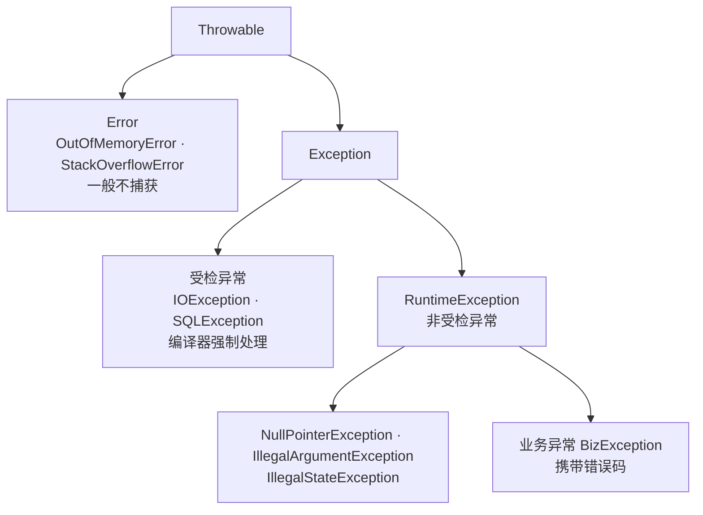

**坑 1：finally 中的 return**

```java
int bad() {
    try {
        throw new IllegalStateException("real error");
    } finally {
        return -1;    // 异常被吞掉，调用方拿到 -1，日志里什么都没有
    }
}
```

`javac -Xlint:finally` 会对这种写法给出警告。

**坑 2：线上日志只有一行 `java.lang.NullPointerException`，没有堆栈**

C2 编译器对频繁抛出的隐式异常（NPE、数组越界、类型转换异常、算术异常）做了优化：抛出足够多次之后，直接复用一个预先分配好的、没有堆栈的异常对象。所以日志后期只剩一行异常名。处理方式：

- 往前翻日志，找到最早出现的那几次，那时还有完整堆栈；
- 排查期间加 `-XX:-OmitStackTraceInFastThrow` 关闭这项优化。

**坑 3：异常的性能**

创建异常的主要开销在 `fillInStackTrace()` 抓取调用栈。高频、只用于流程控制的业务异常可以关掉栈抓取：

```java
public class BizException extends RuntimeException {
    private final String errorCode;

    public BizException(String errorCode, String message) {
        // 最后一个参数 writableStackTrace = false：不抓取调用栈，大幅降低创建成本
        super(message, null, false, false);
        this.errorCode = errorCode;
    }

    public String getErrorCode() {
        return errorCode;
    }
}
```

代价是出问题时没有堆栈可看，所以只适合语义明确的业务校验失败，不要用在系统异常上。

**追问链**

1. **受检异常是不是设计失误？**
   有争议。它的初衷是强制调用方考虑失败情况，但在 Lambda 和 Stream 中很难使用，层层声明 throws 也导致大量"捕获后包装成 RuntimeException"的样板代码。Spring、Kotlin 等都倾向于非受检异常。较为公认的做法是：调用方能合理恢复的情况用受检异常，编程错误和不可恢复的情况用非受检异常。
2. **`catch (Exception e)` 之后 `throw new BizException("xx")` 有什么问题？**
   丢掉了原始异常，排查时找不到根因。必须把 e 作为 cause 传进去。

---

## 四、反射、代理、注解与 SPI

### 01-12 反射的原理与性能，JDK 18 之后有什么变化？

> ★★★ ｜ 资深 ｜ 中频

**考察意图**：是否了解反射调用的实现机制，以及 JDK 9 模块化之后对反射的限制。

**30 秒版回答**

- 反射通过 `Class` 对象拿到类的元数据（字段、方法、构造函数），在运行时访问或调用它们，是 Spring、MyBatis、Jackson 等框架的基础。
- 反射调用的实现经历了两个阶段：
  - **JDK 8 ~ 17**：`Method.invoke` 前 15 次走 native 实现（`NativeMethodAccessorImpl`），超过阈值后用字节码生成一个专门的访问器类（`GeneratedMethodAccessorN`），这个过程叫 inflation（膨胀）。
  - **JDK 18 起**（JEP 416）：核心反射改为基于 MethodHandle 实现。实测 JDK 25 中 `Method.invoke` 的下一层是 `jdk.internal.reflect.DirectMethodHandleAccessor`。
- 反射慢在哪里：参数装箱和数组包装、访问权限检查、难以被 JIT 内联。热点路径上应缓存 `Method` 对象并调用 `setAccessible(true)`，或者改用 `static final MethodHandle`。
- **强封装**：JDK 16 起默认禁止反射访问 JDK 内部的非公开成员（JEP 396），JDK 17 移除了 `--illegal-access` 开关（JEP 403）。访问时会抛 `InaccessibleObjectException`，只能通过 `--add-opens` 显式开放。

**深入剖析**

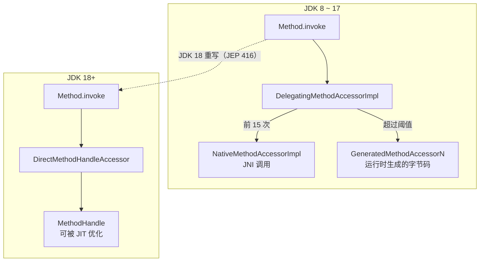

JDK 8 时代的一个生产问题：每个被反射调用的方法都会生成一个 `GeneratedMethodAccessorN` 类，由独立的类加载器加载。大量使用反射的应用（例如反射调用很多不同方法的序列化框架）会出现元空间持续增长。

需要极致性能时，用 `static final` 的 MethodHandle，JIT 可以把它当作常量内联：

```java
private static final MethodHandle GET_NAME;

static {
    try {
        GET_NAME = MethodHandles.lookup()
                .findVirtual(User.class, "getName", MethodType.methodType(String.class));
    } catch (ReflectiveOperationException e) {
        throw new ExceptionInInitializerError(e);
    }
}

static String nameOf(User user) throws Throwable {
    return (String) GET_NAME.invokeExact(user);
}
```

**追问链**

1. **升级到 JDK 17 后，启动报 `InaccessibleObjectException` 怎么办？**
   说明某个库在反射访问 JDK 内部类。优先升级这个库；临时方案是在启动参数里加 `--add-opens java.base/java.lang=ALL-UNNAMED` 这类参数，并记录在案，后续逐步消除。
2. **`sun.misc.Unsafe` 还能用吗？**
   它的内存访问方法在 JDK 23 被标记为待移除（JEP 471），JDK 24 起使用时会打印警告（JEP 498）。替代品是 VarHandle 和 FFM API（`java.lang.foreign`，JDK 22 正式）。

---

### 01-13 JDK 动态代理、CGLIB、ByteBuddy 的区别

> ★★★ ｜ 资深 / 架构师 ｜ 高频

**考察意图**：是否理解代理类的生成方式和限制，能否解释 Spring AOP 失效的根本原因。

**30 秒版回答**

- **JDK 动态代理**：运行时生成一个继承 `java.lang.reflect.Proxy`、实现目标接口的类，所有方法调用都转给 `InvocationHandler.invoke`。**只能代理接口**。
- **CGLIB**：用 ASM 生成目标类的**子类**，重写非 final 方法，调用转给 `MethodInterceptor`。可以代理没有接口的类，但**不能代理 final 类和 final / private / static 方法**。原 CGLIB 项目已停止维护，Spring 内部维护了一份重新打包的版本（`org.springframework.cglib`）。
- **ByteBuddy**：现代的字节码生成库，API 类型安全，持续跟进新版本 JDK。Hibernate、Mockito 都基于它。
- Spring AOP 如何选：Spring Framework 本身对有接口的 Bean 默认用 JDK 代理；**Spring Boot 2.0 起默认 `spring.aop.proxy-target-class=true`，统一用 CGLIB**。
- 无论哪种代理，**同一个类内部的 `this.method()` 调用都不经过代理**，这是 `@Transactional`、`@Async` 自调用失效的根本原因。

**深入剖析**

JDK 动态代理的调用路径：

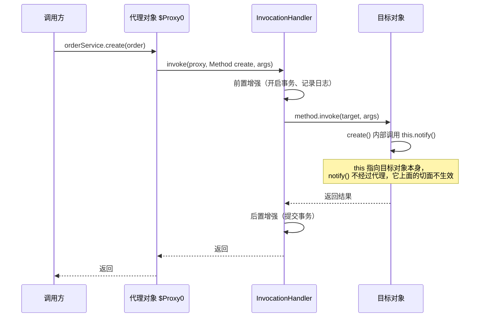

| 维度 | JDK 动态代理 | CGLIB | ByteBuddy |
| --- | --- | --- | --- |
| 代理方式 | 实现接口 | 生成子类 | 子类、重定义、插桩均可 |
| 是否需要接口 | 需要 | 不需要 | 不需要 |
| 限制 | 只能代理接口方法 | final 类、final / private / static 方法不可代理 | 取决于使用方式 |
| 方法调用 | 反射调用目标方法 | FastClass 按索引直接调用，避开反射 | 生成直接调用的字节码 |
| 维护状态 | JDK 内置 | 原项目停止维护，Spring 维护内部版本 | 活跃 |
| 典型使用者 | Spring（有接口时）、MyBatis Mapper、RPC 客户端 | Spring Boot 默认 | Hibernate、Mockito |

**追问链**

1. **MyBatis 的 Mapper 接口没有实现类，为什么能调用？**
   `MapperProxy` 实现了 `InvocationHandler`，`SqlSession.getMapper()` 用 JDK 动态代理生成接口的实现，调用时根据"接口全名 + 方法名"找到对应的 SQL 执行。RPC 框架的客户端存根也是同样的思路。
2. **自调用导致切面失效，怎么解决？**
   - 把方法拆到另一个 Bean 中（最推荐，职责也更清晰）；
   - 注入自身的代理（`@Lazy` 注入自己，或者用 `ObjectProvider`）；
   - `AopContext.currentProxy()`（需要开启 `exposeProxy`，侵入性强，不推荐）；
   - 改用 AspectJ 编译期或加载期织入，直接修改目标类的字节码。
3. **JDK 21 之后用 Mockito 有什么变化？**
   JDK 21 起，运行时动态加载 Java Agent 会打印警告（JEP 451），未来会默认禁止。Mockito 的 inline mock maker 依赖动态加载 Agent，需要在测试启动参数中用 `-javaagent` 显式挂载。

---

### 01-14 注解的原理：运行期注解和编译期注解处理器

> ★★ ｜ 资深 ｜ 中频

**考察意图**：是否知道注解本身没有任何行为，行为来自"读取注解的代码"；能否区分两类注解的工作时机。

**30 秒版回答**

- 注解本质是一个继承了 `java.lang.annotation.Annotation` 的特殊接口。它本身不做任何事，只是元数据，**行为由读取它的代码决定**。
- `@Retention` 决定注解保留到哪个阶段：
  - `SOURCE`：只在源码中，编译后丢弃（如 `@Override`、Lombok 的注解）；
  - `CLASS`：保留到 class 文件，运行时读不到（默认值）；
  - `RUNTIME`：运行时可以通过反射读取（如 Spring 的 `@Component`）。
- 运行期读取：`method.getAnnotation(X.class)` 返回的是 JDK 用**动态代理**生成的注解实例，属性值保存在 `AnnotationInvocationHandler` 的 Map 中。
- 编译期处理：注解处理器（JSR 269，实现 `javax.annotation.processing.Processor`）在 javac 编译过程中运行，可以生成新的源文件。MapStruct、Dagger 用的就是这种标准方式。

**深入剖析**

| 方式 | 时机 | 是否修改已有类 | 代表 |
| --- | --- | --- | --- |
| 运行期反射读取 | 运行时 | 否 | Spring、JUnit |
| 标准注解处理器 | 编译期 | 否，只能生成新文件 | MapStruct、AutoService |
| Lombok | 编译期 | **是**，直接修改 javac 的语法树 | Lombok |
| 字节码插桩 | 编译后或类加载时 | 是 | AspectJ、Java Agent |

Lombok 不在 JSR 269 允许的范围内：它通过 javac 的内部 API 修改语法树。所以每次 JDK 大版本升级，Lombok 都要跟着适配，旧版本 Lombok 在新 JDK 上可能编译失败。升级 JDK 时要同时检查 Lombok 版本。

**追问链**

1. **Spring 的 `@AliasFor`、组合注解是怎么实现的？**
   Java 原生注解不支持继承，也不支持属性别名。Spring 在 `MergedAnnotations` 中自己解析注解层级，把 `@AliasFor` 关联的属性合并起来，这完全是 Spring 的能力，不是 JDK 的。
2. **`@Inherited` 有什么作用？**
   只对类上的注解生效：父类带有 `@Inherited` 修饰的注解时，子类通过 `getAnnotation` 也能获取到。它对接口和方法上的注解不生效。

---

### 01-15 SPI 机制是什么？和 Spring、Dubbo 的扩展机制有何不同？

> ★★★ ｜ 架构师 ｜ 中频

**考察意图**：是否理解"面向接口编程 + 运行时发现实现"的扩展点设计，以及 SPI 与双亲委派的关系。

**30 秒版回答**

- SPI（Service Provider Interface）：接口由框架定义，实现由第三方提供；框架在运行时通过 `ServiceLoader` 扫描 classpath 下 `META-INF/services/<接口全限定名>` 文件，按其中列出的类名加载实现。JDBC 驱动加载、SLF4J 绑定日志实现都基于它。
- JDK SPI 的不足：只能遍历并实例化所有实现，不能按名称按需加载；没有依赖注入；加载失败时只能在遍历时抛异常。
- **Spring Boot** 的自动配置：早期读 `META-INF/spring.factories`，Boot 2.7 起改为 `META-INF/spring/org.springframework.boot.autoconfigure.AutoConfiguration.imports`，Boot 3 起自动配置只认后者。它加载的是配置类，再结合 `@Conditional` 决定是否生效。
- **Dubbo SPI**：配置文件是 `key=实现类` 形式，可以按名称按需加载；支持依赖注入、Wrapper 类实现 AOP、`@Adaptive` 根据 URL 参数在运行时选择实现。
- SPI 与类加载：JDK 的 `ServiceLoader.load(Class)` 默认使用**线程上下文类加载器**（TCCL），以便由平台类加载器加载的 `java.sql` 等核心模块能找到应用类路径下的实现类。这就是常说的"SPI 破坏了双亲委派"。

**深入剖析**

JDBC 加载 MySQL 驱动的过程：

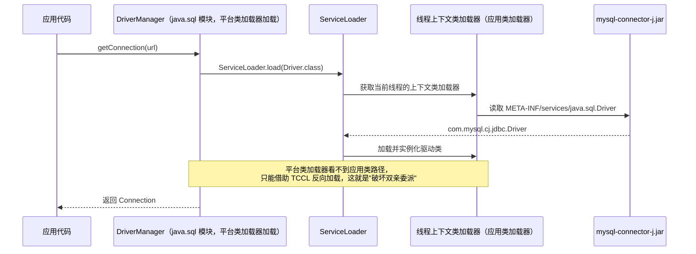

| 维度 | JDK SPI | Spring Boot 自动配置 | Dubbo SPI |
| --- | --- | --- | --- |
| 配置文件 | `META-INF/services/接口名` | `AutoConfiguration.imports` | `META-INF/dubbo/接口名` |
| 文件内容 | 实现类全名，每行一个 | 自动配置类全名 | `名称=实现类` |
| 加载方式 | 遍历全部 | 全部读取后按 `@Conditional` 过滤 | 按名称按需加载 |
| 依赖注入 | 无 | 完整的 Spring 容器 | 支持 setter 注入 |
| 扩展能力 | 无 | 条件装配、排序 | Wrapper（AOP）、`@Adaptive` |

**追问链**

1. **JDK 9 模块化之后 SPI 有什么变化？**
   模块可以在 `module-info.java` 中用 `provides 接口 with 实现` 声明服务，用 `uses 接口` 声明依赖，`ServiceLoader` 同时支持模块路径和类路径两种方式。
2. **自己设计一个 SPI 扩展点要注意什么？**
   接口要稳定，并带上版本语义；实现的加载失败要隔离，一个实现出问题不能拖垮整个框架；要有明确的优先级或排序规则；按需加载，避免启动时实例化用不到的实现。

**架构师加分点**

SPI 本质是"依赖倒置 + 运行时绑定"：框架层定义扩展点接口，不依赖任何具体实现。设计中间件或平台型组件时，把易变的部分（序列化方式、注册中心、负载均衡策略）设计成扩展点，核心流程保持稳定，这是 Dubbo 能支持大量协议和注册中心的原因。

---

## 五、函数式编程

### 01-16 Lambda 表达式的底层原理

> ★★★ ｜ 资深 ｜ 中频

**考察意图**：是否知道 Lambda 不是匿名内部类的语法糖，以及由此带来的行为差异。

**30 秒版回答**

- Lambda **不会**编译成匿名内部类的 class 文件。编译器做两件事：
  1. 把 Lambda 体编译成宿主类中的一个私有方法（如 `lambda$main$0`）；
  2. 在 Lambda 出现的位置生成一条 `invokedynamic` 指令，引导方法是 `LambdaMetafactory.metafactory`。
- 第一次执行到这条指令时，`LambdaMetafactory` 在运行时生成一个实现函数式接口的类，并绑定调用点；之后再执行就直接使用已绑定的调用点。
- JDK 15 起这个类是**隐藏类**（Hidden Class，JEP 371），实测 JDK 25 中类名形如 `Facts$$Lambda/0x...`，`isHidden()` 为 true。
- 与匿名内部类的区别：Lambda 中的 `this` 指向外部类实例；不捕获变量的 Lambda 通常会复用同一个实例（实现细节，不要依赖）；不会多出一个 class 文件。

**深入剖析**

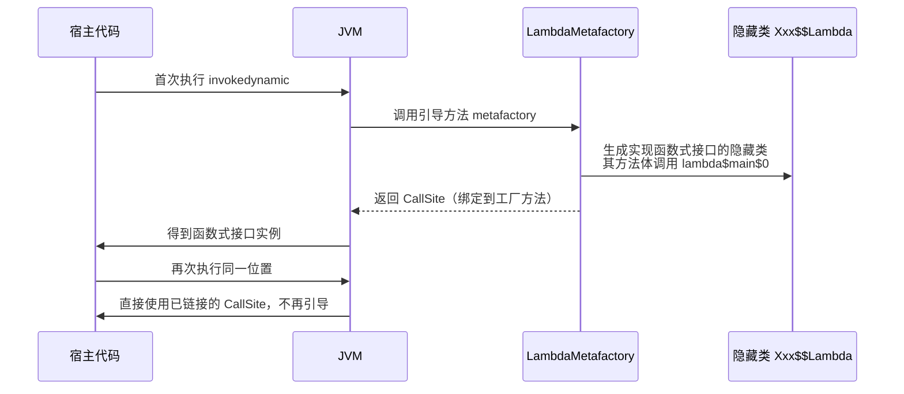

**追问链**

1. **为什么 Lambda 中引用的局部变量必须是 effectively final？**
   Lambda 捕获的是变量值的拷贝，而不是变量本身（局部变量在栈上，Lambda 可能在另一个线程、方法返回之后才执行）。如果允许修改，外部和 Lambda 内部看到的值就会不一致。所以编译器要求变量在初始化后不再被赋值。
2. **为什么用 invokedynamic 而不是直接生成内部类？**
   把"如何生成实现"推迟到运行时，JDK 可以在不改变已编译字节码的前提下优化实现策略；同时避免了每个 Lambda 都生成一个 class 文件，减小包体积和类加载开销。
3. **方法引用 `String::length` 和 Lambda 有区别吗？**
   底层同样走 `invokedynamic`，区别在于方法引用直接指向已有方法，不需要编译器额外生成 `lambda$xxx` 私有方法。

---

### 01-17 Stream 的执行原理与 Gatherers

> ★★ ｜ 资深 ｜ 中频

**考察意图**：是否理解惰性求值、流水线和短路，能否避开 Stream 的性能陷阱。

**30 秒版回答**

- Stream 由**数据源 + 若干中间操作 + 一个终止操作**组成。中间操作是**惰性的**，只记录在流水线上，直到调用终止操作才真正执行。
- 执行时，终止操作把所有中间操作包装成一条 `Sink` 链，然后数据源**逐个元素**推入这条链。每个元素一次走完所有操作，而不是每个操作各遍历一遍集合。
- 中间操作分**无状态**（`filter`、`map`）和**有状态**（`sorted`、`distinct`）。有状态操作需要看到全部元素才能输出，会成为流水线中的"屏障"。
- 短路操作（`findFirst`、`anyMatch`、`limit`）找到结果后会通知上游停止推送数据。
- **Gatherers**（JDK 24 正式，JEP 485）：允许自定义中间操作，例如固定窗口、滑动窗口、带状态的扫描。实测 `Stream.of(1,2,3,4,5).gather(Gatherers.windowFixed(2))` 得到 `[[1, 2], [3, 4], [5]]`。

**深入剖析**

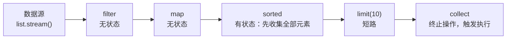

执行顺序（以元素 a、b 为例）：`filter(a) → map(a) → 进入 sorted 缓冲`，`filter(b) → map(b) → 进入 sorted 缓冲`，数据源耗尽后 sorted 排序，再把排好的元素逐个推给 `limit` 和 `collect`。

常见误用：

| 误用 | 问题 | 正确做法 |
| --- | --- | --- |
| 同一个 Stream 用两次 | 抛 `IllegalStateException` | 每次重新调用 `stream()` |
| 在 `map`、`filter` 中修改外部集合 | 结果依赖执行顺序，并行时出错 | 中间操作保持无副作用 |
| `Collectors.toMap` 遇到重复 key | 抛 `IllegalStateException` | 传入合并函数 `(a, b) -> a` |
| `toMap` 的 value 为 null | 抛 `NullPointerException` | 先过滤 null，或者自己用循环构建 Map |
| 对小集合使用 `parallelStream` | 拆分和合并的开销超过收益 | 默认串行，见[《03 Java 并发》](03-Java并发.md)03-21 |

**追问链**

1. **`peek` 适合做什么？**
   主要用于调试。不要在 `peek` 中写业务逻辑：如果终止操作不需要遍历全部元素（例如 JDK 9 起 `count()` 能直接从数据源得到大小时），`peek` 可能根本不会执行。
2. **Stream 一定比 for 循环慢吗？**
   不一定。简单循环中 for 可能略快，但差距通常不在业务代码的瓶颈上。选择依据应该是可读性；真正的热点路径用基准测试（JMH）说话。

---

### 01-18 Optional 怎么用才算正确？

> ★ ｜ 资深 ｜ 中频

**考察意图**：是否理解 Optional 的设计定位（方法返回值），而不是把它当作万能判空工具。

**30 秒版回答**

- Optional 的设计目的是**作为方法返回值**，明确告诉调用方"结果可能不存在"，迫使调用方处理。
- 不推荐的用法：作为类的字段（Optional 不可序列化，还增加内存开销）、作为方法参数（调用方仍可能传 null）、放进集合、用 `isPresent()` + `get()` 写成和判空一样的代码。
- 注意 `orElse` 和 `orElseGet` 的区别：`orElse(createDefault())` 无论是否有值都会执行 `createDefault()`；`orElseGet(this::createDefault)` 只在没有值时执行。默认值的计算有开销或副作用时，必须用 `orElseGet`。

**深入剖析**

```java
// 推荐：链式表达"取值、转换、兜底"
String city = userRepository.findById(id)        // 返回 Optional<User>
        .map(User::getAddress)
        .map(Address::getCity)
        .orElse("UNKNOWN");

// 不存在就是业务错误时，直接抛出带错误码的异常
User user = userRepository.findById(id)
        .orElseThrow(() -> new BizException(ErrorCode.USER_NOT_FOUND, "user not found"));
```

**追问链**

1. **返回集合的方法要不要返回 `Optional<List<T>>`？**
   不要。直接返回空集合即可，空集合本身就能表达"没有结果"。

---

## 六、序列化

### 01-19 Java 序列化机制与反序列化漏洞

> ★★★ ｜ 架构师 ｜ 中频

**考察意图**：是否理解 Java 原生序列化的风险，能否给出系统层面的防护方案。

**30 秒版回答**

- 机制：实现 `Serializable` 的对象可以通过 `ObjectOutputStream` 写成字节流。反序列化时，JVM **不调用该类的构造函数**（只调用第一个不可序列化父类的无参构造函数），然后按字节流恢复字段，并调用类中私有的 `readObject` 方法（如果有）。
- `serialVersionUID`：不显式声明时由类结构自动计算，类稍作修改就会变化，导致旧数据反序列化失败。**可序列化的类必须显式声明它**。
- 漏洞原理：攻击者构造恶意字节流，让反序列化过程中依次调用一串已有类的 `readObject`、`hashCode`、`compareTo` 等方法（称为 gadget chain，利用链），最终执行任意代码。2015 年的 Apache Commons Collections 利用链影响了大量 Java 应用。
- 防护：
  - **不要反序列化不可信的数据**，这是根本；
  - 使用反序列化过滤器 `ObjectInputFilter`（JEP 290，JDK 9 引入并已向下移植到 8u121），用白名单限制允许的类；JDK 17 起支持按上下文配置过滤器工厂（JEP 415）；
  - 对外接口用 JSON、Protobuf 等不能携带任意类型信息的格式；
  - JSON 库也要关闭"根据数据中的类名实例化对象"的能力：Fastjson 关闭 autoType（建议迁移到 Fastjson2 并保持默认的安全模式），Jackson 不要开启不受限的多态类型处理。

**深入剖析**

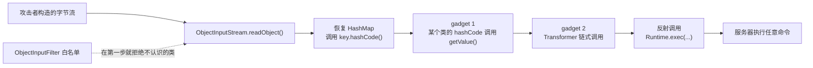

利用链中的每个类都是 classpath 上合法存在的类，单独看都没有问题，组合起来才构成攻击。所以"升级某个依赖修掉漏洞"只能堵住已知的链，**根本措施是不对外暴露 Java 原生反序列化入口**，并配置白名单过滤器。

**追问链**

1. **单例类实现了 Serializable，反序列化会破坏单例吗？**
   会，反序列化会创建新对象。解决办法是实现 `readResolve()` 返回单例实例，或者直接用枚举单例。
2. **`transient` 和 `static` 字段会被序列化吗？** 都不会。
3. **record 的序列化有什么不同？**
   record 反序列化时一定调用规范构造函数，构造函数中的校验不会被绕过，见 01-09。

**架构师加分点**

安全评审时，要把"Java 原生反序列化入口"作为一类高危资产清点出来：RMI、JMX、老版本的 Spring HttpInvoker、自研 RPC 使用的 Java 序列化、缓存中存放的 Java 序列化对象等。能替换格式的替换，不能替换的配置全局白名单过滤器（`-Djdk.serialFilter=...`）。

---

## 七、常用 API 的坑

### 01-20 BigDecimal 做金额计算有哪些坑？

> ★★ ｜ 资深 ｜ 高频（金融、电商岗位必问）

**考察意图**：是否有金额处理的实战经验。

**30 秒版回答**（以下结论均已实测）

1. **不要用 `new BigDecimal(double)`**：`new BigDecimal(0.1)` 得到 `0.1000000000000000055511151231257827021181583404541015625`。应使用 `new BigDecimal("0.1")` 或 `BigDecimal.valueOf(0.1)`（结果是 `0.1`）。
2. **比较大小用 `compareTo`，不要用 `equals`**：`equals` 会比较精度，`new BigDecimal("1.0").equals(new BigDecimal("1.00"))` 为 false，`compareTo` 为 0。这同样影响集合：放进 HashSet 是 2 个元素，放进 TreeSet 是 1 个。
3. **除法必须指定精度和舍入方式**：`BigDecimal.ONE.divide(BigDecimal.valueOf(3))` 抛出 `ArithmeticException: Non-terminating decimal expansion`。
4. **舍入方式要按业务约定选择**：`HALF_UP` 是四舍五入（2.5 → 3）；`HALF_EVEN` 是银行家舍入（2.5 → 2），统计大量数据时误差更小。
5. **输出字符串用 `toPlainString()`**：`new BigDecimal("100").stripTrailingZeros()` 的 `toString()` 是 `1E+2`，返回给前端或写入报表会出错。

**深入剖析**

金额计算的工程化做法：

```java
public final class MoneyUtils {
    /** 金额统一保留 2 位小数，舍入规则按财务约定配置 */
    private static final int AMOUNT_SCALE = 2;
    private static final RoundingMode AMOUNT_ROUNDING = RoundingMode.HALF_UP;

    private MoneyUtils() {
    }

    /** 按比例分摊：最后一份用总额减去前面各份之和，保证分摊后加总等于原金额 */
    public static List<BigDecimal> split(BigDecimal total, List<BigDecimal> weights) {
        BigDecimal weightSum = weights.stream().reduce(BigDecimal.ZERO, BigDecimal::add);
        List<BigDecimal> parts = new ArrayList<>(weights.size());
        BigDecimal allocated = BigDecimal.ZERO;
        for (int i = 0; i < weights.size() - 1; i++) {
            BigDecimal part = total.multiply(weights.get(i))
                    .divide(weightSum, AMOUNT_SCALE, AMOUNT_ROUNDING);
            parts.add(part);
            allocated = allocated.add(part);
        }
        parts.add(total.subtract(allocated));
        return parts;
    }
}
```

"最后一份用减法兜底"是分摊、拆单、优惠均摊中的标准做法，否则每份各自舍入后加起来会差几分钱，对账时对不平。

**追问链**

1. **金额用 long 存"分"和用 BigDecimal 存"元"，怎么选？**
   long 存分：运算快、没有精度问题，适合只有固定 2 位小数的场景（大多数支付系统）。BigDecimal：适合需要更多小数位的场景（利率、汇率、单价）。数据库中对应用 `BIGINT` 或 `DECIMAL(p, s)`，**不能用 FLOAT / DOUBLE**。
2. **BigDecimal 是线程安全的吗？** 是，它是不可变对象，每次运算都返回新对象。

---

### 01-21 日期时间 API 的坑与 java.time 的正确用法

> ★★ ｜ 资深 ｜ 高频

**考察意图**：是否踩过线程安全、时区、跨年这几类典型问题。

**30 秒版回答**

- `SimpleDateFormat` **不是线程安全的**：它内部用一个共享的 `Calendar` 字段保存中间状态，定义成静态变量在多线程下使用，会得到错乱的日期甚至抛异常。
- 用 java.time（JDK 8，JSR 310）替代：所有类不可变、线程安全；`DateTimeFormatter` 可以定义为常量共享。
- 类的选择：
  - `Instant`：时间线上的一个点（UTC），适合存储和传输；
  - `LocalDate` / `LocalDateTime`：不带时区的日期时间，只适合表达"墙上时钟"（如生日、营业时间）；
  - `ZonedDateTime` / `OffsetDateTime`：带时区或偏移量，用于需要换算时区的场景。
- **`YYYY` 和 `yyyy` 是两回事**：`YYYY` 是"周所在的年"（week-based year）。实测 2025-12-29 用 `YYYY-MM-dd` 格式化得到 `2026-12-29`，`SimpleDateFormat` 和 `DateTimeFormatter` 都是如此。每年年底都有系统因此出现"日期跳到明年"的事故。

**深入剖析**

时间处理的一致性约定（多时区系统尤其重要）：

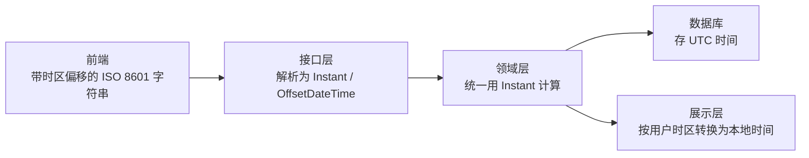

```java
public final class DateFormats {
    /** DateTimeFormatter 不可变且线程安全，可以定义为常量 */
    public static final DateTimeFormatter DATE_TIME =
            DateTimeFormatter.ofPattern("yyyy-MM-dd HH:mm:ss").withZone(ZoneId.of("Asia/Shanghai"));

    private DateFormats() {
    }
}
```

**追问链**

1. **MySQL 的 DATETIME 和 TIMESTAMP 怎么选？**
   TIMESTAMP 存储时转换为 UTC，读取时按会话时区转回，范围只到 2038 年；DATETIME 原样存储，不做时区转换。多时区系统常用"DATETIME 存 UTC 时间 + 应用层统一时区"的方式，并在连接串中显式配置时区，避免 JDBC 驱动按服务器默认时区转换造成 8 小时偏差。详见[《15 MySQL》](../04-数据存储/15-MySQL.md)。
2. **为什么不能用 `LocalDateTime` 表示订单创建时间？**
   它不带时区，同一个值在不同时区的服务器上代表不同的时刻；遇到夏令时还可能出现重复或不存在的时间。订单时间应该用 `Instant` 或带偏移量的类型。

---

## 八、版本演进

### 01-22 Java 8 到 25 的关键演进与升级关注点

> ★★ ｜ 架构师 ｜ 高频

**考察意图**：是否持续跟进 Java 的发展，能否主导一次 JDK 升级。

**30 秒版回答**

- LTS 版本：8 → 11 → 17 → 21 → 25。JDK 9 起每半年发布一个版本，每两年一个 LTS。
- 各 LTS 最值得关注的变化：
  - **11**：模块化（9）、`var`（10）、标准 HttpClient、G1 成为默认收集器（9）；
  - **17**：record、sealed、switch 表达式、文本块、强封装 JDK 内部 API；
  - **21**：虚拟线程、switch 模式匹配、record 模式、Sequenced Collections、分代 ZGC；
  - **25**：ScopedValue、紧凑对象头（需显式开启）、模块导入声明、精简的源文件与实例 main 方法、灵活的构造函数体、AOT 启动优化。
- Spring Boot 3 要求 JDK 17+，这是大部分团队从 8 / 11 升级的直接推动力。

**深入剖析**

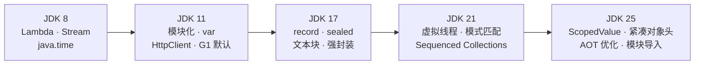

| 版本 | 特性 | JEP |
| --- | --- | --- |
| 9 | 模块系统、G1 默认、紧凑字符串、字符串拼接 indy 化、集合工厂方法 | 261、248、254、280、269 |
| 10 | 局部变量类型推断 `var` | 286 |
| 11 | 标准 HttpClient、单文件源码直接运行 | 321、330 |
| 14 | switch 表达式、友好的 NPE 信息 | 361、358 |
| 15 | 文本块、隐藏类、ZGC 转正 | 378、371、377 |
| 16 | record、instanceof 模式匹配、默认强封装 | 395、394、396 |
| 17 | sealed、移除 `--illegal-access` | 409、403 |
| 18 | 默认 UTF-8、反射基于 MethodHandle 重写、finalize 标记待移除 | 400、416、421 |
| 21 | 虚拟线程、switch 模式匹配、record 模式、Sequenced Collections、分代 ZGC | 444、441、440、431、439 |
| 22 | 未命名变量与模式 `_`、FFM API 转正 | 456、454 |
| 23 | 分代 ZGC 成为默认模式 | 474 |
| 24 | Stream Gatherers、虚拟线程 synchronized 不再 pin、AOT 类加载与链接、永久禁用 SecurityManager | 485、491、483、486 |
| 25 | ScopedValue、模块导入声明、精简源文件与实例 main、灵活构造函数体、紧凑对象头转正、AOT 参数简化与方法剖析 | 506、511、512、513、519、514、515 |

**追问链**

1. **从 JDK 8 升级到 17 / 21，主要会遇到哪些问题？**
   - **强封装**：反射访问 JDK 内部类的库会报 `InaccessibleObjectException`，要升级依赖或临时加 `--add-opens`；
   - **被移除的模块**：JAXB、JAX-WS、CORBA 等 Java EE 模块在 JDK 11 被移除（JEP 320），需要显式引入依赖；
   - **`javax` 到 `jakarta` 的包名变更**：Spring Boot 3 / Jakarta EE 9+ 要求，影响面最大；
   - **GC 参数变化**：CMS 已在 JDK 14 移除，旧的 GC 日志参数在 JDK 9 改为统一日志 `-Xlog:gc*`；
   - **字节码工具**：Lombok、ASM、ByteBuddy、Mockito 等需要升级到支持目标 JDK 的版本。
2. **JDK 18 默认 UTF-8 有什么影响？**
   在此之前，`new String(bytes)`、`FileReader` 等不指定字符集的 API 使用操作系统默认编码，在 Windows 中文环境下是 GBK。升级后默认变成 UTF-8，依赖平台默认编码读写文件的旧代码可能出现乱码。

**架构师加分点**

主导 JDK 升级时，建议的路径：先用 `jdeps --jdk-internals` 扫描对 JDK 内部 API 的依赖，再升级构建工具和字节码相关依赖，然后在测试环境中把编译目标保持不变、只换运行时 JDK，跑完回归测试后再切换编译目标。GC 选择和参数要重新压测，不要直接沿用 JDK 8 的参数。
