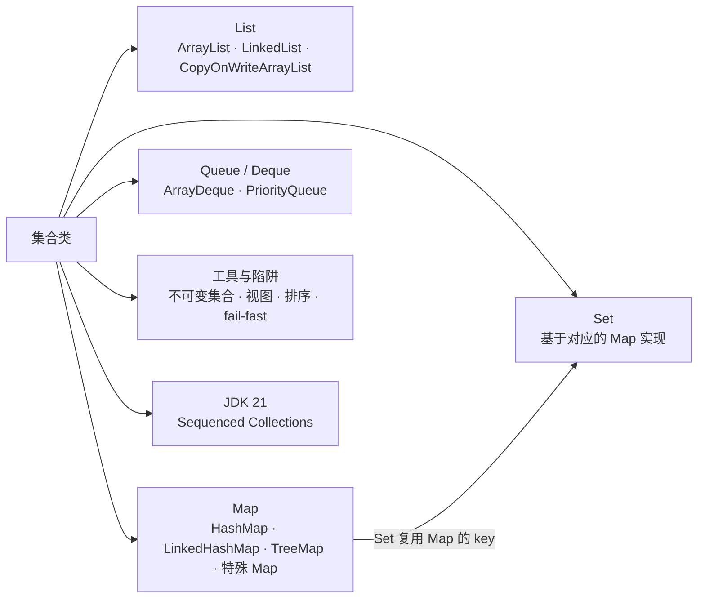
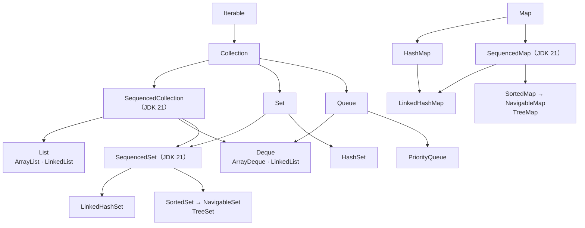
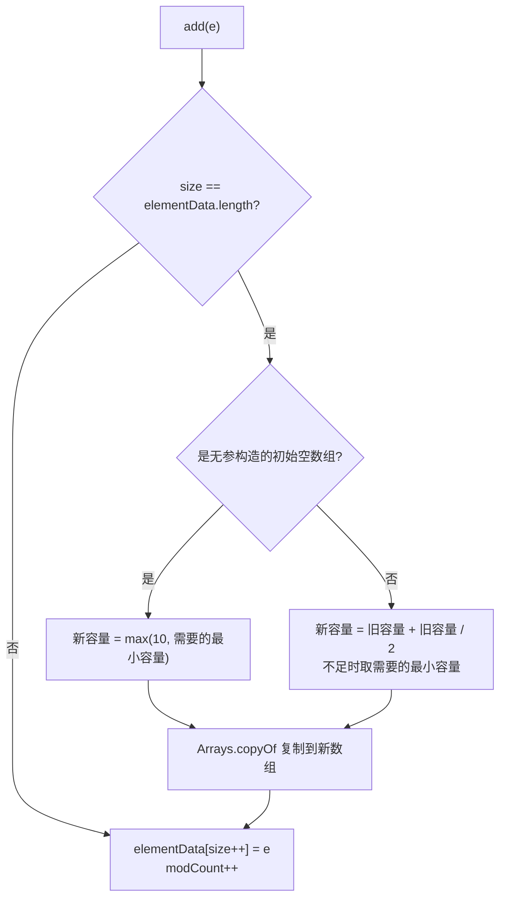
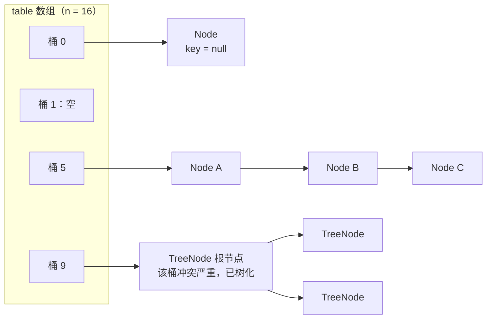
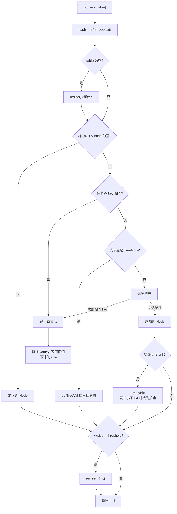
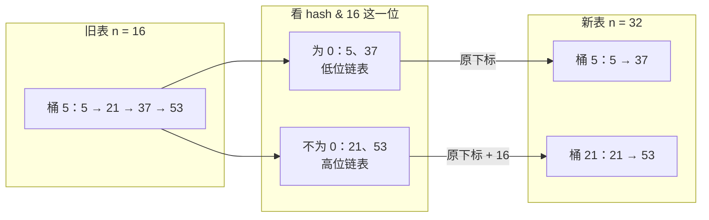
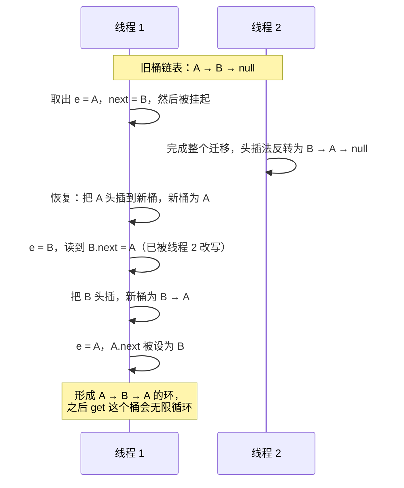
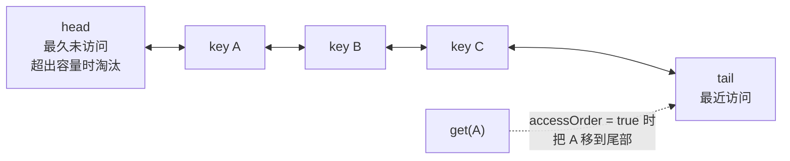
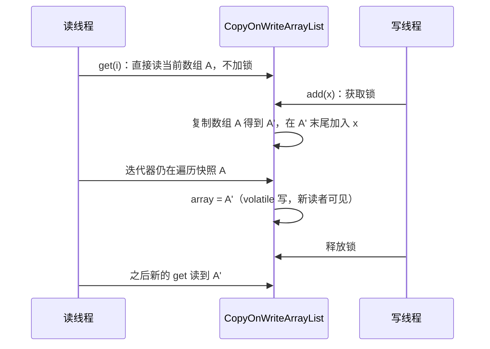
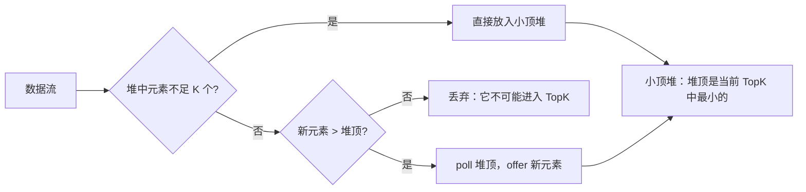

# 02 · 集合类

> 适用岗位：Java 资深开发 / 架构师
> 版本基线：JDK 21 / JDK 25（LTS），JDK 7 / 8 的历史差异单独标注
> 事实核对：源码常量与扩容规则已核对 OpenJDK 25 `src.zip`；标「实测」的行为已在 JDK 25 上运行验证
> 相关分类：[《03 Java 并发》](03-Java并发.md)（ConcurrentHashMap、阻塞队列、CopyOnWrite）、[《40 数据结构》](../08-计算机基础/40-数据结构.md)（红黑树、堆、跳表）、[《18 本地缓存》](../04-数据存储/18-本地缓存.md)（LRU 与 W-TinyLFU）

## 知识地图



## 题目索引

| 编号 | 题目 | 难度 | 层级 |
| --- | --- | --- | --- |
| 02-01 | Java 集合框架的整体结构与选型 | ★ | 资深 |
| 02-02 | ArrayList 的扩容机制与 fail-fast | ★ | 资深 |
| 02-03 | ArrayList 和 LinkedList 怎么选？ | ★★ | 资深 |
| 02-04 | HashMap 的底层结构与 hash 计算 | ★★ | 资深 |
| 02-05 | HashMap 的 put 流程 | ★★ | 资深 |
| 02-06 | HashMap 如何扩容？JDK 7 为什么会死循环？ | ★★★ | 资深 |
| 02-07 | 为什么树化阈值是 8、退化阈值是 6？为什么要求表长至少 64？ | ★★ | 资深 |
| 02-08 | HashMap 线程不安全会表现成什么样？ | ★★ | 资深 |
| 02-09 | HashMap 的初始容量应该怎么设？ | ★★ | 资深 |
| 02-10 | LinkedHashMap 如何实现 LRU？生产中用它做缓存有什么问题？ | ★★ | 资深 |
| 02-11 | TreeMap 与红黑树；比较器为什么要与 equals 一致？ | ★★ | 资深 |
| 02-12 | HashSet、LinkedHashSet、TreeSet 是怎么实现的？ | ★ | 资深 |
| 02-13 | fail-fast 与 fail-safe；遍历时如何正确删除元素？ | ★ | 资深 |
| 02-14 | CopyOnWriteArrayList 的原理与适用场景 | ★★ | 资深 |
| 02-15 | PriorityQueue 的实现与 TopK 问题 | ★★ | 资深 |
| 02-16 | 为什么推荐用 ArrayDeque 代替 Stack 和 LinkedList？ | ★ | 资深 |
| 02-17 | JDK 21 的 Sequenced Collections 解决了什么问题？ | ★★ | 资深 |
| 02-18 | 不可变集合与集合视图有哪些坑？ | ★★ | 资深 |
| 02-19 | WeakHashMap、IdentityHashMap、EnumMap 分别用在哪里？ | ★★ | 资深 / 架构师 |
| 02-20 | 集合排序用的什么算法？"Comparison method violates its general contract" 是怎么回事？ | ★★★ | 资深 |

---

## 一、整体与 List

### 02-01 Java 集合框架的整体结构与选型

> ★ ｜ 资深 ｜ 高频

**考察意图**：是否有清晰的全景图，能否按访问模式选对数据结构。

**30 秒版回答**

- 两大体系：`Collection`（单个元素的容器，分为 List、Set、Queue）和 `Map`（键值对）。
- JDK 21 新增了 `SequencedCollection`、`SequencedSet`、`SequencedMap` 三个接口，统一了"有确定顺序的集合"的首尾操作，见 02-17。
- 选型看访问模式：
  - 按下标随机访问、尾部追加：`ArrayList`；
  - 按 key 查找：`HashMap`；需要保持插入顺序或访问顺序：`LinkedHashMap`；需要按 key 排序或范围查询：`TreeMap`；
  - 去重：对应的 Set；
  - 栈和队列：`ArrayDeque`；按优先级出队：`PriorityQueue`；
  - 多线程场景：`java.util.concurrent` 包中的对应实现，见[《03 Java 并发》](03-Java并发.md)。

**深入剖析**



| 需求 | 首选 | 时间复杂度 |
| --- | --- | --- |
| 按下标读写、尾部追加 | ArrayList | get / set O(1)，尾部 add 均摊 O(1) |
| 按 key 查找 | HashMap | 平均 O(1) |
| 保持插入顺序的 Map | LinkedHashMap | 平均 O(1) |
| key 有序、范围查询 | TreeMap | O(log n) |
| 栈、队列、双端队列 | ArrayDeque | 两端操作均摊 O(1) |
| 每次取最小 / 最大元素 | PriorityQueue | 入队、出队 O(log n) |
| key 是枚举 | EnumMap / EnumSet | O(1)，内存最省 |

**追问链**

1. **Collection 和 Collections 有什么区别？**
   `Collection` 是集合接口；`Collections` 是工具类，提供排序、二分查找、包装成同步或不可变集合等静态方法。

---

### 02-02 ArrayList 的扩容机制与 fail-fast

> ★ ｜ 资深 ｜ 高频

**考察意图**：是否读过 ArrayList 源码，是否理解 modCount 的作用。

**30 秒版回答**

- 底层是 `Object[] elementData`。用无参构造函数创建时，数组是一个共享的空数组，**第一次 add 时才分配容量 10**（延迟分配）。
- 容量不够时扩容为原来的 **1.5 倍**（`oldCapacity + (oldCapacity >> 1)`，JDK 25 中通过 `ArraysSupport.newLength` 计算），然后用 `Arrays.copyOf` 复制到新数组。实测容量变化：0 → 10 → 15 → 22 → 33 → 49 → 73。
- 预知元素数量时，构造时直接指定容量，或调用 `ensureCapacity`，避免多次扩容和复制。
- **fail-fast**：每次结构性修改（增删元素）都会让 `modCount` 加 1。迭代器创建时记下 `expectedModCount`，之后每次 `next()` 检查两者是否一致，不一致就抛 `ConcurrentModificationException`。它用来尽早发现"遍历时被修改"的错误，**不是线程安全机制**，不保证一定能检测到。

**深入剖析**



**追问链**

1. **为什么是 1.5 倍，而不是 2 倍？**
   这是空间和时间的折中：倍数越大，扩容次数越少，但浪费的空间越多。1.5 倍还有一个好处：多次扩容后，之前释放的几块旧数组加起来有可能容纳新数组，对内存复用更友好。
2. **ArrayList 的最大容量是多少？**
   `Integer.MAX_VALUE - 8` 是"软上限"（部分 JVM 会在数组对象中保留一些头部字段），确实需要时最多可以到 `Integer.MAX_VALUE`，再大就抛 `OutOfMemoryError`。
3. **`elementData` 为什么用 transient 修饰？**
   数组通常没有填满，直接序列化整个数组会浪费空间。ArrayList 自己实现了 `writeObject`，只序列化前 size 个元素。

---

### 02-03 ArrayList 和 LinkedList 怎么选？

> ★★ ｜ 资深 ｜ 高频

**考察意图**：能否跳出"数组查询快、链表增删快"的教科书答案，从内存布局和 CPU 缓存的角度分析。

**30 秒版回答**

- 教科书答案"ArrayList 查询快、LinkedList 增删快"**只对了一半**。LinkedList 在中间插入时，要先 O(n) 地遍历到插入位置，链接操作本身才是 O(1)；而 ArrayList 的中间插入是一次 `System.arraycopy`，底层是高效的内存块移动。
- 在绝大多数实际场景中 **ArrayList 都更快**，原因是内存布局：
  - ArrayList 的引用连续存放在数组里，CPU 缓存预取效果好；
  - LinkedList 每个元素都要额外分配一个 Node 对象（含 prev、next、item 三个引用），节点在堆上分散，遍历时缓存命中率低，内存占用也是 ArrayList 的好几倍，还增加了 GC 压力。
- LinkedList 唯一明显占优的场景：已经通过 ListIterator 定位到某个位置，然后在该位置附近**大量**插入和删除。真正需要队列或栈时，用 ArrayDeque 更好。
- 结论：默认用 ArrayList；需要两端操作用 ArrayDeque；LinkedList 很少有用武之地，它的作者 Joshua Bloch 也公开表示自己几乎不用它。

**深入剖析**

| 操作 | ArrayList | LinkedList |
| --- | --- | --- |
| get(i) | O(1) | O(n)，从离 i 较近的一端开始遍历 |
| 尾部 add | 均摊 O(1) | O(1)，但每次都要分配一个 Node |
| 中间 add / remove（按下标） | O(n) 的数组复制 | O(n) 的遍历 + O(1) 的链接 |
| 头部 add / remove | O(n) | O(1) |
| 每个元素的额外内存（开启压缩指针） | 数组中的 4 字节引用 | 一个 Node 对象，约 24 字节 |
| 遍历时的缓存友好度 | 高，连续内存 | 低，节点分散 |

**追问链**

1. **要频繁在头部插入怎么办？** 用 ArrayDeque，它是循环数组，两端操作都是均摊 O(1)，见 02-16。
2. **怎么证明哪个更快？** 不要凭感觉，用 JMH 写基准测试。注意预热、防止死代码消除，并在接近生产的数据规模下测试。

---

## 二、HashMap

### 02-04 HashMap 的底层结构与 hash 计算

> ★★ ｜ 资深 ｜ 高频

**考察意图**：是否理解"数组 + 链表 + 红黑树"结构，以及 hash 扰动和"容量为 2 的幂"的设计原因。

**30 秒版回答**

- JDK 8 至今：**数组 + 链表 + 红黑树**。数组叫 table，每个位置叫桶（bucket）。哈希冲突的元素在桶内组成链表；链表长度达到 8 且数组长度不小于 64 时，链表转换为红黑树。
- 下标计算：`index = (n - 1) & hash`。数组长度 n 总是 2 的幂，所以 `n - 1` 的二进制全是 1，按位与等价于对 n 取模，但比取模快得多。
- hash 扰动：`hash = h ^ (h >>> 16)`，把 hashCode 的高 16 位异或到低 16 位。因为下标只用到 hash 的低几位，如果不扰动，高位不同、低位相同的 key 会全部落到同一个桶。
- 默认参数（已核对 JDK 25 源码）：初始容量 16，负载因子 0.75，树化阈值 8，退化阈值 6，最小树化容量 64，最大容量 2³⁰。
- 构造时传入的容量会被 `tableSizeFor` 向上取整到 2 的幂；数组本身延迟到第一次 put 时才创建。

**深入剖析**



hash 扰动的效果：

```text
h            = 1011 0110 0011 1010  0000 0000 0000 0101   (hashCode)
h >>> 16     = 0000 0000 0000 0000  1011 0110 0011 1010
h ^ (h>>>16) = 1011 0110 0011 1010  1011 0110 0011 1111   (高位特征混入了低位)
n - 1 = 15   = 0000 0000 0000 0000  0000 0000 0000 1111
index        = 1111 = 15
```

**追问链**

1. **为什么容量必须是 2 的幂？**
   一是 `(n - 1) & hash` 可以代替取模；二是扩容时每个元素的新位置只有两种可能（原位置，或原位置 + 旧容量），只需看 hash 中的一个比特位，见 02-06。
2. **负载因子为什么是 0.75？**
   时间和空间的折中。负载因子越大，空间利用率越高，但冲突越多、链表越长；越小则相反。源码注释中的分析表明，0.75 时桶中元素个数近似服从参数为 0.5 的泊松分布，链表长度达到 8 的概率极低，见 02-07。
3. **HashMap 允许 null 吗？**
   允许一个 null key（hash 视为 0，放在桶 0）和多个 null value。ConcurrentHashMap 都不允许，原因见[《03 Java 并发》](03-Java并发.md)03-16。
4. **为什么 String 适合做 key？**
   String 不可变，hashCode 计算一次后缓存在对象里；equals 和 hashCode 实现规范。

---

### 02-05 HashMap 的 put 流程

> ★★ ｜ 资深 ｜ 高频

**考察意图**：能否完整、准确地讲出 putVal 的每一个分支。

**30 秒版回答**

1. table 为空时先调用 `resize()` 完成初始化；
2. 计算下标，桶为空则直接放入新节点；
3. 桶不为空：
   - 头节点的 key 相同，记下该节点，之后替换 value；
   - 头节点是 TreeNode，调用红黑树的插入方法；
   - 否则遍历链表，找到相同 key 就记下，遍历到尾部仍未找到就**尾插**新节点；插入后链表长度达到 8，调用 `treeifyBin`（数组长度小于 64 时改为扩容）；
4. 找到已存在的 key 时，替换 value 并返回旧值（`putIfAbsent` 不替换）；
5. 新增节点时 `modCount++`，`++size` 超过阈值（容量 × 负载因子）则扩容。

**深入剖析**



**追问链**

1. **判断 key 相同的条件是什么？**
   `p.hash == hash && (p.key == key || (key != null && key.equals(p.key)))`。先比较 hash（很快且能快速排除大部分不同的 key），再比较引用，最后才调用 equals。
2. **JDK 8 为什么把头插法改成了尾插法？**
   插入时需要遍历链表判断 key 是否已存在（同时统计长度，决定是否树化），本来就会走到尾部，尾插不增加成本。更重要的是扩容时能保持链表原有顺序，避免了 JDK 7 并发扩容时链表成环的问题，见 02-06。

---

### 02-06 HashMap 如何扩容？JDK 7 为什么会死循环？

> ★★★ ｜ 资深 ｜ 高频

**考察意图**：是否理解高低位拆分的巧妙之处，能否讲清 JDK 7 死循环的成因。

**30 秒版回答**

- 触发：元素个数超过阈值（容量 × 0.75），或链表要树化但数组长度小于 64。
- 扩容为 2 倍，然后把旧桶中的元素迁移到新数组。因为容量是 2 的幂，**每个元素只需看 hash 中"旧容量对应的那一位"**：
  - `(hash & oldCap) == 0`：留在原下标 j（低位链表）；
  - 否则：移到 j + oldCap（高位链表）。
  不需要重新计算每个元素的下标。JDK 8 用两组头尾指针分别构建低位链表和高位链表，**保持元素原有顺序**。
- 红黑树桶同样按这一位拆分，拆分后节点数不超过 6 时退化回链表。
- **JDK 7 的死循环**：JDK 7 迁移时用头插法，会把链表顺序反转。两个线程同时扩容时，一个线程的反转结果被另一个线程按旧的 next 指针继续处理，可能形成 A → B → A 的环形链表。之后对这个桶执行 get，会在环上无限循环，表现为 CPU 100%。

**深入剖析**

以旧容量 16、桶 5 中有 hash 为 5、21、37、53 的四个元素为例：



验证：37 = 32 + 5，二进制第 4 位（值 16）为 0，留在 5；53 = 32 + 16 + 5，第 4 位为 1，移到 21。新表中 37 的下标是 `37 & 31 = 5`，53 的下标是 `53 & 31 = 21`，与拆分结果一致。

JDK 7 并发扩容成环的过程（简化）：



**追问链**

1. **JDK 8 修复了死循环，HashMap 就线程安全了吗？** 没有，见 02-08。
2. **扩容的代价有多大？**
   需要分配新数组并遍历所有元素，元素多时是一次明显的停顿，也会产生一个大数组的内存分配。可以预估容量避免扩容，见 02-09。

---

### 02-07 为什么树化阈值是 8、退化阈值是 6？为什么要求表长至少 64？

> ★★ ｜ 资深 ｜ 中频

**考察意图**：是否读过源码注释中的概率分析，是否理解树化的真正目的。

**30 秒版回答**

- **树化是对"坏哈希"的兜底**，不是常规优化。源码注释给出了分析：hashCode 分布良好、负载因子为 0.75 时，桶中元素个数近似服从参数为 0.5 的泊松分布，长度达到 8 的概率约为 **0.00000006**（已核对 JDK 25 源码注释中的概率表）。正常情况下几乎不会树化；一旦树化，说明 hashCode 实现很差，或者遭受了哈希碰撞攻击。
- **退化阈值是 6 而不是 8**：留出一个缓冲区间，避免元素数在 8 附近来回变化时反复在链表和红黑树之间转换。
- **表长至少 64 才树化**：表很小时，冲突更可能是因为桶太少，扩容就能把元素分散开，比树化更划算；而且 TreeNode 的大小约为普通 Node 的两倍。

**深入剖析**

源码注释中的概率表（每个桶中有 k 个元素的概率）：

| k | 概率 |
| --- | --- |
| 0 | 0.60653066 |
| 1 | 0.30326533 |
| 2 | 0.07581633 |
| 3 | 0.01263606 |
| 4 | 0.00157952 |
| 5 | 0.00015795 |
| 6 | 0.00001316 |
| 7 | 0.00000094 |
| 8 | 0.00000006 |

**追问链**

1. **key 没有实现 Comparable，红黑树怎么排序？**
   先比较 hash；hash 相同时，如果 key 实现了 Comparable 且类型相同，就用 compareTo；否则用 `tieBreakOrder`，依次比较类名和 `System.identityHashCode`，保证插入时总能确定方向。所以 key 实现 Comparable 能让树化后的查找更快。
2. **什么是哈希碰撞攻击？**
   攻击者构造大量 hashCode 相同的 key（例如精心构造的请求参数名），让服务端的 HashMap 退化成长链表，每次插入都是 O(n)，整体 O(n²)，耗尽 CPU。JDK 8 的树化把最坏情况从 O(n) 降到 O(log n)，Web 容器也会限制请求参数的个数。

---

### 02-08 HashMap 线程不安全会表现成什么样？

> ★★ ｜ 资深 ｜ 高频

**考察意图**：能否列出具体的错误现象，而不只是说"线程不安全"。

**30 秒版回答**

- JDK 7：并发扩容可能形成环形链表，get 时死循环，CPU 100%。
- JDK 8 及之后，不会死循环，但仍会出现：
  - **数据丢失**：两个线程同时往同一个空桶放元素，后写的覆盖先写的；或者扩容迁移过程中新写入的数据丢失；
  - **size 不准**：`++size` 不是原子操作；
  - **get 返回 null**：扩容迁移过程中，元素暂时不在任何一个能被找到的位置；
  - **迭代时抛 ConcurrentModificationException**；
  - 并发树化时，偶尔会出现 `ClassCastException: HashMap$Node cannot be cast to HashMap$TreeNode` 这样的异常。
- 替代方案：ConcurrentHashMap（首选）；`Collections.synchronizedMap`（一把大锁，迭代时还要手动加锁）；Hashtable（遗留类，不要用）。

**追问链**

1. **只读的 HashMap 能在多线程间共享吗？**
   可以，前提是构建完成后**安全发布**（例如赋给 final 字段或 volatile 字段），并且之后没有任何写入。更好的做法是直接包装成不可变 Map（`Map.copyOf`）。

---

### 02-09 HashMap 的初始容量应该怎么设？

> ★★ ｜ 资深 ｜ 中频

**考察意图**：是否知道"传入的容量"和"能放的元素数"不是一回事。

**30 秒版回答**

- 构造函数的参数是**数组容量**，不是能放的元素数。能放的元素数 = 容量 × 0.75。
- 实测：`new HashMap<>(1000)` 后放入 1000 个元素，**仍然发生了 1 次扩容**。因为 1000 被取整为 1024，阈值是 768，放第 769 个元素时扩容到 2048。
- 正确做法：
  - JDK 19 起用 `HashMap.newHashMap(1000)`，它按 `expected / 0.75` 计算容量。实测放入 1000 个元素，0 次扩容；
  - JDK 19 之前用 `(int) (expected / 0.75f) + 1`，或 Guava 的 `Maps.newHashMapWithExpectedSize`；
  - `HashSet.newHashSet`、`LinkedHashMap.newLinkedHashMap` 等也是 JDK 19 新增的。

**深入剖析**

```java
// 错误：以为能放 1000 个元素，实际阈值只有 768
Map<Long, Order> orders = new HashMap<>(1000);

// 正确（JDK 19+）：按期望的元素个数创建
Map<Long, Order> orders2 = HashMap.newHashMap(1000);
```

**追问链**

1. **容量设得越大越好吗？**
   不是。数组太大浪费内存，而且遍历 HashMap 的时间与"容量 + 元素数"成正比，容量过大会让遍历变慢。

---

### 02-10 LinkedHashMap 如何实现 LRU？生产中用它做缓存有什么问题？

> ★★ ｜ 资深 ｜ 高频

**考察意图**：能否手写 LRU，并清楚它在生产中的局限。

**30 秒版回答**

- LinkedHashMap 继承 HashMap，在每个节点上额外维护 `before`、`after` 指针，把所有节点串成一个双向链表。
- 双向链表有两种顺序：插入顺序（默认），或者访问顺序（构造参数 `accessOrder = true`，每次 get 或 put 已有的 key，都把该节点移到链表尾部）。
- 每次插入后，HashMap 会调用 `afterNodeInsertion`，其中会询问 `removeEldestEntry(eldest)`，返回 true 就删除链表头部（最久未被访问）的节点。
- 所以 **访问顺序 + 重写 `removeEldestEntry`** 就是一个 LRU 缓存。
- 生产中的问题：不是线程安全的（访问顺序模式下**连 get 都会修改链表结构**，读操作也必须加锁）；LRU 的命中率不如 W-TinyLFU；没有过期时间、统计等功能。生产中应该用 Caffeine，见[《18 本地缓存》](../04-数据存储/18-本地缓存.md)。

**深入剖析**



```java
/** 基于 LinkedHashMap 的 LRU 缓存，非线程安全，仅适合单线程或外部加锁的场景 */
public class LruCache<K, V> extends LinkedHashMap<K, V> {
    private final int maxSize;

    public LruCache(int maxSize) {
        super(16, 0.75f, true);     // 第三个参数 accessOrder = true：按访问顺序排列
        this.maxSize = maxSize;
    }

    @Override
    protected boolean removeEldestEntry(Map.Entry<K, V> eldest) {
        return size() > maxSize;
    }
}
```

**追问链**

1. **面试要求不用 LinkedHashMap 手写 LRU，怎么写？**
   HashMap 存 key 到链表节点的映射，再自己维护一个带头尾哨兵节点的双向链表。get 时把节点移到尾部；put 时插入尾部，超出容量就删除头部节点并从 HashMap 中移除。所有操作都是 O(1)。完整代码见[《42 编程题》](../10-编码与思维/42-编程题.md)。
2. **LRU 有什么缺点？**
   一次性的批量扫描（例如导出报表时读了大量冷数据）会把热点数据全部挤出缓存，即"缓存污染"。LFU 和 W-TinyLFU 通过统计访问频率解决这个问题。

---

## 三、有序结构与 Set

### 02-11 TreeMap 与红黑树；比较器为什么要与 equals 一致？

> ★★ ｜ 资深 ｜ 中频

**考察意图**：是否了解红黑树相对 AVL 的取舍，是否踩过"TreeSet 丢数据"的坑。

**30 秒版回答**

- TreeMap 基于**红黑树**，key 按自然顺序或 Comparator 排序，增删查都是 O(log n)。它实现了 `NavigableMap`，支持 `floorKey`、`ceilingEntry`、`headMap`、`tailMap`、`subMap` 等范围操作。
- 红黑树的 5 条性质：节点非红即黑；根是黑色；叶子（NIL）是黑色；红节点的子节点必须是黑色；任一节点到其所有叶子的路径上黑节点数相同。由此保证最长路径不超过最短路径的 2 倍，树高为 O(log n)。
- 为什么不用 AVL 树：AVL 平衡更严格，查询略快，但插入删除需要更多旋转。红黑树插入最多 2 次旋转、删除最多 3 次旋转，更适合写入较多的通用场景。
- **TreeMap / TreeSet 判断"是否同一个 key"用的是 `compare() == 0`，不是 equals**。比较器与 equals 不一致时会出问题，见下面的例子。

**深入剖析**

真实的坑：按分数排序的排行榜，丢失了同分的用户。

```java
// 错误：只按分数比较，两个不同用户分数相同时 compare 返回 0，被 TreeSet 当成同一个元素
Set<User> ranking = new TreeSet<>(Comparator.comparingInt(User::getScore));

// 正确：加上能区分不同对象的次要排序字段
Set<User> ranking2 = new TreeSet<>(
        Comparator.comparingInt(User::getScore).reversed().thenComparing(User::getId));
```

BigDecimal 是 JDK 自带的反例：它的 `compareTo` 忽略精度而 `equals` 比较精度，实测 `1.0` 和 `1.00` 放进 HashSet 是 2 个元素，放进 TreeSet 是 1 个。

TreeMap 范围查询的典型应用是一致性哈希的哈希环：

```java
private final TreeMap<Long, String> ring = new TreeMap<>();

public String route(String key) {
    long hash = hash(key);
    // 顺时针找到第一个不小于 hash 的虚拟节点；超出环尾时回到环首
    Map.Entry<Long, String> entry = ring.ceilingEntry(hash);
    return entry != null ? entry.getValue() : ring.firstEntry().getValue();
}
```

**追问链**

1. **TreeMap 和 HashMap 怎么选？** 只需要按 key 查找就用 HashMap；需要有序遍历或范围查询才用 TreeMap。
2. **TreeMap 能放 null key 吗？** 使用自然排序时不能（调用 compareTo 会 NPE）；自定义 Comparator 能处理 null 时可以。
3. **数据库索引为什么用 B+ 树而不是红黑树？** 红黑树是二叉树，数据量大时树很高，每层一次磁盘 IO 代价太大；B+ 树是多路树，一个节点对应一个磁盘页，三四层就能存千万级数据。见[《15 MySQL》](../04-数据存储/15-MySQL.md)。

---

### 02-12 HashSet、LinkedHashSet、TreeSet 是怎么实现的？

> ★ ｜ 资深 ｜ 中频

**考察意图**：是否知道 Set 是对 Map 的复用。

**30 秒版回答**

- `HashSet` 内部就是一个 `HashMap`，元素作为 key，value 统一用一个静态的 `PRESENT` 占位对象。
- `LinkedHashSet` 继承 HashSet，内部用 `LinkedHashMap`，保持插入顺序。
- `TreeSet` 内部是 `TreeMap`（准确地说是 `NavigableMap`），元素有序。
- 所以 Set 的去重规则就是对应 Map 的 key 判等规则：HashSet 依赖 hashCode 和 equals，TreeSet 依赖 compare。

**追问链**

1. **往 HashSet 里放了一个对象，修改它的字段后 `contains` 返回 false，为什么？**
   字段参与了 hashCode 计算，修改后 hashCode 变了，查找时定位到了另一个桶。和 01-01 中"可变对象做 HashMap 的 key"是同一个问题。

---

### 02-13 fail-fast 与 fail-safe；遍历时如何正确删除元素？

> ★ ｜ 资深 ｜ 高频

**考察意图**：是否知道 foreach 中删除元素的正确姿势，以及那个反直觉的"不报错"特例。

**30 秒版回答**

- **fail-fast**（`java.util` 下的大部分集合）：迭代过程中发现集合被结构性修改（modCount 变化），立即抛 `ConcurrentModificationException`。
- **fail-safe**（更准确的叫法是"弱一致性"，`java.util.concurrent` 下的集合）：迭代器基于快照或允许并发修改，不抛异常，但可能看不到最新的修改。例如 CopyOnWriteArrayList 迭代的是创建迭代器时的数组快照。
- 遍历时删除的正确方式：
  - `list.removeIf(e -> 条件)`（JDK 8+，最简洁，ArrayList 中只需一次数组压缩）；
  - 显式使用 `Iterator`，调用 `iterator.remove()`；
  - 用 Stream 过滤出一个新集合。
- 反直觉的特例（实测）：在 foreach 中删除**倒数第二个**元素不会抛异常，但会**跳过最后一个元素**。因为删除后 size 减 1，`hasNext()` 判断 `cursor != size` 恰好为 false，循环直接结束，根本没走到检查 modCount 的 `next()`。

**深入剖析**

```java
List<String> list = new ArrayList<>(List.of("a", "b", "c"));

// 错误 1：删除第一个元素，实测抛 ConcurrentModificationException
for (String s : list) {
    if ("a".equals(s)) {
        list.remove(s);
    }
}

// 错误 2：删除倒数第二个元素，实测不抛异常，但 "c" 根本没有被检查到
for (String s : list) {
    if ("b".equals(s)) {
        list.remove(s);
    }
}

// 正确
list.removeIf(s -> "a".equals(s) || "b".equals(s));
```

**追问链**

1. **单线程下也会抛 ConcurrentModificationException 吗？**
   会。名字里有 Concurrent，但它检测的是"迭代期间被非迭代器的方式修改"，与是否多线程无关。上面的例子就是单线程。
2. **用普通 for 循环按下标删除可以吗？**
   正序删除会跳过紧跟在被删元素后面的元素（后面的元素前移了），需要在删除后 `i--`，或者倒序遍历。不如 `removeIf` 清晰。

---

## 四、并发与特殊集合

### 02-14 CopyOnWriteArrayList 的原理与适用场景

> ★★ ｜ 资深 ｜ 中频

**考察意图**：是否理解写时复制的代价，能否判断适用场景。

**30 秒版回答**

- 原理：内部持有一个 volatile 的数组引用。
  - **写操作**加锁，复制一份新数组，在新数组上修改，再把引用指向新数组；
  - **读操作**完全不加锁，直接读当前数组；
  - 迭代器基于创建时的数组快照，不会抛 ConcurrentModificationException，但看不到之后的修改。
- JDK 25 中写操作用的是 `synchronized (lock)`，源码注释说明了原因：在两者都能满足需求时，优先使用内置的 monitor 而不是 ReentrantLock（已核对；JDK 8 中用的是 ReentrantLock）。
- 适用：**读远多于写、集合较小**的场景，例如事件监听器列表、路由规则、白名单。
- 不适用：写频繁或集合很大。每次写都复制整个数组，时间 O(n)，并产生大量短命的大数组，增加 GC 压力。

**深入剖析**



**追问链**

1. **CopyOnWriteArraySet 是怎么实现的？**
   内部就是一个 CopyOnWriteArrayList，add 时用 `addIfAbsent` 去重，所以 contains 和 add 都是 O(n)，只适合很小的集合。
2. **有没有更通用的"写时复制"做法？**
   不可变对象 + volatile 引用替换：写时构建一个新的不可变 Map 或 List，再一次性替换引用。读路径完全无锁，见[《03 Java 并发》](03-Java并发.md)03-10。

---

### 02-15 PriorityQueue 的实现与 TopK 问题

> ★★ ｜ 资深 ｜ 高频

**考察意图**：是否理解二叉堆，能否写出 TopK 的标准解法。

**30 秒版回答**

- PriorityQueue 是用数组实现的**二叉堆**，默认是小顶堆。下标为 i 的节点，子节点是 2i + 1 和 2i + 2，父节点是 (i − 1) / 2。
- `offer` 把元素放到末尾再**上浮**（siftUp），`poll` 把末尾元素移到堆顶再**下沉**（siftDown），都是 O(log n)；`peek` 是 O(1)。
- 扩容：容量小于 64 时约翻倍（增加 旧容量 + 2），否则增加 50%（已核对 JDK 25 源码）。
- 注意：**迭代顺序不是有序的**，只保证堆顶是最小值；不是线程安全的，多线程用 `PriorityBlockingQueue`。
- TopK（取最大的 K 个）：维护一个大小为 K 的**小顶堆**。遍历数据，堆不满就放入；堆满时，新元素比堆顶大就替换堆顶。时间 O(n log K)，空间 O(K)，适合海量数据和流式数据。

**深入剖析**

```java
/** 返回最大的 k 个数，时间 O(n log k)，空间 O(k) */
public static List<Integer> topK(Iterable<Integer> data, int k) {
    PriorityQueue<Integer> minHeap = new PriorityQueue<>(k);
    for (int x : data) {
        if (minHeap.size() < k) {
            minHeap.offer(x);
        } else if (x > minHeap.peek()) {
            minHeap.poll();
            minHeap.offer(x);
        }
    }
    List<Integer> result = new ArrayList<>(minHeap);
    result.sort(Comparator.reverseOrder());
    return result;
}
```



**追问链**

1. **为什么取最大的 K 个要用小顶堆？**
   堆顶是"当前 TopK 中最小的那个"，也就是进入 TopK 的门槛。新元素只需和门槛比较一次，就能决定去留。
2. **数据量大到单机放不下怎么办？**
   分治：按哈希把数据分到多个分片，每个分片各自求 TopK，最后合并各分片的结果再求一次 TopK。这正是 MapReduce 和 Elasticsearch 分片聚合的思路。

---

### 02-16 为什么推荐用 ArrayDeque 代替 Stack 和 LinkedList？

> ★ ｜ 资深 ｜ 中频

**考察意图**：是否了解 Stack 的历史包袱和 ArrayDeque 的实现。

**30 秒版回答**

- `Stack` 继承自 `Vector`，所有方法都加了 synchronized，单线程下有无谓的加锁开销；而且因为继承了 Vector，可以通过下标在任意位置插入元素，破坏了栈的语义。
- `ArrayDeque` 是基于**循环数组**的双端队列：用 head 和 tail 两个下标在数组中循环移动，两端的插入和删除都是均摊 O(1)，没有 LinkedList 的节点分配开销。扩容规则与 PriorityQueue 相同（小于 64 时约翻倍，否则增加 50%，已核对 JDK 25 源码）。
- 当栈用：`push` / `pop` / `peek`；当队列用：`offer` / `poll` / `peek`。
- 限制：**不允许 null 元素**（null 被用来表示"空位"）；不是线程安全的。

**追问链**

1. **多线程下用什么？** `ConcurrentLinkedDeque`（无锁）或 `LinkedBlockingDeque`（阻塞），见[《03 Java 并发》](03-Java并发.md)03-18。

---

### 02-17 JDK 21 的 Sequenced Collections 解决了什么问题？

> ★★ ｜ 资深 ｜ 中频（JDK 21 之后）

**考察意图**：是否跟进新版本集合 API。

**30 秒版回答**

- JDK 21（JEP 431）新增 `SequencedCollection`、`SequencedSet`、`SequencedMap` 三个接口，表示"元素有确定先后顺序"的集合。
- 解决的问题：在此之前，"取第一个 / 最后一个元素"在不同集合上的写法各不相同：

| 集合 | JDK 21 之前取最后一个 | JDK 21 之后 |
| --- | --- | --- |
| List | `list.get(list.size() - 1)` | `list.getLast()` |
| Deque | `deque.getLast()` | `deque.getLast()` |
| SortedSet | `set.last()` | `set.getLast()` |
| LinkedHashSet | 只能遍历到最后 | `set.getLast()` |
| LinkedHashMap | 只能遍历到最后 | `map.lastEntry()` |

- 统一的方法：`getFirst`、`getLast`、`addFirst`、`addLast`、`removeFirst`、`removeLast`、`reversed()`；SequencedMap 还有 `firstEntry`、`lastEntry`、`pollFirstEntry`、`putFirst`、`putLast` 等。
- `reversed()` 返回的是**逆序视图**，不复制数据，对视图的修改会反映到原集合（实测 `list.reversed()` 输出逆序结果）。

**追问链**

1. **升级到 JDK 21 有没有兼容性风险？**
   有。如果自己的类或第三方类实现了 List，并且已经有一个签名相同但返回类型不同的 `reversed()` 或 `getFirst()` 方法，升级后会编译失败。JEP 431 在风险评估中专门提到了这一点。另外，其他 JVM 语言（如 Kotlin）的同名扩展函数在 JDK 21 上可能被成员方法覆盖，导致行为变化。

---

### 02-18 不可变集合与集合视图有哪些坑？

> ★★ ｜ 资深 ｜ 高频

**考察意图**：是否清楚各种"不可变"集合的真实语义差异。

**30 秒版回答**（以下结论均已实测）

| 写法 | 能否修改 | 是否允许 null | 原集合变化后是否可见 |
| --- | --- | --- | --- |
| `Arrays.asList(...)` | 可以 set，不能 add / remove（抛 UnsupportedOperationException） | 允许 | 与原数组共享，修改互相可见 |
| `Collections.unmodifiableList(list)` | 不能 | 允许 | **可见**，它只是一个只读视图 |
| `List.of(...)` | 不能 | **不允许**，连 `contains(null)` 都会抛 NPE | 无原集合 |
| `List.copyOf(list)` | 不能 | 不允许 | 不可见，是一份拷贝 |
| `stream.toList()`（JDK 16） | 不能 | 允许 | 无原集合 |
| `Collectors.toList()` | 能（当前实现返回 ArrayList，但规范不保证） | 允许 | 无原集合 |

另外几个高频坑：

- `Arrays.asList(int[])` 得到的是 `List<int[]>`，size 为 1，因为基本类型数组不能作为可变参数展开。
- `Map.of`、`Set.of` 的**迭代顺序是不确定的**：实现中带有一个在 JVM 启动时随机生成的盐值，实测连续 3 次运行 `Set.of("a", ..., "h")` 输出了 3 种不同的顺序。依赖其顺序的单元测试会随机失败。
- `subList` 返回的是原列表的**视图**：
  - 修改原列表的结构之后再访问 subList，会抛 ConcurrentModificationException（实测）；
  - 把一个大列表的一小段 subList 长期保存下来，会让整个大列表都无法回收；
  - 不能把它强转成 ArrayList。

**深入剖析**

```java
List<Integer> base = new ArrayList<>(List.of(1, 2, 3));
List<Integer> view = Collections.unmodifiableList(base);
base.add(4);
System.out.println(view);           // 实测输出 [1, 2, 3, 4]：只读视图能看到原集合的修改

// 对外暴露内部集合时，真正安全的做法是拷贝
public List<Integer> getItems() {
    return List.copyOf(items);
}
```

**追问链**

1. **`List.copyOf` 每次都会拷贝吗？**
   如果参数本身已经是 `List.of` 这类不可变集合，会直接返回参数本身，不再拷贝。
2. **`subList(...).clear()` 有什么用？** 这是删除列表中某个区间的惯用写法，效率比逐个删除高。

---

### 02-19 WeakHashMap、IdentityHashMap、EnumMap 分别用在哪里？

> ★★ ｜ 资深 / 架构师 ｜ 中频

**考察意图**：是否了解这些特殊用途的 Map，能否用对场景、避开陷阱。

**30 秒版回答**

- **WeakHashMap**：key 被弱引用持有。key 在其他地方不再被强引用时，GC 会回收它，对应的 Entry 会在之后的操作中通过 ReferenceQueue 被清理掉。
  - 用途：以对象为 key 的元数据缓存，key 消失时缓存项自动消失；
  - 陷阱：value 如果强引用了 key，key 永远不会被回收；用字符串字面量或小整数做 key，因为常量池和缓存一直持有它们，也永远不会被回收；不是线程安全的。
- **IdentityHashMap**：用 `==` 和 `System.identityHashCode` 判断 key，而不是 equals 和 hashCode，底层是线性探测的开放寻址表。
  - 用途：遍历对象图时记录"已访问过的对象"（深拷贝、序列化框架处理循环引用），需要区分"相等但不是同一个"的对象的场景。
- **EnumMap / EnumSet**：key 是枚举时使用。EnumMap 内部是一个以枚举序号为下标的数组；EnumSet 用位向量实现（枚举常量不超过 64 个时用一个 long）。速度和内存都明显优于 HashMap / HashSet。

**追问链**

1. **以 Class 为 key 缓存元数据，用 WeakHashMap 合适吗？**
   key 是 Class 时，value 往往会间接引用到这个 Class（例如缓存了它的 Method 对象），导致永远不能回收，ClassLoader 也卸载不掉。JDK 提供了专门的 `ClassValue` 来解决"按 Class 关联数据"的问题。

---

### 02-20 集合排序用的什么算法？"Comparison method violates its general contract" 是怎么回事？

> ★★★ ｜ 资深 ｜ 中频

**考察意图**：是否了解 JDK 的排序算法选择，是否处理过这个线上异常。

**30 秒版回答**

- `Arrays.sort(int[])` 等基本类型数组：双轴快速排序（DualPivotQuicksort），不稳定，对基本类型来说稳定性没有意义。
- `Arrays.sort(Object[])`、`List.sort`、`Collections.sort`：**TimSort**，稳定排序。它结合了归并排序和二分插入排序，会识别数据中已经有序的片段（run），对部分有序的数据能接近 O(n)。
- **"Comparison method violates its general contract!"**：TimSort 在合并过程中发现比较结果自相矛盾时抛出的 `IllegalArgumentException`。根因是 Comparator 违反了契约（自反性、对称性、传递性）。实测：对 2000 个有大量重复值的整数，用 `(a, b) -> a > b ? 1 : -1`（相等时也不返回 0）排序，抛出了这个异常。
- 常见原因：
  - 相等时不返回 0；
  - 用减法比较 `a - b`，整数溢出导致符号错误；
  - 比较的字段在排序期间被其他线程修改；
  - 浮点数中有 NaN；
  - 多字段比较时逻辑不一致。
- 修复：使用 `Integer.compare`、`Comparator.comparing(...).thenComparing(...)`。启动参数 `-Djava.util.Arrays.useLegacyMergeSort=true` 可以切回旧的归并排序（JDK 25 中仍保留，已核对），它不检测矛盾所以不报错，但这只是掩盖问题，排序结果仍然可能是错的。

**深入剖析**

```java
// 错误：相等时返回 -1，违反对称性；数据量大、重复值多时会抛异常
list.sort((a, b) -> a > b ? 1 : -1);

// 错误：减法可能溢出，例如 Integer.MIN_VALUE - 1
list.sort((a, b) -> a - b);

// 正确
list.sort(Integer::compare);
users.sort(Comparator.comparing(User::getLevel).thenComparing(User::getId));
```

**追问链**

1. **为什么这个异常往往只在线上出现？**
   TimSort 只在合并阶段检测矛盾，元素个数少于 32 时直接用二分插入排序，不会触发检测。测试数据量小，自然发现不了。
2. **为什么对象排序要求稳定？**
   多次按不同字段排序时（先按时间排、再按状态排），稳定排序能保留前一次排序的相对顺序。
