# 03 · Java 并发

> 适用岗位：Java 资深开发 / 架构师
> 版本基线：JDK 21 / JDK 25（LTS）。JDK 8 时代已过时的说法会单独标注
> 事实核对：涉及源码、默认参数和运行行为的结论，已用本机 OpenJDK 21 / 24 / 25 的 `src.zip`、`-XX:+PrintFlagsFinal` 和实际运行核对，文中标「已核对」或「实测」
> 相关分类：[《02 集合类》](02-集合类.md)（HashMap）、[《04 JVM》](04-JVM.md)（对象头、GC）、[《33 线上问题排查》](../07-工程实践与稳定性/33-线上问题排查.md)（jstack、JFR）

## 知识地图

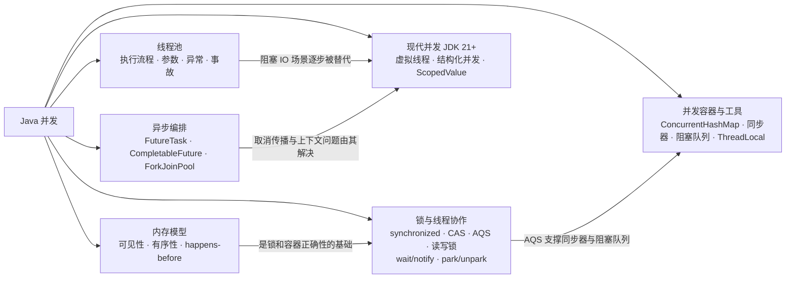

## 题目索引

| 编号 | 题目 | 难度 | 层级 |
| --- | --- | --- | --- |
| 03-01 | 并发问题的三个根源是什么？JMM 如何解决？ | ★★ | 资深 |
| 03-02 | happens-before 是什么？如何用它判断代码是否线程安全？ | ★★★ | 架构师 |
| 03-03 | volatile 的底层原理？为什么 DCL 单例必须加 volatile？ | ★★ | 资深 |
| 03-04 | 线程有哪些状态？BLOCKED 和 WAITING 的区别？如何正确停止线程？ | ★ | 资深 |
| 03-25 | wait / notify 的原理是什么？为什么必须写在 synchronized 里、必须用 while 判断？ | ★★ | 资深 |
| 03-05 | synchronized 的底层实现与锁状态演进（JDK 25 视角） | ★★★ | 资深 / 架构师 |
| 03-06 | CAS 的原理与问题；AtomicLong 和 LongAdder 怎么选？ | ★★ | 资深 |
| 03-07 | AQS 的核心设计，以 ReentrantLock 讲一遍加锁解锁 | ★★★ | 资深 |
| 03-08 | Condition 的 await / signal 在 AQS 中如何流转？ | ★★★ | 资深 |
| 03-09 | ReentrantLock 和 synchronized 怎么选？ | ★★ | 资深 |
| 03-10 | ReentrantReadWriteLock 和 StampedLock 的区别与选型 | ★★ | 资深 |
| 03-11 | 死锁如何产生？线上如何排查与预防？ | ★★ | 资深 |
| 03-26 | LockSupport 的 park / unpark 是怎么工作的？和 wait / notify 有什么区别？ | ★★ | 资深 |
| 03-12 | ThreadPoolExecutor 的执行流程与状态 | ★★ | 资深 |
| 03-13 | 线程池参数怎么定？如何动态调整与可观测？ | ★★★ | 架构师 |
| 03-14 | 线程池中任务的异常为什么"消失"了？如何优雅关闭？ | ★★ | 资深 |
| 03-15 | 线程池有哪些典型的生产事故？ | ★★★ | 资深 / 架构师 |
| 03-16 | ConcurrentHashMap 如何实现线程安全与协作扩容？ | ★★★ | 资深 |
| 03-17 | CountDownLatch、CyclicBarrier、Semaphore 的区别 | ★★ | 资深 |
| 03-18 | BlockingQueue 有哪些实现？线程池里怎么选？ | ★★ | 资深 |
| 03-19 | ThreadLocal 原理、内存泄漏与线程池上下文传递 | ★★★ | 资深 |
| 03-20 | CompletableFuture 怎么用？生产中有哪些坑？ | ★★★ | 资深 / 架构师 |
| 03-21 | ForkJoinPool 的工作窃取；parallelStream 为什么要慎用？ | ★★ | 资深 |
| 03-27 | FutureTask 的原理是什么？get 为什么会阻塞，cancel 真的能停掉任务吗？ | ★★ | 资深 |
| 03-22 | 虚拟线程的原理是什么？和平台线程有什么区别？ | ★★★ | 资深 / 架构师 |
| 03-23 | 把服务迁移到虚拟线程，需要注意什么？ | ★★★ | 架构师 |
| 03-24 | 结构化并发和 ScopedValue 解决了什么问题？ | ★★★ | 架构师 |

---

## 一、内存模型与可见性

### 03-01 并发问题的三个根源是什么？JMM 如何解决？

> ★★ ｜ 资深 ｜ 高频

**考察意图**：看你是否理解并发 bug 的物理来源，而不是只会背"可见性、原子性、有序性"三个词。

**30 秒版回答**

- **可见性**问题来自缓存与编译优化：每个 CPU 核有自己的缓存和 store buffer，JIT 还可能把变量缓存到寄存器里。一个线程写的值，另一个线程不一定马上看得到。
- **原子性**问题来自线程切换：`count++` 是"读-改-写"三步，中间可能被切走。
- **有序性**问题来自重排序：只要单线程语义不变，编译器和 CPU 都可以调整指令顺序。
- JMM（Java 内存模型）不是一块真实的内存，而是一份**规范**。它用 happens-before 规则定义"什么情况下一个写对另一个读可见"。程序员用 `volatile`、`synchronized`、`final` 和 `java.util.concurrent` 声明哪里需要约束，JVM 再按 CPU 平台插入合适的内存屏障。

**深入剖析**

左边是真实硬件，右边是 JMM 给程序员的抽象。JMM 的作用是屏蔽 x86、ARM 等平台内存模型的差异：

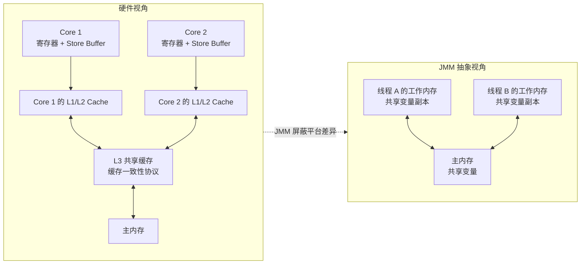

三个问题各举一个最小例子：

| 问题 | 例子 | 根因 | 解决手段 |
| --- | --- | --- | --- |
| 可见性 | 线程 A 改了 `stop = true`，线程 B 的 `while (!stop)` 一直不退出 | JIT 把 `stop` 的读取提到循环外；或写入停留在 store buffer | `volatile`、锁 |
| 原子性 | 两个线程各执行 1 万次 `count++`，结果小于 2 万 | 读-改-写之间发生线程切换 | 锁、`AtomicInteger`、`LongAdder` |
| 有序性 | DCL 单例拿到"半初始化"对象（见 03-03） | 对象初始化和引用赋值被重排 | `volatile`、`final` 语义 |

**实测**：下面这段代码在 JDK 21 和 JDK 25 上，主线程设置 `stop = true` 后，工作线程 3 秒后仍然存活。

```java
public class Visibility {
    static boolean stop = false;   // 没有 volatile

    public static void main(String[] args) throws Exception {
        Thread worker = new Thread(() -> {
            long n = 0;
            while (!stop) {        // JIT 编译后，stop 的读取被提到循环外，变成死循环
                n++;
            }
        });
        worker.start();
        Thread.sleep(1000);
        stop = true;
        worker.join(3000);
        System.out.println("worker alive after 3s = " + worker.isAlive());   // 实测输出 true
        System.exit(0);
    }
}
```

这个例子说明：**可见性问题不只来自 CPU 缓存，JIT 编译优化同样会造成**。这里的根因是循环不变量外提（loop hoisting），和缓存一致性协议无关。

**追问链**

1. **既然 CPU 有 MESI 这类缓存一致性协议，为什么还有可见性问题？**
   MESI 保证同一缓存行在各核之间最终一致，但为了不让写操作等待其他核的失效确认，CPU 加了 store buffer；为了尽快回复确认，又加了 invalidate queue。写入先进 store buffer，其他核暂时看不到；失效消息还在队列里时，其他核可能读到旧值。内存屏障的作用就是强制清空 store buffer、处理 invalidate queue。再加上 JIT 的寄存器缓存，光靠缓存一致性协议远远不够。
2. **x86 上 volatile 需要哪些屏障？**
   x86 是 TSO（全存储排序）模型，只允许"写-读"重排，所以 volatile 写之后需要一个 StoreLoad 屏障，HotSpot 用一条 `lock` 前缀指令（如 `lock addl $0x0,(%rsp)`）实现。其他三种屏障在 x86 上不需要生成指令，只需禁止编译器重排。ARM（如 Apple M 系列、AWS Graviton）是弱内存模型，HotSpot 在 AArch64 上用 `ldar` / `stlr` 这类带获取-释放语义的指令实现 volatile。
3. **as-if-serial 和 happens-before 是什么关系？**
   as-if-serial 约束单线程：不管怎么重排，单线程的执行结果不变。happens-before 约束多线程：只要满足规则，跨线程的写对读可见。前者是后者中"程序次序规则"的基础。

**生产实践 / 踩坑**

- 线上"开关改了不生效"的问题，先检查开关字段有没有 `volatile`，再检查是否被局部变量缓存了。
- 同一份代码在开发机上正常、在服务器上出问题，常见原因是 JIT 编译时机不同（循环跑了足够多次才会触发 C2 编译）以及 CPU 架构不同（x86 与 ARM）。不能用"我本地测过没问题"来证明线程安全。

---

### 03-02 happens-before 是什么？如何用它判断代码是否线程安全？

> ★★★ ｜ 架构师 ｜ 中频，区分度高

**考察意图**：能否用规则推理并发正确性，而不是凭感觉加锁。

**30 秒版回答**

- happens-before（下文简称 HB）是 JMM 给程序员的承诺：如果操作 A HB 操作 B，那么 A 的结果对 B 可见，并且从可见效果上看，A 排在 B 之前。
- HB 不要求 A 在时间上真的先执行，JVM 可以重排，只要结果和 HB 关系一致。反过来，时间上先执行的写，如果和读之间没有 HB 关系，另一个线程照样可能看不到。
- 判断方法：对每个共享变量的每一对"写-读"，找出一条 HB 链。找不到就是数据竞争（data race），代码不安全。

**深入剖析**

JLS 第 17.4 节定义的规则：

| 规则 | 内容 |
| --- | --- |
| 程序次序规则 | 同一线程内，前面的操作 HB 后面的操作 |
| 监视器锁规则 | 对一把锁的 unlock HB 之后对同一把锁的 lock |
| volatile 规则 | 对 volatile 变量的写 HB 之后对同一变量的读 |
| 线程启动规则 | `Thread.start()` HB 新线程中的任何操作 |
| 线程终止规则 | 线程中的任何操作 HB 其他线程检测到它终止（`join()` 返回、`isAlive()` 为 false） |
| 中断规则 | 调用 `interrupt()` HB 被中断线程检测到中断 |
| 终结器规则 | 构造函数结束 HB `finalize()` 开始（`finalize` 已在 JDK 18 被标记为待移除） |
| 传递性 | A HB B 且 B HB C，则 A HB C |

`java.util.concurrent` 包在此基础上做了扩展（见该包文档的 Memory Consistency Properties）：放入并发容器 HB 取出；向 Executor 提交任务 HB 任务开始执行；任务完成 HB `Future.get()` 返回；`countDown()` HB `await()` 返回，等等。

用 HB 推理一个最常见的"安全发布"例子：

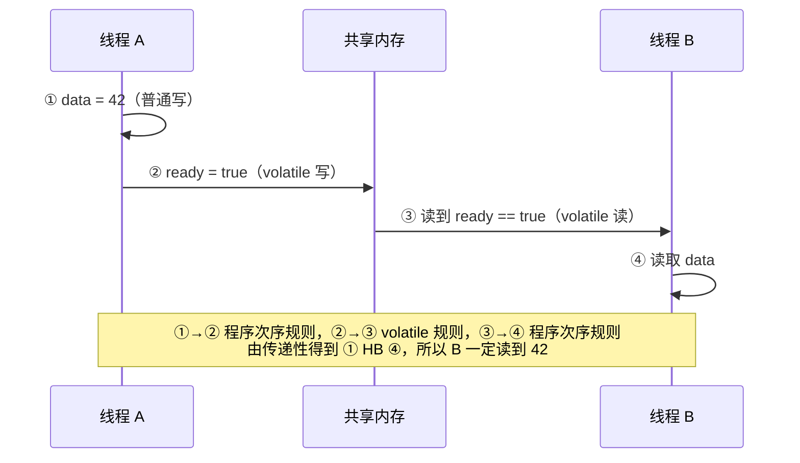

```java
class Publisher {
    private int data;                  // 普通字段
    private volatile boolean ready;    // 只需要这一个 volatile

    void write() {                     // 线程 A
        data = 42;
        ready = true;
    }

    void read() {                      // 线程 B
        if (ready) {
            System.out.println(data);  // 一定输出 42
        }
    }
}
```

如果 `ready` 不是 volatile，②→③ 这条边就断了：B 可能永远看不到 `ready == true`，也可能看到 `ready == true` 但 `data == 0`。

**追问链**

1. **只用 final 字段能保证安全发布吗？**
   JMM 对 final 字段有专门语义：只要构造过程中 `this` 没有逃逸，其他线程拿到对象引用时，一定能看到 final 字段在构造函数里赋的值（以及通过 final 字段可达的对象在构造结束时的状态）。非 final 字段没有这个保证。所以不可变对象天然线程安全，前提是构造期间 `this` 没有逃逸（例如没有在构造函数里注册监听器、启动线程）。
2. **线程池执行的任务，能看到提交之前的写吗？**
   能。`ExecutorService` 保证提交任务之前的操作 HB 任务开始执行。
3. **什么是 DRF-SC 保证？**
   如果程序没有数据竞争（Data-Race-Free），那么它的所有执行结果都等价于顺序一致（Sequentially Consistent）的执行。这是 JMM 最重要的结论：**只要用 HB 规则消除了所有数据竞争，就可以像单线程一样推理代码**。

**架构师加分点**

- 设计无锁组件或 Review 并发代码时，把共享变量的写-读关系画成 HB 图，比"感觉这里该加锁"可靠得多。
- 很多"偶现"的并发 bug 只在特定 JIT 编译状态或特定 CPU 上出现，靠测试很难稳定复现。HB 推理是唯一可靠的证明手段。

---

### 03-03 volatile 的底层原理？为什么 DCL 单例必须加 volatile？

> ★★ ｜ 资深 ｜ 高频

**考察意图**：是否理解 volatile 的能力边界和内存屏障，能否讲清 DCL 的重排序问题。

**30 秒版回答**

- volatile 保证**可见性**和**有序性**（禁止特定的重排序），**不保证复合操作的原子性**。`volatile int i; i++` 仍然线程不安全。
- 实现上，JIT 会在 volatile 读写前后插入内存屏障。在 x86 上，实际只在 volatile 写之后生成一条 `lock` 前缀指令，它会清空 store buffer，并通过缓存一致性协议使其他核的对应缓存行失效。
- DCL 中 `instance = new Singleton()` 分三步：分配内存、初始化对象、把引用赋给 `instance`。后两步可能被重排，另一个线程在第一次判空时看到非 null、但字段尚未初始化的对象。volatile 写保证"写之前的所有操作"HB"之后读到这个引用的线程"，从而避免这一问题。

**深入剖析**

JSR-133 Cookbook 给出的保守插入策略：

| 操作 | 之前插入 | 之后插入 |
| --- | --- | --- |
| volatile 写 | StoreStore | StoreLoad |
| volatile 读 | 无 | LoadLoad + LoadStore |

DCL 在没有 volatile 时的出错时序：

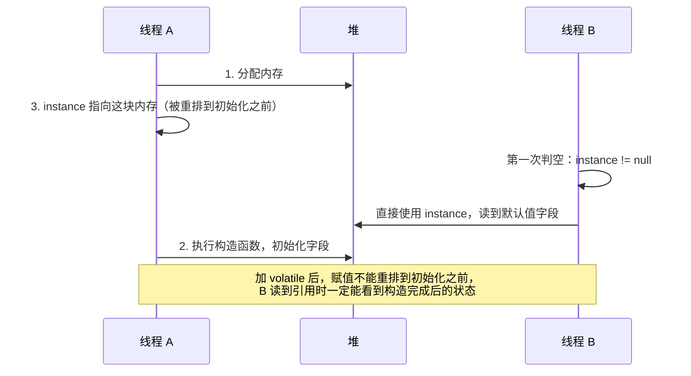

正确写法：

```java
public final class ConfigHolder {
    private static volatile ConfigHolder instance;

    private final Map<String, String> config;
    private long loadedAt;                       // 非 final 字段：没有 volatile 就可能被看到默认值

    private ConfigHolder() {
        this.config = loadConfig();
        this.loadedAt = System.currentTimeMillis();
    }

    public static ConfigHolder getInstance() {
        ConfigHolder local = instance;           // 只读一次 volatile 字段，减少屏障开销
        if (local == null) {
            synchronized (ConfigHolder.class) {
                local = instance;
                if (local == null) {
                    instance = local = new ConfigHolder();
                }
            }
        }
        return local;
    }

    private static Map<String, String> loadConfig() {
        return Map.of("env", "prod");
    }
}
```

更简单、同样线程安全的替代方案：

- **静态内部类（Holder）**：利用类初始化锁保证只初始化一次，且天然延迟加载。
- **枚举单例**：还能防止反射和反序列化破坏单例。

**追问链**

1. **volatile 能保证 `i++` 的原子性吗？** 不能。要用 `AtomicInteger`、`LongAdder` 或锁。
2. **volatile 适合哪些场景？**
   - 状态标志位（一写多读）。
   - 一写多读的配置引用替换：构建一个新的不可变配置对象，再用一次 volatile 写替换引用（copy-on-write 发布）。
   - DCL。
3. **VarHandle 提供了哪些比 volatile 更细的内存语义？**
   JDK 9 引入的 `VarHandle` 提供四档访问模式：Plain（普通读写）、Opaque（保证单变量的按序可见，不建立 HB）、Acquire/Release（`getAcquire` / `setRelease`，比 volatile 弱，少一个 StoreLoad 屏障）、Volatile。`ConcurrentHashMap` 的 `tabAt` 用的就是 Acquire 语义读（JDK 25 源码中为 `U.getReferenceAcquire`，已核对）。业务代码一般用不到，写高性能并发组件时才需要。

---

## 二、线程基础

### 03-04 线程有哪些状态？BLOCKED 和 WAITING 的区别？如何正确停止线程？

> ★ ｜ 资深 ｜ 高频

**考察意图**：基础是否扎实，能否看懂 jstack 输出里的线程状态，是否了解中断协作机制。

**30 秒版回答**

- `Thread.State` 共 6 种：NEW、RUNNABLE、BLOCKED、WAITING、TIMED_WAITING、TERMINATED。
- RUNNABLE 同时包含操作系统层面的"就绪"和"运行"。**阻塞在传统 socket 读上的平台线程，在 Java 里也显示为 RUNNABLE**，这是看 jstack 时最常见的误判。
- BLOCKED **只**表示在等待进入 synchronized（等 monitor）。WAITING 是主动等待：`Object.wait()`、`Thread.join()`、`LockSupport.park()`。使用 `ReentrantLock` 抢锁失败的线程是 WAITING（parking），不是 BLOCKED。
- 停止线程要用**中断协作**：调用 `interrupt()` 设置中断标志，由线程自己检查并退出。`Thread.stop()` 会在任意位置释放所有锁，可能破坏对象状态，从 JDK 20 起直接抛 `UnsupportedOperationException`（已核对 JDK 20 源码）。

**深入剖析**

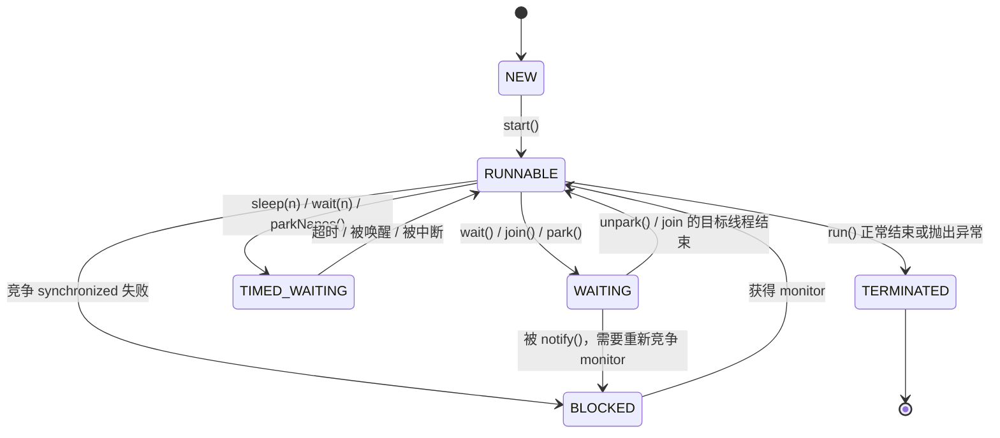

注意 `WAITING → BLOCKED` 这条边：`wait()` 被 `notify()` 唤醒后，线程必须重新抢 monitor，抢到之前处于 BLOCKED。

正确响应中断的写法：

```java
@Slf4j
public final class PollingWorker implements Runnable {
    private final BlockingQueue<Runnable> queue;

    public PollingWorker(BlockingQueue<Runnable> queue) {
        this.queue = queue;
    }

    @Override
    public void run() {
        while (!Thread.currentThread().isInterrupted()) {
            try {
                Runnable task = queue.poll(1, TimeUnit.SECONDS);
                if (task != null) {
                    task.run();
                }
            } catch (InterruptedException e) {
                // 阻塞方法抛出 InterruptedException 时会清除中断标志，必须恢复，否则 while 条件感知不到
                Thread.currentThread().interrupt();
            }
        }
        log.info("polling worker stopped, thread={}", Thread.currentThread().getName());
    }
}
```

**追问链**

1. **catch 到 InterruptedException 后为什么要再调用一次 `interrupt()`？**
   抛出这个异常时中断标志已被清除。如果吞掉异常又不恢复标志，上层代码（比如线程池的 `shutdownNow`）就不知道线程曾被要求停止。
2. **`interrupt()` 能打断一个正在读 socket 的线程吗？**
   - 平台线程上的传统 `java.net.Socket` 读写不响应中断。
   - NIO 的 `InterruptibleChannel` 会被关闭并抛出 `ClosedByInterruptException`。
   - 虚拟线程上，阻塞在 `Socket` / `ServerSocket` / `DatagramSocket` 操作中时，中断会唤醒线程并关闭 socket（JEP 444 的规定）。
3. **sleep 和 wait 的区别？**
   `wait()` 必须在 synchronized 内调用，会释放 monitor；`sleep()` 不释放任何锁。`wait()` 可能被虚假唤醒，必须放在 while 循环里判断条件。

---

### 03-25 wait / notify 的原理是什么？为什么必须写在 synchronized 里、必须用 while 判断？

> ★★ ｜ 资深 ｜ 高频

**考察意图**：现在业务代码很少直接写 wait / notify，但它是理解 Condition、阻塞队列和"丢失唤醒"的基础。面试官想确认你讲得出三条规则背后的原因，而不是只背规则。

**30 秒版回答**

- 每个对象的 monitor 除了"谁持有锁"之外，还维护两个集合：**入口队列**（抢不到锁的线程，状态 BLOCKED）和**等待集合**（调用了 `wait()` 的线程，状态 WAITING）。
- `wait()` 做三件事：把当前线程放进等待集合、**释放 monitor**、挂起。被唤醒后要**重新抢到 monitor** 才能从 `wait()` 返回。
- `notify()` 只是把等待集合里的一个线程挪到入口队列。调用 `notify()` 的线程不会立刻让出锁，要等它退出 synchronized，被唤醒的线程才有机会运行。
- **必须在 synchronized 里**：判断条件和调用 `wait()` 必须是原子的，否则会丢失唤醒。JVM 用抛 `IllegalMonitorStateException` 的方式强制这一点。
- **必须用 while**：线程从 `wait()` 返回时，条件不一定成立。原因有三个：被 `notifyAll()` 一起唤醒的其他线程先把条件消费掉了；`notify()` 唤醒的是等另一个条件的线程；操作系统层面允许虚假唤醒。
- **优先用 notifyAll**：一个 monitor 只有一个等待集合，生产者和消费者混在一起，`notify()` 可能叫醒同类，造成所有线程都在等。需要精确唤醒时用 `Condition`，见 03-08。

**深入剖析**

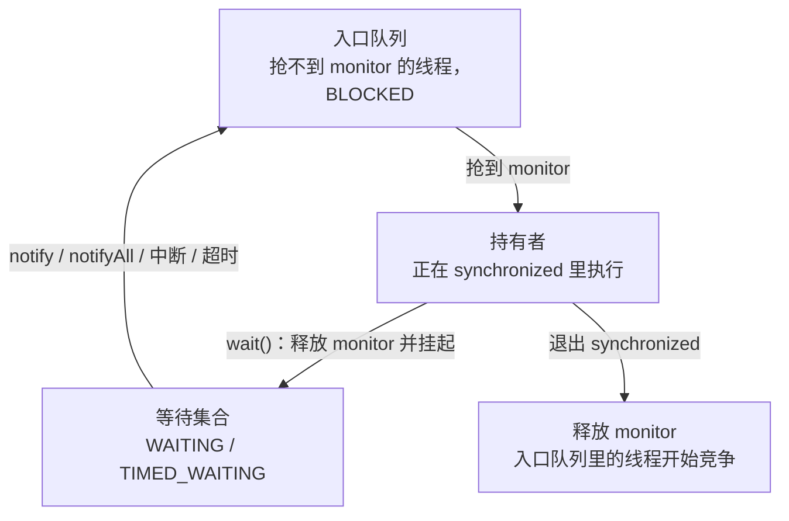

**不加锁为什么会丢失唤醒**。假设允许这样写：

```java
// 错误示意：判断和等待之间没有锁保护
if (queue.isEmpty()) {
    // ← 此时生产者放入元素并调用 notify()，但还没有线程在等，这次通知白发了
    lock.wait(); // 消费者开始等待，再也没有人来唤醒它
}
```

消费者"看到队列为空"和"开始等待"之间有一个窗口，生产者的通知如果落在这个窗口里就丢了。把判断、等待、修改条件、通知全部放进同一把锁里，这个窗口才会消失。

用 wait / notifyAll 写的有界缓冲区，本机 JDK 25 运行过：3 个生产者各放入 1000 个数、2 个消费者取出，结果 `消费条数=3000，期望=3000；数值之和=1501500，期望=1501500`。

```java
/** 用 wait / notifyAll 实现的有界缓冲区 */
static final class BoundedBuffer<T> {
    private final Queue<T> queue = new ArrayDeque<>();
    private final int capacity;

    BoundedBuffer(int capacity) { this.capacity = capacity; }

    synchronized void put(T item) throws InterruptedException {
        while (queue.size() == capacity) {   // 必须是 while：被唤醒后条件可能又不成立
            wait();                          // 释放 monitor，进入等待集合
        }
        queue.add(item);
        notifyAll();                         // 生产者和消费者等在同一个集合里，只能全部唤醒
    }

    synchronized T take() throws InterruptedException {
        while (queue.isEmpty()) {
            wait();
        }
        T item = queue.remove();
        notifyAll();
        return item;
    }
}
```

`sleep`、`wait`、`park` 三者经常放在一起问：

| 维度 | `Thread.sleep` | `Object.wait` | `LockSupport.park` |
| --- | --- | --- | --- |
| 是否需要持有锁 | 不需要 | 必须持有该对象的 monitor | 不需要 |
| 是否释放锁 | 不释放任何锁 | 释放这个对象的 monitor | 不释放任何锁 |
| 怎么唤醒 | 超时、中断 | notify、notifyAll、超时、中断 | unpark、超时、中断 |
| 能否指定唤醒谁 | 不涉及 | 不能，由 JVM 选 | 能，`unpark(thread)` |
| 对中断的反应 | 抛 `InterruptedException` | 抛 `InterruptedException` | 直接返回，不抛异常 |
| 先唤醒后等待 | 不涉及 | 通知丢失 | 不丢，许可会留着，见 03-26 |

**追问链**

1. **`notify()` 之后，被唤醒的线程马上就运行吗？**
   不会。它只是从等待集合进了入口队列，还要等通知方退出 synchronized，再和其他线程竞争 monitor。所以 `notify()` 写在同步块的开头还是结尾，对被唤醒线程的运行时机没有区别。
2. **只用 `notify()` 会出什么问题？**
   缓冲区容量为 1，两个生产者、两个消费者。某一时刻两个消费者和一个生产者都在等待集合里，另一个生产者放入元素后 `notify()` 恰好唤醒了那个生产者，它发现缓冲区已满又去等待。此时没有任何线程会再发通知，四个线程全部永久等待。这种问题没有死锁的环路，jstack 也不会提示，只能看到所有线程都是 WAITING。
3. **`wait(timeout)` 返回后，怎么知道是超时还是被唤醒？**
   区分不了，返回值是 void。要自己记录截止时间，在 while 循环里重新计算剩余等待时间。`Condition.awaitNanos` 会返回剩余时间，这是它比 `wait` 好用的地方之一。
4. **虚拟线程里用 synchronized 加 wait 有问题吗？**
   JDK 21 到 23，虚拟线程在 synchronized 块里阻塞（包括 `wait()`）会把载体线程一起占住。JDK 24 的 JEP 491 解决了这个问题，阻塞时虚拟线程可以正常卸载。迁移注意事项见 03-23。

**生产实践 / 踩坑**

- 新代码不要再手写 wait / notify。生产者消费者用 `BlockingQueue`，等一组任务完成用 `CountDownLatch` 或 `CompletableFuture`，自定义条件等待用 `ReentrantLock` 加 `Condition`。手写版本最常见的错误就是上面三条规则漏了一条。
- **不要在公开的对象上 wait**，比如 `this` 或者一个对外暴露的字段。外部代码可以对同一个对象调用 `notifyAll()` 或者长时间持有它的锁，干扰你的等待逻辑。用一个私有的 `final Object lock`。
- 排查时看到大量线程 `WAITING (on object monitor)`，先在 jstack 里找它们等的是哪个对象，再找谁应该调用 `notify`。常见原因是通知方因为异常提前退出，没有走到通知那一行。通知要放在 finally 能覆盖的位置。

---

## 三、锁

### 03-05 synchronized 的底层实现与锁状态演进（JDK 25 视角）

> ★★★ ｜ 资深 / 架构师 ｜ 高频

**考察意图**：能否讲清 synchronized 从字节码到对象头再到 ObjectMonitor 的实现；知识是否停留在 JDK 8。

**30 秒版回答**

- 字节码层：同步代码块编译为 `monitorenter` / `monitorexit`，异常路径上还有一条 `monitorexit`，保证锁一定释放；同步方法靠方法访问标志 `ACC_SYNCHRONIZED`。
- 锁状态记录在对象头 Mark Word 的低 2 位：`01` 无锁，`00` 轻量级锁，`10` 重量级锁（指向 ObjectMonitor），`11` GC 标记。
- **偏向锁已经不存在了**：JDK 15 默认关闭并废弃（JEP 374），JDK 18 移除。在 JDK 18 上加 `-XX:+UseBiasedLocking` 会提示"support was removed in 18.0"（已核对）。所以"无锁 → 偏向锁 → 轻量级锁 → 重量级锁"是 JDK 8 时代的答案。
- JDK 21 / 25 的实际路径：**无锁 → 轻量级锁 → 重量级锁**。轻量级锁的实现也换了：JDK 21 默认 `LockingMode=1`（传统栈上锁记录），JDK 24 / 25 默认 `LockingMode=2`（基于线程私有 lock-stack 的新实现，切换发生在 JDK 23）（已核对 `-XX:+PrintFlagsFinal`）。
- 出现竞争或调用 `wait()` 时膨胀为重量级锁：竞争失败的线程先自适应自旋，仍拿不到再进入 ObjectMonitor 的队列并 park。

**深入剖析**

64 位 JVM、未开启紧凑对象头时的 Mark Word：

| 状态 | 高位内容 | 低 2 位 |
| --- | --- | --- |
| 无锁 | identity hashCode（31 位）、分代年龄（4 位） | 01 |
| 轻量级锁 | JDK 21：指向栈上锁记录的指针；JDK 23+：保留原内容，只改锁标志位 | 00 |
| 重量级锁 | 指向 ObjectMonitor 的指针 | 10 |
| GC 标记 | GC 使用 | 11 |

JDK 25 的紧凑对象头（JEP 519，需 `-XX:+UseCompactObjectHeaders` 显式开启，默认关闭，已核对）把对象头压缩到 8 字节，锁标志位仍在 Mark Word 低位，但具体布局有变化。

锁状态流转（JDK 21+，无偏向锁）：

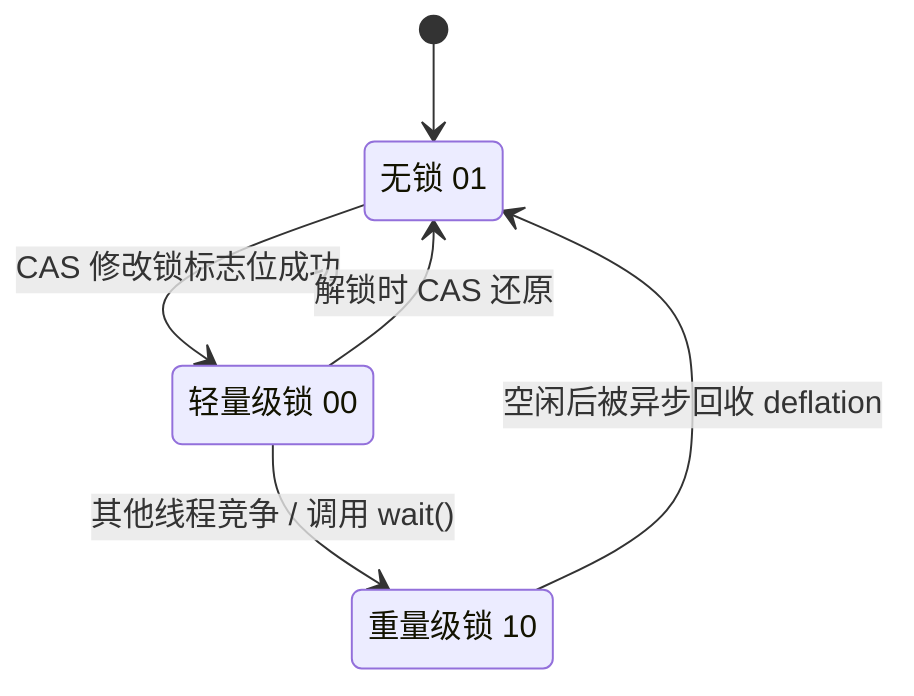

重量级锁（ObjectMonitor）的三元模型：

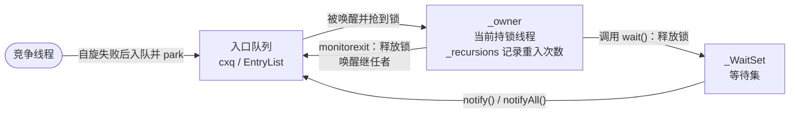

`cxq` / `EntryList` 是 JDK 8 到 JDK 21 的经典结构。近期版本对入口队列的实现做了重写，具体字段以对应版本的 HotSpot 源码为准，但"入口队列 + owner + WaitSet"这个模型没有变。

JIT 层面还有两项优化：

- **锁消除**：逃逸分析证明锁对象不会被其他线程访问时，直接去掉加锁（例如方法内的 `StringBuffer`）。
- **锁粗化**：连续对同一对象加解锁时，合并成一次大范围加锁。

**追问链**

1. **为什么要移除偏向锁？**
   JEP 374 的理由：偏向锁的收益来自"无竞争的同步"，这在早期使用 `Vector`、`Hashtable` 的代码里很常见，而现代代码大多改用无同步的集合或 `java.util.concurrent`；同时撤销偏向需要等到安全点，实现复杂，维护成本超过了收益。
2. **锁会降级吗？**
   使用过程中不会从重量级锁退回轻量级锁。但空闲的 ObjectMonitor 会被回收（deflation），对象回到无锁状态，JDK 15 起这项工作由专门的 MonitorDeflationThread 异步完成。
3. **synchronized 的可重入是怎么实现的？**
   重量级锁用 ObjectMonitor 的 `_recursions` 计数。轻量级锁在传统实现里多压一条锁记录，在新实现里往 lock-stack 里重复压入同一个对象。
4. **synchronized 等锁时能响应中断吗？**
   不能，线程处于 BLOCKED 状态。需要可中断的等待，请用 `ReentrantLock.lockInterruptibly()`。
5. **wait / notify 为什么必须在 synchronized 里调用？**
   它们操作的是 monitor 的 WaitSet，必须先持有 monitor，否则抛 `IllegalMonitorStateException`。这也避免了"检查条件"和"进入等待"之间被插入 notify 而造成的丢失唤醒（lost wake-up）。

**架构师加分点**

- 在 JDK 21 到 23 上，虚拟线程在 synchronized 块内阻塞会钉住（pin）载体线程；JDK 24 起（JEP 491）这个问题已解决。迁移虚拟线程时必须先确认 JDK 版本，见 03-23。
- 面试中如果面试官仍按"偏向锁"提问，可以先按 JDK 8 回答，再补一句"JDK 18 之后已移除"，并说明移除原因。这比只会背 JDK 8 的答案更有区分度。

---

### 03-06 CAS 的原理与问题；AtomicLong 和 LongAdder 怎么选？

> ★★ ｜ 资深 ｜ 高频

**考察意图**：是否理解 CAS 的硬件基础和局限，能否基于竞争程度做选型。

**30 秒版回答**

- CAS（Compare-And-Swap，比较并交换）由 CPU 原子指令实现：x86 上是 `lock cmpxchg`，ARMv8 上是 LL/SC 指令对（`ldaxr` / `stlxr`）或 ARMv8.1 的 LSE 原子指令。Java 通过 `Unsafe` 和 `VarHandle` 暴露。
- CAS 有三个问题：
  - **ABA**：值从 A 变 B 又变回 A，CAS 察觉不到。解决办法是加版本号（`AtomicStampedReference`）。
  - **高竞争下自旋浪费 CPU**。
  - **只能保证单个变量原子**。多个变量需要加锁，或封装成一个不可变对象后对引用做 CAS。
- AtomicLong 让所有线程争抢同一个变量；LongAdder 把热点分散到 `base + Cell[]`，每个线程按自己的 probe 哈希值累加到不同的 Cell，`sum()` 时再汇总。
  - 写多读少的统计计数：用 LongAdder。
  - 需要精确实时值或 CAS 语义（发号器、额度扣减）：用 AtomicLong。

**深入剖析**

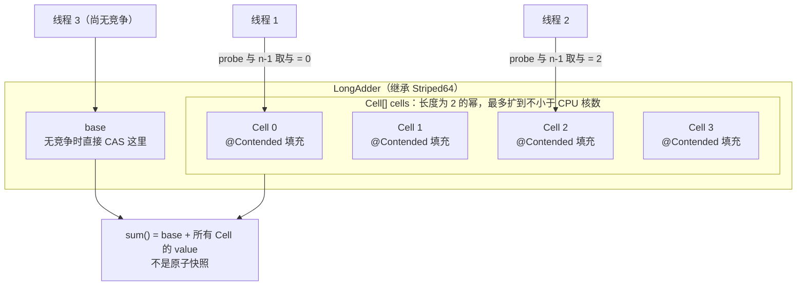

一个常被忽略的事实：在 x86 上，`AtomicLong.incrementAndGet()` 被 JIT 内建为一条 `lock xadd` 指令，**不存在 CAS 失败后的重试循环**。它在高并发下变慢，是因为同一条缓存行在多个核之间被反复失效、来回传递（cache line bouncing）。LongAdder 把写入分散到不同缓存行上的 Cell，解决的正是这个问题。

**追问链**

1. **LongAdder 的 `sum()` 为什么不精确？**
   遍历 Cell 的过程中其他线程还在累加，它返回的不是某一时刻的快照。所以 LongAdder 适合监控统计，不适合做判断依据。
2. **`@Contended` 是做什么的？**
   用于避免伪共享（false sharing）：两个被不同线程频繁写的变量落在同一条缓存行里，会互相导致对方的缓存行失效。`@Contended` 让 JVM 在字段前后填充空白（`-XX:ContendedPaddingWidth` 默认 128 字节，可以覆盖 128 字节缓存行的 CPU）。业务类上使用需要加 `-XX:-RestrictContended`。
3. **能用 LongAdder 做限流计数吗？**
   不能。限流需要"判断是否超限并扣减"这一步是原子的，LongAdder 没有 CAS 语义，也读不到精确值。

---

### 03-07 AQS 的核心设计，以 ReentrantLock 讲一遍加锁解锁

> ★★★ ｜ 资深 ｜ 高频

**考察意图**：是否真正读过 AQS 源码，能否讲清"状态 + 队列 + 模板方法"的设计。

**30 秒版回答**

- AQS（AbstractQueuedSynchronizer）= **一个 volatile int state + 一个 FIFO 等待队列（CLH 变体，双向链表）+ 模板方法**。
- 子类只需要定义"怎么抢"：独占模式实现 `tryAcquire` / `tryRelease`，共享模式实现 `tryAcquireShared` / `tryReleaseShared`。"抢不到之后怎么办"（入队、park、唤醒、取消、中断、超时）由 AQS 统一处理。
- state 的含义由子类定义：ReentrantLock 是重入次数，Semaphore 是剩余许可数，CountDownLatch 是剩余计数，ReentrantReadWriteLock 是"高 16 位读、低 16 位写"。
- 加锁：`tryAcquire` 失败，把当前线程包装成节点，CAS 挂到队尾；如果前驱是 head 就再试一次；还不行就把自己标记为 WAITING 并 park。解锁：`tryRelease` 让 state 归零，然后唤醒 head 的后继节点。

**版本说明**：JDK 14 起 AQS 被 Doug Lea 重写（JDK-8229442）。节点状态从 JDK 8 的 SIGNAL(-1) / CANCELLED(1) / CONDITION(-2) / PROPAGATE(-3) 简化为 WAITING(1) / CANCELLED(负数) / COND(2)，入队、自旋、park 的逻辑统一到一个 `acquire(node, arg, shared, interruptible, timed, time)` 方法里（已核对 JDK 25 源码）。面试官用 JDK 8 的术语提问时，你要能对应上。

**深入剖析**

AQS 的数据结构：

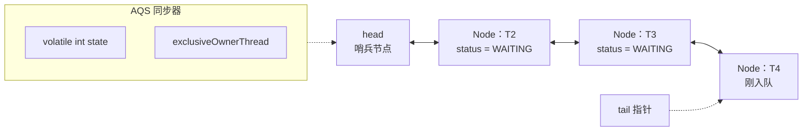

ReentrantLock（非公平）的加锁流程：

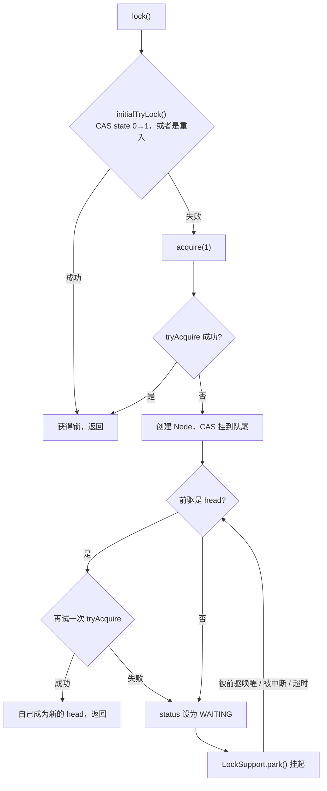

解锁流程：`unlock()` → `release(1)` → `tryRelease` 把 state 减 1，减到 0 时清空 owner → `signalNext(head)`：如果 head 的后继存在且在等待，就清除它的 WAITING 状态并 `unpark`。

公平锁和非公平锁只差一步：非公平锁在 `initialTryLock` 里不管队列直接 CAS（插队）；公平锁先检查 `hasQueuedThreads()`，队列里有人就不抢（已核对 JDK 25 `ReentrantLock.FairSync`）。

**追问链**

1. **为什么默认是非公平锁？**
   被唤醒的线程从 unpark 到真正运行有一段延迟。这段时间里，如果新来的线程正好拿到锁并很快释放，整体吞吐更高。代价是排队的线程可能饥饿。
2. **AQS 为什么用 park / unpark，而不是 wait / notify？**
   unpark 可以先于 park 调用（许可证语义，不会丢失唤醒）；可以精确唤醒指定线程；不需要先持有 monitor。
3. **JDK 8 的 AQS 唤醒后继时，为什么要从 tail 往前找？**
   入队时先 CAS 设置 tail，再设置旧尾节点的 `next`，两步不是原子的，所以 `next` 可能暂时为 null，而 `prev` 一定已经设置好。从 tail 沿 `prev` 往前找，才不会漏掉刚入队的节点。
4. **共享模式里的"传播"是什么？**
   共享锁释放后，被唤醒的节点获取成功时，如果还有剩余资源，要继续唤醒后面的节点。JDK 8 的 PROPAGATE 状态就是为修复这一场景下 Semaphore 可能卡住的缺陷而引入的。

---

### 03-08 Condition 的 await / signal 在 AQS 中如何流转？

> ★★★ ｜ 资深 ｜ 中频

**考察意图**：是否理解"条件队列"和"同步队列"两条队列之间的节点转移。

**30 秒版回答**

- 每个 Condition（`ConditionObject`）有自己的**条件队列**（单向链表），它和 AQS 的**同步队列**是两条不同的队列。
- `await()`：必须先持有锁 → 把当前线程包装成节点加入条件队列 → **完全释放锁**（记下重入次数）→ park → 被 signal 后，节点被**转移到同步队列**排队抢锁 → 抢到后恢复原来的重入次数 → 从 `await()` 返回。
- `signal()`：把条件队列的头节点转移到同步队列尾部，而不是让它立刻执行。被转移的线程仍然要重新抢锁。
- 相比 `Object.wait/notify`，一把锁可以有多个 Condition，从而精确唤醒，例如生产者等 notFull、消费者等 notEmpty。

**深入剖析**

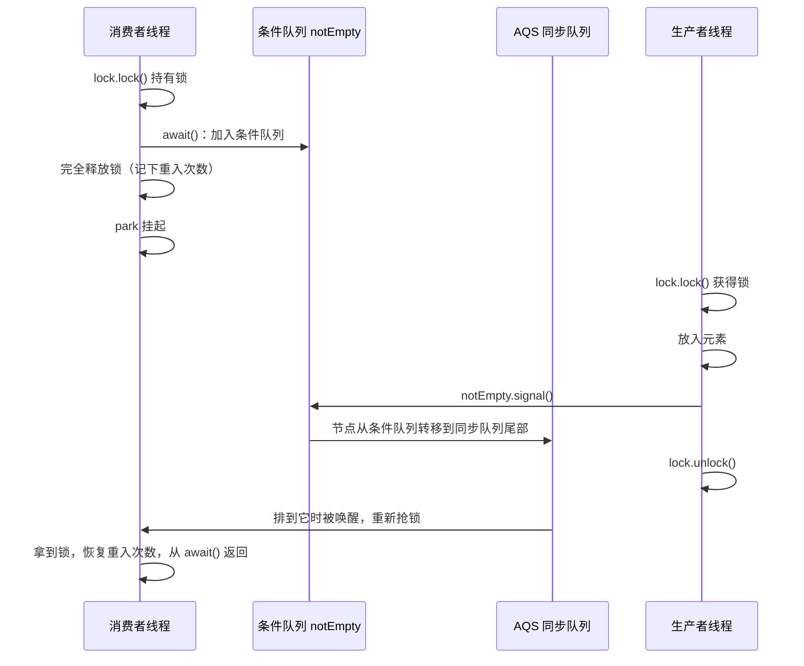

用两个 Condition 实现有界缓冲区（`ArrayBlockingQueue` 就是这个结构）：

```java
public final class BoundedBuffer<E> {
    private final Object[] items;
    private int putIndex;
    private int takeIndex;
    private int count;
    private final ReentrantLock lock = new ReentrantLock();
    private final Condition notFull = lock.newCondition();
    private final Condition notEmpty = lock.newCondition();

    public BoundedBuffer(int capacity) {
        this.items = new Object[capacity];
    }

    public void put(E e) throws InterruptedException {
        lock.lock();
        try {
            // 必须用 while：被唤醒后条件可能已被其他线程改变，也可能是虚假唤醒
            while (count == items.length) {
                notFull.await();
            }
            items[putIndex] = e;
            putIndex = (putIndex + 1) % items.length;
            count++;
            notEmpty.signal();
        } finally {
            lock.unlock();
        }
    }

    @SuppressWarnings("unchecked")
    public E take() throws InterruptedException {
        lock.lock();
        try {
            while (count == 0) {
                notEmpty.await();
            }
            E e = (E) items[takeIndex];
            items[takeIndex] = null;
            takeIndex = (takeIndex + 1) % items.length;
            count--;
            notFull.signal();
            return e;
        } finally {
            lock.unlock();
        }
    }
}
```

**追问链**

1. **signal 和 signalAll 怎么选？**
   所有等待者等的是同一个条件、且一次只有一个能继续时，用 signal；等待者条件不同，或一次状态变化能让多个等待者继续时，用 signalAll。拿不准就用 signalAll，代价是多几次无效唤醒，但不会漏掉唤醒。
2. **await 期间被中断会怎样？**
   节点同样会被转移到同步队列，线程必须先重新拿到锁。之后根据中断发生在 signal 之前还是之后，决定是抛出 `InterruptedException`，还是只恢复中断标志（JDK 8 源码中对应 THROW_IE 和 REINTERRUPT 两种模式）。

---

### 03-09 ReentrantLock 和 synchronized 怎么选？

> ★★ ｜ 资深 ｜ 高频

**考察意图**：能否基于功能需求和运行环境做选型，而不是背"谁性能更好"。

**30 秒版回答**

- 默认先用 synchronized：写法简单，不会忘记解锁，JVM 持续优化，JDK 24 起在虚拟线程下也不再 pin。
- 需要以下能力时用 ReentrantLock：可中断地等待锁、带超时地获取锁、公平锁、多个 Condition、查询锁状态（如 `getQueueLength()` 用于监控）。
- 常见场景下两者性能接近，选择依据是功能，不是性能。

**深入剖析**

| 维度 | synchronized | ReentrantLock |
| --- | --- | --- |
| 实现层 | JVM（对象头 + ObjectMonitor） | JDK 类库（AQS） |
| 释放锁 | 自动，包括异常路径 | 必须在 finally 中 unlock |
| 可中断 | 否 | `lockInterruptibly()` |
| 超时获取 | 否 | `tryLock(timeout, unit)` |
| 公平性 | 非公平 | 可选 |
| 条件队列 | 1 个（wait / notify） | 多个 Condition |
| 虚拟线程 JDK 21~23 | 阻塞时钉住载体线程 | 不会 |
| 虚拟线程 JDK 24+ | 不再钉住（JEP 491） | 不会 |
| jstack 中的表现 | BLOCKED，`waiting to lock <0x...>` | WAITING (parking)，`parking to wait for <0x...>` |

带超时的获取，失败时快速返回而不是无限等待：

```java
public boolean tryUpdate(Runnable criticalSection) throws InterruptedException {
    if (!lock.tryLock(200, TimeUnit.MILLISECONDS)) {
        return false;             // 获取失败：交给调用方快速失败或降级
    }
    try {
        criticalSection.run();
        return true;
    } finally {
        lock.unlock();
    }
}
```

**追问链**

1. **`lock()` 应该写在 try 外面还是里面？**
   写在 try 外面。如果写在 try 里而 `lock()` 本身抛了异常，finally 会去 unlock 一把没有持有的锁，抛出 `IllegalMonitorStateException`，掩盖原始异常。
2. **公平锁一定公平吗？**
   不一定。无参的 `tryLock()` 会无视公平策略，只要锁空闲就直接拿走，JDK 文档对此有明确说明。需要公平就用 `tryLock(0, TimeUnit.SECONDS)`。

---

### 03-10 ReentrantReadWriteLock 和 StampedLock 的区别与选型

> ★★ ｜ 资深 ｜ 中频

**考察意图**：是否了解读写锁的状态设计、锁降级，以及乐观读的使用方式和限制。

**30 秒版回答**

- ReentrantReadWriteLock（以下简称 RRWL）：读读共享、读写互斥、写写互斥。AQS 的 state 拆成高 16 位读计数、低 16 位写重入数。支持重入、支持 Condition（仅写锁）、支持**锁降级**（持有写锁 → 获取读锁 → 释放写锁），**不支持锁升级**（持有读锁再去获取写锁会死锁）。
- StampedLock（JDK 8）：在读写锁之外提供**乐观读**。`tryOptimisticRead()` 不加锁，只拿一个戳（stamp），读完用 `validate(stamp)` 检查期间是否发生过写入，失败再退化为悲观读锁。读多写少、读操作很短时吞吐更高。
- StampedLock 的代价：**不可重入**（重入会死锁），不支持 Condition，乐观读期间读到的多个字段可能彼此不一致，必须先拷贝到局部变量再 validate。

**深入剖析**

| state 位段 | 含义 |
| --- | --- |
| 高 16 位 | 所有线程持有读锁的总次数（每个线程自己的重入次数存在 ThreadLocal 的 HoldCounter 里） |
| 低 16 位 | 写锁重入次数 |

StampedLock 乐观读的标准写法（来自 JDK 文档示例）：

```java
public final class Point {
    private double x;
    private double y;
    private final StampedLock sl = new StampedLock();

    public void move(double dx, double dy) {
        long stamp = sl.writeLock();
        try {
            x += dx;
            y += dy;
        } finally {
            sl.unlockWrite(stamp);
        }
    }

    public double distanceFromOrigin() {
        long stamp = sl.tryOptimisticRead();
        // 先把共享字段拷贝到局部变量，再校验戳
        double curX = x;
        double curY = y;
        if (!sl.validate(stamp)) {
            // 乐观读期间发生过写入，退化为悲观读锁
            stamp = sl.readLock();
            try {
                curX = x;
                curY = y;
            } finally {
                sl.unlockRead(stamp);
            }
        }
        return Math.hypot(curX, curY);
    }
}
```

**追问链**

1. **RRWL 会出现写饥饿吗？**
   非公平模式下，如果队列中第一个等待者是写线程，新来的读线程会主动排队（`readerShouldBlock` 判断 `apparentlyFirstQueuedIsExclusive`），以此缓解写饥饿。
2. **为什么不支持锁升级？**
   两个都持有读锁的线程同时想升级为写锁，都在等对方释放读锁，形成死锁。

**架构师加分点**

读多写少的配置表、路由表，更好的方案往往不是读写锁，而是 **copy-on-write + volatile 引用替换**：写时复制一份新的不可变对象，再用一次 volatile 写替换引用，读完全无锁。读写锁更适合"写不频繁、但写必须与读互斥，而且数据大到不适合整体复制"的场景。

---

### 03-11 死锁如何产生？线上如何排查与预防？

> ★★ ｜ 资深 ｜ 高频

**考察意图**：能否从四个必要条件出发给出可落地的预防手段，以及有没有真实排查经验。

**30 秒版回答**

- 四个必要条件：互斥、占有且等待、不可抢占、循环等待。破坏任意一个就不会死锁。
- 工程上最有效的两种做法：
  - **破坏循环等待**：全局固定加锁顺序。
  - **破坏不可抢占**：用 `tryLock` 加超时，超时就释放已持有的锁。
- 排查：`jstack -l <pid>` 或 `jcmd <pid> Thread.print`，输出末尾会直接给出 "Found one Java-level deadlock"。程序内可以用 `ThreadMXBean.findDeadlockedThreads()` 定期巡检并告警。注意：jstack 不显示虚拟线程，需要用 `jcmd <pid> Thread.dump_to_file -format=json <文件>`。

**深入剖析**

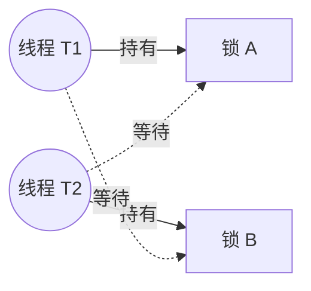

转账场景按账户 ID 固定加锁顺序：

```java
public void transfer(Account from, Account to, long amount) {
    // 无论谁转给谁，都先锁 ID 小的账户，破坏循环等待
    Account first = from.getId() < to.getId() ? from : to;
    Account second = first == from ? to : from;
    synchronized (first) {
        synchronized (second) {
            from.debit(amount);
            to.credit(amount);
        }
    }
}
```

**追问链**

1. **数据库死锁和 Java 死锁有什么不同？**
   InnoDB 有死锁检测（基于等待图），发现后会主动回滚代价较小的事务。JVM 不会自动解除死锁，只能靠重启或人工处理。
2. **除了锁，还有哪些"资源死锁"？**
   - 线程池饥饿死锁：父任务占满线程，同步等待排在队列里的子任务，见 03-15。
   - 连接池死锁：一个请求内嵌套获取两个数据库连接，并发量一大，所有线程都持有一个、等待第二个。
   - 分布式锁之间互相等待。
   这些情况 jstack 不会报 deadlock，只能从"线程全部在等待某种资源"的特征去判断。

---

### 03-26 LockSupport 的 park / unpark 是怎么工作的？和 wait / notify 有什么区别？

> ★★ ｜ 资深 ｜ 中频

**考察意图**：AQS、线程池、`FutureTask`、`CompletableFuture` 的阻塞最终都落在 `LockSupport.park` 上。讲清它的"许可"模型，才算真正理解这些工具为什么不会丢失唤醒。

**30 秒版回答**

- 每个线程关联一个**许可**，只有"有"和"没有"两种状态，**不会累加**（已核对 JDK 25 的 `LockSupport` 文档注释：at most one）。
- `park()`：有许可就消耗掉并立即返回；没有就挂起当前线程。
- `unpark(thread)`：把目标线程的许可置为"有"；如果它正挂起就唤醒它。
- 和 wait / notify 的三个关键区别：
  1. **不需要持有任何锁**；
  2. **可以指定唤醒哪个线程**，AQS 的 FIFO 队列正是靠这一点按顺序唤醒后继节点；
  3. **先 unpark 再 park 不会丢失唤醒**，许可会一直留到下一次 park。
- `park()` 在三种情况下返回：被 `unpark`、被中断、**无原因的虚假返回**。它不抛 `InterruptedException`，也不告诉你是哪种原因，所以调用方必须在循环里重新检查条件。

**深入剖析**

下面的代码在本机 JDK 25 上运行过：

```java
// 1. 先 unpark 再 park：许可已经存在，park 立即返回
LockSupport.unpark(Thread.currentThread());
long t0 = System.nanoTime();
LockSupport.park();
System.out.println("先 unpark 再 park，耗时(ms)=" + (System.nanoTime() - t0) / 1_000_000);

// 2. 许可不累加：连续 unpark 两次，只够一次 park 用
LockSupport.unpark(Thread.currentThread());
LockSupport.unpark(Thread.currentThread());
LockSupport.park();
t0 = System.nanoTime();
LockSupport.parkNanos(200_000_000L);
System.out.println("unpark 两次后第二次 park，耗时(ms)=" + (System.nanoTime() - t0) / 1_000_000);

// 3. 中断会让 park 返回，不抛异常，也不清除中断标志
Thread t = new Thread(() -> {
    LockSupport.park(ParkDemo.class);
    System.out.println("park 被中断唤醒，中断标志=" + Thread.currentThread().isInterrupted());
    long s = System.nanoTime();
    LockSupport.park();
    System.out.println("中断标志未清除时再次 park，耗时(ms)=" + (System.nanoTime() - s) / 1_000_000);
}, "park-demo");
t.start();
Thread.sleep(100);
System.out.println("阻塞中的线程状态=" + t.getState() + "，blocker=" + LockSupport.getBlocker(t));
t.interrupt();
t.join();
```

```text
先 unpark 再 park，耗时(ms)=0
unpark 两次后第二次 park，耗时(ms)=205
阻塞中的线程状态=WAITING，blocker=class ParkDemo
park 被中断唤醒，中断标志=true
中断标志未清除时再次 park，耗时(ms)=0
```

最后一行值得注意：**中断标志没清除时，再次 park 会立即返回**。如果循环里只是反复 park 而不处理中断，线程会变成空转，CPU 占满一个核。

标准用法是"条件放在循环里，park 只负责等"：

```java
// 等待方
while (!condition()) {          // 条件由 volatile 变量或 CAS 维护
    LockSupport.park(this);      // 传入 blocker，方便 jstack 里看出在等什么
    if (Thread.interrupted()) {  // 读取并清除中断标志，按业务决定退出还是继续等
        throw new InterruptedException();
    }
}

// 通知方：先改条件，再 unpark
changeCondition();
LockSupport.unpark(waiterThread);
```

这段代码不会丢失唤醒：如果通知方的 `unpark` 发生在等待方"检查条件之后、park 之前"，许可会留下来，等待方的 `park` 立即返回，回到循环开头重新检查条件。

**追问链**

1. **park 在 JVM 里是怎么实现的？**
   - 平台线程：HotSpot 给每个线程配了一个 Parker 对象，里面是一个计数器加一组操作系统的互斥量和条件变量。`park` 检查计数器，为 0 就在条件变量上等待；`unpark` 把计数器置 1 并发信号。
   - 虚拟线程：`LockSupport.park` 里先判断 `isVirtual()`（已核对 JDK 25 源码），虚拟线程走的是另一条路径：把自己的栈从载体线程上卸下来，载体线程去执行别的虚拟线程，**不会阻塞操作系统线程**。原理见 03-22。
2. **AQS 为什么用 park / unpark，而不用 wait / notify？**
   AQS 自己维护等待队列，释放锁时要唤醒**队头的那一个**线程，wait / notify 做不到指定唤醒。另外 AQS 要支持可中断、带超时、不可中断三种获取方式，park 不抛异常、由调用方自己决定怎么处理中断，正好合适。
3. **`park(Object blocker)` 的参数有什么用？**
   只用于诊断。JVM 把它记在线程对象里，jstack 中显示为 `parking to wait for <0x...> (a java.util.concurrent.locks.ReentrantLock$NonfairSync)`，据此能看出线程在等哪把锁、哪个队列。自己封装同步工具时应该传 blocker。

**生产实践 / 踩坑**

- jstack 里 `WAITING (parking)` 本身不代表有问题。线程池的空闲线程停在 `LinkedBlockingQueue` 的 `ConditionObject` 上是正常状态。要看的是 blocker：大量业务线程停在同一把 `ReentrantLock` 上，才说明有锁竞争或者持锁的线程卡住了。
- 自己用 park 写等待逻辑时，漏掉循环或者漏掉中断处理是最常见的两类错误。前者在虚假返回时逻辑出错，后者在中断后空转。能用现成的同步器就不要直接用 `LockSupport`。

---

## 四、线程池

### 03-12 ThreadPoolExecutor 的执行流程与状态

> ★★ ｜ 资深 ｜ 高频

**考察意图**：能否准确讲出提交流程，包括"先排队、后扩容"这个反直觉的点，以及 ctl 的设计。

**30 秒版回答**

- 7 个参数：corePoolSize、maximumPoolSize、keepAliveTime、unit、workQueue、threadFactory、handler（拒绝策略）。
- 提交流程：
  1. 线程数小于 core：新建核心线程执行任务；
  2. 否则放入队列；
  3. 队列满了且线程数小于 max：新建非核心线程；
  4. 否则执行拒绝策略。
- **反直觉的一点是先排队、后扩容**。所以用无界队列时 max 形同虚设。Tomcat 的线程池为了适应 Web 请求，改成了"先扩容、后排队"：它的 `TaskQueue.offer()` 在线程数没到 max 时直接返回 false，逼线程池去创建新线程。
- ctl 是一个 AtomicInteger，高 3 位存运行状态、低 29 位存线程数，一次 CAS 就能同时维护两者（已核对 JDK 25 源码：`COUNT_BITS = Integer.SIZE - 3`）。

**深入剖析**

`execute()` 的完整判断流程：

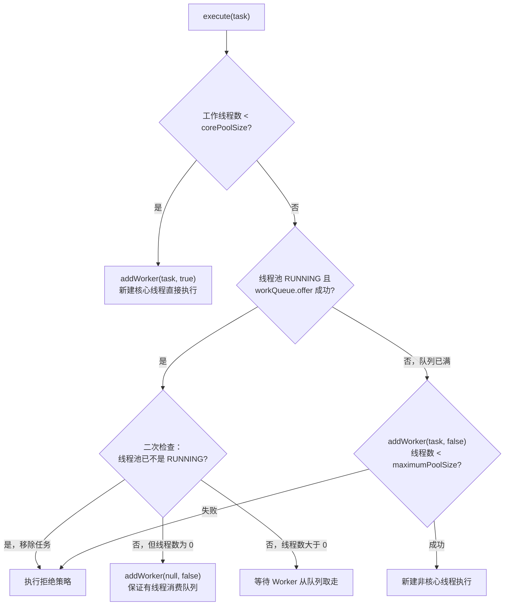

线程池的五种状态：

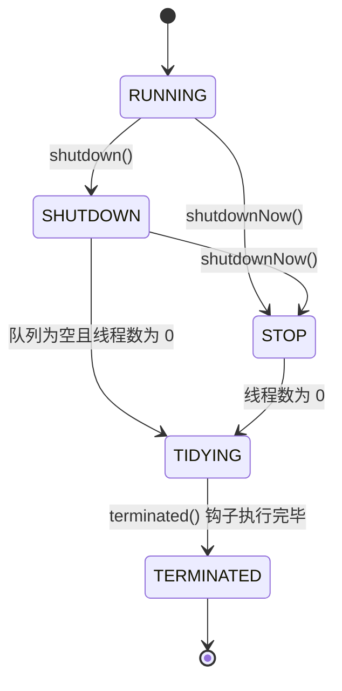

| 状态 | 接收新任务 | 处理队列中的任务 | 中断执行中的任务 |
| --- | --- | --- | --- |
| RUNNING | 是 | 是 | 否 |
| SHUTDOWN | 否 | 是 | 否（只中断空闲线程） |
| STOP | 否 | 否（队列中的任务被返回给调用方） | 是 |

Worker 的设计：

- `Worker` 继承 AQS 并实现 Runnable，自己就是一把**不可重入**的独占锁，用来标识"正在执行任务"。`shutdown()` 只中断能 `tryLock` 成功的空闲线程，不打断正在执行的任务。
- `runWorker` 循环调用 `getTask()`：线程数大于 core（或开启了 `allowCoreThreadTimeOut`）时用 `poll(keepAliveTime)`，超时返回 null，线程退出；否则用 `take()` 一直阻塞。

**追问链**

1. **线程池怎么区分"核心线程"和"非核心线程"？**
   不区分。线程本身没有身份标记，只看当前线程数和 core 的大小关系。任何一个线程都可能在 `getTask()` 超时后退出。
2. **核心线程会被回收吗？** 默认不会；调用 `allowCoreThreadTimeOut(true)` 后会。
3. **如何预热线程池？** 调用 `prestartAllCoreThreads()`，在接收流量前创建好全部核心线程。
4. **Worker 为什么不直接用 ReentrantLock？**
   源码注释给出了原因：要求不可重入，防止任务在执行中调用 `setCorePoolSize` 这类控制方法时，重新获取到自己的锁并把自己中断。

---

### 03-13 线程池参数怎么定？如何动态调整与可观测？

> ★★★ ｜ 架构师 ｜ 高频

**考察意图**：能否跳出"背公式"，用容量模型、压测、监控和动态调整形成闭环。

**30 秒版回答**

- 经验公式只能给**初始值**：CPU 密集型约为 CPU 核数 + 1；IO 密集型约为 CPU 核数 × (1 + 等待时间 / 计算时间)。
- 更可靠的方法是**利特尔法则**：需要的并发线程数 = 目标 QPS × 平均耗时（秒），再留出余量。
- 真正的答案是**压测 + 监控 + 动态调整**。ThreadPoolExecutor 原生支持运行期调用 `setCorePoolSize`、`setMaximumPoolSize`、`setKeepAliveTime`；队列容量要动态可调，需要自定义可调容量的队列。
- 必须监控的指标：活跃线程数、队列长度与剩余容量、拒绝次数、任务执行耗时与排队耗时的 P99、已完成任务数。
- 隔离：不同业务、不同下游使用不同线程池（舱壁模式），避免一个慢下游拖垮整个服务。

**深入剖析**

用利特尔法则算一个例子：目标 2000 QPS，下游平均耗时 50 ms，需要的并发数 = 2000 × 0.05 = 100 个线程。如果下游耗时涨到 500 ms，需要 1000 个线程。这就是"下游一变慢，上游线程池就被打满"的数学原因。

动态线程池的整体架构：

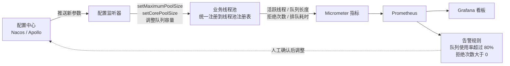

运行期调整大小时要注意调用顺序。JDK 9 起，`setCorePoolSize` 在新的 core 大于 max 时抛 `IllegalArgumentException`，`setMaximumPoolSize` 在新的 max 小于 core 时也会抛：

```java
/**
 * 运行期调整线程池大小：扩容先调 max，缩容先调 core，避免中间状态出现 core > max
 * 入参合法性（newCore <= newMax）由调用入口统一校验
 */
public static void resize(ThreadPoolExecutor pool, int newCore, int newMax) {
    if (newMax >= pool.getMaximumPoolSize()) {
        pool.setMaximumPoolSize(newMax);
        pool.setCorePoolSize(newCore);
    } else {
        pool.setCorePoolSize(newCore);
        pool.setMaximumPoolSize(newMax);
    }
}
```

指标采集可以直接用 Micrometer 的 `ExecutorServiceMetrics.monitor(registry, executor, "orderPool")`，它会输出线程数、活跃数、队列长度、完成数等指标。拒绝次数需要包装拒绝策略自己计数。

**追问链**

1. **队列容量设多大？**
   从"调用方能接受的最大排队时间"反推：队列长度 ≈ 线程数 × (可接受的排队时间 / 平均任务耗时)。超过这个长度，排在后面的任务就算最终被执行，调用方也早已超时，排队只是在浪费内存、拖长故障时间。
2. **拒绝策略怎么选？**
   - 核心链路不能丢任务：`CallerRunsPolicy` 由提交线程自己执行，形成天然的背压。但它会占住调用线程（比如 Tomcat 的请求线程），要评估影响。
   - 可丢弃的统计类任务：`DiscardPolicy` 加计数告警。
   - 需要兜底：自定义策略，把任务写入 MQ 或数据库，之后补偿处理。
3. **有了虚拟线程，还需要调线程池吗？**
   虚拟线程不应该池化，但"并发上限"这个约束并没有消失，只是转移到了 Semaphore、连接池和下游限流上，见 03-23。

**架构师加分点**

- 线程池参数本质是**容量规划**问题：先确定 SLA（目标 QPS、P99 耗时、可接受的排队时间），再推导线程数和队列长度，最后用压测验证。
- 开源实现可以参考 dynamic-tp、Hippo4j，但核心原理就是上面这张图：配置推送 + 原生 setter + 可调容量队列 + 指标告警。

---

### 03-14 线程池中任务的异常为什么"消失"了？如何优雅关闭？

> ★★ ｜ 资深 ｜ 高频

**考察意图**：是否踩过"异常被吞"的坑，是否理解停机是一条端到端的链路。

**30 秒版回答**

- 用 `execute()` 提交的任务抛出异常：该 Worker 线程终止（线程池会补一个新线程），异常交给线程的 UncaughtExceptionHandler，默认打印到 `System.err`。**没有经过日志框架，所以在日志文件里看不到**。
- 用 `submit()` 提交的任务：异常被 FutureTask 捕获，保存在 Future 里，不调用 `get()` 就永远看不到。
- 解决办法：
  - 任务内部 try-catch 并打 error 日志（最直接）；
  - 重写 `afterExecute(Runnable r, Throwable t)`，注意 submit 时 `t` 为 null，要从 Future 里取；
  - 通过 ThreadFactory 设置 UncaughtExceptionHandler，只对 execute 生效。
- 优雅关闭：`shutdown()` → `awaitTermination(超时)` → 超时后 `shutdownNow()` 中断 → 再等待一次。JDK 19 起 ExecutorService 实现了 AutoCloseable，`close()` 会 shutdown 并等待所有任务结束（已核对 JDK 25 源码）。

**深入剖析**

统一记录异常的线程池：

```java
@Slf4j
public class LoggingThreadPoolExecutor extends ThreadPoolExecutor {

    public LoggingThreadPoolExecutor(int core, int max, long keepAliveSeconds,
                                     BlockingQueue<Runnable> queue, ThreadFactory factory,
                                     RejectedExecutionHandler handler) {
        super(core, max, keepAliveSeconds, TimeUnit.SECONDS, queue, factory, handler);
    }

    @Override
    protected void afterExecute(Runnable r, Throwable t) {
        super.afterExecute(r, t);
        // submit() 提交的任务被包装成 FutureTask，异常不会通过参数 t 传进来
        if (t == null && r instanceof Future<?> future && future.isDone()) {
            try {
                future.get();
            } catch (CancellationException e) {
                t = e;
            } catch (ExecutionException e) {
                t = e.getCause();
            } catch (InterruptedException e) {
                Thread.currentThread().interrupt();
            }
        }
        if (t != null) {
            log.error("task execution failed, errorCode={}, task={}", ErrorCode.ASYNC_TASK_FAILED, r, t);
        }
    }
}
```

优雅关闭单个线程池：

```java
public static void gracefulShutdown(ExecutorService pool, Duration timeout) {
    pool.shutdown();                                          // 1. 不再接收新任务，继续处理队列
    try {
        if (!pool.awaitTermination(timeout.toMillis(), TimeUnit.MILLISECONDS)) {
            List<Runnable> dropped = pool.shutdownNow();      // 2. 超时：中断执行中的任务，返回未执行的任务
            log.info("executor force shutdown, droppedTasks={}", dropped.size());
            pool.awaitTermination(timeout.toMillis(), TimeUnit.MILLISECONDS);
        }
    } catch (InterruptedException e) {
        pool.shutdownNow();
        Thread.currentThread().interrupt();
    }
}
```

**架构师加分点**

优雅停机是一条端到端的链路，关掉线程池只是其中一步。顺序错了，会出现"流量还在进，线程池已经关了"的报错：

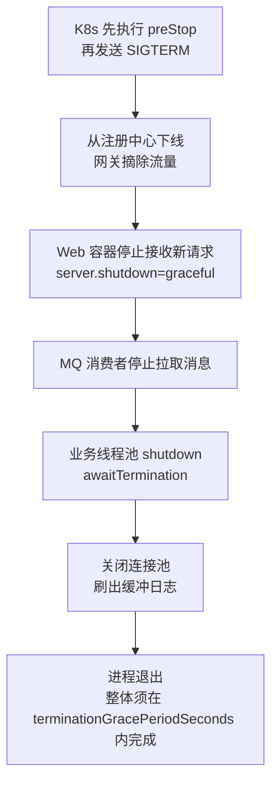

在 Spring 中，可以通过 `SmartLifecycle` 的 phase 控制各组件的停止顺序；`ThreadPoolTaskExecutor` 要配置 `setWaitForTasksToCompleteOnShutdown(true)` 和 `setAwaitTerminationSeconds(...)`。

**追问链**

1. **`shutdownNow()` 一定能停掉正在执行的任务吗？**
   不一定。它只是调用 `interrupt()`，任务代码不响应中断就停不下来。
2. **用 execute 提交的任务频繁抛异常，有什么额外代价？**
   每次异常都会销毁一个线程、再创建一个新线程，有创建开销，线程上的 ThreadLocal 也会全部丢失。

---

### 03-15 线程池有哪些典型的生产事故？

> ★★★ ｜ 资深 / 架构师 ｜ 高频

**考察意图**：有没有真实的线上排障经验，能否从现象推到根因。

**30 秒版回答**

1. **Executors 工厂方法的无界陷阱**：`newFixedThreadPool` 和 `newSingleThreadExecutor` 使用无界的 LinkedBlockingQueue，任务积压导致 OOM；`newCachedThreadPool` 的最大线程数是 `Integer.MAX_VALUE`，线程数暴涨。
2. **父子任务共用一个线程池导致饥饿死锁**：父任务占满全部线程并同步等待子任务，子任务在队列里永远轮不到执行。
3. **在方法内部创建线程池且不关闭**：每次请求 new 一个线程池，线程持续泄漏。
4. **共用 ForkJoinPool 公共池**：`parallelStream` 和不指定线程池的 CompletableFuture 共用 commonPool，有人在里面做阻塞 IO，全局都会变慢，见 03-20、03-21。
5. **上下文丢失或串号**：ThreadLocal 里的 traceId、租户、登录用户在线程池中不传递，或残留到下一个任务，见 03-19。

**深入剖析**

父子任务饥饿死锁：

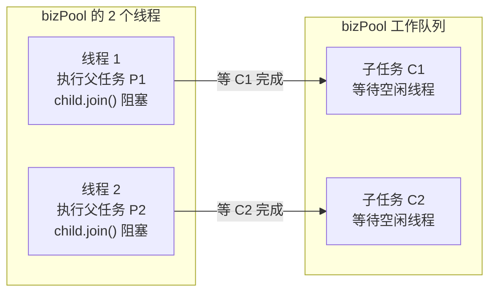

C1、C2 只能由 bizPool 的线程执行，而 bizPool 仅有的两个线程正在等它们完成：线程等子任务，子任务等线程，形成循环等待，谁也结束不了。

```java
// 错误示例：父子任务共用 bizPool，并发父任务数达到线程数时整体卡死
CompletableFuture<Order> parent = CompletableFuture.supplyAsync(() -> {
    CompletableFuture<User> child = CompletableFuture.supplyAsync(this::loadUser, bizPool);
    return buildOrder(child.join());     // 在池内线程上同步等待池内的另一个任务
}, bizPool);
```

修复思路（任选其一）：

- 父子任务使用不同的线程池；
- 改为非阻塞编排，用 `thenCombine` / `thenCompose` 代替在池内线程上 `join()`；
- 迁移到虚拟线程 + 结构化并发，等待不再占用平台线程。

排查特征：jstack 中线程池的所有线程都停在 `CompletableFuture.join` 或 `FutureTask.get` 上，同时队列长度不为 0、CPU 很低。

**追问链**

1. **怎么发现线程泄漏？**
   监控 JVM 存活线程数（Micrometer 的 `jvm.threads.live`）是否持续上涨；用 jstack 按线程名前缀统计。看到 `pool-1234-thread-1` 这种编号不断增大的线程名，基本可以断定有人在方法里创建线程池。
2. **为什么要给线程池起业务名字？**
   出问题时 jstack 里一眼就能看出是哪个线程池、属于哪个业务。可以用 `Thread.ofPlatform().name("order-pool-", 0).factory()`（JDK 21+）或 Guava 的 `ThreadFactoryBuilder` 设置名称前缀。

---

## 五、并发容器与工具类

### 03-16 ConcurrentHashMap 如何实现线程安全与协作扩容？

> ★★★ ｜ 资深 ｜ 高频

**考察意图**：是否掌握锁粒度设计、无锁读、多线程协作扩容这三个核心设计。

**30 秒版回答**

- JDK 7 使用 Segment 分段锁：Segment 继承 ReentrantLock，默认 16 段。
- JDK 8 至今（JDK 25 的核心设计没有变化）：数组 + 链表 / 红黑树。**桶为空时用 CAS 插入，桶不为空时 synchronized 锁住桶的头节点**，锁粒度细化到单个桶。
- 读操作完全无锁：Node 的 `val` 和 `next` 是 volatile；读取数组元素用的是 Acquire 语义（JDK 25 的 `tabAt` 调用 `U.getReferenceAcquire`，已核对）。
- 扩容由多线程协作完成：每个线程按 stride（最少 16 个桶）领取一段桶区间，从高到低逐桶迁移。迁移完的桶放一个 ForwardingNode（hash = MOVED = -1）占位。其他线程 put 时遇到它会先 `helpTransfer` 帮忙扩容；get 遇到它会转到新表查找。
- 计数借鉴 LongAdder：`baseCount + CounterCell[]`，避免所有线程争抢一个计数器。

**深入剖析**

`putVal` 的主流程：

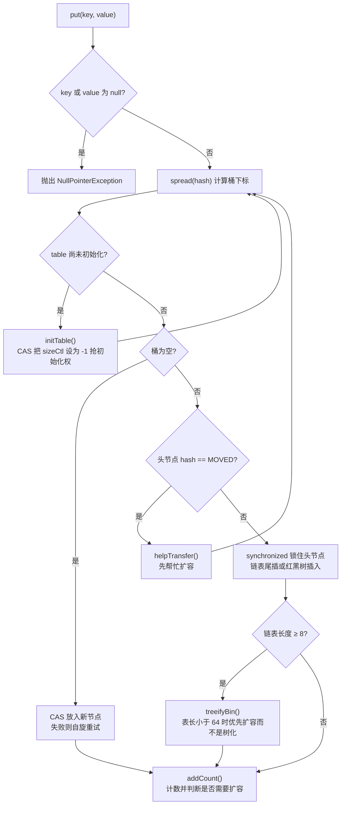

多线程协作扩容（迁移过程的空间关系用图更直观）：

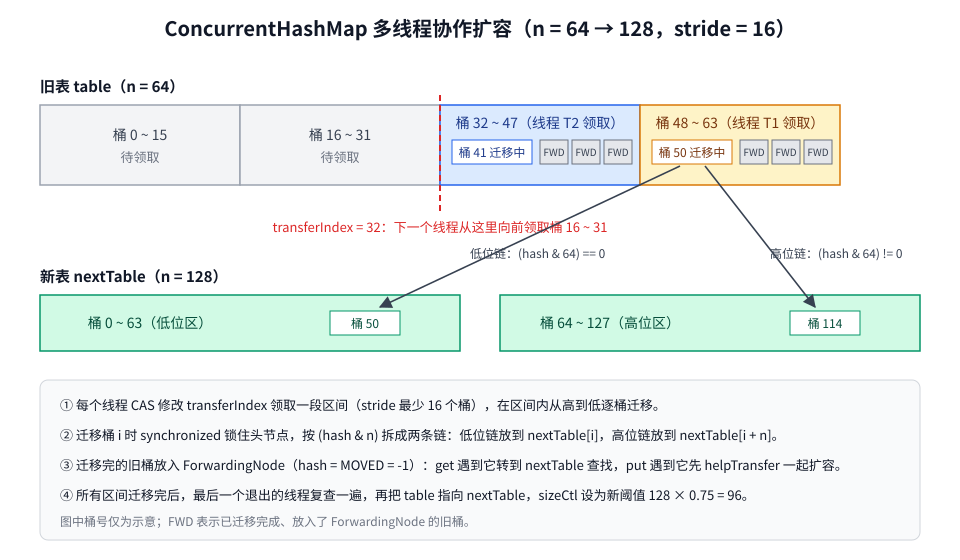

源码细节（已核对 JDK 25）：

- `stride = (NCPU > 1) ? (n >>> 3) / NCPU : n`，小于 `MIN_TRANSFER_STRIDE`（16）时取 16。
- `MOVED = -1`（ForwardingNode），`TREEBIN = -2`（红黑树根），`RESERVED = -3`（`computeIfAbsent` 等方法计算期间的占位节点）。
- 树化条件：`TREEIFY_THRESHOLD = 8` 且表长不小于 `MIN_TREEIFY_CAPACITY = 64`。

`sizeCtl` 在不同阶段的含义：

| sizeCtl 的值 | 含义 |
| --- | --- |
| 0 | 未初始化，使用默认容量 16 |
| -1 | 正在初始化 |
| 其他负数（扩容中） | 高 16 位是 resizeStamp（标识这一轮扩容），低 16 位是 1 + 正在参与扩容的线程数 |
| 正数 | 初始化前表示初始容量；初始化后表示下次扩容的阈值（0.75n） |

**追问链**

1. **为什么 key 和 value 都不允许为 null？**
   并发场景下，`get` 返回 null 时无法区分"不存在"和"值为 null"，又不能像 HashMap 那样用 `containsKey` 再确认一次，因为两次调用之间可能被其他线程修改。
2. **`size()` 准确吗？**
   不是强一致的快照，只是一个估计值。数量可能超过 int 范围时用 `mappingCount()`。
3. **为什么锁头节点用 synchronized，而不是 ReentrantLock？**
   桶的数量非常多，每个桶配一个 ReentrantLock 对象内存开销太大；synchronized 直接锁头节点，不需要额外对象，无竞争时成本也很低。
4. **用了 ConcurrentHashMap 就一定线程安全吗？**
   不是。单个方法是原子的，组合起来不是。`if (!map.containsKey(k)) map.put(k, v)` 要改成 `putIfAbsent` 或 `computeIfAbsent`。

**生产实践 / 踩坑**

- **`computeIfAbsent` 的函数里不要修改同一个 map**：JDK 8 中可能死循环（JDK-8062841），JDK 9 起会检测到并抛出 `IllegalStateException: Recursive update`。
- **`computeIfAbsent` 的函数里不要做远程调用或其他慢操作**：函数执行期间持有桶锁，同一个桶上的其他写操作都会被阻塞。用它做本地缓存加载时，函数要么足够快，要么改用 Caffeine 这类专门的缓存组件。

---

### 03-17 CountDownLatch、CyclicBarrier、Semaphore 的区别

> ★★ ｜ 资深 ｜ 高频

**考察意图**：能否讲清三者的语义差异、实现方式和适用场景，而不是混用。

**30 秒版回答**

- CountDownLatch：一个或多个线程**等待 N 个事件完成**，计数归零后无法重置。
- CyclicBarrier：N 个线程**互相等待**，全部到齐后一起继续，之后自动重置，可以循环使用。
- Semaphore：控制**同时访问某资源的线程数**，用于限流和资源池。

**深入剖析**

| 维度 | CountDownLatch | CyclicBarrier | Semaphore |
| --- | --- | --- | --- |
| 语义 | 等待 N 个事件 | N 个线程互相等待 | 控制并发数 |
| 实现 | AQS 共享模式，state = 剩余计数 | ReentrantLock + Condition，按"代"（generation）管理 | AQS 共享模式，state = 剩余许可 |
| 能否复用 | 否 | 是，到齐后自动重置 | 是，归还许可即可 |
| 谁来推进 | 任意线程调用 `countDown()` | 参与线程自己调用 `await()` | `acquire()` / `release()`，可以由不同线程释放 |
| 异常影响 | 某个任务失败不影响其他等待者，需要自己处理 | 一个线程中断或超时，屏障被打破，其他线程收到 `BrokenBarrierException` | 无 |
| 典型场景 | 主线程等待多个子任务、启动时等待依赖就绪 | 多阶段并行计算、压测时让所有线程同时开始 | 限流、资源池、虚拟线程的并发上限 |

另外还有 Phaser：可以动态增减参与方的多阶段屏障，相当于更灵活的 CyclicBarrier。

用 Semaphore 限制对某个下游的并发调用数：

```java
public class InventoryGateway {
    private static final int MAX_CONCURRENT_CALLS = 50;
    private static final long ACQUIRE_TIMEOUT_MS = 100;

    private final Semaphore permits = new Semaphore(MAX_CONCURRENT_CALLS);
    private final InventoryClient client;

    public InventoryGateway(InventoryClient client) {
        this.client = client;
    }

    public Stock query(long skuId) throws InterruptedException {
        if (!permits.tryAcquire(ACQUIRE_TIMEOUT_MS, TimeUnit.MILLISECONDS)) {
            throw new BizException(ErrorCode.DOWNSTREAM_BUSY);
        }
        try {
            return client.query(skuId);
        } finally {
            permits.release();
        }
    }
}
```

**追问链**

1. **`countDown()` 应该写在哪里？**
   必须写在 finally 里。否则子任务抛异常时计数减不到 0，主线程会永远 `await()`。主线程最好使用带超时的 `await(timeout, unit)`。
2. **Semaphore 的 `release()` 有什么陷阱？**
   它不校验调用者是否真的 acquire 过，多调用一次 `release()` 就会凭空多出一个许可。所以 acquire 失败的分支绝对不能走到 release。
3. **单机 Semaphore 能做集群限流吗？**
   不能，它只限制当前 JVM。集群限流要用 Redis 计数或 Sentinel 的集群流控，见[《26 高可用》](../06-三高与架构/26-高可用.md)。

---

### 03-18 BlockingQueue 有哪些实现？线程池里怎么选？

> ★★ ｜ 资深 ｜ 中频

**考察意图**：是否了解各实现的有界性和锁结构，能否结合线程池行为选型。

**30 秒版回答**

- 线程池默认首选**有界队列**：`ArrayBlockingQueue` 或指定容量的 `LinkedBlockingQueue`，再配合合理的拒绝策略。
- 希望"先扩容、后排队"（Web 请求类）：用 `SynchronousQueue` 加较大的 max，或者参考 Tomcat 的 TaskQueue。
- 延迟任务用 `DelayQueue`（单机）；定时任务直接用 `ScheduledThreadPoolExecutor`。
- 最大的坑是 `LinkedBlockingQueue` 不指定容量时默认是 `Integer.MAX_VALUE`，实际等于无界。

**深入剖析**

| 实现 | 有界性 | 锁结构 | 特点与场景 |
| --- | --- | --- | --- |
| ArrayBlockingQueue | 有界，必须指定容量 | 一把 ReentrantLock + notEmpty / notFull 两个 Condition | 数组预分配，入队不产生新节点对象；入队和出队互斥 |
| LinkedBlockingQueue | 可选，默认 Integer.MAX_VALUE | putLock / takeLock 两把锁 + AtomicInteger 计数 | 入队和出队可以并行；**不指定容量是 OOM 的常见源头** |
| SynchronousQueue | 容量为 0 | 无锁，基于 CAS | 直接移交，必须马上有线程接手；`newCachedThreadPool` 使用它 |
| PriorityBlockingQueue | 无界 | 一把锁 | 按优先级出队 |
| DelayQueue | 无界 | 一把锁 + leader-follower | 元素到期才能取出 |
| LinkedTransferQueue | 无界 | 无锁，基于 CAS | `transfer()` 会等到消费者真正取走元素 |
| LinkedBlockingDeque | 可选 | 一把锁 | 双端队列 |

DelayQueue 的 leader-follower 设计：只有一个 leader 线程按队首元素的剩余延迟做限时等待，其余线程无限期等待。队首元素到期后 leader 取走元素，并唤醒一个 follower 成为新的 leader。这样避免了所有消费者在同一时刻被定时唤醒。

**追问链**

1. **add / offer / put 有什么区别？**
   队列满时，`add` 抛 `IllegalStateException`，`offer` 返回 false（也可以带超时），`put` 一直阻塞。出队对应 `remove`、`poll`、`take`。
2. **为什么 LinkedBlockingQueue 用两把锁，ArrayBlockingQueue 只用一把？**
   链表的头尾是不同的节点，入队和出队天然操作不同的数据，用 AtomicInteger 维护计数后就能用两把锁并行。数组实现里两端共享 `count` 和数组，Doug Lea 选择了单锁，换取实现的简单。
3. **用 DelayQueue 做订单超时关闭有什么问题？**
   数据只在单机内存里：重启会丢，也不能水平扩展。分布式场景要用 RocketMQ 定时消息、Redis ZSet 或时间轮，见[《34 定时任务》](../07-工程实践与稳定性/34-定时任务.md)。

---

### 03-19 ThreadLocal 原理、内存泄漏与线程池上下文传递

> ★★★ ｜ 资深 ｜ 高频

**考察意图**：能否讲清引用链，分清"内存泄漏"和"数据串号"这两类问题，以及在线程池和虚拟线程下的上下文传递方案。

**30 秒版回答**

- 数据不是存在 ThreadLocal 里，而是存在**线程**里：每个 Thread 持有一个 ThreadLocalMap，key 是 ThreadLocal 对象（**弱引用**），value 是存入的值（**强引用**）。冲突用开放寻址（线性探测）解决，哈希增量 `0x61c88647` 让下标分布更均匀。
- 泄漏链路是 Thread → ThreadLocalMap → Entry → value。只要线程活着（线程池线程几乎一直活着），value 就不会被回收。key 用弱引用只能让 ThreadLocal 对象本身可以被回收，value 要等后续的 get / set / remove 顺带清理 key 为 null 的过期 Entry 时才释放。
- **生产中更常见的问题其实是"串号"**：ThreadLocal 一般声明为 `static final`，key 永远不会被回收；线程池复用线程时，上一个请求的用户信息残留到下一个请求。所以用完必须在 finally 里 `remove()`。
- 线程池中传递上下文：InheritableThreadLocal 只在**创建线程**时复制一次，线程池的线程早已创建好，所以无效。可以用阿里的 TransmittableThreadLocal（TTL），在提交任务时捕获上下文、执行时回放。JDK 25 正式发布的 ScopedValue 是新的方向，见 03-24。

**深入剖析**

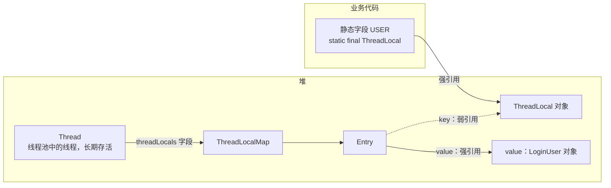

从图上能看出两件事：

1. 只要 `USER` 这个静态字段还在，ThreadLocal 对象就不会被回收，弱引用根本不起作用。
2. 只要线程还活着，value 就一直可达。线程池里的线程一直活着，所以不 remove 就会一直占着内存，并被下一个任务读到。

标准用法：在请求入口统一设置和清理。

```java
public final class UserContext {
    private static final ThreadLocal<LoginUser> HOLDER = new ThreadLocal<>();

    private UserContext() {
    }

    public static void set(LoginUser user) {
        HOLDER.set(user);
    }

    public static LoginUser get() {
        return HOLDER.get();
    }

    public static void clear() {
        HOLDER.remove();
    }
}

// Filter 或拦截器中：保证 finally 里一定清理
try {
    UserContext.set(user);
    chain.doFilter(request, response);
} finally {
    UserContext.clear();
}
```

线程池上下文传递的几种方案：

| 方案 | 原理 | 适用 |
| --- | --- | --- |
| TransmittableThreadLocal | 包装 Runnable / Executor，提交时捕获、执行时回放、结束后恢复 | 存量项目、ThreadLocal 种类多 |
| Spring `TaskDecorator` | 在 `ThreadPoolTaskExecutor` 上包装任务，手动复制上下文 | Spring 项目中的少量上下文 |
| Spring 6.1+ `ContextPropagatingTaskDecorator` | 基于 Micrometer context-propagation 自动传递已注册的上下文（如 traceId、MDC） | Spring Boot 3.2+ 的可观测性场景 |
| ScopedValue | 不可变绑定，在结构化并发的子任务中自动继承 | JDK 25+ 的新代码 |

TTL 的用法：

```java
private static final TransmittableThreadLocal<String> TRACE_ID = new TransmittableThreadLocal<>();

// 包装业务线程池，提交任务时自动捕获、执行时自动回放
ExecutorService ttlPool = TtlExecutors.getTtlExecutorService(bizPool);
```

**追问链**

1. **key 为什么用弱引用，而不是强引用？**
   如果 key 是强引用，即使业务代码不再持有这个 ThreadLocal（例如作为实例字段的 ThreadLocal 随对象一起失效），只要线程活着它就无法回收。弱引用至少保证 ThreadLocal 对象能被回收，并留下 key 为 null 的标记，方便之后清理。
2. **value 为什么不也用弱引用？**
   如果 value 只被 Entry 弱引用，GC 之后 `get()` 就会拿到 null，而业务代码明明还没有 remove，语义就错了。
3. **虚拟线程下使用 ThreadLocal 有什么问题？**
   功能上支持，但每个虚拟线程各有一份。百万级虚拟线程乘以较大的缓存对象，内存会明显上涨。另外，"用 ThreadLocal 缓存昂贵对象并在线程间复用"的老做法（比如缓存 `SimpleDateFormat`）在虚拟线程下失效，因为虚拟线程不会被复用。
4. **Tomcat 热部署时，ThreadLocal 为什么会导致 ClassLoader 泄漏？**
   value 引用了 Web 应用中的类，而线程属于 Tomcat 的线程池、比应用活得久。于是整个 WebappClassLoader 和它加载的所有类都无法卸载。Tomcat 在停止应用时会检测到这种情况并打印告警日志。

---

## 六、异步编排

### 03-20 CompletableFuture 怎么用？生产中有哪些坑？

> ★★★ ｜ 资深 / 架构师 ｜ 高频

**考察意图**：能否写出带超时、降级、异常处理的并行聚合代码，是否了解默认线程池和取消语义的坑。

**30 秒版回答**

- 编排能力：串行用 `thenApply` / `thenCompose`，并行聚合用 `thenCombine` / `allOf` / `anyOf`，异常处理用 `exceptionally` / `handle` / `whenComplete`，超时用 `orTimeout` / `completeOnTimeout`（JDK 9+）。
- **坑 1：默认线程池**。不传 Executor 时，任务跑在 ForkJoinPool 的公共池里，和 `parallelStream` 等共用。IO 任务必须指定业务线程池。这里有一个版本差异，在 2 核容器上表现完全不同（见下方实测）。
- **坑 2：异常被包装**。`join()` 抛 `CompletionException`，`get()` 抛 `ExecutionException`，原始异常要用 `getCause()` 取。链路中某一步异常后，后续的 `thenApply` 都会跳过，直到遇到 `exceptionally` 或 `handle`。
- **坑 3：超时不等于取消**。`orTimeout` 只是让这个 future 以 TimeoutException 结束，**不会中断底层正在执行的任务**；对 CompletableFuture 调用 `cancel(true)` 也不会中断执行线程。超时的任务会继续占用线程和下游连接。
- **坑 4：非 Async 回调在哪个线程执行不确定**。前一步已经完成时，`thenApply` 在调用线程执行；否则在完成前一步的线程执行。耗时逻辑要用 `thenApplyAsync(fn, executor)`。
- **坑 5：上下文不传递**。ThreadLocal 里的 traceId、登录用户在异步线程里拿不到，见 03-19。

**深入剖析**

**实测：2 核容器上的默认线程池（JDK 21 与 JDK 25 行为不同）**

用 `-XX:ActiveProcessorCount=2` 模拟 2 核容器，不传 Executor 提交 4 个各 sleep 1 秒的任务：

| JDK | commonPool 并行度 | 4 个任务总耗时 | 执行线程 |
| --- | --- | --- | --- |
| 21 | 1 | 约 1 秒 | `Thread-0` ~ `Thread-3`（每个任务新建一个线程） |
| 25 | 1 | **约 4 秒** | 只有 `ForkJoinPool.commonPool-worker-1`（串行） |
| 21 / 25（8 核） | 7 | 约 1 秒 | commonPool 的 4 个 worker |

原因（已核对源码）：

- JDK 21 / 24：`ASYNC_POOL = USE_COMMON_POOL ? ForkJoinPool.commonPool() : new ThreadPerTaskExecutor()`，其中 `USE_COMMON_POOL` 要求公共池并行度大于 1。2 核时并行度是 2 − 1 = 1，于是退化为**每个任务新建一个线程**。
- JDK 25：改为 `ForkJoinPool.asyncCommonPool()`，始终使用公共池（只有并行度被配置成 0 时才调到 2）。2 核时所有异步任务挤在**一个**工作线程上。

结论：从 JDK 21 升级到 25 后，如果代码里有不指定线程池的 `supplyAsync` / `runAsync`，又跑在小规格容器上，阻塞型任务会从"并行"变成"串行"。**任何会阻塞的异步任务都必须显式传入 Executor**，这条规则在新版本上更重要了。

并行调用多个下游、带超时与降级的聚合写法：

```java
public ProductDetail queryDetail(long skuId) {
    // 核心数据：超时直接失败
    CompletableFuture<Sku> sku = CompletableFuture
            .supplyAsync(() -> skuClient.query(skuId), ioPool)
            .orTimeout(200, TimeUnit.MILLISECONDS);
    // 非核心数据：超时或异常时降级为默认值
    CompletableFuture<Price> price = CompletableFuture
            .supplyAsync(() -> priceClient.query(skuId), ioPool)
            .orTimeout(150, TimeUnit.MILLISECONDS)
            .exceptionally(e -> Price.UNKNOWN);
    CompletableFuture<Stock> stock = CompletableFuture
            .supplyAsync(() -> stockClient.query(skuId), ioPool)
            .orTimeout(150, TimeUnit.MILLISECONDS)
            .exceptionally(e -> Stock.UNKNOWN);

    // sku 失败时 join 抛出 CompletionException，交给统一异常处理
    return CompletableFuture.allOf(sku, price, stock)
            .thenApply(ignored -> new ProductDetail(sku.join(), price.join(), stock.join()))
            .join();
}
```

这段代码还剩一个问题：sku 超时失败后，price 和 stock 仍会继续执行到底，没有被取消。这正是结构化并发要解决的问题，见 03-24。

**追问链**

1. **`thenCompose` 和 `thenApply` 有什么区别？**
   类似 Stream 的 `flatMap` 和 `map`。函数本身返回 CompletableFuture 时用 `thenCompose`，否则会得到嵌套的 `CompletableFuture<CompletableFuture<T>>`。
2. **`allOf` 的结果怎么拿？**
   `allOf` 返回 `CompletableFuture<Void>`，要逐个 `join()` 各个子 future 取值。任一子任务失败，`allOf` 也以异常结束，但**不会取消其他子任务**。
3. **JDK 19 之后 Future 有哪些新方法？**
   `state()`、`resultNow()`、`exceptionNow()`，在已经确定完成时可以直接取结果，不用再处理受检异常。

---

### 03-21 ForkJoinPool 的工作窃取；parallelStream 为什么要慎用？

> ★★ ｜ 资深 ｜ 中频

**考察意图**：是否理解工作窃取的队列设计，是否了解公共池共享带来的隔离问题。

**30 秒版回答**

- ForkJoinPool 的每个工作线程有自己的双端队列。线程从队列一端压入、取出自己 fork 出的子任务（LIFO，局部性好）；空闲线程从**别的线程队列的另一端**窃取任务（FIFO，偷到的通常是更大的任务，和队列主人的冲突也更少）。
- 它适合**可以递归拆分的 CPU 密集型**任务（分治、并行流），不适合阻塞 IO。
- `parallelStream` 默认使用公共池（并行度 = CPU 核数 − 1），整个 JVM 共享。某处在 parallelStream 里调 RPC 或查库，会占住公共池，拖慢其他 parallelStream 和不指定线程池的 CompletableFuture。
- 下面这些情况，并行流可能比串行更慢：数据量小、数据源难拆分（如 LinkedList）、有顺序依赖的操作（`forEachOrdered`、`limit`）、大量装箱拆箱。

**深入剖析**

```mermaid
flowchart LR
    THIEF["Worker 2<br/>自己的队列已空"] -.->|"② 从 base 端窃取最早的 T1（FIFO）"| BASE
    subgraph DQ["Worker 1 的双端队列"]
        direction LR
        BASE["base 端<br/>T1 最早"] --- T2["T2"] --- T3["T3"] --- TOP["top 端<br/>T4 最新"]
    end
    TOP -->|"① 队列主人从 top 端 push / pop（LIFO）"| OWNER["Worker 1<br/>队列的主人"]
```

把 parallelStream 放进自定义池执行，可以与公共池隔离：

```java
ForkJoinPool pool = new ForkJoinPool(8);
try {
    long count = pool.submit(() -> ids.parallelStream().map(this::compute).count()).get();
} finally {
    pool.shutdown();
}
```

注意：这个技巧依赖"并行流的子任务会提交到当前 ForkJoin 线程所在的池"这一**实现细节**，并不是规范保证。

**追问链**

1. **RecursiveTask 怎么写效率更高？**
   在 `compute()` 里 fork 一半，自己直接计算另一半，最后再 join，而不是两半都 fork。这样少一次任务调度。
2. **公共池的并行度能改吗？** 可以，通过 `-Djava.util.concurrent.ForkJoinPool.common.parallelism=N`。
3. **虚拟线程用的是公共池吗？**
   不是。虚拟线程的调度器是一个**单独的** ForkJoinPool，并且以 FIFO 模式（asyncMode = true）运行（已核对 JDK 25 `VirtualThread.createDefaultScheduler`）。
4. **JDK 25 的 ForkJoinPool 有什么新变化？**
   JDK 25 中 ForkJoinPool 实现了 `ScheduledExecutorService` 接口，可以直接提交延迟任务和周期任务（已核对：JDK 24 源码中还没有，JDK 25 中已经有）。

---

### 03-27 FutureTask 的原理是什么？get 为什么会阻塞，cancel 真的能停掉任务吗？

> ★★ ｜ 资深 ｜ 中频

**考察意图**：`submit()` 返回的 Future 背后就是 FutureTask。讲清它的状态机，才能解释"异常为什么被吞""取消为什么没生效""同一个任务为什么只执行一次"。

**30 秒版回答**

- FutureTask 同时实现了 `Runnable` 和 `Future`：线程池把它当任务执行，调用方把它当凭证取结果。`submit()` 内部就是把 Callable 包成 FutureTask 再 `execute`。
- 核心是四个字段（已核对 JDK 25 源码）：
  - `state`：volatile 的状态，共 7 个值；
  - `outcome`：正常结果或者异常；
  - `runner`：正在执行任务的线程，用 CAS 从 null 改成当前线程，**保证任务只被执行一次**；
  - `waiters`：调用 `get()` 而阻塞的线程，组成一个无锁的栈。
- `run()`：执行任务 → 把结果或异常写进 `outcome` → 修改状态 → 唤醒 `waiters` 里的所有线程。
- `get()`：任务没结束就把自己挂到 `waiters` 上并 `park`；被唤醒后按状态返回结果、抛 `ExecutionException` 或 `CancellationException`。
- `cancel(true)` 只是给执行线程发**中断**，任务不响应中断就会继续跑完，只不过结果被丢弃。

**深入剖析**

状态流转（已核对 JDK 25 `FutureTask` 源码注释）：

```mermaid
stateDiagram-v2
    [*] --> NEW
    NEW --> COMPLETING : 任务执行结束，开始写结果
    COMPLETING --> NORMAL : 结果已写入
    COMPLETING --> EXCEPTIONAL : 异常已写入
    NEW --> CANCELLED : cancel(false)
    NEW --> INTERRUPTING : cancel(true)
    INTERRUPTING --> INTERRUPTED : 已对执行线程发出中断
    NORMAL --> [*]
    EXCEPTIONAL --> [*]
    CANCELLED --> [*]
    INTERRUPTED --> [*]
```

两点说明：

- NEW 既表示"还没开始"，也表示"正在执行"，FutureTask 内部不区分这两者。
- JDK 19 新增的 `Future.state()` 把这 7 个内部状态归并成 4 个对外状态：RUNNING、SUCCESS、FAILED、CANCELLED，同时新增了不阻塞的 `resultNow()` 和 `exceptionNow()`。

下面的代码在本机 JDK 25 上运行过：

```java
// 1. 同一个 FutureTask 被多个线程 run，只会真正执行一次
AtomicInteger executed = new AtomicInteger();
FutureTask<String> task = new FutureTask<>(() -> {
    executed.incrementAndGet();
    Thread.sleep(50);
    return "result";
});
System.out.println("执行前 state=" + task.state());
Thread[] ts = new Thread[4];
for (int i = 0; i < ts.length; i++) { ts[i] = new Thread(task); ts[i].start(); }
for (Thread t : ts) { t.join(); }
System.out.println("4 个线程 run 同一个任务，实际执行次数=" + executed.get()
        + "，get=" + task.get() + "，state=" + task.state());

// 2. 任务抛异常：异常被存进 outcome，get 时才以 ExecutionException 抛出
FutureTask<String> failed = new FutureTask<>(() -> { throw new IllegalStateException("boom"); });
failed.run();
System.out.println("异常任务 run 之后没有任何输出，state=" + failed.state());
try {
    failed.get();
} catch (ExecutionException e) {
    System.out.println("get 抛出 " + e.getClass().getSimpleName() + "，cause=" + e.getCause());
}

// 3. cancel(true) 会中断正在执行的线程；取消之后 get 抛 CancellationException
CountDownLatch started = new CountDownLatch(1);
FutureTask<String> slow = new FutureTask<>(() -> {
    started.countDown();
    try {
        Thread.sleep(10_000);
    } catch (InterruptedException e) {
        System.out.println("任务线程收到中断");
        throw e;
    }
    return "never";
});
Thread runner = new Thread(slow);
runner.start();
started.await();
System.out.println("cancel(true) 返回 " + slow.cancel(true) + "，state=" + slow.state());
runner.join();
try {
    slow.get();
} catch (CancellationException e) {
    System.out.println("取消后 get 抛出 " + e.getClass().getSimpleName());
}
System.out.println("已完成的任务再 cancel 返回 " + task.cancel(true));
```

```text
执行前 state=RUNNING
4 个线程 run 同一个任务，实际执行次数=1，get=result，state=SUCCESS
异常任务 run 之后没有任何输出，state=FAILED
get 抛出 ExecutionException，cause=java.lang.IllegalStateException: boom
任务线程收到中断
cancel(true) 返回 true，state=CANCELLED
取消后 get 抛出 CancellationException
已完成的任务再 cancel 返回 false
```

第三行就是"`submit()` 提交的任务异常消失"的原因：`run()` 把异常接住存了起来，线程池看到的是一次正常结束的执行，不调用 `get()` 就没有任何地方会打印它。处理办法见 03-14。

**追问链**

1. **为什么需要 COMPLETING 这个中间状态？**
   "写入 outcome"和"把状态改成终态"是两步。先用 CAS 把状态从 NEW 改成 COMPLETING，等于抢到了写结果的权利，同时挡住并发的 `cancel`；写完 outcome 再改成 NORMAL 或 EXCEPTIONAL。`get()` 看到 COMPLETING 时知道结果马上就好，只做短暂让步，不会挂起。
2. **`cancel(true)` 之后，任务一定停了吗？**
   不一定。它只做三件事：改状态、对执行线程调用 `interrupt()`、唤醒等待结果的线程。任务代码如果既不调用可中断的阻塞方法，也不检查中断标志，就会一直跑到结束，白白占着线程。写长任务时要在循环里检查 `Thread.currentThread().isInterrupted()`。
3. **定时线程池的周期任务抛了异常，为什么后面就不执行了？**
   周期任务用的是 `runAndReset()`：正常结束后不写结果，把状态留在 NEW，以便下次再跑。任务抛异常时状态变成 EXCEPTIONAL，`runAndReset()` 返回 false，调度器就不再把它放回队列。所以周期任务的方法体必须自己 try-catch，见[《34 定时任务》](../07-工程实践与稳定性/34-定时任务.md)34-03。
4. **Future 有什么局限？**
   只能阻塞地取结果，不能注册回调，也不能把多个异步结果组合起来。这些能力由 `CompletableFuture` 提供，见 03-20。

**生产实践 / 踩坑**

- **`get()` 不带超时**：下游卡住时调用线程永久阻塞，线程池被慢慢占满。一律用 `get(timeout, unit)`，超时后调用 `cancel(true)` 释放执行线程。
- **用 FutureTask 防止重复计算**：缓存里存 `ConcurrentHashMap<K, Future<V>>`，用 `putIfAbsent` 放入 FutureTask，只有放入成功的线程调用 `run()`，其他线程 `get()` 等同一个结果。这样同一个 Key 的昂贵计算只会发生一次，是防缓存击穿的经典写法。计算失败时要把这个 Future 从 Map 里移除，否则失败结果会被永久缓存。手写版本见[《42 编程题》](../10-编码与思维/42-编程题.md)42-06。

---

## 七、虚拟线程与结构化并发

### 03-22 虚拟线程的原理是什么？和平台线程有什么区别？

> ★★★ ｜ 资深 / 架构师 ｜ 高频（JDK 21 之后）

**考察意图**：是否理解虚拟线程的调度模型和挂载 / 卸载机制，是否清楚它提升的是吞吐而不是速度。

**30 秒版回答**

- 平台线程与操作系统线程一一对应，栈空间按 `-Xss` 预留，创建和切换成本高，所以必须池化，数量通常只有几千。
- 虚拟线程（JDK 21 正式发布，JEP 444）是由 JVM 管理的用户态线程，以 **M:N** 的方式调度到少量**载体线程**（carrier，也是平台线程）上。
- 虚拟线程遇到阻塞（socket IO、sleep、锁、BlockingQueue 等）时，JVM 把它的栈帧从载体线程上**卸载（unmount）**到堆里，载体线程立刻去执行别的虚拟线程；IO 就绪后，再把它**挂载（mount）**到任意一个空闲载体线程上继续执行。
- 底层机制是 Continuation（续体）：yield 时把栈帧保存到堆中的 StackChunk 对象里，恢复时再拷贝回来。
- 默认调度器是一个**独立的** FIFO 模式 ForkJoinPool：并行度 = CPU 核数，载体线程上限 = max(并行度, 256)（已核对 JDK 25 源码，可通过 `jdk.virtualThreadScheduler.parallelism` 和 `jdk.virtualThreadScheduler.maxPoolSize` 调整）。
- 它的价值是：让"一个请求一个线程"的同步阻塞写法，获得接近异步框架的**吞吐量**。它不会降低单个请求的耗时，CPU 密集型任务也得不到任何收益。

**深入剖析**

一次 socket 读的挂载 / 卸载过程：

```mermaid
sequenceDiagram
    participant VT as 虚拟线程 VT-1
    participant C as 载体线程 Carrier-1
    participant S as 调度器 ForkJoinPool
    participant P as IO Poller（epoll / kqueue）
    S->>C: 调度 VT-1
    C->>VT: mount：在载体上恢复 VT-1 的栈帧
    VT->>VT: 执行业务代码
    VT->>P: socket.read() 数据未就绪，注册 fd
    VT->>C: yield：栈帧保存到堆（StackChunk），unmount
    C->>S: Carrier-1 空闲，继续执行其他虚拟线程
    P-->>S: 数据就绪，把 VT-1 重新提交给调度器
    S->>C: 任意空闲载体（可能是 Carrier-2）mount VT-1
    VT->>VT: 从 read() 返回处继续执行
```

| 维度 | 平台线程 | 虚拟线程 |
| --- | --- | --- |
| 与 OS 线程的关系 | 1:1 | M:N，由 JVM 调度 |
| 栈 | 按 `-Xss` 预留固定大小 | 栈帧存放在堆上，按需增长 |
| 创建成本 | 需要系统调用 | 普通的对象分配 |
| 数量级 | 千级 | 可达百万级 |
| 是否池化 | 必须 | 不应池化 |
| 守护线程 | 可选 | 永远是守护线程 |
| 优先级 | 可设置 | 固定为 NORM_PRIORITY，设置无效 |
| 适用场景 | CPU 密集、长期运行 | 大量并发的阻塞 IO |

创建方式：

```java
// 1. 直接启动一个虚拟线程
Thread vt = Thread.ofVirtual().name("order-", 0).start(task);

// 2. 每个任务一个虚拟线程的 Executor（JDK 21+），try-with-resources 结束时等待所有任务完成
try (ExecutorService executor = Executors.newVirtualThreadPerTaskExecutor()) {
    List<Future<String>> futures = urls.stream()
            .map(url -> executor.submit(() -> httpGet(url)))
            .toList();
    for (Future<String> f : futures) {
        handle(f.get());
    }
}

// 3. Spring Boot 3.2+：配置 spring.threads.virtual.enabled=true
```

**追问链**

1. **为什么说虚拟线程不能让单个请求变快？**
   它不会让代码执行得更快，只是在阻塞时不占用操作系统线程。吞吐的提升来自利特尔法则：并发数 = 吞吐 × 耗时。耗时不变时，能同时处理的请求越多，吞吐就越高。
2. **文件 IO 为什么会占住载体线程？**
   多数操作系统的文件 IO 没有可用的异步就绪通知，虚拟线程做文件读写时会占住（capture）载体线程。JDK 的做法是临时增加调度器的并行度来补偿，这也是 `maxPoolSize` 默认是 256 的原因。
3. **怎么排查虚拟线程的问题？**
   用 `jcmd <pid> Thread.dump_to_file -format=json <文件>` 导出包含虚拟线程的线程转储；用 JFR 的 `jdk.VirtualThreadStart`、`jdk.VirtualThreadEnd`、`jdk.VirtualThreadPinned`、`jdk.VirtualThreadSubmitFailed` 等事件分析。

---

### 03-23 把服务迁移到虚拟线程，需要注意什么？

> ★★★ ｜ 架构师 ｜ 高频（JDK 21 之后）

**考察意图**：是否有系统性的迁移判断，是否意识到瓶颈转移和 pinning 问题。

**30 秒版回答**

1. **不要池化虚拟线程**：它很廉价，一个任务一个线程。过去"用线程池大小限流"的思路，要改成用 **Semaphore** 或下游资源池来限制并发。
2. **瓶颈会转移**：线程不再是瓶颈后，数据库连接池、下游 QPS、Redis 连接会先被打满。HikariCP 的连接数仍然是数据库并发的上限。必须设置超时和限流，否则会把更多请求同时压到下游。
3. **Pinning（钉住载体线程）**：
   - JDK 21~23：虚拟线程在 synchronized 块内或 `Object.wait()` 中阻塞时，会钉住载体线程。大量发生时载体线程耗尽，吞吐骤降，甚至看起来像假死。
   - **JDK 24 起（JEP 491），synchronized 不再导致 pinning**。仍会 pin 的情况：在 native 方法或 FFM 外部函数调用中阻塞、在类加载或类初始化期间阻塞等。
   - 诊断：使用 JFR 事件 `jdk.VirtualThreadPinned`。JDK 24 已移除 `-Djdk.tracePinnedThreads`（JDK 25 源码中已无此参数，已核对）。
4. **ThreadLocal 的成本**：每个虚拟线程一份，百万并发乘以大对象会占用大量内存；用 ThreadLocal 做对象池或缓存的老套路失效。
5. **CPU 密集型任务没有收益**，而且调度器目前不做时间片抢占，长时间不阻塞的虚拟线程会一直占着载体线程。

**深入剖析**

是否迁移、如何迁移的判断流程：

```mermaid
flowchart TD
    A{"服务以阻塞 IO 为主吗?<br/>RPC、数据库、HTTP 调用多"} -->|"否，CPU 密集"| N1["不迁移<br/>继续使用平台线程池"]
    A -->|"是"| B{"当前瓶颈是线程数吗?<br/>线程池满、排队，但 CPU 和下游有余量"}
    B -->|"否，瓶颈在数据库或下游"| N2["先治理下游<br/>虚拟线程不会提升吞吐"]
    B -->|"是"| C{"JDK 版本 ≥ 24?"}
    C -->|"否，21 ~ 23"| D["排查 synchronized 内的阻塞 IO<br/>热点改用 ReentrantLock"]
    C -->|"是"| E["开启虚拟线程"]
    D --> E
    E --> F["用 Semaphore / 连接池<br/>给每个下游设置并发上限和超时"]
    F --> G["用 JFR 监控 VirtualThreadPinned<br/>压测对比吞吐和 P99"]
```

Spring Boot 中开启：

```yaml
spring:
  threads:
    virtual:
      enabled: true     # Spring Boot 3.2+：Tomcat 请求线程、@Async、@Scheduled 等改用虚拟线程
  main:
    keep-alive: true    # 虚拟线程都是守护线程，只跑定时任务的应用需要它防止 JVM 直接退出
```

用 JFR 找出 pinning：

```bash
java -XX:StartFlightRecording=filename=vt.jfr,settings=profile -jar app.jar
jfr print --events jdk.VirtualThreadPinned vt.jfr
```

**追问链**

1. **为什么 JDK 21 中 synchronized 会导致 pinning？**
   当时 JVM 记录 monitor 的持有者时，用的是载体线程（操作系统线程）的身份。如果虚拟线程持有 monitor 时被卸载，载体线程转去执行别的虚拟线程，monitor 的归属就乱了，所以只能不卸载。JEP 491 让 monitor 改为记录虚拟线程自己的身份，问题随之解决。
2. **有了虚拟线程，还需要 WebFlux 这类响应式框架吗？**
   以下是观点，不是定论：新项目用"同步阻塞写法 + 虚拟线程"更容易编写、调试和维护，可以作为默认选择；需要背压的流式处理、已经有成熟的响应式技术栈、或者对资源占用要求极致的网关类场景，响应式框架仍有价值。

**架构师加分点**

迁移虚拟线程本质上是把"并发控制"从线程池挪到资源边界上。架构评审时要逐个列出下游（数据库、缓存、RPC、第三方 HTTP），为每个下游定义并发上限、超时和降级策略。否则虚拟线程只会让故障来得更快。

---

### 03-24 结构化并发和 ScopedValue 解决了什么问题？

> ★★★ ｜ 架构师 ｜ 中频，前沿方向

**考察意图**：是否跟进 JDK 新特性，能否说清楚它们解决了 CompletableFuture 和 ThreadLocal 的哪些根本问题。

**30 秒版回答**

- **结构化并发**（`StructuredTaskScope`，截至 JDK 25 仍是预览特性，JDK 25 为第五次预览 JEP 505，需要 `--enable-preview`，API 仍可能变化）：把"拆成多个并发子任务的一个任务"当作一个有边界的代码块。
  - 子任务的生命周期不会超出这个作用域；
  - 任何一个子任务失败，可以自动取消其他子任务；
  - 父线程被中断时，取消会传播到所有子任务；
  - 线程转储中能看到父子关系。
  它解决了 CompletableFuture 的几个老问题：失败不会取消兄弟任务、超时不会取消底层任务、线程泄漏、调用链难以观测。
- **ScopedValue**（JDK 25 正式发布，JEP 506）：不可变、有明确作用域的上下文传递方式。
  - 在 `ScopedValue.where(KEY, value).run(...)` 的范围内可读，离开范围自动失效；
  - 不需要 remove，不会串号；
  - 在 StructuredTaskScope 中 fork 出的子任务会自动继承。
  与 ThreadLocal 相比：值不可变（数据单向流动），生命周期由代码块界定，传给子线程时只共享引用，成本很低。

**深入剖析**

```mermaid
flowchart TD
    REQ["请求线程<br/>ScopedValue.where(USER, user).call(...)"] --> SCOPE["StructuredTaskScope.open()<br/>整体超时 200ms"]
    SCOPE --> S1["子任务：查用户画像<br/>虚拟线程，自动继承 USER"]
    SCOPE --> S2["子任务：查订单<br/>虚拟线程，自动继承 USER"]
    S2 -->|"抛出异常"| FAIL["作用域被取消<br/>中断查用户画像的子任务"]
    S1 -.->|"被中断"| FAIL
    FAIL --> JOIN["join() 抛出 FailedException<br/>close() 保证所有子线程都已结束"]
```

代码示例（基于 JDK 25 的预览 API，方法签名已用 `javap` 核对，编译和运行都需要 `--enable-preview`）：

```java
import java.time.Duration;
import java.util.List;
import java.util.concurrent.StructuredTaskScope;
import java.util.concurrent.StructuredTaskScope.Joiner;
import java.util.concurrent.StructuredTaskScope.Subtask;

public class HomePageService {
    private static final ScopedValue<LoginUser> CURRENT_USER = ScopedValue.newInstance();
    private static final Duration HOME_PAGE_TIMEOUT = Duration.ofMillis(200);

    public HomePage loadHome(LoginUser user) throws InterruptedException {
        return ScopedValue.where(CURRENT_USER, user).call(() -> {
            try (var scope = StructuredTaskScope.open(
                    Joiner.<Object>awaitAllSuccessfulOrThrow(),
                    cf -> cf.withTimeout(HOME_PAGE_TIMEOUT))) {
                Subtask<Profile> profile = scope.fork(this::queryProfile);
                Subtask<List<Order>> orders = scope.fork(this::queryOrders);
                // 任一子任务失败：取消其余子任务并抛出 FailedException；超时抛出 TimeoutException
                scope.join();
                return new HomePage(profile.get(), orders.get());
            }
        });
    }

    private Profile queryProfile() {
        LoginUser user = CURRENT_USER.get();   // 子任务中直接读取，不需要显式传参
        return profileClient.query(user.id());
    }

    private List<Order> queryOrders() {
        return orderClient.listRecent(CURRENT_USER.get().id());
    }
}
```

**实测（JDK 25，`--enable-preview`）**：把上面的代码配上模拟下游跑三种情况。

| 情况 | 结果 | 耗时 | 另一个子任务 |
| --- | --- | --- | --- |
| 两个子任务都成功 | 正常返回 HomePage | 未计时 | 无 |
| 查订单 20 ms 后抛异常，画像要 1 秒 | `StructuredTaskScope$FailedException`，cause 为原始异常 | 约 27 ms | 被中断，没有空跑 1 秒 |
| 两个子任务都要 1 秒 | `StructuredTaskScope$TimeoutException` | 约 207 ms | 都被中断 |

和 03-20 的 CompletableFuture 版本对比：

| 问题 | CompletableFuture | StructuredTaskScope |
| --- | --- | --- |
| 一个子任务失败 | 其他子任务继续执行到底 | 自动取消其他子任务 |
| 整体超时 | `orTimeout` 只结束 future，不中断任务 | 超时后取消所有子任务 |
| 子任务的生命周期 | 可能比调用方活得更久（线程泄漏） | 不会超出 try 块 |
| 上下文传递 | 需要 TTL 等额外方案 | ScopedValue 自动继承 |
| 可观测性 | 线程转储里看不出调用关系 | JSON 格式的线程转储中能看到作用域树 |

**追问链**

1. **ScopedValue 为什么设计成不可变？**
   可变的 ThreadLocal 允许在调用栈的任意深处改写数据，形成隐式的双向数据流，很难推理；传给子线程时还必须复制。不可变 + 作用域绑定后，继承只需共享一个引用。
2. **确实需要"修改"上下文怎么办？**
   在内层用 `ScopedValue.where(KEY, newValue)` 重新绑定（rebinding）。新值只在内层作用域生效，离开后自动恢复为外层的值。
3. **现在能在生产环境使用吗？**
   ScopedValue 在 JDK 25 已经正式发布，可以使用。StructuredTaskScope 截至 JDK 25 仍是预览特性，生产使用需要 `--enable-preview`，并承担 API 变更的风险，建议先在内部工具或非核心链路试点。

**架构师加分点**

结构化并发的核心思想与"结构化编程取代 goto"一样：**让并发的生命周期与代码的语法结构保持一致**。即便暂时不能用 JDK 25，也可以在现有代码中贯彻这个原则：子任务必须在父任务返回前结束或被取消、超时必须向下传播、上下文必须显式传递。这比引入某个具体的 API 更重要。
