# 04 · JVM

> 适用岗位：Java 资深开发 / 架构师
> 版本基线：JDK 21 / JDK 25（LTS），HotSpot 虚拟机。JDK 8 及更早的差异单独标注
> 事实核对：默认参数来自本机 OpenJDK 25 的 `-XX:+PrintFlagsFinal`（macOS AArch64，部分参数与平台有关，文中会注明）；标「实测」的行为已在 JDK 25 上运行验证
> 相关分类：[《03 Java 并发》](03-Java并发.md)（对象头与锁）、[《33 线上问题排查》](../07-工程实践与稳定性/33-线上问题排查.md)、[《41 容器与云计算》](../09-云原生/41-容器与云计算.md)（容器资源限制）

## 知识地图

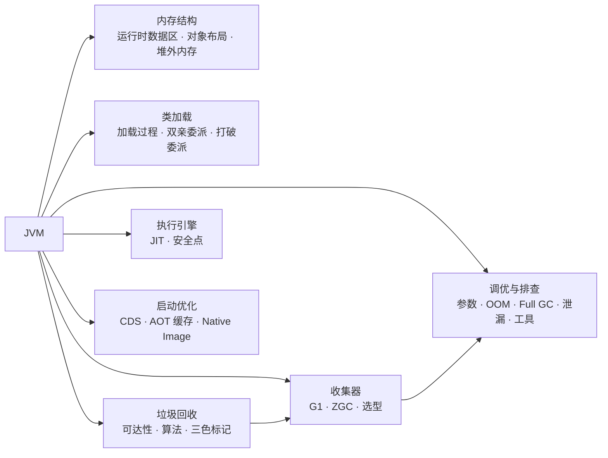

## 题目索引

| 编号 | 题目 | 难度 | 层级 |
| --- | --- | --- | --- |
| 04-01 | JVM 运行时数据区有哪些？JDK 8 前后有什么变化？ | ★ | 资深 |
| 04-02 | 对象是怎么创建的？在内存中长什么样？ | ★★ | 资深 |
| 04-03 | 容器里 Java 进程的内存为什么远大于 -Xmx？ | ★★★ | 资深 / 架构师 |
| 04-04 | 类加载的过程与初始化时机 | ★★ | 资深 |
| 04-05 | 双亲委派模型是什么？哪些场景需要打破它？ | ★★★ | 资深 / 架构师 |
| 04-06 | 如何判断对象可以回收？GC Roots 和四种引用 | ★★ | 资深 |
| 04-07 | GC 算法与分代收集；对象什么时候进入老年代？ | ★★ | 资深 |
| 04-08 | 三色标记与并发标记中的漏标问题 | ★★★ | 资深 / 架构师 |
| 04-09 | 垃圾收集器的演进与选型（JDK 25 视角） | ★★★ | 架构师 |
| 04-10 | G1 的工作原理 | ★★★ | 资深 / 架构师 |
| 04-11 | ZGC 的工作原理 | ★★★ | 架构师 |
| 04-12 | JVM 参数调优的思路；容器中如何配置 JVM？ | ★★★ | 架构师 |
| 04-13 | OOM 有哪些类型？如何排查？ | ★★★ | 资深 |
| 04-14 | Full GC 频繁或 GC 停顿过长，如何排查？ | ★★★ | 资深 |
| 04-15 | 内存泄漏有哪些常见场景？ | ★★ | 资深 |
| 04-16 | 常用的 JVM 诊断工具有哪些？ | ★★ | 资深 |
| 04-17 | JIT 编译做了哪些优化？ | ★★★ | 资深 |
| 04-18 | 什么是安全点？为什么 GC 很短但应用停顿很长？ | ★★★ | 架构师 |
| 04-19 | 如何优化 Java 应用的启动速度？ | ★★★ | 架构师 |

---

## 一、内存结构

### 04-01 JVM 运行时数据区有哪些？JDK 8 前后有什么变化？

> ★ ｜ 资深 ｜ 高频

**考察意图**：基础是否扎实，是否清楚永久代到元空间的变化及其原因。

**30 秒版回答**

- **线程私有**：
  - 程序计数器：当前线程执行到的字节码位置，唯一不会 OOM 的区域；
  - 虚拟机栈：每个方法调用对应一个栈帧（局部变量表、操作数栈、动态链接、返回地址），太深抛 StackOverflowError；
  - 本地方法栈：给 native 方法用，HotSpot 把它和虚拟机栈合二为一。
- **线程共享**：
  - 堆：几乎所有对象实例都在这里，是 GC 的主要区域；
  - 方法区：类的元数据、运行时常量池、JIT 编译后的代码等。它是规范中的概念，具体实现在 JDK 7 及之前是**永久代**，JDK 8 起是**元空间**（Metaspace，使用本地内存）。
- 两个位置变化：
  - **字符串常量池**和**类的静态变量**在 JDK 7 就从永久代移到了堆中（静态变量存放在对应的 Class 对象里）；
  - JDK 8 用元空间取代永久代（JEP 122），不再受 `-XX:MaxPermSize` 限制，默认上限只受本机内存约束（实测 `MaxMetaspaceSize` 默认无上限）。

**深入剖析**

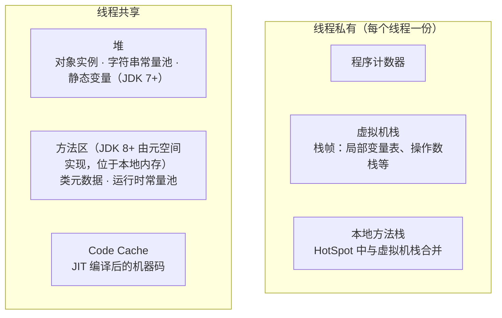

**追问链**

1. **为什么要用元空间替代永久代？**
   永久代大小在启动时固定，类很多（大量动态代理、Groovy 脚本、JSP）时容易 `OutOfMemoryError: PermGen space`，而且很难估算合适的大小；永久代的回收与 Full GC 绑定，效率低。另一个直接原因是 HotSpot 与 JRockit 合并，JRockit 本身就没有永久代。
2. **元空间不设上限有什么风险？**
   类加载器泄漏（热部署、动态生成类不断增加）会让元空间无限增长，最终耗尽机器或容器内存。生产环境建议设置 `-XX:MaxMetaspaceSize`，让问题以 `OutOfMemoryError: Metaspace` 的形式尽早暴露。
3. **JVM 内存结构和 Java 内存模型（JMM）是一回事吗？**
   不是。前者讲 JVM 把内存划分成哪些区域；后者讲多线程之间的可见性和有序性规则，见[《03 Java 并发》](03-Java并发.md)03-01。

---

### 04-02 对象是怎么创建的？在内存中长什么样？

> ★★ ｜ 资深 ｜ 高频

**考察意图**：是否了解 TLAB、对象头、压缩指针，以及 JDK 25 紧凑对象头带来的变化。

**30 秒版回答**

- 创建过程：
  1. **类加载检查**：类没有加载过就先加载；
  2. **分配内存**：堆内存规整时用"指针碰撞"，不规整时用"空闲列表"。为避免多线程争抢，每个线程先在 Eden 中预分配一小块私有的 **TLAB**（Thread Local Allocation Buffer，默认开启），在自己的 TLAB 里分配不需要加锁；
  3. **内存清零**：保证字段不赋值也有默认值；
  4. **设置对象头**；
  5. **执行构造函数** `<init>`。
- 内存布局：**对象头 + 实例数据 + 对齐填充**（对象大小按 8 字节对齐）。
  - 对象头 = Mark Word（8 字节，存哈希码、GC 年龄、锁状态）+ 类型指针（开启压缩类指针时 4 字节）；数组对象还有 4 字节的长度。
- 实测（JDK 25，`Unsafe.objectFieldOffset`）：

| 配置 | 对象头大小（第一个字段的偏移量） | int[] 数据起始偏移量 |
| --- | --- | --- |
| 默认 | 12 字节 | 16 字节 |
| `-XX:+UseCompactObjectHeaders`（JEP 519，JDK 25 转正，默认关闭） | **8 字节** | 12 字节 |

  对于大量小对象的应用，每个对象省 4 字节，堆占用能明显下降。

**深入剖析**


**压缩指针**：64 位 JVM 上，引用默认被压缩成 32 位（`UseCompressedOops`，默认开启）。因为对象按 8 字节对齐，地址的低 3 位总是 0，把 32 位值左移 3 位就能寻址 2³² × 8 = **32 GB**。堆超过约 32 GB 时压缩指针自动失效，所有引用变成 8 字节，于是出现一个反直觉的现象：**33 GB 的堆可能比 31 GB 的堆能放的对象还少**。

**追问链**

1. **关闭压缩指针后，对象头会变成 16 字节吗？**
   不一定。JDK 15 起压缩类指针（`UseCompressedClassPointers`）与压缩普通指针解耦，实测关闭 `UseCompressedOops` 后对象头仍是 12 字节。
2. **`new Object()` 占多少字节？**
   默认配置下对象头 12 字节，按 8 字节对齐后是 16 字节；开启紧凑对象头后是 8 字节。
3. **TLAB 用完了怎么办？**
   申请一块新的 TLAB；如果要分配的对象太大，TLAB 放不下，就直接在 Eden 的共享区域用 CAS 分配。

---

### 04-03 容器里 Java 进程的内存为什么远大于 -Xmx？

> ★★★ ｜ 资深 / 架构师 ｜ 高频（容器化之后）

**考察意图**：是否清楚 JVM 进程内存的完整构成，能否解释"堆没满，容器却被 OOMKilled"。

**30 秒版回答**

- 进程内存 = 堆 + **堆外的一大堆东西**：
  - 元空间和压缩类空间（压缩类空间默认上限 1 GB，已核对）；
  - 线程栈：线程数 × 栈大小（Linux x64 默认 1 MB；实测 macOS AArch64 为 2 MB）；
  - Code Cache：JIT 编译后的代码（实测 `ReservedCodeCacheSize` 默认 240 MB）；
  - 直接内存：NIO 的 DirectByteBuffer、Netty 的内存池。`MaxDirectMemorySize` 默认值为 0，表示上限**等于最大堆大小**；
  - GC 自身的数据结构（如 G1 的记忆集），在堆大、对象引用复杂时可能占到堆的百分之几到十几；
  - JVM 内部的符号表、JNI 本地库分配的内存、glibc 的内存分配器（malloc arena）预留等。
- 所以"把 -Xmx 设成容器内存上限"一定会被 OOMKilled。经验值：堆占容器内存的 **50% ~ 75%**，再用 NMT 实测确认。
- 排查工具：`-XX:NativeMemoryTracking=summary` 启动后，用 `jcmd <pid> VM.native_memory summary` 查看 JVM 自己管理的各区域占用；NMT 统计不到的部分（JNI 库、malloc 碎片），要用 `pmap` 或系统级工具分析。

**深入剖析**

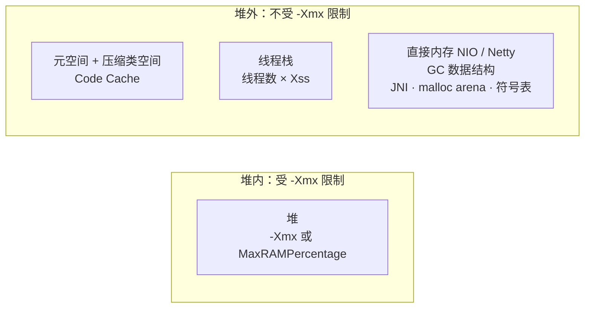

两部分加起来超过容器的内存上限，进程就会被内核直接 OOMKilled（退出码 137），堆本身可能还远没有用满。

**容器中的默认堆大小**：JDK 10 起（并向下移植到 8u191）JVM 能识别容器的内存限制，默认最大堆是容器内存的 **25%**（实测 `MaxRAMPercentage = 25`，用 `-XX:MaxRAM=2g` 模拟时最大堆为 512 MB）。4 GB 的容器默认只给 1 GB 堆，大部分场景偏小，应显式设置 `-XX:MaxRAMPercentage=70` 左右。

**追问链**

1. **线程很多时要注意什么？**
   1000 个线程 × 1 MB 栈 = 1 GB 的虚拟内存预留（实际占用取决于栈用了多深）。线程数过多除了内存，还有上下文切换的开销，这也是虚拟线程的价值所在。
2. **Pod 被 OOMKilled，但 Java 日志里没有任何 OOM 异常，正常吗？**
   正常。这是内核按 cgroup 限制直接杀掉了进程，JVM 来不及做任何处理。要从"堆外内存"的角度排查，而不是去找堆转储。

---

## 二、类加载

### 04-04 类加载的过程与初始化时机

> ★★ ｜ 资深 ｜ 中频

**考察意图**：是否清楚每个阶段做了什么，能否判断"哪些写法会触发类初始化"。

**30 秒版回答**

- 生命周期：**加载 → 链接（验证、准备、解析）→ 初始化 → 使用 → 卸载**。
  - 加载：根据全限定名读取字节流，在方法区生成类的元数据，在堆中生成对应的 Class 对象；
  - 验证：检查字节码格式和语义是否合法；
  - 准备：为**静态变量**分配内存并赋**默认值**（0、null），`static final` 的编译期常量此时直接赋最终值；
  - 解析：把常量池中的符号引用替换为直接引用（可以延迟到第一次使用时）；
  - 初始化：执行 `<clinit>`，也就是静态变量赋值语句和 static 代码块，按源码顺序执行。
- 主动使用才会触发初始化：`new`、读写非常量的静态字段、调用静态方法、反射、初始化子类时先初始化父类、启动时的主类。
- **不会**触发初始化的被动引用：通过子类引用父类的静态字段（只初始化父类）；创建该类的数组；引用编译期常量（常量在编译时已经内联到调用方）。

**深入剖析**

`<clinit>` 由 JVM 保证**线程安全**：多个线程同时初始化一个类时，只有一个线程执行，其他线程阻塞等待。静态内部类单例（Holder 模式）正是利用了这一点：

```java
public final class IdGenerator {
    private IdGenerator() {
    }

    /** 外部类加载时不会初始化 Holder，第一次调用 getInstance 时才触发，且由 JVM 保证只初始化一次 */
    private static final class Holder {
        private static final IdGenerator INSTANCE = new IdGenerator();
    }

    public static IdGenerator getInstance() {
        return Holder.INSTANCE;
    }
}
```

**追问链**

1. **类初始化会导致死锁吗？**
   会。线程 1 初始化类 A，A 的静态代码块用到了类 B；同时线程 2 初始化类 B，B 的静态代码块用到了类 A。两个线程各自持有一个类的初始化锁、等待另一个，形成死锁。jstack 中能看到线程停在 `<clinit>`。静态初始化代码应尽量简单，不要互相引用。
2. **静态代码块里抛出异常会怎样？**
   第一次使用时抛 `ExceptionInInitializerError`，之后再使用这个类，会抛 `NoClassDefFoundError: Could not initialize class X`。线上看到后者，要去找第一次初始化失败时的日志。

---

### 04-05 双亲委派模型是什么？哪些场景需要打破它？

> ★★★ ｜ 资深 / 架构师 ｜ 高频

**考察意图**：能否讲清楚委派的目的，以及 SPI、Tomcat、模块化等打破或修改委派的原因。

**30 秒版回答**

- JDK 9 起的类加载器层次（已实测）：
  - **启动类加载器**（Bootstrap，在 Java 中表现为 null）：加载 `java.base` 等核心模块，例如 String；
  - **平台类加载器**（`ClassLoaders$PlatformClassLoader`，取代了 JDK 8 的扩展类加载器）：加载 `java.sql` 等平台模块；
  - **应用类加载器**（`ClassLoaders$AppClassLoader`）：加载类路径上的类。
- 双亲委派：加载类时先检查自己是否已加载过，没有就**先委派给父加载器**，父加载器找不到时才自己加载（`loadClass` → `findLoadedClass` → `parent.loadClass` → `findClass`）。
- 目的：**安全**（自己写的 `java.lang.String` 永远不会被加载，核心类不会被篡改）和**唯一**（同一个类不会被不同加载器重复加载）。
- 需要打破的场景：
  1. **SPI**：核心库中的代码要加载应用提供的实现类，只能借助线程上下文类加载器，见[《01 Java 基础》](01-Java基础.md)01-15；
  2. **Tomcat**：每个 Web 应用有自己的 WebappClassLoader，**优先自己加载**（java.* 等核心类除外），实现应用之间的隔离，允许不同应用使用同一个库的不同版本；
  3. **热部署**：丢弃旧的类加载器、创建新的类加载器重新加载，例如 Spring Boot DevTools 的重启类加载器；
  4. **OSGi 等模块化框架**：类加载器之间是网状委派。
- JDK 9 模块化后的变化：平台和应用类加载器在委派给父加载器之前，会先判断要加载的类属于哪个命名模块，**直接交给负责该模块的加载器**。

**深入剖析**

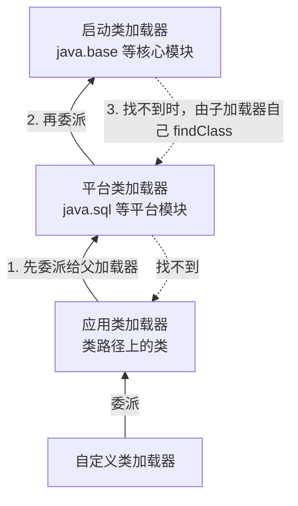

类的身份 = **类的全限定名 + 定义它的类加载器**。同名的类被两个不同的加载器加载，就是两个不同的类型。这解释了一个经典的诡异异常：`ClassCastException: com.x.User cannot be cast to com.x.User`。常见于热部署之后，或者同一个类既在 Web 应用中、又在容器的共享目录中。

**追问链**

1. **自定义类加载器应该重写 loadClass 还是 findClass？**
   只想从新的位置加载类时，重写 `findClass`，保留双亲委派；只有在确实要改变委派顺序时（比如实现 Tomcat 那样的隔离），才重写 `loadClass`。
2. **类什么时候会被卸载？**
   同时满足三个条件：该类的所有实例都已被回收；加载它的类加载器已被回收；它的 Class 对象没有在任何地方被引用。由启动、平台、应用类加载器加载的类基本不会被卸载，所以热部署必须依赖自定义类加载器。
3. **Spring Boot 的可执行 jar 是怎么加载嵌套 jar 的？**
   标准的 `URLClassLoader` 不能直接读取 jar 中嵌套的 jar。Spring Boot 的启动器使用自己的类加载器和 URL 处理器读取 `BOOT-INF/lib` 下的依赖，`Main-Class` 指向 Spring Boot 的启动类，再由它启动应用的主类。

**架构师加分点**

做插件化、多租户脚本、规则引擎热更新这类需求时，类加载器隔离是核心手段：每个插件一个类加载器，共享 API 由父加载器加载，实现由插件加载器加载。同时要防止类加载器泄漏：插件卸载时清理它注册的线程、ThreadLocal、JDBC 驱动、定时任务，否则元空间会持续增长。

---

## 三、垃圾回收基础

### 04-06 如何判断对象可以回收？GC Roots 和四种引用

> ★★ ｜ 资深 ｜ 高频

**考察意图**：是否理解可达性分析，能否说出四种引用各自的使用场景。

**30 秒版回答**

- JVM 用**可达性分析**：从一组 GC Roots 出发沿引用关系遍历，遍历不到的对象就是可回收的。不用引用计数，因为它解决不了循环引用。
- 常见的 GC Roots：
  - 各线程栈帧中的局部变量和参数；
  - 已加载类的静态字段（类本身由类加载器持有）；
  - JNI 引用；
  - 被 synchronized 持有的锁对象；
  - JVM 内部的引用（基本类型对应的 Class 对象、常驻的异常对象、系统类加载器等）。
- 四种引用强度：

| 引用 | 何时被回收 | 典型用途 |
| --- | --- | --- |
| 强引用 | 只要可达就不回收 | 普通对象引用 |
| 软引用 SoftReference | 内存不足、即将 OOM 之前 | 内存敏感的缓存（实际很少推荐，见追问） |
| 弱引用 WeakReference | 下一次 GC 时 | WeakHashMap、ThreadLocalMap 的 key |
| 虚引用 PhantomReference | 不影响回收，只用于在对象被回收后收到通知 | `Cleaner`、堆外内存释放 |

**深入剖析**

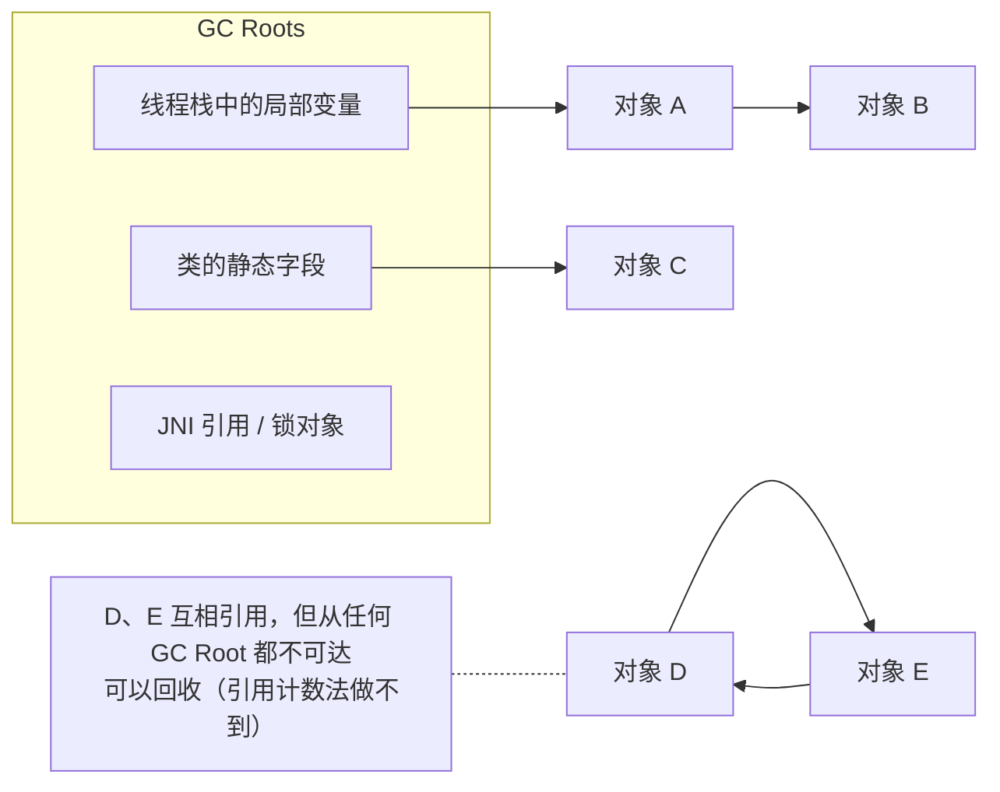

**追问链**

1. **为什么不推荐用软引用做缓存？**
   软引用只在内存快要耗尽时才集中回收，回收时机不可控：平时占满堆，一旦回收又是大批量地清空，同时引发长时间的 GC。缓存应该用有明确容量上限和淘汰策略的组件（Caffeine）。
2. **对象被判定不可达后，一定马上被回收吗？**
   不一定。它只是"可回收"，具体什么时候回收取决于收集器和它所在的区域。历史上覆盖了 finalize 的对象还要经过一次 finalize 才能真正回收，见[《01 Java 基础》](01-Java基础.md)01-06。

---

### 04-07 GC 算法与分代收集；对象什么时候进入老年代？

> ★★ ｜ 资深 ｜ 高频

**考察意图**：是否理解三种基本算法的取舍，以及对象晋升的几种路径。

**30 秒版回答**

- 三种基本算法：
  - **标记-清除**：会产生内存碎片；
  - **标记-复制**：没有碎片，但需要额外的空闲空间，适合存活率低的区域；
  - **标记-整理**：没有碎片，但移动对象的成本高，适合存活率高的区域。
- **分代假说**：绝大多数对象朝生夕灭；熬过多次 GC 的对象往往会一直存活。所以把堆分为年轻代和老年代：年轻代用复制算法，老年代用整理算法（或者像 G1 那样按区域选择性地回收）。
- 对象进入老年代的几种情况：
  1. **年龄达到阈值**：每熬过一次 Young GC 年龄加 1，达到 `MaxTenuringThreshold`（默认 15，已核对）后晋升；
  2. **动态年龄判断**：Survivor 中某个年龄及以下的对象总大小超过 Survivor 空间的一半（`TargetSurvivorRatio` 默认 50），大于等于该年龄的对象直接晋升；
  3. **Survivor 放不下**：Young GC 后存活对象太多，放不进 Survivor 的直接进入老年代；
  4. **大对象**：G1 中超过半个 Region 大小的对象（Humongous 对象）直接分配在老年代的连续 Region 中。

**深入剖析**

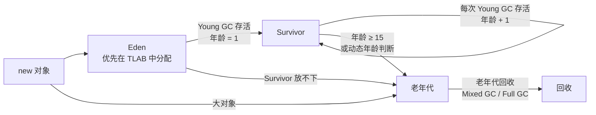

**追问链**

1. **为什么要有两个 Survivor 区？**
   复制算法需要一块空的目标区域。每次 Young GC 把 Eden 和其中一个 Survivor 的存活对象复制到另一个 Survivor，两个 Survivor 轮流作为"来源"和"目标"，始终有一个是空的，也就不会产生碎片。（G1 中 Survivor 由若干个 Region 组成，数量动态调整，但思想相同。）
2. **"大对象直接进老年代"有什么坑？**
   在 G1 中，频繁分配略大于半个 Region 的数组（比如一次性加载的大批量查询结果、大的 byte 数组），会占用大量 Humongous Region，导致老年代被快速填满、过早触发并发标记甚至 Full GC。可以调大 `-XX:G1HeapRegionSize`，或者在业务上避免一次性分配巨大的对象。

---

### 04-08 三色标记与并发标记中的漏标问题

> ★★★ ｜ 资深 / 架构师 ｜ 中频，区分度高

**考察意图**：是否理解并发收集器的核心难题，能否说出增量更新和 SATB 的区别。

**30 秒版回答**

- 三色标记把对象分成三种状态：
  - **白色**：还没被访问到，标记结束时仍为白色的对象会被回收；
  - **灰色**：自己已被访问，但它引用的对象还没有全部扫描完；
  - **黑色**：自己和它引用的对象都已扫描完。
- 并发标记时用户线程仍在修改引用，可能造成**漏标**：一个存活对象被错误地当成垃圾回收。漏标必须**同时满足两个条件**：
  1. 一个**黑色**对象新增了一条指向**白色**对象的引用；
  2. 所有从**灰色**对象到这个白色对象的路径都被删除了。
- 破坏任意一个条件即可：
  - **增量更新**（CMS 使用）：破坏条件 1。黑色对象新增引用时用写屏障记录下来，重新标记阶段把这些黑色对象当作灰色重新扫描；
  - **SATB，原始快照**（G1、Shenandoah 使用）：破坏条件 2。删除引用时用写屏障把被删除的旧引用记录下来，按照"标记开始时的快照"把它们视为存活。代价是会多保留一些本已死亡的对象（浮动垃圾），留到下一轮回收。

**深入剖析**

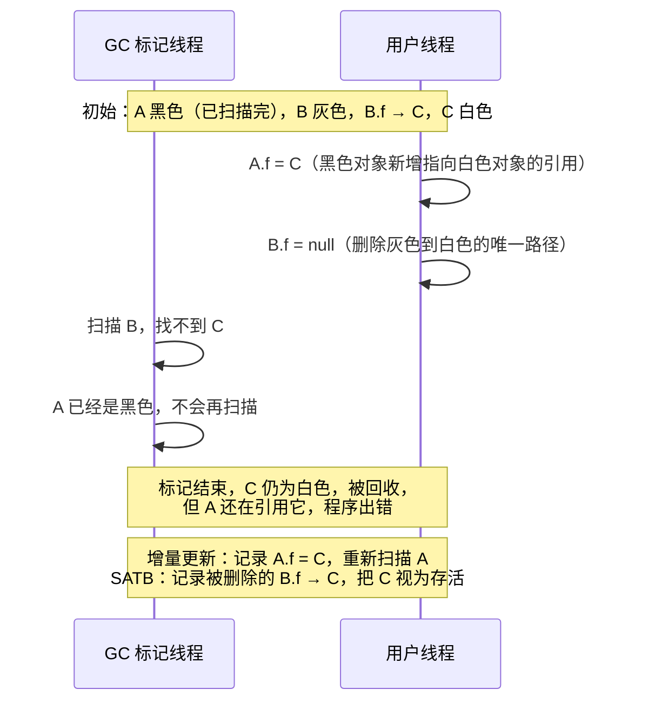

**追问链**

1. **G1 为什么选 SATB 而不是增量更新？**
   SATB 只需要在重新标记阶段处理写屏障记录的引用，不需要重新扫描黑色对象，所以重新标记的停顿时间更短、更可预测，符合 G1 追求可控停顿的目标。
2. **ZGC 如何处理并发问题？**
   ZGC 依靠读屏障和着色指针，在用户线程读取引用时检查并修正对象状态，从而实现并发标记和并发转移，见 04-11。

---

## 四、收集器

### 04-09 垃圾收集器的演进与选型（JDK 25 视角）

> ★★★ ｜ 架构师 ｜ 高频

**考察意图**：知识是否停留在 JDK 8 的 CMS 时代，能否根据业务目标选择收集器。

**30 秒版回答**

- 演进脉络（JDK 25 视角）：

| 收集器 | 特点 | 状态 |
| --- | --- | --- |
| Serial | 单线程，STW | 仍在；1 个 CPU 的环境会被自动选中（实测 `-XX:ActiveProcessorCount=1` 时默认为 Serial） |
| Parallel | 多线程，吞吐优先 | 仍在；**JDK 8 的默认收集器** |
| CMS | 并发标记清除，低停顿，有碎片 | JDK 9 废弃，**JDK 14 移除**（JEP 363） |
| G1 | 分区，可预测停顿 | **JDK 9 起成为默认**（实测 JDK 25 默认即 G1） |
| ZGC | 并发转移，亚毫秒级停顿 | JDK 15 转正；JDK 21 推出分代模式；JDK 23 默认分代；**JDK 24 移除非分代模式**（实测 `-XX:+ZGenerational` 提示"support was removed in 24.0"） |
| Shenandoah | 并发转移，低停顿 | JDK 15 转正；JDK 25 分代模式转正（JEP 521）；**Oracle 发布的构建不包含它**（实测本机 jdk.java.net 构建报"not supported"），需要用 Temurin、Corretto、Red Hat 等发行版 |
| Epsilon | 只分配不回收 | JDK 11 引入，用于性能测试和极短命的任务 |

- 选型：
  - 大多数在线服务：**G1**，默认即可，先只设置堆大小；
  - 对延迟敏感、堆大（几十 GB 以上）、能接受一定吞吐损失：**分代 ZGC**；
  - 离线批处理、只看吞吐：**Parallel**；
  - 小于 2 个 CPU 的小容器：JVM 会自动选 Serial，如果对延迟有要求，要显式指定 G1，并考虑给容器分配更多 CPU。

**深入剖析**

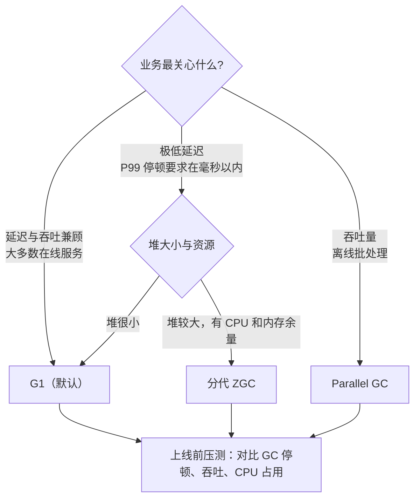

**追问链**

1. **低延迟收集器的代价是什么？**
   读写屏障会消耗一部分 CPU，吞吐量通常略低于 G1 和 Parallel；并发回收需要堆留有余量，回收速度跟不上分配速度时，ZGC 会出现"分配停顿"（Allocation Stall），线程在分配内存时被阻塞。
2. **从 JDK 8 + CMS 升级到 JDK 21 + G1，参数要怎么改？**
   - 去掉所有 CMS 参数：实测在 JDK 21 / 25 上，`-XX:+UseConcMarkSweepGC`、`-XX:CMSInitiatingOccupancyFraction=70` 都会报 "Unrecognized VM option"，**JVM 直接无法启动**；
   - 去掉 `-Xmn`、`-XX:NewRatio` 之类固定年轻代大小的参数，G1 会自动调整年轻代，固定它反而会破坏停顿预测；
   - GC 日志改用统一日志 `-Xlog:gc*`。旧的 `-XX:+PrintGCDetails` 实测只打印废弃警告并自动转换，但 `-XX:+PrintGCDateStamps` 这类参数已不再识别；
   - 然后只保留堆大小和停顿目标，压测后再微调。

---

### 04-10 G1 的工作原理

> ★★★ ｜ 资深 / 架构师 ｜ 高频

**考察意图**：能否讲清 Region、记忆集、回收周期和"停顿可预测"是如何实现的。

**30 秒版回答**

- **Region 化**：堆被划分为大量大小相同的 Region（大小为 2 的幂，按堆大小自动选择，也可用 `-XX:G1HeapRegionSize` 指定）。每个 Region 动态扮演 Eden、Survivor、Old 或 Humongous（大对象）角色，年轻代和老年代不再是固定的连续空间。
- **记忆集**（Remembered Set，RSet）：每个 Region 记录"有哪些其他 Region 引用了我"。回收某些 Region 时只需扫描它们的 RSet，不用扫描整个堆。RSet 靠写屏障维护。
- 回收周期：
  1. **Young GC**：STW，把所有年轻代 Region 中的存活对象复制到 Survivor 或老年代；
  2. 老年代占用达到阈值（`InitiatingHeapOccupancyPercent` 默认 45，默认开启自适应调整，已核对）时，触发**并发标记**：初始标记（借助一次 Young GC 完成）→ 并发标记 → 重新标记（STW）→ 清理；
  3. **Mixed GC**：在回收年轻代的同时，挑选一部分**垃圾最多**的老年代 Region 一起回收（Garbage-First 名字的由来）。
- **停顿可预测**：G1 根据历史数据估算每个 Region 的回收耗时，在 `MaxGCPauseMillis`（默认 200 ms，已核对）的预算内选择收益最高的一组 Region。
- 兜底：回收速度跟不上分配速度时会发生 Full GC（JDK 10 起是并行的，JEP 307），停顿很长，需要避免。

**深入剖析**

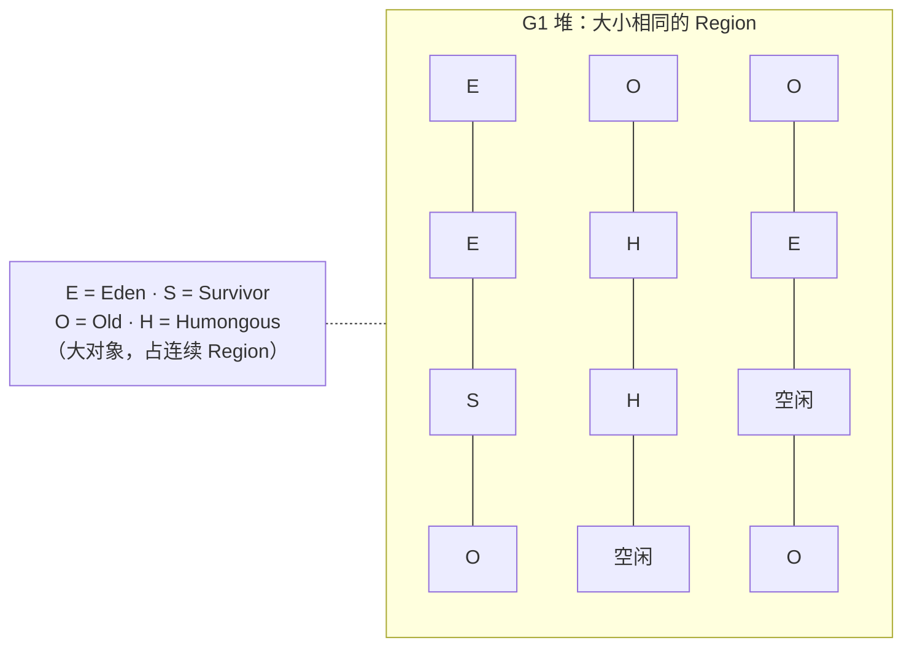

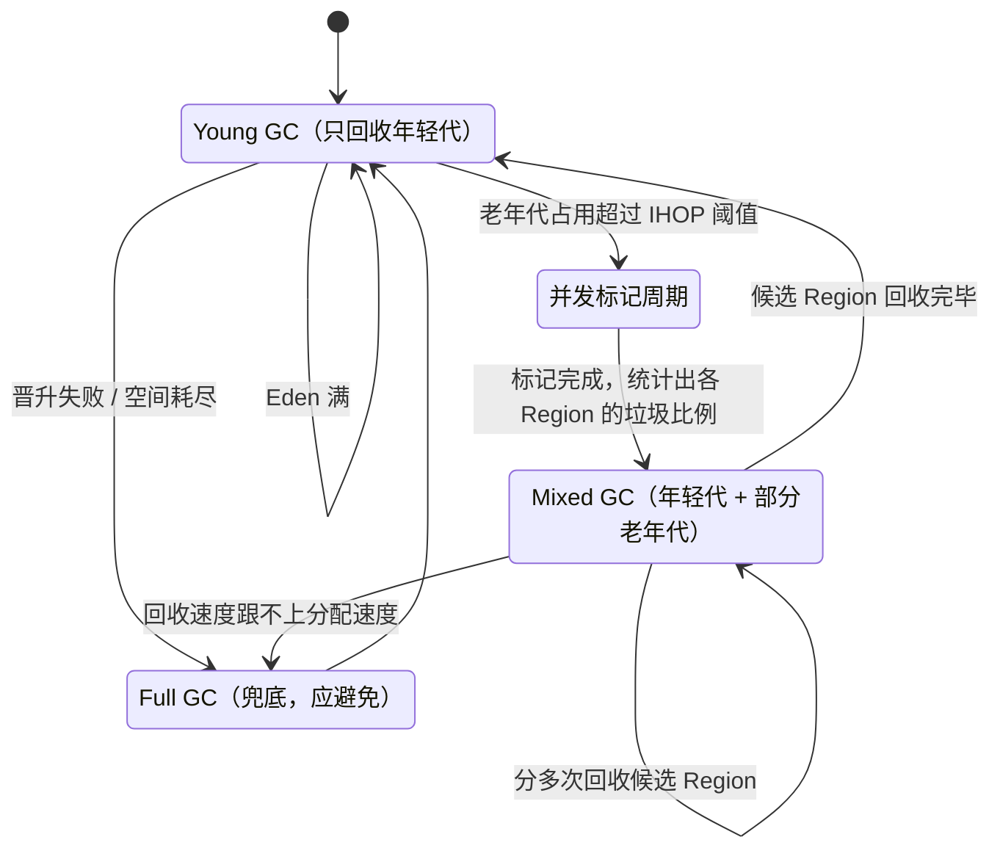

**追问链**

1. **`MaxGCPauseMillis` 设得越小越好吗？**
   不是。设得太小，G1 每次只能回收很少的 Region，回收速度跟不上分配速度，反而导致更频繁的 GC，甚至 Full GC。一般保持默认值，或根据业务的延迟要求做小幅调整。
2. **日志中出现 "to-space exhausted" 或 "Evacuation Failure" 是什么意思？**
   复制存活对象时找不到空闲的 Region，通常说明堆太小，或者瞬时的分配速率太高。处理方式：加大堆、降低 IHOP 让并发标记更早开始、排查突发的大量分配。
3. **G1 的写屏障做了什么？**
   有两类：写之前的屏障把被覆盖的旧引用记入 SATB 队列（用于并发标记，见 04-08）；写之后的屏障把跨 Region 的新引用对应的卡片标记为脏，后续由线程更新到 RSet。

---

### 04-11 ZGC 的工作原理

> ★★★ ｜ 架构师 ｜ 中频（低延迟场景高频）

**考察意图**：是否理解 ZGC 能做到停顿时间与堆大小无关的原因。

**30 秒版回答**

- 目标：GC 停顿不超过 1 毫秒（设计目标），且**停顿时间与堆大小无关**，最大支持 16 TB 的堆。
- 两个核心技术：
  - **着色指针**：在对象引用（指针）中借用若干位存放元数据（标记状态、是否已重新映射），通过指针本身就能知道对象处于 GC 的哪个阶段；
  - **读屏障**（load barrier）：用户线程从堆中读取一个引用时，插入一小段检查代码。如果指针的"颜色"不对（比如对象已经被移动），就走慢速路径：找到对象的新地址，并**把这个引用就地修正**（自愈），下次读取就不再走慢速路径。
- 因此标记、转移（移动对象）、重定位这些耗时的工作都可以与用户线程**并发执行**，只有扫描根集合等极短的步骤需要 STW。
- **分代 ZGC**（JDK 21 引入，JDK 23 成为默认，JDK 24 起是唯一模式）：增加年轻代和老年代，频繁回收年轻代，降低了回收开销和对内存余量的要求；同时引入了写屏障。

**深入剖析**

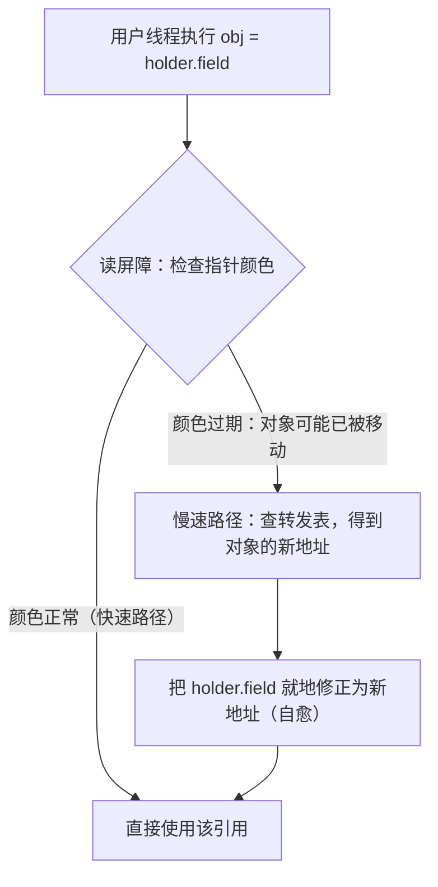

**追问链**

1. **ZGC 一般需要调哪些参数？**
   通常只需要设置 `-Xmx`，必要时用 `-XX:SoftMaxHeapSize` 设一个软上限，让 ZGC 尽量把堆控制在这个范围内，只在必要时才用到 `-Xmx`。其余参数（如并发 GC 线程数）大多可以交给 JVM 自适应。
2. **什么情况下 ZGC 反而表现不好？**
   CPU 资源紧张时（并发回收要和业务线程争 CPU）；分配速率极高、堆余量不足时，会出现分配停顿；对吞吐非常敏感的批处理任务，读写屏障的开销可能不划算。

---

## 五、调优与排查

### 04-12 JVM 参数调优的思路；容器中如何配置 JVM？

> ★★★ ｜ 架构师 ｜ 高频

**考察意图**：是否有方法论（目标、度量、单变量调整），而不是堆砌参数。

**30 秒版回答**

- 调优的顺序：
  1. **先确定目标**：延迟（P99 停顿）、吞吐（GC 时间占比）、内存占用，三者不可兼得；
  2. **先度量**：打开 GC 日志，用 JFR 采样，拿到基线数据；
  3. **先排除代码问题**：大部分"GC 问题"其实是代码问题（内存泄漏、一次性加载大量数据、缓存无上限），调参数解决不了；
  4. **一次只改一个参数**，压测对比；
  5. 默认值往往已经足够好：现代 JVM 的自适应能力很强，参数越少越好。
- 容器中的基础配置（JDK 21 / 25）：用 `MaxRAMPercentage` 而不是写死 `-Xmx`，这样调整容器规格时不用改参数；保留 GC 日志和 OOM 现场；让编排系统负责重启。

**深入剖析**

一套适合大多数在线服务的起步参数（需按压测结果调整）：

```bash
java \
  -XX:MaxRAMPercentage=70 -XX:InitialRAMPercentage=70 \
  -XX:MaxMetaspaceSize=512m \
  -Xlog:gc*,safepoint:file=/logs/gc-%p-%t.log:time,uptime,level,tags:filecount=10,filesize=50m \
  -XX:+HeapDumpOnOutOfMemoryError -XX:HeapDumpPath=/dumps \
  -XX:+ExitOnOutOfMemoryError \
  -jar app.jar
```

| 参数 | 作用 | 说明 |
| --- | --- | --- |
| `MaxRAMPercentage=70` | 最大堆占容器内存的 70% | 默认只有 25%（已核对），通常偏小；剩余 30% 留给堆外内存，见 04-03 |
| `InitialRAMPercentage=70` | 初始堆与最大堆一致 | 避免运行中扩缩堆带来的停顿和抖动 |
| `MaxMetaspaceSize` | 限制元空间 | 让类加载器泄漏尽早以 OOM 的形式暴露 |
| `-Xlog:gc*,safepoint` | 统一日志格式的 GC 和安全点日志 | 带轮转，防止写满磁盘 |
| `HeapDumpOnOutOfMemoryError` | OOM 时自动转储堆 | 转储目录要挂载持久卷，否则容器重启后就丢了 |
| `ExitOnOutOfMemoryError` | OOM 后直接退出 | 发生 OOM 的 JVM 状态已经不可信，让 K8s 重启比"带病运行"更好 |

**追问链**

1. **JVM 在容器里拿到的 CPU 数准确吗？**
   JVM 会根据 cgroup 的 CPU 配额计算可用的处理器数，它决定了 GC 线程数、ForkJoinPool 公共池的并行度、虚拟线程调度器的并行度等。配额很小（比如 1 个 CPU）时，JVM 会把它当作非服务器级机器，**自动选择 Serial GC**（实测）。可以用 `-XX:ActiveProcessorCount` 显式指定。
2. **为什么不建议 `-XX:+DisableExplicitGC`？**
   NIO 分配直接内存时，如果额度不够，会调用 `System.gc()` 来回收已经不可达的 DirectByteBuffer，从而释放它们占用的堆外内存。禁用显式 GC 后这条路被堵死，可能出现 `OutOfMemoryError: Direct buffer memory`。如果是担心 `System.gc()` 造成长停顿，用 `-XX:+ExplicitGCInvokesConcurrent`，让它触发一次并发周期而不是 Full GC。

**架构师加分点**

JVM 参数应该作为**基础设施的一部分统一管理**：基础镜像中放一份经过压测的默认参数，按服务类型（在线、批处理、网关）提供少数几个模板，业务只覆盖必要的项。比每个服务各自调参、无人能说清的状况要好得多。

---

### 04-13 OOM 有哪些类型？如何排查？

> ★★★ ｜ 资深 ｜ 高频

**考察意图**：能否根据错误信息快速判断方向，并有一套标准的排查流程。

**30 秒版回答**

不同的错误信息指向不同的区域，排查方向完全不同：

| 错误信息 | 含义 | 常见原因 | 排查方向 |
| --- | --- | --- | --- |
| `Java heap space` | 堆满了 | 内存泄漏、一次性加载大量数据、堆设置过小 | 堆转储 + MAT 分析 |
| `GC overhead limit exceeded` | GC 时间占比超过 98%，却只回收了不到 2% 的堆 | 本质上与 heap space 相同，堆接近耗尽 | 同上 |
| `Metaspace` | 元空间满了 | 动态生成类过多（CGLIB、Groovy、反射访问器）、类加载器泄漏 | 统计类加载数量，找出加载类最多的类加载器 |
| `Direct buffer memory` | 直接内存满了 | NIO / Netty 的缓冲区没有释放，或额度太小 | NMT、Netty 的泄漏检测 |
| `unable to create native thread` | 无法创建操作系统线程 | 线程泄漏、达到系统或容器的线程数 / 进程数上限、内存不足 | 统计线程数和线程名，检查 `ulimit -u` 和 cgroup 的 pids 限制 |
| `Requested array size exceeds VM limit` | 申请的数组超过 JVM 上限 | 代码 bug，例如长度计算错误 | 看异常堆栈 |
| 无 Java 异常，进程退出码 137 | 被内核 OOMKilled | 堆外内存超出容器限制 | 见 04-03 |

**深入剖析**

标准排查流程：

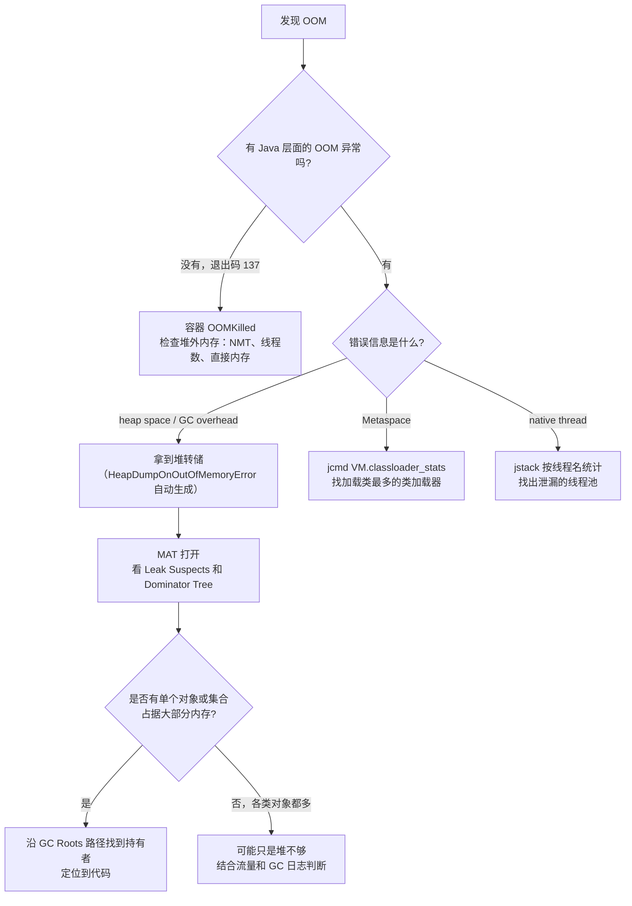

**追问链**

1. **线上 8 GB 的堆，直接 `jmap -dump` 可以吗？**
   要谨慎。`jmap -dump:live` 会先触发一次 Full GC，转储期间应用停顿，大堆可能停顿几十秒，还会产生同样大小的文件。应该先把这个实例从负载均衡中摘除，再做转储。
2. **MAT 的 Shallow Heap 和 Retained Heap 有什么区别？**
   Shallow 是对象本身占用的大小；Retained 是"如果这个对象被回收，总共能释放多少内存"，包括只被它引用的所有对象。找泄漏时看 Retained Heap。

---

### 04-14 Full GC 频繁或 GC 停顿过长，如何排查？

> ★★★ ｜ 资深 ｜ 高频

**考察意图**：能否从 GC 日志中读出原因，并区分"分配太多"和"回收不掉"两类问题。

**30 秒版回答**

- 第一步看 GC 日志中 Full GC 的**触发原因**（括号里的 cause），常见的有：

| 触发原因 | 含义 | 处理思路 |
| --- | --- | --- |
| `Allocation Failure` / `G1 Evacuation Pause` 后接 Full GC | 回收速度跟不上分配速度 | 降低分配速率，增大堆，让并发标记更早开始 |
| `Metadata GC Threshold` | 元空间达到阈值 | 检查动态类生成和类加载器泄漏 |
| `System.gc()` | 代码或库显式调用 | 找出调用方，考虑 `ExplicitGCInvokesConcurrent` |
| `G1 Humongous Allocation` | 大对象分配 | 避免巨大的数组，或调大 Region |
| `To-space exhausted` / 转移失败 | 复制时没有空闲 Region | 增大堆，提前开始并发标记 |

- 第二步判断是"**分配太多**"还是"**回收不掉**"：
  - 每次 Full GC 后老年代占用都能降到很低：说明是分配速率太高、对象过早晋升，属于"分配问题"；
  - Full GC 后老年代占用仍然很高，且一次比一次高：说明对象一直存活，大概率是**内存泄漏**，见 04-15。
- 常用工具：`jstat -gcutil <pid> 1000` 每秒观察各区域使用率和 GC 次数；用 JFR 的分配采样找出分配最多的代码位置。

**追问链**

1. **Young GC 停顿也很长，可能是什么原因？**
   存活对象太多（复制的成本与存活对象数量成正比）；跨代引用多，扫描记忆集耗时长；或者问题不在 GC 本身，而是**线程迟迟到不了安全点**，见 04-18。
2. **如何减少对象分配？**
   复用对象（尤其是大的缓冲区）；避免在循环中创建临时对象；避免把大量数据一次性加载到内存，改为分页或流式处理；日志中避免拼接无用的字符串（使用占位符）。

---

### 04-15 内存泄漏有哪些常见场景？

> ★★ ｜ 资深 ｜ 高频

**考察意图**：是否有真实的排查经验，能否举出具体场景。

**30 秒版回答**

Java 中的"内存泄漏"指对象已经没有用了，却仍然从 GC Roots 可达，无法被回收。常见场景：

1. **无上限的静态集合或缓存**：用 static 的 HashMap 做缓存，只放不删；
2. **ThreadLocal 没有 remove**：在线程池中，value 随线程一直存活，见[《03 Java 并发》](03-Java并发.md)03-19；
3. **监听器、回调注册后没有注销**；
4. **资源没有关闭**：连接、流、文件句柄；
5. **非静态内部类或匿名类持有外部类的引用**：内部类对象被长期持有（例如提交到线程池的匿名 Runnable、注册的回调），外部类对象也就无法回收；
6. **可变对象做 HashMap 的 key**：key 的 hashCode 改变后无法再删除，见[《01 Java 基础》](01-Java基础.md)01-01；
7. **类加载器泄漏**：热部署后旧的类加载器被某个线程、ThreadLocal 或 JDBC 驱动注册表引用，导致旧版本的所有类都无法卸载；
8. **大集合的 subList 被长期持有**，见[《02 集合类》](02-集合类.md)02-18。

**深入剖析**

判断方法：观察**每次 Full GC 之后**的老年代占用。正常的应用呈"锯齿状"，每次 Full GC 后都能回落到相近的水平；泄漏的应用则是锯齿的底部不断抬高。

定位方法：间隔一段时间做两次堆转储，在 MAT 中对比，看哪类对象的数量在持续增长，再沿着它到 GC Roots 的路径找到持有者。

**追问链**

1. **内存泄漏和内存溢出是什么关系？**
   泄漏是原因之一，溢出是结果。泄漏积累到一定程度会导致溢出；但溢出也可能只是因为负载太大、堆太小，并没有泄漏。

---

### 04-16 常用的 JVM 诊断工具有哪些？

> ★★ ｜ 资深 ｜ 高频

**考察意图**：是否有实际使用经验，能否为不同问题选对工具。

**30 秒版回答**

| 工具 | 用途 | 注意事项 |
| --- | --- | --- |
| `jcmd` | **统一入口**：`Thread.print`、`GC.heap_info`、`GC.class_histogram`、`GC.heap_dump`、`VM.flags`、`VM.native_memory`、`JFR.start`、`Thread.dump_to_file` | 优先使用，能替代下面大部分 j 系列工具 |
| `jstat` | 实时观察 GC 统计 | 开销极小，适合线上持续观察 |
| `jstack` | 线程转储 | 不显示虚拟线程，虚拟线程用 `jcmd Thread.dump_to_file -format=json` |
| `jmap` | 对象直方图、堆转储 | `-histo:live` 和 `-dump:live` 都会触发 Full GC |
| JFR + JMC | 低开销的持续记录：CPU、分配、锁、IO、GC、虚拟线程 | 默认配置的开销很低，可以在生产环境常开 |
| async-profiler | CPU、内存分配、锁、墙钟时间的火焰图 | 没有安全点偏差，比基于 JVMTI 采样的工具更准确 |
| Arthas | 线上诊断：`dashboard`、`thread -n 3`、`watch`、`trace`、`jad` 反编译 | 会修改字节码，用完要执行 `stop` 还原 |
| MAT | 分析堆转储 | 大的转储文件需要给 MAT 分配足够的内存 |

**追问链**

1. **什么是安全点偏差？**
   一些采样分析工具只能在线程到达安全点时采样，而热点循环中可能很少有安全点，导致采样结果偏向某些位置，看不到真正耗 CPU 的代码。async-profiler 基于操作系统信号和 `AsyncGetCallTrace` 采样，没有这个问题。

---

## 六、执行引擎

### 04-17 JIT 编译做了哪些优化？

> ★★★ ｜ 资深 ｜ 中频

**考察意图**：是否理解 Java "越跑越快"的原因，能否解释逃逸分析的真实效果。

**30 秒版回答**

- **分层编译**（`TieredCompilation`，默认开启）：代码先由解释器执行，热点方法依次被 C1（编译快，优化少）和 C2（编译慢，优化激进）编译。热点通过方法调用计数器和循环回边计数器探测，循环可以在运行中途切换到编译后的代码（OSR，栈上替换）。实测分层编译下进入 C2 的调用阈值 `Tier4InvocationThreshold` 默认 5000。
- 主要优化：
  - **方法内联**：最重要的优化，消除调用开销，并为其他优化创造条件。字节码小于 35 字节的方法总会被内联，热点方法的上限是 325 字节（实测 `MaxInlineSize = 35`、`FreqInlineSize = 325`）；
  - **逃逸分析**：判断对象是否会逃出方法或线程，在此基础上做**标量替换**（把对象拆成若干局部变量，不再在堆上分配）和**锁消除**（实测 `DoEscapeAnalysis`、`EliminateAllocations`、`EliminateLocks` 默认都开启）；
  - 循环展开、去除冗余的空值和范围检查、**内建函数**（intrinsic，直接用特定的 CPU 指令实现 `System.arraycopy`、`Math` 中的方法等）。
- **去优化**：C2 的优化基于运行时收集的类型统计（例如"这个接口到目前为止只有一个实现"），假设被打破时会退回解释执行，之后重新编译。

**深入剖析**


一个常见误解：**HotSpot 并没有真正把对象分配到栈上**。逃逸分析的效果是标量替换，对象被拆成字段对应的局部变量，可能直接放在寄存器里，根本不存在一个对象。

**追问链**

1. **"Code Cache is full. Compiler has been disabled" 是什么问题？**
   存放 JIT 编译结果的 Code Cache 满了（实测默认预留 240 MB），JIT 停止编译新的热点方法，后续代码只能解释执行，性能会断崖式下降。动态生成大量类的应用更容易遇到，可以调大 `ReservedCodeCacheSize`。
2. **服务刚启动时为什么慢？怎么缓解？**
   热点代码还在解释执行，JIT 还没完成编译（预热问题）。缓解方法：发布时用预热流量提前触发编译；JDK 25 的 AOT 缓存可以保存方法的运行统计（JEP 515），让新启动的 JVM 更快地进入编译状态，见 04-19。

---

### 04-18 什么是安全点？为什么 GC 很短但应用停顿很长？

> ★★★ ｜ 架构师 ｜ 中频，区分度高

**考察意图**：是否理解 STW 的完整过程，是否遇到过"到达安全点耗时"的问题。

**30 秒版回答**

- **安全点**（safepoint）是代码中一些特定位置（方法返回、非计数循环的回边等），线程在这些位置时，JVM 能准确知道它的栈上哪些位置存放着对象引用。
- 需要 STW 的操作（GC 的停顿阶段、去优化、类重定义、部分线程转储等）要先让**所有**线程到达安全点。整个停顿 = **等所有线程到达安全点的时间（TTSP）** + 真正执行操作的时间。
- 如果某个线程在执行一个很长的循环、迟迟不经过安全点，其他所有已经停下来的线程都要等它。这就是"GC 日志显示只用了 10 毫秒，应用却停了 2 秒"的原因。
- 历史上的典型场景：以 int 为计数器的循环（计数循环）被 C2 优化掉了安全点检查。JDK 10 引入了**循环条带挖掘**（loop strip mining），把长循环拆成每 1000 次迭代检查一次安全点（实测 `UseCountedLoopSafepoints = true`、`LoopStripMiningIter = 1000`），大大缓解了这个问题。
- JDK 10 还引入了**线程本地握手**（JEP 312），一部分操作可以逐个线程执行，不再需要全局安全点。

**深入剖析**

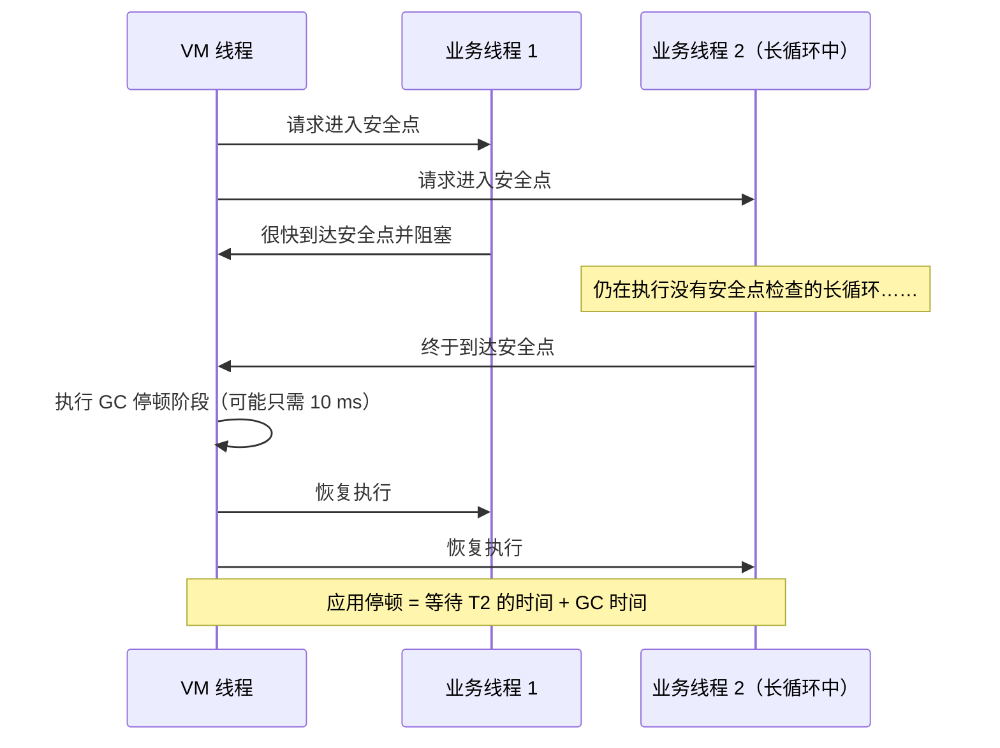

排查：打开 `-Xlog:safepoint`，看每次安全点操作中"到达安全点"花了多久；JFR 中也有安全点相关事件。

**追问链**

1. **处于 native 代码中的线程会阻塞安全点吗？**
   不会。执行 native 代码的线程被视为已经处于安全状态（它不会修改 Java 堆中的引用），只有在返回 Java 代码时才会被拦住。
2. **大数组拷贝、大对象清零会影响安全点吗？**
   某些内建操作在执行期间不检查安全点，超大的数组操作可能拖长 TTSP。这是避免一次性分配和拷贝超大数组的又一个理由。

---

## 七、启动优化

### 04-19 如何优化 Java 应用的启动速度？

> ★★★ ｜ 架构师 ｜ 中频（云原生、Serverless 场景高频）

**考察意图**：是否了解 JDK 近几个版本在启动优化上的进展，能否根据场景选择方案。

**30 秒版回答**

- 启动慢的三个来源：**类的加载与链接**、**框架初始化**（Spring 扫描 Bean、创建代理）、**JIT 预热**（刚启动时以解释执行为主）。
- 方案按侵入性从低到高：

| 方案 | 原理 | 版本 / 适用 |
| --- | --- | --- |
| CDS / AppCDS | 把解析好的类元数据存成归档文件，启动时直接映射 | JDK 12 起 JDK 自身的类默认使用 CDS；应用类需要额外生成归档 |
| **AOT 缓存** | 训练运行时记录加载并链接好的类，下次启动直接使用；JDK 25 还能保存方法的运行统计 | JDK 24 引入（JEP 483），JDK 25 简化为一步生成（JEP 514），并加入方法剖析数据（JEP 515） |
| CRaC | 在应用预热完成后对整个进程做检查点，之后从检查点恢复 | 需要支持 CRaC 的 JDK 发行版，仅限 Linux；要处理好连接、文件句柄等资源的关闭与重建 |
| GraalVM Native Image | 提前编译成本地可执行文件（封闭世界假设） | 启动最快、内存最小；但构建慢，反射和动态代理需要额外配置，峰值性能可能不如 JIT |

- JDK 25 中 AOT 缓存的用法（实测）：

```bash
# 训练运行：执行一遍有代表性的流程，退出时生成 AOT 缓存
java -XX:AOTCacheOutput=app.aot -cp app.jar com.example.Main

# 正式运行：使用缓存
java -XX:AOTCache=app.aot -cp app.jar com.example.Main
```

  实测注意点：类路径中**不能包含目录**，必须全部是 jar 包，否则生成时报 "Cannot have non-empty directory in paths"。

**深入剖析**

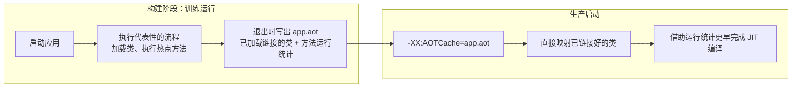

**追问链**

1. **AOT 缓存有什么约束？**
   训练和生产必须使用**同一个 JDK 版本、同一个平台**，类路径要一致（生产中可以在后面追加），否则缓存无法使用，JVM 会回退到正常启动。所以缓存应该在构建镜像时生成，和应用打包在一起。
2. **Spring Boot 应用怎么用这些能力？**
   Spring Boot 3.3 起文档中提供了 CDS 的使用方式：用一个"启动完上下文就退出"的训练运行生成归档。Spring Boot 3 起也支持 GraalVM Native Image（AOT 处理会在构建时生成 Bean 定义代码，减少运行时反射）。
3. **Native Image 适合什么场景？**
   Serverless 函数、命令行工具、需要快速扩容的小服务。对于长期运行、依赖大量反射和动态特性的大型单体应用，JIT 的峰值性能和兼容性优势通常更重要。

**架构师加分点**

选择启动优化方案时，先量化"启动慢"带来的真实影响：是影响弹性扩容的速度？是影响发布时长？还是 Serverless 的冷启动？不同的问题对应不同的方案。对于大多数 Kubernetes 上的常规服务，AOT 缓存（零代码改动）+ 合理的就绪探针和预热，就已经能解决大部分问题。
