# 05 · Spring

> 适用岗位：Java 资深开发 / 架构师
> 版本基线：Spring Framework 6.x / 7.x，Spring Boot 3.x / 4.x（Boot 4.0 于 2025 年 11 月发布）
> 事实核对：标「已核对」的结论来自本机 Maven 仓库中 Spring Framework 7.0.6、Spring Boot 4.0.4 的源码包
> 相关分类：[《01 Java 基础》](../01-Java核心/01-Java基础.md)（动态代理、注解、SPI）、[《12 Spring Cloud》](../03-分布式与微服务/12-SpringCloud.md)、[《15 MySQL》](../04-数据存储/15-MySQL.md)（事务隔离级别）、[《30 设计模式》](../07-工程实践与稳定性/30-设计模式.md)

## 知识地图

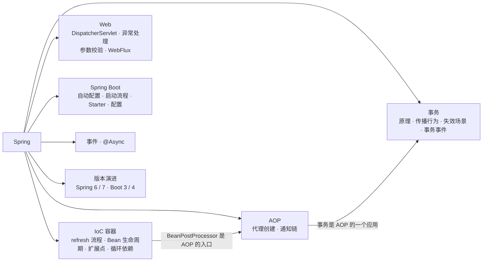

## 题目索引

| 编号 | 题目 | 难度 | 层级 |
| --- | --- | --- | --- |
| 05-01 | IoC 和 DI 的本质是什么？BeanFactory 和 ApplicationContext 有什么区别？ | ★ | 资深 |
| 05-02 | ApplicationContext 的启动流程（refresh 方法） | ★★★ | 资深 |
| 05-03 | Bean 的生命周期 | ★★★ | 资深 |
| 05-04 | BeanFactoryPostProcessor 和 BeanPostProcessor 有什么区别？各自的典型应用？ | ★★★ | 资深 / 架构师 |
| 05-05 | Spring 如何解决循环依赖？为什么需要三级缓存？ | ★★★ | 资深 |
| 05-06 | 为什么推荐构造器注入？@Autowired 和 @Resource 有什么区别？ | ★★ | 资深 |
| 05-07 | Bean 的作用域与线程安全；单例 Bean 中如何使用原型 Bean？ | ★★ | 资深 |
| 05-08 | FactoryBean 是什么？@Configuration 的 proxyBeanMethods 有什么作用？ | ★★ | 资深 |
| 05-09 | Spring AOP 的实现原理 | ★★★ | 资深 |
| 05-10 | @Transactional 的实现原理 | ★★★ | 资深 |
| 05-11 | 事务传播行为有哪些？怎么用？ | ★★ | 资深 |
| 05-12 | @Transactional 失效的常见场景 | ★★★ | 资深 |
| 05-13 | 事务中发 MQ、调远程接口，如何保证一致性？ | ★★★ | 架构师 |
| 05-14 | Spring MVC 的请求处理流程 | ★★ | 资深 |
| 05-22 | 全局异常处理是怎么实现的？Filter、拦截器、AOP 里抛的异常它都能接住吗？ | ★★ | 资深 |
| 05-23 | 参数校验怎么做？`@Valid` 和 `@Validated` 有什么区别？校验为什么会不生效？ | ★★ | 资深 |
| 05-24 | WebFlux 和 Spring MVC 有什么区别？有了虚拟线程，还需要响应式吗？ | ★★★ | 资深 / 架构师 |
| 05-15 | Spring Boot 自动配置的原理 | ★★★ | 资深 |
| 05-16 | Spring Boot 的启动流程 | ★★ | 资深 |
| 05-17 | 如何设计一个自定义 Starter？ | ★★ | 架构师 |
| 05-18 | 配置的加载优先级；@Value 和 @ConfigurationProperties 怎么选？ | ★★ | 资深 |
| 05-19 | Spring 的事件机制及其使用注意事项 | ★★ | 资深 |
| 05-20 | @Async 的原理与常见坑 | ★★ | 资深 |
| 05-21 | Spring 6 / 7 和 Spring Boot 3 / 4 有哪些重要变化？ | ★★★ | 架构师 |

---

## 一、IoC 容器

### 05-01 IoC 和 DI 的本质是什么？BeanFactory 和 ApplicationContext 有什么区别？

> ★ ｜ 资深 ｜ 高频

**考察意图**：能否说出 IoC 解决的真实问题，而不是背定义。

**30 秒版回答**

- **IoC（控制反转）**：对象不再自己创建和查找依赖，而是由容器创建对象、组装依赖、管理生命周期。"控制"指的是对象的创建和依赖关系的组装权，"反转"指这个权力从业务代码转移给了容器。
- **DI（依赖注入）**：IoC 的实现方式，容器通过构造函数、setter 或字段把依赖传进来。
- 解决的问题：**解耦**（依赖接口而不是具体实现，替换实现不改调用方）、**可测试**（测试时注入 Mock）、**统一管理横切逻辑**（因为对象由容器创建，容器才有机会给它包一层代理，实现事务、缓存、权限）。
- BeanFactory 是最基础的容器接口，只负责 Bean 的创建和获取，默认**延迟创建**；ApplicationContext 继承了 BeanFactory，增加了国际化、事件发布、资源加载、环境配置等能力，并且会在启动时**提前创建所有非延迟的单例 Bean**，配置错误能在启动时暴露。实际开发中用的都是 ApplicationContext。

**追问链**

1. **IoC 和"工厂模式"有什么区别？**
   工厂模式中，调用方仍然主动向工厂要对象；IoC 中，调用方只声明需要什么，由容器在创建它时主动注入，调用方对"依赖从哪来"完全无感知。
2. **为什么 ApplicationContext 要预先创建单例？**
   把依赖缺失、配置错误、初始化失败等问题提前到启动阶段暴露，而不是等到第一次请求才失败。代价是启动更慢，可以对少数重量级的 Bean 使用 `@Lazy`。

---

### 05-02 ApplicationContext 的启动流程（refresh 方法）

> ★★★ ｜ 资深 ｜ 高频

**考察意图**：是否读过 `AbstractApplicationContext.refresh()`，能否说清楚各类扩展点在哪一步生效。

**30 秒版回答**

`refresh()` 的主要步骤（已核对 Spring 7.0.6 源码）：

1. `prepareRefresh`：记录启动时间，初始化并校验环境属性；
2. `obtainFreshBeanFactory`：获取 BeanFactory（在 XML 时代还会在这里加载 Bean 定义）；
3. `prepareBeanFactory`：配置类加载器、表达式解析器，注册几个内置的 BeanPostProcessor 和环境相关的 Bean；
4. `postProcessBeanFactory`：留给子类的扩展，例如 Web 容器注册与请求、会话相关的作用域；
5. **`invokeBeanFactoryPostProcessors`**：执行所有 BeanFactoryPostProcessor。**配置类的解析（`@ComponentScan`、`@Import`、`@Bean`）就发生在这一步**，由 `ConfigurationClassPostProcessor` 完成，Spring Boot 的自动配置也在这里被导入；
6. **`registerBeanPostProcessors`**：实例化并注册所有 BeanPostProcessor，它们会作用于之后创建的所有 Bean；
7. `initMessageSource`：国际化；
8. `initApplicationEventMulticaster`：事件广播器；
9. `onRefresh`：留给子类，**Spring Boot 在这里创建并启动内嵌的 Web 服务器**；
10. `registerListeners`：注册事件监听器，发布之前积压的早期事件；
11. **`finishBeanFactoryInitialization`**：实例化所有非延迟的单例 Bean，Bean 的生命周期（见 05-03）就在这一步走完；
12. `finishRefresh`：启动实现了 Lifecycle 的组件，发布 `ContextRefreshedEvent`。

**深入剖析**

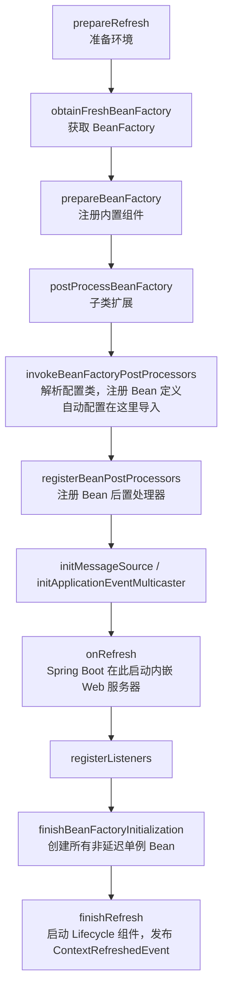

**追问链**

1. **为什么 BeanFactoryPostProcessor 要在 BeanPostProcessor 之前执行？**
   前者修改的是 Bean 的**定义**（还没有任何业务 Bean 被创建），后者处理的是 Bean 的**实例**。必须先把所有定义确定下来，才能开始按定义创建实例。
2. **refresh 过程中某个 Bean 创建失败会怎样？**
   捕获异常后会销毁已经创建的单例 Bean，并把上下文标记为未激活，然后重新抛出异常，应用启动失败。

---

### 05-03 Bean 的生命周期

> ★★★ ｜ 资深 ｜ 高频

**考察意图**：能否按源码顺序讲清楚，并知道各个回调的适用场景。

**30 秒版回答**

单例 Bean 的创建在 `AbstractAutowireCapableBeanFactory.doCreateBean` 中完成，顺序如下（已核对 Spring 7.0.6 源码）：

1. **实例化**：`createBeanInstance`，通过构造函数或工厂方法创建对象；
2. **合并 Bean 定义后处理**：`applyMergedBeanDefinitionPostProcessors`，例如 `AutowiredAnnotationBeanPostProcessor` 在这里找出带 `@Autowired` 的注入点；
3. **提前暴露引用**：`addSingletonFactory`，把一个能获取早期引用的工厂放进三级缓存，用于解决循环依赖，见 05-05；
4. **属性填充**：`populateBean`，完成依赖注入；
5. **初始化**：`initializeBean`，依次为：
   - Aware 回调（`BeanNameAware`、`BeanClassLoaderAware`、`BeanFactoryAware`）；
   - `BeanPostProcessor.postProcessBeforeInitialization`（`@PostConstruct` 在这里执行，`ApplicationContextAware` 等也在这里回调）；
   - `InitializingBean.afterPropertiesSet`，然后是自定义的 init-method；
   - `BeanPostProcessor.postProcessAfterInitialization`（**AOP 代理通常在这里创建**）；
6. **使用**；
7. **销毁**：容器关闭时依次执行 `@PreDestroy`、`DisposableBean.destroy`、自定义的 destroy-method。

**深入剖析**

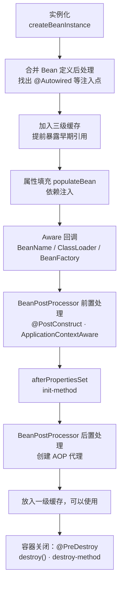

**追问链**

1. **`@PostConstruct` 和构造函数里做初始化有什么区别？**
   构造函数执行时依赖还没有注入（字段注入和 setter 注入的情况下），而 `@PostConstruct` 执行时所有依赖都已就绪。不过它仍然在 AOP 代理创建之前执行，所以在 `@PostConstruct` 里调用本类带 `@Transactional` 的方法，事务不会生效。
2. **原型 Bean 的销毁回调会执行吗？**
   不会。容器创建原型 Bean 后就不再管理它，需要使用方自己释放资源。
3. **想在所有单例都创建完之后执行一段逻辑，应该用什么？**
   `SmartInitializingSingleton.afterSingletonsInstantiated()`，或者监听 `ContextRefreshedEvent`；在 Spring Boot 中更常用 `ApplicationRunner` / `CommandLineRunner`，或监听 `ApplicationReadyEvent`。

---

### 05-04 BeanFactoryPostProcessor 和 BeanPostProcessor 有什么区别？各自的典型应用？

> ★★★ ｜ 资深 / 架构师 ｜ 中频

**考察意图**：是否理解 Spring 的扩展体系，能否用它们实现框架级功能。

**30 秒版回答**

| 维度 | BeanFactoryPostProcessor | BeanPostProcessor |
| --- | --- | --- |
| 作用对象 | Bean **定义**（BeanDefinition） | Bean **实例** |
| 执行时机 | 所有 Bean 实例化之前，执行一次 | 每个 Bean 初始化前后各执行一次 |
| 能做什么 | 修改、新增、删除 Bean 定义 | 修改实例，或返回一个包装后的对象（代理） |
| 典型实现 | `ConfigurationClassPostProcessor`（解析配置类）、`PropertySourcesPlaceholderConfigurer`（解析 `${}` 占位符）、MyBatis 的 `MapperScannerConfigurer`（为每个 Mapper 接口注册 Bean 定义） | `AutowiredAnnotationBeanPostProcessor`（依赖注入）、`CommonAnnotationBeanPostProcessor`（`@PostConstruct`、`@Resource`）、`AbstractAutoProxyCreator`（AOP 代理）、`AsyncAnnotationBeanPostProcessor`（`@Async`） |

- `BeanDefinitionRegistryPostProcessor` 是 BeanFactoryPostProcessor 的子接口，专门用于**注册新的 Bean 定义**，比普通的 BeanFactoryPostProcessor 更早执行。

**深入剖析**

MyBatis 的 Mapper 接口能被 `@Autowired` 注入，就是两类扩展点配合的结果：

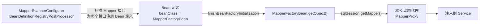

**追问链**

1. **在 BeanFactoryPostProcessor 里注入普通 Bean 会有什么问题？**
   它执行得非常早，为了执行它而提前创建的依赖 Bean，此时还没有注册完全部 BeanPostProcessor，这些依赖 Bean 可能**不会被 AOP 代理**、`@Autowired` 也可能处理不完整。日志里会出现类似 "is not eligible for getting processed by all BeanPostProcessors" 的提示。所以这类处理器通常声明为 static 的 `@Bean` 方法，并且尽量不依赖其他 Bean。
2. **要给所有带某个注解的 Bean 自动加一层功能（比如方法耗时监控），怎么做？**
   写一个 BeanPostProcessor，在 `postProcessAfterInitialization` 中判断类或方法上是否有该注解，有就返回一个代理对象。更规范的做法是实现一个 Advisor（切点 + 通知），交给 Spring 已有的自动代理机制统一处理，这样能和事务等其他切面正确地排序与合并。

---

### 05-05 Spring 如何解决循环依赖？为什么需要三级缓存？

> ★★★ ｜ 资深 ｜ 高频

**考察意图**：能否准确讲出三级缓存各自的作用，以及为什么不能只用两级。

**30 秒版回答**

- 三级缓存都在 `DefaultSingletonBeanRegistry` 中（已核对 Spring 7.0.6 源码）：
  - 一级 `singletonObjects`：完全初始化好的单例；
  - 二级 `earlySingletonObjects`：提前暴露的、尚未完成初始化的早期引用；
  - 三级 `singletonFactories`：能够生成早期引用的 `ObjectFactory`。
- 以 A 依赖 B、B 依赖 A 为例：
  1. 创建 A：实例化后，把"获取 A 早期引用"的工厂放入三级缓存，然后给 A 注入属性，发现需要 B；
  2. 创建 B：实例化后注入属性，发现需要 A，于是依次查一级、二级缓存都没有，在三级缓存中找到 A 的工厂，调用它得到 A 的早期引用，放入二级缓存，并删除三级缓存中的工厂；
  3. B 完成初始化，放入一级缓存；
  4. 回到 A，注入 B，完成初始化，放入一级缓存。
- **为什么需要第三级**：如果 A 需要被 AOP 代理，B 拿到的应该是 **A 的代理**，而不是原始对象。但代理通常在初始化的最后一步才创建。三级缓存中的工厂调用 `getEarlyBeanReference`，让 `AbstractAutoProxyCreator` 在**确实发生循环依赖时**才提前创建代理；没有循环依赖时就不提前，保持"初始化完成后再代理"的正常流程。
- 解决不了的情况：**构造器注入的循环依赖**（实例化之前就需要对方，无法提前暴露）、原型 Bean 的循环依赖、`@Async` 的 Bean 被循环依赖（其代理不是通过 `getEarlyBeanReference` 创建的，最终会因为"注入的早期引用和最终对象不一致"而报错）。
- **Spring Boot 2.6 起默认禁止循环依赖**（`spring.main.allow-circular-references` 默认 false，已核对 Boot 4.0.4 源码），出现循环依赖时启动直接失败。

**深入剖析**

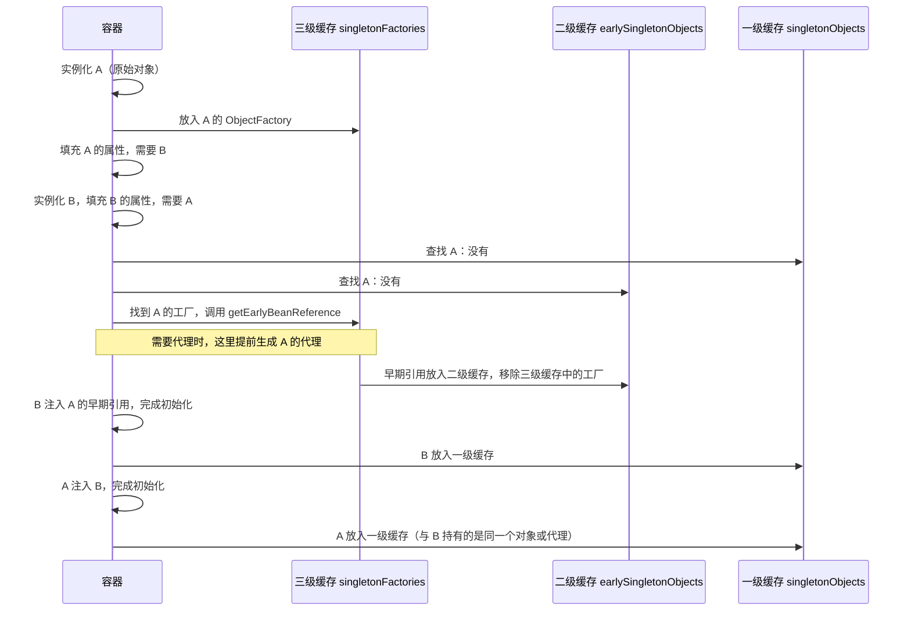

**追问链**

1. **只用二级缓存行不行？**
   如果在实例化之后**立刻**为每个 Bean 创建代理并放入二级缓存，二级缓存在功能上就够了。代价是所有需要代理的 Bean 都要提前创建代理，违背了"代理在初始化完成后创建"的设计，也可能让一些后置处理器看到的对象不一致。三级缓存的意义在于**延迟决策**：只有真的发生循环依赖时才提前创建代理。
2. **遇到循环依赖，正确的处理方式是什么？**
   循环依赖通常意味着职责划分有问题。优先**重构**：抽出公共逻辑到第三个 Bean，或者用事件解耦。临时手段才是 `@Lazy`（注入一个延迟解析的代理）或重新打开 `allow-circular-references`。

---

### 05-06 为什么推荐构造器注入？@Autowired 和 @Resource 有什么区别？

> ★★ ｜ 资深 ｜ 高频

**考察意图**：是否理解不同注入方式的工程影响。

**30 秒版回答**

- 推荐**构造器注入**：
  - 依赖可以声明为 final，对象创建后就处于完整、不可变的状态；
  - 依赖关系一目了然，构造函数参数过多时，本身就提示这个类职责太多；
  - 不依赖容器也能直接 `new` 出来做单元测试；
  - 构造器之间的循环依赖在启动时就会暴露，而不是被三级缓存"悄悄"化解。
- 只有一个构造函数时，Spring 4.3 起可以省略 `@Autowired`。配合 Lombok 的 `@RequiredArgsConstructor`，代码很简洁。
- `@Autowired`（Spring）和 `@Resource`（Jakarta 标准）的区别：

| 维度 | @Autowired | @Resource |
| --- | --- | --- |
| 来源 | Spring | Jakarta Annotations（`jakarta.annotation.Resource`） |
| 默认匹配方式 | **先按类型**，多个候选时再按 `@Primary`、`@Priority`、参数名匹配 | **先按名称**，找不到再按类型 |
| 指定名称 | 配合 `@Qualifier` | `name` 属性 |
| 支持位置 | 构造函数、字段、setter、方法参数 | 字段、setter |
| 处理者 | `AutowiredAnnotationBeanPostProcessor` | `CommonAnnotationBeanPostProcessor` |

**深入剖析**

```java
@Service
@RequiredArgsConstructor
public class OrderService {
    private final OrderRepository orderRepository;
    private final PaymentClient paymentClient;
    private final ApplicationEventPublisher eventPublisher;
}
```

**追问链**

1. **同一个接口有多个实现，怎么注入？**
   用 `@Qualifier("xxx")` 指定；或者在默认实现上加 `@Primary`；或者直接注入 `List<接口>` / `Map<String, 接口>` 拿到全部实现，按 key 选择，这是实现策略模式的常用写法。

---

### 05-07 Bean 的作用域与线程安全；单例 Bean 中如何使用原型 Bean？

> ★★ ｜ 资深 ｜ 高频

**考察意图**：是否理解单例 Bean 的线程安全由谁负责，以及作用域不匹配的问题。

**30 秒版回答**

- 作用域：singleton（默认）、prototype、request、session、application，以及 WebSocket 的 websocket 作用域。
- **单例 Bean 不是线程安全的**，Spring 不做任何同步。它之所以通常没有问题，是因为 Controller、Service、Repository 一般是**无状态**的：只持有其他无状态的 Bean，不在字段里保存请求相关的数据。
- 一旦在单例 Bean 的字段里保存了请求数据（例如把当前用户、计数器存成成员变量），就会出现并发问题。解决方法：保持无状态；需要请求级数据时用方法参数传递，或者用 ThreadLocal / 请求作用域的 Bean。
- **单例中直接注入原型 Bean，原型只会被创建一次**（注入只发生在单例创建时）。要每次获取新实例，可以：
  - 注入 `ObjectProvider<T>`，每次调用 `getObject()`；
  - 使用 `@Lookup` 方法注入；
  - 给原型 Bean 加 `@Scope(proxyMode = ScopedProxyMode.TARGET_CLASS)`，注入的是一个代理，每次调用方法时转发给新的实例。

**深入剖析**

```java
@Service
@RequiredArgsConstructor
public class ReportService {
    /** ReportBuilder 是 prototype，每次生成报表都需要一个新实例 */
    private final ObjectProvider<ReportBuilder> builderProvider;

    public Report generate(ReportRequest request) {
        ReportBuilder builder = builderProvider.getObject();
        return builder.build(request);
    }
}
```

**追问链**

1. **请求作用域的 Bean 能注入到单例 Bean 中吗？**
   可以，但注入的必须是作用域代理（`@RequestScope` 默认就是代理模式），代理在每次调用时从当前请求中找到真实对象。在请求线程之外（例如异步线程中）调用会报错，因为找不到当前请求。

---

### 05-08 FactoryBean 是什么？@Configuration 的 proxyBeanMethods 有什么作用？

> ★★ ｜ 资深 ｜ 中频

**考察意图**：是否分得清 BeanFactory 和 FactoryBean，是否理解配置类的 Full 模式和 Lite 模式。

**30 秒版回答**

- **BeanFactory** 是容器；**FactoryBean** 是一种特殊的 Bean，它本身是"生产 Bean 的工厂"。容器发现某个 Bean 实现了 FactoryBean 时，`getBean("xxx")` 返回的是它 `getObject()` 的结果；要拿 FactoryBean 本身，名字前面加 `&`。适用于创建过程复杂、需要编程控制的对象，例如 MyBatis 的 `SqlSessionFactoryBean`、`MapperFactoryBean`。
- **`@Configuration(proxyBeanMethods = true)`（默认，Full 模式）**：配置类会被 CGLIB 增强，在一个 `@Bean` 方法中调用另一个 `@Bean` 方法时，会被拦截并返回容器中的同一个单例，而不是每次都 new 一个新对象。
- **`proxyBeanMethods = false`（Lite 模式）**：配置类不做增强，`@Bean` 方法之间的直接调用就是普通的 Java 方法调用，会创建新对象。好处是启动更快、不需要生成 CGLIB 子类（对 GraalVM Native Image 友好）。**Spring Boot 自己的自动配置类全部使用 Lite 模式**，依赖关系通过 `@Bean` 方法的参数来表达。

**深入剖析**

```java
@Configuration(proxyBeanMethods = false)
public class DataConfig {
    @Bean
    public DataSource dataSource() {
        return new HikariDataSource();
    }

    // 正确：通过参数注入容器中的 DataSource，Lite 模式下也保证是同一个实例
    @Bean
    public JdbcTemplate jdbcTemplate(DataSource dataSource) {
        return new JdbcTemplate(dataSource);
    }

    // 错误（Lite 模式下）：直接调用 dataSource()，会创建第二个连接池
    // @Bean
    // public JdbcTemplate jdbcTemplate() { return new JdbcTemplate(dataSource()); }
}
```

**追问链**

1. **`@Component` 类里写 `@Bean` 方法有什么区别？**
   效果等同于 Lite 模式，方法之间的调用不会被拦截。

---

## 二、AOP 与事务

### 05-09 Spring AOP 的实现原理

> ★★★ ｜ 资深 ｜ 高频

**考察意图**：能否讲清代理在何时、由谁创建，以及多个通知如何串成一条链执行。

**30 秒版回答**

- **代理创建的时机和执行者**：`@EnableAspectJAutoProxy`（Spring Boot 自动开启）注册了 `AnnotationAwareAspectJAutoProxyCreator`，它是一个 BeanPostProcessor。每个 Bean 初始化完成后，在 `postProcessAfterInitialization` 中调用 `wrapIfNecessary`：
  1. 找出所有能匹配这个 Bean 的 Advisor（切点 + 通知）。`@Aspect` 类中的每个通知方法会被解析成一个 Advisor，事务、缓存、`@Async` 等也各自提供 Advisor；
  2. 有匹配的 Advisor，就通过 `ProxyFactory` 创建代理：有接口且未强制使用类代理时用 JDK 动态代理，否则用 CGLIB。**Spring Boot 默认 `spring.aop.proxy-target-class=true`，统一用 CGLIB**（已核对 Boot 4.0.4 的 `AopAutoConfiguration`）；
  3. 把代理对象放进容器，原始对象作为代理的 target。
- **调用时**：代理把匹配当前方法的所有通知转换成 `MethodInterceptor` 列表，用 `ReflectiveMethodInvocation.proceed()` 递归执行，形成一条**责任链**，最后一环调用目标方法。
- Spring AOP 与 AspectJ 的区别：Spring AOP 是运行时代理，只能拦截 Spring Bean 的**方法执行**，无法拦截自调用、构造函数、字段访问；AspectJ 在编译期或类加载期修改字节码，没有这些限制，但需要额外的编译器或 Java Agent。

**深入剖析**

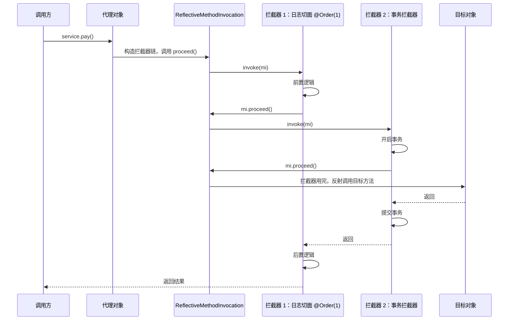

同一个切面内各类通知的执行顺序（Spring 5.2.7 起）：`@Around` 的前半部分 → `@Before` → 目标方法 → `@AfterReturning` 或 `@AfterThrowing` → `@After` → `@Around` 的后半部分。多个切面之间用 `@Order` 控制，**数值越小越先进入、越后退出**，像洋葱一样一层包一层。

**追问链**

1. **自定义切面和事务切面谁在外层？会有什么影响？**
   事务通知的默认顺序是最低优先级（`Ordered.LOWEST_PRECEDENCE`），所以通常位于最内层、紧贴目标方法。如果自定义切面在外层捕获了异常（比如统一转换异常、记录日志后吞掉），事务拦截器已经看到异常并回滚了，不受影响；但如果自定义切面在**内层**吞掉了异常，事务拦截器就看不到异常，会提交事务。需要时用 `@Order` 明确两者的先后。
2. **为什么 Spring Boot 默认用 CGLIB？**
   避免一个常见的错误：Bean 实现了接口，生成的是 JDK 代理，而注入点按实现类注入，就会报"类型不匹配"。统一用 CGLIB 后，按接口还是按实现类注入都可以。

---

### 05-10 @Transactional 的实现原理

> ★★★ ｜ 资深 ｜ 高频

**考察意图**：能否串起"AOP 拦截 → 事务管理器 → 连接绑定到线程 → 持久层取到同一个连接"这条完整链路。

**30 秒版回答**

- `@EnableTransactionManagement`（Spring Boot 自动开启）注册了一个 Advisor：切点是"方法或类上有 `@Transactional`"，通知是 `TransactionInterceptor`。
- `TransactionInterceptor` 调用 `TransactionAspectSupport.invokeWithinTransaction`：
  1. 解析 `@Transactional` 的属性（传播行为、隔离级别、超时、只读、回滚规则）；
  2. 确定使用哪个 `PlatformTransactionManager`；
  3. `createTransactionIfNecessary`：按传播行为决定新建事务、加入已有事务还是挂起已有事务；
  4. 执行目标方法；
  5. 抛出异常时按回滚规则决定回滚还是提交；正常返回时提交。
- **关键机制：事务资源绑定到线程**。以 JDBC 为例，`DataSourceTransactionManager` 开启事务时从连接池拿一个连接，`setAutoCommit(false)`，然后把连接放进 `TransactionSynchronizationManager` 的 ThreadLocal 中（以 DataSource 为 key）。MyBatis、JdbcTemplate 获取连接时会先查这个 ThreadLocal，所以同一个线程里的所有数据库操作用的是**同一个连接**，也就在同一个事务里。
- 默认回滚规则：**只对 RuntimeException 和 Error 回滚**，受检异常会提交（已核对 Spring 7.0.6 `DefaultTransactionAttribute.rollbackOn`）。Spring 6.2 起可以用 `@EnableTransactionManagement(rollbackOn = RollbackOn.ALL_EXCEPTIONS)` 全局改为所有异常都回滚（已核对源码中的 `@since 6.2`）。

**深入剖析**

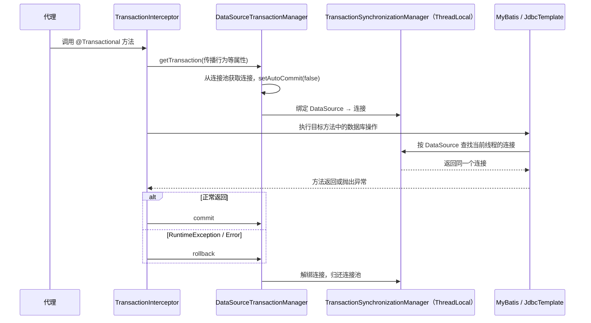

**追问链**

1. **既然连接绑定在 ThreadLocal 上，在事务方法里开一个新线程操作数据库，在不在同一个事务里？**
   不在。新线程的 ThreadLocal 里没有这个连接，它会从连接池拿一个新连接，以自动提交的方式执行。所以"多线程 + 同一个事务"在 Spring 本地事务中是做不到的。
2. **`readOnly = true` 有什么用？**
   对 JDBC 来说会调用 `Connection.setReadOnly(true)`，MySQL 驱动可以据此做一些优化（例如在读写分离的场景中路由到只读库）；对 JPA 来说还会关闭脏检查和自动 flush。它是一个提示，并不能阻止所有写操作。
3. **事务的超时 `timeout` 是怎么生效的？**
   Spring 会根据剩余时间设置 JDBC Statement 的查询超时。只有在超时之后**再执行 SQL** 时才会抛出超时异常，方法中的非数据库耗时操作（比如远程调用）本身不会被中断。

---

### 05-11 事务传播行为有哪些？怎么用？

> ★★ ｜ 资深 ｜ 高频

**考察意图**：能否结合业务场景选择传播行为，并清楚 REQUIRES_NEW 和 NESTED 的区别。

**30 秒版回答**

| 传播行为 | 当前有事务 | 当前没有事务 | 典型场景 |
| --- | --- | --- | --- |
| **REQUIRED**（默认） | 加入 | 新建 | 绝大多数业务方法 |
| **REQUIRES_NEW** | 挂起当前事务，新建一个独立事务 | 新建 | 记录操作日志、审计：主业务回滚时日志仍要保留 |
| **NESTED** | 在当前事务中创建保存点，失败时只回滚到保存点 | 新建 | 批量处理中单条失败不影响其他条 |
| SUPPORTS | 加入 | 以非事务方式执行 | 查询方法 |
| NOT_SUPPORTED | 挂起当前事务，以非事务方式执行 | 以非事务方式执行 | 不希望被外部事务影响的操作 |
| MANDATORY | 加入 | 抛出异常 | 强制要求调用方开启事务 |
| NEVER | 抛出异常 | 以非事务方式执行 | 强制要求不在事务中 |

**REQUIRES_NEW 和 NESTED 的区别**：

- REQUIRES_NEW 是**完全独立**的新事务，使用**另一个数据库连接**。内层提交后，外层回滚不影响内层；内层回滚，只要外层捕获了异常，外层也不受影响。
- NESTED 仍在**同一个连接、同一个事务**中，只是设置了一个保存点。内层回滚到保存点，不影响外层；但**外层回滚时内层也一起回滚**。它依赖 JDBC 保存点，只有 `DataSourceTransactionManager` 等支持保存点的事务管理器才能使用。

**深入剖析**

一个高频的线上异常："Transaction rolled back because it has been marked as rollback-only"（`UnexpectedRollbackException`）。

```java
@Transactional
public void placeOrder(Order order) {
    orderRepository.save(order);
    try {
        couponService.use(order.getCouponId());   // REQUIRED：加入同一个事务，内部抛出 RuntimeException
    } catch (BizException e) {
        log.info("coupon use failed, orderNo={}", order.getOrderNo());   // 外层吞掉异常，想继续下单
    }
}   // 方法正常返回，尝试提交，抛出 UnexpectedRollbackException
```

原因：内层方法抛出异常时，事务拦截器已经把**整个**事务标记为 rollback-only。外层捕获了异常、正常返回，提交时发现事务已被标记，只能回滚并抛出异常。
修复：如果优惠券失败确实不应影响下单，内层改用 `REQUIRES_NEW` 或 `NESTED`；或者让内层方法不抛出异常、改用返回值表达失败。

**追问链**

1. **REQUIRES_NEW 有什么生产风险？**
   外层事务挂起时**仍然占着自己的连接**，内层又要从连接池再拿一个。并发量大、连接池小时，可能所有线程都拿着一个连接、等着第二个连接，形成连接池死锁（见[《03 Java 并发》](../01-Java核心/03-Java并发.md)03-11）。使用 REQUIRES_NEW 的链路要评估连接池大小。

---

### 05-12 @Transactional 失效的常见场景

> ★★★ ｜ 资深 ｜ 高频

**考察意图**：是否踩过坑，能否从"代理"和"线程绑定"两个原理出发解释每一种失效。

**30 秒版回答**

大多数失效都能归结为两个原因：**调用没有经过代理**，或者**数据库操作不在绑定了事务的线程或连接上**。

| 场景 | 原因 | 解决办法 |
| --- | --- | --- |
| 同一个类中方法 A 调用带事务的方法 B | `this.b()` 不经过代理 | 拆到另一个 Bean；或注入自身代理 |
| 方法是 private 或 final，或类是 final | CGLIB 无法重写 | 改为可重写的方法（Spring 6 起 protected、包级可见的方法在 CGLIB 代理下也能生效，已核对 Spring 7.0.6 源码中 `new AnnotationTransactionAttributeSource(false)`） |
| 异常被 try-catch 吞掉 | 事务拦截器看不到异常 | 重新抛出，或手动调用 `TransactionAspectSupport.currentTransactionStatus().setRollbackOnly()` |
| 抛出的是受检异常 | 默认只回滚 RuntimeException 和 Error | `rollbackFor = Exception.class`，或 Spring 6.2+ 全局配置 `rollbackOn` |
| 在新线程里操作数据库 | 连接绑定在原线程的 ThreadLocal 上 | 让数据库操作留在事务线程中 |
| 对象是自己 new 出来的 | 不是 Spring 管理的 Bean，没有代理 | 从容器中获取 |
| 在 `@PostConstruct` 中调用 | 此时代理还没创建 | 改为监听 `ApplicationReadyEvent` 后调用 |
| 传播行为设成了 NOT_SUPPORTED / NEVER | 主动以非事务方式执行 | 检查传播行为 |
| 多数据源用错了事务管理器 | 事务开在 A 库的连接上，操作的是 B 库 | `@Transactional("bTransactionManager")` |
| 表使用 MyISAM 引擎 | 存储引擎不支持事务 | 改用 InnoDB |

**深入剖析**

自调用问题的几种解法，从推荐到不推荐：

```java
// 推荐：按职责拆分到另一个 Bean，结构最清晰
@Service
@RequiredArgsConstructor
public class OrderFacade {
    private final OrderTxService orderTxService;

    public void submit(OrderCommand cmd) {
        validate(cmd);                      // 非事务的校验、远程查询放在外面
        orderTxService.createOrder(cmd);    // 经过代理，事务生效，且事务范围更小
    }
}

// 可用：注入自身代理（需要 @Lazy 避免循环依赖报错）
@Service
public class OrderService {
    @Lazy
    @Autowired
    private OrderService self;

    public void submit(OrderCommand cmd) {
        self.createOrder(cmd);
    }

    @Transactional
    public void createOrder(OrderCommand cmd) { /* ... */ }
}
```

**追问链**

1. **类上加了 `@Transactional`，方法上也加了，以谁为准？** 方法上的优先，覆盖类上的配置。
2. **接口上的 `@Transactional` 会生效吗？**
   现代版本中，基于接口的 JDK 代理和基于类的 CGLIB 代理都能识别接口方法上的注解，但官方仍建议把注解写在实现类上，语义更明确，也不依赖代理方式。

---

### 05-13 事务中发 MQ、调远程接口，如何保证一致性？

> ★★★ ｜ 架构师 ｜ 高频

**考察意图**：是否意识到本地事务的边界，能否给出可落地的一致性方案。

**30 秒版回答**

- 两类常见错误：
  - **在事务中发 MQ**：消息发出去了，事务却回滚了，下游处理了一条"不存在"的订单；
  - **在事务中调远程接口**：远程调用慢或者超时，事务和数据库连接被长时间占用；远程已经成功，本地却回滚了，数据不一致。
- 基本原则：**远程调用移出事务**；事务内只做本地数据库操作，并且尽量短。
- 本地事务与消息的一致性，按可靠性递增：
  1. **事务提交后再发送**：用 `@TransactionalEventListener(phase = AFTER_COMMIT)` 或 `TransactionSynchronization.afterCommit`。简单，但提交后、发送前进程崩溃会丢消息；
  2. **本地消息表（事务发件箱，Transactional Outbox）**：在**同一个本地事务**中写业务表和消息表，再由后台任务或 CDC（如 Canal、Debezium）读取消息表并投递到 MQ，投递成功后标记状态。至少投递一次，下游必须幂等；
  3. **RocketMQ 事务消息**：先发半消息，执行本地事务，再提交或回滚消息；Broker 长时间收不到确认时会回查本地事务状态。见[《22 RocketMQ》](../05-消息队列/22-RocketMQ.md)。

**深入剖析**

事务发件箱模式：

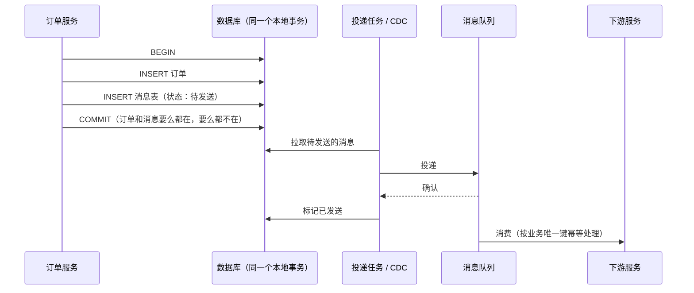

使用 `AFTER_COMMIT` 时有一个隐蔽的坑：

```java
@TransactionalEventListener(phase = TransactionPhase.AFTER_COMMIT)
public void onOrderCreated(OrderCreatedEvent event) {
    // 此时原事务已经提交，但事务资源仍绑定在当前线程上。
    // 如果这里调用的方法是默认的 REQUIRED，它会"加入"这个已经提交的事务，
    // 写入的数据不会被再次提交，等于丢失。需要写库时，被调用的方法必须使用 REQUIRES_NEW。
    pointService.addPoints(event.getUserId(), event.getAmount());
}
```

Spring 在 `TransactionSynchronization.afterCommit` 的文档中明确说明了这一点。另外注意：**当前没有活跃事务时，`@TransactionalEventListener` 默认不会被执行**，需要设置 `fallbackExecution = true`。

**追问链**

1. **消息表的数据越来越多怎么办？** 已发送的消息定期归档或删除；按时间分表；投递任务按状态和创建时间建立索引，分批拉取。
2. **下游如何幂等？**
   用业务唯一键（订单号 + 事件类型）做去重：数据库唯一索引、Redis `SET NX`、或者状态机的条件更新（`UPDATE ... WHERE status = 'INIT'`）。见[《20 MQ 通用与选型》](../05-消息队列/20-MQ通用与选型.md)。

**架构师加分点**

本地事务的边界就是一个数据库连接。只要跨越了这个边界（另一个库、MQ、远程服务、缓存），就不存在"天然的一致性"，只能在**最终一致**的框架下选择：可靠消息（发件箱、事务消息）、补偿（Saga / TCC）、对账。评审设计时，看到"事务里调用了外部系统"，就应该追问：外部成功、本地失败怎么办？本地成功、外部失败怎么办？超时、状态未知时又怎么办？

---

## 三、Web

### 05-14 Spring MVC 的请求处理流程

> ★★ ｜ 资深 ｜ 高频

**考察意图**：能否讲清 DispatcherServlet 如何协调各个组件，以及参数解析和返回值处理的位置。

**30 秒版回答**

`DispatcherServlet.doDispatch` 的主要步骤：

1. **查找处理器**：遍历 HandlerMapping（主要是 `RequestMappingHandlerMapping`），根据 URL、请求方法、请求头等找到对应的 Controller 方法，与匹配的拦截器一起组成 `HandlerExecutionChain`；
2. **查找适配器**：找到能执行这个处理器的 HandlerAdapter（`RequestMappingHandlerAdapter`）；
3. 依次执行拦截器的 **`preHandle`**，任何一个返回 false 就直接结束；
4. **执行处理器**：参数解析器（`HandlerMethodArgumentResolver`）把请求转换成方法参数，`@RequestBody` 由 HttpMessageConverter（如 Jackson）反序列化；然后反射调用 Controller 方法；返回值处理器处理结果，`@ResponseBody` 由 HttpMessageConverter 序列化后写入响应；
5. 执行拦截器的 **`postHandle`**；
6. **处理结果**：如果有异常，交给 HandlerExceptionResolver 处理（`@ControllerAdvice` + `@ExceptionHandler` 就是在这里生效的）；如果返回的是视图，则渲染视图；
7. 执行拦截器的 **`afterCompletion`**（无论成功还是失败都会执行，适合清理 ThreadLocal）。

**深入剖析**

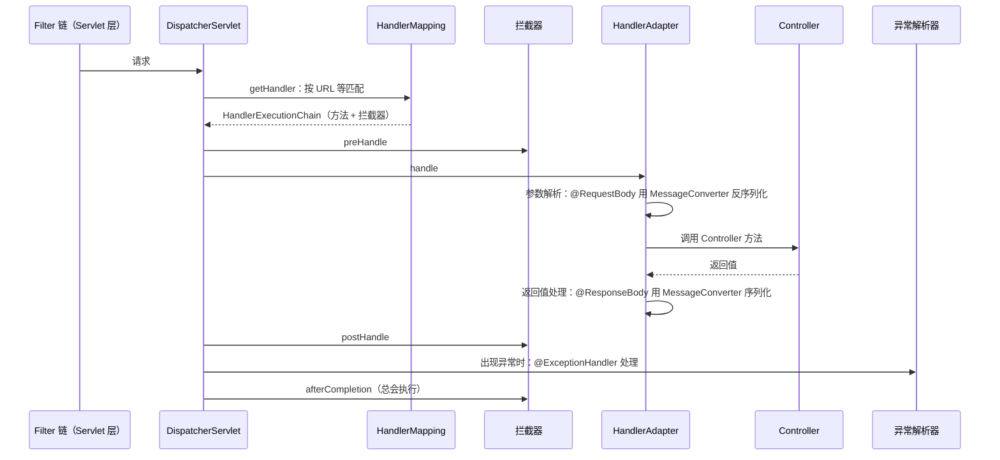

**Filter 和拦截器的区别**：

| 维度 | Filter | HandlerInterceptor |
| --- | --- | --- |
| 规范 | Servlet 规范 | Spring MVC |
| 位置 | DispatcherServlet 之前 | DispatcherServlet 内部 |
| 能拿到什么 | 原始请求和响应 | 还能拿到要执行的 Controller 方法（`HandlerMethod`） |
| 适合 | 编码、跨域、认证（Spring Security 就是一组 Filter）、请求日志 | 与具体接口相关的逻辑：权限注解检查、接口级埋点 |

**追问链**

1. **为什么在 Filter 里读取了请求体，Controller 就拿不到了？**
   请求体是一个输入流，只能读一次。需要多次读取时，用 `ContentCachingRequestWrapper` 之类的包装类先缓存。
2. **Spring 7 在 Web 层有什么新能力？**
   原生支持 **API 版本控制**：`@RequestMapping` 新增了 `version` 属性（已核对 spring-web 7.0.6），配合版本解析策略（请求头、路径、参数、媒体类型），可以把同一个路径的不同版本路由到不同的方法。

---

### 05-22 全局异常处理是怎么实现的？Filter、拦截器、AOP 里抛的异常它都能接住吗？

> ★★ ｜ 资深 ｜ 高频

**考察意图**：几乎每个项目都写了 `@RestControllerAdvice`，但"哪些异常它接不住""多个处理方法怎么选"才是区分度所在。

**30 秒版回答**

- `@ControllerAdvice` + `@ExceptionHandler` 由 `ExceptionHandlerExceptionResolver` 实现。它是 `DispatcherServlet` 里的一个 `HandlerExceptionResolver`，**只能处理 `DispatcherServlet.doDispatch` 内部抛出的异常**。
- 一次请求从外到内的顺序：**Filter → DispatcherServlet → 拦截器 preHandle → 参数解析与校验 → AOP 切面 → Controller 方法**。
- 能不能接住，看异常抛在哪一层：
  - 拦截器的 `preHandle` / `postHandle`、参数解析、参数校验、切面、Controller：都在 `doDispatch` 的 try 块里，**能接住**；
  - **Filter 里抛的异常接不住**，它在 `DispatcherServlet` 之外。Spring Security 的认证、鉴权异常就属于这一类，由它自己的 `ExceptionTranslationFilter` 处理；
  - 拦截器的 `afterCompletion` 里抛的异常只会被记录日志，不影响响应。
- 默认注册了三个异常解析器，按顺序尝试（已核对 spring-webmvc 7.0.6）：`ExceptionHandlerExceptionResolver` → `ResponseStatusExceptionResolver`（处理 `@ResponseStatus`）→ `DefaultHandlerExceptionResolver`（把 Spring 自己的异常翻译成 400、405、415 等状态码）。

**深入剖析**

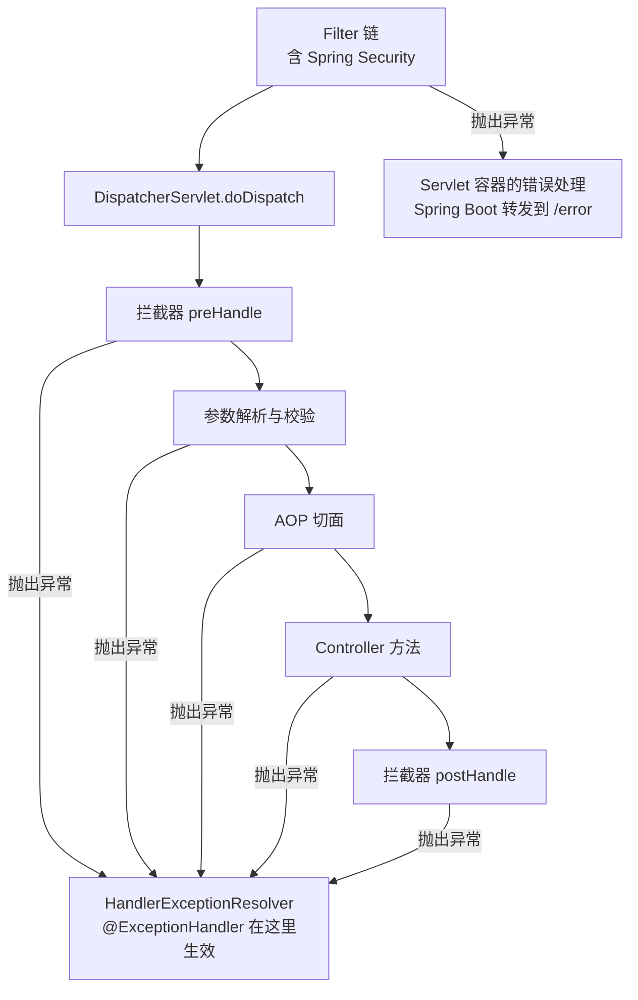

**匹配规则**（已核对 `ExceptionHandlerExceptionResolver` 和 `ExceptionHandlerMethodResolver` 源码）：

1. **先找 Controller 自己的 `@ExceptionHandler` 方法**，找不到再按顺序遍历各个 `@ControllerAdvice`；
2. 在同一个类里，如果多个方法都能处理，选**继承层次上离实际异常最近**的那个；
3. 按实际异常类型找不到时，会**沿着 cause 链继续找**。所以被包装过的业务异常也可能被匹配到；
4. 多个 `@ControllerAdvice` 之间按 `@Order` 排序，**第一个能处理的就用它，不会跨类比较谁更精确**。

第 4 条是最常见的坑：一个优先级高的 advice 里写了 `@ExceptionHandler(Exception.class)` 兜底，另一个 advice 里针对 `BizException` 的处理方法就永远执行不到。兜底处理要放在优先级最低的 advice 里。

推荐写法（示意代码，未编译）：

```java
@Slf4j
@RestControllerAdvice
public class GlobalExceptionHandler extends ResponseEntityExceptionHandler {

    /** 业务异常：是预期内的失败，记录 info 即可 */
    @ExceptionHandler(BizException.class)
    public ProblemDetail handleBiz(BizException e) {
        log.info("business rule rejected, errorCode={}", e.getErrorCode());
        ProblemDetail detail = ProblemDetail.forStatusAndDetail(HttpStatus.UNPROCESSABLE_ENTITY, e.getMessage());
        detail.setProperty(ERROR_CODE_KEY, e.getErrorCode());
        return detail;
    }

    /** 兜底：不把内部异常信息返回给调用方 */
    @ExceptionHandler(Exception.class)
    public ProblemDetail handleUnknown(Exception e, HttpServletRequest request) {
        log.error("unexpected error, errorCode={}, uri={}", ErrorCode.SYSTEM_ERROR, request.getRequestURI(), e);
        return ProblemDetail.forStatusAndDetail(HttpStatus.INTERNAL_SERVER_ERROR, SYSTEM_ERROR_MESSAGE);
    }
}
```

- `ResponseEntityExceptionHandler` 是 Spring 提供的基类，已经为参数缺失、类型不匹配、请求体不可读、校验失败等二十来种框架异常准备了处理方法，继承它就能统一这些响应的格式。
- `ProblemDetail` 是 Spring 6.0 引入的错误响应体，对应 RFC 9457。Spring Boot 中通过 `spring.mvc.problemdetails.enabled=true` 让框架异常也输出这种格式（已核对 Spring Boot 4.0.4 的配置元数据）。

**追问链**

1. **Filter 里的异常想走统一的错误格式，怎么办？**
   两种做法：
   - 在 Filter 里注入名为 `handlerExceptionResolver` 的 Bean，catch 住异常后手动调用它的 `resolveException`，让异常进入同一套 `@ExceptionHandler`；
   - 不处理，让异常到达容器，由 Spring Boot 的 `/error` 端点输出，再自定义 `ErrorAttributes` 统一格式。
   认证类 Filter 更常见的做法是直接写响应并 return，不抛异常。
2. **访问一个不存在的路径，`@ExceptionHandler` 能处理吗？**
   能。Spring 7 的 `DispatcherServlet` 找不到处理器时直接抛 `NoHandlerFoundException`（已核对 7.0.6 源码）；静态资源找不到抛 `NoResourceFoundException`（6.1 引入）。老版本需要设置 `throwExceptionIfNoHandlerFound=true` 才会抛，这个开关在 7.0 的源码里已经没有了。
3. **想在拦截器的 `postHandle` 里给响应加个头，为什么不生效？**
   `@ResponseBody` 的返回值在 `HandlerAdapter` 里就已经写出并提交了响应，`postHandle` 执行时已经晚了。要改响应体或响应头，实现 `ResponseBodyAdvice`，它在消息转换器写出之前被调用。
4. **参数校验失败时，切面为什么没有执行？**
   参数解析和校验发生在 `HandlerAdapter` 调用 Controller 代理对象**之前**。校验不通过，方法根本没被调用，切面自然不会触发。想统计所有请求（包括校验失败的），要放在拦截器或 Filter 里。

**生产实践 / 踩坑**

- **兜底处理把异常信息原样返回**：`e.getMessage()` 里可能有 SQL、表名、内部地址。兜底分支只返回固定文案和错误码，详细信息只进日志。
- **业务异常也打 error 并带堆栈**：余额不足、库存不够这类预期内的失败会淹没真正的错误。业务异常记 info，不要堆栈；未知异常记 error，带堆栈。分类原则见[《最佳实践 · 项目工程开发》](../最佳实践/01-项目工程开发最佳实践.md)。
- **异步请求**：Controller 返回 `CompletableFuture` 或 `DeferredResult` 时，异步阶段的异常会重新派发回 `DispatcherServlet`，仍然能被 `@ExceptionHandler` 处理；但 `@Async` 方法里的异常和 Controller 没有关系，不会走到这里，见 05-20。

---

### 05-23 参数校验怎么做？`@Valid` 和 `@Validated` 有什么区别？校验为什么会不生效？

> ★★ ｜ 资深 ｜ 高频

**考察意图**：看你是否清楚校验在请求处理的哪一步发生、失败时抛什么异常，以及能否系统地说出"加了注解却没校验"的原因。

**30 秒版回答**

- 规范是 Jakarta Bean Validation，实现是 Hibernate Validator。Spring Boot 需要单独引入 `spring-boot-starter-validation`，Web 的 starter 里不带。
- `@Valid` 是规范里的注解，可以标在字段上触发**嵌套校验**；`@Validated` 是 Spring 的注解，支持**分组**，标在类上还能开启**方法级校验**（基于 AOP）。
- 三种校验位置，对应三种异常：

| 写法 | 谁来校验 | 失败时抛出 |
| --- | --- | --- |
| `@RequestBody @Valid OrderCreateRequest req` | 参数解析器 | `MethodArgumentNotValidException`，默认 400 |
| `@RequestParam @Min(1) int page`（约束直接写在参数上） | Spring 6.1 起由 MVC 内置的方法校验完成 | `HandlerMethodValidationException`，默认 400 |
| Service 类上加 `@Validated`，方法参数上写约束 | `MethodValidationPostProcessor` 生成的 AOP 代理 | `ConstraintViolationException`，不处理的话是 500 |

- 第二行有个版本细节（已核对 spring-web 7.0.6 `HandlerMethod` 源码）：**Controller 类上如果标了 `@Validated`，内置的方法校验就不启用**，仍然走 AOP 那条路，抛的是 `ConstraintViolationException`。升级到 Spring 6.1 以后，Controller 类上的 `@Validated` 可以去掉。

**深入剖析**

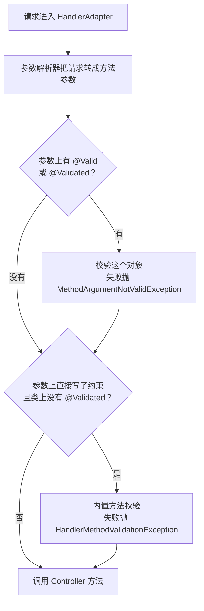

分组和嵌套的写法（示意代码，未编译）：

```java
public record OrderCreateRequest(
        @NotNull(groups = Update.class) Long id,          // 只在更新时必填
        @NotBlank @Size(max = MAX_REMARK_LENGTH) String remark,
        @NotEmpty List<@Valid OrderItem> items,           // 集合元素要校验，@Valid 写在元素类型上
        @NotNull @Valid Address address) {                // 嵌套对象要校验，字段上必须加 @Valid

    public interface Update extends Default { }          // 继承 Default，更新时默认分组的约束也生效
}

@PostMapping
public OrderResponse create(@RequestBody @Valid OrderCreateRequest request) { ... }

@PutMapping
public OrderResponse update(@RequestBody @Validated(OrderCreateRequest.Update.class) OrderCreateRequest request) { ... }
```

**校验不生效的常见原因**：

1. 没有引入 `spring-boot-starter-validation`，注解存在但没有校验器，不报错也不校验；
2. 参数上漏了 `@Valid` / `@Validated`；
3. **嵌套对象的字段上没加 `@Valid`**，只校验了外层；
4. 指定了分组，但约束属于默认分组（分组接口没有继承 `Default`）；
5. Service 上的方法级校验**被同类内部调用**，没有经过代理，和 `@Transactional` 失效是同一个原因，见 05-12；
6. 用错了约束：`@NotNull` 不拦截空字符串，`@NotEmpty` 不拦截纯空格，字符串必填要用 `@NotBlank`；`@Min`、`@Size` 等约束遇到 null 一律通过，必填要另外加 `@NotNull`。

**追问链**

1. **`@RequestBody @Valid List<OrderItem> items` 能校验每个元素吗？**
   Spring 6.1 之前不能，因为 `List` 本身没有约束注解，`@Valid` 也不会展开容器。6.1 起内置的方法校验会处理"带 `@Valid` 的集合、数组、Map 参数"（已核对源码中的 `isIndexOrKeyBasedContainer` 判断），失败时抛 `HandlerMethodValidationException`。老版本的通常做法是包一层请求对象，或者在类上加 `@Validated`。
2. **怎么写自定义约束？**
   定义一个标了 `@Constraint(validatedBy = XxxValidator.class)` 的注解，实现 `ConstraintValidator<注解, 字段类型>`。校验器是由 Spring 创建的，可以注入其他 Bean。但**不要在校验器里查数据库**：格式校验和业务校验是两回事。
3. **校验应该放在哪一层？**
   - Controller 层：格式、必填、长度、范围，只依赖请求本身就能判断的规则；
   - 领域层：业务不变量，比如"订单金额等于明细之和""已发货的订单不能改地址"，写在实体自己的方法里，见[《27 DDD》](../06-三高与架构/27-DDD.md)27-07；
   - 中间各层不重复判空。整条链路在入口做一次校验，下游信任契约。
4. **一个字段不合法就立刻返回，还是把所有错误都返回？**
   默认会校验完所有约束。面向表单的接口适合全部返回，方便前端一次提示；面向内部调用的接口可以开启快速失败（Hibernate Validator 的 `fail_fast` 配置），减少无意义的校验开销。

**生产实践 / 踩坑**

- **三种异常只处理了一种**：全局异常处理只写了 `MethodArgumentNotValidException`，结果 `@RequestParam` 上的约束失败返回了 500。三种异常都要处理，或者继承 `ResponseEntityExceptionHandler` 后重写对应方法，再单独处理 `ConstraintViolationException`。
- **把字段的原始值写进错误响应**：手机号、证件号校验失败时，原值不应该回显到响应和日志里，只返回字段名和错误说明。
- **DTO 复用过度**：新增、修改、查询共用一个 DTO，靠分组区分，分组越来越多，没人说得清哪个接口校验了什么。读写分开建 DTO 通常比分组更好维护。

---

### 05-24 WebFlux 和 Spring MVC 有什么区别？有了虚拟线程，还需要响应式吗？

> ★★★ ｜ 资深 / 架构师 ｜ 中频

**考察意图**：是否理解响应式解决的是"线程被阻塞占用"的问题而不是"单次请求变快"，能否讲清它的约束，并对"要不要用"给出有依据的判断。

**30 秒版回答**

- Spring MVC 是**每个请求占一个线程**的模型：业务代码阻塞在 IO 上时，线程也跟着被占住。WebFlux 是**事件循环**模型：少量线程处理所有连接，IO 没就绪时线程去处理别的请求。
- WebFlux 基于 Reactive Streams 规范（`Publisher`、`Subscriber`、`Subscription`），Spring 用的实现是 Reactor：`Mono` 表示 0 或 1 个元素，`Flux` 表示 0 到 N 个。默认运行在 Reactor Netty 上。
- 它带来两样 MVC 没有的东西：**用很少的线程支撑大量慢连接**，以及**背压**（消费者告诉生产者"我还能处理几个"）。
- 它**不会让单个请求变快**，还要求**整条链路都不能阻塞**：数据库要用 R2DBC，HTTP 调用要用 `WebClient`，`ThreadLocal` 不再可靠。
- 虚拟线程出现后，"阻塞时不占用操作系统线程"这个收益用同步写法就能拿到。新项目默认用 Spring MVC 加虚拟线程；需要背压的流式场景、网关、已经运行良好的响应式系统，继续用 WebFlux。

**深入剖析**

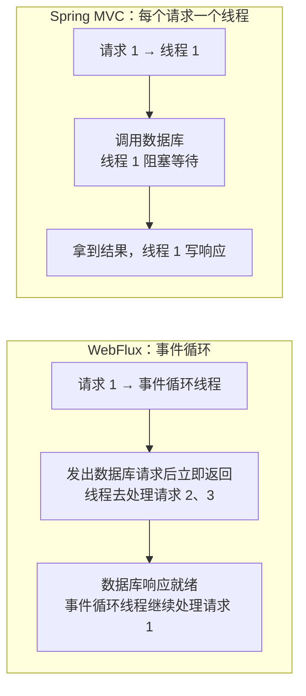

**Reactor 的三个基本事实**：

1. **不订阅就什么都不发生**。`Mono` 和 `Flux` 只是对"将来怎么计算"的描述，WebFlux 框架在写响应时替你订阅。自己在代码里创建了一个 `Mono` 却没有把它接进返回的链路，它就不会执行，也不会报错。
2. **背压靠 `request(n)` 实现**。订阅者通过 `Subscription.request(n)` 声明还能接收多少个元素，生产者不能超发。上游是无法暂停的数据源（如行情推送）时，要显式选择策略：缓冲、丢弃、只保留最新。
3. **线程由调度器决定**。Reactor 内置的调度器默认值（已核对 reactor-core 3.8.4 源码）：

| 调度器 | 默认线程数 | 用途 |
| --- | --- | --- |
| `Schedulers.parallel()` | CPU 核数 | 不阻塞的计算 |
| `Schedulers.boundedElastic()` | CPU 核数 × 10，每个线程的任务队列上限 100000 | 包装不得不执行的阻塞调用 |

**在事件循环线程里阻塞会怎样**：

- 调用 `block()`：Reactor 能检测到，直接抛 `IllegalStateException: block()/blockFirst()/blockLast() are blocking, which is not supported in thread ...`（已核对源码中的这段文案）；
- 调用 JDBC、`RestTemplate`、`Thread.sleep` 这类普通阻塞方法：**不会报错**，但这个事件循环线程上的所有连接都要等它。事件循环线程数与 CPU 核数在同一量级，几个慢查询就能让整个服务失去响应。

不得不调用阻塞代码时，把它切到专门的调度器上（示意代码，未编译）：

```java
public Mono<Report> loadReport(String reportId) {
    return Mono.fromCallable(() -> legacyReportDao.query(reportId)) // 阻塞的旧代码
            .subscribeOn(Schedulers.boundedElastic())                // 放到弹性线程池执行，不占事件循环
            .timeout(REPORT_QUERY_TIMEOUT);
}
```

**追问链**

1. **`publishOn` 和 `subscribeOn` 有什么区别？**
   `subscribeOn` 决定**数据源从哪个线程开始发**，写在链路的哪个位置都一样，影响的是源头；`publishOn` 决定**它之后的操作符在哪个线程执行**，位置有意义。包装阻塞调用用 `subscribeOn`，把后续的处理切走用 `publishOn`。
2. **`ThreadLocal` 在 WebFlux 里为什么不可靠？traceId 怎么传？**
   一个请求的处理会在多个线程之间切换，线程和请求不再一一对应。Reactor 提供了随订阅传递的 `Context` 来代替。日志 MDC 和链路追踪依赖 Micrometer 的上下文传播库，通过 `Hooks.enableAutomaticContextPropagation()` 在线程切换时自动把 `Context` 里的值恢复到 `ThreadLocal`。链路追踪的原理见[《32 日志与可观测性》](../07-工程实践与稳定性/32-日志与可观测性.md)32-04。
3. **WebFlux 和虚拟线程能一起用吗？**
   能，两个方向都有支持：
   - WebFlux 6.1 起提供 `BlockingExecutionConfigurer`（已核对源码的 `@since 6.1`），可以让返回值不是响应式类型的 Controller 方法在指定的执行器上运行，这个执行器可以是虚拟线程；
   - Reactor 的 `boundedElastic` 可以通过系统属性 `reactor.schedulers.defaultBoundedElasticOnVirtualThreads=true` 改为使用虚拟线程，默认关闭（已核对 reactor-core 3.8.4）。
4. **什么场景下 WebFlux 仍然是更好的选择？**
   - **网关**：纯转发、连接数多、几乎没有业务阻塞，见[《12 Spring Cloud》](../03-分布式与微服务/12-SpringCloud.md)12-07；
   - **流式响应**：SSE、大模型逐字输出、文件流转发，数据是一段一段来的，需要背压；
   - **扇出很大的聚合**：一个请求要并发调用几十个下游并做超时、重试、合并，Reactor 的操作符比手写线程编排简洁；
   - 团队已经有成熟的响应式代码和排查经验。

**生产实践 / 踩坑**

- **响应式项目里混入阻塞调用**是头号问题：引入了一个只有同步客户端的 SDK，或者在过滤器里同步查了一次 Redis，压测时吞吐骤降。上线前用 BlockHound 这类工具在测试环境检测事件循环线程上的阻塞调用。
- **堆栈不可读**：异常堆栈里全是 Reactor 的内部类，看不出业务调用路径。开发环境可以打开 `Hooks.onOperatorDebug()`，生产环境用开销小得多的 `checkpoint()` 给关键链路做标记。
- **只把 Controller 改成返回 `Mono`，下面仍然是 JDBC**：线程模型变复杂了，阻塞一点没少，是最差的组合。要么整条链路响应式，要么保持同步写法并启用虚拟线程。

**架构师加分点**

选型时把问题还原成"瓶颈是不是线程"。如果服务的瓶颈在数据库或下游的处理能力，换成 WebFlux 不会提高吞吐，只会把排队的位置从线程池挪到连接池。只有当"大量线程阻塞在慢 IO 上、而下游还有余量"时，换线程模型才有收益；这种情况下，虚拟线程能以小得多的改造成本拿到同样的收益。响应式真正不可替代的是背压和流式组合能力，而不是省线程。迁移到虚拟线程的注意事项见[《03 Java 并发》](../01-Java核心/03-Java并发.md)03-23。

---

## 四、Spring Boot

### 05-15 Spring Boot 自动配置的原理

> ★★★ ｜ 资深 ｜ 高频

**考察意图**：能否讲清楚"从哪里读到候选配置、如何过滤、为什么用户的 Bean 能覆盖默认值"。

**30 秒版回答**

- `@SpringBootApplication` = `@SpringBootConfiguration` + `@EnableAutoConfiguration` + `@ComponentScan`。
- `@EnableAutoConfiguration` 通过 `@Import` 引入 `AutoConfigurationImportSelector`。它是一个 **DeferredImportSelector**，会等用户自己的配置类全部解析完之后才执行。
- 执行过程：
  1. 读取所有 jar 包中的 `META-INF/spring/org.springframework.boot.autoconfigure.AutoConfiguration.imports`，得到候选的自动配置类（Boot 2.7 引入这个文件，Boot 3 起自动配置只认它，已核对 Boot 4.0.4 的 jar 包中存在该文件）；
  2. 用编译时生成的元数据（`spring-autoconfigure-metadata.properties`）快速过滤掉 `@ConditionalOnClass` 不满足的类，避免加载大量用不到的类；
  3. 去掉 `exclude` 指定的类，再按 `@AutoConfiguration(before / after)` 排序；
  4. 注册为配置类，其中的 `@Bean` 方法再由各种 `@Conditional` 条件决定是否生效。
- **用户的 Bean 为什么能覆盖默认值**：自动配置类在用户配置之后处理，而大量默认 Bean 都标注了 `@ConditionalOnMissingBean`，发现用户已经定义了同类型的 Bean，默认的就不再创建。
- 排查手段：启动参数加 `--debug` 打印条件评估报告；或者访问 Actuator 的 `/actuator/conditions` 端点，看每个自动配置为什么生效、为什么没生效。

**深入剖析**

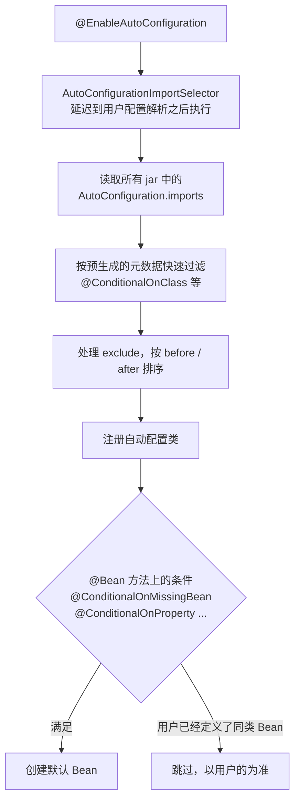

常用条件注解：

| 注解 | 生效条件 |
| --- | --- |
| `@ConditionalOnClass` / `@ConditionalOnMissingClass` | 类路径中有 / 没有某个类 |
| `@ConditionalOnBean` / `@ConditionalOnMissingBean` | 容器中有 / 没有某个 Bean |
| `@ConditionalOnProperty` / `@ConditionalOnBooleanProperty` | 配置项满足条件 |
| `@ConditionalOnWebApplication` | 当前是 Web 应用 |
| `@ConditionalOnThreading(Threading.VIRTUAL)` | 开启了虚拟线程 |

**追问链**

1. **`@ConditionalOnBean` 为什么有时判断不准？**
   它只能看到**此刻已经注册**的 Bean 定义，结果依赖处理顺序。所以它主要用在自动配置类中，并且要用 `@AutoConfiguration(after = ...)` 确保被依赖的配置先处理；在用户的普通配置类中使用它很容易出错。
2. **Spring Boot 4 在自动配置上有什么变化？**
   原来的单个 `spring-boot-autoconfigure` 被拆分成大量按技术划分的模块，包名也随之改变。例如 `DataSourceAutoConfiguration` 现在位于 `spring-boot-jdbc` 模块的 `org.springframework.boot.jdbc.autoconfigure` 包中，`WebMvcAutoConfiguration` 位于 `spring-boot-webmvc` 模块（均已核对 Boot 4.0.4 的 jar 包）。代码里通过类名 `exclude` 自动配置、或直接引用自动配置类的地方，升级时需要修改 import。

---

### 05-16 Spring Boot 的启动流程

> ★★ ｜ 资深 ｜ 中频

**考察意图**：能否说清 SpringApplication.run 的主干，以及各类扩展点的执行时机。

**30 秒版回答**

1. **构造 SpringApplication**：根据类路径推断应用类型（Servlet、Reactive 或非 Web）；从 `spring.factories` 加载 `ApplicationContextInitializer` 和 `ApplicationListener`；推断主类。
2. **执行 `run()`**（已核对 Boot 4.0.4 源码中的调用顺序）：
   1. `listeners.starting`：发布启动事件；
   2. `prepareEnvironment`：创建环境，加载命令行参数、系统属性、环境变量、`application.yml` 等配置；
   3. `printBanner`；
   4. `createApplicationContext`：按应用类型创建上下文；
   5. `prepareContext`：执行 Initializer，把主类注册为 Bean 定义；
   6. **`refreshContext`**：调用 05-02 中的 `refresh()`，其中 `onRefresh` 会创建并启动内嵌的 Tomcat；
   7. `afterRefresh`；
   8. `listeners.started`：发布 `ApplicationStartedEvent`；
   9. `callRunners`：执行所有 `ApplicationRunner` 和 `CommandLineRunner`；
   10. `listeners.ready`：发布 `ApplicationReadyEvent`，此时应用可以对外提供服务。

**深入剖析**

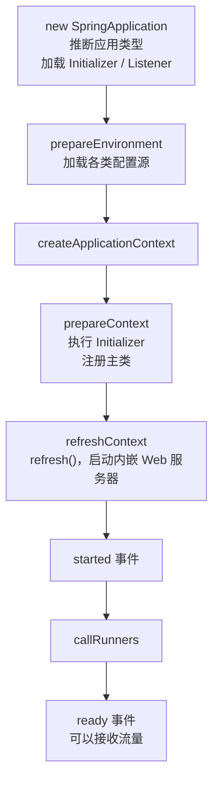

**追问链**

1. **启动后要执行初始化逻辑（预热缓存、注册服务），放在哪里？**
   放在 `ApplicationRunner` 或监听 `ApplicationReadyEvent`。在 Kubernetes 中，还应让就绪探针在这些初始化完成之后才返回成功，避免流量提前进入。
2. **Spring Boot 应用启动慢，怎么分析？**
   用 `BufferingApplicationStartup` 记录启动步骤（通过 Actuator 的 `/actuator/startup` 查看）找出耗时最多的 Bean；常见原因有扫描范围过大、某些 Bean 在初始化时做了远程调用、自动配置引入了用不到的组件。启动优化见[《04 JVM》](../01-Java核心/04-JVM.md)04-19。

---

### 05-17 如何设计一个自定义 Starter？

> ★★ ｜ 架构师 ｜ 中频

**考察意图**：是否有封装公共组件的经验，是否知道好 Starter 的设计原则。

**30 秒版回答**

- 结构：通常拆成两个模块。
  - `xxx-spring-boot-autoconfigure`：自动配置类 + 配置属性类 + `AutoConfiguration.imports` 注册文件；
  - `xxx-spring-boot-starter`：没有代码，只用来聚合依赖，使用方引入它即可。
  - 命名约定：官方 Starter 叫 `spring-boot-starter-xxx`，第三方叫 `xxx-spring-boot-starter`。
- 设计原则：
  - **可以被覆盖**：所有默认 Bean 加 `@ConditionalOnMissingBean`；
  - **可以被关闭**：提供 `xxx.enabled` 开关；
  - **按需生效**：用 `@ConditionalOnClass` 判断依赖是否存在；
  - **不使用组件扫描**：自动配置类只用 `@Bean` 显式声明，避免把不该注册的类扫进使用方的容器；
  - **配置有元数据、有校验**：引入 `spring-boot-configuration-processor` 生成配置提示，用 `@Validated` 在启动时校验配置；
  - **启动时不做重活**：不在初始化时发起远程调用，必要的连接延迟建立或异步建立。

**深入剖析**

```java
@AutoConfiguration
@ConditionalOnClass(AuditClient.class)
@ConditionalOnBooleanProperty(name = "company.audit.enabled", matchIfMissing = true)
@EnableConfigurationProperties(AuditProperties.class)
public class AuditAutoConfiguration {

    @Bean
    @ConditionalOnMissingBean
    public AuditClient auditClient(AuditProperties properties) {
        return new AuditClient(properties.getEndpoint(), properties.getTimeout());
    }
}

@Validated
@ConfigurationProperties(prefix = "company.audit")
public class AuditProperties {
    /** 审计服务地址 */
    @NotBlank
    private String endpoint;
    /** 调用超时时间 */
    private Duration timeout = Duration.ofSeconds(2);
    // getter / setter 省略
}
```

注册文件 `META-INF/spring/org.springframework.boot.autoconfigure.AutoConfiguration.imports`：

```text
com.company.audit.autoconfigure.AuditAutoConfiguration
```

**追问链**

1. **Starter 依赖的第三方库版本和使用方冲突怎么办？**
   Starter 中尽量把可选的依赖声明为 `optional`，由使用方决定是否引入；公司内部统一维护一个 BOM，约束所有 Starter 的依赖版本。

---

### 05-18 配置的加载优先级；@Value 和 @ConfigurationProperties 怎么选？

> ★★ ｜ 资深 ｜ 中频

**考察意图**：是否清楚线上"配置不生效"时该从哪里查起。

**30 秒版回答**

- 优先级从高到低（常用部分）：
  1. 命令行参数（`--server.port=8081`）；
  2. `SPRING_APPLICATION_JSON`；
  3. Java 系统属性（`-Dserver.port=8081`）；
  4. 操作系统环境变量（`SERVER_PORT=8081`）；
  5. jar 包**外部**的 `application-{profile}.yml`，然后是外部的 `application.yml`；
  6. jar 包**内部**的 `application-{profile}.yml`，然后是内部的 `application.yml`；
  7. `@PropertySource` 引入的配置；
  8. 默认属性。
- 通过 `spring.config.import` 可以引入额外的配置源，例如 Nacos 配置中心（见[《13 配置中心》](../03-分布式与微服务/13-配置中心.md)）。
- 宽松绑定：`server.port`、`SERVER_PORT`、`server-port` 都能绑定到同一个属性，这也是环境变量能覆盖配置文件的原因。
- `@Value` 和 `@ConfigurationProperties`：

| 维度 | @Value | @ConfigurationProperties |
| --- | --- | --- |
| 适合 | 零散的一两个值 | 一组相关的配置 |
| 类型安全 | 弱 | 强，支持嵌套对象、List、Map、Duration、DataSize |
| 宽松绑定 | 有限 | 完整支持 |
| 校验 | 不支持 | 配合 `@Validated` |
| IDE 提示 | 无 | 有（生成元数据） |
| SpEL 表达式 | 支持 | 不支持 |
| 不可变 | 不支持 | 支持构造器绑定，可以直接使用 record |

**追问链**

1. **线上修改了配置不生效，怎么排查？**
   用 Actuator 的 `/actuator/env` 查看最终生效的值以及来自哪个配置源，往往会发现被更高优先级的来源（环境变量、启动参数）覆盖了。

---

### 05-19 Spring 的事件机制及其使用注意事项

> ★★ ｜ 资深 ｜ 中频

**考察意图**：是否清楚事件默认是同步的，以及由此带来的事务和异常问题。

**30 秒版回答**

- 用法：通过 `ApplicationEventPublisher.publishEvent(event)` 发布，用 `@EventListener` 方法监听。事件可以是任意对象。
- **默认是同步执行的**：监听器在发布者的线程中执行，处于发布者的事务中。监听器抛出的异常会传回发布者，可能导致发布者的事务回滚。
- 需要异步时，在监听器上加 `@Async`；需要在事务提交后才执行，用 `@TransactionalEventListener`（见 05-13）。
- 事件只在**进程内存**中传递，进程崩溃就丢失，也不能跨服务。需要可靠性和跨服务时，用 MQ 加事务发件箱。

**深入剖析**

```java
@Service
@RequiredArgsConstructor
public class UserService {
    private final ApplicationEventPublisher publisher;

    @Transactional
    public void register(User user) {
        userRepository.save(user);
        publisher.publishEvent(new UserRegisteredEvent(user.getId()));
    }
}

@Component
public class WelcomeCouponListener {
    /** 注册事务提交后再发券，异步执行，发券失败不影响注册 */
    @Async
    @TransactionalEventListener(phase = TransactionPhase.AFTER_COMMIT)
    public void onRegistered(UserRegisteredEvent event) {
        couponService.grantWelcomeCoupon(event.userId());
    }
}
```

**追问链**

1. **事件机制和直接调用相比，好在哪里？**
   发布者不需要知道有哪些订阅者，新增一种后续处理（发券、发短信、更新统计）只需要加一个监听器，符合开闭原则。代价是调用链不再直观，需要在团队中约定好事件的命名和文档。

---

### 05-20 @Async 的原理与常见坑

> ★★ ｜ 资深 ｜ 高频

**考察意图**：是否知道 @Async 默认使用什么线程池，以及它和事务、上下文、循环依赖之间的问题。

**30 秒版回答**

- 原理：`@EnableAsync` 注册 `AsyncAnnotationBeanPostProcessor`，为带 `@Async` 的 Bean 创建代理。调用时，代理把方法调用包装成任务提交给线程池，立即返回。
- **用哪个线程池**：`@Async("名字")` 指定的 → `AsyncConfigurer` 提供的 → 容器中唯一的 TaskExecutor Bean → 名为 `taskExecutor` 的 Bean。纯 Spring 环境下都找不到时，会退回到 `SimpleAsyncTaskExecutor`，**每个任务新建一个线程**。
- Spring Boot 会自动配置一个 `ThreadPoolTaskExecutor`，但它的默认参数是：**核心线程 8 个、队列容量 `Integer.MAX_VALUE`**（已核对 Boot 4.0.4 的 `TaskExecutionProperties`）。也就是说最多只有 8 个线程在干活，其余任务全部在无界队列中排队，突发流量下任务会大量堆积直到 OOM。生产环境应该为不同业务定义有界的专用线程池。开启虚拟线程后，Boot 会改用基于虚拟线程的 `SimpleAsyncTaskExecutor`。
- 常见坑：
  - 自调用不生效（和事务一样，不经过代理）；
  - 返回 void 时，异常交给 `AsyncUncaughtExceptionHandler`，默认只打日志，调用方完全不知道；需要结果或异常时返回 `CompletableFuture`；
  - 异步线程中拿不到原线程的 ThreadLocal（登录用户、traceId），需要配置 `TaskDecorator`；
  - 异步方法**不在调用方的事务中**；
  - 带 `@Async` 的 Bean 如果处于循环依赖中，启动会报错，见 05-05。

**深入剖析**

```java
@Configuration
@EnableAsync
public class AsyncConfig {
    @Bean("notifyExecutor")
    public ThreadPoolTaskExecutor notifyExecutor() {
        ThreadPoolTaskExecutor executor = new ThreadPoolTaskExecutor();
        executor.setCorePoolSize(8);
        executor.setMaxPoolSize(16);
        executor.setQueueCapacity(1000);                     // 有界队列
        executor.setThreadNamePrefix("notify-");
        executor.setRejectedExecutionHandler(new ThreadPoolExecutor.CallerRunsPolicy());
        executor.setTaskDecorator(new ContextPropagatingTaskDecorator());   // 传递 traceId 等上下文（Spring 6.1+）
        executor.setWaitForTasksToCompleteOnShutdown(true);
        executor.setAwaitTerminationSeconds(30);
        return executor;
    }
}

@Service
public class NotifyService {
    @Async("notifyExecutor")
    public CompletableFuture<Boolean> sendSms(String phone, String content) {
        return CompletableFuture.completedFuture(smsClient.send(phone, content));
    }
}
```

**追问链**

1. **@Async 和自己用线程池提交任务，怎么选？**
   @Async 写起来简单，但线程池的选择和异常处理被"藏"起来了，排查问题时不直观。核心链路建议显式注入线程池、显式提交任务，便于控制超时、降级和监控；边缘的、简单的异步任务可以用 @Async。

---

## 五、版本演进

### 05-21 Spring 6 / 7 和 Spring Boot 3 / 4 有哪些重要变化？

> ★★★ ｜ 架构师 ｜ 高频

**考察意图**：是否跟进生态的演进，能否评估升级的成本和收益。

**30 秒版回答**

**Spring Framework 6 / Spring Boot 3（2022 年 11 月）**：

- 最低 **JDK 17**；
- **从 Java EE 迁移到 Jakarta EE**（`javax.*` 包名全部改为 `jakarta.*`），这是升级中工作量最大的一项；
- AOT 处理与 GraalVM Native Image 的正式支持；
- 基于 Micrometer 的可观测性（Observation API），取代 Spring Cloud Sleuth；
- HTTP 接口客户端（`@HttpExchange`）；6.1 起有 `RestClient`、`JdbcClient`，并支持虚拟线程（Boot 3.2 的 `spring.threads.virtual.enabled`）。

**Spring Framework 7 / Spring Boot 4（2025 年 11 月）**：

- JDK 17 仍是最低要求，推荐使用 JDK 21 / 25；基线升级到 **Jakarta EE 11**（Servlet 6.1），内嵌 Tomcat 11；
- **内置弹性能力**：`@Retryable`（支持最大重试次数、延迟、抖动、倍数、最大延迟）和 `@ConcurrencyLimit`，配合 `@EnableResilientMethods` 启用（已核对 spring-context 7.0.6 中的 `org.springframework.resilience.annotation` 包）；
- **API 版本控制**：`@RequestMapping(version = "...")`（已核对 spring-web 7.0.6）；
- 采用 JSpecify 注解统一空值安全声明；
- Spring Boot 4 的**自动配置被拆分成按技术划分的模块**，包名随之改变（见 05-15）；
- Jackson 3 成为默认的 JSON 库（包名从 `com.fasterxml.jackson` 改为 `tools.jackson`，注解包保持不变），从 Boot 3 升级时要检查自定义的 ObjectMapper 配置和序列化器。依赖管理中仍保留了 Jackson 2 的 BOM，便于过渡；
- 依赖版本（已核对 `spring-boot-dependencies` 4.0.4）：Tomcat 11.0.18、Servlet 6.1、Jackson 3.1.0、Netty 4.2.10、HikariCP 7.0.2、Kafka 客户端 4.1.2。

**深入剖析**

Spring 7 内置的方法级重试和并发限制：

```java
@Configuration
@EnableResilientMethods
public class ResilienceConfig {
}

@Service
public class InventoryClient {
    /** 最多重试 3 次，初始延迟 100ms，指数退避，带随机抖动，避免重试风暴 */
    @Retryable(includes = RemoteAccessException.class, maxRetries = 3, delay = 100, multiplier = 2, jitter = 50)
    public Stock query(long skuId) {
        return remote.query(skuId);
    }

    /** 同一时刻最多 20 个并发调用，保护下游 */
    @ConcurrencyLimit(20)
    public void reserve(long skuId, int quantity) {
        remote.reserve(skuId, quantity);
    }
}
```

**追问链**

1. **从 Spring Boot 2.x 升级到 3 / 4，建议的路径是什么？**
   先升级到 2.7（这个版本中已经有大部分 3.x 的新写法和废弃提示），处理掉所有废弃警告；然后升级 JDK 到 17+；再用 OpenRewrite 之类的工具批量完成 `javax` 到 `jakarta` 的迁移；最后升级到 3.x，逐个处理依赖的兼容性。从 3.x 到 4.x 主要处理模块拆分、Jackson 3 以及被移除的废弃 API。
2. **有了 Spring 7 的 `@Retryable`，还需要 Resilience4j 吗？**
   Spring 7 内置的是方法级的重试和并发限制，足以应对简单场景；需要熔断器、限流器、舱壁隔离、统一的指标监控时，Resilience4j 或 Sentinel 仍然更完整。见[《26 高可用》](../06-三高与架构/26-高可用.md)。

**架构师加分点**

升级的价值要算清楚：JDK 17 / 21 带来的 GC 和性能提升、虚拟线程、更好的可观测性，以及安全补丁的持续供给（旧版本 Spring Boot 的开源支持已经结束）。把升级拆成可以独立回滚的小步骤，并用自动化测试兜底，是控制升级风险的关键。
