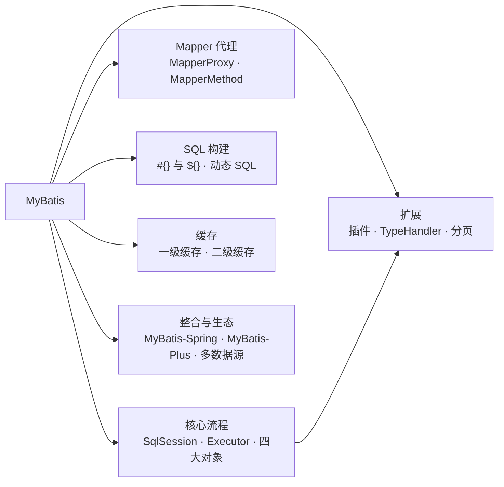
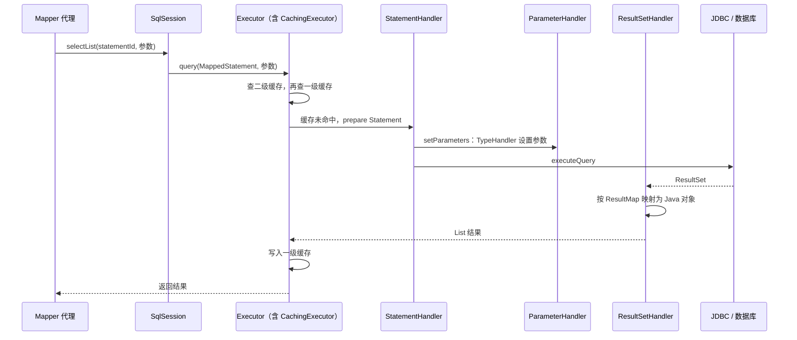
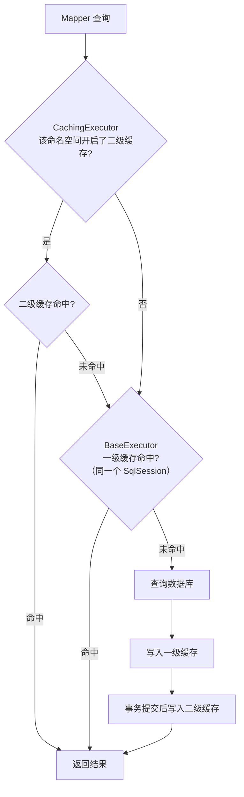
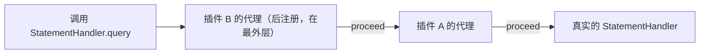
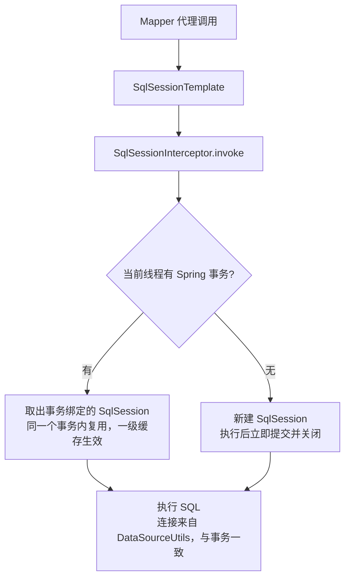
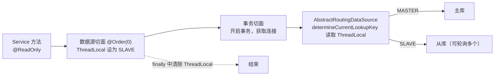

# 06 · MyBatis

> 适用岗位：Java 资深开发 / 架构师
> 版本基线：MyBatis 3.5.x、MyBatis-Spring 3.x、MyBatis-Plus 3.5.x
> 事实核对：默认配置和类结构来自本机 Maven 仓库中的 MyBatis 3.5.19 与 MyBatis-Spring 3.0.5（`javap` 与实际运行），标「实测」的行为已运行验证
> 相关分类：[《05 Spring》](05-Spring.md)（事务、FactoryBean、BeanPostProcessor）、[《15 MySQL》](../04-数据存储/15-MySQL.md)（索引与慢 SQL）、[《16 分库分表》](../04-数据存储/16-分库分表.md)

## 知识地图



## 题目索引

| 编号 | 题目 | 难度 | 层级 |
| --- | --- | --- | --- |
| 06-01 | MyBatis 的整体架构与一条 SQL 的执行流程 | ★★ | 资深 |
| 06-02 | Mapper 接口为什么不需要实现类？ | ★★ | 资深 |
| 06-03 | `#{}` 和 `${}` 有什么区别？什么时候不得不用 `${}`？ | ★ | 资深 |
| 06-04 | 一级缓存和二级缓存的原理与坑 | ★★★ | 资深 |
| 06-05 | Executor 有哪几种？批量插入怎么写才快？ | ★★ | 资深 |
| 06-06 | MyBatis 插件的原理与应用 | ★★★ | 资深 / 架构师 |
| 06-07 | 分页有哪些方式？PageHelper 的原理和坑 | ★★ | 资深 |
| 06-08 | 动态 SQL 的原理与常见陷阱 | ★★ | 资深 |
| 06-09 | 结果映射：关联查询、N+1 问题与延迟加载 | ★★ | 资深 |
| 06-10 | MyBatis 如何与 Spring 整合？SqlSessionTemplate 为什么线程安全？ | ★★★ | 资深 |
| 06-11 | TypeHandler 的作用与典型应用 | ★★ | 资深 |
| 06-12 | 大结果集如何处理才不会 OOM？ | ★★★ | 资深 |
| 06-13 | 多数据源与读写分离如何实现？ | ★★★ | 架构师 |
| 06-14 | MyBatis-Plus 的原理与常见坑 | ★★ | 资深 |
| 06-15 | MyBatis 和 JPA / Hibernate 怎么选？ | ★★ | 架构师 |

---

## 一、核心流程

### 06-01 MyBatis 的整体架构与一条 SQL 的执行流程

> ★★ ｜ 资深 ｜ 高频

**考察意图**：能否说清楚各个核心组件的职责与调用顺序。

**30 秒版回答**

- 启动阶段：`SqlSessionFactoryBuilder` 解析配置文件和 Mapper XML（或注解），把所有信息装进一个 `Configuration` 对象。每条 SQL 被解析成一个 `MappedStatement`，以"命名空间 + 语句 id"为 key 保存。
- 执行阶段，一条查询经过的组件：
  1. **SqlSession**：对外的 API，例如 `selectList`；
  2. **Executor**：执行器，负责缓存（一级、二级）和事务，再交给 StatementHandler；
  3. **StatementHandler**：创建 JDBC 的 Statement，执行 SQL；
  4. **ParameterHandler**：把参数设置到 PreparedStatement 的 `?` 上，具体的类型转换由 **TypeHandler** 完成；
  5. **ResultSetHandler**：把 JDBC 的 ResultSet 按 ResultMap 映射成 Java 对象，同样依靠 TypeHandler。
- 其中 Executor、StatementHandler、ParameterHandler、ResultSetHandler 被称为"四大对象"，也是插件可以拦截的全部目标，见 06-06。

**深入剖析**



**追问链**

1. **SqlSession 是线程安全的吗？**
   `DefaultSqlSession` 不是线程安全的，应该每次请求或每个事务使用一个，用完关闭。在 Spring 中使用的是线程安全的 `SqlSessionTemplate`，见 06-10。
2. **SqlSessionFactory 应该是什么生命周期？** 整个应用一个单例，它是重量级对象，持有完整的 Configuration。

---

### 06-02 Mapper 接口为什么不需要实现类？

> ★★ ｜ 资深 ｜ 高频

**考察意图**：是否理解 MapperProxy 动态代理，以及 Mapper 方法与 SQL 的对应规则。

**30 秒版回答**

- `sqlSession.getMapper(UserMapper.class)` 返回的是一个 **JDK 动态代理**，`InvocationHandler` 是 `MapperProxy`。
- 调用 Mapper 方法时，`MapperProxy` 找到（并缓存）对应的 `MapperMethod`，它用"**接口全限定名 + 方法名**"去 Configuration 中查找 `MappedStatement`，再根据 SQL 类型（SELECT / INSERT / UPDATE / DELETE）和方法的返回类型，调用 SqlSession 对应的方法。
- 由此带来两个约束：
  - XML 的 namespace 必须等于接口的全限定名，语句 id 必须等于方法名；
  - **Mapper 接口中的方法不能重载**，因为查找 key 里没有参数类型。
- 接口的 default 方法会被直接调用，不会去找 SQL。

**追问链**

1. **多个参数时为什么要加 `@Param`？**
   编译后方法参数名默认会丢失（除非编译时加 `-parameters`；使用 `spring-boot-starter-parent` 时，它为编译插件默认开启了这个选项），MyBatis 只能用 `param1`、`param2` 或 `arg0`、`arg1` 引用。加上 `@Param("userId")` 后，XML 中才能用 `#{userId}`。
2. **在 Spring 中，Mapper 接口是怎么变成 Bean 的？**
   `MapperScannerConfigurer` 扫描接口，为每个接口注册一个 `MapperFactoryBean` 类型的 Bean 定义，它的 `getObject()` 返回上面说的代理。完整链路见[《05 Spring》](05-Spring.md)05-04。

---

### 06-03 `#{}` 和 `${}` 有什么区别？什么时候不得不用 `${}`？

> ★ ｜ 资深 ｜ 高频

**考察意图**：是否有 SQL 注入的防范意识，以及在必须使用 `${}` 时如何防护。

**30 秒版回答**

- `#{}`：预编译占位符，SQL 中生成 `?`，通过 `PreparedStatement.setXxx` 设置参数，数据库把参数当作值，**不会被当作 SQL 解析，能防止 SQL 注入**。
- `${}`：字符串**直接拼接**进 SQL，参数中的内容会被当作 SQL 的一部分执行，**存在注入风险**。
- 不得不用 `${}` 的场景：表名、列名、排序字段、排序方向。它们是 SQL 的结构，不能用 `?` 占位。
- 这时必须**在代码中用白名单校验**，只允许预先定义好的取值。

**深入剖析**

```java
/** 排序字段白名单：前端传入的字段名必须映射到预定义的列名，不能直接拼接 */
public enum OrderSortField {
    CREATE_TIME("create_time"),
    AMOUNT("amount");

    private final String column;

    OrderSortField(String column) {
        this.column = column;
    }

    public String column() {
        return column;
    }

    public static OrderSortField of(String name) {
        return Arrays.stream(values())
                .filter(f -> f.name().equalsIgnoreCase(name))
                .findFirst()
                .orElseThrow(() -> new BizException(ErrorCode.INVALID_SORT_FIELD, "invalid sort field"));
    }
}
```

```xml
<select id="listOrders" resultType="Order">
    SELECT * FROM t_order WHERE user_id = #{userId}
    ORDER BY ${sortColumn} ${sortDirection}   <!-- 两个值都已在代码中经过白名单校验 -->
</select>
```

**追问链**

1. **`LIKE` 模糊查询怎么写才安全？**
   用 `LIKE CONCAT('%', #{keyword}, '%')`，或者在 Java 中拼好 `%` 再传给 `#{}`。不要写 `LIKE '%${keyword}%'`。另外要注意用户输入中的 `%` 和 `_` 是通配符，必要时转义，否则可能变成全表扫描式的查询。

---

## 二、缓存与执行器

### 06-04 一级缓存和二级缓存的原理与坑

> ★★★ ｜ 资深 ｜ 高频

**考察意图**：是否清楚缓存的作用范围，以及为什么生产环境通常关闭二级缓存。

**30 秒版回答**

- **一级缓存**：
  - 作用范围是 **SqlSession**（默认 `localCacheScope = SESSION`，实测），存放在 BaseExecutor 的 `PerpetualCache`（一个 HashMap）中；
  - key 由语句 id、分页参数、SQL 文本和参数值组成；
  - 同一个 SqlSession 中执行任何增删改、提交或回滚，都会清空它；
  - **在 Spring 中，如果没有开启事务，每次 Mapper 调用都会使用一个新的 SqlSession**，一级缓存实际上不起作用；只有在同一个事务内，多次相同查询才会命中。
- **二级缓存**：
  - 作用范围是 **Mapper 的命名空间**，跨 SqlSession 共享；
  - 全局开关 `cacheEnabled` 默认为 true（实测），但每个 Mapper 还需要配置 `<cache/>` 才会真正启用；
  - 由 `CachingExecutor` 实现，用装饰器模式叠加能力：`LruCache`、`FifoCache`、`SoftCache`、`WeakCache`、`ScheduledCache`、`SerializedCache`、`SynchronizedCache`、`LoggingCache`、`BlockingCache`、`TransactionalCache`（实测 jar 包中的全部装饰器）；
  - 查询结果在事务**提交后**才真正写入二级缓存（`TransactionalCache` 暂存）。
- 生产中的问题：
  - **多表关联时容易读到脏数据**：缓存按命名空间失效，A Mapper 修改了表，B Mapper 中关联这张表的查询缓存不会失效；
  - **分布式部署时各节点的缓存互相独立**，一个节点更新了数据，其他节点仍返回旧值；
  - 一级缓存返回的是**同一个对象引用**，调用方修改了对象，同一会话中的下一次查询会拿到被修改过的对象。
- 结论：**一般不启用二级缓存**，需要缓存时在 Service 层用 Caffeine 或 Redis 显式管理，见[《17 Redis》](../04-数据存储/17-Redis.md)和[《18 本地缓存》](../04-数据存储/18-本地缓存.md)。

**深入剖析**



**追问链**

1. **同一个事务内先查询、再用 JDBC 直接修改了数据、再查询，会读到旧数据吗？**
   会。第二次查询命中了一级缓存，而直接用 JDBC 修改不会清空 MyBatis 的缓存。需要时可以把 `localCacheScope` 设为 `STATEMENT`，相当于关闭一级缓存。

---

### 06-05 Executor 有哪几种？批量插入怎么写才快？

> ★★ ｜ 资深 ｜ 高频

**考察意图**：是否做过大批量数据写入，是否知道 JDBC 批处理和 MySQL 驱动参数的作用。

**30 秒版回答**

- 三种执行器（`ExecutorType`，实测默认为 `SIMPLE`）：
  - **SIMPLE**：每次执行都创建新的 Statement；
  - **REUSE**：在同一个 SqlSession 中复用 SQL 相同的 PreparedStatement；
  - **BATCH**：用 JDBC 的 `addBatch` 攒批，`flushStatements` 或提交时一次性发送。
  - 开启二级缓存时，外面再包一层 `CachingExecutor`。
- 批量插入的两种方式：
  1. **XML 中用 `<foreach>` 拼成一条多值 INSERT**：`INSERT INTO t VALUES (...), (...), ...`。简单，但一条 SQL 太长时会超过 MySQL 的 `max_allowed_packet` 限制，也会让 MyBatis 解析参数变慢。需要**分批**，每批几百到一千条；
  2. **BATCH 执行器 + MySQL 驱动参数 `rewriteBatchedStatements=true`**：驱动会把一批单条 INSERT 改写成多值 INSERT 发送。**不加这个参数，MySQL 驱动仍然是一条一条发送**，批处理的效果大打折扣。

**深入剖析**

```java
@Service
@RequiredArgsConstructor
public class OrderImportService {
    private static final int BATCH_SIZE = 500;

    private final SqlSessionFactory sqlSessionFactory;

    /** 大批量写入：使用 BATCH 执行器，每 500 条刷新一次，配合 JDBC URL 中的 rewriteBatchedStatements=true */
    public void importOrders(List<Order> orders) {
        try (SqlSession session = sqlSessionFactory.openSession(ExecutorType.BATCH, false)) {
            OrderMapper mapper = session.getMapper(OrderMapper.class);
            for (int i = 0; i < orders.size(); i++) {
                mapper.insert(orders.get(i));
                if ((i + 1) % BATCH_SIZE == 0) {
                    session.flushStatements();
                }
            }
            session.flushStatements();
            session.commit();
        }
    }
}
```

**追问链**

1. **BATCH 模式下，`insert` 方法的返回值还准确吗？**
   不准确。语句只是被加入批次，还没有真正执行，返回值是一个固定的占位值。需要影响行数时，看 `flushStatements()` 返回的 `BatchResult`。
2. **批量插入后怎么拿到自增主键？**
   单条插入用 `useGeneratedKeys="true" keyProperty="id"`；`<foreach>` 方式的多值插入，MyBatis 3.3.1 起也能把生成的主键回填到集合中的每个对象。在分库分表的场景下，主键通常由分布式 ID 生成器预先分配，不依赖数据库自增，见[《09 分布式理论》](../03-分布式与微服务/09-分布式理论.md)。

---

## 三、扩展机制

### 06-06 MyBatis 插件的原理与应用

> ★★★ ｜ 资深 / 架构师 ｜ 高频

**考察意图**：能否讲清插件的代理链机制，并用它实现框架级能力。

**30 秒版回答**

- 插件实现 `Interceptor` 接口，核心是 `intercept(Invocation)`（实测接口中只有它是抽象方法，`plugin` 和 `setProperties` 都有默认实现），用 `@Intercepts` + `@Signature` 声明要拦截哪个对象的哪个方法。
- 只能拦截**四大对象**：Executor、StatementHandler、ParameterHandler、ResultSetHandler。
- 原理：Configuration 在创建这四类对象时，调用 `interceptorChain.pluginAll(target)`，按注册顺序用 `Plugin.wrap` 为目标对象层层包装 **JDK 动态代理**。调用被拦截的方法时进入 `intercept`，调用 `invocation.proceed()` 继续向内传递。
- 因为是层层包装，**最后注册的插件在最外层，最先执行**。
- 典型应用：分页（PageHelper、MyBatis-Plus 的分页插件）、数据权限（自动追加 `WHERE dept_id IN (...)`）、多租户（追加租户条件）、慢 SQL 记录、字段加解密、审计字段自动填充。

**深入剖析**

一个记录慢 SQL 的插件：

```java
@Slf4j
@Intercepts({
        @Signature(type = StatementHandler.class, method = "query", args = {Statement.class, ResultHandler.class}),
        @Signature(type = StatementHandler.class, method = "update", args = {Statement.class})
})
public class SlowSqlInterceptor implements Interceptor {
    private static final long SLOW_SQL_THRESHOLD_MS = 500;

    @Override
    public Object intercept(Invocation invocation) throws Throwable {
        long start = System.nanoTime();
        try {
            return invocation.proceed();
        } finally {
            long costMs = (System.nanoTime() - start) / 1_000_000;
            if (costMs >= SLOW_SQL_THRESHOLD_MS) {
                StatementHandler handler = (StatementHandler) invocation.getTarget();
                log.info("slow sql detected, costMs={}, sql={}", costMs, handler.getBoundSql().getSql());
            }
        }
    }
}
```



**追问链**

1. **数据权限插件应该拦截哪个对象？怎么改 SQL？**
   通常拦截 `StatementHandler.prepare`，拿到 `BoundSql` 中的原始 SQL，用 SQL 解析器（如 JSqlParser）解析成语法树，在 WHERE 中追加条件，再通过反射（MyBatis 提供的 `MetaObject`）写回。**不要用字符串拼接修改 SQL**，遇到子查询、UNION、别名时很容易出错，还可能被利用造成越权。
2. **插件的代价是什么？**
   每个被拦截的方法调用都要经过反射和代理，插件过多、逻辑复杂会拖慢所有 SQL；修改 SQL 的插件之间还会相互影响（顺序敏感）。插件应该少而精，并有充分的测试。

---

### 06-07 分页有哪些方式？PageHelper 的原理和坑

> ★★ ｜ 资深 ｜ 高频

**考察意图**：是否知道 RowBounds 是内存分页，是否踩过 PageHelper 的 ThreadLocal 坑，是否了解深分页的优化。

**30 秒版回答**

- **RowBounds**：MyBatis 自带的分页参数，但它是**逻辑分页**：SQL 照常查出全部数据，在遍历 ResultSet 时跳过前 offset 行。数据量大时既慢又占内存，生产中不要用。
- **物理分页插件**（PageHelper、MyBatis-Plus 的 `PaginationInnerInterceptor`）：拦截查询，先执行一条 `COUNT` 查询得到总数，再在原 SQL 后面追加 `LIMIT`。
- **PageHelper 的原理与坑**：`PageHelper.startPage(1, 10)` 把分页参数放进 **ThreadLocal**，**紧接着的第一条**查询会消费并清除它。
  - 如果 `startPage` 之后没有立即执行查询（例如中间有判断直接 return 了），分页参数会残留在 ThreadLocal 中，被这个线程**处理下一个请求时的某条无关查询**用上，造成莫名其妙的分页；
  - 正确做法是 `startPage` 与查询紧挨着写，或者使用 `PageHelper.startPage(...).doSelectPage(() -> mapper.list())` 这种 Lambda 写法。
- **深分页**：`LIMIT 1000000, 10` 需要扫描并丢弃前 100 万行。优化方法：
  - **游标分页**（推荐）：用上一页最后一条的 id 作为条件：`WHERE id > #{lastId} ORDER BY id LIMIT 10`；
  - **延迟关联**：先在覆盖索引上查出 id，再关联回表：`SELECT t.* FROM t JOIN (SELECT id FROM t ORDER BY create_time LIMIT 1000000, 10) x ON t.id = x.id`。
  - 详见[《15 MySQL》](../04-数据存储/15-MySQL.md)。

**追问链**

1. **COUNT 查询很慢怎么办？**
   复杂的多表关联查询，自动生成的 COUNT 也很复杂。可以为 COUNT 单独写一条优化过的 SQL（PageHelper 支持自定义 count 查询）；对精确总数没有要求的场景（如信息流），干脆不查总数，只提供"下一页"。

---

### 06-08 动态 SQL 的原理与常见陷阱

> ★★ ｜ 资深 ｜ 中频

**考察意图**：是否知道动态 SQL 在运行时如何生成，是否踩过 OGNL 表达式的坑。

**30 秒版回答**

- 解析 XML 时，含有 `<if>`、`<where>`、`<foreach>` 或 `${}` 的语句会被解析成一棵 `SqlNode` 树，包装在 `DynamicSqlSource` 中；不含动态内容的语句是 `RawSqlSource`，启动时就生成好了最终 SQL。
- 每次执行时，`DynamicSqlSource` 用当前参数遍历 SqlNode 树（条件用 **OGNL** 表达式求值），拼出最终 SQL，再把 `#{}` 替换为 `?`，得到 `BoundSql`。
- `<where>` 会去掉多余的开头 `AND` / `OR`，在没有任何条件时也不会输出 WHERE；`<set>` 会去掉多余的末尾逗号。
- **经典陷阱（实测）**：`<if test="status != null and status != ''">`，当 status 是整数 **0** 时，OGNL 把 `''` 当作 0 来比较，`status != ''` 结果为 false，**这个查询条件被悄悄丢掉**。实测结果：

| status 的值 | `status != null and status != ''` |
| --- | --- |
| 0 | **false** |
| 1 | true |
| `''` | false |
| `'A'` | true |

  对数值类型的参数，只写 `status != null` 即可，不要加 `!= ''`。

**深入剖析**

另一个高危陷阱：所有条件都为空时，`<where>` 不生成 WHERE，**UPDATE 或 DELETE 会作用于整张表**。

```xml
<!-- 危险：userId 和 orderNo 都为空时，变成 DELETE FROM t_order -->
<delete id="deleteOrders">
    DELETE FROM t_order
    <where>
        <if test="userId != null">AND user_id = #{userId}</if>
        <if test="orderNo != null">AND order_no = #{orderNo}</if>
    </where>
</delete>
```

防护手段：Service 层先校验参数不全为空（快速失败）；数据库层面可以开启 MySQL 的 `sql_safe_updates`；或者用插件拦截没有 WHERE 条件的 UPDATE 和 DELETE（MyBatis-Plus 提供了 `BlockAttackInnerInterceptor`）。

**追问链**

1. **`<foreach>` 拼接 IN 列表要注意什么？**
   集合为空时会生成 `IN ()`，是语法错误，要提前判断；集合过大时 SQL 很长，解析和执行都会变慢，应分批查询（每批几百个）。

---

### 06-09 结果映射：关联查询、N+1 问题与延迟加载

> ★★ ｜ 资深 ｜ 中频

**考察意图**：是否了解 association / collection 的两种写法以及各自的性能问题。

**30 秒版回答**

- 一对一用 `<association>`，一对多用 `<collection>`，各有两种写法：
  - **嵌套查询**（`select` 属性）：先查主表，再对每一行主表数据执行一次子查询。写法简单，但查 N 条主表记录要额外执行 N 次子查询，这就是 **N+1 问题**；
  - **嵌套结果**（`resultMap` 属性）：用一条 JOIN 查询查出所有数据，由 MyBatis 按 id 把重复的主表行合并、组装成对象树。只有一次查询，但一对多的 JOIN 会让主表数据重复，配合分页时会出错（LIMIT 作用在 JOIN 后的行上，而不是主表记录上）。
- **延迟加载**：配合嵌套查询使用，`lazyLoadingEnabled` 默认关闭（实测）。开启后，主对象被包装成代理（默认用 Javassist，实测 `JavassistProxyFactory`），第一次访问关联属性时才执行子查询。

**深入剖析**

工程上的取舍：

| 方案 | 优点 | 缺点 | 适用 |
| --- | --- | --- | --- |
| 嵌套查询 | 简单，可延迟加载 | N+1 问题 | 关联数据很少被用到 |
| 嵌套结果（JOIN） | 一次查询 | 数据重复，分页困难 | 一对一，或一对多但不分页 |
| **应用层组装** | 可控、好优化 | 需要写组装代码 | 列表页的一对多（推荐） |

应用层组装：先分页查出主表的 N 条记录，收集它们的 id，再用一条 `WHERE order_id IN (...)` 查出所有子记录，在内存中按 id 分组后填充。无论 N 是多少都只有 2 次查询，而且分页正确。

**追问链**

1. **延迟加载在 JSON 序列化时会出什么问题？**
   序列化器会访问所有属性，触发所有延迟加载，反而变成 N+1；如果此时 SqlSession 已经关闭，还会抛异常。另外序列化器可能把代理类内部的字段也序列化出来。接口层返回 DTO，而不是直接返回带延迟加载的实体。

---

## 四、整合与生态

### 06-10 MyBatis 如何与 Spring 整合？SqlSessionTemplate 为什么线程安全？

> ★★★ ｜ 资深 ｜ 中频

**考察意图**：是否理解 MyBatis 如何融入 Spring 事务，这是理解"一级缓存在 Spring 中为什么失效"的基础。

**30 秒版回答**

- `SqlSessionFactoryBean`（一个 FactoryBean）构建 SqlSessionFactory；`MapperScannerConfigurer` 把每个 Mapper 接口注册为 `MapperFactoryBean`，它们使用同一个 `SqlSessionTemplate`。
- `SqlSessionTemplate` 本身不执行 SQL，它内部持有一个 **SqlSession 的 JDK 动态代理**，`InvocationHandler` 是 `SqlSessionInterceptor`（实测 MyBatis-Spring 3.0.5 中的类结构）。每次调用时：
  1. 通过 `SqlSessionUtils.getSqlSession` 获取 SqlSession：**如果当前线程有 Spring 事务，就从 `TransactionSynchronizationManager` 中取出绑定在这个事务上的 SqlSession**；没有事务就新建一个；
  2. 用它执行 SQL；
  3. 没有事务时立即提交并关闭；有事务时交给 Spring 在事务结束时统一处理。
- 所以 `SqlSessionTemplate` 本身无状态，可以被多个线程共享，每个线程实际用的是自己的 SqlSession。
- 连接方面，MyBatis 使用 `SpringManagedTransaction`，通过 `DataSourceUtils.getConnection` 取得**与 Spring 事务绑定的同一个连接**，这正是[《05 Spring》](05-Spring.md)05-10 中"同一个事务用同一个连接"的另一半。

**深入剖析**



**追问链**

1. **为什么 Spring 中没有事务时一级缓存不生效？** 因为每次调用都是一个新的 SqlSession，用完就关闭了，缓存随之丢弃。

---

### 06-11 TypeHandler 的作用与典型应用

> ★★ ｜ 资深 ｜ 中频

**考察意图**：是否用 TypeHandler 解决过实际问题，而不是在业务代码里到处手动转换。

**30 秒版回答**

- TypeHandler 负责 Java 类型与 JDBC 类型之间的双向转换：设置参数时调用 `setParameter`，读取结果时调用 `getResult`。MyBatis 内置了常见类型的处理器。
- 典型的自定义场景：
  - **枚举**：内置的 `EnumTypeHandler` 存枚举名称，`EnumOrdinalTypeHandler` 存序号。**不要存序号**，枚举调整顺序后数据会全部错乱。更好的做法是让枚举实现一个带 `code` 的接口，写一个通用的 TypeHandler 按 code 存储；
  - **JSON 字段**：把一个 Java 对象或 List 存到 MySQL 的 JSON 列；
  - **敏感字段加解密**：写入前加密，读取后解密，对业务代码透明。

**深入剖析**

```java
/** 把手机号等敏感字段加密存储，读取时自动解密 */
@MappedTypes(EncryptedString.class)
public class EncryptedStringTypeHandler extends BaseTypeHandler<EncryptedString> {

    @Override
    public void setNonNullParameter(PreparedStatement ps, int i, EncryptedString parameter, JdbcType jdbcType)
            throws SQLException {
        ps.setString(i, CryptoUtils.encrypt(parameter.plainText()));
    }

    @Override
    public EncryptedString getNullableResult(ResultSet rs, String columnName) throws SQLException {
        String cipher = rs.getString(columnName);
        return cipher == null ? null : new EncryptedString(CryptoUtils.decrypt(cipher));
    }

    @Override
    public EncryptedString getNullableResult(ResultSet rs, int columnIndex) throws SQLException {
        String cipher = rs.getString(columnIndex);
        return cipher == null ? null : new EncryptedString(CryptoUtils.decrypt(cipher));
    }

    @Override
    public EncryptedString getNullableResult(CallableStatement cs, int columnIndex) throws SQLException {
        String cipher = cs.getString(columnIndex);
        return cipher == null ? null : new EncryptedString(CryptoUtils.decrypt(cipher));
    }
}
```

**追问链**

1. **加密后的字段怎么查询？**
   随机加密（每次密文不同）的字段无法直接用于 WHERE。常见做法是额外存一列"确定性哈希"（如带密钥的 HMAC）用于等值查询；模糊查询则需要额外的分词密文或专门的检索方案。

---

### 06-12 大结果集如何处理才不会 OOM？

> ★★★ ｜ 资深 ｜ 高频（数据导出场景）

**考察意图**：是否做过大数据量导出，是否了解 MySQL 驱动的流式读取机制。

**30 秒版回答**

- 问题根源：MySQL 驱动默认会把**整个结果集**一次性读到客户端内存，`fetchSize` 默认不生效。一次查出几百万行，JVM 直接 OOM。
- 三种方案：
  1. **分批查询**：按主键游标分页（`WHERE id > ? ORDER BY id LIMIT 1000`）循环查询，每批处理完再查下一批。最通用、最稳妥；
  2. **流式查询**：MyBatis 的 `Cursor<T>` 返回值，或者 `ResultHandler` 回调。MySQL 驱动需要设置 `fetchSize = Integer.MIN_VALUE` 才会真正逐行读取；或者在连接串中开启 `useCursorFetch=true` 后设置一个正数的 `fetchSize`，由服务端游标分批返回；
  3. **从源头减少数据**：只查需要的列，在数据库中先聚合。
- 流式查询的注意事项：
  - 读取期间**一直占用这个连接**，在读完或关闭之前，这个连接不能执行别的 SQL；
  - 处理过程要快，否则连接被长时间占用，还可能触发服务端的超时；
  - 必须在事务中（或手动管理 SqlSession），保证遍历期间连接不被归还。

**深入剖析**

```java
@Mapper
public interface OrderMapper {
    @Options(fetchSize = Integer.MIN_VALUE)    // MySQL 驱动：逐行流式读取
    @Select("SELECT id, order_no, amount, create_time FROM t_order WHERE create_time >= #{from}")
    Cursor<OrderRow> streamOrders(@Param("from") LocalDateTime from);
}

@Service
@RequiredArgsConstructor
public class OrderExportService {
    private final OrderMapper orderMapper;

    /** Cursor 需要在连接打开期间遍历，所以放在只读事务中 */
    @Transactional(readOnly = true)
    public void export(LocalDateTime from, Consumer<OrderRow> writer) {
        try (Cursor<OrderRow> cursor = orderMapper.streamOrders(from)) {
            cursor.forEach(writer);
        } catch (IOException e) {
            throw new BizException(ErrorCode.EXPORT_FAILED, "close cursor failed");
        }
    }
}
```

**追问链**

1. **导出 100 万行数据给用户下载，整体怎么设计？**
   异步任务：接口只负责创建导出任务；后台用分批或流式查询逐批写入文件（Excel 用 EasyExcel / FastExcel 这类流式写入的工具），上传到对象存储；完成后通知用户下载。同时限制每个用户的并发导出数，避免把数据库拖垮。见[《35 文件处理》](../07-工程实践与稳定性/35-文件处理.md)。

---

### 06-13 多数据源与读写分离如何实现？

> ★★★ ｜ 架构师 ｜ 中频

**考察意图**：是否理解动态数据源的切换时机与事务的关系。

**30 秒版回答**

- 两类需求：
  - **多个业务库**：不同 Mapper 访问不同的库。最清晰的做法是为每个库配置独立的 DataSource、SqlSessionFactory 和事务管理器，按包路径扫描各自的 Mapper；
  - **读写分离**：同一套 Mapper，写操作走主库，读操作走从库。
- 读写分离的常见实现是 Spring 的 `AbstractRoutingDataSource`：
  - 它本身是一个 DataSource，内部持有多个真实的 DataSource；
  - 每次获取连接时，调用 `determineCurrentLookupKey()` 决定用哪一个，key 通常来自 ThreadLocal；
  - 用 AOP 根据注解（`@ReadOnly`）或方法名设置 ThreadLocal 中的 key。
- **关键陷阱：切换数据源的切面必须在事务切面之前执行**。事务一开启就会从 DataSource 拿到连接并绑定到线程，之后再切换 key 已经没有用了。所以要么让数据源切面的 `@Order` 比事务切面更小，要么直接根据 `@Transactional(readOnly = true)` 来判断读写。
- 主从延迟：刚写完马上读，可能从从库读到旧数据。对一致性要求高的读操作（写后立即读、支付状态查询）强制走主库。
- 更完整的方案：ShardingSphere-JDBC 提供读写分离、分库分表、负载均衡和主库强制路由，见[《16 分库分表》](../04-数据存储/16-分库分表.md)。

**深入剖析**



**追问链**

1. **一个事务中既有读又有写，读应该走哪个库？** 走主库。同一个事务只能使用一个连接，而且事务中的读往往需要看到本事务刚写入的数据。

---

### 06-14 MyBatis-Plus 的原理与常见坑

> ★★ ｜ 资深 ｜ 高频

**考察意图**：是否理解 MyBatis-Plus 是怎么"不写 SQL 就能 CRUD"的，以及它带来的新问题。

**30 秒版回答**

- 原理：
  - **通用 CRUD**：启动时，`ISqlInjector` 为每个继承了 `BaseMapper` 的 Mapper，根据实体类上的注解（表名、主键、字段映射）生成 `selectById`、`insert`、`updateById` 等方法对应的 `MappedStatement`，注册到 MyBatis 的 Configuration 中。运行时和手写 XML 的 SQL 没有区别；
  - **条件构造器**（`QueryWrapper`、`LambdaQueryWrapper`）：在运行时拼接 WHERE 片段，通过 `${ew.customSqlSegment}` 嵌入 SQL，其中的值仍以 `#{}` 参数的形式绑定；
  - **插件**：分页、乐观锁、多租户、防全表更新删除，都基于 MyBatis 的插件机制（`MybatisPlusInterceptor` 中挂载各类 InnerInterceptor）。
- 常见坑：
  - **`updateById` 默认忽略值为 null 的字段**，想把某个字段更新为 null 时不生效。需要用 `UpdateWrapper.set("col", null)`，或调整字段的更新策略；
  - **`apply`、`last`、`orderBy` 等方法中拼接的是原始 SQL 片段**，把用户输入传进去就是 SQL 注入；
  - **逻辑删除与唯一索引冲突**：记录被逻辑删除后仍在表中，再插入相同唯一键的记录会违反唯一约束。常见解法是把删除标记设计成"删除时写入记录的 id 或删除时间"，并把它加入唯一索引；
  - 在 Service 中大量拼 Wrapper，查询逻辑散落在各处，难以复用和优化。复杂查询仍然应该写在 XML 中。

**追问链**

1. **乐观锁插件是怎么工作的？**
   实体中带 `@Version` 的字段，`updateById` 时插件自动在 SET 中追加 `version = version + 1`，在 WHERE 中追加 `version = 旧值`。影响行数为 0 说明数据已经被别人修改过，由业务决定重试还是报错。

---

### 06-15 MyBatis 和 JPA / Hibernate 怎么选？

> ★★ ｜ 架构师 ｜ 中频

**考察意图**：能否从团队、业务和数据访问模式出发做技术选型，而不是"国内都用 MyBatis"。

**30 秒版回答**

| 维度 | MyBatis | JPA / Hibernate |
| --- | --- | --- |
| 思路 | SQL 映射：SQL 由开发者编写和掌控 | 对象关系映射：以对象模型为中心，SQL 由框架生成 |
| SQL 可控性 | 完全可控，便于针对性优化 | 生成的 SQL 不直观，需要理解框架行为才能调优 |
| 复杂查询、报表 | 擅长 | 需要借助 JPQL、原生 SQL 或 Querydsl |
| 领域建模 | 偏贫血，对象与表基本一一对应 | 支持聚合、级联、脏检查，更贴近 DDD 的聚合持久化 |
| 学习曲线 | 低 | 高（懒加载、会话状态、脏检查、N+1） |
| 典型坑 | XML 维护成本、SQL 散落 | N+1、懒加载异常、意外的批量更新、性能不透明 |

- 选择依据：
  - 读写模型复杂、SQL 调优是常态（互联网高并发业务、大量报表）：MyBatis；
  - 领域模型丰富、以聚合为单位读写、团队熟悉 JPA（偏传统企业应用、DDD 实践）：JPA；
  - 也可以混合使用：命令侧用 JPA 持久化聚合，查询侧用 MyBatis 或 JdbcClient 写优化过的 SQL（CQRS 思路）。

**架构师加分点**

无论用哪个框架，都应该在仓储（Repository）这一层把持久化细节封装起来，领域层只依赖仓储接口。这样技术选型是可以替换的局部决策，而不是渗透到全部业务代码中的全局约束。见[《27 DDD》](../06-三高与架构/27-DDD.md)。
