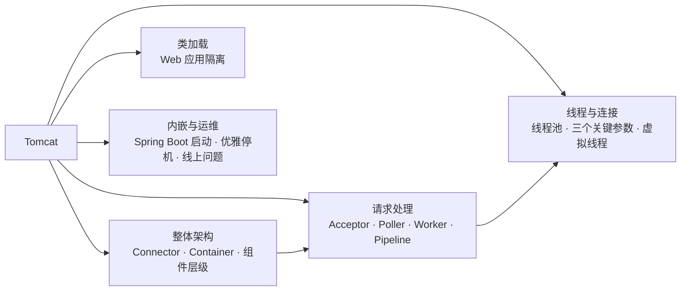
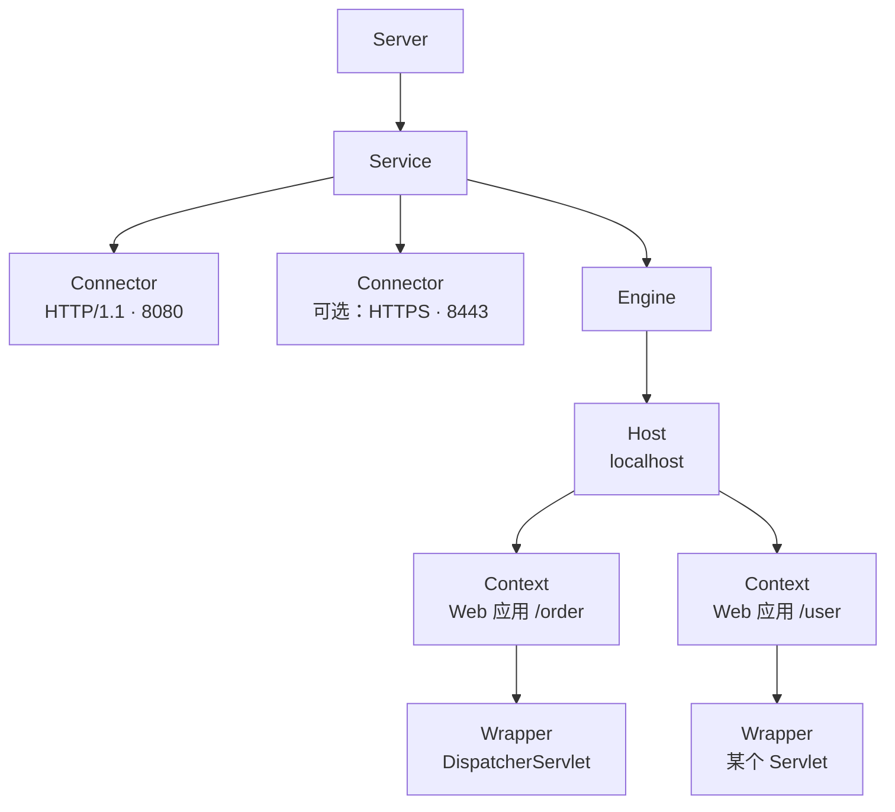
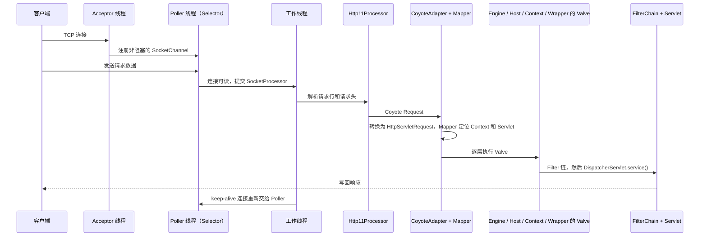
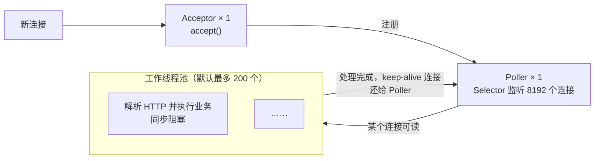
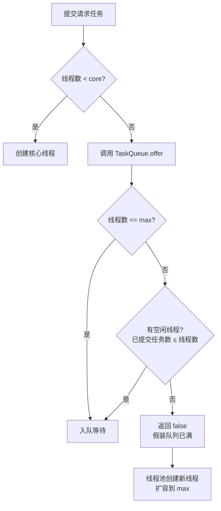
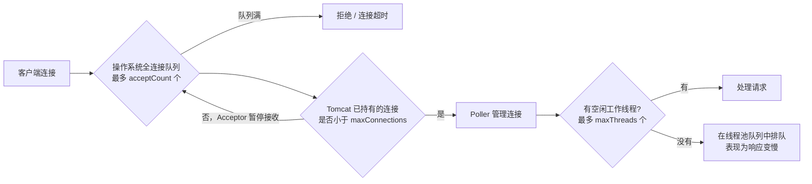

# 07 · Tomcat

> 适用岗位：Java 资深开发 / 架构师
> 版本基线：Tomcat 10.1 / 11（Jakarta EE 10 / 11），Spring Boot 3.x / 4.x 内嵌 Tomcat
> 事实核对：标「已核对」的结论来自本机 Maven 仓库中 Tomcat 11.0.18（tomcat-embed-core 源码包）与 Spring Boot 4.0.4 的源码和依赖管理
> 相关分类：[《03 Java 并发》](../01-Java核心/03-Java并发.md)（线程池、虚拟线程）、[《04 JVM》](../01-Java核心/04-JVM.md)（类加载）、[《05 Spring》](05-Spring.md)（MVC、启动流程）、[《08 Netty》](08-Netty.md)、[《38 操作系统》](../08-计算机基础/38-操作系统.md)（IO 模型）

## 知识地图



## 题目索引

| 编号 | 题目 | 难度 | 层级 |
| --- | --- | --- | --- |
| 07-01 | Tomcat 的整体架构是怎样的？ | ★★ | 资深 |
| 07-02 | 一个 HTTP 请求在 Tomcat 中是怎么被处理的？ | ★★★ | 资深 |
| 07-03 | NIO 连接器的线程模型 | ★★★ | 资深 |
| 07-04 | Tomcat 的线程池和 JDK 的线程池有什么不同？ | ★★★ | 资深 |
| 07-05 | maxThreads、maxConnections、acceptCount 是什么关系？如何调优？ | ★★★ | 资深 / 架构师 |
| 07-06 | Tomcat 的类加载机制，为什么要打破双亲委派？ | ★★ | 资深 |
| 07-07 | Pipeline-Valve 机制是什么？和 Filter 有什么区别？ | ★★ | 资深 |
| 07-08 | Tomcat 如何支持虚拟线程？ | ★★ | 资深 / 架构师 |
| 07-09 | Servlet 异步处理的原理与适用场景 | ★★ | 资深 |
| 07-10 | Spring Boot 内嵌 Tomcat 是如何启动的？ | ★★ | 资深 |
| 07-11 | Tomcat 优雅停机是怎么回事？ | ★★ | 资深 / 架构师 |
| 07-12 | Tomcat 的常见线上问题有哪些？ | ★★★ | 资深 |
| 07-13 | Tomcat、Jetty、Undertow、Netty 怎么选？ | ★★ | 架构师 |

---

## 一、架构与请求处理

### 07-01 Tomcat 的整体架构是怎样的？

> ★★ ｜ 资深 ｜ 高频

**考察意图**：是否清楚 Tomcat 的两大核心（连接器与容器）以及组件层级。

**30 秒版回答**

- Tomcat 由两大部分组成：
  - **连接器（Connector，模块名 Coyote）**：负责网络通信和协议解析，把字节流解析成 Request 对象，再把 Response 写回；
  - **容器（Container，模块名 Catalina）**：负责处理请求，找到对应的 Servlet 并执行。
- 组件层级（与 `server.xml` 的结构一一对应）：
  - **Server**：整个 Tomcat 实例；
  - **Service**：把若干个 Connector 和一个 Engine 组合在一起；
  - **Engine**：顶层容器，一个 Service 只有一个；
  - **Host**：虚拟主机，对应一个域名；
  - **Context**：一个 Web 应用；
  - **Wrapper**：一个 Servlet。
- 另外两个支撑机制：**Mapper**（根据请求的域名和路径找到对应的 Host、Context、Wrapper）和 **Pipeline-Valve**（每层容器都有一条责任链，见 07-07）。
- 在 Spring Boot 内嵌模式下，这套结构依然存在，只是由代码组装：通常一个 Service、一个 Connector、一个 Host、一个 Context，里面只有一个 DispatcherServlet。

**深入剖析**



**追问链**

1. **为什么连接器和容器要分开？**
   网络协议（HTTP/1.1、HTTP/2、AJP）和 IO 模型（NIO、NIO2）的变化与业务处理无关。分开之后，一个容器可以挂多个连接器，同时对外提供 HTTP 和 HTTPS，容器代码完全不用改。

---

### 07-02 一个 HTTP 请求在 Tomcat 中是怎么被处理的？

> ★★★ ｜ 资深 ｜ 高频

**考察意图**：能否把连接器的线程模型、协议解析、容器的 Pipeline 和 Servlet 规范串成一条完整的链路。

**30 秒版回答**

1. **Acceptor 线程**接收新连接，把 SocketChannel 设为非阻塞，注册给 Poller；
2. **Poller 线程**用 Selector 监听所有连接，某个连接上有数据可读时，把它包装成 `SocketProcessor` 任务提交给**工作线程池**；
3. **工作线程**中，`Http11Processor` 读取并解析 HTTP 请求行和请求头，生成 Coyote 层的 Request；
4. `CoyoteAdapter` 把它转换成 Servlet 规范的 `HttpServletRequest`，用 **Mapper** 找到对应的 Host、Context、Wrapper；
5. 请求依次经过各层容器的 **Pipeline**：`StandardEngineValve` → `StandardHostValve` → `StandardContextValve` → `StandardWrapperValve`；
6. `StandardWrapperValve` 创建 `ApplicationFilterChain`，依次执行所有 Filter，最后调用 `Servlet.service()`。在 Spring 应用中，这个 Servlet 就是 DispatcherServlet；
7. 响应原路返回，写回 Socket。连接如果是 keep-alive，会被重新交给 Poller，等待下一个请求。

**深入剖析**



**追问链**

1. **请求体是在哪一步读取的？**
   请求头在 `Http11Processor` 中就解析完了，请求体则是在应用代码调用 `getInputStream()` 或 `getParameter()` 时才按需读取。所以如果请求体很大而业务代码迟迟不读，这个连接和工作线程会被一直占着。

---

### 07-03 NIO 连接器的线程模型

> ★★★ ｜ 资深 ｜ 高频

**考察意图**：是否理解 NIO 连接器中"少量线程管理大量连接"的分工。

**30 秒版回答**

- Tomcat 8.5 移除了 BIO 连接器，Tomcat 10.1 移除了 APR 连接器，现在默认使用 **NIO**（`Http11NioProtocol`）。Tomcat 11.0.18 中仍保留 NIO2 实现（已核对源码中的 `Http11Nio2Protocol`），但很少使用。
- 三类线程（已核对 Tomcat 11.0.18 的 `AbstractEndpoint` 与 `NioEndpoint`）：
  - **1 个 Acceptor 线程**：阻塞地调用 `accept()` 接收新连接；连接数达到 `maxConnections` 时暂停接收；
  - **1 个 Poller 线程**：持有一个 Selector，管理所有空闲连接上的读写事件。早期版本可以配置多个 Poller，Tomcat 9 起固定为 1 个；
  - **工作线程池**：真正执行请求解析和业务代码，默认最多 200 个。
- 关键点：**连接数可以远多于工作线程数**。空闲的 keep-alive 连接只占用 Poller 中的一个注册，不占用工作线程；只有连接上有数据可读时，才占用一个工作线程。
- 但请求一旦进入 Servlet，执行期间仍是**同步阻塞**的：业务代码调用数据库、远程服务时，工作线程一直被占着。这就是 Servlet 容器并发能力受限于线程数的根本原因，也是虚拟线程和响应式框架要解决的问题。

**深入剖析**



**追问链**

1. **只有一个 Poller，会不会成为瓶颈？**
   Poller 只负责检测就绪事件和分发任务，不做任何耗时的处理，单线程足以处理大量连接上的事件。真正的瓶颈通常在工作线程（业务阻塞）。

---

## 二、线程与连接

### 07-04 Tomcat 的线程池和 JDK 的线程池有什么不同？

> ★★★ ｜ 资深 ｜ 高频

**考察意图**：是否读过 Tomcat 的 TaskQueue，能否解释它为什么这样设计。

**30 秒版回答**

- JDK 的 `ThreadPoolExecutor` 的策略是**先排队、后扩容**：线程数达到 core 之后，新任务先进队列，队列满了才创建新线程扩容到 max（见[《03 Java 并发》](../01-Java核心/03-Java并发.md)03-12）。这适合 CPU 密集型任务，但不适合 Web 请求：如果用无界队列，max 永远不会生效，请求只会排队而不会增加线程。
- Tomcat 的线程池（`org.apache.tomcat.util.threads.ThreadPoolExecutor` + `TaskQueue`）改成了**先扩容、后排队**。秘诀在 `TaskQueue.offer()`（已核对 Tomcat 11.0.18 源码）：
  1. 线程数已经达到最大值：入队；
  2. 已提交但未完成的任务数不超过当前线程数（说明有空闲线程）：入队，让空闲线程去取；
  3. **线程数小于最大值：返回 false**，让线程池以为"队列满了"，从而创建新线程；
  4. 其他情况：入队。
- 另外，Tomcat 的线程池在拒绝任务后还会**再尝试入队一次**，并维护一个"已提交任务数"计数器，用来判断有没有空闲线程。

**深入剖析**



**追问链**

1. **Tomcat 的队列有多长？**
   Spring Boot 中由 `server.tomcat.threads.max-queue-capacity` 控制，默认值是 `Integer.MAX_VALUE`（已核对 Boot 4.0.4 的 `TomcatServerProperties`）。但因为同时还有 `maxConnections` 限制连接数，队列中的任务数实际上不会超过连接数。
2. **这个思路能用在自己的业务线程池上吗？**
   能。IO 密集型、希望优先扩容的场景，可以参照 TaskQueue 自定义队列。Dubbo 的 `EagerThreadPool` 也是同样的思路。

---

### 07-05 maxThreads、maxConnections、acceptCount 是什么关系？如何调优？

> ★★★ ｜ 资深 / 架构师 ｜ 高频

**考察意图**：能否说清三个参数分别在哪一层起作用，以及超过之后客户端会看到什么现象。

**30 秒版回答**

三个参数分别限制三个不同的层次（默认值已核对 Tomcat 11.0.18 与 Spring Boot 4.0.4）：

| 参数 | 默认值 | 限制的是什么 | Spring Boot 配置项 |
| --- | --- | --- | --- |
| `maxThreads` | 200 | 同时**处理**请求的工作线程数 | `server.tomcat.threads.max` |
| `maxConnections` | 8192 | Tomcat 同时**持有**的连接数（包括正在处理的和空闲的 keep-alive 连接） | `server.tomcat.max-connections` |
| `acceptCount` | 100 | 连接数达到 maxConnections 后，**操作系统**为这个端口保留的全连接队列长度（`listen()` 的 backlog 参数） | `server.tomcat.accept-count` |

- 请求依次经过三道关口：
  1. 连接数未达到 maxConnections：Tomcat 接收连接；
  2. 达到之后，新连接停留在操作系统的全连接队列中，最多 acceptCount 个（实际值还受内核参数 `net.core.somaxconn` 限制）；
  3. 队列也满了：新连接被拒绝或超时，客户端看到 connection refused 或连接超时。
- 而连接被接收之后，如果所有工作线程都忙，请求会在线程池队列中排队，客户端看到的是**响应变慢**。

**深入剖析**



调优思路：

- **maxThreads**：按利特尔法则估算，所需线程数 = 目标 QPS × 平均响应时间（秒），再留余量。例如目标 2000 QPS、平均 RT 50 ms，需要 100 个线程。线程不是越多越好：线程越多，上下文切换和内存开销越大，而且下游（数据库连接池）往往先成为瓶颈。
- **maxConnections**：一般保持默认即可，长连接很多的场景（如大量客户端保持 keep-alive）可以适当调大。
- **acceptCount**：过大只会让请求在内核队列中等到超时，过小则在流量突增时直接拒绝。通常保持默认，同时在网关或负载均衡层做限流。
- 最重要的：**业务接口有超时、下游有熔断**。线程被慢请求占满，是 Tomcat 不可用最常见的原因，调大参数只能延缓，不能解决。

**追问链**

1. **线上 Tomcat 线程池满了，怎么定位原因？**
   jstack 统计 `http-nio-8080-exec-*` 线程的状态和栈顶：大部分线程停在 JDBC 的 socket 读上，说明数据库慢或连接池不够；停在 HTTP 客户端上，说明下游服务慢；停在锁上，说明有锁竞争。见[《33 线上问题排查》](../07-工程实践与稳定性/33-线上问题排查.md)。

---

### 07-06 Tomcat 的类加载机制，为什么要打破双亲委派？

> ★★ ｜ 资深 ｜ 中频

**考察意图**：是否理解 Web 容器对类隔离的需求。

**30 秒版回答**

- 独立部署的 Tomcat 中，类加载器的层级是：Bootstrap → System（加载 Tomcat 启动所需的类）→ **Common**（加载 Tomcat 和所有 Web 应用共享的类，即 `lib` 目录下的 jar）→ 每个 Web 应用各自的 **WebappClassLoader**（加载 `WEB-INF/classes` 和 `WEB-INF/lib`）。
- WebappClassLoader **默认优先自己加载**（`delegate = false`，已核对 Tomcat 11.0.18 源码），找不到时才委派给父加载器。但 JDK 核心类和 Servlet API 等例外，仍然先委派，防止应用覆盖它们。
- 原因：
  1. **应用之间相互隔离**：A 应用用 Spring 6、B 应用用 Spring 5，各自加载自己的版本；
  2. **应用优先使用自带的版本**：避免被 Tomcat 的 `lib` 目录中的同名类覆盖；
  3. **支持热部署**：重新部署时丢弃旧的 WebappClassLoader，新建一个加载新版本的类。
- Spring Boot 内嵌模式下通常只有一个应用，类加载结构简单得多，这类隔离问题基本不存在。

**追问链**

1. **热部署多次后出现元空间 OOM，可能是什么原因？**
   旧的 WebappClassLoader 没有被回收：应用创建的线程没有停止、ThreadLocal 没有清理、JDBC 驱动注册在 DriverManager 中没有注销。Tomcat 停止应用时会检测这些情况并打印告警日志，见[《04 JVM》](../01-Java核心/04-JVM.md)04-05。

---

### 07-07 Pipeline-Valve 机制是什么？和 Filter 有什么区别？

> ★★ ｜ 资深 ｜ 中频

**考察意图**：是否理解 Tomcat 容器层的责任链设计。

**30 秒版回答**

- Engine、Host、Context、Wrapper 每一层容器都有一条 **Pipeline**（管道），管道中是若干个 **Valve**（阀门），请求依次经过每个阀门。每条管道的最后都有一个基础阀门（`StandardXxxValve`），负责把请求交给下一层容器的管道。
- 这是典型的**责任链模式**，可以在任意一层插入自定义的阀门，例如访问日志 `AccessLogValve`、获取真实客户端 IP 的 `RemoteIpValve`。
- 与 Filter 的区别：

| 维度 | Valve | Filter |
| --- | --- | --- |
| 规范 | Tomcat 私有 | Servlet 规范，所有容器通用 |
| 作用范围 | 可以作用于 Engine、Host 级别（多个应用） | 只作用于一个 Web 应用 |
| 执行时机 | 在 Filter 之前 | 在 Valve 之后、Servlet 之前 |
| 典型用途 | 访问日志、真实 IP、全局的安全检查 | 应用内的编码、认证、跨域 |

**追问链**

1. **在负载均衡之后，Tomcat 拿到的客户端 IP 是负载均衡器的 IP，怎么解决？**
   开启 `RemoteIpValve`（Spring Boot 中配置 `server.forward-headers-strategy=native`，或设置 `server.tomcat.remoteip.*`），从 `X-Forwarded-For` 等请求头中解析真实 IP。注意只信任来自内部代理的请求头，否则客户端可以伪造 IP。

---

### 07-08 Tomcat 如何支持虚拟线程？

> ★★ ｜ 资深 / 架构师 ｜ 中频（JDK 21 之后高频）

**考察意图**：是否了解虚拟线程在 Web 容器中的落地方式和注意事项。

**30 秒版回答**

- Tomcat 提供了基于虚拟线程的执行器（`StandardVirtualThreadExecutor`、`VirtualThreadExecutor`，已核对 Tomcat 11.0.18 源码），连接器可以配置 `useVirtualThreads="true"`（默认 false，已核对），之后**每个请求在一个新的虚拟线程中处理**。
- Spring Boot 3.2+ 只需配置 `spring.threads.virtual.enabled=true`，Tomcat 的请求处理就会切换到虚拟线程。
- 效果：请求处理过程中阻塞在数据库或远程调用上时，不再占用操作系统线程，`maxThreads = 200` 这个上限也就不再是并发瓶颈。
- 注意事项（详见[《03 Java 并发》](../01-Java核心/03-Java并发.md)03-23）：
  - 并发瓶颈会转移到数据库连接池和下游服务，要为每个下游设置并发上限和超时；
  - JDK 21 ~ 23 上，在 synchronized 中阻塞会钉住载体线程，JDK 24 起已解决；
  - 连接相关的参数（maxConnections、acceptCount）仍然有效，它们限制的是连接，不是线程。

**追问链**

1. **用了虚拟线程，是不是就等于 WebFlux 了？**
   在"阻塞时不占用操作系统线程"这一点上效果相近，编程模型却完全不同：虚拟线程保留了同步阻塞的写法，调试和排查更简单；WebFlux 是异步非阻塞加背压，适合流式处理和网关类场景。

---

### 07-09 Servlet 异步处理的原理与适用场景

> ★★ ｜ 资深 ｜ 中频

**考察意图**：是否理解"异步 Servlet"释放的是哪个线程，以及它的真正价值。

**30 秒版回答**

- Servlet 3.0 起支持异步处理：调用 `request.startAsync()` 得到 `AsyncContext` 后，Servlet 方法可以直接返回，**Tomcat 的工作线程被释放**，但连接和响应保持打开。之后由其他线程（例如业务线程池、消息回调）在结果就绪时写入响应，并调用 `asyncContext.complete()`。
- Spring MVC 中，Controller 返回 `Callable`、`DeferredResult`、`CompletableFuture`、`SseEmitter` 时，底层用的就是 Servlet 异步。
- 适用场景：
  - **长轮询、服务端推送（SSE）**：请求需要长时间挂起等待事件；
  - **把慢操作交给专门的线程池**，让 Tomcat 的工作线程尽快回去接收新请求。
- 需要注意：异步只是把阻塞从 Tomcat 的线程**转移**到了别的线程。如果别的线程也是阻塞地调用下游，整体并发能力并没有提升，只是隔离了线程池。真正的提升来自下游也是非阻塞的（异步 HTTP 客户端、消息回调）。

**深入剖析**

```java
@RestController
@RequiredArgsConstructor
public class OrderStatusController {
    private static final long POLL_TIMEOUT_MS = 30_000;

    private final OrderStatusNotifier notifier;

    /** 长轮询：订单状态变化时立即返回，超时则返回当前状态，期间不占用 Tomcat 工作线程 */
    @GetMapping("/orders/{orderNo}/status")
    public DeferredResult<OrderStatus> waitStatus(@PathVariable String orderNo) {
        DeferredResult<OrderStatus> result = new DeferredResult<>(POLL_TIMEOUT_MS);
        result.onTimeout(() -> result.setResult(notifier.currentStatus(orderNo)));
        notifier.register(orderNo, result::setResult);
        result.onCompletion(() -> notifier.unregister(orderNo));
        return result;
    }
}
```

**追问链**

1. **异步请求中拿不到 ThreadLocal 里的用户信息，为什么？**
   写结果的已经是另一个线程。需要在启动异步处理前把上下文取出来，作为参数传给后续逻辑，或者使用上下文传播工具，见[《03 Java 并发》](../01-Java核心/03-Java并发.md)03-19。

---

## 三、内嵌与运维

### 07-10 Spring Boot 内嵌 Tomcat 是如何启动的？

> ★★ ｜ 资深 ｜ 中频

**考察意图**：能否把 Spring 容器的 refresh 流程和 Tomcat 的启动关联起来。

**30 秒版回答**

1. 自动配置注册 `TomcatServletWebServerFactory`（Spring Boot 4 中位于独立的 `spring-boot-tomcat` 模块，已核对）；
2. 上下文刷新到 `onRefresh()` 这一步时（见[《05 Spring》](05-Spring.md)05-02），`ServletWebServerApplicationContext.createWebServer()` 从容器中取出这个工厂，调用 `getWebServer()`：
   - 用代码 new 出 Tomcat 对象，组装 Connector、Engine、Host、Context；
   - 把 DispatcherServlet、所有 Filter、Listener 注册到 Context 中（它们本身也是 Spring Bean，通过 `ServletContextInitializer` 注册）；
   - 启动 Tomcat 的内部组件，但**此时连接器还不接收请求**；
3. 等所有单例 Bean 都创建完毕，在 `finishRefresh()` 阶段，`WebServerStartStopLifecycle` 才真正启动连接器、开始监听端口，并发布 `ServletWebServerInitializedEvent`。
- 这样设计是为了**避免应用还没准备好就接收流量**。

**追问链**

1. **怎么定制内嵌 Tomcat 的配置？**
   常用的配置项用 `server.tomcat.*`；更细粒度的定制注册一个 `WebServerFactoryCustomizer<TomcatServletWebServerFactory>` Bean，可以添加连接器、Valve，或修改协议参数。

---

### 07-11 Tomcat 优雅停机是怎么回事？

> ★★ ｜ 资深 / 架构师 ｜ 中频

**考察意图**：是否理解停机过程中"停止接收"和"等待处理完成"两个阶段。

**30 秒版回答**

- 优雅停机分两步：
  1. **停止接收新请求**：连接器暂停接收新连接，对 keep-alive 连接上的新请求返回关闭；
  2. **等待正在处理的请求完成**，最多等待一个超时时间，超时后强制关闭。
- Spring Boot 中由 `server.shutdown` 控制，**Spring Boot 4 的默认值是 `GRACEFUL`**（已核对 Boot 4.0.4 的 `ServerProperties`；Spring Boot 3.4 之前的默认值是 `IMMEDIATE`），等待时间由 `spring.lifecycle.timeout-per-shutdown-phase` 控制，默认 30 秒。
- Tomcat 只是整条停机链路中的一环。在 Kubernetes 中还要配合：先从注册中心和负载均衡中摘除流量（preStop 中适当等待），再让 Tomcat 优雅停止，然后关闭 MQ 消费者和业务线程池。完整链路见[《03 Java 并发》](../01-Java核心/03-Java并发.md)03-14。

**追问链**

1. **为什么配置了优雅停机，发布时仍然有少量 502 错误？**
   通常是流量摘除晚于 Tomcat 停止接收：负载均衡还在往这个 Pod 转发请求，而 Tomcat 已经拒绝了。在 preStop 中先等几秒，让注册中心和负载均衡的摘除生效，再开始停机。

---

### 07-12 Tomcat 的常见线上问题有哪些？

> ★★★ ｜ 资深 ｜ 高频

**考察意图**：是否有真实的线上排障经验。

**30 秒版回答**

| 现象 | 原因 | 处理 |
| --- | --- | --- |
| 大量 `ClientAbortException: Broken pipe` | 客户端（或网关）在服务端写回响应之前就断开了连接，通常是因为客户端超时时间比服务端处理时间短 | 先确认服务端为什么慢；对齐网关、客户端和服务端的超时设置；这类日志本身可以降级为 info |
| 请求返回 400，日志中有 `Request header is too large` | 请求头超过 `maxHttpRequestHeaderSize`（Spring Boot 默认 8 KB，已核对），常见于 Cookie 或 Token 过大 | 缩小 Cookie 或 Token；必要时调大限制 |
| 400，`Invalid character found in the request target` | URL 中包含没有编码的特殊字符（如 `{}`、`|`） | 客户端对 URL 正确编码；不建议放宽 Tomcat 的字符校验 |
| 参数丢失或报参数过多 | 超过 `maxParameterCount`（Spring Boot 4 默认 1000，已核对） | 这是防止哈希碰撞攻击的保护，参数确实很多时改用 JSON 请求体 |
| 上传文件失败 | 超过 multipart 的大小限制或 `maxPartCount`（Spring Boot 4 默认 50 个分段，已核对） | 调整 `spring.servlet.multipart.*` 和对应限制 |
| 响应变慢、偶发超时 | 工作线程被慢请求占满 | 见 07-05，优先治理慢下游 |
| 服务端出现大量 `CLOSE_WAIT` 连接 | 对方关闭了连接，本端没有调用 close，通常是代码或连接池没有正确释放连接 | 定位持有这些连接的代码，检查 HTTP 客户端和连接池的使用方式 |

**追问链**

1. **`maxParameterCount`、`maxPartCount` 这类限制为什么越来越严？**
   它们都是防御拒绝服务攻击的手段：大量参数可以触发哈希碰撞，大量 multipart 分段会消耗大量内存和临时文件。Tomcat 近几年针对这类漏洞多次收紧默认值，升级后出现"参数被截断"时要首先想到这一点。

---

### 07-13 Tomcat、Jetty、Undertow、Netty 怎么选？

> ★★ ｜ 架构师 ｜ 中频

**考察意图**：能否结合生态支持和业务场景做选择，并了解 Spring Boot 4 的变化。

**30 秒版回答**

| 容器 | 特点 | Spring Boot 4 中的状态 |
| --- | --- | --- |
| Tomcat | 生态最成熟，文档和排障经验最多 | 默认的 Servlet 容器，版本为 Tomcat 11（已核对依赖管理中为 11.0.18） |
| Jetty | 轻量、模块化，可嵌入性好 | 仍然支持，版本为 Jetty 12.1（已核对依赖管理中为 12.1.7） |
| Undertow | 轻量，曾经在部分基准测试中吞吐更高 | **Spring Boot 4 已移除对它的支持**（已核对：Boot 3.5.6 的依赖管理中还有 Undertow 2.3.19，Boot 4.0.4 中已经没有），原因是 Undertow 尚未支持 Servlet 6.1 |
| Netty（Reactor Netty） | 非阻塞，事件驱动 | WebFlux 的默认服务器，不是 Servlet 容器 |

- 选择建议：
  - 普通的 Servlet 应用（Spring MVC）：直接用默认的 Tomcat，配合虚拟线程已经能满足大多数高并发场景；
  - 响应式应用、网关（Spring Cloud Gateway 的响应式版本）：Netty；
  - 从 Undertow 迁移到 Spring Boot 4：换成 Tomcat 或 Jetty，重点检查原来针对 Undertow 做的定制（缓冲区、IO 线程数等）。

**架构师加分点**

Web 容器之间的性能差异，在真实业务中往往远小于业务代码、数据库和下游调用带来的差异。选择时优先考虑生态成熟度、团队熟悉程度和框架的长期支持，而不是基准测试中的数字。
