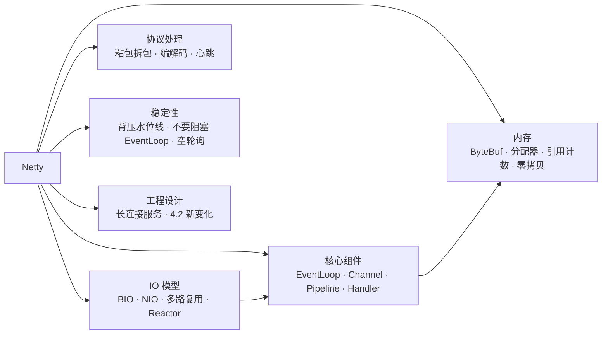
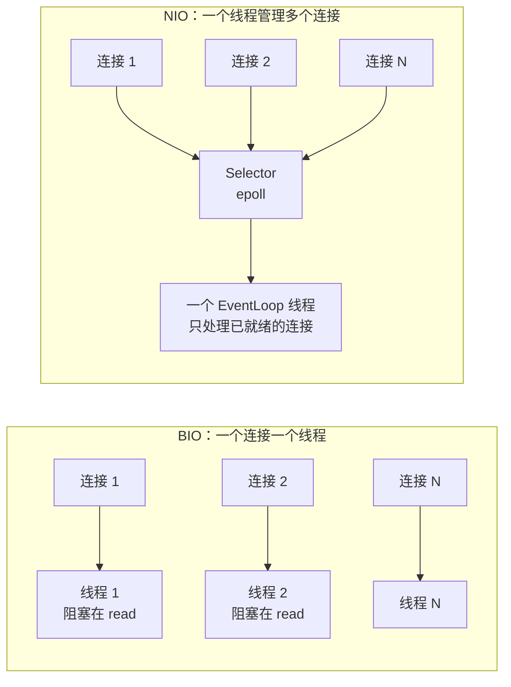
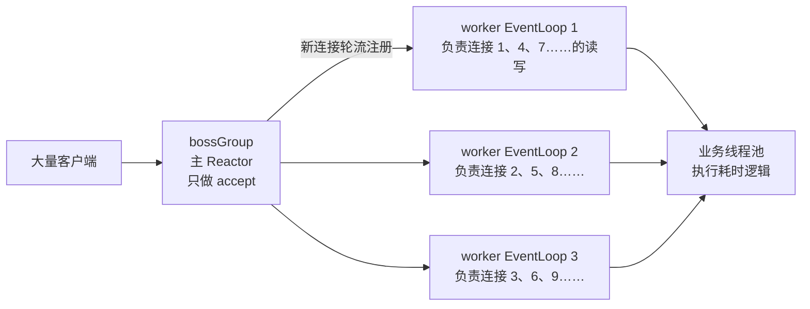
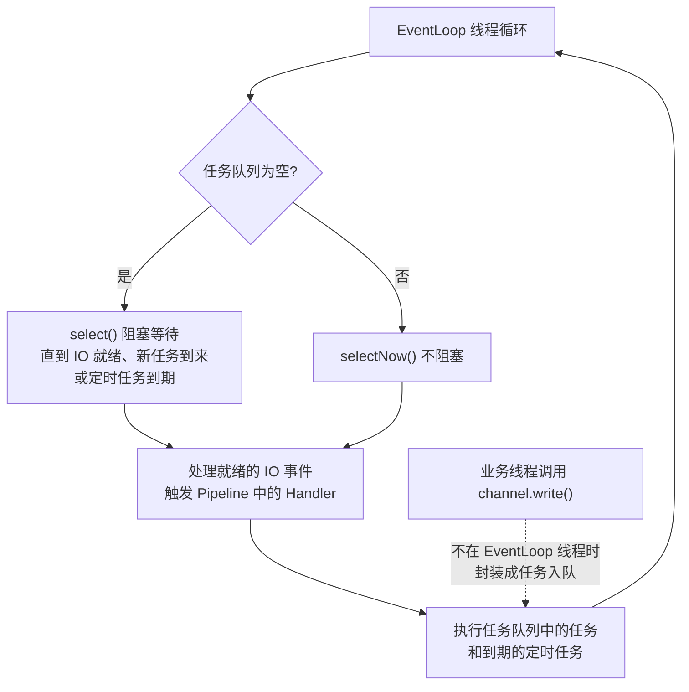
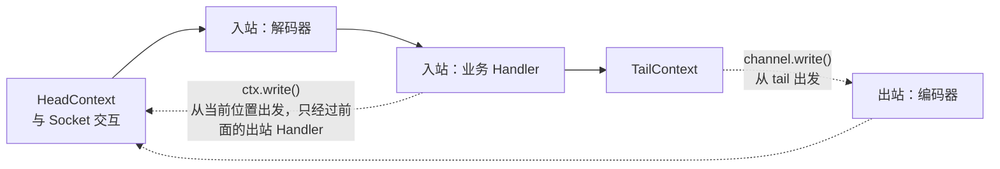
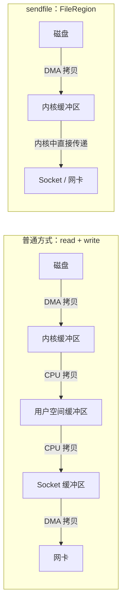
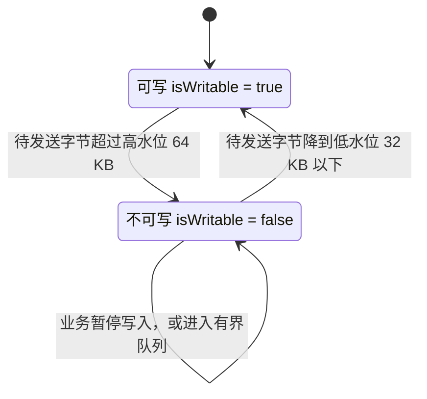
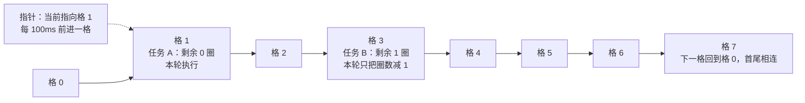
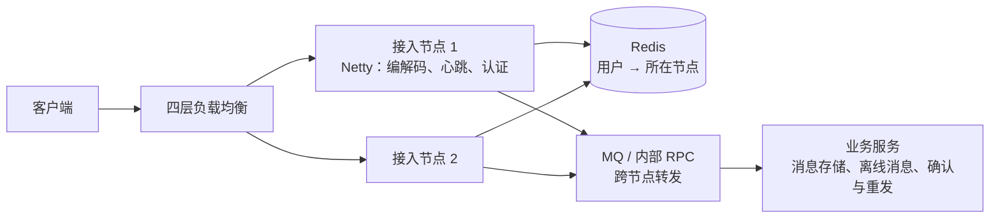

# 08 · Netty

> 适用岗位：Java 资深开发 / 架构师
> 版本基线：Netty 4.2（Spring Boot 4.0 依赖管理中为 4.2.10），4.1 的差异单独标注
> 事实核对：标「已核对」的结论来自本机 Maven 仓库中 Netty 4.2.10 的源码包；标「实测」的示例已用 4.2.10 编译运行
> 相关分类：[《07 Tomcat》](07-Tomcat.md)（NIO 连接器）、[《10 RPC 与 Dubbo》](../03-分布式与微服务/10-RPC与Dubbo.md)、[《37 计算机网络》](../08-计算机基础/37-计算机网络.md)（TCP）、[《38 操作系统》](../08-计算机基础/38-操作系统.md)（IO 模型、零拷贝）

## 知识地图



## 题目索引

| 编号 | 题目 | 难度 | 层级 |
| --- | --- | --- | --- |
| 08-01 | BIO、NIO、AIO 有什么区别？什么是 IO 多路复用？ | ★★ | 资深 |
| 08-02 | Reactor 模型有哪几种？Netty 用的是哪一种？ | ★★★ | 资深 |
| 08-03 | Netty 的核心组件有哪些？ | ★★ | 资深 |
| 08-04 | EventLoop 是如何工作的？ | ★★★ | 资深 |
| 08-05 | ChannelPipeline 中 Handler 的执行顺序 | ★★ | 资深 |
| 08-06 | ByteBuf 比 JDK 的 ByteBuffer 好在哪里？ | ★★ | 资深 |
| 08-07 | Netty 的内存分配器：池化、Adaptive 与堆外内存 | ★★★ | 资深 |
| 08-08 | 引用计数与内存泄漏检测 | ★★★ | 资深 |
| 08-09 | Netty 的零拷贝体现在哪些地方？ | ★★★ | 资深 |
| 08-10 | TCP 粘包、拆包是怎么回事？Netty 如何解决？ | ★★ | 资深 |
| 08-11 | 如何实现心跳与空闲连接检测？ | ★★ | 资深 |
| 08-12 | 写得太快会怎样？高低水位线与背压 | ★★★ | 资深 / 架构师 |
| 08-13 | 为什么不能在 EventLoop 中执行阻塞操作？ | ★★★ | 资深 |
| 08-14 | JDK 的 Selector 空轮询 bug 是什么？Netty 如何规避？ | ★★ | 资深 |
| 08-15 | FastThreadLocal、HashedWheelTimer 的原理 | ★★ | 资深 |
| 08-16 | Netty 4.2 有哪些重要变化？ | ★★ | 资深 / 架构师 |
| 08-17 | 用 Netty 设计一个长连接服务要考虑哪些问题？ | ★★★ | 架构师 |

---

## 一、IO 模型与 Reactor

### 08-01 BIO、NIO、AIO 有什么区别？什么是 IO 多路复用？

> ★★ ｜ 资深 ｜ 高频

**考察意图**：是否理解阻塞与非阻塞、同步与异步，以及多路复用解决的问题。

**30 秒版回答**

- **BIO（同步阻塞）**：每个连接一个线程，`read()` 没有数据时线程阻塞。连接一多，线程数就爆炸。
- **NIO（同步非阻塞 + 多路复用）**：Channel 设为非阻塞；一个线程用 **Selector** 同时监听大量 Channel，只处理已经就绪的那些。数据从内核拷贝到用户空间的过程仍由应用线程完成，所以仍属于"同步 IO"。
- **AIO（异步）**：应用发起读操作后立即返回，内核把数据拷贝到用户缓冲区之后再通知应用。Linux 上 JDK 的 AIO 底层仍是用 epoll 模拟的，没有明显优势，Netty 也放弃了 AIO 的传输实现。
- **IO 多路复用**：用一个系统调用同时监听多个文件描述符的就绪状态。Linux 上的演进是 select（有 1024 个描述符的上限，每次全量拷贝和遍历）→ poll（去掉上限，仍然全量遍历）→ **epoll**（内核维护就绪列表，只返回就绪的描述符，复杂度与连接总数无关）。
- 详见[《38 操作系统》](../08-计算机基础/38-操作系统.md)。

**深入剖析**



**追问链**

1. **epoll 的水平触发（LT）和边缘触发（ET）有什么区别？**
   水平触发：只要缓冲区里还有数据，每次 `epoll_wait` 都会通知；边缘触发：只在状态变化时通知一次，应用必须一次把数据读完，否则可能再也收不到通知。JDK 的 NIO 使用水平触发。Netty 4.1 的 epoll 原生传输默认使用边缘触发；**Netty 4.2 起固定使用水平触发**，`EpollChannelConfig.setEpollMode` 变成空操作（已核对 4.2 的废弃 API 说明和 4.2.10 的字节码），详见[《38 操作系统》](../08-计算机基础/38-操作系统.md)38-13。

---

### 08-02 Reactor 模型有哪几种？Netty 用的是哪一种？

> ★★★ ｜ 资深 ｜ 高频

**考察意图**：能否清楚地讲出三种 Reactor 模型的分工差异。

**30 秒版回答**

- Reactor 模式：用一个或多个线程监听事件，事件到来时分发给对应的处理器。按线程分工分为三种：
  1. **单 Reactor 单线程**：一个线程负责接收连接、读写 IO 和业务处理。简单，但任何一个慢操作都会卡住所有连接。Redis 6 之前的网络模型就是这样（Redis 的业务操作都在内存中，足够快）；
  2. **单 Reactor 多线程**：一个线程负责所有 IO 事件，业务处理交给线程池。Reactor 线程同时负责接收连接和所有读写，连接很多时成为瓶颈；
  3. **主从 Reactor 多线程**：主 Reactor 只负责接收新连接，接收后把连接注册到某个从 Reactor；多个从 Reactor 各自负责一部分连接的读写。
- Netty 推荐的就是**主从 Reactor**：bossGroup（通常 1 个线程）负责 accept，workerGroup（默认 CPU 核数 × 2 个线程，已核对 4.2.10 源码中的 `DEFAULT_EVENT_LOOP_THREADS`）负责读写。耗时的业务逻辑还应该交给独立的业务线程池（见 08-13）。

**深入剖析**



**追问链**

1. **Tomcat 的 NIO 连接器属于哪种模型？**
   Acceptor（接收连接）+ Poller（单个线程检测就绪事件）+ 工作线程池（解析和业务处理），接近"单 Reactor 多线程"。区别在于 Netty 的每个 worker EventLoop 自己完成读写和解码，而 Tomcat 把这些都交给了工作线程，见[《07 Tomcat》](07-Tomcat.md)07-03。

---

## 二、核心组件

### 08-03 Netty 的核心组件有哪些？

> ★★ ｜ 资深 ｜ 高频

**考察意图**：能否说清各组件的职责和它们之间的关系。

**30 秒版回答**

| 组件 | 职责 |
| --- | --- |
| `Bootstrap` / `ServerBootstrap` | 启动引导，把下面的组件组装起来 |
| `EventLoopGroup` / `EventLoop` | 线程池与线程，一个 EventLoop 绑定一个线程，负责若干个 Channel 的所有 IO 事件和任务 |
| `Channel` | 一个网络连接，封装了 Socket 的读写操作 |
| `ChannelPipeline` | 每个 Channel 一条，由多个 Handler 组成的责任链 |
| `ChannelHandler` | 处理入站事件（读到数据、连接建立）或出站操作（写数据、关闭）的业务单元 |
| `ChannelHandlerContext` | Handler 在 Pipeline 中的上下文，用于向前或向后传递事件 |
| `ByteBuf` | Netty 的字节容器 |
| `ChannelFuture` / `Promise` | 异步操作的结果，可以添加监听器 |

**深入剖析**

Netty 4.2 中启动服务端的标准写法（实测可以编译运行）：

```java
// 4.2 起推荐 MultiThreadIoEventLoopGroup + IoHandler 工厂；4.1 的 NioEventLoopGroup 已被标记为废弃（已核对）
EventLoopGroup boss = new MultiThreadIoEventLoopGroup(1, NioIoHandler.newFactory());
EventLoopGroup worker = new MultiThreadIoEventLoopGroup(NioIoHandler.newFactory());
try {
    ServerBootstrap bootstrap = new ServerBootstrap()
            .group(boss, worker)
            .channel(NioServerSocketChannel.class)
            .option(ChannelOption.SO_BACKLOG, 1024)
            .childOption(ChannelOption.WRITE_BUFFER_WATER_MARK, new WriteBufferWaterMark(32 * 1024, 64 * 1024))
            .childHandler(new ChannelInitializer<SocketChannel>() {
                @Override
                protected void initChannel(SocketChannel ch) {
                    ch.pipeline()
                            .addLast(new IdleStateHandler(60, 0, 0, TimeUnit.SECONDS))                  // 空闲检测
                            .addLast(new LengthFieldBasedFrameDecoder(1024 * 1024, 0, 4, 0, 4))      // 解决粘包拆包
                            .addLast(new LengthFieldPrepender(4))                                     // 出站加长度头
                            .addLast(new EchoHandler());                                              // 业务处理
                }
            });
    bootstrap.bind(8080).sync().channel().closeFuture().sync();
} finally {
    boss.shutdownGracefully();
    worker.shutdownGracefully();
}
```

**追问链**

1. **`option` 和 `childOption` 有什么区别？**
   `option` 作用于监听用的 ServerSocketChannel（例如 `SO_BACKLOG`，全连接队列长度）；`childOption` 作用于每个接收进来的连接（例如 `TCP_NODELAY`、`SO_KEEPALIVE`、写水位线）。

---

### 08-04 EventLoop 是如何工作的？

> ★★★ ｜ 资深 ｜ 高频

**考察意图**：是否理解 Netty"无锁串行化"的设计，以及它对编程方式的要求。

**30 秒版回答**

- 一个 EventLoop = **一个线程 + 一个 Selector + 一个任务队列**。它在一个死循环中不断做三件事：
  1. 调用 `select` 等待 IO 事件（有待执行任务时不阻塞）；
  2. 处理就绪的 IO 事件（读数据、接收连接、可写）；
  3. 执行任务队列中的普通任务和到期的定时任务。
- **一个 Channel 在整个生命周期中只绑定一个 EventLoop**，它的所有 IO 事件和 Handler 回调都在这个线程上执行。所以同一个 Channel 的 Handler 不需要加锁，这就是 Netty 的**无锁串行化**设计。
- 从其他线程调用 `channel.write()` 时，Netty 会判断当前线程是不是这个 Channel 的 EventLoop：如果不是，就把写操作封装成任务放进它的队列，由 EventLoop 线程执行。这保证了所有操作都在同一个线程上串行发生。
- IO 处理和任务执行的时间比例：4.1 中由 `ioRatio` 控制（默认 50），4.2 的新 IoHandler 模型中重新组织了这部分逻辑。

**深入剖析**



**追问链**

1. **既然一个 Channel 绑定一个线程，那多个 Channel 的负载不均匀怎么办？**
   新连接是轮询分配给 EventLoop 的，长期来看比较均衡；但如果某几个连接流量特别大（例如网关后面的少数几个大客户），对应的 EventLoop 就会成为热点。这种情况需要在业务层面拆分连接，或者把重活交给业务线程池。

---

### 08-05 ChannelPipeline 中 Handler 的执行顺序

> ★★ ｜ 资深 ｜ 高频

**考察意图**：是否清楚入站和出站的方向，以及 `ctx.write` 和 `channel.write` 的区别。

**30 秒版回答**

- Pipeline 是一个由 `ChannelHandlerContext` 组成的**双向链表**，两端是固定的 `HeadContext` 和 `TailContext`（已核对 4.2.10 源码）。
- **入站事件**（读到数据、连接建立）从 **head 向 tail** 传递，只经过入站 Handler（`ChannelInboundHandler`）；
- **出站操作**（写、刷新、关闭）从 **tail 向 head** 传递，只经过出站 Handler（`ChannelOutboundHandler`），最后由 head 调用底层 Socket 完成。
- **`ctx.write()` 和 `ctx.channel().write()` 不一样**：
  - `ctx.write()` 从**当前 Handler 所在的位置**开始向 head 传递，只经过它前面的出站 Handler；
  - `channel.write()` 从 **tail** 开始，经过所有出站 Handler。
  - 如果编码器在当前 Handler 的后面，用 `ctx.write()` 写出的对象就不会被编码，导致发送失败。

**深入剖析**



上图中，编码器位于业务 Handler 的后面（靠近 tail），所以业务 Handler 调用 `ctx.write()` 时**不会经过编码器**。实践中通常把编解码器都放在业务 Handler 前面，或者在业务 Handler 中使用 `ctx.channel().write()`。

**追问链**

1. **读到的消息如果没有被任何 Handler 处理并释放，会怎样？**
   最终到达 TailContext，它会释放消息并打印一条 debug 日志。但如果中间的某个 Handler 既没有往后传递、也没有释放，就会造成内存泄漏，见 08-08。

---

## 三、内存管理

### 08-06 ByteBuf 比 JDK 的 ByteBuffer 好在哪里？

> ★★ ｜ 资深 ｜ 高频

**考察意图**：是否了解 ByteBuf 的读写指针设计及其带来的便利。

**30 秒版回答**

- JDK `ByteBuffer` 只有一个 position 指针，从写模式切换到读模式要调用 `flip()`，忘记调用就会出错；容量固定，不能自动扩容。
- Netty `ByteBuf` 的改进：
  - **读写指针分离**：`readerIndex` 和 `writerIndex`，不需要 flip；
  - **自动扩容**；
  - **池化**：减少频繁分配和回收带来的开销（尤其是堆外内存，分配和释放的成本都很高）；
  - **引用计数**：精确控制内存的回收时机；
  - **零拷贝相关的视图操作**：`slice`、`duplicate`、`CompositeByteBuf`，见 08-09。

**深入剖析**

```text
+-------------------+------------------+------------------+
| 可丢弃的字节       |  可读的字节       |  可写的字节       |
| (已经读过)         |  (CONTENT)       |                  |
+-------------------+------------------+------------------+
|                   |                  |                  |
0      <=      readerIndex   <=   writerIndex    <=    capacity
```

`discardReadBytes()` 可以回收已读的区域，但需要移动数据，不要频繁调用。

**追问链**

1. **堆内 ByteBuf 和堆外 ByteBuf 怎么选？**
   IO 读写使用堆外内存：JVM 向 Socket 写数据时，如果数据在堆内，要先拷贝到一块堆外内存，直接使用堆外内存可以省掉这次拷贝。业务逻辑中的编解码、临时处理用堆内内存，分配快、由 GC 管理。Netty 的 IO 操作默认就是这样选择的。

---

### 08-07 Netty 的内存分配器：池化、Adaptive 与堆外内存

> ★★★ ｜ 资深 ｜ 中频

**考察意图**：是否了解 Netty 内存池的基本原理，以及 4.2 的默认分配器变化。

**30 秒版回答**

- **默认分配器在 4.2 中变了**：4.1 默认是 `PooledByteBufAllocator`（基于 jemalloc 思想的内存池）；**4.2 默认是 `AdaptiveByteBufAllocator`**，可以通过 `-Dio.netty.allocator.type=pooled | adaptive | unpooled` 切换（已核对 4.2.10 `ByteBufUtil` 源码，并实测服务端 Channel 默认使用的就是 `AdaptiveByteBufAllocator`）。
- `PooledByteBufAllocator` 的思路（与 jemalloc 类似）：
  - 预先向操作系统申请大块内存（Chunk），切分成页（Page），再细分成更小的块，按大小分级管理，减少碎片；
  - 多个 Arena 分散竞争，线程通过 **线程本地缓存**（PoolThreadCache）优先从自己的缓存中分配和回收，避免加锁。
- Adaptive 分配器根据实际的分配模式自适应地管理内存，在内存占用和性能之间做了新的平衡，目标是在多数场景下占用更少内存。
- 堆外内存的上限：受 JVM 的 `-XX:MaxDirectMemorySize` 约束，Netty 还可以通过 `io.netty.maxDirectMemory` 单独设置自己的上限。堆外内存不受 `-Xmx` 限制，容器中要为它留出空间，见[《04 JVM》](../01-Java核心/04-JVM.md)04-03。

**追问链**

1. **用了池化，为什么内存占用反而一直很高？**
   池化会**缓存**已释放的内存以备复用，不会立即还给操作系统。看到的高占用不一定是泄漏。判断是否泄漏，要看在负载稳定后内存是否仍然持续增长，并结合泄漏检测日志，见 08-08。

---

### 08-08 引用计数与内存泄漏检测

> ★★★ ｜ 资深 ｜ 高频

**考察意图**：是否清楚 ByteBuf 应该由谁释放，是否用过泄漏检测定位问题。

**30 秒版回答**

- 池化的、堆外的 ByteBuf 不能依赖 GC 及时回收，所以 Netty 使用**引用计数**：创建时为 1，`retain()` 加 1，`release()` 减 1，减到 0 时归还内存池或释放堆外内存。
- 释放的基本原则：**谁最后使用，谁负责释放**。
  - 入站消息：如果 Handler 把消息传给了下一个 Handler（`ctx.fireChannelRead(msg)`），由后面的负责释放；如果消息在这里被消费、不再往后传，就要在这里 `release`。继承 `SimpleChannelInboundHandler` 时，它会在 `channelRead0` 返回后自动释放；
  - 出站消息：写出去之后由 Netty 在发送完成时释放，调用方不要再释放；
  - 自己 `retain` 的，要自己负责对应的 `release`。
- 泄漏检测：`ResourceLeakDetector` 对一部分 ByteBuf 采样跟踪，如果它在被 GC 回收之前还没有 release，就打印 `LEAK: ByteBuf.release() was not called` 日志。级别有 DISABLED、**SIMPLE（默认，已核对 4.2.10 源码）**、ADVANCED、PARANOID。排查时在测试环境开到 PARANOID（`-Dio.netty.leakDetection.level=paranoid`），会记录这个 ByteBuf 最近的访问位置。

**深入剖析**

```java
/** 消息在这里被完全消费，不再向后传递：继承 SimpleChannelInboundHandler，由它自动释放 */
public class EchoHandler extends SimpleChannelInboundHandler<ByteBuf> {
    @Override
    protected void channelRead0(ChannelHandlerContext ctx, ByteBuf msg) {
        // 要把同一个 ByteBuf 写回去，必须先 retain：channelRead0 返回后它会被释放一次，写完成后 Netty 还会再释放一次
        ctx.writeAndFlush(msg.retain());
    }
}
```

**追问链**

1. **线上出现 `OutOfDirectMemoryError`，怎么排查？**
   先看日志中是否有 LEAK 记录；在测试环境用 PARANOID 级别复现；检查自定义 Handler 中提前 return、抛异常的分支是否漏了 release（释放应该放在 finally 中）。同时确认是否只是直接内存上限设得太小。

---

### 08-09 Netty 的零拷贝体现在哪些地方？

> ★★★ ｜ 资深 ｜ 高频

**考察意图**：能否区分操作系统层面的零拷贝和 Netty 在用户态做的"少拷贝"。

**30 秒版回答**

Netty 的零拷贝分两个层面：

1. **操作系统层面**：
   - `FileRegion` 发送文件时调用 `FileChannel.transferTo`，在 Linux 上对应 `sendfile` 系统调用，数据直接在内核中从文件缓存送到 Socket，不经过用户空间；
   - 使用**堆外内存**做 Socket 读写，避免堆内数据先拷贝到堆外的那一次拷贝。
2. **用户态（Netty 自身）层面，避免在内存中复制数据**：
   - `CompositeByteBuf`：把多个 ByteBuf 逻辑上组合成一个（例如协议头和消息体），不需要复制到一个新的大缓冲区；
   - `slice()`、`duplicate()`：创建一个共享底层内存的视图，用于拆分数据；
   - `Unpooled.wrappedBuffer(byte[])`：直接包装已有的数组，不复制。

**深入剖析**



详见[《38 操作系统》](../08-计算机基础/38-操作系统.md)中关于零拷贝的部分。

**追问链**

1. **`slice()` 出来的 ByteBuf，引用计数怎么算？**
   `slice()` 与原 ByteBuf **共享同一个引用计数**，释放其中一个会影响另一个。需要独立的生命周期时，用 `retainedSlice()`，它会把引用计数加 1，由使用方单独释放。
2. **HTTPS 场景还能用 sendfile 吗？**
   不能直接用。数据需要在用户空间加密后才能发送。Linux 的内核 TLS（kTLS）可以把加密放到内核中，从而让 sendfile 继续生效，但需要内核和 TLS 库的支持。

---

## 四、协议处理

### 08-10 TCP 粘包、拆包是怎么回事？Netty 如何解决？

> ★★ ｜ 资深 ｜ 高频

**考察意图**：是否理解 TCP 是字节流，以及应用层协议如何确定消息边界。

**30 秒版回答**

- TCP 是**面向字节流**的协议，没有"消息"的概念。发送方连续发送的多条消息可能被合并成一个 TCP 段发出（**粘包**，例如 Nagle 算法合并小包），一条大消息也可能被拆成多个段（**拆包**，受 MSS 和缓冲区大小影响）。接收方一次 `read` 读到的数据，可能是半条消息，也可能是一条半。
- 解决思路是在**应用层协议中定义消息边界**，常见三种：
  - **固定长度**：`FixedLengthFrameDecoder`；
  - **分隔符**：`LineBasedFrameDecoder`（换行）、`DelimiterBasedFrameDecoder`（自定义分隔符）；
  - **长度字段**（最常用）：消息头中带上消息体的长度，用 `LengthFieldBasedFrameDecoder` 解码，发送端用 `LengthFieldPrepender` 自动加上长度头。
- 这些解码器都继承自 `ByteToMessageDecoder`：它把不完整的数据**累积**在一个缓冲区中，凑够一条完整的消息才交给下一个 Handler。

**深入剖析**

`LengthFieldBasedFrameDecoder(maxFrameLength, lengthFieldOffset, lengthFieldLength, lengthAdjustment, initialBytesToStrip)` 的五个参数：

| 参数 | 含义 | 示例值（4 字节长度头 + 消息体） |
| --- | --- | --- |
| maxFrameLength | 单条消息的最大长度，超过抛异常 | 1 MB，防止恶意的超大长度把内存撑爆 |
| lengthFieldOffset | 长度字段从第几个字节开始 | 0 |
| lengthFieldLength | 长度字段占几个字节 | 4 |
| lengthAdjustment | 长度字段的值需要加上的修正量（长度值是否包含头部） | 0 |
| initialBytesToStrip | 解码后去掉开头的多少字节 | 4，去掉长度头，只把消息体交给后面 |

**追问链**

1. **UDP 有粘包问题吗？**
   没有。UDP 是面向数据报的，每次 `receive` 得到的就是一个完整的数据报，但它不保证可靠和有序。
2. **`maxFrameLength` 为什么一定要设？**
   攻击者可以发送一个声称长度为 2 GB 的消息头，解码器就会一直等待并累积数据，最终耗尽内存。设置合理的上限并在超出时关闭连接，是基本的防护。

---

### 08-11 如何实现心跳与空闲连接检测？

> ★★ ｜ 资深 ｜ 中频

**考察意图**：是否理解应用层心跳的必要性。

**30 秒版回答**

- 为什么需要应用层心跳：
  - TCP 的 keepalive 默认 2 小时才开始探测，太慢；
  - 中间的 NAT、防火墙、负载均衡会悄悄清理长时间空闲的连接，两端都不知道连接已经失效；
  - 对端进程卡死（比如长时间 Full GC）时，TCP 连接仍然存在，但对端已经无法处理请求。
- Netty 用 `IdleStateHandler(读空闲, 写空闲, 读写空闲, 时间单位)` 检测空闲，超时后触发 `IdleStateEvent`，在 `userEventTriggered` 中处理：
  - **客户端**：写空闲时发送心跳包；
  - **服务端**：读空闲（在若干个心跳周期内都没有收到任何数据）时，认为连接已失效，关闭它。

**深入剖析**

```java
public class HeartbeatServerHandler extends ChannelInboundHandlerAdapter {
    @Override
    public void userEventTriggered(ChannelHandlerContext ctx, Object evt) throws Exception {
        if (evt instanceof IdleStateEvent idle && idle.state() == IdleState.READER_IDLE) {
            // 服务端：60 秒没有收到任何数据（客户端每 20 秒一次心跳），判定连接失效
            ctx.close();
            return;
        }
        super.userEventTriggered(ctx, evt);
    }
}
```

**追问链**

1. **心跳间隔怎么定？**
   要小于链路上所有中间设备的空闲超时时间（例如负载均衡的空闲超时），并且服务端判定失效的时间通常取心跳间隔的 2 ~ 3 倍，容忍偶发的丢包和延迟。

---

## 五、稳定性

### 08-12 写得太快会怎样？高低水位线与背压

> ★★★ ｜ 资深 / 架构师 ｜ 中频，区分度高

**考察意图**：是否意识到"发送速度大于对端接收速度"时会发生内存问题。

**30 秒版回答**

- `channel.write()` 是异步的：数据先放进这个 Channel 的**出站缓冲区**（`ChannelOutboundBuffer`），再由 EventLoop 逐步写入 Socket。如果对端接收很慢（网络差、对端处理慢），而本端一直写，出站缓冲区就会无限增长，最终 OOM。
- Netty 用**高低水位线**表达这种状态（默认低水位 32 KB、高水位 64 KB，已核对 4.2.10 源码）：
  - 待发送的数据超过高水位时，`channel.isWritable()` 变成 false，并触发 `channelWritabilityChanged` 事件；
  - 降到低水位以下时，恢复为可写。
- Netty **只负责通知，不会自动阻止写入**。业务代码必须主动检查 `isWritable()`：不可写时暂停生产数据（停止从上游读取、把消息放进有界队列、或者丢弃低优先级的消息），恢复可写后再继续。这就是**背压**。

**深入剖析**



**追问链**

1. **网关类的转发服务，怎么做端到端的背压？**
   下游的连接不可写时，暂停读取上游连接（`channel.config().setAutoRead(false)`），让上游的 TCP 接收窗口被填满，TCP 自身的流量控制会让上游发送方慢下来；下游恢复可写时再打开 autoRead。

---

### 08-13 为什么不能在 EventLoop 中执行阻塞操作？

> ★★★ ｜ 资深 ｜ 高频

**考察意图**：是否理解 EventLoop 被阻塞的影响范围。

**30 秒版回答**

- 一个 EventLoop 线程负责**很多个 Channel**。在 Handler 中执行阻塞操作（查数据库、调远程服务、`Thread.sleep`、同步等待 Future），会让这个线程上的所有 Channel 都无法读写，表现为大量连接同时超时，而 CPU 并不高。
- 正确做法：
  - 耗时的业务逻辑提交到**独立的业务线程池**，处理完成后再 `ctx.writeAndFlush()` 写回（Netty 会自动把写操作调度回 EventLoop 线程）；
  - 或者在添加 Handler 时指定一个 `EventExecutorGroup`：`pipeline.addLast(bizGroup, "biz", new BizHandler())`，这个 Handler 的回调就会在 bizGroup 的线程中执行；
  - 下游调用尽量使用异步客户端。
- 特别注意：**不要在 EventLoop 线程中调用 `future.sync()` 或 `future.await()`**，等待的那个操作本身可能就需要这个 EventLoop 线程来完成，形成死锁。Netty 在检测到这种情况时会抛出 `BlockingOperationException`。

**追问链**

1. **业务线程池满了怎么办？**
   与普通线程池一样，需要有界队列和拒绝策略；对于长连接服务，拒绝时可以向客户端返回"服务繁忙"的响应，而不是直接丢弃，否则客户端只能等到超时。

---

### 08-14 JDK 的 Selector 空轮询 bug 是什么？Netty 如何规避？

> ★★ ｜ 资深 ｜ 中频

**考察意图**：是否了解 Netty 在 JDK NIO 之上做的工程化修补。

**30 秒版回答**

- 在某些 Linux 内核与 JDK 版本的组合下，epoll 会在没有任何就绪事件时被唤醒，导致 `selector.select()` 立即返回 0。EventLoop 循环不断空转，CPU 被打满到 100%，这就是著名的 JDK epoll 空轮询 bug。
- Netty 的规避方法：统计**在没有超时、也没有任何事件的情况下 select 提前返回的次数**，连续达到阈值（默认 512 次，可以通过 `io.netty.selectorAutoRebuildThreshold` 调整，已核对 4.2.10 `NioIoHandler` 源码）时，认为触发了这个 bug，**重建 Selector**：新建一个 Selector，把旧 Selector 上注册的所有 Channel 迁移过去，再关闭旧的。
- 这个问题在现代 JDK 和内核中已经很少出现，但这种"检测异常状态并自愈"的思路很值得借鉴。

**追问链**

1. **Netty 为什么还要提供 epoll 原生传输？**
   原生传输（`netty-transport-native-epoll`）绕过了 JDK 的 NIO，直接通过 JNI 调用 epoll，支持更多 Linux 特有的 Socket 选项（如 `SO_REUSEPORT`），产生的垃圾对象也更少。在 Linux 生产环境中通常使用它。

---

### 08-15 FastThreadLocal、HashedWheelTimer 的原理

> ★★ ｜ 资深 ｜ 中频

**考察意图**：是否了解 Netty 中这些高性能小组件的设计思路。

**30 秒版回答**

- **FastThreadLocal**：JDK 的 ThreadLocal 底层是一个哈希表，用线性探测解决冲突，查找时可能需要多次比较。FastThreadLocal 在创建时就分配一个**全局唯一的数组下标**，值存放在 `FastThreadLocalThread` 持有的数组中，访问时直接按下标读取，是 O(1) 的数组访问。它需要配合 `FastThreadLocalThread` 使用（Netty 的 EventLoop 线程就是这种线程），在普通线程中会退化为基于 JDK ThreadLocal 的实现。
- **HashedWheelTimer（时间轮）**：
  - 一个环形数组，每个格子（bucket）代表一个时间刻度（tick），格子里是一个任务链表；
  - 一个工作线程每隔一个 tick 前进一格，执行这一格中到期的任务；
  - 超过一圈的任务记录剩余圈数，每经过一次减 1。
  - 添加和取消任务都是 O(1)，非常适合**大量、对精度要求不高**的超时任务（例如每个请求的超时检测、连接空闲检测）。代价是精度受 tick 大小限制，并且只有一个工作线程，任务本身不能执行耗时的逻辑。

**深入剖析**



**追问链**

1. **时间轮和 `ScheduledThreadPoolExecutor` 怎么选？**
   后者内部是一个小顶堆，添加任务是 O(log n)，适合数量不多、要求精确的定时任务；时间轮适合海量的、短期的、可以容忍一定误差的超时任务。Kafka 的延迟操作还使用了多层时间轮，以支持更大的时间跨度，见[《21 Kafka》](../05-消息队列/21-Kafka.md)和[《34 定时任务》](../07-工程实践与稳定性/34-定时任务.md)。

---

## 六、版本与设计

### 08-16 Netty 4.2 有哪些重要变化？

> ★★ ｜ 资深 / 架构师 ｜ 中频

**考察意图**：是否跟进 Netty 的版本演进（Spring Boot 4 已经升级到 Netty 4.2）。

**30 秒版回答**

- **新的 IO 模型抽象**：EventLoop 与具体的传输实现解耦，统一使用 `MultiThreadIoEventLoopGroup`，传输方式由 `IoHandler` 工厂决定（`NioIoHandler`、`EpollIoHandler` 等）。4.1 中的 `NioEventLoopGroup` 被标记为废弃（已核对 4.2.10 源码中的 `@deprecated Use MultiThreadIoEventLoopGroup with NioIoHandler#newFactory()`）。
- **默认内存分配器改为 `AdaptiveByteBufAllocator`**，见 08-07。
- **QUIC 和 HTTP/3 编解码器进入 Netty 主项目**（已核对本机仓库中存在 4.2.10 版本的 `netty-codec-classes-quic` 与 `netty-codec-http3`）。
- 编解码模块被进一步拆分（例如 `netty-codec-base`、`netty-codec-compression`），按需引入。
- 升级影响：直接使用 Netty API 的中间件（RPC 框架、自研网关）需要适配新的 EventLoopGroup 写法，并评估分配器变化带来的内存表现差异；必要时可以先用 `-Dio.netty.allocator.type=pooled` 保持旧的行为。

---

### 08-17 用 Netty 设计一个长连接服务要考虑哪些问题？

> ★★★ ｜ 架构师 ｜ 中频（IM、推送、IoT、网关场景高频）

**考察意图**：能否从协议、连接管理、可靠性、扩展性等方面系统地思考。

**30 秒版回答**

| 维度 | 要考虑的问题 | 常见做法 |
| --- | --- | --- |
| 协议 | 消息边界、版本、序列化 | 魔数 + 版本 + 类型 + 长度 + 消息体；Protobuf 序列化 |
| 连接管理 | 认证、心跳、空闲清理、单机连接数上限 | 建连后限时认证；应用层心跳；文件描述符和内核参数调优 |
| 路由 | 消息发到哪台机器上的哪个连接 | 用户与连接所在节点的映射存入 Redis；节点之间通过 MQ 或内部 RPC 转发 |
| 可靠性 | 消息不丢、不重、有序 | 消息 ID + 客户端确认 + 服务端重发；接收端按 ID 去重；会话内的序号保证有序 |
| 背压与保护 | 慢客户端、恶意客户端 | 水位线控制；限制消息大小和频率；不可写时丢弃或降级 |
| 线程模型 | 业务处理不能阻塞 IO | EventLoop 只做编解码，业务逻辑交给业务线程池 |
| 扩展与发布 | 水平扩展、发布时大量连接断开 | 无状态的接入层 + 有状态的连接映射；滚动发布，客户端带随机退避的重连，避免重连风暴 |
| 可观测性 | 连接数、消息吞吐、延迟、错误 | 按节点和业务维度采集指标 |

**深入剖析**



**架构师加分点**

长连接服务最难的通常不是单机性能，而是**发布和故障时的行为**：一个节点下线时，它上面的几十万连接同时重连，会把其他节点和认证服务打垮。必须设计好客户端的退避重连、服务端的连接迁移和限流，并在压测中专门验证"大量连接同时断开再重连"的场景。
