# 09 · 分布式理论

> 适用岗位：Java 资深开发 / 架构师
> 版本基线：理论部分不随版本变化；涉及组件时以 Redisson 4.x、Seata 2.x、ZooKeeper 3.8+、etcd 3.5+ 为准
> 事实核对：Redisson 分布式锁的 Lua 脚本与看门狗参数已核对本机 Maven 仓库中 Redisson 4.2.0 的源码；雪花算法示例已在 JDK 25 上运行验证
> 相关分类：[《05 Spring》](../02-框架与容器/05-Spring.md)（本地事务、事务发件箱）、[《14 ZooKeeper》](14-ZooKeeper.md)、[《17 Redis》](../04-数据存储/17-Redis.md)、[《20 MQ 通用与选型》](../05-消息队列/20-MQ通用与选型.md)、[《26 高可用》](../06-三高与架构/26-高可用.md)

## 知识地图

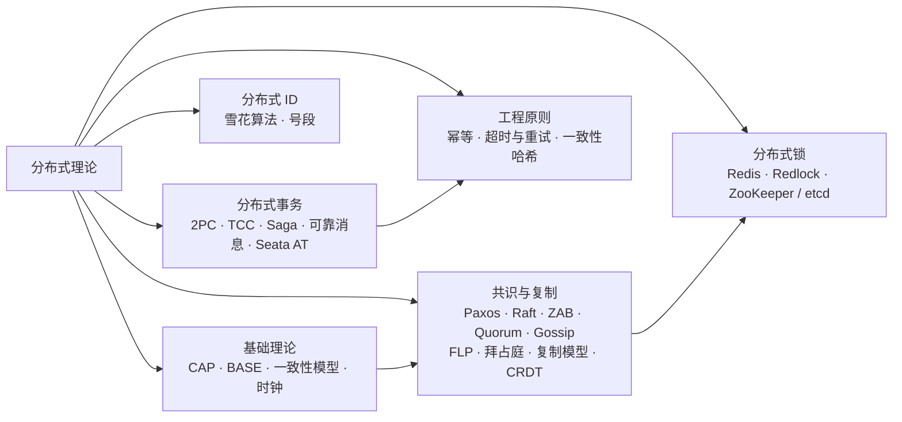

## 题目索引

| 编号 | 题目 | 难度 | 层级 |
| --- | --- | --- | --- |
| 09-01 | 如何正确理解 CAP 定理？ | ★★ | 资深 / 架构师 |
| 09-02 | BASE 理论与最终一致性 | ★ | 资深 |
| 09-03 | 一致性模型有哪些？"读己之写"是什么？ | ★★★ | 架构师 |
| 09-04 | Raft 算法是如何工作的？ | ★★★ | 资深 / 架构师 |
| 09-05 | 多数派（Quorum）与脑裂 | ★★ | 资深 |
| 09-06 | Gossip 协议是什么？适合什么场景？ | ★★ | 资深 |
| 09-07 | 分布式系统中的时间与逻辑时钟 | ★★★ | 架构师 |
| 09-20 | Paxos 是怎么工作的？它和 Raft 是什么关系？ | ★★★ | 架构师 |
| 09-21 | FLP 不可能定理和拜占庭将军问题分别说的是什么？对工程有什么影响？ | ★★★ | 架构师 |
| 09-22 | 数据复制有哪几种模型？多个节点同时写入产生了冲突怎么办？ | ★★★ | 架构师 |
| 09-08 | 分布式事务有哪些方案？如何选择？ | ★★★ | 架构师 |
| 09-09 | 2PC / XA 有什么问题？ | ★★ | 资深 |
| 09-10 | TCC 的空回滚、悬挂、幂等问题如何处理？ | ★★★ | 资深 / 架构师 |
| 09-11 | Saga 模式与补偿设计 | ★★★ | 架构师 |
| 09-12 | Seata AT 模式的原理 | ★★★ | 资深 |
| 09-13 | 如何用 Redis 实现一个可靠的分布式锁？ | ★★★ | 资深 |
| 09-14 | Redlock 有什么争议？什么是 fencing token？ | ★★★ | 架构师 |
| 09-15 | Redis、ZooKeeper、etcd 实现分布式锁有何不同？ | ★★ | 资深 / 架构师 |
| 09-16 | 分布式 ID 有哪些生成方案？雪花算法如何处理时钟回拨？ | ★★★ | 资深 |
| 09-17 | 如何设计接口的幂等性？ | ★★★ | 资深 / 架构师 |
| 09-18 | 远程调用的超时与重试应该怎么设计？ | ★★★ | 架构师 |
| 09-19 | 一致性哈希的原理与应用 | ★★ | 资深 |

---

## 一、基础理论

### 09-01 如何正确理解 CAP 定理？

> ★★ ｜ 资深 / 架构师 ｜ 高频

**考察意图**：能否纠正"三选二"的常见误解，并结合真实系统说明取舍。

**30 秒版回答**

- **C（一致性）**：这里特指**线性一致性**，所有节点在同一时刻看到的数据一致，读操作一定能读到最近一次完成的写；
- **A（可用性）**：每个发送到**未故障节点**的请求，都能在有限时间内得到一个非错误的响应；
- **P（分区容错）**：网络分区（节点之间消息丢失或无限延迟）发生时，系统仍能继续运行。
- **常见误解是"三选二"**。在分布式系统中，网络分区**不是可以选择不要的**，它一定会发生。所以 CAP 的真正含义是：**当网络分区发生时，只能在 C 和 A 之间二选一**：
  - 选 C（CP）：拒绝部分请求，保证返回的数据是一致的，例如 ZooKeeper、etcd、HBase；
  - 选 A（AP）：继续响应，但可能返回旧数据，事后再修复，例如 Eureka、Cassandra，以及 Nacos 的临时实例。
- 没有分区时，C 和 A 可以同时满足。这时真正的取舍是**延迟和一致性**之间的平衡，这就是 **PACELC** 的补充：发生分区（P）时在 A 和 C 之间选择；否则（E，Else）在延迟（L）和一致性（C）之间选择。

**深入剖析**

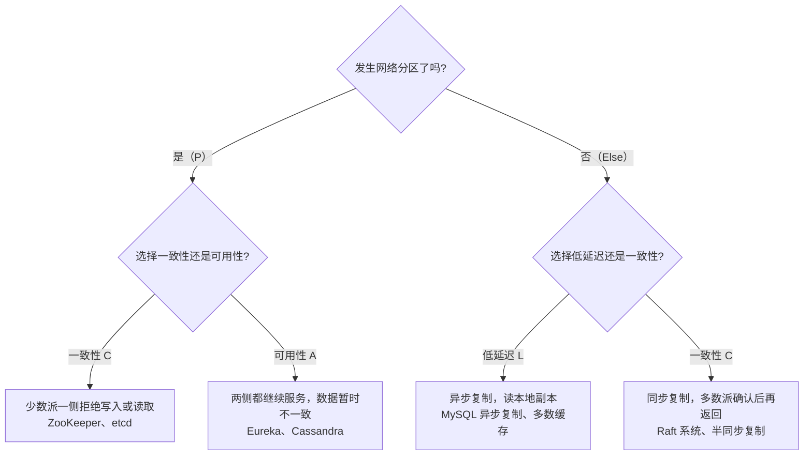

**追问链**

1. **Nacos 是 CP 还是 AP？**
   两者都有：**临时实例**（默认，客户端通过心跳续约）使用自研的 Distro 协议，是 AP；**持久化实例**和配置数据使用 Raft（JRaft 实现），是 CP。见[《12 Spring Cloud》](12-SpringCloud.md)[《13 配置中心》](13-配置中心.md)。
2. **MySQL 主从是 CP 还是 AP？**
   异步复制下，主库宕机切换到从库时可能丢失最近的写，偏 AP；半同步复制至少有一个从库确认后才返回，一致性更强，但仍不能保证线性一致。MySQL Group Replication 基于 Paxos 变种，更接近 CP。

**架构师加分点**

讨论 CAP 时要落到**具体的数据和操作**上，而不是给整个系统贴一个标签：同一个系统中，账户余额要 CP，商品浏览数可以 AP。设计时先回答"这份数据在分区期间读到旧值能不能接受、写入能不能被拒绝"，再选择存储和复制方式。

---

### 09-02 BASE 理论与最终一致性

> ★ ｜ 资深 ｜ 中频

**考察意图**：是否理解 BASE 是对 CAP 中"选 A"的工程化表述。

**30 秒版回答**

- **BA（基本可用）**：出现故障时允许损失部分可用性，例如响应变慢、部分功能降级（大促时关闭商品评论），但核心功能可用；
- **S（软状态）**：允许系统中的数据存在中间状态，例如"支付处理中"；
- **E（最终一致性）**：经过一段时间后，所有副本的数据最终达到一致。
- BASE 是大部分互联网业务的现实选择：用最终一致性换取可用性和性能。关键在于**"最终"要有保证**：明确的补偿、重试、对账机制，以及可度量的不一致时间窗口。

**追问链**

1. **最终一致性的系统，怎么知道它"最终"真的一致了？**
   靠**对账**：定期比对两个系统中的数据（例如订单系统和支付系统按日核对），发现差异时自动或人工修复。对账是最终一致性的最后一道防线，见[《29 场景题》](../06-三高与架构/29-场景题.md)。

---

### 09-03 一致性模型有哪些？"读己之写"是什么？

> ★★★ ｜ 架构师 ｜ 中频，区分度高

**考察意图**：能否区分不同强度的一致性模型，并知道它们对应的工程问题。

**30 秒版回答**

从强到弱：

| 模型 | 含义 | 例子 |
| --- | --- | --- |
| 线性一致性 | 所有操作看起来像在一个全局时间线上瞬间完成，读一定能读到最新完成的写 | etcd、ZooKeeper 的 sync 读、Raft 的线性一致读 |
| 顺序一致性 | 所有节点看到相同的操作顺序，但这个顺序不一定与真实时间一致 | ZooKeeper 的普通读（每个客户端看到的更新顺序相同，但可能滞后） |
| 因果一致性 | 有因果关系的操作，所有节点看到的顺序一致；没有因果关系的可以不同 | 评论必须在被回复的帖子之后出现 |
| 最终一致性 | 不再有新写入时，副本最终会一致 | DNS、大部分缓存 |

在最终一致性的基础上，还有几个面向**客户端视角**的"会话一致性"保证，它们能以较低成本解决大部分用户可感知的问题：

- **读己之写**（Read Your Writes）：用户写入后，自己一定能读到刚写的内容。例如修改头像后刷新页面，不能看到旧头像；
- **单调读**：用户不会先读到新数据、再读到旧数据（多次请求打到不同的从库时容易出现）；
- **单调写**：同一个用户的写操作按顺序生效。

**深入剖析**

读己之写的常见实现：

- 用户写入后的一小段时间内（比如 1 秒），**这个用户的读请求强制路由到主库**；
- 写入时返回一个版本号或时间戳，读的时候带上，从库的复制进度落后于这个版本时转到主库读取；
- 同一个用户的请求固定路由到同一个副本（会话粘滞），可以同时满足单调读。

**追问链**

1. **为什么不直接都用线性一致性？**
   代价高：每次读写都需要多数派确认或者经过 Leader，延迟更高、吞吐更低，跨地域时尤其明显。大部分业务只需要在少数关键路径上使用强一致性。

---

## 二、共识与协议

### 09-04 Raft 算法是如何工作的？

> ★★★ ｜ 资深 / 架构师 ｜ 高频

**考察意图**：能否讲清 Raft 的三个子问题：领导者选举、日志复制、安全性。

**30 秒版回答**

Raft 把共识问题拆成三个相对独立的部分：

1. **领导者选举**：
   - 节点有三种角色：Follower、Candidate、Leader；时间被划分为**任期**（term），每个任期最多一个 Leader；
   - Follower 在**随机的选举超时时间**（论文建议 150 ~ 300 ms）内没有收到 Leader 的心跳，就转为 Candidate，任期加 1，给自己投票并向其他节点请求投票；
   - 获得**多数派**投票的成为 Leader。随机超时让多个节点同时竞选的概率很低；
   - 每个节点在一个任期内只投一票，并且**只投给日志至少和自己一样新的候选人**，这是安全性的关键。
2. **日志复制**：
   - 客户端的写请求只发给 Leader，Leader 先追加到自己的日志，再并行发给 Follower；
   - **多数派**写入成功后，这条日志被视为已提交（committed），Leader 应用到状态机并返回客户端；
   - 每条日志带有任期和索引，Follower 通过"前一条日志的任期和索引是否匹配"来检查一致性，不一致时由 Leader 回退并覆盖 Follower 的冲突日志。
3. **安全性**：选举限制保证新 Leader 一定包含所有已提交的日志；Leader 只能通过提交**当前任期**的日志，来间接提交之前任期的日志。

**深入剖析**

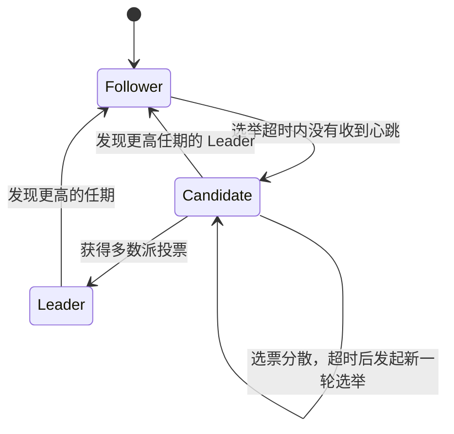

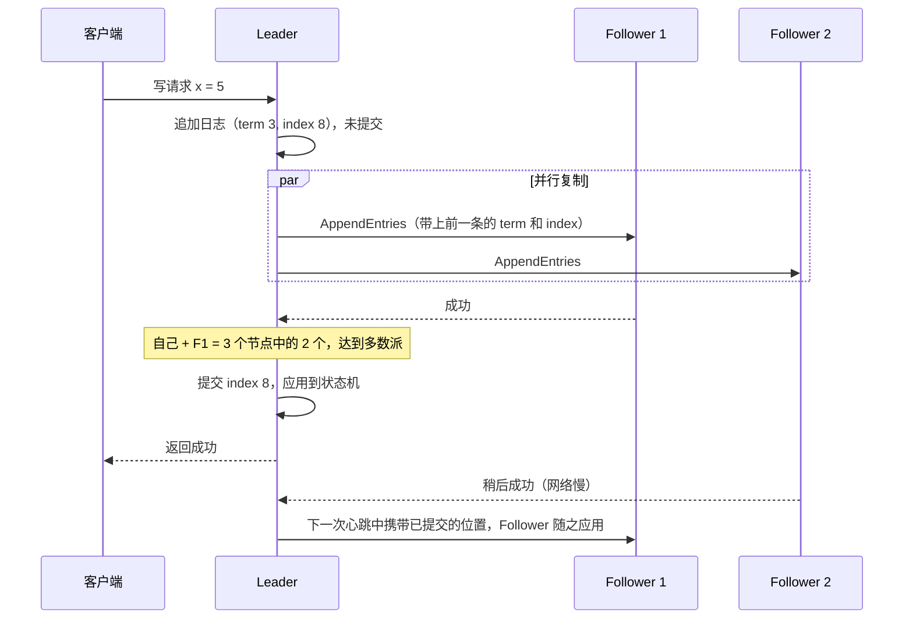

**追问链**

1. **Raft 的读请求怎么保证线性一致？**
   Leader 也可能已经被网络隔离而不自知（旧 Leader），直接读它的数据可能是旧的。常见做法：**ReadIndex**（记下当前的提交位置，向多数派确认自己仍是 Leader，等状态机应用到这个位置后再读）；**Lease Read**（在租约期内认为自己仍是 Leader，省去确认的网络往返，但依赖时钟的准确性）。
2. **哪些系统使用了 Raft？**
   etcd、Consul、TiKV、Nacos（持久化数据部分，基于 JRaft）、Kafka 的 KRaft 模式（Raft 的变种）、RocketMQ 的 DLedger。

---

### 09-05 多数派（Quorum）与脑裂

> ★★ ｜ 资深 ｜ 高频

**考察意图**：是否理解多数派如何防止脑裂，以及集群节点数的选择。

**30 秒版回答**

- **脑裂**：网络分区后，集群分裂成多个部分，每部分都认为其他部分已经宕机，各自选出 Leader 并接受写入，分区恢复后数据冲突，无法合并。
- **多数派机制**：任何决策（选举、提交）都需要超过半数（`N / 2 + 1`）的节点同意。任意两个多数派必然至少有一个公共节点，所以**不可能同时存在两个合法的 Leader**。分区后只有包含多数节点的一侧能继续工作，少数派一侧停止写入。
- 节点数通常取**奇数**：3 个节点能容忍 1 个故障，4 个节点也只能容忍 1 个故障（多数派是 3），多一个节点没有提高容错能力，反而增加了复制开销。5 个节点能容忍 2 个故障。
- 读写的 Quorum 公式（Dynamo 风格的系统）：N 个副本，写需要 W 个确认，读需要 R 个响应，只要 **W + R > N**，读和写的集合就必然有交集，读一定能读到最新写入的副本。

**深入剖析**

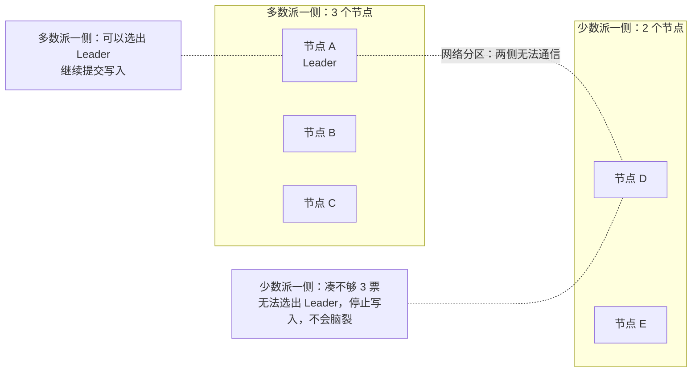

**追问链**

1. **跨两个机房部署 3 个节点，怎么分配？**
   2 + 1 的部署中，2 个节点所在的机房宕机，剩下的 1 个节点无法形成多数派，集群不可用。真正的机房级容灾需要三个机房（3 + 3 + 3 或 2 + 2 + 1），或者接受这种部署方式下只能容忍"少数节点所在机房"的故障。见[《26 高可用》](../06-三高与架构/26-高可用.md)。

---

### 09-06 Gossip 协议是什么？适合什么场景？

> ★★ ｜ 资深 ｜ 中频

**考察意图**：是否了解去中心化系统中信息传播的方式。

**30 秒版回答**

- Gossip（流言协议）：每个节点周期性地**随机选择几个其他节点**交换自己知道的信息，信息像流言一样在集群中扩散，经过 O(log N) 轮后几乎所有节点都会知道。
- 特点：
  - **去中心化**，没有单点，节点的加入和离开很自然；
  - **最终一致**，信息传播有延迟；
  - 消息冗余较多，但每个节点每轮只发送固定数量的消息，负载可控。
- 应用：Redis Cluster 的节点状态和槽位信息传播、Cassandra 的成员管理、Consul 的成员与故障检测（基于 Serf / SWIM）。
- 不适合需要强一致的场景（例如选主、分配全局唯一资源）。

**追问链**

1. **Redis Cluster 中节点如何判定另一个节点下线？**
   一个节点在超时时间内收不到某节点的回复时，把它标记为"疑似下线"（PFAIL），并通过 Gossip 告诉其他节点；当半数以上持有槽位的主节点都认为它疑似下线时，才标记为"已下线"（FAIL）并广播，然后触发故障转移。见[《17 Redis》](../04-数据存储/17-Redis.md)。

---

### 09-07 分布式系统中的时间与逻辑时钟

> ★★★ ｜ 架构师 ｜ 中频

**考察意图**：是否意识到不能依赖不同机器的物理时间来判断先后顺序。

**30 秒版回答**

- **物理时钟不可靠**：不同机器的时钟存在偏差，NTP 同步后仍可能相差几毫秒到几十毫秒，NTP 校准还会让时钟向后跳。所以"用两台机器上的时间戳比较先后"是不可靠的，用时间戳做"最后写入获胜"会导致数据丢失。
- **Lamport 逻辑时钟**：每个节点维护一个计数器，本地每发生一个事件加 1；发送消息时带上计数器；收到消息时取 `max(本地, 消息中的) + 1`。它保证**如果 A 发生在 B 之前（有因果关系），那么 A 的时钟值小于 B**，但反过来不成立。
- **向量时钟**：每个节点维护一个"所有节点计数器"的向量。比较两个向量可以判断两个事件是因果相关的，还是**并发**的，从而发现冲突。代价是向量的大小随节点数增长。
- **混合逻辑时钟（HLC）**：把物理时间和逻辑计数器组合起来，既接近真实时间、又保证因果顺序，CockroachDB、YugabyteDB 等使用它。Google Spanner 的 TrueTime 则依靠原子钟和 GPS 给出带误差范围的时间，并通过"提交等待"跨过误差区间。

**追问链**

1. **雪花算法依赖物理时钟，时钟回拨了怎么办？** 见 09-16。
2. **业务中怎么判断两条消息的先后？**
   不要依赖不同机器的时间戳。由同一个"源头"生成单调递增的序号（例如同一个聚合的版本号、数据库自增序列、单分区内的消息偏移量），在需要有序的范围内按序号比较。

---

### 09-20 Paxos 是怎么工作的？它和 Raft 是什么关系？

> ★★★ ｜ 架构师 ｜ 中频

**考察意图**：Raft 讲得再熟，面试官也可能追问"那 Paxos 呢"。想确认你理解共识算法安全性的来源（多数派相交 + 沿用已接受的值），而不是只背过 Raft 的流程。

**30 秒版回答**

- Basic Paxos 解决的问题是：一组节点**对一个值达成一致**，一旦选定就不会再变，即使有节点宕机、消息丢失或乱序。
- 三种角色：**提议者**（Proposer）发起提案，**接受者**（Acceptor）投票，**学习者**（Learner）得知结果。一个进程可以身兼多职。
- 两个阶段：
  1. **准备**：提议者选一个全局唯一、递增的编号 n，发给接受者。接受者如果没承诺过更大的编号，就承诺"不再接受编号小于 n 的提案"，并带回**自己已经接受过的提案**；
  2. **接受**：提议者拿到多数派承诺后发起提案。**如果承诺里带回了已接受的提案，必须使用其中编号最大的那个值**，否则才能用自己的值。多数派接受后，值被选定。
- 安全性来自两点：任意两个多数派必然有交集；后来的提议者在阶段一一定会碰到这个交集里的节点，从而被迫沿用已经可能选定的值。
- 和 Raft 的关系：工程上用的是 **Multi-Paxos**（选出稳定的领导者，后续提案省掉阶段一）。Raft 可以看作加了更强约束、把细节全部规定清楚的 Multi-Paxos：强领导者、日志必须连续、只有日志最新的节点才能当选。

**深入剖析**

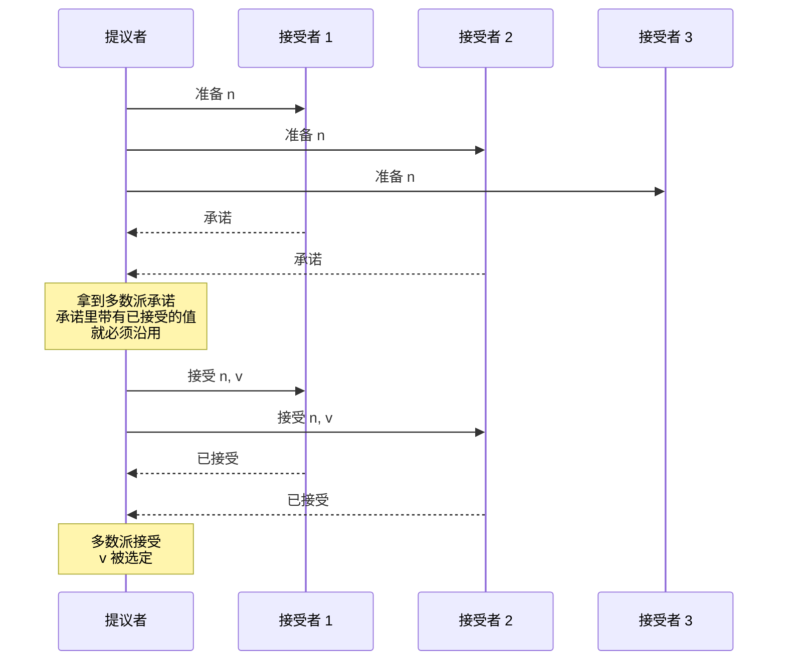

下面是一个最小模拟（本机 JDK 25 运行过），演示最关键的那条规则。P1 把 X 送到了两个接受者后宕机，P2 并不知道 X 已被选定，它想提 Y：

```java
/** 提议者跑一轮完整的两阶段，reachableInAccept 模拟阶段二的消息只送达了一部分接受者 */
static String propose(String who, int n, String myValue, List<Acceptor> all, List<Acceptor> reachableInAccept) {
    int majority = all.size() / 2 + 1;
    List<Promise> promises = new ArrayList<>();
    for (Acceptor a : all) {
        Promise p = a.prepare(n);          // 编号比承诺过的大才答应，并带回已接受的提案
        if (p.ok()) { promises.add(p); }
    }
    if (promises.size() < majority) {
        System.out.println(who + " 提案 " + n + "：阶段一没拿到多数派承诺，放弃");
        return null;
    }
    // 关键规则：在收到的承诺里找编号最大的已接受提案，有就必须用它的值
    String value = myValue;
    int maxNo = 0;
    for (Promise p : promises) {
        if (p.acceptedNo() > maxNo) { maxNo = p.acceptedNo(); value = p.acceptedValue(); }
    }
    // ...打印实际提出的值，然后向 reachableInAccept 发送接受请求并统计是否过半
}
```

```text
P1 提案 1：想提 X，实际提 X
P1 提案 1：阶段二 2 个接受，值 X 被选定
  此时：[A1(promised=1, accepted=1:X), A2(promised=1, accepted=1:X), A3(promised=1, accepted=0:null)]
P2 提案 2：想提 Y，实际提 X（沿用编号 1 的已接受值）
P2 提案 2：阶段二 3 个接受，值 X 被选定
  此时：[A1(promised=2, accepted=2:X), A2(promised=2, accepted=2:X), A3(promised=2, accepted=2:X)]
P1 提案 1：阶段一没拿到多数派承诺，放弃
```

P2 的提案编号更大、也拿到了全部承诺，但它提出的仍然是 X。这就是"已选定的值不会被推翻"的由来。最后一行是编号过期的提议者被直接拒绝。

**Multi-Paxos 和 Raft 的对比**：

| 维度 | Multi-Paxos | Raft |
| --- | --- | --- |
| 领导者 | 是一种优化，协议本身允许多个提议者 | 必须有，且每个任期最多一个 |
| 日志 | 允许空洞，不同位置可以乱序选定 | 必须连续，按顺序提交 |
| 谁能当选 | 任何节点都可以，当选后再把缺的日志补齐 | 只有日志至少和多数派一样新的节点 |
| 规范程度 | 论文只描述了核心思想，成员变更、快照等靠各家自己实现 | 论文把选举、复制、成员变更、快照都规定了 |
| 典型实现 | Chubby、Spanner、OceanBase、MySQL 组复制（Paxos 变种） | etcd、Consul、TiKV、Kafka KRaft |

**追问链**

1. **Paxos 会不会一直选不出值？**
   会。两个提议者交替发起更大的编号，互相让对方的阶段二失败，可以无限持续下去，这叫活锁。它不破坏安全性（不会选出两个值），只影响可用性。工程上的解法是选出一个稳定的领导者，或者让提议者失败后随机退避。这个现象背后的理论限制见 09-21。
2. **提案编号怎么保证全局唯一且递增？**
   常见做法是"轮次 + 节点编号"拼起来：高位是本节点见过的最大轮次加 1，低位是节点自己的编号。这样不同节点永远不会生成相同的编号。
3. **为什么工程上更多人选 Raft？**
   不是因为 Raft 更强，两者的容错能力相同（2f + 1 个节点容忍 f 个故障）。原因是 Raft 把实现细节规定得足够具体，不同团队照着论文写出来的东西行为一致，也更容易验证和排查。Paxos 的各种工程实现彼此差别很大，正确性更依赖实现者的功力。
4. **ZAB 属于哪一类？**
   ZAB 是 ZooKeeper 专用的原子广播协议，思路上接近 Raft（强领导者、按顺序提交），但它是独立设计的，时间上早于 Raft。细节见[《14 ZooKeeper》](14-ZooKeeper.md)14-04。

**架构师加分点**

业务系统里几乎不需要自己实现共识算法，需要的是判断"这个场景是不是共识问题"以及"用哪个现成的组件"。选主、分布式锁、配置的强一致存储、元数据管理，本质上都是共识问题，应该交给 etcd、ZooKeeper 或数据库自带的复制协议。自己用"多个 Redis 节点投票""数据库加时间戳"拼出来的方案，通常在网络分区或时钟跳变时会选出两个主。

---

### 09-21 FLP 不可能定理和拜占庭将军问题分别说的是什么？对工程有什么影响？

> ★★★ ｜ 架构师 ｜ 低频

**考察意图**：这两个是分布式理论的边界。面试官不要求证明，而是看你能否说清"它们限制了什么""现实中的系统是怎么绕开的"。

**30 秒版回答**

- **FLP 不可能定理**：在**完全异步**的网络里（消息延迟没有上限），哪怕只有**一个节点可能宕机**，也不存在一个确定性的算法能保证共识**一定在有限时间内完成**。
  - 根源：异步网络里无法区分"对方挂了"和"对方只是很慢"。
  - 它否定的是"一定能结束"（活性），没有否定"不会出错"（安全性）。
  - 工程上的绕法：引入**超时**，也就是假设网络大部分时间是正常的。Raft 的选举超时、Paxos 的领导者租约都是这个思路。代价是网络异常期间系统可能暂时不可用，但不会出错。
- **拜占庭将军问题**：节点不只是宕机，还可能**发送错误甚至互相矛盾的消息**（被入侵、有 bug、数据损坏）。
  - 结论：要容忍 f 个这样的节点，至少需要 **3f + 1** 个节点。
  - 只考虑宕机的算法（Raft、Paxos）需要 2f + 1 个节点，它们**不能容忍拜占庭故障**。
  - 企业内网的系统默认节点是可信的，用 Raft 这类算法就够了；公有链、跨机构的联盟链才需要拜占庭容错（PBFT 及其变种、工作量证明等）。

**深入剖析**

三类故障模型，容错成本逐级上升：

| 故障模型 | 节点可能的行为 | 容忍 f 个故障需要的节点数 | 代表算法 |
| --- | --- | --- | --- |
| 宕机后停止 | 要么正常工作，要么彻底不响应 | 2f + 1 | Paxos、Raft、ZAB |
| 遗漏 | 可能丢消息，但不会发错误消息 | 2f + 1 | 同上，靠重试处理 |
| 拜占庭 | 任意行为，包括伪造和撒谎 | 3f + 1 | PBFT、HotStuff、工作量证明 |

**为什么拜占庭容错需要 3f + 1**。直观理解：总共 n 个节点，其中 f 个可能不回复，所以只能等到 n − f 个回复就得做决定。这 n − f 个回复里，又可能有 f 个来自说谎的节点。要让诚实的回复占多数，需要 (n − f) − f > f，即 n > 3f。

**FLP、CAP、共识算法三者的关系**：

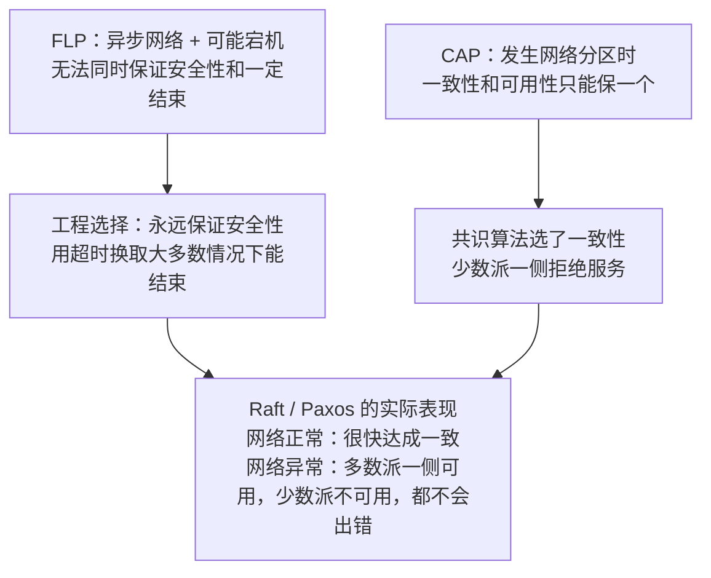

**追问链**

1. **既然有 FLP，Raft 为什么还能工作？**
   Raft 没有违反 FLP。它保证的是：任何情况下都不会选出两个领导者、不会提交冲突的日志（安全性）；而"最终能选出领导者"依赖于"网络终将恢复到消息能在超时时间内送达"这个额外假设。极端情况下（选举超时设得比网络延迟还短），Raft 确实会一直选不出领导者。
2. **企业内部的系统完全不用考虑拜占庭故障吗？**
   不用引入拜占庭容错算法，但要防一种常见的"轻度拜占庭"：**数据静默损坏**。磁盘坏块、内存位翻转、有 bug 的节点会把错误数据当成正确数据复制出去，而宕机容错的算法会忠实地把它同步到所有副本。对策是在数据上加校验和：Kafka 的消息、etcd 和 RocksDB 的日志、HDFS 的数据块都带 CRC，读取时校验，发现不一致就从其他副本修复。
3. **两将军问题和拜占庭将军问题是一回事吗？**
   不是。两将军问题说的是：两个节点通过**会丢消息的信道**通信，无论来回确认多少次，都无法让双方**同时确信**对方已经知道了约定。它没有恶意节点，问题出在信道上。TCP 的三次握手也没有解决它，只是把不确定性降到了可以接受的程度。工程上的应对是"重试 + 幂等"：发送方反复发直到收到确认，接收方保证重复收到也只处理一次，见 09-17。
4. **区块链的工作量证明是怎么做到拜占庭容错的？**
   它换了一个思路：不要求确定性的最终一致，而是让"推翻已有结果"的成本随时间指数上升。节点通过消耗算力竞争记账权，诚实节点总是沿着最长的链继续，攻击者要改写历史就必须拥有超过全网一半的算力。代价是吞吐低、确认慢、最终性是概率性的，所以不适合企业内部的交易系统。

**生产实践 / 踩坑**

- **把"超时"当成"失败"**：调用下游超时后直接当作失败处理并回滚，而下游其实已经执行成功。FLP 的现实含义就是：超时只说明"不知道"，不说明"没做"。超时之后必须通过查询或幂等重试来确认结果，见 09-18。
- **用心跳超时直接判定主节点已死并自行升主**：旧主可能只是暂时卡住（长时间 GC、网络抖动），恢复后两个主同时写入。切换必须配合多数派投票或者 fencing token，见 09-05 和 09-14。

---

### 09-22 数据复制有哪几种模型？多个节点同时写入产生了冲突怎么办？

> ★★★ ｜ 架构师 ｜ 中频

**考察意图**：主从复制人人都会说，但做多机房、多活架构时必须面对多主和无主模型。面试官想知道你是否清楚每种模型把"冲突"放在了哪里处理，以及各种冲突解决办法会不会丢数据。

**30 秒版回答**

- 三种模型，区别在于**谁可以接受写入**：

| 模型 | 谁能写 | 冲突 | 代表 |
| --- | --- | --- | --- |
| 单主（主从） | 只有主节点 | 没有写冲突，问题在主从延迟和主节点切换 | MySQL 主从、Redis 主从、Kafka 分区副本 |
| 多主 | 每个机房一个主，都能写 | 两个主同时改同一条数据，必须解决冲突 | MySQL 双主、跨机房双向同步、各类多活方案 |
| 无主 | 任何副本都能写，客户端同时写多个副本 | 靠读写多数派和版本号在读取时发现并修复冲突 | Dynamo 风格的系统，如 Cassandra |

- 冲突的解决办法，按"丢数据的风险"从高到低：
  1. **最后写入者胜**：比较时间戳，留下最新的。简单，但会悄悄丢掉另一方的写入，而且依赖各机器的时钟；
  2. **版本向量**：能准确判断两个版本是先后关系还是并发关系，并发时把两个版本都保留下来，交给应用合并；
  3. **CRDT**：把数据类型设计成"任意顺序合并，结果都一样"，自动合并且不丢数据，但只适用于计数器、集合等特定的数据类型；
  4. **从业务上避免冲突**：同一个用户的写入固定路由到同一个机房，让冲突根本不发生。这是多活架构里最常用、也最可靠的办法。

**深入剖析**

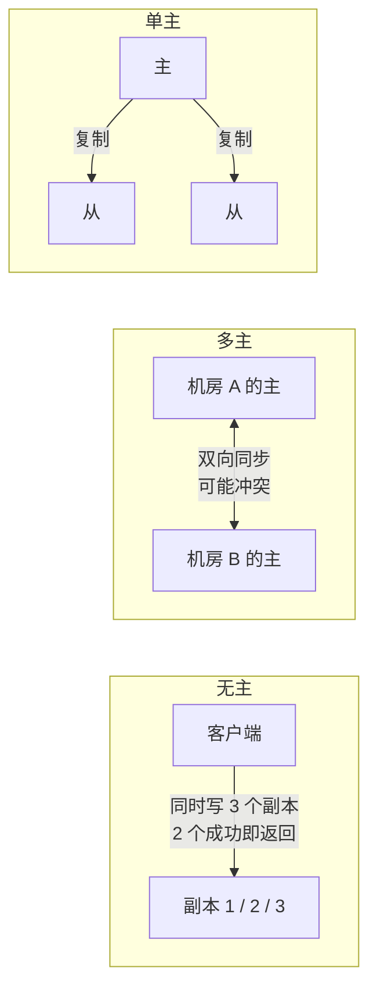

**无主模型的三个配套机制**（多数派读写的 W + R > N 见 09-05）：

- **读修复**：读取时发现某个副本的数据是旧的，顺手把新值写回去；
- **提示移交**：目标副本暂时不可用时，由别的节点先代为保存这次写入，等它恢复后再转交；
- **反熵**：后台进程定期比较副本之间的数据，把差异补齐。为了减少比较的数据量，一般用哈希树只传输有差异的部分。

**CRDT 为什么能自动合并**。以只增计数器为例：每个节点只修改属于自己的那个分量，合并时逐个分量取最大值。这个合并操作满足交换律、结合律和幂等性，所以同步的顺序、次数都不影响结果。下面的代码在本机 JDK 25 上运行过：

```java
/** G-Counter：只增计数器。每个节点只改自己的分量，合并时逐个分量取最大值 */
static final class GCounter {
    private final String nodeId;
    private final Map<String, Long> counts = new HashMap<>();

    GCounter(String nodeId) { this.nodeId = nodeId; }

    void increment(long delta) { counts.merge(nodeId, delta, Long::sum); }

    long value() { return counts.values().stream().mapToLong(Long::longValue).sum(); }

    void merge(GCounter other) { other.counts.forEach((k, v) -> counts.merge(k, v, Math::max)); }
}
```

两个机房在网络中断期间分别累加了 5 次，恢复后互相同步（其中一个方向重复同步了一次）：

```text
合并前 北京: {bj=5} => 5，上海: {sh=5} => 5
合并后 北京: {sh=5, bj=5} => 10，上海: {sh=5, bj=5} => 10
最后写入者胜的结果: 5，真实的总增量是 10
```

最后一行是对照：把计数当成一个普通数字、按"最后写入者胜"覆盖，会丢掉其中一个机房的全部增量。

**追问链**

1. **单主模型没有冲突，那它的问题在哪？**
   - **复制延迟**：异步复制下，从库读到的可能是旧数据，表现为"刚写完就查不到"，见[《15 MySQL》](../04-数据存储/15-MySQL.md)15-21；
   - **切换丢数据**：主库宕机时，还没来得及复制的写入会丢失；
   - **脑裂**：旧主没有真的死，切换后出现两个主。必须靠多数派或 fencing 来防，见 09-05；
   - **写入不能水平扩展**：所有写都要经过主节点，容量到头后只能分片，见[《16 分库分表》](../04-数据存储/16-分库分表.md)。
2. **"最后写入者胜"具体会出什么问题？**
   两个问题叠加：第一，并发的两次写入必然丢一个，而且不报任何错；第二，"最后"是按时间戳判断的，机器之间的时钟有偏差，时钟快的机器写的旧值可能盖掉时钟慢的机器写的新值。它只适合"丢一次无所谓"的数据，比如用户的最后在线时间、缓存。时钟问题见 09-07。
3. **CRDT 能用来做库存扣减或者账户余额吗？**
   不能直接用。CRDT 保证的是"最终收敛到同一个值"，不保证"任何时刻都不违反约束"。库存不能为负、余额不能透支，这类约束需要在写入时就知道全局状态，本质上要求强一致。两个机房各自扣减一件库存，合并后都合法地收敛了，但库存可能已经是负数。这类数据要么只在一个机房写，要么把库存预先切分到各机房分别扣减。
4. **双向同步怎么避免数据在两个机房之间无限循环？**
   给每条变更打上来源标记（比如来源机房的编号），同步组件发现这条变更本来就是从对端同步过来的，就不再回传。MySQL 的 GTID 里带有产生事务的实例标识，就能起到这个作用；用 Canal 之类的工具做双向同步时，要自己在事务里带上标记。

**架构师加分点**

做多活时，优先级应该是：**先避免冲突，再检测冲突，最后才是解决冲突**。按用户或租户把写入固定到一个"归属机房"，其他机房只读或者只做容灾，绝大多数业务都能这样处理；只有全局共享、又必须多点写入的数据（比如全局配置、社交关系里的计数），才需要考虑 CRDT 或者业务层的合并逻辑。一上来就做"任意机房任意写"，等于把最难的问题留给了每一个业务开发。多活的整体设计见[《26 高可用》](../06-三高与架构/26-高可用.md)26-11。

---

## 三、分布式事务

### 09-08 分布式事务有哪些方案？如何选择？

> ★★★ ｜ 架构师 ｜ 高频

**考察意图**：能否给出全景，并按一致性要求、性能、业务侵入性做出选择。

**30 秒版回答**

| 方案 | 一致性 | 性能 | 业务侵入 | 适用场景 |
| --- | --- | --- | --- | --- |
| 2PC / XA | 强一致（存在阻塞问题） | 低，全程持有锁 | 低 | 同一个机房内、少量参与者、并发不高的场景 |
| Seata AT | 最终一致，借助全局锁实现写隔离 | 中 | 很低（自动生成回滚日志） | 使用关系型数据库的微服务，希望低侵入 |
| TCC | 最终一致，资源预留 | 高 | 高（每个操作三个接口） | 资金、库存等对隔离性要求高的核心链路 |
| Saga | 最终一致，没有隔离性 | 高 | 中（需要补偿接口） | 长流程、跨多个服务的业务（订票、订单履约） |
| 本地消息表 / 事务消息 | 最终一致 | 高 | 中 | 上游成功后通知下游，下游一定能成功（只需重试）的场景 |
| 最大努力通知 | 最终一致（尽力而为） | 高 | 低 | 对外部系统的通知，例如支付结果回调 |

选择思路：

1. **先问能不能避免**：重新划分服务边界，让需要强一致的数据落在同一个服务、同一个库中，用本地事务解决。这是最好的分布式事务方案；
2. 下游**一定会成功**（只要重试就行）：用可靠消息（本地消息表、事务消息）；
3. 下游可能失败、需要回滚上游：短流程、对隔离性要求高的用 TCC；长流程用 Saga；
4. 想要较低的业务侵入，且都使用关系型数据库：Seata AT。

**深入剖析**

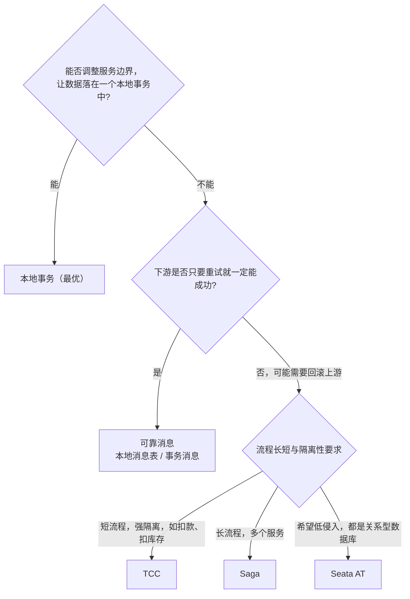

**追问链**

1. **为什么说"没有万能的分布式事务方案"？**
   每种方案都在一致性、性能、侵入性、隔离性之间做取舍。而且它们都只能保证**数据层面**的最终一致，业务语义上的问题（比如补偿时商品已经发货）仍需要业务自己设计。

---

### 09-09 2PC / XA 有什么问题？

> ★★ ｜ 资深 ｜ 中频

**考察意图**：是否理解两阶段提交的阻塞问题。

**30 秒版回答**

- 两阶段提交：
  1. **准备阶段**：协调者询问所有参与者能否提交，参与者执行事务但不提交，写好 redo/undo 日志，锁住资源，回复"可以"或"不可以"；
  2. **提交阶段**：全部回复"可以"则通知提交，否则通知回滚。
- 问题：
  - **同步阻塞**：从准备到提交的整个过程中，参与者一直持有锁，并发性能差；
  - **协调者单点**：协调者在发出提交指令之前宕机，参与者会一直持有锁、等待指令（"阻塞"）；
  - **数据不一致**：提交阶段只有部分参与者收到了提交指令，其他参与者因为网络问题没收到，就会出现部分提交；
  - 参与者都必须支持 XA 协议，一些中间件（大部分 NoSQL、MQ）不支持。
- **3PC** 在两个阶段之间加入了 CanCommit，并引入超时自动提交，缓解了阻塞，但在网络分区时仍可能不一致，工程上很少使用。

**追问链**

1. **MySQL 的 XA 有什么坑？**
   XA 事务在 PREPARE 之后，即使客户端断开，事务也会一直保留并持有锁，需要人工用 `XA RECOVER` 查出来并处理。早期版本中还存在主从复制下 XA 事务不一致的问题。

---

### 09-10 TCC 的空回滚、悬挂、幂等问题如何处理？

> ★★★ ｜ 资深 / 架构师 ｜ 高频

**考察意图**：是否真正落地过 TCC，能否说清楚三个经典问题的成因和解法。

**30 秒版回答**

- TCC 把一个操作拆成三步，每一步都是一个本地事务：
  - **Try**：检查并**预留资源**（例如冻结 100 元，而不是直接扣减）；
  - **Confirm**：真正使用预留的资源（扣减冻结金额）；
  - **Cancel**：释放预留的资源（解冻）。
- 三个经典问题：
  1. **幂等**：网络超时会导致 Confirm 或 Cancel 被重复调用，必须保证重复执行的结果一致；
  2. **空回滚**：Try 请求因为网络原因**根本没有到达**参与者，事务管理器超时后调用了 Cancel。参与者没有执行过 Try，Cancel 不能真的去"解冻"任何东西，应该直接返回成功；
  3. **悬挂**：Cancel 先执行了（空回滚），之后**迟到的 Try 请求又到达了**，冻结了资源，但这个全局事务已经结束，再也不会有人来 Confirm 或 Cancel，资源被永久冻结。
- 统一的解法：每个参与者维护一张**事务控制表**，以"全局事务 ID + 分支 ID"为主键，记录 Try、Confirm、Cancel 的执行状态：
  - Confirm / Cancel 执行前先查状态，已执行过就直接返回（幂等）；
  - Cancel 时找不到 Try 的记录，插入一条"已回滚"记录后直接返回成功（空回滚）；
  - Try 时发现已经存在"已回滚"记录，直接拒绝执行（防悬挂）。
  - Seata 的 TCC 模式从 1.5 版本起内置了这种机制（`tcc_fence_log` 表），开启后由框架处理。

**深入剖析**

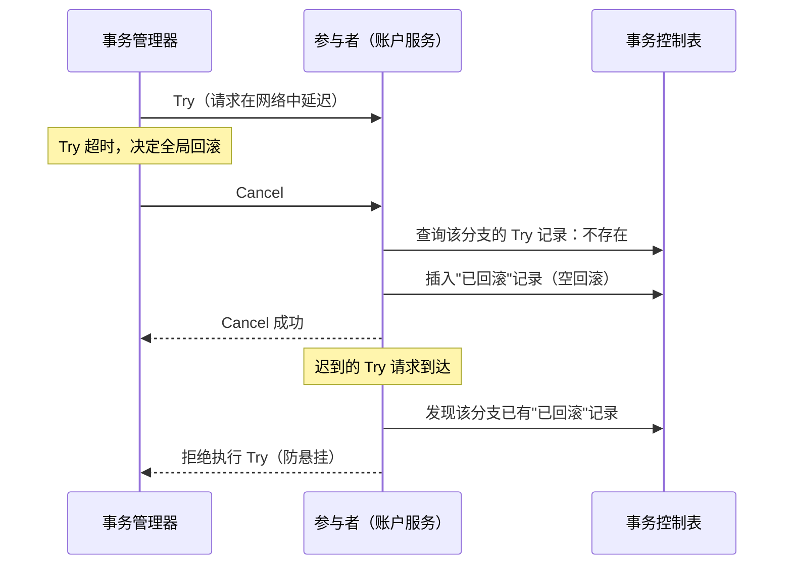

**追问链**

1. **TCC 的 Try 阶段为什么要"预留"而不是直接扣减？**
   预留状态对其他事务可见但不可用，例如冻结的金额不能被别的交易使用，从而在 Confirm 之前提供了**隔离性**。如果 Try 直接扣减，Cancel 时再加回去，期间其他事务可能已经基于"扣减后的余额"做了决策。
2. **Confirm 失败了怎么办？**
   Confirm 必须设计成**一定能成功**（资源已经在 Try 中预留了），失败通常只是网络或临时故障，由事务管理器持续重试，所以 Confirm 必须幂等。

---

### 09-11 Saga 模式与补偿设计

> ★★★ ｜ 架构师 ｜ 中频

**考察意图**：是否理解 Saga 没有隔离性带来的问题，以及补偿的设计原则。

**30 秒版回答**

- Saga 把一个长事务拆成一系列本地事务 T1、T2、……、Tn，每个都有对应的**补偿操作** C1、C2、……。正常情况下依次执行；某一步 Ti 失败时，**逆序**执行已经完成的步骤的补偿 Ci-1、……、C1。
- 两种协调方式：
  - **编排**（Choreography）：各服务通过事件驱动，没有中心协调者。简单，但流程分散在各个服务中，步骤多了难以理解和追踪；
  - **编制**（Orchestration）：由一个协调者（状态机）统一调度每一步。流程清晰、便于监控，Seata 的 Saga 模式和 Temporal 等工作流引擎属于这一类。
- **Saga 最大的问题是没有隔离性**：T1 提交后，在后续步骤失败、执行补偿之前，其他事务已经能看到 T1 的结果（"脏读"）。应对方法：
  - **语义锁**：在数据上标记"处理中"状态，其他业务看到这个状态时等待或拒绝；
  - **把容易失败的步骤放在前面**，把不可补偿的步骤（发短信、调用外部的不可撤销操作）放在最后；
  - 补偿操作设计成**业务上的反向操作**，而不是简单的数据回滚（例如"退款"而不是"删除支付记录"）。
- 补偿操作本身也必须**幂等**、**可重试**，并且要处理"补偿时原操作还没执行"（类似 TCC 空回滚）的情况。

**深入剖析**

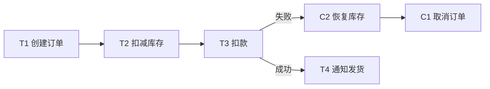

**追问链**

1. **补偿也失败了怎么办？**
   持续重试（带退避）；超过重试次数后进入人工处理队列并告警。所以每个 Saga 都要有可查询的状态和人工干预的入口。

---

### 09-12 Seata AT 模式的原理

> ★★★ ｜ 资深 ｜ 高频

**考察意图**：能否讲清 AT 模式的两阶段、undo log 和全局锁。

**30 秒版回答**

- 三个角色：**TC**（事务协调者，独立部署的 Seata Server）、**TM**（事务管理器，发起全局事务的一方，即加了 `@GlobalTransactional` 的方法）、**RM**（资源管理器，每个参与的数据库）。
- **一阶段**：
  1. Seata 代理了业务的数据源，执行 SQL 前解析 SQL，查询出被修改行的**修改前镜像**（before image）；
  2. 执行业务 SQL；
  3. 查询**修改后镜像**（after image）；
  4. 把前后镜像写入 `undo_log` 表，**与业务数据在同一个本地事务中提交**；
  5. 提交前向 TC 注册分支并申请这些行的**全局锁**；
  6. 本地事务直接提交，释放本地锁。
- **二阶段**：
  - 全局提交：TC 通知各 RM 异步删除 undo log，非常快；
  - 全局回滚：RM 根据 undo log 中的前镜像生成反向 SQL 恢复数据。恢复前先**比对当前数据与后镜像**，不一致说明数据在此期间被全局事务之外的操作修改过（脏写），需要人工处理。
- **隔离性**：
  - **写隔离**依靠全局锁：其他全局事务要修改同一行，必须先拿到全局锁，避免两个全局事务互相覆盖；
  - 默认的**读隔离级别是"读未提交"**：其他事务能读到一阶段已经提交、但全局事务尚未结束的数据。需要读已提交时用 `SELECT ... FOR UPDATE`，Seata 会检查全局锁。

**深入剖析**

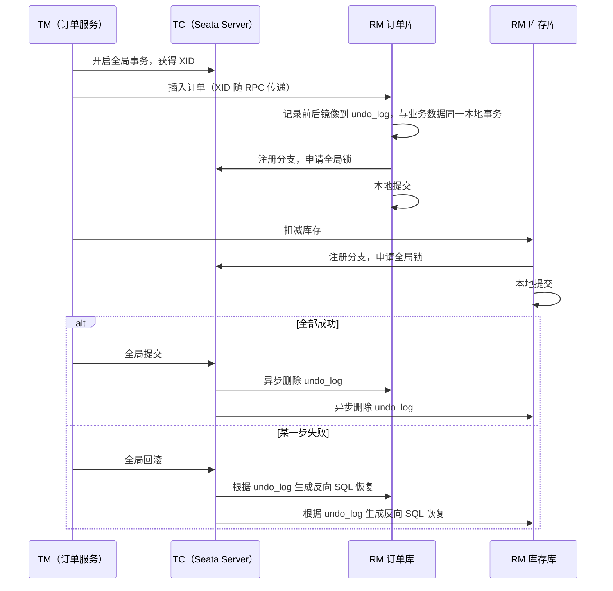

**追问链**

1. **AT 模式适合高并发的热点数据吗？**
   不太适合。全局锁要等整个全局事务结束才释放，热点行（比如同一个商品的库存）上的全局事务只能排队执行。热点场景更适合 TCC，或者在业务层面先合并请求、拆分热点。
2. **AT 模式有什么使用限制？**
   依赖数据库的本地事务和 SQL 解析，对一些复杂 SQL 的支持有限；表必须有主键；需要额外的 undo_log 表；绕过 Seata 数据源代理直接修改数据，会导致回滚时校验失败。

---

## 四、分布式锁

### 09-13 如何用 Redis 实现一个可靠的分布式锁？

> ★★★ ｜ 资深 ｜ 高频

**考察意图**：能否一步步说出每个细节背后要解决的问题，而不是只会说"SETNX"。

**30 秒版回答**

一步步演进：

1. **加锁要原子地设置过期时间**：`SET lock_key 唯一值 NX PX 30000`。如果先 `SETNX` 再 `EXPIRE`，两条命令之间进程崩溃，锁就永远不会过期；
2. **值要唯一**（UUID + 线程 ID），**释放时要校验是不是自己的锁**，而且"校验 + 删除"必须原子，用 Lua 脚本。否则：A 的锁过期了，B 拿到了锁，A 执行完后把 B 的锁删掉了；
3. **锁的过期时间不好定**：设短了，业务没执行完锁就过期；设长了，持有者崩溃后要等很久。解决方法是**看门狗续期**：持有锁期间后台线程定期延长过期时间，进程崩溃后续期停止，锁自然过期；
4. **可重入**：同一个线程多次加锁时计数加 1，释放时减 1，减到 0 才真正删除；
5. **主从切换可能丢锁**：Redis 主从复制是异步的，锁写入主库后还没同步到从库主库就宕机了，从库提升为主库后锁丢失，见 09-14。

- 实际使用 **Redisson**，以上几点都已实现（已核对 Redisson 4.2.0 源码）：
  - 锁存储为 **Hash 结构**：field 是"客户端 ID + 线程 ID"，value 是重入次数，加锁脚本使用 `hincrby` + `pexpire`；
  - **看门狗默认超时 30 秒**（`lockWatchdogTimeout = 30 * 1000`），**每隔 1/3 的时间（10 秒）续期一次**（`RenewalTask` 中按 `internalLockLeaseTime / 3` 调度）；
  - 如果调用 `lock(leaseTime, unit)` 时**显式指定了过期时间，看门狗不会生效**，锁到期后自动释放。

**深入剖析**

Redisson 加锁 Lua 脚本的逻辑（简化自源码）：

```lua
-- KEYS[1] = 锁名，ARGV[1] = 过期毫秒数，ARGV[2] = 客户端ID:线程ID
if (redis.call('exists', KEYS[1]) == 0) or (redis.call('hexists', KEYS[1], ARGV[2]) == 1) then
    redis.call('hincrby', KEYS[1], ARGV[2], 1)    -- 不存在则创建，或者是自己持有的锁：重入次数加 1
    redis.call('pexpire', KEYS[1], ARGV[1])
    return nil                                     -- 加锁成功
end
return redis.call('pttl', KEYS[1])                 -- 被别人持有：返回剩余时间，客户端据此等待
```

```java
@Service
@RequiredArgsConstructor
public class InventoryService {
    private static final long LOCK_WAIT_SECONDS = 3;

    private final RedissonClient redisson;

    public void deduct(long skuId, int quantity) throws InterruptedException {
        RLock lock = redisson.getLock("lock:inventory:" + skuId);
        // 只指定等待时间、不指定持有时间，看门狗才会自动续期
        if (!lock.tryLock(LOCK_WAIT_SECONDS, TimeUnit.SECONDS)) {
            throw new BizException(ErrorCode.SYSTEM_BUSY, "inventory locked");
        }
        try {
            doDeduct(skuId, quantity);
        } finally {
            if (lock.isHeldByCurrentThread()) {
                lock.unlock();
            }
        }
    }
}
```

**追问链**

1. **加了分布式锁，数据就一定安全吗？**
   不一定。锁可能因为 GC 停顿、网络延迟而在持有者"不知情"的情况下过期，另一个客户端拿到锁后，两者会同时操作。所以对数据正确性要求高的场景，还要在**存储层再做一次校验**（版本号乐观锁、条件更新、fencing token），见 09-14。
2. **库存扣减一定要用分布式锁吗？**
   通常不需要。用数据库的条件更新 `UPDATE stock SET qty = qty - ? WHERE sku_id = ? AND qty >= ?` 就能保证不超卖，比分布式锁简单可靠。分布式锁适合"一段业务逻辑在全局只能有一个执行者"的场景，例如定时任务防重复执行。

---

### 09-14 Redlock 有什么争议？什么是 fencing token？

> ★★★ ｜ 架构师 ｜ 中频，区分度高

**考察意图**：是否了解分布式锁在理论上的局限，能否给出工程上的正确兜底。

**30 秒版回答**

- **Redlock**：为了解决主从切换丢锁的问题，Redis 作者提出在 N 个（通常 5 个）**相互独立**的 Redis 主节点上依次加锁，在锁有效期内获得**多数派**（至少 3 个）节点的锁才算成功。
- **争议**（以 Martin Kleppmann 的分析为代表）：
  1. Redlock 依赖**时钟**：某个节点的时钟向前跳变，锁提前过期，可能出现两个客户端同时持有锁；
  2. 更根本的问题：**任何基于超时的锁都不能保证互斥**。客户端拿到锁后发生长时间 GC 停顿，锁过期并被别人拿走，停顿结束后它仍然以为自己持有锁，继续写数据。这个问题与 Redlock 无关，单节点 Redis 锁、ZooKeeper 锁都存在。
- **fencing token（围栏令牌）**：每次成功加锁时，锁服务返回一个**单调递增**的令牌；客户端写存储时带上这个令牌，**存储系统拒绝比已见过的令牌更小的请求**。这样即使旧的持有者"复活"，它的写入也会被拒绝。
  - ZooKeeper 的临时顺序节点的序号、etcd 的 revision，天然可以作为 fencing token；
  - 用数据库实现时，就是"版本号乐观锁"：`UPDATE ... SET version = ? WHERE id = ? AND version < ?`。
- 结论：如果锁只用于**提高效率**（避免重复计算，偶尔重复执行也没关系），单节点 Redis 锁足够；如果锁用于**保证正确性**，必须在存储层配合 fencing token 或乐观锁，Redlock 也不能替代这一点。

**深入剖析**

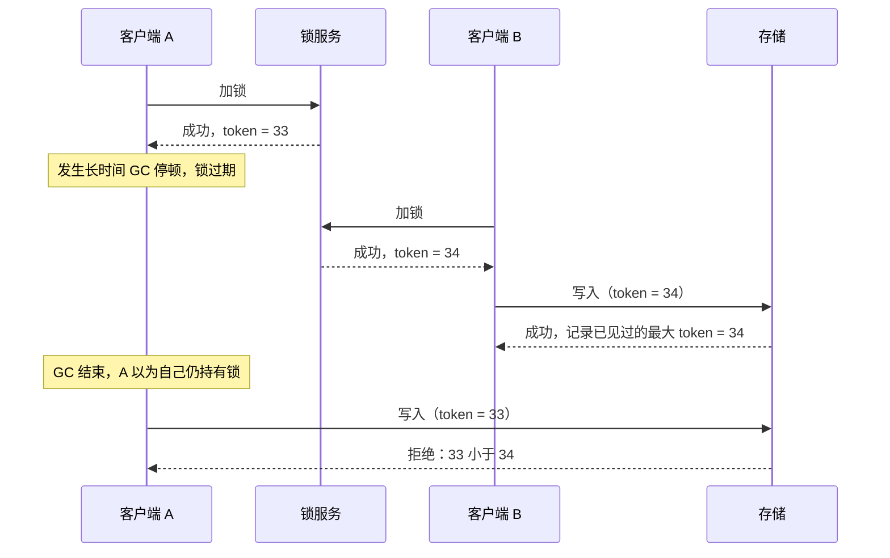

---

### 09-15 Redis、ZooKeeper、etcd 实现分布式锁有何不同？

> ★★ ｜ 资深 / 架构师 ｜ 高频

**考察意图**：能否根据一致性、性能和运维成本做选择。

**30 秒版回答**

| 维度 | Redis（Redisson） | ZooKeeper（Curator） | etcd |
| --- | --- | --- | --- |
| 一致性 | 异步复制，主从切换可能丢锁 | ZAB 协议，写入多数派后才成功 | Raft，写入多数派后才成功 |
| 锁的释放 | 过期时间 + 看门狗续期 | **临时节点**：客户端会话断开后自动删除 | **租约**（Lease）到期自动删除，客户端需要续约 |
| 等待方式 | 发布订阅通知 + 重试 | 监听前一个顺序节点的删除事件（没有惊群效应） | 监听比自己 revision 小的前一个 key |
| fencing token | 需要自己实现 | 顺序节点的序号 | revision |
| 性能 | 高 | 较低（写入需要多数派确认） | 中等 |
| 适用 | 高并发、对偶发失效能容忍（或有存储层兜底） | 对正确性要求高，已有 ZooKeeper 的环境 | Kubernetes 生态、云原生环境 |

**深入剖析**

ZooKeeper 公平锁的实现：

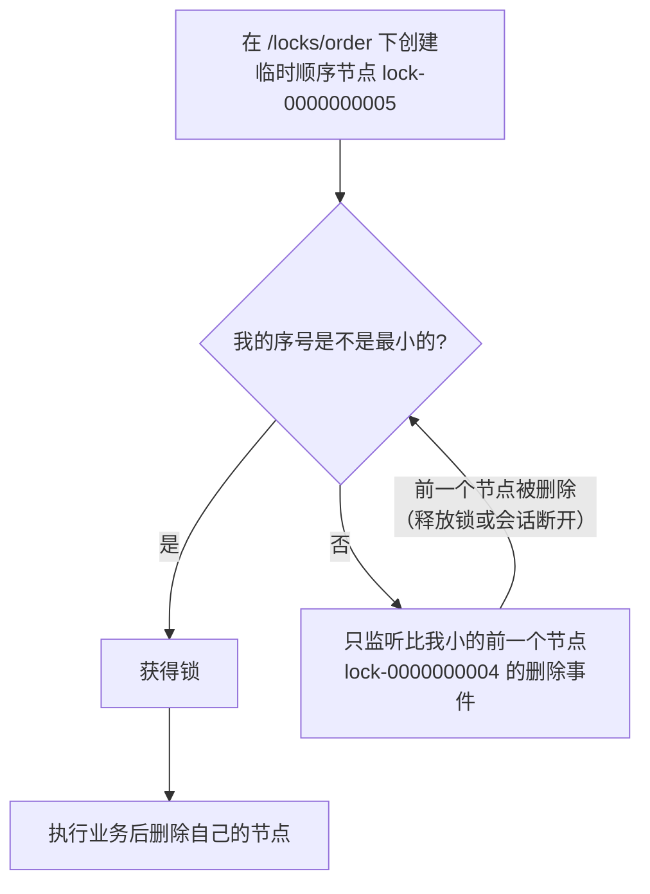

只监听前一个节点，而不是监听锁节点本身，避免了锁释放时所有等待者被同时唤醒的**惊群效应**。Curator 的 `InterProcessMutex` 就是这样实现的，见[《14 ZooKeeper》](14-ZooKeeper.md)。

**追问链**

1. **ZooKeeper 的临时节点一定安全吗？**
   客户端发生长时间 GC 停顿，会话超时后临时节点被删除，别人获得锁，而这个客户端恢复后可能还没意识到会话已经失效。仍然需要 fencing token 兜底。

---

## 五、ID、幂等与调用

### 09-16 分布式 ID 有哪些生成方案？雪花算法如何处理时钟回拨？

> ★★★ ｜ 资深 ｜ 高频

**考察意图**：能否比较各方案的优劣，并讲清雪花算法的位结构和时钟回拨问题。

**30 秒版回答**

| 方案 | 优点 | 缺点 |
| --- | --- | --- |
| UUID | 本地生成，无依赖 | 128 位，太长；无序，作为 InnoDB 主键会导致页分裂、写入性能差 |
| 数据库自增 | 简单，严格递增 | 单点瓶颈；分库分表后需要设置不同的起始值和步长，扩容困难；ID 连续，容易被猜出业务量 |
| 号段模式（美团 Leaf-segment、滴滴 TinyID） | 每次从数据库取一段（如 1000 个）在内存中分配，性能高；配合双缓冲预加载 | 依赖数据库；服务重启会浪费未用完的号段；ID 不是严格连续 |
| **雪花算法** | 本地生成、趋势递增、性能高 | **依赖时钟**，时钟回拨会产生重复 ID；需要分配机器 ID |
| Redis INCR | 简单、递增 | 依赖 Redis 的持久化，宕机可能导致 ID 重复 |

- 雪花算法的 64 位结构：1 位符号位（固定为 0）+ **41 位时间戳**（毫秒，可用约 69 年）+ **10 位机器 ID**（最多 1024 个节点）+ **12 位序列号**（每毫秒每个节点最多 4096 个 ID）。
- **时钟回拨**的处理：
  - 回拨幅度很小（比如几毫秒）：**等待**时钟追上上次的时间戳；
  - 回拨幅度较大：拒绝生成并告警，或者切换到备用的机器 ID 继续生成；
  - 另一种思路：**不依赖实时时钟**，启动时取一次时间，之后只在序列号用完时让时间戳"逻辑上"加 1（百度 UidGenerator 的 CachedUidGenerator、一些"借用未来时间"的实现）。
- **机器 ID 的分配**：手工配置容易冲突。可以用 ZooKeeper 的顺序节点、数据库表或 Redis 在启动时申请，Kubernetes 中可以由 StatefulSet 的序号推导。

**深入剖析**

```text
| 0 | 41 位毫秒时间戳（相对自定义纪元） | 10 位机器 ID | 12 位序列号 |
  ^ 符号位，保证 ID 为正数
```

带时钟回拨处理的实现。实测：在 JDK 25 上把时钟改为可注入后运行，验证了四种情况：真实时钟下连续生成 10 万个 ID 唯一且递增；同一毫秒的序列号用完后进入下一毫秒；小幅回拨（3 ms）时等待追平；大幅回拨（100 ms）时抛出异常。

```java
public final class SnowflakeIdGenerator {
    /** 自定义纪元：2024-01-01T00:00:00Z，越晚可用年限越长 */
    private static final long EPOCH = 1704067200000L;
    private static final int WORKER_BITS = 10;
    private static final int SEQUENCE_BITS = 12;
    private static final long MAX_WORKER_ID = (1L << WORKER_BITS) - 1;
    private static final long SEQUENCE_MASK = (1L << SEQUENCE_BITS) - 1;
    /** 可以容忍、通过等待来追平的最大回拨毫秒数 */
    private static final long MAX_BACKWARD_MS = 5;

    private final long workerId;
    private long lastTimestamp = -1L;
    private long sequence = 0L;

    public SnowflakeIdGenerator(long workerId) {
        if (workerId < 0 || workerId > MAX_WORKER_ID) {
            throw new IllegalArgumentException("workerId out of range: " + workerId);
        }
        this.workerId = workerId;
    }

    public synchronized long nextId() {
        long now = System.currentTimeMillis();
        if (now < lastTimestamp) {
            long offset = lastTimestamp - now;
            if (offset > MAX_BACKWARD_MS) {
                throw new IllegalStateException("clock moved backwards " + offset + " ms");
            }
            now = waitUntil(lastTimestamp);            // 小幅回拨：等待时钟追上
        }
        if (now == lastTimestamp) {
            sequence = (sequence + 1) & SEQUENCE_MASK;
            if (sequence == 0) {
                now = waitUntil(lastTimestamp + 1);    // 本毫秒的序列号用完，等待下一毫秒
            }
        } else {
            sequence = 0L;
        }
        lastTimestamp = now;
        return ((now - EPOCH) << (WORKER_BITS + SEQUENCE_BITS)) | (workerId << SEQUENCE_BITS) | sequence;
    }

    private long waitUntil(long target) {
        long now = System.currentTimeMillis();
        while (now < target) {
            Thread.onSpinWait();
            now = System.currentTimeMillis();
        }
        return now;
    }
}
```

**追问链**

1. **雪花 ID 是严格递增的吗？**
   单个节点上是递增的；多个节点之间只是**趋势递增**，同一毫秒内不同节点生成的 ID 没有先后关系。需要全局严格递增时（例如消息序号），只能用中心化的发号器。
2. **ID 传给前端时有什么坑？**
   JavaScript 的 Number 只能精确表示 2⁵³ 以内的整数，64 位的雪花 ID 会丢失精度。后端序列化时要把 Long 转成字符串。

---

### 09-17 如何设计接口的幂等性？

> ★★★ ｜ 资深 / 架构师 ｜ 高频

**考察意图**：能否根据不同的操作类型选择合适的幂等手段，并考虑并发情况。

**30 秒版回答**

- **幂等**：同一个操作执行一次和执行多次，产生的效果相同。网络超时重试、MQ 重复投递、用户重复点击，都要求接口幂等。
- 天然幂等的操作：查询、删除、"设置为某个值"的更新（`SET status = 'PAID'`）。**不幂等的**：插入、"在原值上增减"的更新（`SET balance = balance - 100`）。
- 常用手段：

| 手段 | 做法 | 适用 |
| --- | --- | --- |
| 唯一索引 | 用业务唯一键（订单号、外部流水号）建唯一索引，重复插入会失败 | 创建类操作，最简单可靠 |
| 状态机 + 条件更新 | `UPDATE t SET status = 'PAID' WHERE id = ? AND status = 'UNPAID'`，影响行数为 0 说明已处理 | 状态流转类操作 |
| 乐观锁 | `UPDATE ... SET version = version + 1 WHERE id = ? AND version = ?` | 并发更新同一条数据 |
| 去重表 / Token | 请求前先申请一个 token；执行时用 token 做唯一键插入去重表（或 Redis `SET NX`），成功才执行业务 | 无法用业务数据本身去重的场景，如防止表单重复提交 |
| 防重 + 结果缓存 | 第一次执行完把结果按请求 ID 保存，重复请求直接返回保存的结果 | 需要对重复请求返回同样响应的接口，如支付下单 |

**深入剖析**

用去重表实现幂等时，要注意**去重记录与业务操作必须在同一个本地事务中**：

```java
@Transactional
public PayResult pay(PayCommand cmd) {
    // 1. 插入去重记录（request_id 唯一索引），重复请求在这里抛出 DuplicateKeyException
    try {
        idempotentRecordMapper.insert(new IdempotentRecord(cmd.requestId(), "PAY"));
    } catch (DuplicateKeyException e) {
        return payResultRepository.findByRequestId(cmd.requestId());   // 返回第一次的结果
    }
    // 2. 执行业务；如果失败，事务回滚，去重记录也一起回滚，允许客户端重试
    PayResult result = doPay(cmd);
    payResultRepository.save(cmd.requestId(), result);
    return result;
}
```

如果去重记录放在 Redis 中，而业务数据在数据库中，就会出现"Redis 中标记已处理，但数据库事务回滚了"的不一致，重试的请求也会被错误地拦截。

**追问链**

1. **第一个请求还在执行中，第二个相同的请求到了，怎么办？**
   唯一索引会让第二个请求在插入时阻塞（等待第一个事务的行锁），第一个事务提交后第二个请求报唯一冲突，然后返回第一次的结果。如果第一个请求耗时很长，可以让第二个请求直接返回"处理中"，由客户端稍后查询。

---

### 09-18 远程调用的超时与重试应该怎么设计？

> ★★★ ｜ 架构师 ｜ 高频

**考察意图**：是否理解远程调用的"第三种结果"，以及不当重试可能放大故障。

**30 秒版回答**

- 远程调用有**三种结果**：成功、失败、**未知**（超时）。超时时，请求可能根本没到对方，也可能对方已经执行成功只是响应丢了。所以：
  - 只有**幂等**的操作才能自动重试；
  - 非幂等操作超时后，应该**先查询结果**再决定是否重试（例如支付超时后先查支付状态）。
- **超时时间**的设定：
  - 根据下游的 P99 / P999 延迟设定，而不是拍脑袋；
  - 调用链上**越往下游，超时时间应该越短**，并且整条链路要有总的时间预算（deadline 传递），否则上游已经超时放弃了，下游还在白白执行。
- **重试**的原则：
  - 只对**可重试的错误**重试（超时、连接失败、503），不对业务错误重试（参数错误、余额不足）；
  - 使用**指数退避 + 随机抖动**，避免所有客户端在同一时刻重试；
  - **限制重试的总量**：重试次数上限，以及"重试请求占总请求的比例"上限（重试预算）。否则下游变慢时，上游的重试会让流量成倍增加，把下游彻底压垮（**重试风暴**）；
  - 调用链中**只在一层重试**。如果每一层都重试 3 次，5 层调用最坏会放大到 3⁵ = 243 倍。
- 配合**熔断**：下游持续失败时直接快速失败，不再发起请求和重试，见[《26 高可用》](../06-三高与架构/26-高可用.md)。

**深入剖析**

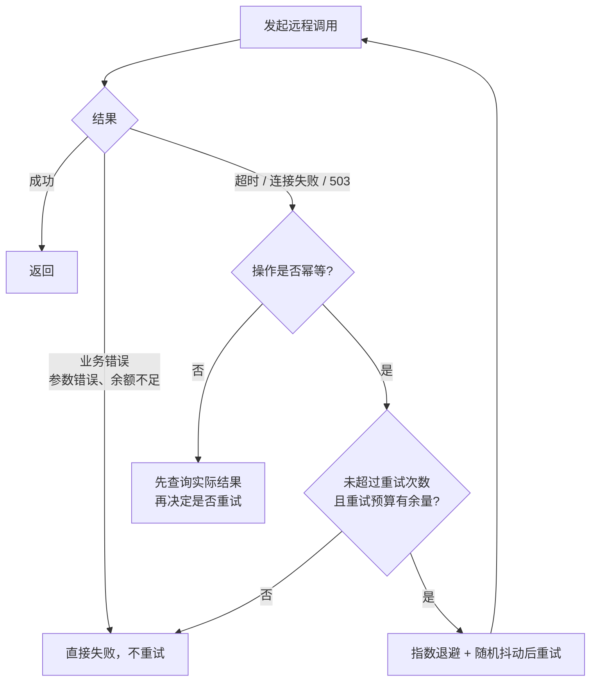

**追问链**

1. **Spring 7 内置的 `@Retryable` 支持这些吗？**
   支持最大重试次数、初始延迟、倍数、最大延迟和随机抖动，以及按异常类型决定是否重试，见[《05 Spring》](../02-框架与容器/05-Spring.md)05-21。但重试预算、熔断需要 Resilience4j、Sentinel 这类组件。

**架构师加分点**

评审调用链时要逐个问：这一跳的超时是多少？谁负责重试？重试几次？操作是否幂等？下游变慢时，上游会不会因为重试而把流量放大？这些问题的答案应该写进接口文档，而不是只存在于开发者的脑子里。

---

### 09-19 一致性哈希的原理与应用

> ★★ ｜ 资深 ｜ 高频

**考察意图**：是否理解一致性哈希解决的问题，以及虚拟节点的作用。

**30 秒版回答**

- **普通取模哈希的问题**：`node = hash(key) % N`，节点数 N 变化时，几乎所有 key 的映射都会改变，缓存会大面积失效。
- **一致性哈希**：把哈希值空间（例如 0 ~ 2³² − 1）组织成一个**环**，节点按哈希值放在环上，key 沿顺时针方向找到的第一个节点就是它的归属。增加或删除一个节点，**只影响环上相邻的一段 key**，平均只有 1/N 的 key 需要迁移。
- **虚拟节点**：节点较少时，它们在环上的分布不均匀，导致数据倾斜；一个节点宕机时，它的全部负载会落到顺时针的下一个节点上。为每个物理节点在环上放置多个（比如 100 ~ 200 个）虚拟节点，可以让数据和故障时转移的负载都更均匀。
- 应用：分布式缓存的客户端分片、负载均衡中的会话保持（Dubbo 的一致性哈希负载均衡）、Cassandra 等分布式存储的数据分片。
- **Redis Cluster 没有使用一致性哈希**，而是固定的 16384 个**哈希槽**：`slot = CRC16(key) % 16384`，槽再分配给节点。迁移时以槽为单位，更容易手动控制，见[《17 Redis》](../04-数据存储/17-Redis.md)。

**深入剖析**

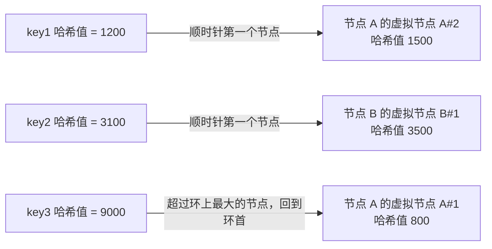

TreeMap 实现哈希环查找的代码见[《02 集合类》](../01-Java核心/02-集合类.md)02-11。

**追问链**

1. **新增节点时，迁移的是哪部分数据？**
   新节点在环上占据的位置，到它逆时针方向前一个节点之间的这段 key，原来属于顺时针方向的下一个节点，现在归新节点。只有这一段需要迁移。
