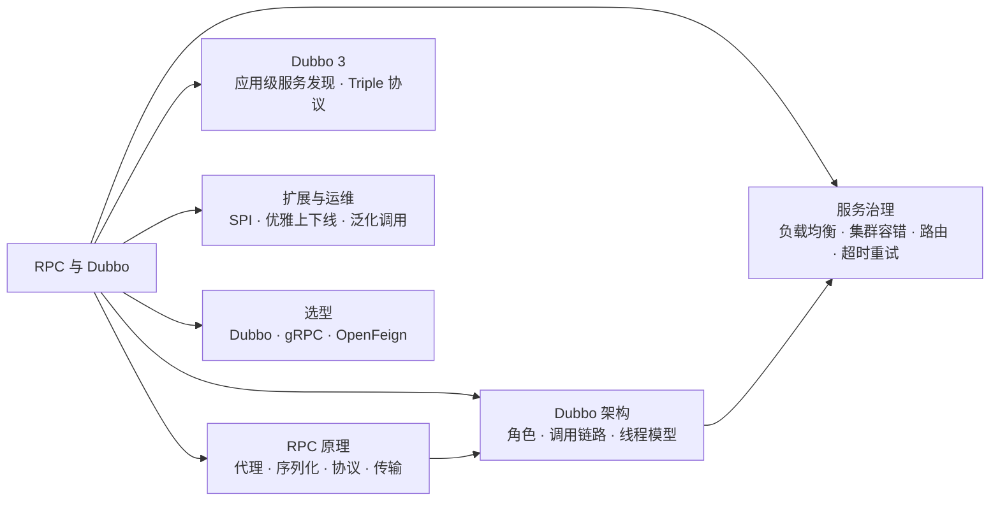
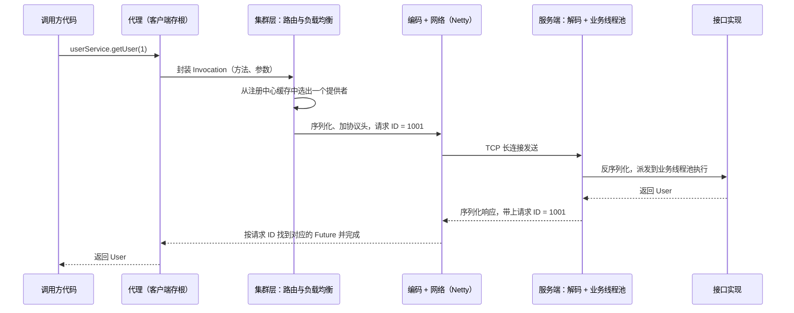
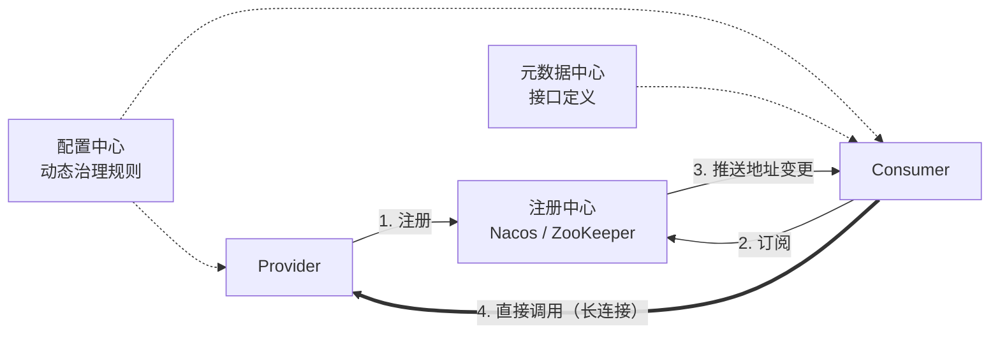
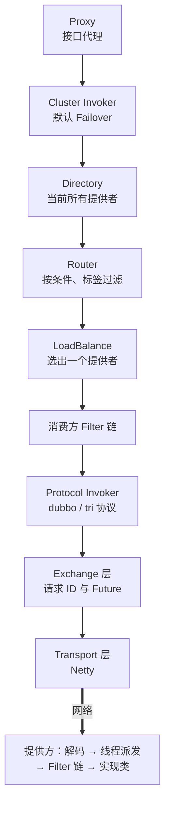
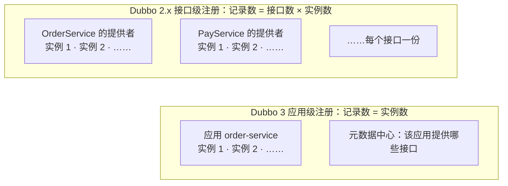
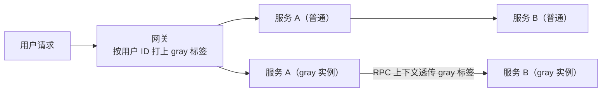

# 10 · RPC 与 Dubbo

> 适用岗位：Java 资深开发 / 架构师
> 版本基线：Apache Dubbo 3.3（Triple X）；Dubbo 2.x 的差异单独标注
> 事实核对：本机没有 Dubbo 的包，版本相关的结论查阅了 Dubbo 官方文档，并在文中附上来源链接
> 相关分类：[《01 Java 基础》](../01-Java核心/01-Java基础.md)（动态代理、SPI、序列化）、[《08 Netty》](../02-框架与容器/08-Netty.md)、[《09 分布式理论》](09-分布式理论.md)（超时重试、幂等、一致性哈希）、[《12 Spring Cloud》](12-SpringCloud.md)

## 知识地图



## 题目索引

| 编号 | 题目 | 难度 | 层级 |
| --- | --- | --- | --- |
| 10-01 | 一次 RPC 调用经历了哪些步骤？ | ★★ | 资深 |
| 10-02 | RPC 和 HTTP 接口有什么区别？ | ★★ | 资深 |
| 10-03 | 序列化协议怎么选？ | ★★ | 资深 |
| 10-04 | 如何设计一个 RPC 通信协议？ | ★★★ | 架构师 |
| 10-05 | Dubbo 的整体架构与核心角色 | ★★ | 资深 |
| 10-06 | Dubbo 一次调用的完整链路 | ★★★ | 资深 |
| 10-07 | Dubbo 3 相比 2.x 有哪些关键变化？ | ★★★ | 架构师 |
| 10-08 | Triple 协议是什么？与 gRPC 是什么关系？ | ★★ | 资深 |
| 10-09 | Dubbo 有哪些负载均衡策略？ | ★★ | 资深 |
| 10-10 | Dubbo 有哪些集群容错策略？ | ★★ | 资深 |
| 10-11 | Dubbo 的线程模型；"线程池耗尽"如何排查？ | ★★★ | 资深 |
| 10-12 | Dubbo 的超时与重试有什么坑？ | ★★ | 资深 |
| 10-13 | Dubbo SPI 的自适应扩展是怎么实现的？ | ★★★ | 资深 |
| 10-14 | 如何用 Dubbo 实现灰度发布和流量治理？ | ★★ | 架构师 |
| 10-15 | 如何实现服务的优雅上下线？ | ★★ | 资深 / 架构师 |
| 10-16 | 什么是泛化调用？有什么用？ | ★★ | 资深 |
| 10-17 | Dubbo、gRPC、OpenFeign 怎么选？ | ★★ | 架构师 |

---

## 一、RPC 原理

### 10-01 一次 RPC 调用经历了哪些步骤？

> ★★ ｜ 资深 ｜ 高频

**考察意图**：能否把 RPC 框架拆解成清晰的分层。

**30 秒版回答**

RPC（远程过程调用）的目标是让调用远程服务像调用本地方法一样。一次调用经过：

1. **代理**：调用方拿到的是接口的动态代理（客户端存根），它把方法名、参数类型、参数值封装成请求对象；
2. **服务发现**：从注册中心获取提供方的地址列表（通常本地缓存，并订阅变化）；
3. **路由与负载均衡**：按路由规则过滤，再从剩下的地址中选一个；
4. **序列化**：把请求对象转换成字节；
5. **协议编码**：加上协议头（魔数、请求 ID、序列化方式、长度等），解决粘包拆包；
6. **网络传输**：通常基于 Netty 的长连接，异步发送；
7. 服务端按相反的顺序：解码、反序列化、找到实现类、**在业务线程池中**执行、把结果编码返回；
8. 客户端通过**请求 ID** 把响应对应到发起请求的那次调用（同一个连接上会同时有很多个请求在途），唤醒等待的线程或完成 Future。

**深入剖析**



**追问链**

1. **同一个连接上同时发出很多请求，响应怎么和请求对应起来？**
   每个请求带一个全局唯一的请求 ID，客户端用一个 Map 保存"请求 ID → Future"。收到响应后按 ID 找到 Future 并完成它，然后从 Map 中移除。超时没有收到响应的，由定时任务（例如时间轮）清理并以超时异常完成。

---

### 10-02 RPC 和 HTTP 接口有什么区别？

> ★★ ｜ 资深 ｜ 高频

**考察意图**：能否说清两者的本质差异，而不是"RPC 更快"。

**30 秒版回答**

- 二者不是同一层面的概念：HTTP 是一种传输协议，RPC 是一种调用方式。gRPC、Dubbo 的 Triple 协议本身就基于 HTTP/2。真正要比较的是"**面向接口的 RPC 框架**"和"**REST 风格的 HTTP 接口**"。
- 差异：

| 维度 | RPC 框架（Dubbo、gRPC） | REST 风格 HTTP（JSON） |
| --- | --- | --- |
| 接口契约 | 强类型（Java 接口或 IDL） | 文档或 OpenAPI 描述 |
| 序列化 | 二进制，体积小、速度快 | 文本 JSON，可读性好 |
| 连接 | 长连接、多路复用 | 取决于客户端，HTTP/1.1 下容易受连接数限制 |
| 服务治理 | 内置服务发现、负载均衡、容错、路由 | 需要额外组件（注册中心、负载均衡器、网关） |
| 跨语言与通用性 | 需要对应语言的客户端 | 任何能发 HTTP 请求的地方都能调用 |
| 调试 | 需要专门的工具 | curl、浏览器即可 |

- 常见做法：**对外**（前端、第三方）用 HTTP + JSON；**内部**服务之间调用频繁、对性能敏感的用 RPC。Dubbo 3.3 的 Triple 协议同一个服务可以同时被 RPC 客户端和普通 HTTP 请求调用，模糊了这条界线，见 10-08。

---

### 10-03 序列化协议怎么选？

> ★★ ｜ 资深 ｜ 高频

**考察意图**：能否从性能、跨语言、兼容性、安全四个维度权衡。

**30 秒版回答**

| 协议 | 体积与速度 | 跨语言 | 字段演进的兼容性 | 安全 | 典型使用 |
| --- | --- | --- | --- | --- | --- |
| JDK 序列化 | 体积大、慢 | 否 | 差 | **反序列化漏洞多** | 不推荐 |
| Hessian2 | 中等 | 有多语言实现 | 较好 | 需要白名单 | Dubbo 协议 |
| Protobuf | 小、快 | 是，基于 IDL | **好**（按字段编号，新增字段向后兼容） | 好 | gRPC、Triple |
| JSON（Jackson / Fastjson2） | 较大 | 是 | 好 | 关闭自动类型识别 | HTTP 接口 |
| Kryo | 小、快 | 主要是 Java | 需要注册类，兼容性较弱 | 需要白名单 | 内部系统、缓存 |

- 选择思路：
  - 跨语言、长期演进：**Protobuf**；
  - 纯 Java、希望无需定义 IDL：Hessian2 或 Fastjson2；
  - 任何会反序列化外部数据的地方，都要启用**类型白名单**，见[《01 Java 基础》](../01-Java核心/01-Java基础.md)01-19。
- Dubbo 的默认序列化有过变化：**3.2 默认改为 fastjson2，3.3.0 又改回 hessian2**。从 3.2 升级到 3.3 时，官方建议显式配置 `prefer-serialization=fastjson2,hessian2` 以保持与 3.2 一致（来源：[Dubbo 3.1 升级到 3.2](https://cn.dubbo.apache.org/en/overview/mannual/java-sdk/reference-manual/upgrades-and-compatibility/version/3.1-to-3.2-compatibility-guide/)、[Dubbo 3.2 升级到 3.3](https://cn.dubbo.apache.org/en/overview/mannual/java-sdk/reference-manual/upgrades-and-compatibility/version/3.2-to-3.3-compatibility-guide/)）。Dubbo 3.2 起对 Hessian2 和 Fastjson2 默认启用了类的白名单校验（来源：[Dubbo 序列化安全说明](https://dubbo.apache.org/en/overview/notices/serialization)）。

**追问链**

1. **给 DTO 新增一个字段，老版本的调用方会出问题吗？**
   Protobuf 中新增字段（使用新的编号）是向后兼容的，旧版本会忽略不认识的字段；Hessian2 和 JSON 一般也能容忍新增字段。但**删除字段、修改字段类型、修改 Protobuf 的字段编号**都可能导致不兼容。接口演进的规则应当写进团队规范：只增不删，删除前先标记废弃并确认没有调用方在用。

---

### 10-04 如何设计一个 RPC 通信协议？

> ★★★ ｜ 架构师 ｜ 中频

**考察意图**：能否设计一个可扩展、可演进的二进制协议。

**30 秒版回答**

一个典型的协议头（参考 Dubbo 协议的设计）：

| 字段 | 长度 | 作用 |
| --- | --- | --- |
| 魔数 | 2 字节 | 快速识别是不是本协议的报文，过滤非法连接 |
| 版本号 | 1 字节 | 协议升级时新旧版本共存 |
| 标志位 | 1 字节 | 请求 / 响应、单向调用、心跳包、序列化方式 |
| 状态码 | 1 字节 | 响应的状态（成功、超时、服务端错误等） |
| 请求 ID | 8 字节 | 匹配请求与响应 |
| 消息体长度 | 4 字节 | 解决粘包拆包 |
| 扩展头（可选） | 变长 | 链路追踪 ID、调用方应用名、灰度标签等，用键值对表示 |
| 消息体 | 变长 | 序列化后的数据 |

- 设计要点：
  - **可演进**：有版本号；扩展信息放在变长的键值对中，而不是固定字段，新增元数据不需要升级协议；
  - **自描述**：标志位中带上序列化方式，服务端据此选择反序列化器；
  - **安全**：限制消息体的最大长度，防止恶意超大报文，见[《08 Netty》](../02-框架与容器/08-Netty.md)08-10；
  - **支持多种调用模式**：同步、异步、单向（不需要响应）、流式。

**追问链**

1. **为什么新一代协议（gRPC、Triple）都基于 HTTP/2？**
   HTTP/2 自带多路复用、流控、头部压缩、流式传输，并且能被网关、负载均衡、服务网格等基础设施直接识别和处理，不需要为私有协议开发专门的插件。代价是比精简的私有二进制协议多一些开销。

---

## 二、Dubbo 架构

### 10-05 Dubbo 的整体架构与核心角色

> ★★ ｜ 资深 ｜ 高频

**考察意图**：是否清楚各个角色的职责，以及注册中心宕机时会发生什么。

**30 秒版回答**

- **Provider**：服务提供者，启动时向注册中心注册；
- **Consumer**：服务消费者，启动时订阅需要的服务，拿到地址列表后**直接与 Provider 建立连接**调用，调用不经过注册中心；
- **Registry**：注册中心（Nacos、ZooKeeper），负责地址的注册与变更通知；
- **Config Center**：配置中心，存放动态的治理规则（路由、权重、超时）；
- **Metadata Center**：元数据中心，存放接口的方法定义等元数据，Dubbo 3 的应用级服务发现依赖它；
- **Monitor / 可观测性**：调用统计、链路追踪、指标。

**深入剖析**



**追问链**

1. **注册中心宕机了，服务还能调用吗？**
   已经运行的服务可以：消费方在内存中（以及本地文件中）缓存了地址列表，调用本身不经过注册中心。但新上线的提供者无法被发现，下线的提供者也无法被及时剔除，新启动的消费方如果没有本地缓存则无法获取地址。

---

### 10-06 Dubbo 一次调用的完整链路

> ★★★ ｜ 资深 ｜ 高频

**考察意图**：是否读过 Dubbo 源码，能否说清 Cluster、Directory、Router、LoadBalance、Filter、Protocol 各自的位置。

**30 秒版回答**

消费方：

1. **Proxy**：接口的动态代理，把调用封装成 `Invocation`；
2. **Cluster Invoker**：集群容错层，代表"一组提供者"。默认是 `FailoverClusterInvoker`；
   - 从 **Directory**（服务目录，动态维护来自注册中心的提供者列表）获取所有 Invoker；
   - 经过 **Router**（路由规则，如条件路由、标签路由）过滤；
   - 由 **LoadBalance** 选出一个 Invoker；
   - 调用失败时按容错策略处理（例如换一个提供者重试）；
3. **Filter 链**：消费方的过滤器（上下文传递、监控、限流等）；
4. **Protocol Invoker**：按协议（dubbo、tri）编码请求，经 **Exchange** 层（请求-响应模型）和 **Transport** 层（Netty）发送。

提供方：Transport 收到数据 → 解码 → 线程派发（Dispatcher 决定在 IO 线程还是业务线程池执行）→ 提供方的 Filter 链 → 通过反射或生成的 Wrapper 类调用接口实现。

**深入剖析**



**追问链**

1. **Dubbo 的 Filter 有哪些典型用途？**
   上下文和链路追踪 ID 的传递、访问日志、调用统计、限流（例如集成 Sentinel 的 Filter）、权限校验、异常转换。自定义 Filter 通过 SPI 注册，并用 `@Activate` 指定在消费方还是提供方生效以及顺序。

---

### 10-07 Dubbo 3 相比 2.x 有哪些关键变化？

> ★★★ ｜ 架构师 ｜ 高频

**考察意图**：是否理解应用级服务发现解决的规模问题，以及 Triple 协议的定位。

**30 秒版回答**

1. **应用级服务发现**：
   - Dubbo 2.x 是**接口级**注册：每个接口的每个实例都在注册中心写一条记录（包含大量参数的 URL）。一个应用有 100 个接口、部署 100 个实例，就是 1 万条记录。规模一大，注册中心的存储和推送压力巨大；
   - Dubbo 3 改为**应用级**注册：每个实例只注册一条"应用名 + IP + 端口 + 元数据版本"的记录，接口的详细信息放在元数据中，"接口 → 应用"的映射单独存储。注册中心的数据量下降了一到两个数量级，也和 Spring Cloud、Kubernetes 的"以应用（服务）为单位"的模型对齐了；
   - 为平滑迁移，提供方可以同时进行接口级和应用级的双注册，消费方逐步切换订阅方式。
2. **Triple 协议**：基于 HTTP/2、兼容 gRPC，见 10-08。
3. **云原生方向**：支持 Kubernetes 原生的服务发现、无代理（Proxyless）服务网格、更完善的可观测性（指标、链路追踪）。

**深入剖析**



---

### 10-08 Triple 协议是什么？与 gRPC 是什么关系？

> ★★ ｜ 资深 ｜ 中频

**考察意图**：是否了解 Dubbo 新一代协议的定位与能力。

**30 秒版回答**

- Triple 是 Dubbo 3 推出的新一代 RPC 协议：基于 HTTP/2，**完全兼容 gRPC**（gRPC 客户端可以调用 Triple 服务，反之亦然），支持一元调用和流式调用。
- 与 gRPC 相比，它不强制使用 Protobuf 的 IDL，Java 接口可以直接定义服务，对 Java 开发者更友好。
- **Dubbo 3.3 的 Triple X**（2024 年 9 月发布）：
  - 同时支持 **HTTP/1、HTTP/2、HTTP/3**；
  - 支持 **REST 风格**的服务暴露，复用 Triple 的 HTTP 协议栈，同一个服务既能被 RPC 客户端调用，也能被浏览器、curl 直接通过 HTTP 访问，不再需要网关做协议转换；
  - HTTP/3 通过协商启用：客户端先用 HTTP/2，服务端通过 `Alt-Svc` 响应头告知支持 HTTP/3 后再切换，避免 UDP 被网络设备拦截时完全不可用。
  - 来源：[Apache Dubbo 3.3 发布公告](https://dubbo.apache.org/en/blog/2024/09/11/apache-dubbo-3.3-released-triple-x-leads-a-new-era-of-microservices-communication/)、[Triple 3.3 新特性](https://cn.dubbo.apache.org/en/overview/mannual/java-sdk/reference-manual/protocol/triple-3.3)。

**追问链**

1. **已有的 Dubbo 协议服务要不要迁移到 Triple？**
   内部纯 Java、运行稳定的服务没有迁移的紧迫性；需要跨语言、需要被网关或服务网格直接识别、需要流式调用、或者希望同一个服务同时提供 HTTP 访问的，适合使用 Triple。Dubbo 支持同一个服务同时以多种协议暴露，可以逐步迁移。

---

## 三、服务治理

### 10-09 Dubbo 有哪些负载均衡策略？

> ★★ ｜ 资深 ｜ 高频

**考察意图**：能否说出各策略的适用场景。

**30 秒版回答**

| 策略 | 原理 | 适用场景 |
| --- | --- | --- |
| **random**（默认） | 按权重随机 | 通用，调用量大时分布均匀 |
| roundrobin | 平滑加权轮询（避免短时间内连续打到同一台权重高的机器） | 希望请求分布更平均 |
| leastactive | 选择**正在处理的请求数最少**的提供者，相同时按权重随机 | 提供者性能不均，能让慢节点少接请求 |
| shortestresponse | 选择最近一段时间平均响应时间最短的提供者 | 对延迟敏感 |
| consistenthash | 相同参数的请求总是发到同一个提供者（默认按第一个参数哈希，使用虚拟节点） | 提供者有本地缓存，希望提高命中率 |
| adaptive（Dubbo 3） | 基于 P2C（随机选两个，再比较负载），综合延迟和负载自适应选择 | 负载变化大的场景 |

**追问链**

1. **新启动的提供者会被立刻打满吗？**
   Dubbo 有**预热**机制：提供者启动后的一段时间内（默认 10 分钟），权重从较低的值逐渐上升到配置值，让 JIT 编译、缓存、连接池逐步就绪，避免冷启动的实例被大流量打垮。

---

### 10-10 Dubbo 有哪些集群容错策略？

> ★★ ｜ 资深 ｜ 高频

**考察意图**：能否结合幂等性选择容错策略。

**30 秒版回答**

| 策略 | 行为 | 适用 |
| --- | --- | --- |
| **failover**（默认） | 失败后自动切换到其他提供者重试，默认重试 2 次（总共最多调用 3 次） | **幂等**的读操作 |
| failfast | 只调用一次，失败立即报错 | 非幂等的写操作 |
| failsafe | 失败时忽略异常，返回空结果 | 记录审计日志等不重要的操作 |
| failback | 失败后记录下来，后台定时重发 | 消息通知类操作 |
| forking | 同时调用多个提供者，任意一个成功即返回 | 对实时性要求高的读操作，代价是消耗更多资源 |
| broadcast | 逐个调用所有提供者，任意一个失败则整体失败 | 通知所有提供者刷新本地缓存 |

**追问链**

1. **为什么写操作用默认配置会出问题？** 见 10-12。

---

### 10-11 Dubbo 的线程模型；"线程池耗尽"如何排查？

> ★★★ ｜ 资深 ｜ 高频

**考察意图**：是否理解 IO 线程与业务线程的分工，是否处理过线程池耗尽的事故。

**30 秒版回答**

- 提供方有两类线程：
  - **IO 线程**（Netty 的 worker EventLoop）：负责网络读写和编解码；
  - **业务线程池**：执行业务逻辑。默认是**固定大小 200 个线程**、**没有排队队列**（`SynchronousQueue`），线程用完时直接拒绝。
- 由 `dispatcher` 决定哪些事件交给业务线程池：
  - `all`（默认）：请求、响应、连接、断开、心跳全部交给业务线程池；
  - `direct`：全部在 IO 线程中执行（只适合极快、不阻塞的逻辑）；
  - `message`：只有请求和响应交给业务线程池。
- **线程池耗尽**：日志出现 `Thread pool is EXHAUSTED!`，调用方收到 `RejectedExecutionException`。Dubbo 的拒绝策略会顺带把当前的线程堆栈**转储到文件**（默认在用户主目录下），这是排查的第一手资料。
- 排查思路：
  - 看转储文件中业务线程都在做什么：大量线程卡在数据库、下游调用、锁上，说明是**下游慢**导致线程被占住；
  - 判断是突发流量还是慢调用：结合 QPS 和响应时间的监控；
  - 解决：治理慢的依赖（超时、熔断）、为慢接口单独配置线程池（隔离）、提供方限流，而不是盲目调大线程数。

**追问链**

1. **为什么 Dubbo 默认不给业务线程池加队列？**
   RPC 调用方都设置了超时时间，在队列中排队的请求很可能还没开始执行，调用方就已经超时放弃了，执行它们只是在浪费资源。直接拒绝能让调用方尽快失败，并把请求转发给其他提供者（failover）。

---

### 10-12 Dubbo 的超时与重试有什么坑？

> ★★ ｜ 资深 ｜ 高频

**考察意图**：是否遇到过"超时重试导致重复写入"的问题。

**30 秒版回答**

- 默认值：超时 **1000 毫秒**，集群容错为 failover，**重试 2 次**。
- 最常见的事故：**非幂等的写接口使用了默认配置**。提供方处理得慢（比如 1.5 秒），消费方 1 秒时超时，又重试了 2 次，结果提供方执行了 3 次，产生 3 笔订单或扣了 3 次款。
- 正确做法：
  - 写接口设置 `retries = 0`（或使用 failfast），并且**接口本身实现幂等**，见[《09 分布式理论》](09-分布式理论.md)09-17；
  - 超时时间按接口实际的 P99 设定，**消费方的超时时间要小于上游调用方剩余的超时预算**；
  - 超时配置可以在提供方声明（作为默认值传给消费方），消费方的配置优先。
- 超时的语义是"**结果未知**"，不是"失败"：超时后应该查询结果或依靠幂等重试，不能当作失败直接回滚上游。

**深入剖析**

```java
// 写接口：不重试，超时时间按接口的实际耗时设置
@DubboReference(timeout = 3000, retries = 0)
private OrderCommandService orderCommandService;

// 读接口：允许 failover 重试
@DubboReference(timeout = 500, retries = 2)
private OrderQueryService orderQueryService;
```

---

## 四、扩展与运维

### 10-13 Dubbo SPI 的自适应扩展是怎么实现的？

> ★★★ ｜ 资深 ｜ 中频

**考察意图**：是否理解 Dubbo 如何在运行时根据参数选择具体实现。

**30 秒版回答**

- Dubbo SPI 在 JDK SPI 的基础上增加了按名称加载、依赖注入、Wrapper（类似 AOP）和**自适应扩展**，与 JDK SPI 的对比见[《01 Java 基础》](../01-Java核心/01-Java基础.md)01-15。
- **自适应扩展**（`@Adaptive`）解决的问题：一个扩展点（比如 Protocol、LoadBalance）有很多实现，到底用哪一个，要等到**运行时**从调用的 URL 参数中才能知道。
- 实现方式：`ExtensionLoader.getAdaptiveExtension()` 为扩展接口**动态生成一个代理类**（生成源码再编译）。代理类的方法从 URL 中读取指定的参数（例如 `loadbalance=leastactive`），再用这个名称获取真正的扩展实现，然后转发调用。
- 因为 Dubbo 内部用 URL 承载所有配置，自适应扩展让"根据配置选择实现"这件事统一而透明。

**追问链**

1. **Wrapper 类是怎么起作用的？**
   扩展点的实现类中，如果某个类的构造函数接收同一个扩展接口的实例，它就被识别为 Wrapper。加载扩展时，Dubbo 自动用所有 Wrapper 把真正的实现层层包装起来，用来实现通用的增强逻辑（例如 `ProtocolFilterWrapper` 为 Protocol 加上 Filter 链）。

---

### 10-14 如何用 Dubbo 实现灰度发布和流量治理？

> ★★ ｜ 架构师 ｜ 中频

**考察意图**：是否了解路由规则在灰度发布中的应用。

**30 秒版回答**

- **标签路由**：给一部分提供者实例打上标签（例如 `gray`），请求中携带同样的标签时只路由到这些实例；不带标签的请求路由到普通实例。标签可以在入口（网关）根据用户 ID、请求头等规则打上，并通过 RPC 上下文沿调用链**透传**，实现全链路灰度。
- **条件路由**：按消费方、方法、参数等条件过滤提供者，例如"来自应用 A 的请求只调用某个机房的提供者"。
- **权重调整**：动态修改某些实例的权重，逐步把流量切过去。
- 这些规则通过配置中心动态下发，无需重启。

**深入剖析**



**追问链**

1. **全链路灰度中，异步消息怎么处理？**
   标签要写进消息的属性中，消费方根据标签决定由灰度消费者还是普通消费者处理，否则在 MQ 这一环会断开。这也是全链路灰度落地中最容易遗漏的部分。

---

### 10-15 如何实现服务的优雅上下线？

> ★★ ｜ 资深 / 架构师 ｜ 中频

**考察意图**：是否理解发布过程中报错的原因，以及上线和下线各自的要点。

**30 秒版回答**

- **优雅下线**：
  1. 先从注册中心**注销**，等待消费方收到通知并把自己从地址列表中移除（推送有延迟，需要等待一小段时间）；
  2. 不再接收新请求，等待正在处理的请求完成（有超时上限）；
  3. 关闭连接和线程池。
  - Dubbo 通过 JVM 的 ShutdownHook 实现这个过程；在 Spring 中要确保 Dubbo 的关闭与 Spring 容器的关闭顺序正确；在 Kubernetes 中可以在 preStop 中先调用注销接口并等待几秒。
- **优雅上线**：
  1. 应用完全初始化好（缓存预热完成、依赖就绪）之后，才向注册中心注册；可以用**延迟暴露**（`delay` 参数），或者等待就绪探针通过后再注册；
  2. 刚上线时使用**预热权重**，逐步接收流量，见 10-09。

**追问链**

1. **发布时为什么还会有少量调用失败？**
   注册中心推送有延迟，消费方在收到通知之前仍可能调用已经停止的提供者。消费方开启 failover 重试（读接口）、提供方在注销后多等一个推送周期，可以消除大部分这类错误。

---

### 10-16 什么是泛化调用？有什么用？

> ★★ ｜ 资深 ｜ 中频

**考察意图**：是否了解在没有接口 jar 包时如何调用 Dubbo 服务。

**30 秒版回答**

- 泛化调用（`GenericService`）：调用方**不需要依赖提供方的接口 jar 包**，用"接口名 + 方法名 + 参数类型 + 参数值（用 Map 表示 POJO）"的方式发起调用，返回值也以 Map 等通用类型返回。
- 用途：
  - **API 网关**：网关不可能依赖所有后端服务的 jar 包，通过泛化调用把 HTTP 请求转换成 Dubbo 调用；
  - **测试平台、Mock 平台**：在页面上配置接口和参数即可发起调用；
  - 跨语言调用的适配层。
- 缺点：没有编译期的类型检查，参数错误只能在运行时发现；序列化 Map 的开销比直接序列化 POJO 大。Dubbo 3.3 的 Triple 协议可以直接暴露 HTTP 接口，部分网关场景不再需要泛化调用。

---

### 10-17 Dubbo、gRPC、OpenFeign 怎么选？

> ★★ ｜ 架构师 ｜ 高频

**考察意图**：能否结合团队、语言、生态做选型。

**30 秒版回答**

| 维度 | Dubbo 3 | gRPC | Spring Cloud OpenFeign |
| --- | --- | --- | --- |
| 协议 | Dubbo（TCP 私有协议）、Triple（HTTP/2，兼容 gRPC）、REST | HTTP/2 + Protobuf | HTTP + JSON |
| 接口定义 | Java 接口或 IDL | Protobuf IDL | Java 接口 + Spring MVC 注解 |
| 跨语言 | Java 为主，Triple 可跨语言 | 最好 | 任何 HTTP 客户端都能调用 |
| 服务治理 | 内置（负载均衡、容错、路由、灰度） | 较弱，通常依赖服务网格 | 依赖 Spring Cloud 的组件 |
| 性能 | 高 | 高 | 相对较低 |
| 适合 | Java 技术栈为主、服务数量多、需要丰富治理能力 | 多语言团队、云原生、服务网格 | Spring Cloud 生态、服务数量适中、简单直接 |

**架构师加分点**

选型时还要考虑**团队已有的积累和基础设施**：已经有成熟 Dubbo 治理平台的团队，迁移到 HTTP 的收益可能不足以覆盖成本；而新的、多语言的团队，从 gRPC 或 Triple 开始可以少走弯路。无论选哪一种，都应当保证**同一个组织内的内部调用协议尽量统一**，否则网关、监控、灰度等基础设施都要为多套协议各做一份。
