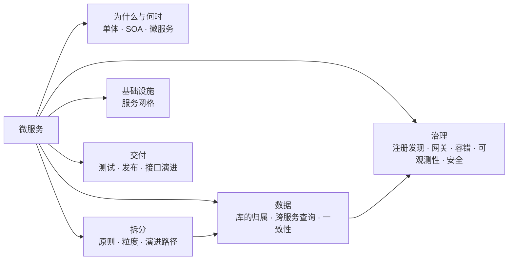
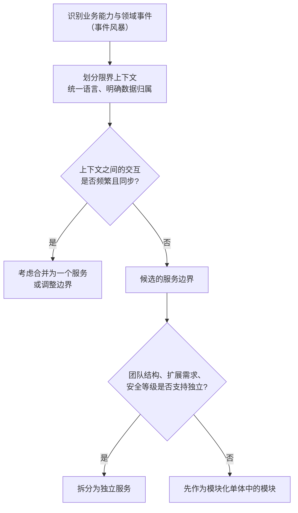
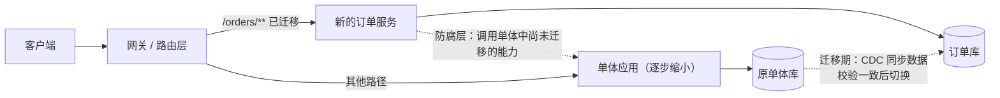
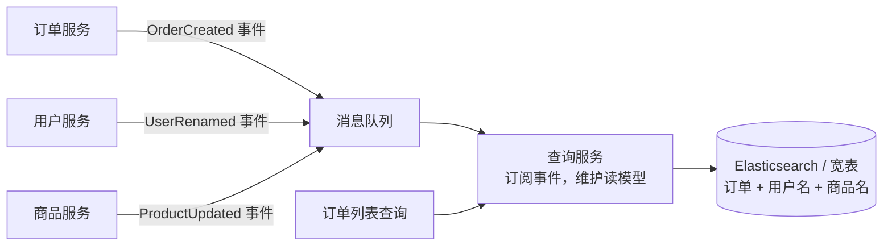
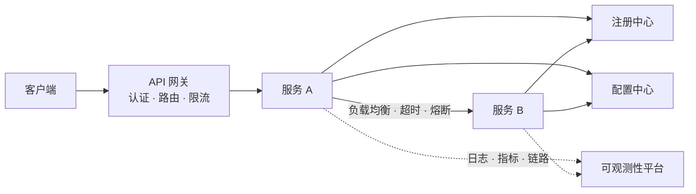
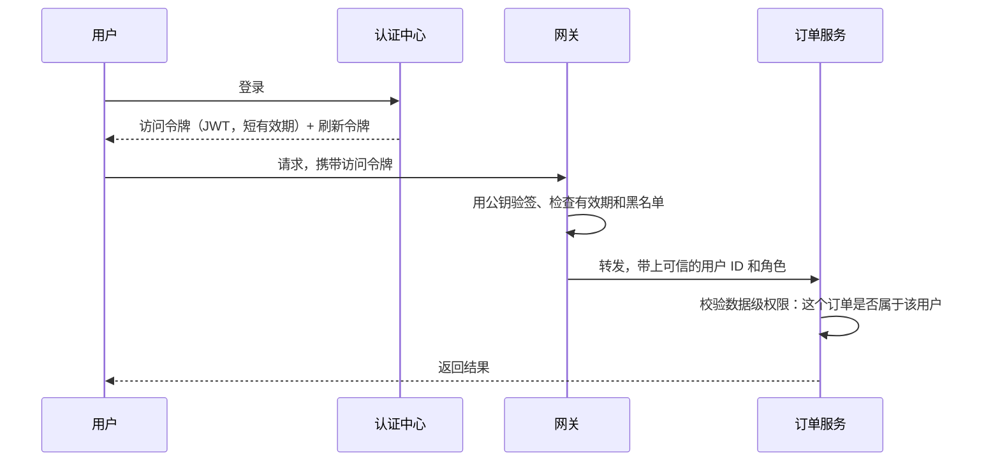

# 11 · 微服务

> 适用岗位：Java 资深开发 / 架构师（本类以架构师视角为主）
> 版本基线：理论与模式不随版本变化；涉及组件时以 Spring Cloud 2025.x、Kubernetes、Istio 当前稳定版为准
> 相关分类：[《09 分布式理论》](09-分布式理论.md)、[《10 RPC 与 Dubbo》](10-RPC与Dubbo.md)、[《12 Spring Cloud》](12-SpringCloud.md)、[《26 高可用》](../06-三高与架构/26-高可用.md)、[《27 DDD》](../06-三高与架构/27-DDD.md)、[《28 架构设计》](../06-三高与架构/28-架构设计.md)、[《32 日志与可观测性》](../07-工程实践与稳定性/32-日志与可观测性.md)

## 知识地图

## 题目索引

| 编号 | 题目 | 难度 | 层级 |
| --- | --- | --- | --- |
| 11-01 | 什么是微服务？什么时候不该用微服务？ | ★★ | 资深 / 架构师 |
| 11-02 | 微服务应该如何拆分？ | ★★★ | 架构师 |
| 11-03 | 拆得太细会怎样？什么是"分布式单体"？ | ★★★ | 架构师 |
| 11-04 | 单体应用如何平滑地演进到微服务？ | ★★★ | 架构师 |
| 11-05 | 微服务的数据怎么管理？跨服务查询怎么做？ | ★★★ | 架构师 |
| 11-06 | 微服务治理包括哪些方面？ | ★★ | 资深 / 架构师 |
| 11-07 | 服务注册与发现有哪些模式？ | ★★ | 资深 |
| 11-08 | API 网关的职责与设计要点 | ★★ | 资深 / 架构师 |
| 11-09 | 服务间通信：同步调用还是异步事件？ | ★★★ | 架构师 |
| 11-10 | 微服务下的认证与授权 | ★★★ | 架构师 |
| 11-11 | 服务网格是什么？Sidecar、Proxyless、Ambient 有什么区别？ | ★★★ | 架构师 |
| 11-12 | 微服务的测试策略与契约测试 | ★★ | 资深 / 架构师 |
| 11-13 | 微服务有哪些发布策略？ | ★★ | 资深 / 架构师 |
| 11-14 | 如何管理接口的兼容性与版本？ | ★★ | 资深 / 架构师 |
| 11-15 | 如何衡量微服务改造是否成功？ | ★★ | 架构师 |

---

## 一、为什么与何时

### 11-01 什么是微服务？什么时候不该用微服务？

> ★★ ｜ 资深 / 架构师 ｜ 高频

**考察意图**：能否客观评价微服务的收益与代价，而不是盲目推崇。

**30 秒版回答**

- 微服务：把一个应用拆成一组**围绕业务能力**组织的小服务，每个服务**独立开发、独立部署、独立扩展**，拥有自己的数据，通过轻量级的网络协议通信。
- 与单体、SOA 的对比：

| 维度 | 单体 | SOA | 微服务 |
| --- | --- | --- | --- |
| 部署单元 | 一个 | 多个，通常较粗 | 多个，较细 |
| 通信 | 进程内调用 | 常借助企业服务总线（ESB），总线承载大量逻辑 | 轻量协议，"智能端点、哑管道" |
| 数据 | 共享一个库 | 常共享数据库 | 每个服务拥有自己的数据 |
| 治理 | 集中 | 集中 | 去中心化，团队自治 |

- 收益：团队可以独立交付；按需扩展热点服务；故障隔离；技术栈可以按服务选择。
- 代价：**分布式系统的全部复杂度**：网络不可靠、分布式事务、数据一致性、调用链排查困难、运维和基础设施成本大幅上升。
- **不该用微服务的情况**：
  - 团队很小（一个团队就能维护整个系统），独立部署的收益不明显；
  - 业务处于早期、边界还不清晰，过早拆分会把错误的边界固化下来；
  - 没有自动化部署、监控、链路追踪等基础设施；
  - 对强一致性的要求贯穿大部分业务。
- 这些情况下，**模块化单体**（一个部署单元，内部按业务模块严格划分边界、模块间只通过接口交互）通常是更好的起点，等边界稳定、团队扩大后再按需拆出服务。

**架构师加分点**

微服务首先是一个**组织问题**，其次才是技术问题。它的核心价值是让多个团队能独立地、高频地交付；如果组织并没有这个需求，就是在为一个不存在的问题支付分布式系统的成本。

---

## 二、拆分

### 11-02 微服务应该如何拆分？

> ★★★ ｜ 架构师 ｜ 高频

**考察意图**：能否给出有依据的拆分方法，而不是"按功能模块拆"。

**30 秒版回答**

- 拆分的依据：
  1. **按业务能力 / DDD 限界上下文拆分**（首要依据）：同一个限界上下文中，术语含义一致、规则内聚。例如"订单"在交易上下文中关注状态流转，在物流上下文中关注收货地址和包裹，它们应当属于不同的服务；
  2. **数据所有权**：每份数据只能有一个服务负责写入，其他服务通过接口或事件获取；
  3. **康威定律**：系统的结构会趋同于组织的沟通结构。服务边界最好与团队边界一致，一个服务只由一个团队负责；
  4. **变化频率与非功能需求**：变化频繁的部分、需要单独扩容的部分（如秒杀）、安全等级不同的部分（如支付），可以单独拆出。
- 好的服务边界的特征：**高内聚、低耦合**。大部分需求变更只需要改一个服务；服务之间的调用以"粗粒度、业务语义明确"的接口为主，而不是频繁的细碎调用。

**深入剖析**

**追问链**

1. **能不能按技术分层拆（比如把所有 DAO 放在一个"数据服务"里）？**
   不能。按技术分层拆分会导致任何一个业务需求都要同时修改多个服务、同步发布，彻底失去独立交付的能力。这是典型的反模式。

---

### 11-03 拆得太细会怎样？什么是"分布式单体"？

> ★★★ ｜ 架构师 ｜ 高频

**考察意图**：是否见过过度拆分的后果。

**30 秒版回答**

- **分布式单体**：系统被拆成了很多服务，但它们之间**高度耦合**：必须一起修改、一起发布，一个服务挂了其他服务都无法工作。它同时拥有单体的耦合和分布式的复杂度，是最差的状态。
- 过度拆分的典型症状：
  - 一个用户请求要经过十几个服务的同步调用，延迟叠加，任何一环出问题整条链路失败；
  - 多个服务共享同一个数据库、同一张表；
  - 服务之间通过共享的"公共 DTO jar 包"紧密绑定，一个字段的修改要所有服务一起升级；
  - 每次需求都需要多个团队协调发布顺序；
  - 服务数量远大于团队人数，每个人维护好几个服务。
- 判断粒度是否合适的问题：这个服务能**独立发布**吗？它有**独立的数据**吗？一个常见的需求变更需要改几个服务？

**架构师加分点**

拆分是可以回退的：发现两个服务总是一起变化、调用非常频繁，就应该**合并**。拆分错误的代价远高于暂时不拆，所以"先粗后细、按需拆分"比一开始就追求细粒度更稳妥。

---

### 11-04 单体应用如何平滑地演进到微服务？

> ★★★ ｜ 架构师 ｜ 高频

**考察意图**：是否有可执行、可回退的迁移方案，而不是"推倒重来"。

**30 秒版回答**

- 不要"大爆炸式"重写，采用**绞杀者模式**（Strangler Fig）：在单体前面加一层路由（网关），把功能**一块一块**迁移到新服务，逐步替换，单体越来越小，直至消失。
- 步骤：
  1. **先在单体内部做模块化**：理清模块边界，消除模块之间直接访问对方数据表的情况，这一步决定了后续拆分的成本；
  2. **选择第一个拆分对象**：边界清晰、依赖少、变化频繁或有独立扩展需求的模块；
  3. 新服务与单体之间加**防腐层**（Anti-Corruption Layer），避免单体中的旧模型污染新服务；
  4. **数据迁移**是最难的部分：先双写或通过 CDC 同步数据，校验一致后切读，最后切写，并保留回滚的能力；
  5. 网关按路径、按用户、按比例把流量切到新服务，出问题时可以迅速切回。
- 每一步都要**可灰度、可回滚**。

**深入剖析**

**追问链**

1. **数据迁移时，双写和 CDC 怎么选？**
   双写需要修改代码，两次写入之间的失败难以处理，容易不一致；CDC（基于 binlog，如 Canal、Debezium）不侵入业务代码，延迟低，更适合大规模迁移。无论哪种方式都要配合**数据校验**，迁移期间持续比对两边的数据。

---

## 三、数据

### 11-05 微服务的数据怎么管理？跨服务查询怎么做？

> ★★★ ｜ 架构师 ｜ 高频

**考察意图**：是否理解"每个服务拥有自己的数据"带来的挑战和对应的模式。

**30 秒版回答**

- 原则：**每个服务拥有自己的数据库（至少是自己的表），其他服务不能直接访问**，只能通过它的接口或它发布的事件获取数据。否则数据结构的修改会影响所有直接访问它的服务，服务之间又耦合在一起了。
- 带来的问题与对应的模式：

| 问题 | 模式 |
| --- | --- |
| 跨服务的事务 | Saga、TCC、可靠消息，见[《09 分布式理论》](09-分布式理论.md)09-08 |
| 跨服务的关联查询（例如订单列表要显示用户名和商品名） | ① **API 组合**：由上层服务分别调用再在内存中组装；② **数据冗余**：订单中冗余保存下单时的商品名、价格快照；③ **CQRS 读模型**：订阅各服务的事件，构建专门用于查询的宽表或搜索索引 |
| 报表与数据分析 | 通过 CDC 把各服务的数据同步到数据仓库，在数仓中做关联分析 |

- 数据冗余要分清"**快照**"和"**引用**"：订单中的商品价格是下单时的快照，本来就不应该随商品价格变化；而用户的昵称是引用，冗余后需要通过事件同步更新，或者接受短暂的不一致。

**深入剖析**

CQRS 读模型：

**追问链**

1. **API 组合的性能问题怎么解决？**
   批量接口（一次查多个 ID，而不是循环调用）、并行调用、合理缓存；对于列表页这类高频、复杂的查询，直接改用 CQRS 读模型。

---

## 四、治理

### 11-06 微服务治理包括哪些方面？

> ★★ ｜ 资深 / 架构师 ｜ 高频

**考察意图**：是否有完整的治理全景图。

**30 秒版回答**

| 方面 | 解决的问题 | 常用组件 |
| --- | --- | --- |
| 服务注册与发现 | 服务实例动态变化时如何找到对方 | Nacos、Consul、Kubernetes Service |
| 配置管理 | 配置集中管理、动态生效 | Nacos、Apollo，见[《13 配置中心》](13-配置中心.md) |
| API 网关 | 统一入口、鉴权、路由、限流 | Spring Cloud Gateway、Higress、APISIX |
| 负载均衡 | 请求分发 | Spring Cloud LoadBalancer、Dubbo |
| 容错 | 超时、重试、熔断、限流、降级、隔离 | Sentinel、Resilience4j，见[《26 高可用》](../06-三高与架构/26-高可用.md) |
| 可观测性 | 日志、指标、链路追踪 | OpenTelemetry、Prometheus、Grafana、ELK，见[《32 日志与可观测性》](../07-工程实践与稳定性/32-日志与可观测性.md) |
| 安全 | 认证授权、服务间通信加密 | OAuth2 / OIDC、JWT、mTLS |
| 发布 | 灰度、蓝绿、回滚 | Kubernetes、服务网格、标签路由 |

**深入剖析**

---

### 11-07 服务注册与发现有哪些模式？

> ★★ ｜ 资深 ｜ 中频

**考察意图**：是否了解客户端发现与服务端发现的区别，以及 Kubernetes 原生方式。

**30 秒版回答**

- **客户端发现**：客户端从注册中心获取实例列表，自己做负载均衡后直接调用。例如 Spring Cloud + Nacos、Dubbo。优点是没有中间转发、负载均衡策略灵活；缺点是每种语言都需要客户端库。
- **服务端发现**：客户端请求一个固定地址（负载均衡器），由它查询注册中心并转发。例如 Kubernetes 的 Service（kube-proxy 基于 iptables / IPVS 转发）、云厂商的负载均衡。优点是客户端简单、与语言无关；缺点是多了一跳，负载均衡策略受限。
- 实例的健康检查：
  - 客户端心跳（Nacos 临时实例、Eureka）：实例主动上报，超时未上报则剔除；
  - 服务端主动探测（Nacos 持久化实例、Consul、Kubernetes 的就绪探针）。

**追问链**

1. **在 Kubernetes 中，还需要 Nacos 这类注册中心吗？**
   如果所有服务都在同一个集群中，且 Kubernetes Service 的负载均衡能力够用，可以直接用 Kubernetes 原生的服务发现。需要跨集群、虚拟机与容器混合部署、精细的负载均衡或标签路由时，仍然需要独立的注册中心（或者使用服务网格）。

---

### 11-08 API 网关的职责与设计要点

> ★★ ｜ 资深 / 架构师 ｜ 高频

**考察意图**：是否清楚网关应该做什么、不应该做什么。

**30 秒版回答**

- 职责：
  - **路由**：按路径、域名、请求头把请求转发到对应的服务；
  - **认证**：校验 Token，把用户身份以可信的请求头传给后端；
  - **限流、熔断**：保护后端；
  - **协议转换**：HTTP 转 RPC（泛化调用、gRPC 转码）；
  - **横切能力**：跨域、请求日志、链路追踪的起点、灰度标签。
- 设计要点：
  - **网关中不放业务逻辑**，只做通用能力，否则会变成新的单体，任何业务变更都要改网关；
  - 网关本身必须**高可用、无状态**，可以水平扩展；
  - 性能敏感，通常基于异步非阻塞的框架（Spring Cloud Gateway 的响应式版本基于 Netty，Higress、APISIX 基于 Envoy、Nginx）；
  - 区分**流量网关**（全局入口：TLS 终止、WAF、全局限流）和**业务网关**（按业务域划分，负责业务相关的路由和鉴权）。
- **BFF**（Backend For Frontend）：为不同的前端（App、Web、小程序）各自提供一层聚合接口，裁剪和组装数据。它属于业务层，不是网关的一部分。

---

### 11-09 服务间通信：同步调用还是异步事件？

> ★★★ ｜ 架构师 ｜ 高频

**考察意图**：能否根据业务语义选择通信方式，并理解编排与协同的取舍。

**30 秒版回答**

| 维度 | 同步调用（RPC / HTTP） | 异步事件（MQ） |
| --- | --- | --- |
| 适用 | 调用方**需要立即得到结果**才能继续 | 调用方只需**通知**别人"发生了什么"，不关心对方何时处理 |
| 耦合 | 时间上耦合：对方必须在线 | 时间上解耦：对方暂时不可用也不影响发布方 |
| 可用性 | 整条调用链的可用性是各环节可用性的乘积 | 发布方的可用性不受下游影响 |
| 一致性 | 更容易推理 | 最终一致，需要处理重复、乱序、丢失 |
| 排查 | 链路清晰 | 链路分散，需要完善的追踪和监控 |

- 原则：**查询用同步，状态变化的通知用异步**。例如下单时查询库存、计算价格是同步的；下单成功后通知积分、物流、营销是异步事件。
- 多个服务参与的业务流程，有两种组织方式：
  - **协同**（Choreography）：各服务订阅事件、自主决定做什么，没有中心。松耦合，但流程分散在各处，难以看清全貌；
  - **编排**（Orchestration）：由一个流程服务（或工作流引擎）明确地依次调用各服务。流程清晰、便于监控和补偿，但编排者知道所有参与者。
  - 流程步骤少、参与者稳定时用协同；流程长、需要补偿、需要可视化监控时用编排，见[《09 分布式理论》](09-分布式理论.md)09-11。

---

### 11-10 微服务下的认证与授权

> ★★★ ｜ 架构师 ｜ 中频

**考察意图**：是否有清晰的安全分层设计。

**30 秒版回答**

- **用户认证**：统一的认证中心（基于 OAuth2 / OIDC，例如 Spring Authorization Server、Keycloak）签发令牌。
- **网关统一校验**：网关校验令牌（JWT 可以用公钥本地校验，不需要每次请求都调用认证中心），把用户 ID、角色等以请求头的形式传给后端；后端**只信任来自网关的请求**（通过网络隔离或服务间认证保证）。
- **授权**：
  - 粗粒度的权限（这个用户能不能访问这个接口）可以在网关做；
  - 细粒度的权限（能不能访问这一条订单）必须由**拥有数据的服务**自己判断。
- **服务间认证**（零信任）：内网也不应该默认信任。服务之间使用 **mTLS**（双向 TLS，通常由服务网格自动完成证书签发和轮换），或者使用 OAuth2 的客户端凭证模式获取服务身份令牌。
- **JWT 的问题**：签发后在有效期内无法撤销。常见做法是使用较短的有效期（如 15 分钟）配合刷新令牌，再加上一份被撤销令牌的黑名单（存在 Redis 中）。

**深入剖析**

---

## 五、基础设施与交付

### 11-11 服务网格是什么？Sidecar、Proxyless、Ambient 有什么区别？

> ★★★ ｜ 架构师 ｜ 中频

**考察意图**：是否了解服务网格的价值、代价和最新演进。

**30 秒版回答**

- 服务网格把服务治理能力（流量路由、负载均衡、重试、熔断、mTLS、可观测性）从应用代码和 SDK 中**剥离到基础设施层**，由**控制平面**（如 Istio 的 istiod）统一下发策略，**数据平面**执行。好处是与语言无关、治理能力统一升级、业务代码不需要引入治理 SDK。
- 三种数据平面形态：

| 形态 | 原理 | 优点 | 代价 |
| --- | --- | --- | --- |
| **Sidecar** | 每个 Pod 注入一个代理（Envoy），拦截所有进出流量 | 能力完整，与应用完全解耦 | 每个 Pod 额外占用 CPU 和内存；多两跳代理，增加延迟；升级代理需要重启 Pod |
| **Proxyless** | 治理能力放在应用的 SDK 中（例如 gRPC、Dubbo 3 直接对接控制平面的 xDS 协议） | 没有额外代理，性能最好 | 依赖特定语言的 SDK |
| **Ambient**（Istio） | 去掉 Sidecar：每个节点一个四层代理（ztunnel）负责 mTLS 和基础的四层能力；需要七层能力时才为某个命名空间或服务部署 waypoint 代理 | 资源开销显著降低，应用升级无需重启 | 七层能力需要额外部署 waypoint |

- Istio 的 Ambient 模式已经正式可用（GA），是目前服务网格降低开销的主要方向。

**追问链**

1. **已经用了 Spring Cloud 或 Dubbo，还需要服务网格吗？**
   如果是单一的 Java 技术栈，SDK 已经满足治理需求，引入服务网格的收益有限，还会增加一套需要运维的复杂系统。多语言、需要统一的零信任安全（mTLS）、需要和 Kubernetes 深度结合时，服务网格的价值才明显。两者同时开启治理功能（比如都做重试）时要避免重复和冲突。

---

### 11-12 微服务的测试策略与契约测试

> ★★ ｜ 资深 / 架构师 ｜ 中频

**考察意图**：是否理解微服务下"集成测试成本高"的问题以及契约测试的作用。

**30 秒版回答**

- 测试金字塔：大量的**单元测试** → 适量的**组件测试 / 集成测试**（服务内部与数据库、MQ 一起测，用 Testcontainers 启动真实的依赖）→ 少量的**端到端测试**。
- 微服务的难点：端到端测试需要启动很多服务，环境不稳定、执行慢、问题难以定位。
- **契约测试**（如 Spring Cloud Contract、Pact）：
  - 消费方把自己"期望的请求和响应"写成契约；
  - 提供方在自己的流水线中用这份契约验证实现，确保修改不会破坏消费方；
  - 消费方用契约生成的桩（Stub）做测试，不需要启动真正的提供方。
  - 这样每个服务都能独立地、快速地验证与其他服务的兼容性。
- 详见[《31 单元测试》](../07-工程实践与稳定性/31-单元测试.md)。

---

### 11-13 微服务有哪些发布策略？

> ★★ ｜ 资深 / 架构师 ｜ 高频

**考察意图**：能否比较几种发布策略的风险与成本。

**30 秒版回答**

| 策略 | 做法 | 优点 | 缺点 |
| --- | --- | --- | --- |
| 滚动发布 | 逐批替换旧版本实例 | 资源开销小，Kubernetes 默认方式 | 发布过程中新旧版本同时在线；回滚也要逐批进行 |
| 蓝绿发布 | 完整部署一套新版本（绿），验证后把流量一次性切过去，旧版本（蓝）保留用于回滚 | 回滚最快，切换干净 | 需要双倍资源；数据库变更要同时兼容两个版本 |
| 金丝雀 / 灰度发布 | 先让一小部分流量（按比例、按用户、按地域）使用新版本，观察指标后逐步扩大 | 风险最小，可以用真实流量验证 | 需要流量控制能力；需要好的监控来判断"是否正常" |
| 全链路灰度 | 灰度流量在整条调用链（包括 MQ）上都只经过灰度版本 | 多个服务同时变更时也能安全验证 | 需要标签在整条链路上透传，实现复杂，见[《10 RPC 与 Dubbo》](10-RPC与Dubbo.md)10-14 |

- 所有发布策略的共同前提：**新旧版本必须能同时正确运行**，即接口和数据都要向后兼容，见 11-14。

---

### 11-14 如何管理接口的兼容性与版本？

> ★★ ｜ 资深 / 架构师 ｜ 中频

**考察意图**：是否有接口演进的规范意识。

**30 秒版回答**

- 核心原则：**提供方的变更必须向后兼容**，因为无法让所有消费方同时升级。
  - 可以做的：新增可选字段、新增接口、新增枚举值（前提是消费方能处理未知的枚举值）；
  - 不可以做的：删除或重命名字段、修改字段类型或含义、把可选字段改为必填。
- 不兼容的变更怎么办：**新增一个版本**（新路径 `/v2/...`、新的接口名、Spring 7 的 API 版本控制），新旧版本并存，监控旧版本的调用量，确认所有消费方迁移后再下线旧版本。
- 消费方要遵守"**宽进**"原则：忽略不认识的字段，对未知的枚举值有兜底处理，不要因为多了一个字段就反序列化失败。
- 数据库的变更同样要分步：先加字段（新旧代码都能运行）→ 发布新代码 → 迁移数据 → 下一个版本再删除旧字段（"扩展-收缩"模式）。

**架构师加分点**

把接口兼容性检查放进流水线：对 OpenAPI 或 Protobuf 定义做自动化的"破坏性变更检测"，提供方的变更破坏了已发布的契约时，流水线直接失败。比依靠代码评审和人的记忆可靠得多。

---

### 11-15 如何衡量微服务改造是否成功？

> ★★ ｜ 架构师 ｜ 中频

**考察意图**：能否用可度量的指标评价架构决策，而不是"拆完了就算成功"。

**30 秒版回答**

- 微服务的目标是**更快、更稳地交付**，所以应当用交付效能和稳定性来衡量，而不是服务的数量。业界常用 **DORA 四个指标**：

| 指标 | 含义 | 改造成功时的趋势 |
| --- | --- | --- |
| 部署频率 | 多久向生产发布一次 | 提高，各团队可以独立、频繁地发布 |
| 变更前置时间 | 代码提交到上线需要多久 | 缩短 |
| 变更失败率 | 发布导致故障或需要回滚的比例 | 降低或持平 |
| 故障恢复时间 | 出现故障后多久恢复 | 缩短，故障被限制在单个服务内 |

- 还可以补充几个架构层面的观察指标：
  - 一个需求平均需要修改几个服务、协调几个团队（越少越好）；
  - 需要多个服务"一起发布"的次数（理想情况下接近 0）；
  - 核心链路的同步调用深度和端到端延迟。
- 如果拆分后这些指标没有改善，甚至恶化（例如发布更频繁地需要多团队协调），说明边界划分有问题，应该回到 11-02、11-03 重新审视。

**架构师加分点**

在改造开始前先采集这些指标的**基线**，改造过程中持续跟踪。用数据回答"值不值得继续拆"，比用技术偏好做决定更有说服力，也更容易获得业务方和管理层的支持。

