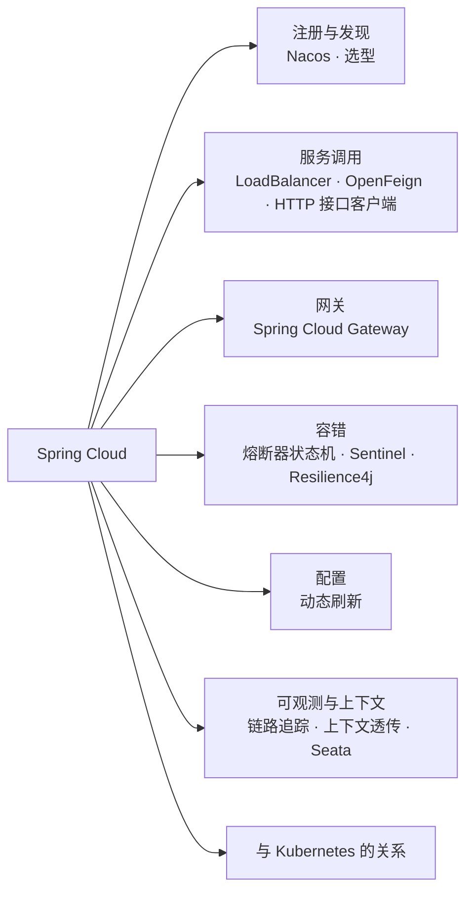
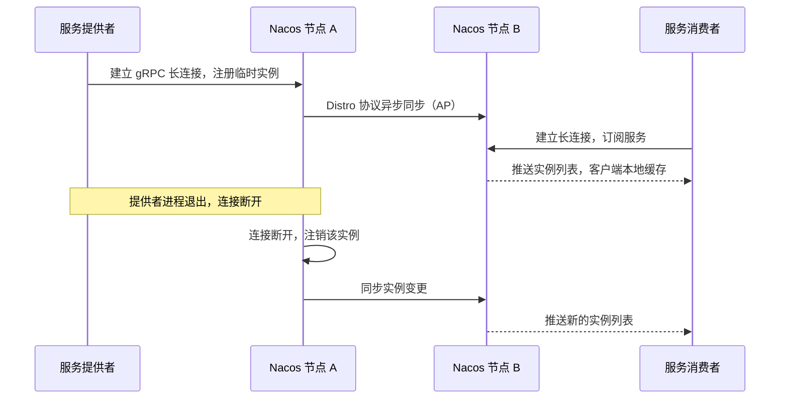
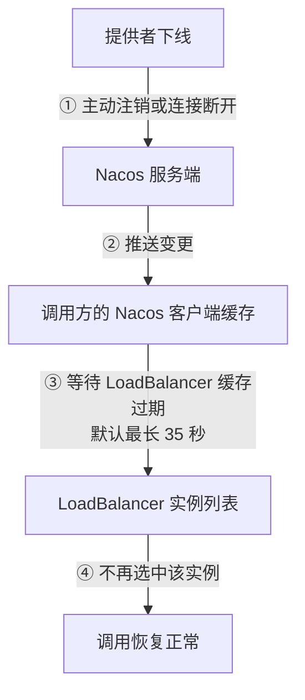
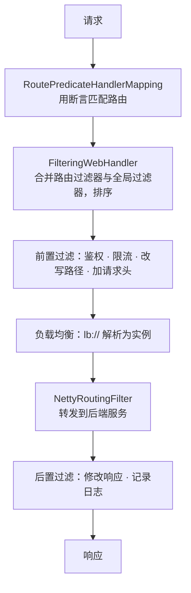
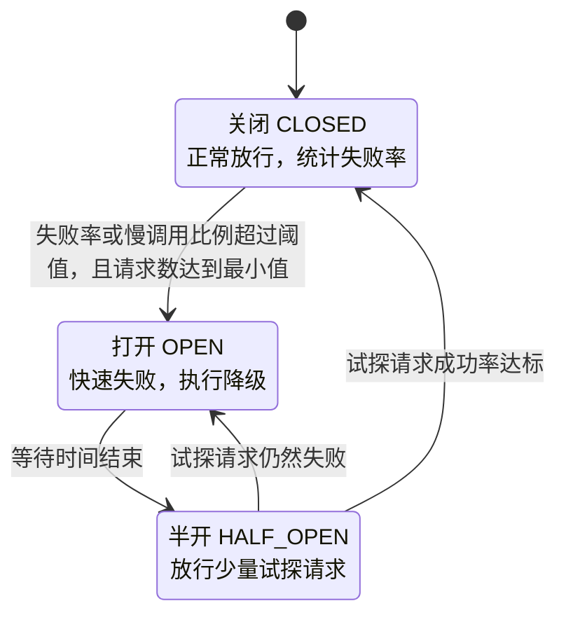
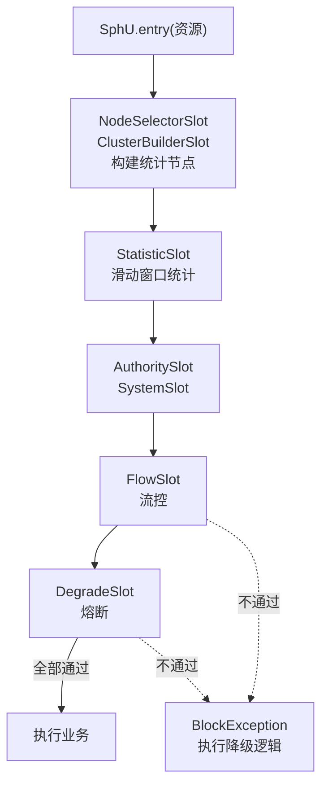

# 12 · Spring Cloud

> 适用岗位：Java 资深开发 / 架构师
> 版本基线：Spring Cloud 2025.1（对应 Spring Boot 4，已核对本机仓库中 `spring-cloud-dependencies` 2025.1.2 管理的 Commons、Gateway、OpenFeign 等组件均为 5.0.2）；Spring Cloud Alibaba + Nacos 2.x / 3.x
> 事实核对：标「已核对」的结论来自本机 Maven 仓库中的 Spring Cloud 依赖管理文件、Spring Cloud LoadBalancer 4.1.4 和 Nacos 客户端 3.0.2（`javap` 与实际运行）；Nacos 3.x 的版本信息查阅了官方发布记录，附有链接
> 相关分类：[《05 Spring》](../02-框架与容器/05-Spring.md)、[《09 分布式理论》](09-分布式理论.md)、[《11 微服务》](11-微服务.md)、[《13 配置中心》](13-配置中心.md)、[《26 高可用》](../06-三高与架构/26-高可用.md)、[《32 日志与可观测性》](../07-工程实践与稳定性/32-日志与可观测性.md)

## 知识地图



## 题目索引

| 编号 | 题目 | 难度 | 层级 |
| --- | --- | --- | --- |
| 12-01 | Spring Cloud 有哪些组件？近几年有什么变化？ | ★★ | 资深 |
| 12-02 | Nacos 注册中心的原理 | ★★★ | 资深 |
| 12-03 | Nacos、Eureka、Consul、ZooKeeper 做注册中心怎么选？ | ★★ | 资深 / 架构师 |
| 12-04 | Spring Cloud LoadBalancer 的原理 | ★★ | 资深 |
| 12-05 | 服务下线后，为什么调用方还会调到它？ | ★★★ | 资深 |
| 12-06 | OpenFeign 的原理与常见问题 | ★★★ | 资深 |
| 12-07 | Spring Cloud Gateway 的工作原理 | ★★★ | 资深 |
| 12-08 | 网关的常见问题与限流实现 | ★★★ | 资深 / 架构师 |
| 12-09 | 熔断器的原理（状态机与滑动窗口） | ★★★ | 资深 |
| 12-10 | Sentinel 的工作原理 | ★★★ | 资深 |
| 12-11 | 配置动态刷新的原理；@RefreshScope 有什么坑？ | ★★★ | 资深 |
| 12-12 | 链路追踪是怎么实现的？ | ★★ | 资深 |
| 12-13 | 微服务调用中如何传递上下文？ | ★★ | 资深 |
| 12-14 | Spring Cloud 中如何集成 Seata？ | ★★ | 资深 |
| 12-15 | 在 Kubernetes 上，还需要 Spring Cloud 吗？ | ★★★ | 架构师 |

---

## 一、全景

### 12-01 Spring Cloud 有哪些组件？近几年有什么变化？

> ★★ ｜ 资深 ｜ 高频

**考察意图**：知识是否停留在 Netflix 全家桶时代。

**30 秒版回答**

- Spring Cloud 是一套**抽象 + 多种实现**：Spring Cloud Commons 定义了服务发现、负载均衡、熔断等接口，不同的子项目提供具体实现。
- 主流组件（2025 年前后）：

| 能力 | 当前主流 | 已退场（Netflix 时代） |
| --- | --- | --- |
| 注册与发现 | Nacos、Consul、Eureka、Kubernetes | — |
| 负载均衡 | **Spring Cloud LoadBalancer** | Ribbon |
| 声明式调用 | OpenFeign、Spring 的 HTTP 接口客户端（`@HttpExchange`） | — |
| 网关 | **Spring Cloud Gateway** | Zuul 1 |
| 熔断与限流 | Spring Cloud CircuitBreaker（Resilience4j）、Sentinel | Hystrix |
| 配置 | Nacos Config、Spring Cloud Config、Apollo | Archaius |
| 链路追踪 | **Micrometer Tracing + OpenTelemetry** | Sleuth、Zipkin 客户端 |

- 几个值得关注的变化：
  - Hystrix、Ribbon、Zuul 等 Netflix 组件在 Spring Cloud 2020.0 中被移除；
  - Spring Boot 3 起，Sleuth 被 Micrometer Tracing 取代；
  - Spring Cloud OpenFeign 已进入"功能完成"状态，只做维护，官方建议新代码考虑 Spring Framework 自带的 HTTP 接口客户端；
  - Spring Cloud Gateway 拆分为基于 WebFlux 和基于 Web MVC 的两种实现，Starter 也改了名（已核对本机仓库中 2025.1 对应的是 `spring-cloud-starter-gateway-server-webflux` 5.0.2）。
- 版本对应：Spring Cloud 2025.1 对应 Spring Boot 4，2025.0 对应 Boot 3.5，2024.0 对应 Boot 3.4。**版本不匹配是启动失败最常见的原因之一**，应当通过 `spring-cloud-dependencies` BOM 统一管理。

---

## 二、注册与调用

### 12-02 Nacos 注册中心的原理

> ★★★ ｜ 资深 ｜ 高频

**考察意图**：能否讲清临时实例与持久化实例、1.x 与 2.x 的通信模型差异，以及 AP/CP 的分工。

**30 秒版回答**

- 两类实例：
  - **临时实例**（默认，`ephemeral = true`）：数据只存在服务端内存中，健康状态由**客户端**维持；集群之间用自研的 **Distro 协议**（AP）同步，每个节点负责一部分数据，异步复制给其他节点；
  - **持久化实例**：数据持久化，健康状态由**服务端主动探测**；集群之间用 **Raft**（基于 JRaft，CP）保证一致。
- 健康检查机制在 1.x 和 2.x 中不同：
  - **Nacos 1.x**：HTTP 短连接 + 客户端定时心跳。心跳间隔 5 秒，15 秒没有心跳标记为不健康，30 秒没有心跳则删除（实测 Nacos 客户端 3.0.2 中的常量 `DEFAULT_HEART_BEAT_INTERVAL = 5000`、`DEFAULT_HEART_BEAT_TIMEOUT = 15000`、`DEFAULT_IP_DELETE_TIMEOUT = 30000`）；
  - **Nacos 2.x 起**：客户端与服务端建立 **gRPC 长连接**，临时实例**与连接绑定**，连接断开即注销实例，不再依赖定时心跳；服务端也通过长连接主动**推送**服务变更。gRPC 端口默认是 HTTP 端口加 **1000**（例如 8848 对应 9848），集群之间的通信端口是加 1001（实测客户端常量 `SDK_GRPC_PORT_DEFAULT_OFFSET = 1000`、`CLUSTER_GRPC_PORT_DEFAULT_OFFSET = 1001`）。部署时要放通这些端口。
- 客户端会把服务列表缓存在内存和本地文件中，注册中心短暂不可用时，已有的服务列表仍然可以使用。
- **Nacos 3.x**：3.0（2025 年 4 月发布）服务端要求 JDK 17，新增了 Admin API，并增加了面向 AI 场景的 MCP 注册中心能力；3.1 起又加入了 Agent（A2A）注册能力。从 2.x 升级时，官方建议先升级到较早的 3.x 版本再继续升级（来源：[Nacos 3.0.0 发布记录](https://newreleases.io/project/github/alibaba/nacos/release/3.0.0)、[Nacos 3.0.1 发布记录](https://newreleases.io/project/github/alibaba/nacos/release/3.0.1)、[Nacos 3.1.1 发布博客](https://nacos.io/blog/release-311-and-252/)、[Nacos 3.3.0 发布记录](https://newreleases.io/project/github/alibaba/nacos/release/3.3.0)）。

**深入剖析**



**追问链**

1. **临时实例和持久化实例怎么选？**
   普通的微服务实例用临时实例：实例的生命周期跟随进程，进程没了就应该消失。数据库、中间件这类不会主动注册的服务，由运维登记为持久化实例，由服务端探测健康状态。

---

### 12-03 Nacos、Eureka、Consul、ZooKeeper 做注册中心怎么选？

> ★★ ｜ 资深 / 架构师 ｜ 高频

**考察意图**：能否从 CAP、功能和生态出发比较。

**30 秒版回答**

| 维度 | Nacos | Eureka | Consul | ZooKeeper |
| --- | --- | --- | --- | --- |
| 一致性 | 临时实例 AP，持久化实例 CP | AP | CP（Raft） | CP（ZAB） |
| 健康检查 | 长连接（2.x）/ 服务端探测 | 客户端心跳 | 服务端多种探测（HTTP、TCP、脚本） | 会话 + 临时节点 |
| 变更通知 | 服务端推送 | 客户端定时拉取（有延迟） | 阻塞查询（长轮询） | Watcher |
| 配置中心 | 有 | 无 | 有（KV） | 可以做，但很原始 |
| 多数据中心 | 支持 | 有限 | 原生支持 | 弱 |
| 生态 | Spring Cloud Alibaba、Dubbo | Spring Cloud Netflix | HashiCorp 生态 | Dubbo、Kafka（旧版）、Hadoop |

- **注册中心更适合 AP**：服务发现的数据短暂不一致（多一个或少一个实例）可以通过客户端重试、熔断来容忍；但注册中心因为分区而**拒绝服务**，会导致新实例无法注册、调用方拿不到地址，影响更大。所以 ZooKeeper 这种 CP 系统做大规模服务发现并不理想。
- 国内 Java 技术栈中，Nacos 同时提供注册和配置，社区活跃，是最常见的选择。

---

### 12-04 Spring Cloud LoadBalancer 的原理

> ★★ ｜ 资深 ｜ 中频

**考察意图**：是否了解它如何获取实例列表、如何选择实例，以及实例缓存。

**30 秒版回答**

- 核心接口：
  - `ServiceInstanceListSupplier`：提供实例列表，通常从 `DiscoveryClient`（Nacos 等）获取，可以层层包装：缓存、健康检查过滤、按区域过滤、同一实例优先（会话保持）等；
  - `ReactorServiceInstanceLoadBalancer`：从列表中选出一个实例。默认是 `RoundRobinLoadBalancer`（轮询），也提供 `RandomLoadBalancer`。
- 使用方式：`@LoadBalanced` 修饰的 `RestClient.Builder` / `WebClient.Builder`，或者 OpenFeign，会在发起请求前把 `http://服务名/...` 中的服务名替换为选中的实例地址。
- **实例列表缓存**：默认使用 Caffeine 缓存实例列表，**TTL 为 35 秒、容量 256**（已核对 Spring Cloud LoadBalancer 4.1.4 中 `LoadBalancerCacheProperties` 的默认值）。这个缓存是"服务下线后仍被调用"的原因之一，见 12-05。
- 每个服务（客户端名称）有独立的子上下文，可以为不同的下游服务配置不同的负载均衡策略。

---

### 12-05 服务下线后，为什么调用方还会调到它？

> ★★★ ｜ 资深 ｜ 高频（发布期间报错的常见原因）

**考察意图**：能否把注册中心、客户端缓存和负载均衡缓存串起来分析。

**30 秒版回答**

一个实例下线后，调用方要经过**多层延迟**才会停止调用它：

1. 提供者进程**没有主动注销**就退出（被强杀），注册中心要等到连接断开或心跳超时才能发现；
2. 注册中心把变更推送给调用方需要时间；
3. 调用方的 **Nacos 客户端缓存**更新后，Spring Cloud LoadBalancer 自己还有一层**实例列表缓存**（默认 35 秒）；
4. 已经建立的连接、正在进行的请求。

解决方法：

- 提供者**优雅下线**：先主动从注册中心注销，再等待一段时间（覆盖推送和缓存刷新的时间），然后才停止 Web 服务器。在 Kubernetes 中通过 preStop 实现，见[《03 Java 并发》](../01-Java核心/03-Java并发.md)03-14；
- 调小 LoadBalancer 的缓存时间，或者在收到注册中心推送时主动刷新缓存（部分集成方案支持）；
- 调用方对**幂等**请求开启失败重试（切换到另一个实例），对连接失败快速重试；
- 新实例上线时配合就绪探针和预热，避免另一个方向的问题（实例注册了但还没准备好）。

**深入剖析**



---

### 12-06 OpenFeign 的原理与常见问题

> ★★★ ｜ 资深 ｜ 高频

**考察意图**：是否了解 Feign 的代理机制，是否踩过超时、重试、首次调用慢等问题。

**30 秒版回答**

- 原理：
  1. `@EnableFeignClients` 扫描带 `@FeignClient` 的接口，为每个接口注册一个 `FeignClientFactoryBean`；
  2. 创建 Bean 时，Feign 用 **JDK 动态代理**生成接口实现；`Contract` 解析接口方法上的 Spring MVC 注解（`@GetMapping`、`@RequestParam`），生成请求模板；
  3. 调用时：按模板构造请求 → 经过 `RequestInterceptor`（加请求头、传递上下文）→ 编码 → 通过 LoadBalancer 选择实例 → 由底层 HTTP 客户端（默认的 JDK HttpURLConnection，生产中通常换成 Apache HttpClient 5 或 OkHttp，以获得连接池）发送 → 解码响应 → 非 2xx 时由 `ErrorDecoder` 转换为异常。
- 常见问题：
  - **超时**：分别配置连接超时和读超时（`spring.cloud.openfeign.client.config.<服务名>.read-timeout`），不要依赖默认值；
  - **重试**：默认的 `Retryer` 是不重试；如果自己开启了重试，非幂等的写接口同样有重复执行的风险；
  - **没有连接池**：默认的 HTTP 客户端每次请求创建连接，高并发下性能差；
  - **第一次调用很慢**：Feign 的子上下文和 LoadBalancer 是懒加载的，首次调用要完成初始化。可以开启预加载（eager-load）；
  - **服务端返回的错误被吞掉或包装成难以理解的异常**：自定义 ErrorDecoder，把下游的错误码转换成本地的业务异常。
- 新项目可以考虑 Spring Framework 的 **HTTP 接口客户端**（`@HttpExchange` + `RestClient`），它是 Spring 官方的声明式客户端，OpenFeign 已进入只维护的状态。

**深入剖析**

```java
// 同样的声明式写法，使用 Spring 官方的 HTTP 接口客户端（Spring 6+）
@HttpExchange("/api/stock")
public interface StockClient {
    @GetExchange("/{skuId}")
    StockDTO query(@PathVariable long skuId);
}

@Configuration
public class ClientConfig {
    @Bean
    public StockClient stockClient(RestClient.Builder loadBalancedBuilder) {
        RestClient restClient = loadBalancedBuilder.baseUrl("http://stock-service").build();
        return HttpServiceProxyFactory.builderFor(RestClientAdapter.create(restClient))
                .build()
                .createClient(StockClient.class);
    }
}
```

（`loadBalancedBuilder` 是带 `@LoadBalanced` 注解定义的 `RestClient.Builder` Bean，请求中的服务名会被 LoadBalancer 解析为实例地址。）

**追问链**

1. **Feign 接口和服务端的 Controller 共用一个接口定义好不好？**
   能减少重复代码，但会把服务端和客户端绑定在同一个 jar 包上，接口的任何改动都要求双方一起升级，还会把服务端的依赖带给客户端。较好的做法是只共享一个轻量的 API 模块（DTO 和接口），并严格遵守向后兼容的规则，见[《11 微服务》](11-微服务.md)11-14。

---

## 三、网关

### 12-07 Spring Cloud Gateway 的工作原理

> ★★★ ｜ 资深 ｜ 高频

**考察意图**：能否讲清路由、断言、过滤器三个核心概念和请求处理流程。

**30 秒版回答**

- 三个核心概念：
  - **路由**（Route）：由 ID、目标地址（`lb://服务名` 表示经过负载均衡）、一组断言和一组过滤器组成；
  - **断言**（Predicate）：判断请求是否匹配这个路由，例如 `Path=/order/**`、`Header=X-Gray, true`、`Weight=group1, 90`；
  - **过滤器**（Filter）：对请求和响应进行处理，分为只作用于某个路由的 `GatewayFilter` 和作用于所有路由的 `GlobalFilter`。
- 处理流程（WebFlux 版本）：
  1. `RoutePredicateHandlerMapping` 遍历路由，用断言找到第一个匹配的路由；
  2. `FilteringWebHandler` 把这个路由的过滤器和全局过滤器合并、按 order 排序，组成过滤器链；
  3. 过滤器的"前置"部分依次执行（鉴权、改写路径、加请求头、限流）；
  4. 负载均衡过滤器把 `lb://` 解析为具体实例，`NettyRoutingFilter` 用 Reactor Netty 的 HTTP 客户端转发请求；
  5. 响应返回后，过滤器的"后置"部分按相反顺序执行。
- 两种实现：基于 **WebFlux** 的版本（Reactor Netty，非阻塞，适合高并发的网关）；基于 **Web MVC** 的版本（Servlet，同步阻塞，配合虚拟线程使用，更容易与现有的 MVC 代码和过滤器集成）。

**深入剖析**



```yaml
spring:
  cloud:
    gateway:
      server:
        webflux:
          routes:
            - id: order
              uri: lb://order-service
              predicates:
                - Path=/api/order/**
              filters:
                - StripPrefix=1
                - name: RequestRateLimiter
                  args:
                    redis-rate-limiter.replenishRate: 100     # 每秒补充 100 个令牌
                    redis-rate-limiter.burstCapacity: 200     # 桶容量，允许的突发流量
                    key-resolver: "#{@userKeyResolver}"       # 按用户维度限流
```

（配置前缀因版本而异：较早的版本是 `spring.cloud.gateway.routes`，新版本按实现分为 `spring.cloud.gateway.server.webflux` 等前缀。以使用版本的官方文档为准。）

---

### 12-08 网关的常见问题与限流实现

> ★★★ ｜ 资深 / 架构师 ｜ 高频

**考察意图**：是否有网关的生产经验，是否理解响应式编程的约束。

**30 秒版回答**

- **在 WebFlux 网关的过滤器中执行阻塞操作**：例如同步调用用户服务校验令牌、同步查数据库。WebFlux 的 EventLoop 线程很少（与 CPU 核数相当），一旦被阻塞，整个网关的吞吐会断崖式下降。正确做法：使用非阻塞的客户端（`WebClient`、响应式 Redis），或者把令牌校验改为本地验签（JWT）。原理同[《08 Netty》](../02-框架与容器/08-Netty.md)08-13。
- **读取请求体导致内存泄漏或请求体丢失**：请求体是一个只能消费一次的流，读取后要缓存起来再传递；读取后的 `DataBuffer` 没有释放会导致堆外内存泄漏。
- **限流**：内置的 `RequestRateLimiter` 基于 **Redis + Lua 实现的令牌桶**，`replenishRate` 是每秒补充的令牌数，`burstCapacity` 是桶的容量；通过 `KeyResolver` 决定按什么维度限流（用户、IP、接口）。也可以集成 Sentinel 做更丰富的流控。
- **超时**：网关需要为每个路由配置连接超时和响应超时，否则后端慢时网关的连接会被耗尽。
- **网关自身的高可用**：无状态、多实例部署在负载均衡之后；配置（路由规则）放在配置中心动态下发。

限流算法的原理与对比见[《26 高可用》](../06-三高与架构/26-高可用.md)。

---

## 四、容错

### 12-09 熔断器的原理（状态机与滑动窗口）

> ★★★ ｜ 资深 ｜ 高频

**考察意图**：能否讲清三种状态之间的转换条件。

**30 秒版回答**

- 熔断器有三种状态：
  - **关闭**（CLOSED）：正常放行请求，同时用**滑动窗口**统计失败率和慢调用比例；
  - **打开**（OPEN）：统计值超过阈值（例如最近 100 次调用中失败率超过 50%），熔断器打开，**所有请求直接快速失败**（或执行降级逻辑），不再调用下游，给下游恢复的时间；
  - **半开**（HALF_OPEN）：打开状态持续一段时间（等待时间）后，放行**少量**试探请求。试探请求成功率达标就回到关闭状态，否则重新打开。
- 滑动窗口有两种：
  - **基于次数**：统计最近 N 次调用；
  - **基于时间**：统计最近 N 秒的调用，通常用环形数组分桶实现，避免保存每一次调用。
- 还需要一个**最小请求数**：窗口中的请求太少时（比如只有 2 次，失败 1 次就是 50%）不做判断，避免误熔断。

**深入剖析**



```java
// Resilience4j 的熔断器配置
CircuitBreakerConfig config = CircuitBreakerConfig.custom()
        .slidingWindowType(CircuitBreakerConfig.SlidingWindowType.COUNT_BASED)
        .slidingWindowSize(100)                          // 统计最近 100 次调用
        .minimumNumberOfCalls(20)                        // 至少 20 次调用才开始计算失败率
        .failureRateThreshold(50)                        // 失败率超过 50% 打开
        .slowCallDurationThreshold(Duration.ofSeconds(1))
        .slowCallRateThreshold(80)                       // 超过 1 秒的慢调用占 80% 也打开
        .waitDurationInOpenState(Duration.ofSeconds(10)) // 打开 10 秒后进入半开
        .permittedNumberOfCallsInHalfOpenState(5)        // 半开状态放行 5 个试探请求
        .build();
```

**追问链**

1. **熔断和降级有什么区别？**
   熔断是**触发条件**（下游不健康时停止调用）；降级是**应对措施**（返回缓存数据、默认值，或者关闭非核心功能）。熔断打开时通常执行降级逻辑，但降级也可以由其他条件触发（例如大促期间主动降级）。见[《26 高可用》](../06-三高与架构/26-高可用.md)。

---

### 12-10 Sentinel 的工作原理

> ★★★ ｜ 资深 ｜ 中频

**考察意图**：是否了解 Sentinel 的 Slot 链和统计结构，以及规则持久化的生产实践。

**30 秒版回答**

- 核心概念：**资源**（被保护的代码，例如一个接口、一个方法）和**规则**（流控、熔断、系统保护、热点参数、授权）。
- 每次进入资源时，请求经过一条 **Slot 责任链**：
  - 构建调用树和统计节点的 Slot（`NodeSelectorSlot`、`ClusterBuilderSlot`）；
  - **`StatisticSlot`**：用**滑动窗口**（`LeapArray`，环形数组分桶）实时统计 QPS、线程数、响应时间、异常数；
  - 规则校验的 Slot：授权、系统保护、**流控**（`FlowSlot`）、**熔断**（`DegradeSlot`）。
  - 任何一个 Slot 判定不通过，抛出 `BlockException`，由降级处理逻辑接管。
- 流控效果：直接拒绝、预热（Warm Up，冷启动时逐步放大阈值）、匀速排队（漏桶式，让请求以固定间隔通过）。
- 熔断策略：慢调用比例、异常比例、异常数。
- **规则持久化**：控制台推送的规则默认只保存在客户端内存中，应用重启就丢失。生产中要把规则存放到 Nacos 等配置中心，控制台修改配置中心中的规则，客户端监听配置中心获取规则（"推模式"）。
- 集群流控：由一个 Token Server 统一发放令牌，实现整个集群的总 QPS 控制。

**深入剖析**



**追问链**

1. **Sentinel 和 Resilience4j 怎么选？**
   Sentinel 功能更全（流控、热点参数、系统自适应保护、集群流控），有可视化控制台，规则可以动态调整，国内使用广泛；Resilience4j 更轻量，以代码配置为主，与 Spring Cloud CircuitBreaker、Micrometer 集成好。需要运营人员实时调整规则时选 Sentinel；只需要熔断和重试时 Resilience4j 足够。

---

## 五、配置、上下文与可观测

### 12-11 配置动态刷新的原理；@RefreshScope 有什么坑？

> ★★★ ｜ 资深 ｜ 高频

**考察意图**：是否理解动态刷新的两种机制及其副作用。

**30 秒版回答**

- 配置中心客户端（Nacos Config 等）监听到配置变化后，更新 Spring 的 `Environment`，并发布 `EnvironmentChangeEvent` 和 `RefreshScopeRefreshedEvent`。之后有两种刷新机制：
  1. **`@ConfigurationProperties` 的 Bean**：会被**重新绑定**属性，Bean 实例不变，字段被更新。这是推荐的方式；
  2. **`@RefreshScope` 的 Bean**：它是一个作用域代理。刷新时，作用域中缓存的 Bean 实例被**销毁**，下一次方法调用时**重新创建**一个新实例，`@Value` 等注入的值因此变成新值。
- `@RefreshScope` 的坑：
  - 刷新后第一次调用要**重新创建 Bean**，如果 Bean 的初始化很重（建立连接池），会造成一次卡顿；
  - Bean 被销毁时，如果它持有线程池、定时任务、连接，处理不当会造成资源泄漏或任务中断；
  - 其他 Bean 持有的是代理，不受影响；但如果某处缓存了它的某个返回值，缓存不会自动更新；
  - 加在 `@Configuration` 类上时，其中定义的所有 Bean 都会受影响，行为难以预期。
- 结论：优先使用 `@ConfigurationProperties`；需要在配置变化时做额外处理（例如调整线程池大小）时，监听 `EnvironmentChangeEvent` 自己处理。

**追问链**

1. **哪些配置不适合动态刷新？**
   数据源地址、端口、线程池的基础结构等需要重建资源的配置，动态刷新风险大，应该通过发布来变更。适合动态刷新的是开关、阈值、限流值、文案等"参数型"配置。见[《13 配置中心》](13-配置中心.md)。

---

### 12-12 链路追踪是怎么实现的？

> ★★ ｜ 资深 ｜ 高频

**考察意图**：是否理解 Trace、Span 和上下文传播。

**30 秒版回答**

- 基本概念：
  - **Trace**：一次完整的请求链路，由全局唯一的 traceId 标识；
  - **Span**：链路中的一个操作（一次 HTTP 调用、一次数据库查询），有自己的 spanId 和父 spanId，记录开始时间、耗时和标签；
  - 所有 Span 按父子关系组成一棵树。
- **上下文传播**：调用下游时，把 traceId 和当前 spanId 放在请求头中传递，标准是 **W3C Trace Context** 的 `traceparent` 请求头；下游从请求头中取出，创建子 Span。MQ 消息则放在消息属性中。
- Spring Boot 3 起，通过 **Micrometer Tracing**（桥接到 OpenTelemetry 或 Brave）实现，自动为 HTTP 服务端与客户端、数据库、MQ 创建 Span，并把 traceId 写入日志的 MDC，使日志可以按 traceId 关联。
- 采集与展示：数据通过 OTLP 协议发给 OpenTelemetry Collector，再存入 Jaeger、Tempo、SkyWalking 等后端。
- 采样：全量采集成本太高，通常按比例采样；也可以使用**尾部采样**（在 Collector 中等整条链路结束后，优先保留出错和慢的链路）。
- 详见[《32 日志与可观测性》](../07-工程实践与稳定性/32-日志与可观测性.md)。

---

### 12-13 微服务调用中如何传递上下文？

> ★★ ｜ 资深 ｜ 高频

**考察意图**：是否处理过用户身份、租户、灰度标签在调用链中丢失的问题。

**30 秒版回答**

- 需要传递的上下文：用户身份、租户 ID、灰度标签、traceId、请求来源等。
- 传递的几个"接力点"：
  1. **进入服务**：在 Filter 或拦截器中从请求头读取，放入当前线程的上下文（ThreadLocal 或 ScopedValue）；
  2. **同步调用下游**：在 Feign 的 `RequestInterceptor`、RestClient 的拦截器、Dubbo 的 Filter 中，从当前上下文取出写入请求头；
  3. **切换线程**：线程池、`@Async`、CompletableFuture 中会丢失，需要用 `TaskDecorator`、TTL 或 Micrometer 的 context-propagation 传递，见[《03 Java 并发》](../01-Java核心/03-Java并发.md)03-19；
  4. **异步消息**：发送时写入消息属性，消费时恢复；
  5. **请求结束**：在 finally 中清理，避免线程池复用导致串号。
- 安全原则：**来自外部的上下文请求头不可信**。网关要清除客户端传入的同名请求头，再写入自己校验过的值；内部服务只信任来自网关或其他内部服务的请求头。

---

### 12-14 Spring Cloud 中如何集成 Seata？

> ★★ ｜ 资深 ｜ 中频

**考察意图**：是否清楚全局事务 ID 在服务之间的传递方式。

**30 秒版回答**

- 发起方的方法加 `@GlobalTransactional`，Seata 向 TC 注册全局事务，得到 **XID**，放入 `RootContext`（线程上下文）。
- 调用下游时，Seata 提供的集成会把 XID 放在请求头中（Feign、RestTemplate 拦截器，Dubbo Filter）；下游的拦截器读取 XID 并绑定到自己的线程上下文中，此后下游的数据库操作就会作为这个全局事务的分支，被 Seata 的数据源代理记录。
- 需要注意：
  - 下游必须使用 Seata 代理的数据源，并建好 `undo_log` 表（AT 模式）；
  - 上下文透传的链路中任何一环断开（例如中间经过了没有集成 Seata 的 HTTP 客户端、或者切换了线程），下游的操作就不在全局事务中；
  - 下游的异常要传递回发起方（不能被吞掉），发起方才会触发全局回滚。
- AT 模式的原理和适用范围见[《09 分布式理论》](09-分布式理论.md)09-12。

---

## 六、云原生

### 12-15 在 Kubernetes 上，还需要 Spring Cloud 吗？

> ★★★ ｜ 架构师 ｜ 高频

**考察意图**：能否分清 Kubernetes 已经提供了哪些能力、哪些仍需要应用层解决。

**30 秒版回答**

| 能力 | Kubernetes 原生方案 | 是否还需要 Spring Cloud |
| --- | --- | --- |
| 服务发现 | Service + DNS | 单集群内通常不需要；跨集群、虚拟机与容器混部时仍需要注册中心 |
| 负载均衡 | kube-proxy（四层，基于连接） | HTTP/1.1 长连接或 gRPC 下，四层负载均衡分布不均，需要客户端负载均衡或服务网格 |
| 配置 | ConfigMap、Secret | 需要动态刷新、灰度推送、版本回滚、权限审计时，配置中心更完善 |
| 健康检查与自愈 | 存活探针、就绪探针、自动重启 | 不需要额外组件 |
| 熔断、限流、重试 | 需要服务网格（Istio） | 没有服务网格时仍需要 Resilience4j / Sentinel |
| 网关 | Ingress / Gateway API | 需要复杂的业务路由、鉴权、协议转换时仍需要业务网关 |
| 链路追踪 | 服务网格可以采集网络层的 Span | 应用内部的 Span（数据库、方法级）仍需要应用侧埋点 |

- 结论：**基础设施层能解决的，交给基础设施**（服务发现、健康检查、自愈）；**与业务语义相关的，仍在应用层**（细粒度的熔断降级、业务路由、上下文传递）。随着 Kubernetes 和服务网格的成熟，Spring Cloud 中真正必须的组件越来越少。
- Spring Cloud Kubernetes 项目可以让 Spring Cloud 的抽象（DiscoveryClient、配置）直接使用 Kubernetes 的 Service 和 ConfigMap，是一种过渡方案。

**架构师加分点**

避免**同一种能力在两层重复实现**：例如服务网格和 SDK 都做重试，叠加之后重试次数被放大；两层都做超时，以较短的那个为准，另一层的配置形同虚设。每种治理能力应当明确由哪一层负责，并写进架构规范。
