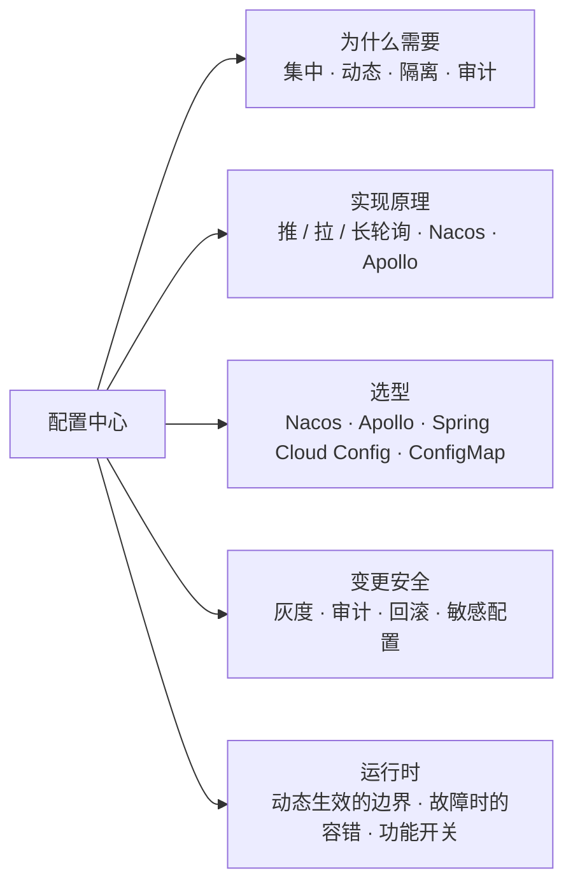
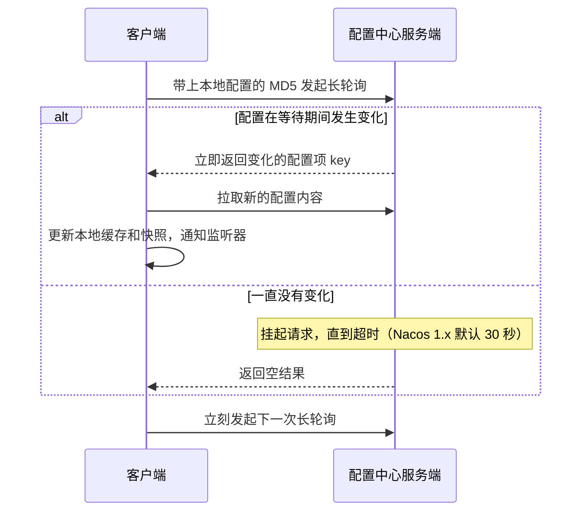
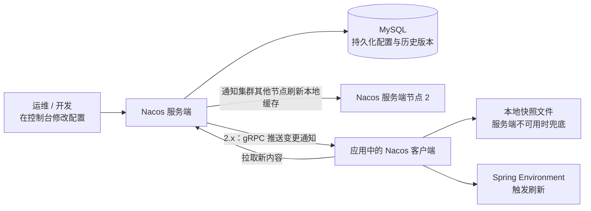
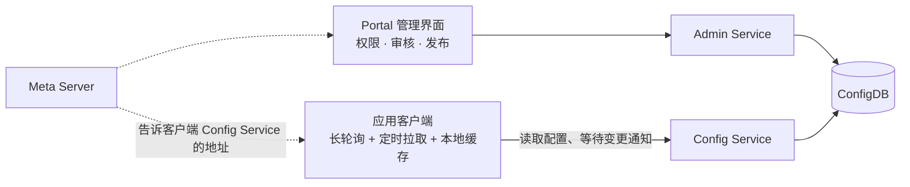
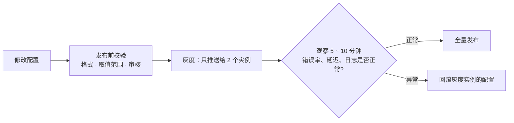

# 13 · 配置中心

> 适用岗位：Java 资深开发 / 架构师
> 版本基线：Nacos 2.x / 3.x、Apollo 2.x、Spring Boot 3 / 4 的 `spring.config.import`
> 事实核对：Nacos 客户端常量来自本机 Maven 仓库中的 nacos-client 3.0.2（`javap -constants` 与实际运行）；Apollo 的机制以其官方设计文档为准
> 相关分类：[《05 Spring》](../02-框架与容器/05-Spring.md)（配置加载优先级）、[《12 Spring Cloud》](12-SpringCloud.md)（动态刷新）、[《39 网络安全》](../08-计算机基础/39-网络安全.md)（密钥管理）

## 知识地图



## 题目索引

| 编号 | 题目 | 难度 | 层级 |
| --- | --- | --- | --- |
| 13-01 | 为什么需要配置中心？ | ★ | 资深 |
| 13-02 | 配置中心推送变更有哪几种方式？ | ★★ | 资深 |
| 13-03 | Nacos 配置中心的原理 | ★★★ | 资深 |
| 13-04 | Apollo 的架构与原理 | ★★★ | 资深 |
| 13-05 | Nacos、Apollo、Spring Cloud Config、ConfigMap 怎么选？ | ★★ | 架构师 |
| 13-06 | Spring Boot 应用如何接入配置中心？ | ★★ | 资深 |
| 13-07 | 多环境、多集群、多租户的配置如何组织？ | ★★ | 资深 / 架构师 |
| 13-08 | 配置如何灰度发布？ | ★★★ | 架构师 |
| 13-09 | 如何保证配置变更的安全？ | ★★★ | 架构师 |
| 13-10 | 密码、密钥等敏感配置怎么管理？ | ★★★ | 架构师 |
| 13-11 | 配置中心不可用时，应用会怎样？ | ★★★ | 资深 / 架构师 |
| 13-12 | 哪些配置适合动态修改？运行时如何安全地生效？ | ★★ | 资深 |
| 13-13 | 如何确认配置已经在所有实例上生效？ | ★★ | 资深 |
| 13-14 | 功能开关（Feature Flag）如何设计与治理？ | ★★★ | 架构师 |
| 13-15 | 配置中心如何做到高可用？ | ★★ | 架构师 |

---

## 一、原理

### 13-01 为什么需要配置中心？

> ★ ｜ 资深 ｜ 高频

**考察意图**：能否说出配置中心解决的具体问题，而不是"方便"。

**30 秒版回答**

传统做法是配置写在 jar 包内的 `application.yml` 或服务器上的配置文件中，带来这些问题：

| 问题 | 配置中心的解法 |
| --- | --- |
| 修改配置需要重新打包、重新发布 | **动态生效**：修改后推送到应用，无需重启 |
| 几十个服务、上百个实例，配置散落各处，难以统一修改 | **集中管理** |
| 开发、测试、生产环境的配置容易混用 | **环境隔离**（命名空间） |
| 谁在什么时候改了什么，无从追溯 | **版本与审计**，可以一键回滚 |
| 一个错误的配置一次性推给所有实例 | **灰度发布**，先推给部分实例验证 |
| 密码明文写在代码仓库中 | 权限控制 + 加密存储 |

---

### 13-02 配置中心推送变更有哪几种方式？

> ★★ ｜ 资深 ｜ 高频

**考察意图**：是否理解推、拉、长轮询的取舍。

**30 秒版回答**

| 方式 | 原理 | 优点 | 缺点 |
| --- | --- | --- | --- |
| 定时拉取 | 客户端每隔一段时间查询一次 | 简单，服务端无状态 | 有延迟；间隔太短会给服务端带来大量无效请求 |
| 推送 | 服务端与客户端保持长连接，配置变化时主动推送 | 实时 | 服务端要维护大量连接；推送失败需要补偿 |
| **长轮询** | 客户端发起请求，服务端**挂起**这个请求：配置变化时立即返回，否则等到超时再返回空结果，客户端随即发起下一次请求 | 接近实时，基于普通 HTTP，实现相对简单 | 服务端要持有大量挂起的请求 |

- 实践中通常组合使用：**长轮询或推送保证实时性 + 定时全量拉取兜底**（防止某次通知丢失）。
- 通知通常只包含"哪个配置变了"，客户端收到通知后再去**拉取**配置内容，这样通知消息很小，内容获取可以单独做缓存和校验。

**深入剖析**

长轮询的过程：



---

### 13-03 Nacos 配置中心的原理

> ★★★ ｜ 资深 ｜ 高频

**考察意图**：能否讲清 Nacos 配置的模型、1.x 与 2.x 的通信差异，以及客户端的本地容错。

**30 秒版回答**

- **数据模型**：`命名空间（Namespace）+ 分组（Group）+ Data ID` 唯一确定一份配置。命名空间通常用于隔离环境或租户，分组用于区分应用或业务，Data ID 是配置文件名（如 `order-service.yaml`）。
- **变更通知**：
  - **Nacos 1.x**：HTTP **长轮询**。客户端把监听的配置及其 MD5 发给服务端，服务端比较 MD5，有变化立即返回，没有变化则挂起，默认超时 **30 秒**（实测 Nacos 客户端 3.0.2 中的常量 `CONFIG_LONG_POLL_TIMEOUT = 30000`，该机制属于 1.x 的 HTTP 模式）；
  - **Nacos 2.x 起**：改为 **gRPC 长连接**，服务端在配置变化时主动推送变更通知，客户端再拉取内容，连接数和延迟都明显改善。
- **客户端容错**：
  - 每次拿到配置后写入**本地快照文件**，服务端不可用时（包括应用启动时）可以从快照中加载；
  - 还支持**故障转移目录**（failover），运维可以在本地手工放置配置文件，优先级高于服务端，用于应急。
- **服务端存储**：配置持久化在数据库中（集群模式下通常是 MySQL），各节点在本地磁盘缓存一份，读请求直接读本地缓存；配置变更后通知集群内其他节点刷新缓存。
- **配置的版本与回滚**：每次发布都有历史版本，可以回滚；支持 Beta 发布（只推送给指定 IP 的实例）。

**深入剖析**



---

### 13-04 Apollo 的架构与原理

> ★★★ ｜ 资深 ｜ 中频

**考察意图**：是否了解 Apollo 的组件划分，以及它在配置治理方面的优势。

**30 秒版回答**

- 组件：
  - **Config Service**：给客户端提供配置读取和变更通知（长轮询）；
  - **Admin Service**：给管理界面提供配置的修改和发布；
  - **Meta Server**：服务发现，告诉客户端和 Portal 去哪里找 Config Service 和 Admin Service（内部基于 Eureka）；
  - **Portal**：管理界面，负责权限、审核、发布流程。
- 客户端机制（据 Apollo 官方设计文档）：
  - 与 Config Service 保持**长轮询**，收到变更通知后立即拉取最新配置；
  - 同时**定时拉取**兜底（默认 5 分钟）；
  - 配置缓存在内存和**本地文件**中，服务端不可用时使用本地文件。
- Apollo 的优势在于**治理能力**：
  - 完善的权限模型（谁能改、谁能发布，可以要求编辑和发布由不同的人完成）；
  - 发布审核、**灰度发布**（按 IP 或标签）、一键回滚；
  - 配置的继承与覆盖（公共配置 + 应用私有配置、集群级覆盖）。

**深入剖析**



---

### 13-05 Nacos、Apollo、Spring Cloud Config、ConfigMap 怎么选？

> ★★ ｜ 架构师 ｜ 高频

**考察意图**：能否结合已有基础设施与治理要求选择。

**30 秒版回答**

| 维度 | Nacos | Apollo | Spring Cloud Config | Kubernetes ConfigMap |
| --- | --- | --- | --- | --- |
| 存储 | 数据库 | 数据库 | Git（也支持其他后端） | etcd |
| 实时性 | 推送（2.x） | 长轮询 | 需要配合 Spring Cloud Bus 才能推送 | 挂载为文件时有分钟级延迟；以环境变量注入时需要重启 Pod |
| 治理能力 | 版本、回滚、Beta 发布 | **最完善**：权限、审核、灰度、回滚、继承 | 依靠 Git 的版本管理和代码评审 | 依靠 Kubernetes 的 RBAC 和 GitOps |
| 附加能力 | 同时是注册中心 | 只做配置 | 与 Git 工作流结合 | 云原生，零额外组件 |
| 适合 | 希望注册与配置一体化、Spring Cloud Alibaba 技术栈 | 对配置治理和审计要求高的大中型团队 | 希望"配置即代码" | 已经全面 Kubernetes 化，配置变化不频繁 |

---

### 13-06 Spring Boot 应用如何接入配置中心？

> ★★ ｜ 资深 ｜ 中频

**考察意图**：是否了解 Spring Boot 2.4 之后的配置导入方式及其优先级。

**30 秒版回答**

- Spring Boot 2.4 起使用 `spring.config.import` 引入外部配置源，取代了早期的 `bootstrap.yml`（以及单独的 Bootstrap 上下文）：

```yaml
spring:
  application:
    name: order-service
  config:
    import:
      - optional:nacos:order-service.yaml?group=ORDER&refreshEnabled=true
      - nacos:common-db.yaml?group=COMMON
  cloud:
    nacos:
      config:
        server-addr: nacos.internal:8848
        namespace: prod
```

- `optional:` 前缀表示配置源不可用时不阻止启动；没有这个前缀时，配置中心连不上应用就启动失败。是否加 `optional:` 取决于"缺少这份配置时应用能否正确运行"，见 13-11。
- 优先级：通过 `spring.config.import` 导入的配置，**优先级高于**导入它的那个文件（例如 jar 包内的 `application.yml`），但仍低于环境变量和命令行参数，见[《05 Spring》](../02-框架与容器/05-Spring.md)05-18。
- 动态刷新的原理和 `@RefreshScope` 的问题见[《12 Spring Cloud》](12-SpringCloud.md)12-11。

---

### 13-07 多环境、多集群、多租户的配置如何组织？

> ★★ ｜ 资深 / 架构师 ｜ 中频

**考察意图**：是否有清晰的配置分层与隔离设计。

**30 秒版回答**

- **环境隔离**：不同环境用不同的命名空间，最好连配置中心本身也按环境独立部署，**生产环境的配置中心与其他环境网络隔离**，避免测试环境的应用误连生产配置。
- **配置分层**（从通用到具体，后者覆盖前者）：
  1. 全公司公共配置（日志格式、监控地址）；
  2. 部门或业务域的公共配置（共享的数据库、MQ 地址）；
  3. 应用配置；
  4. 集群或机房级别的覆盖（不同机房连不同的数据库）；
  5. 实例级别（尽量避免）。
- **命名规范**：Data ID 和分组的命名要有统一的规则（如 `应用名-用途.yaml`），否则配置多了之后无法管理。
- **不要放进配置中心的东西**：大段的业务数据（应该放数据库）、频繁变化的运营数据（应该有专门的后台）、与代码强绑定且需要一起发布的配置（随代码一起发布更安全）。

---

## 二、安全与治理

### 13-08 配置如何灰度发布？

> ★★★ ｜ 架构师 ｜ 中频

**考察意图**：是否意识到"一次错误的配置推送可以瞬间打垮所有实例"。

**30 秒版回答**

- 风险：配置推送是**秒级、全量**的，一个错误的值（比如把超时时间配成 0、把开关配反）会同时影响所有实例，比发布代码更危险。
- 灰度方式：
  - **按实例**：先推送给指定 IP 的少数实例（Nacos 的 Beta 发布、Apollo 的灰度发布），观察日志、指标无异常后，再全量发布；
  - **按标签或比例**：推送给带有某个标签的实例（例如灰度集群）；
  - **按请求维度**：配置本身不灰度，而是在配置值中定义"对哪些用户生效"（这其实是功能开关，见 13-14）。
- 配套能力：发布前的**格式与取值校验**；发布后的**指标监控与自动告警**；**一键回滚**到上一个版本。

**深入剖析**



---

### 13-09 如何保证配置变更的安全？

> ★★★ ｜ 架构师 ｜ 高频

**考察意图**：是否把配置变更当作与代码发布同等重要的生产变更来管理。

**30 秒版回答**

- **权限分离**：编辑和发布权限分开，生产环境的发布需要另一个人审核；按应用和环境细粒度授权。
- **校验**：
  - 配置中心侧：发布前校验格式（YAML、JSON 是否合法）；
  - 应用侧：使用 `@ConfigurationProperties` + `@Validated` 校验取值范围，**校验失败时拒绝本次变更、保留旧值并告警**，而不是带着非法配置运行。
- **审计**：每次修改记录修改人、时间、前后差异。
- **可回滚**：保留历史版本，回滚一键完成。
- **灰度**：见 13-08。
- **变更与监控联动**：配置变更事件推送到监控系统，在指标图上标注出来，出现异常时可以迅速关联到是哪次变更引起的。

**追问链**

1. **如果配置校验放在应用侧，非法配置会怎么样？**
   好的实现应该在刷新时校验新的配置对象，校验失败就拒绝这次刷新并告警，应用继续使用旧配置运行。要避免先把非法值写入正在使用的 Bean、再校验的做法。

---

### 13-10 密码、密钥等敏感配置怎么管理？

> ★★★ ｜ 架构师 ｜ 高频

**考察意图**：是否了解从"加密配置"到"专用密钥管理"的演进。

**30 秒版回答**

- 底线：**敏感信息不能以明文出现在代码仓库、镜像和日志中**。
- 方案（安全性递增）：

| 方案 | 做法 | 问题 |
| --- | --- | --- |
| 配置中心中加密存储 | 用 Jasypt 等工具把密码加密后存放，应用启动时解密 | 解密密钥本身要放在某处（通常是环境变量），只是把问题挪了一步 |
| Kubernetes Secret | 以文件或环境变量注入 | 默认只是 Base64 编码；需要开启 etcd 静态加密，并严格控制 RBAC |
| **专用的密钥管理服务** | HashiCorp Vault、云厂商的 KMS / Secrets Manager。应用通过身份认证（如 Kubernetes ServiceAccount）获取密钥 | 需要额外的基础设施 |
| **动态凭证** | Vault 为每个应用实例临时生成数据库账号，过期自动作废 | 架构复杂度最高，但泄露的影响最小 |

- 配套措施：密钥**定期轮换**，轮换时应用能平滑切换（同时接受新旧两个凭证一段时间）；访问日志审计；日志框架中对敏感字段做脱敏。
- 详见[《39 网络安全》](../08-计算机基础/39-网络安全.md)。

---

## 三、运行时

### 13-11 配置中心不可用时，应用会怎样？

> ★★★ ｜ 资深 / 架构师 ｜ 高频

**考察意图**：是否考虑过配置中心作为强依赖的故障影响。

**30 秒版回答**

- **运行中的应用**：配置已经加载到内存中，配置中心不可用只是无法收到新的变更，业务不受影响。客户端会不断重连。
- **新启动的应用**：
  - 有本地快照的（之前在这台机器上运行过）：可以从快照启动；
  - 全新的实例（容器重新调度后，本地快照不存在）：**会启动失败**，或者在 `optional:` 模式下缺少配置启动，后者可能更危险。
- 也就是说，配置中心的故障会让**扩容和重启**失败。如果恰好在大促扩容时发生，影响很大。
- 应对：
  - 配置中心本身高可用，见 13-15；
  - 关键配置（数据库地址等）有合理的默认值或随镜像打包的兜底文件；
  - 明确区分哪些配置缺失时必须启动失败（快速失败），哪些可以使用默认值；
  - 演练：定期模拟配置中心不可用，验证应用的启动和运行行为。

---

### 13-12 哪些配置适合动态修改？运行时如何安全地生效？

> ★★ ｜ 资深 ｜ 中频

**考察意图**：是否清楚动态刷新的边界。

**30 秒版回答**

- **适合动态修改**：开关、阈值（限流值、超时时间、重试次数）、线程池的核心和最大线程数、文案、黑白名单、灰度比例。
- **不适合动态修改**：数据源地址、端口、连接池的结构性参数、序列化方式、需要重建 Bean 才能生效的配置。这些应该随发布变更，并经过完整的测试。
- 让动态配置安全生效的做法：
  - 使用 `@ConfigurationProperties` 承载配置，读取时**每次从对象上取值**，而不是在初始化时把值拷贝到别的字段中；
  - 需要额外动作的配置（例如线程池大小），监听配置变更事件，**在一个地方集中处理**，并在处理前校验；
  - 一组相关的配置要么一起生效、要么都不生效，避免出现"新的超时时间配上旧的重试次数"这类不一致的中间状态，可以把它们放在同一个配置对象中整体替换。
- 动态调整线程池的示例见[《03 Java 并发》](../01-Java核心/03-Java并发.md)03-13。

---

### 13-13 如何确认配置已经在所有实例上生效？

> ★★ ｜ 资深 ｜ 中频

**考察意图**：是否遇到过"部分实例没有收到配置"的问题。

**30 秒版回答**

- 配置推送可能因为网络问题、客户端异常，在部分实例上没有生效，导致不同实例行为不一致，排查非常困难。
- 确认手段：
  - 配置中心查看**监听者列表**：哪些实例正在监听这份配置、它们当前持有的配置 MD5 是多少（Nacos 控制台提供"监听查询"）；
  - 应用暴露当前生效的配置（Spring Boot Actuator 的 `/actuator/env`、`/actuator/configprops`），由运维平台批量比对；
  - 在应用日志和指标中记录配置版本号，配置变更后检查所有实例上报的版本是否一致。
- 不一致时：触发实例重新拉取，或者重启这些实例。

---

### 13-14 功能开关（Feature Flag）如何设计与治理？

> ★★★ ｜ 架构师 ｜ 中频

**考察意图**：是否理解功能开关在持续交付中的作用，以及开关滥用带来的技术债。

**30 秒版回答**

- 功能开关把"**代码部署**"和"**功能发布**"分开：新功能的代码可以提前上线但默认关闭，之后通过开关按用户、按比例、按地域逐步打开，出问题时立即关闭，无需回滚代码。
- 开关的类型：

| 类型 | 用途 | 生命周期 |
| --- | --- | --- |
| 发布开关 | 控制新功能的逐步放量 | 短期，功能全量后删除 |
| 运维开关 | 降级、熔断非核心功能 | 长期 |
| 实验开关 | A/B 测试 | 实验结束后删除 |
| 权限开关 | 按用户等级或租户开放功能 | 长期 |

- 治理要点：
  - **每个开关都要有负责人和过期时间**，发布开关在功能全量后必须删除，否则代码中会堆积大量永远为 true 的判断，形成技术债；
  - 开关的判断逻辑**集中封装**，不要在业务代码中到处读取配置；
  - 开关打开或关闭时要有审计记录和监控标注；
  - 测试要覆盖开关打开和关闭两种情况。
- 实现：简单的开关可以直接放在配置中心；需要按用户分群、按比例放量、A/B 实验时，使用专门的功能开关平台（如 Unleash、OpenFeature 标准的实现）。

---

### 13-15 配置中心如何做到高可用？

> ★★ ｜ 架构师 ｜ 中频

**考察意图**：能否从服务端集群、存储、客户端容错三个层面回答。

**30 秒版回答**

- **服务端集群**：多节点部署在负载均衡之后（Nacos 集群至少 3 个节点）；跨可用区部署。
- **存储**：配置数据库使用主从或高可用方案；服务端节点在本地缓存全量配置，数据库短暂不可用时读请求仍可以从本地缓存返回。
- **客户端容错**：内存缓存 + 本地快照 + 故障转移目录，见 13-03、13-11。
- **多机房**：每个机房部署独立的配置中心集群，通过同步工具保持一致；机房之间断开时，各机房仍能独立提供配置。
- **容量**：推送风暴（一个被大量应用监听的公共配置发生变化，同时向成千上万个客户端推送）需要做推送限流和分批。

**架构师加分点**

配置中心和注册中心往往是**整个微服务体系的"根依赖"**，它们出问题会让所有服务无法扩容和重启。这类组件的可用性要求应该高于任何业务服务，其变更也要比业务服务更谨慎，并且要定期做故障演练。
