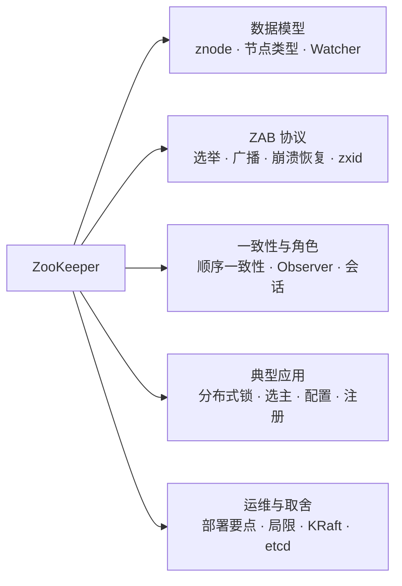
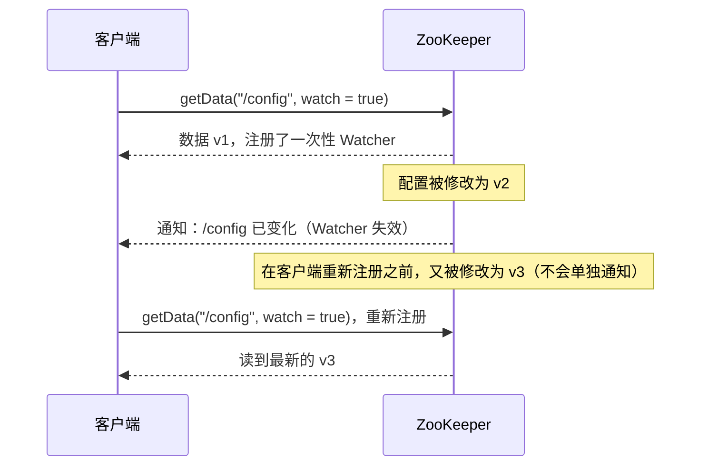
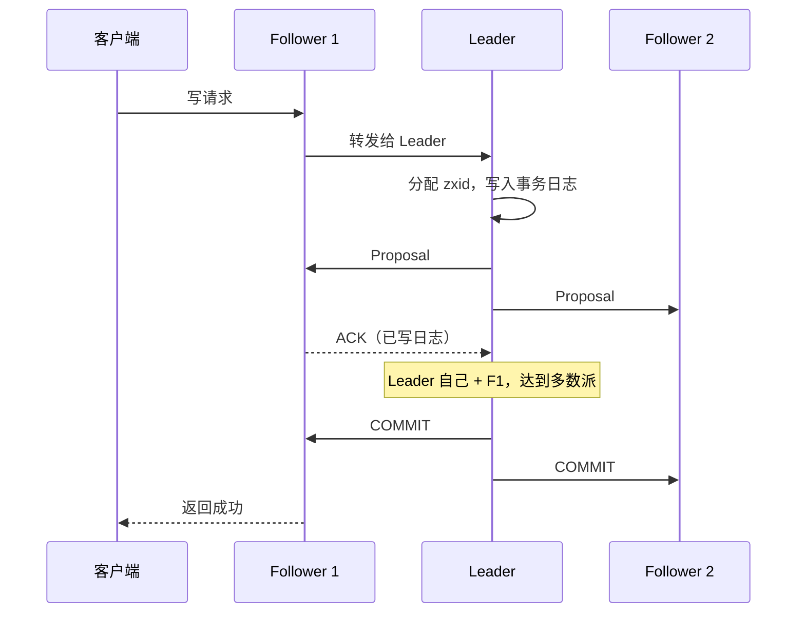
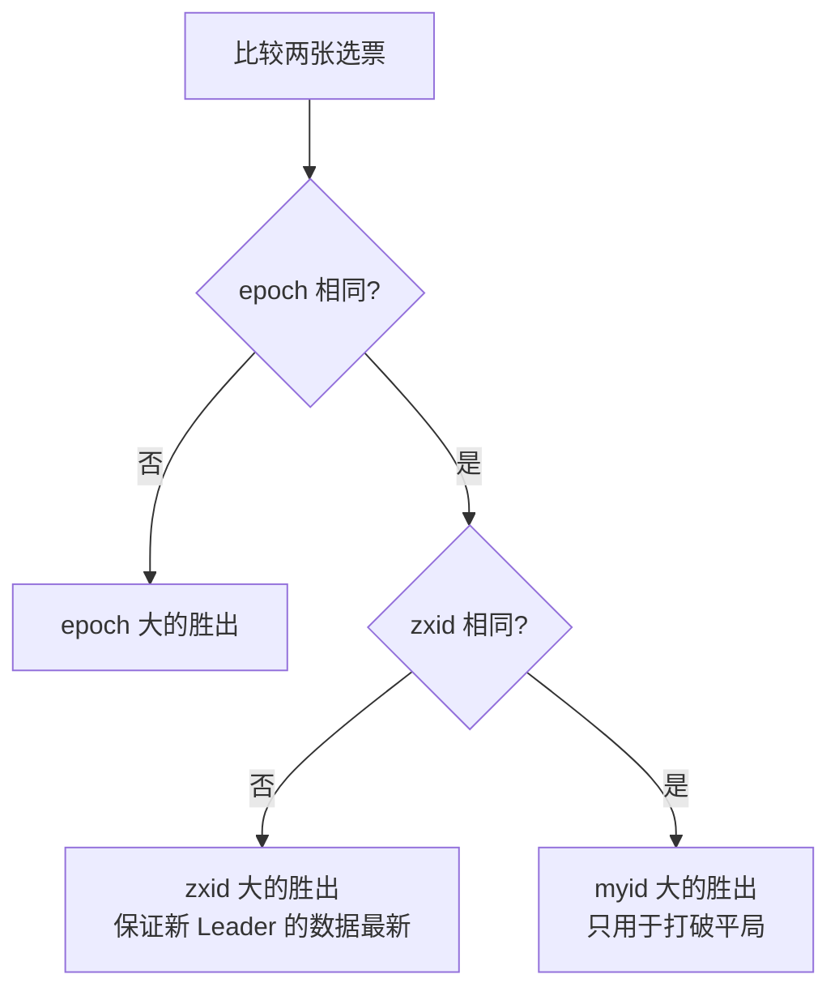
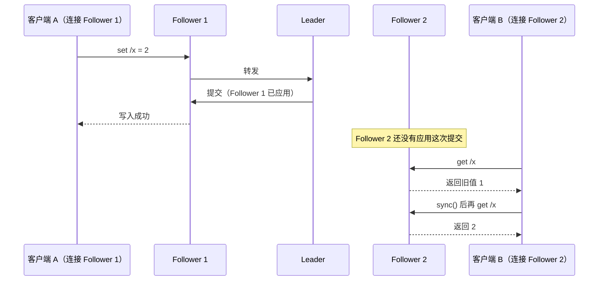
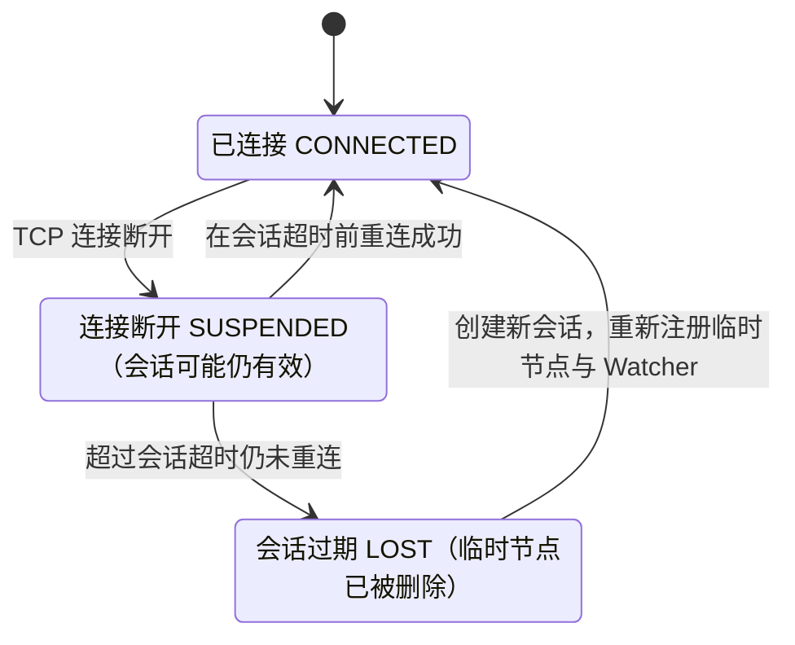

# 14 · ZooKeeper

> 适用岗位：Java 资深开发 / 架构师
> 版本基线：ZooKeeper 3.8.x（最新稳定版）/ 3.9.x（当前版本），Curator 5.x。3.6、3.7 已停止维护（来源：[ZooKeeper 官方发布页](https://zookeeper.apache.org/releases/)、[官方新闻](https://zookeeper.apache.org/news/)）
> 事实核对：Curator 分布式锁的实现细节已核对本机 Maven 仓库中 curator-recipes 5.2.0 的源码
> 相关分类：[《09 分布式理论》](09-分布式理论.md)（共识、分布式锁、fencing token）、[《12 Spring Cloud》](12-SpringCloud.md)（注册中心选型）、[《21 Kafka》](../05-消息队列/21-Kafka.md)（KRaft）

## 知识地图



## 题目索引

| 编号 | 题目 | 难度 | 层级 |
| --- | --- | --- | --- |
| 14-01 | ZooKeeper 是什么？现在还值得学吗？ | ★ | 资深 |
| 14-02 | ZooKeeper 的数据模型与节点类型 | ★★ | 资深 |
| 14-03 | Watcher 机制是怎样的？有什么限制？ | ★★★ | 资深 |
| 14-04 | ZAB 协议是如何工作的？ | ★★★ | 资深 / 架构师 |
| 14-05 | Leader 选举的过程 | ★★★ | 资深 |
| 14-06 | zxid 的结构与作用 | ★★ | 资深 |
| 14-07 | ZooKeeper 提供什么样的一致性？ | ★★★ | 架构师 |
| 14-08 | Leader、Follower、Observer 有什么区别？ | ★★ | 资深 |
| 14-09 | 会话机制：连接断开和会话过期有什么区别？ | ★★★ | 资深 |
| 14-10 | 如何用 ZooKeeper 实现分布式锁？ | ★★★ | 资深 |
| 14-11 | 如何用 ZooKeeper 实现 Leader 选举？ | ★★ | 资深 |
| 14-12 | ZooKeeper 有哪些局限？为什么不适合大规模服务发现？ | ★★ | 架构师 |
| 14-13 | ZooKeeper 的部署与运维要点 | ★★ | 资深 |
| 14-14 | Kafka 为什么去掉了 ZooKeeper？ | ★★★ | 架构师 |
| 14-15 | ZooKeeper 和 etcd 怎么选？ | ★★ | 架构师 |

---

## 一、数据模型

### 14-01 ZooKeeper 是什么？现在还值得学吗？

> ★ ｜ 资深 ｜ 中频

**考察意图**：是否了解 ZooKeeper 的定位与它在当前技术生态中的位置。

**30 秒版回答**

- ZooKeeper 是一个**分布式协调服务**：提供一个类似文件系统的、高可用的、强一致的小型数据存储，加上变更通知（Watcher）机制。分布式系统用它来做**协调**：配置管理、命名服务、分布式锁、Leader 选举、集群成员管理。
- 它的地位正在变化：
  - Kafka 4.0 起**完全移除了 ZooKeeper**，只支持 KRaft 模式，见 14-14；
  - 新的云原生系统更多使用 etcd；
  - 但大量存量系统仍依赖它：Dubbo（作为注册中心之一）、HBase、Hadoop HA、Solr、旧版本的 Kafka 等。
- 学习价值：ZooKeeper 是理解**共识协议（ZAB）、会话、临时节点、Watcher**这些分布式协调基本概念最好的范本，这些概念在 etcd、Nacos、Kafka KRaft 中都能找到对应物。

---

### 14-02 ZooKeeper 的数据模型与节点类型

> ★★ ｜ 资深 ｜ 高频

**考察意图**：是否清楚各类节点的特性，以及它们对应的典型用途。

**30 秒版回答**

- 数据模型是一棵树，每个节点叫 **znode**，用路径标识（如 `/app/config`）。每个 znode 可以存放少量数据（默认上限约 1 MB，由 `jute.maxbuffer` 控制，实际使用应远小于这个值），并带有版本号等元数据（`Stat`）。
- 节点类型：

| 类型 | 特性 | 典型用途 |
| --- | --- | --- |
| 持久节点 | 创建后一直存在，直到被显式删除 | 配置、元数据 |
| **临时节点** | 与创建它的**会话**绑定，会话结束时自动删除；不能有子节点 | 服务注册、存活检测、分布式锁 |
| **顺序节点** | 创建时自动在名称后追加一个单调递增的 10 位序号 | 公平锁的排队、分布式队列、全局递增 ID |
| 临时顺序节点 | 以上两者的组合 | **分布式锁**、Leader 选举 |
| 容器节点（3.5.3+） | 最后一个子节点被删除后，服务端会在之后自动删除它 | 锁、选举的父节点，避免残留大量空目录 |
| TTL 节点（3.5.3+，需要开启扩展类型） | 在指定时间内没有修改且没有子节点时自动删除 | 有过期时间的数据 |

- 每次修改数据，节点的 `version` 加 1。写操作可以带上期望的版本号（**条件更新**，类似 CAS），版本不匹配则失败，用于实现乐观锁。

---

### 14-03 Watcher 机制是怎样的？有什么限制？

> ★★★ ｜ 资深 ｜ 高频

**考察意图**：是否理解经典 Watcher 的一次性触发及其带来的事件丢失问题，是否了解持久监听。

**30 秒版回答**

- 客户端在读取数据或子节点列表时可以注册 Watcher（`getData`、`exists`、`getChildren`）。节点数据变化、被删除、子节点列表变化时，服务端向客户端发送**一次**通知。
- 经典 Watcher 的特点：
  - **一次性**：触发一次后就失效，要继续监听必须重新注册；
  - **只通知"发生了变化"**，不带新的数据，客户端要自己再读一次；
  - 通知是**有序**的：客户端先收到通知，再看到变化后的数据。
- 带来的问题：从收到通知到重新注册 Watcher 之间，如果又发生了变化，这次变化**不会单独通知**。所以重新注册时必须**重新读取最新数据**，而不能假设"每次变化都会收到一次通知"。
- **持久监听**（3.6.0 起）：`addWatch` 支持 `PERSISTENT`（持久监听单个节点）和 `PERSISTENT_RECURSIVE`（持久监听整棵子树），触发后不会失效，简化了客户端的逻辑。
- 实践中使用 Curator 的 `CuratorCache` 等封装，它会自动处理重新注册、重连后的数据同步。

**深入剖析**



---

## 二、ZAB 协议

### 14-04 ZAB 协议是如何工作的？

> ★★★ ｜ 资深 / 架构师 ｜ 高频

**考察意图**：能否讲清 ZAB 的两种模式和它保证的两个关键性质。

**30 秒版回答**

- ZAB（ZooKeeper Atomic Broadcast，原子广播协议）是 ZooKeeper 专门设计的一致性协议，有两种工作模式：
  1. **消息广播**（正常运行时）：
     - 所有写请求都转发给 **Leader**；
     - Leader 为每个写操作分配一个全局唯一、递增的 **zxid**，生成一个提案（Proposal），按顺序发给所有 Follower；
     - Follower 把提案写入本地事务日志后回复 ACK；
     - Leader 收到**多数派**的 ACK 后，发送 COMMIT，各节点按 zxid 的顺序应用到内存数据库；
     - 整个过程类似一个简化的两阶段提交，但只需多数派确认，没有回滚。
  2. **崩溃恢复**（Leader 宕机或失去多数派支持时）：
     - 选举新的 Leader（见 14-05）；
     - **发现与同步**：新 Leader 确定新的 epoch，与 Follower 同步数据，确保所有节点的数据一致后，才重新进入广播模式。
- 崩溃恢复保证两个性质：
  - 已经被 Leader **提交**的提案，最终会被所有服务器提交（不会丢）；
  - 只被 Leader 提出、但**没有被提交**的提案，会被丢弃（不会出现）。

**深入剖析**



**追问链**

1. **ZAB 和 Raft 有什么异同？**
   相同点：都有唯一的 Leader、都通过多数派提交、都用任期（ZAB 中是 epoch）区分不同的 Leader 时期。不同点：Raft 是通用的共识算法，论文中对选举、日志复制、安全性有完整的形式化描述，更容易理解和实现；ZAB 是为 ZooKeeper 的"主备系统"设计的，崩溃恢复中有专门的发现和同步阶段，数据从 Leader 同步到 Follower 的方式也不同（例如可以直接同步快照）。

---

### 14-05 Leader 选举的过程

> ★★★ ｜ 资深 ｜ 高频

**考察意图**：能否说出投票的比较规则，并解释为什么这样比较。

**30 秒版回答**

- 集群启动或 Leader 失效时，所有节点进入 LOOKING 状态，开始选举（默认的 FastLeaderElection 算法）：
  1. 每个节点先投票给自己，投票内容是 `(epoch, zxid, myid)`；
  2. 收到其他节点的投票后，按以下顺序比较，如果对方更优就改投对方，并重新广播自己的投票：
     - **epoch 大的优先**（更新的 Leader 时期）；
     - epoch 相同时，**zxid 大的优先**（数据更新）；
     - zxid 也相同时，**myid 大的优先**（只是为了打破平局）；
  3. 某个节点获得**多数派**的投票时，选举结束：它成为 Leader，其余节点成为 Follower（或 Observer）。
- **为什么先比 zxid**：保证当选的 Leader 拥有**最新的数据**，这是崩溃恢复中"已提交的提案不丢失"的前提。
- 例：3 个节点，myid 分别为 1、2、3，数据都一样新。启动时节点 1 先启动，投给自己；节点 2 启动后两者交换投票，都改投节点 2（myid 更大），节点 2 获得 2 票，达到多数派，成为 Leader；节点 3 之后启动时，发现已有 Leader，直接成为 Follower。

**深入剖析**



---

### 14-06 zxid 的结构与作用

> ★★ ｜ 资深 ｜ 中频

**考察意图**：是否理解 zxid 如何同时表达"哪个 Leader 时期"和"该时期内的顺序"。

**30 秒版回答**

- zxid 是一个 64 位的数字：
  - **高 32 位是 epoch**：每选出一个新的 Leader，epoch 加 1；
  - **低 32 位是计数器**：同一个 epoch 内，每个写操作加 1；新的 epoch 开始时归零。
- 作用：
  - 给所有写操作一个**全局的全序**，所有节点按 zxid 的顺序应用写操作；
  - 选举时比较数据的新旧；
  - 旧 Leader 恢复后，它的 epoch 小于当前 epoch，它发出的提案会被拒绝，避免"旧 Leader 复活"造成数据混乱；
  - 崩溃恢复时，新 Leader 根据 Follower 的最大 zxid 决定向它发送差异数据、截断多余的数据，还是发送完整快照。
- 低 32 位用完（同一个 epoch 内超过约 43 亿次写操作）时，会强制触发一次重新选举，让 epoch 加 1。

---

## 三、一致性、角色与会话

### 14-07 ZooKeeper 提供什么样的一致性？

> ★★★ ｜ 架构师 ｜ 高频，区分度高

**考察意图**：能否纠正"ZooKeeper 是强一致的，读一定能读到最新数据"的误解。

**30 秒版回答**

- ZooKeeper 保证：
  - **写操作线性一致**：所有写操作经过 Leader，按 zxid 全局有序；
  - **顺序一致性**：每个客户端的操作按发出的顺序执行；所有客户端看到的更新顺序相同；
  - **单一视图**：客户端重连到另一台服务器时，不会看到比之前更旧的数据；
  - 原子性、可靠性（一旦写入成功就不会丢失）。
- **但读操作默认不是线性一致的**：读请求由客户端所连接的那台服务器**直接用本地数据回答**，而这台服务器可能还没有应用最新提交的写操作。所以另一个客户端刚写入的数据，你可能暂时读不到。
- 需要读到最新数据时，先调用 **`sync()`**，让当前连接的服务器追上 Leader 的进度，再读取。
- 这就是 CAP 讨论中说 ZooKeeper 是 CP 时需要补充的细节：它在网络分区时牺牲可用性（少数派拒绝服务），但它的普通读并不是线性一致的。

**深入剖析**



---

### 14-08 Leader、Follower、Observer 有什么区别？

> ★★ ｜ 资深 ｜ 中频

**考察意图**：是否了解 Observer 的作用。

**30 秒版回答**

| 角色 | 处理读 | 处理写 | 参与投票（选举、提交） |
| --- | --- | --- | --- |
| Leader | 是 | 唯一处理写，负责广播 | 是 |
| Follower | 是 | 转发给 Leader | 是 |
| Observer | 是 | 转发给 Leader | **否** |

- **Observer 的价值**：要提升读能力，如果增加 Follower，参与投票的节点变多，每次写入需要等待的 ACK 数量也增加，写性能反而下降。Observer 只同步数据、不参与投票，可以**扩展读能力而不影响写性能**。另一个典型用法是在**其他机房**部署 Observer，为本地客户端提供读服务，同时避免跨机房的延迟影响写入的投票。

---

### 14-09 会话机制：连接断开和会话过期有什么区别？

> ★★★ ｜ 资深 ｜ 高频

**考察意图**：是否理解会话与 TCP 连接的区别，这是正确使用临时节点和分布式锁的基础。

**30 秒版回答**

- **会话**（Session）不等于 TCP 连接。客户端与某台服务器建立连接后会创建一个会话，并协商出一个**会话超时时间**（服务端会把它限制在 tickTime 的 2 倍到 20 倍之间）。客户端通过心跳维持会话。
- 两种异常状态要区分清楚：
  - **连接断开**（Disconnected / Connection Loss）：TCP 连接断了，但**会话还活着**。客户端会自动尝试重连集群中的其他服务器，只要在会话超时之前连上，会话就恢复，临时节点、Watcher 都还在；
  - **会话过期**（Session Expired）：超过会话超时时间仍未重连成功，服务端判定会话过期，**删除该会话创建的所有临时节点**。客户端之后重连时会收到过期通知，必须创建一个**新的会话**，重新注册临时节点和 Watcher。
- 对分布式锁的影响：连接断开期间，客户端**不确定**自己是否还持有锁（会话可能在服务端已经过期，锁已被别人拿走）。Curator 用连接状态表达这一点：`SUSPENDED`（连接断开，应当暂停依赖锁的操作）、`LOST`（会话已过期，锁已经丢失）、`RECONNECTED`（重新连上）。

**深入剖析**



**追问链**

1. **会话超时时间设多大合适？**
   太小：网络抖动或客户端 GC 停顿就会导致会话过期，触发不必要的锁释放、服务下线和重新选举；太大：客户端真的宕机后，要很久才能被发现。一般在几秒到几十秒之间，结合业务对故障发现速度的要求和 GC 停顿的情况设定。

---

## 四、典型应用

### 14-10 如何用 ZooKeeper 实现分布式锁？

> ★★★ ｜ 资深 ｜ 高频

**考察意图**：能否讲清临时顺序节点 + 监听前驱节点的实现，以及可重入、会话过期的处理。

**30 秒版回答**

- Curator 的 `InterProcessMutex` 的实现（已核对 curator-recipes 5.2.0 源码中的 `LockInternals` 和 `StandardLockInternalsDriver`）：
  1. 在锁目录下创建一个**临时顺序节点**；
  2. 获取锁目录下的所有子节点并排序，**自己的序号排在最前面就获得锁**（源码中的判断是 `ourIndex < maxLeases`，互斥锁的 maxLeases 为 1）；
  3. 否则只对**排在自己前面的那一个节点**注册 Watcher（`children.get(ourIndex - maxLeases)`），然后让当前线程等待；
  4. 前一个节点被删除（持有者释放锁，或者持有者的会话过期）时收到通知，回到第 2 步重新判断；
  5. 释放锁时删除自己的节点。
- **只监听前一个节点**，锁释放时只会唤醒一个等待者，避免了所有等待者同时被唤醒去争抢的**惊群效应**。
- **可重入**：重入次数保存在**客户端**的 `ConcurrentMap<Thread, LockData>` 中（`lockCount` 计数），同一个线程再次加锁时只增加计数，不会在 ZooKeeper 上再创建节点。
- **自动释放**：持有者崩溃后会话过期，临时节点被自动删除，锁随之释放，不需要像 Redis 锁那样设置过期时间。
- 与 Redis 锁的比较，以及超时类锁的根本局限（需要 fencing token），见[《09 分布式理论》](09-分布式理论.md)09-14、09-15。

**深入剖析**

```java
CuratorFramework client = CuratorFrameworkFactory.builder()
        .connectString("zk1:2181,zk2:2181,zk3:2181")
        .sessionTimeoutMs(15_000)
        .retryPolicy(new ExponentialBackoffRetry(1000, 3))
        .build();
client.start();

InterProcessMutex lock = new InterProcessMutex(client, "/locks/order-settlement");
if (lock.acquire(3, TimeUnit.SECONDS)) {
    try {
        settle();
    } finally {
        lock.release();
    }
}
```

---

### 14-11 如何用 ZooKeeper 实现 Leader 选举？

> ★★ ｜ 资深 ｜ 中频

**考察意图**：是否了解在应用层实现"多个实例中只有一个干活"的方式。

**30 秒版回答**

- 场景：多个实例中只允许一个执行某项工作（定时任务的调度者、主备切换中的主节点）。
- 原理与分布式锁相同：每个实例创建一个临时顺序节点，**序号最小的成为 Leader**，其他实例监听前一个节点；Leader 宕机后它的节点被删除，下一个实例自动成为 Leader。
- Curator 提供两种封装：
  - `LeaderLatch`：一旦当选就一直保持 Leader 身份，直到主动关闭或会话失效；
  - `LeaderSelector`：当选后执行回调中的逻辑，回调返回即放弃 Leader 身份，让其他实例有机会当选，适合轮流执行任务。
- 注意：Leader 收到 `SUSPENDED` 或 `LOST` 状态时必须**立即停止**以 Leader 身份执行的工作，否则可能出现两个实例同时认为自己是 Leader 的情况。

---

## 五、运维与取舍

### 14-12 ZooKeeper 有哪些局限？为什么不适合大规模服务发现？

> ★★ ｜ 架构师 ｜ 中频

**考察意图**：能否客观评价 ZooKeeper 的适用边界。

**30 秒版回答**

- **写入能力有限**：所有写入都要经过唯一的 Leader 并等待多数派确认，增加节点不能提高写能力（反而降低）。
- **不适合存放大量数据**：所有数据都放在每个节点的内存中，单个节点的数据有大小限制；它是为少量**协调元数据**设计的。
- **作为大规模服务发现的问题**：
  - CP 设计：网络分区时少数派一侧完全不可用，服务注册和发现也随之中断，而服务发现更需要的是可用性，见[《12 Spring Cloud》](12-SpringCloud.md)12-03；
  - 大量实例同时上下线时，每次子节点变化都会触发 Watcher，客户端再全量读取子节点列表，产生**通知风暴**；
  - 会话过期会导致临时节点被批量删除，网络抖动时容易出现大量服务"闪断"。
- **运维复杂**：需要关注 JVM GC（长时间停顿会导致会话过期和 Leader 重新选举）、磁盘性能（事务日志写入延迟直接影响写入速度）、快照与日志清理。

---

### 14-13 ZooKeeper 的部署与运维要点

> ★★ ｜ 资深 ｜ 中频

**考察意图**：是否有 ZooKeeper 的实际运维经验。

**30 秒版回答**

| 要点 | 说明 |
| --- | --- |
| 节点数取奇数 | 3 个节点容忍 1 个故障，5 个容忍 2 个，见[《09 分布式理论》](09-分布式理论.md)09-05 |
| 事务日志使用独立磁盘 | 每次写入都要把日志同步刷盘，与快照、应用日志共用磁盘会导致写延迟抖动 |
| 自动清理 | 开启 `autopurge.snapRetainCount` 和 `autopurge.purgeInterval`，否则快照和事务日志会占满磁盘 |
| JVM | 堆大小合适并避免长时间 GC 停顿，GC 停顿超过会话超时会引发连锁问题 |
| 数据大小 | 单个节点的数据要小，避免触发 `jute.maxbuffer` 限制 |
| 四字命令 | 3.5 起默认只开放白名单中的命令（`4lw.commands.whitelist`），排查时需要的 `stat`、`mntr` 等要显式加入 |
| AdminServer | 3.5 起内置基于 HTTP 的管理接口，默认占用 8080 端口，与同一台机器上的其他应用冲突时需要修改或关闭 |
| 监控 | 关注请求延迟、未处理请求数、Follower 同步延迟、连接数、Watcher 数量 |

---

### 14-14 Kafka 为什么去掉了 ZooKeeper？

> ★★★ ｜ 架构师 ｜ 高频

**考察意图**：是否理解外部协调服务在大规模系统中的瓶颈。

**30 秒版回答**

- Kafka 早期把集群元数据（Broker 列表、Topic 配置、分区的 Leader 和副本信息）存放在 ZooKeeper 中，由一个 Broker 担任 Controller，负责监听 ZooKeeper 并管理元数据。
- 问题：
  - **两套系统的运维成本**：部署、监控、安全配置、升级都要做两遍；
  - **元数据规模受限**：Controller 故障切换时，新 Controller 要从 ZooKeeper **加载全部元数据**，分区数达到几十万时，切换要花很长时间，期间集群无法正常处理 Leader 变更；
  - **元数据同步链路长**：ZooKeeper → Controller → 其他 Broker，容易出现不一致。
- **KRaft 模式**：Kafka 内部用一组 Controller 节点运行基于 Raft 的共识协议，元数据以**事件日志**的形式保存在一个内部 Topic（`__cluster_metadata`）中。Broker 像消费普通消息一样增量同步元数据。Controller 切换时，新的 Controller 本身已经拥有最新的元数据（就在本地日志中），切换几乎是瞬时的，可支持的分区数也大幅提升。
- Kafka 3.3 起 KRaft 可以用于生产，**Kafka 4.0 起完全移除了 ZooKeeper 模式**。从旧版本升级到 4.x，必须先在 3.x 版本中完成 ZooKeeper 到 KRaft 的迁移。详见[《21 Kafka》](../05-消息队列/21-Kafka.md)。

**架构师加分点**

这个演进反映了一个通用的规律：当一个系统的核心元数据依赖外部协调服务时，随着规模增长，"把元数据管理内化为自身的复制日志"往往是更好的选择。RocketMQ 的 DLedger、Elasticsearch 自研的集群协调层都是类似的思路。

---

### 14-15 ZooKeeper 和 etcd 怎么选？

> ★★ ｜ 架构师 ｜ 中频

**考察意图**：能否比较两个主流协调服务。

**30 秒版回答**

| 维度 | ZooKeeper | etcd |
| --- | --- | --- |
| 共识协议 | ZAB | Raft |
| 数据模型 | 树形 znode | 扁平的键值对，按前缀组织 |
| 存活机制 | 会话 + 临时节点 | 租约（Lease）+ 续约，一个租约可以绑定多个 key |
| 变更通知 | Watcher（经典版为一次性；3.6 起支持持久监听） | Watch 基于 revision，可以从指定版本开始监听，不会遗漏事件 |
| 多版本 | 只有当前值和版本号 | MVCC，保留历史版本，支持事务（Txn：条件判断 + 多个操作） |
| 接口 | 自定义的 TCP 协议，Java 客户端为主 | gRPC，多语言客户端完善 |
| 生态 | Hadoop、HBase、Dubbo、旧版 Kafka | Kubernetes、云原生生态 |

- 选择：在 Hadoop、Dubbo 等已经深度依赖 ZooKeeper 的生态中继续使用 ZooKeeper；新的云原生系统，尤其是运行在 Kubernetes 上的，优先选择 etcd（Kubernetes 本身就运行着 etcd，但业务数据**不要**直接写进 Kubernetes 的 etcd，应该独立部署）。
