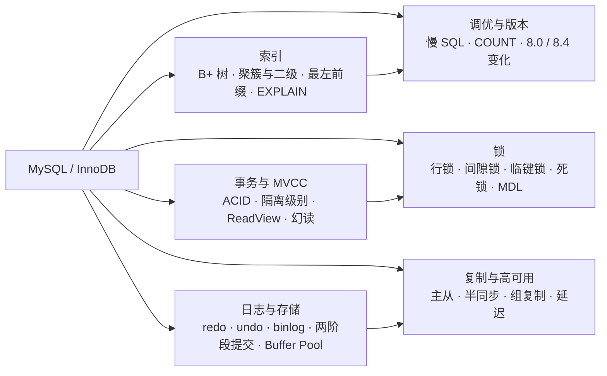
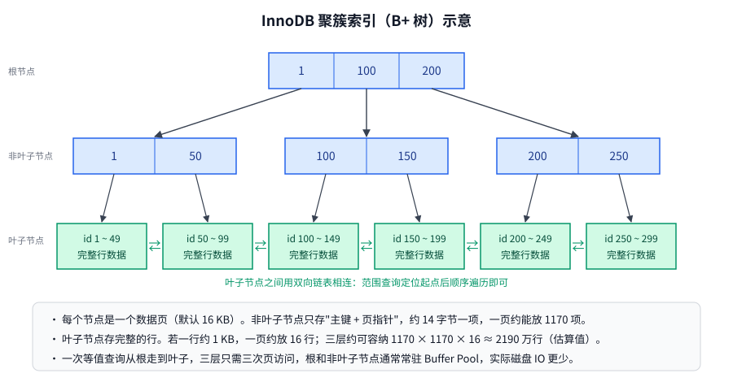
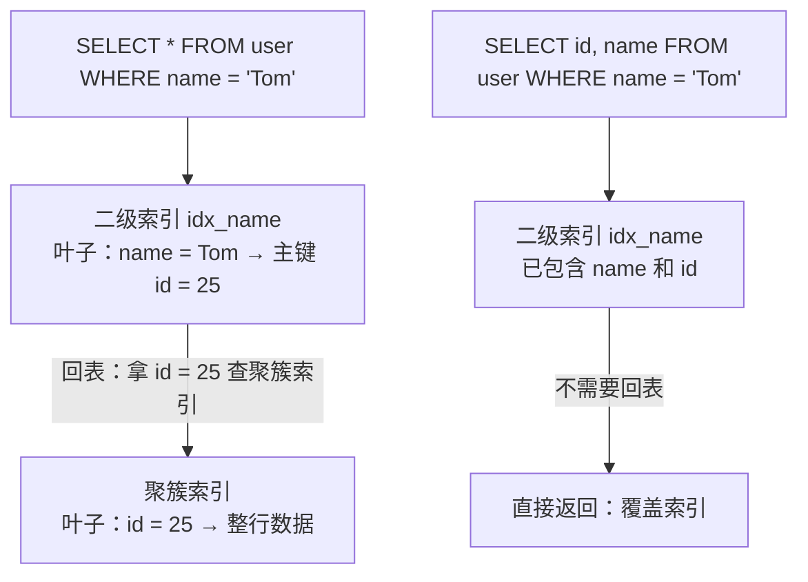
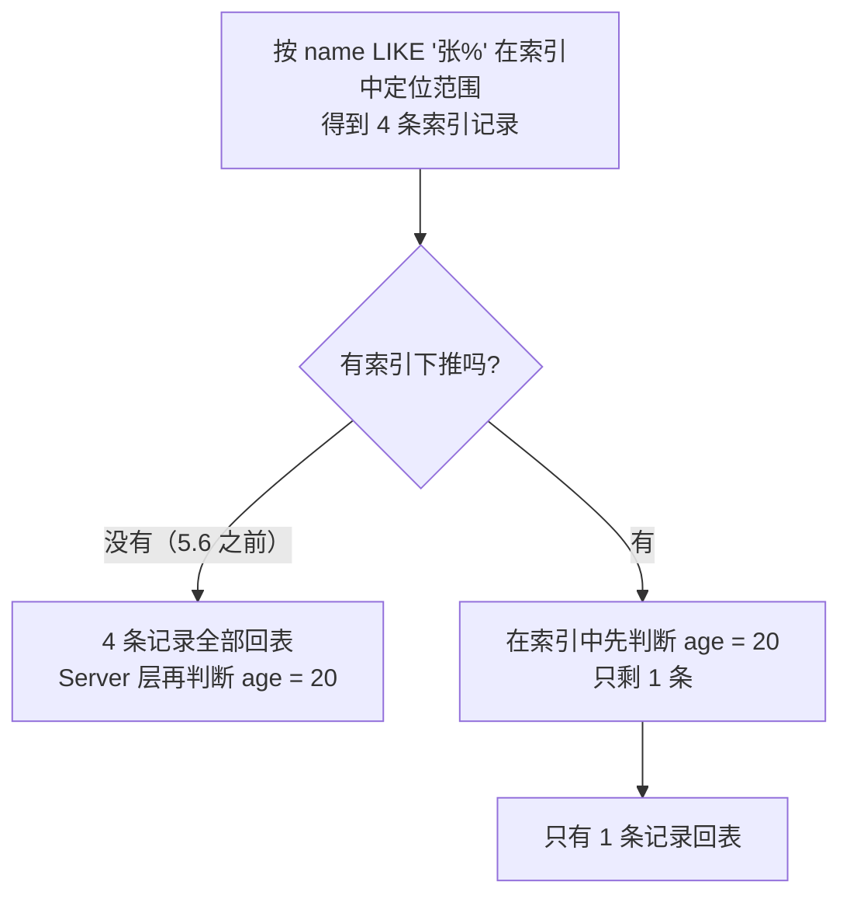
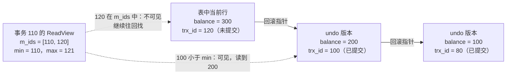
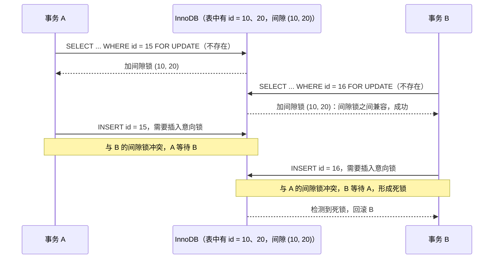
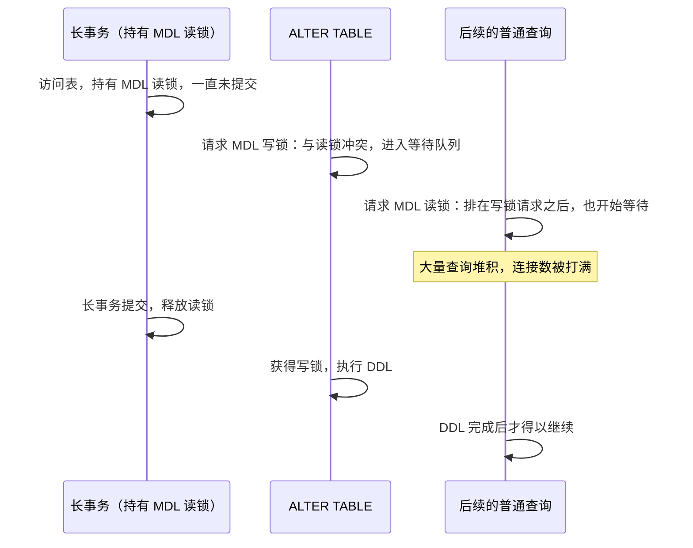
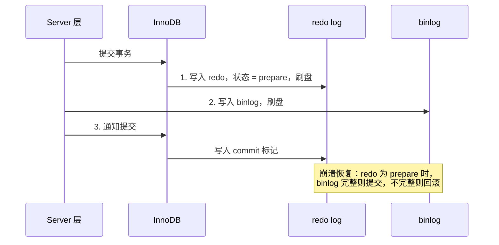
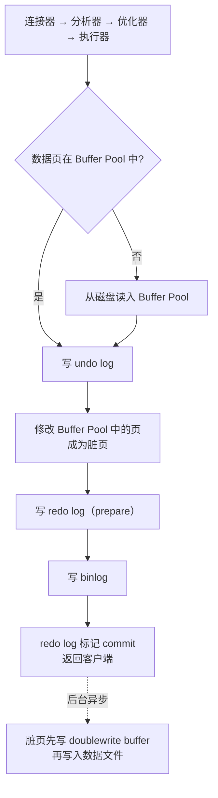
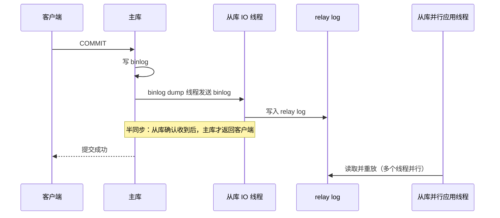

# 15 · MySQL

> 适用岗位：Java 资深开发 / 架构师
> 版本基线：MySQL 8.4 LTS（MySQL 8.0 已于 2026 年 4 月停止支持），InnoDB 存储引擎。5.7 及更早版本的差异单独标注
> 事实核对：本机没有 MySQL 服务端，8.4 的默认值变化查阅了官方手册与厂商文档，附有链接；原理部分以 InnoDB 官方文档为准
> 相关分类：[《05 Spring》](../02-框架与容器/05-Spring.md)（事务传播）、[《06 MyBatis》](../02-框架与容器/06-MyBatis.md)（分页、批量、流式查询）、[《16 分库分表》](16-分库分表.md)、[《40 数据结构》](../08-计算机基础/40-数据结构.md)（B+ 树）

## 知识地图



## 题目索引

| 编号 | 题目 | 难度 | 层级 |
| --- | --- | --- | --- |
| 15-01 | InnoDB 为什么用 B+ 树做索引？ | ★★ | 资深 |
| 15-02 | 聚簇索引、二级索引、回表与覆盖索引 | ★★ | 资深 |
| 15-03 | 联合索引的最左前缀原则；什么是索引下推？ | ★★★ | 资深 |
| 15-04 | 索引失效的常见场景 | ★★ | 资深 |
| 15-05 | 如何看懂 EXPLAIN？ | ★★★ | 资深 |
| 15-06 | 如何设计索引和主键？ | ★★★ | 资深 / 架构师 |
| 15-07 | 事务的 ACID 分别是靠什么保证的？ | ★★ | 资深 |
| 15-08 | 四种隔离级别与读现象 | ★★ | 资深 |
| 15-09 | MVCC 的原理；RC 和 RR 的区别在哪里？ | ★★★ | 资深 |
| 15-10 | 可重复读能解决幻读吗？ | ★★★ | 资深 / 架构师 |
| 15-11 | InnoDB 有哪些锁？ | ★★★ | 资深 |
| 15-12 | 一条 UPDATE 语句会加哪些锁？ | ★★★ | 资深 |
| 15-13 | 死锁是怎么产生的？如何排查和避免？ | ★★★ | 资深 |
| 15-14 | 加一个字段为什么把整张表卡住了？ | ★★★ | 资深 / 架构师 |
| 15-15 | redo log、undo log、binlog 有什么区别？ | ★★★ | 资深 |
| 15-16 | 为什么需要两阶段提交？崩溃后如何恢复？ | ★★★ | 资深 |
| 15-17 | 一条 UPDATE 语句在 InnoDB 中的执行流程 | ★★★ | 资深 |
| 15-18 | Buffer Pool 是如何管理内存的？ | ★★ | 资深 |
| 15-19 | 刷盘参数怎么配才能不丢数据？ | ★★★ | 资深 / 架构师 |
| 15-20 | 主从复制的原理；异步、半同步、组复制有什么区别？ | ★★★ | 资深 / 架构师 |
| 15-21 | 主从延迟的原因与解决办法 | ★★★ | 资深 |
| 15-22 | 慢 SQL 如何优化？ | ★★★ | 资深 |
| 15-23 | COUNT(*)、COUNT(1)、COUNT(列) 有什么区别？ | ★ | 资深 |
| 15-24 | MySQL 8.0 与 8.4 有哪些重要变化？ | ★★ | 架构师 |

---

## 一、索引

### 15-01 InnoDB 为什么用 B+ 树做索引？

> ★★ ｜ 资深 ｜ 高频

**考察意图**：能否从"磁盘 IO 次数"这个根本约束出发解释数据结构的选择。

**30 秒版回答**

- 数据库索引的核心约束是**磁盘 IO**：一次随机 IO 的耗时是内存访问的上万倍，所以要让一次查询经过的**节点数（IO 次数）尽量少**。
- B+ 树的优势：
  - **多路平衡树，矮胖**：一个节点就是一个数据页（InnoDB 默认 16 KB），能存放上千个键，三四层就能索引千万级的数据，一次查询只需三四次 IO（根节点和中间层通常常驻内存，实际更少）；
  - **非叶子节点只存键和指针，不存数据**：同样大小的页能放下更多的键，树更矮；
  - **所有数据都在叶子节点，叶子节点之间用双向链表相连**：范围查询和排序只需定位到起点，然后顺序遍历叶子链表；
  - 查询路径长度稳定，每次都要走到叶子节点。
- 与其他结构比较：
  - **哈希**：等值查询 O(1)，但不支持范围查询和排序；
  - **二叉树 / 红黑树**：每个节点只有两个分支，千万级数据的树高二十多层，IO 次数太多；
  - **B 树**：非叶子节点也存数据，同样的页能放下的键更少、树更高，范围查询需要中序遍历回溯。

**深入剖析**



**估算三层 B+ 树能存多少行**（主键为 BIGINT 的聚簇索引）：

- 非叶子节点中一个条目 = 8 字节主键 + 6 字节页指针 ≈ 14 字节，16 KB 的页约能放 1170 个条目；
- 假设一行数据 1 KB，一个叶子页约能放 16 行；
- 三层：1170 × 1170 × 16 ≈ **2190 万行**。

这也是"单表两千万行"这个经验值的由来。它并不是硬性上限：行越小能放得越多；超过之后树多一层，查询多一次 IO，性能是逐渐下降，而不是突然变差。

**追问链**

1. **InnoDB 有哈希索引吗？**
   用户不能直接创建（MEMORY 引擎才支持）。InnoDB 有一个**自适应哈希索引**（AHI），会为频繁访问的索引页自动在内存中建立哈希索引。但在高并发下它的锁竞争可能成为瓶颈，**MySQL 8.4 已将它默认关闭**（来源：[MySQL 8.4 参考手册：新特性与默认值变化](https://dev.mysql.com/doc/mysql/en/mysql-nutshell.html)）。

---

### 15-02 聚簇索引、二级索引、回表与覆盖索引

> ★★ ｜ 资深 ｜ 高频

**考察意图**：是否理解 InnoDB 的索引组织表结构，以及它对查询性能的影响。

**30 秒版回答**

- **聚簇索引**（主键索引）：叶子节点存放**完整的行数据**，表数据本身就是按主键组织的一棵 B+ 树（索引组织表）。每张表有且只有一个聚簇索引：有主键用主键；没有主键用第一个非空的唯一索引；都没有则使用隐藏的 6 字节行 ID。
- **二级索引**（普通索引、唯一索引、联合索引）：叶子节点存放**索引列的值 + 主键值**，不存完整的行。
- **回表**：通过二级索引查询时，先在二级索引中找到主键，再拿主键回到聚簇索引中查完整的行。回表是一次额外的随机 IO，命中的行越多，代价越大。
- **覆盖索引**：查询需要的所有列都在二级索引中（索引列 + 主键），不需要回表，EXPLAIN 的 Extra 中显示 `Using index`。

**深入剖析**



**追问链**

1. **为什么二级索引存的是主键，而不是行的物理地址？**
   聚簇索引中的行会因为页分裂、页合并而移动位置。如果二级索引存物理地址，每次数据移动都要更新所有二级索引；存主键则不受影响，代价是查询时多一次回表。
2. **主键为什么不宜过长？**
   每个二级索引的叶子节点都要存一份主键，主键越长，所有二级索引越大，能缓存在内存中的索引页越少。

---

### 15-03 联合索引的最左前缀原则；什么是索引下推？

> ★★★ ｜ 资深 ｜ 高频

**考察意图**：能否准确判断联合索引的使用情况，并了解索引下推和跳跃扫描。

**30 秒版回答**

- 联合索引 `(a, b, c)` 的 B+ 树按 a 排序，a 相同时按 b 排序，再按 c 排序。所以：
  - `WHERE a = 1`、`WHERE a = 1 AND b = 2`、`WHERE a = 1 AND b = 2 AND c = 3`：都能用上索引；
  - `WHERE b = 2`：b 单独看是无序的，通常用不上（但见下面的跳跃扫描）；
  - `WHERE a = 1 AND c = 3`：只有 a 用于定位，c 不能用于定位，但可以通过**索引下推**在索引中过滤；
  - **遇到范围条件后，后面的列不能再用于定位**：`WHERE a = 1 AND b > 2 AND c = 3` 中，a 和 b 用于定位，c 只能用于过滤。
  - WHERE 中条件的书写顺序无关紧要，优化器会调整。
- **索引下推**（ICP，Index Condition Pushdown，MySQL 5.6 起）：对于联合索引中**能判断但不能用于定位**的条件，存储引擎在遍历索引时就先过滤掉不满足的记录，再回表。没有 ICP 时，要先回表取出整行，再由 Server 层过滤。EXPLAIN 的 Extra 中显示 `Using index condition`。
- **跳跃扫描**（Skip Scan，MySQL 8.0.13 起）：当联合索引的第一列取值很少（比如性别），查询条件中缺少第一列时，优化器可以对第一列的每个取值分别做一次范围扫描，相当于自动补上第一列。所以"不满足最左前缀就一定用不上索引"在 8.0 中不再绝对，但这种优化只在第一列区分度很低时才划算。

**深入剖析**

以索引 `(name, age)` 和查询 `WHERE name LIKE '张%' AND age = 20` 为例：



**追问链**

1. **`ORDER BY` 能用上联合索引吗？**
   `WHERE a = 1 ORDER BY b` 可以直接利用索引的有序性，不需要额外排序；`WHERE a > 1 ORDER BY b` 不行，因为 a 是范围条件，范围内的 b 并不整体有序，需要 filesort。

---

### 15-04 索引失效的常见场景

> ★★ ｜ 资深 ｜ 高频

**考察意图**：是否能从"索引是按列的原始值排序的 B+ 树"推导出各种失效原因。

**30 秒版回答**

根本原因只有一个：**查询条件无法利用 B+ 树中值的有序性**。

| 场景 | 例子 | 原因 |
| --- | --- | --- |
| 对索引列使用函数或运算 | `WHERE DATE(create_time) = '2026-01-01'`、`WHERE id + 1 = 10` | 索引中存的是原始值，不是计算后的值 |
| 隐式类型转换 | 字符串列与数字比较：`WHERE phone = 13800000000` | MySQL 把字符串列转换成数字后比较，相当于对列使用了函数 |
| 左模糊匹配 | `WHERE name LIKE '%三'` | 以通配符开头，无法确定从哪里开始查找 |
| 不满足最左前缀 | 索引 `(a, b)`，条件只有 `b = 1` | 见 15-03 |
| OR 条件中有一列没有索引 | `WHERE a = 1 OR c = 2`，c 没有索引 | 只能全表扫描（两列都有索引时可以用索引合并） |
| 优化器认为全表扫描更快 | 条件命中了表中很大比例的行 | 大量回表的随机 IO 比顺序扫描全表还慢 |
| 隐式字符集转换 | 关联字段一个是 utf8mb3、一个是 utf8mb4 | 需要转换字符集，相当于对列使用了函数 |

- 注意一个反例：**数字列与字符串比较**（`WHERE id = '10'`）**不会**导致索引失效，因为转换发生在常量上，而不是列上。
- 函数的问题可以改写 SQL 解决：`WHERE create_time >= '2026-01-01' AND create_time < '2026-01-02'`；或者使用 MySQL 8.0.13 起支持的**函数索引**：`CREATE INDEX idx ON t ((DATE(create_time)))`。

**追问链**

1. **`IS NULL`、`!=`、`NOT IN` 一定不走索引吗？**
   不一定。`IS NULL` 可以使用索引；`!=` 和 `NOT IN` 是否使用索引取决于优化器对扫描行数的估算。不要背"某某写法一定不走索引"，要用 EXPLAIN 验证。

---

### 15-05 如何看懂 EXPLAIN？

> ★★★ ｜ 资深 ｜ 高频

**考察意图**：是否能够通过执行计划定位问题。

**30 秒版回答**

最需要关注的几列：

| 列 | 含义 | 重点关注 |
| --- | --- | --- |
| type | 访问类型，从好到差：`system` > `const` > `eq_ref` > `ref` > `range` > `index` > `ALL` | 出现 `ALL`（全表扫描）或 `index`（全索引扫描）时要警惕；一般至少要达到 `range` |
| possible_keys / key | 可能使用的索引 / 实际使用的索引 | key 为 NULL 表示没有用上索引 |
| key_len | 使用的索引长度 | 可以据此判断联合索引用到了前几列 |
| rows | 估计需要扫描的行数 | 越小越好，是估算值 |
| filtered | 经过条件过滤后剩余行的百分比 | rows × filtered 约等于传给下一步的行数 |
| Extra | 额外信息 | 见下表 |

Extra 中的常见值：

| 值 | 含义 |
| --- | --- |
| `Using index` | 覆盖索引，不需要回表（好） |
| `Using index condition` | 使用了索引下推 |
| `Using where` | 在 Server 层进行了过滤 |
| `Using filesort` | 需要额外排序（数据量大时要优化） |
| `Using temporary` | 使用了临时表（常见于 GROUP BY、DISTINCT、UNION，要优化） |

- **`EXPLAIN ANALYZE`**（MySQL 8.0.18 起）：**真正执行**这条语句，输出每个步骤实际的行数和耗时，比估算值更可靠。注意它会真的执行，对 UPDATE、DELETE 要谨慎。
- `EXPLAIN FORMAT=TREE` 以树形展示执行计划，更容易看出 JOIN 的驱动关系。

**追问链**

1. **rows 估算得很不准，怎么办？**
   统计信息过期时，可以执行 `ANALYZE TABLE` 更新；数据分布非常不均匀的列，可以创建**直方图**（MySQL 8.0 起：`ANALYZE TABLE t UPDATE HISTOGRAM ON col`），帮助优化器更准确地估算选择性。

---

### 15-06 如何设计索引和主键？

> ★★★ ｜ 资深 / 架构师 ｜ 高频

**考察意图**：是否有系统的索引设计方法，而不是"给 WHERE 中的每一列都加索引"。

**30 秒版回答**

- **索引设计原则**：
  1. **从查询出发**：先列出核心查询（WHERE、ORDER BY、GROUP BY、JOIN 条件），再设计索引，而不是按列逐个加索引；
  2. **优先联合索引**：一个设计良好的联合索引往往能覆盖多个查询；把**等值条件的列放前面、范围条件的列放后面**，区分度高的列尽量靠前；
  3. **争取覆盖索引**：高频查询只取少量列时，把这些列放进联合索引，避免回表；
  4. **控制数量**：每个索引都会降低写入速度、占用空间和内存，单表索引一般不超过 5 ~ 6 个；定期清理不再使用的索引（`sys.schema_unused_indexes`），删除前可以先设为**不可见索引**（8.0 起）观察影响；
  5. **长字符串使用前缀索引**：`INDEX (email(20))`，前缀长度根据区分度确定，代价是无法用于覆盖索引和排序。
- **主键设计**：
  - 使用**单调递增**的整数主键（自增 ID 或雪花 ID）：新数据总是追加在聚簇索引的末尾，页的利用率高；
  - 不要用 **UUID**（随机的字符串）做主键：插入位置随机，导致频繁的**页分裂**和大量随机 IO，而且主键长，所有二级索引都会变大；
  - 分布式场景下的主键生成见[《09 分布式理论》](../03-分布式与微服务/09-分布式理论.md)09-16；
  - 不要用有业务含义的字段（手机号、身份证号）做主键，业务规则一变就很被动。

**追问链**

1. **区分度低的列（比如状态字段）要不要加索引？**
   单独加索引通常意义不大（命中大量行，优化器可能不用它）；但作为联合索引的一部分（例如 `(user_id, status)`）很有用。另一种例外是数据严重倾斜：99% 的订单是"已完成"，只查询"待支付"的那 1% 时，索引非常有效。

---

## 二、事务与 MVCC

### 15-07 事务的 ACID 分别是靠什么保证的？

> ★★ ｜ 资深 ｜ 高频

**考察意图**：能否把 ACID 与 InnoDB 的具体机制对应起来。

**30 秒版回答**

| 特性 | 含义 | InnoDB 中的实现 |
| --- | --- | --- |
| 原子性 A | 事务中的操作要么全部成功，要么全部撤销 | **undo log**：记录修改前的数据，回滚时据此恢复 |
| 一致性 C | 事务前后数据满足所有约束 | 是目标而不是手段：由 A、I、D 共同保证，加上数据库约束和应用逻辑 |
| 隔离性 I | 并发事务之间互不干扰 | **锁**（写写冲突）+ **MVCC**（读写不冲突） |
| 持久性 D | 提交后的数据不会因为崩溃而丢失 | **redo log**（WAL：先写日志再写数据页）+ doublewrite buffer（防止页写坏） |

**追问链**

1. **为什么说一致性是目标而不是手段？**
   原子性、隔离性、持久性都是数据库提供的机制；而"转账前后两个账户的总额不变"这类一致性，还需要应用代码写对业务逻辑。数据库只能保证它能看到的约束（主键、唯一键、外键、非空）。

---

### 15-08 四种隔离级别与读现象

> ★★ ｜ 资深 ｜ 高频

**考察意图**：是否清楚每种隔离级别解决了什么问题，以及 InnoDB 的实际表现。

**30 秒版回答**

| 隔离级别 | 脏读 | 不可重复读 | 幻读 |
| --- | --- | --- | --- |
| 读未提交 RU | 可能 | 可能 | 可能 |
| 读已提交 RC | 不会 | 可能 | 可能 |
| **可重复读 RR（InnoDB 默认）** | 不会 | 不会 | 标准中可能；InnoDB 在大部分情况下通过 MVCC 和临键锁避免，见 15-10 |
| 串行化 | 不会 | 不会 | 不会 |

- 三种读现象：
  - **脏读**：读到了其他事务**未提交**的修改；
  - **不可重复读**：同一个事务中两次读**同一行**，结果不同（其他事务修改并提交了它）；
  - **幻读**：同一个事务中两次按**同一个条件**查询，第二次多出了行（其他事务插入并提交了新行）。
- 生产中的选择：不少互联网公司把隔离级别改成 **RC**：没有间隙锁，并发更好、死锁更少；配合行格式的 binlog 不会有主从不一致的问题。代价是同一个事务中可能出现不可重复读，需要业务代码能接受。

---

### 15-09 MVCC 的原理；RC 和 RR 的区别在哪里？

> ★★★ ｜ 资深 ｜ 高频

**考察意图**：能否讲清版本链和 ReadView 的可见性判断，这是 InnoDB 最核心的面试题之一。

**30 秒版回答**

- MVCC（多版本并发控制）让**普通的 SELECT（快照读）不加锁**，读写不阻塞。三个组成部分：
  1. **隐藏列**：每行记录有 `DB_TRX_ID`（最后修改它的事务 ID）和 `DB_ROLL_PTR`（回滚指针，指向 undo log 中的上一个版本）；
  2. **undo 版本链**：每次修改都把旧版本写入 undo log，通过回滚指针串成一条链，最新版本在表中，旧版本在 undo log 中；
  3. **ReadView**（读视图）：事务做快照读时生成，记录了：
     - `m_ids`：生成时所有**活跃**（未提交）的事务 ID；
     - `min_trx_id`：活跃事务中最小的 ID；
     - `max_trx_id`：生成时**下一个将要分配**的事务 ID；
     - `creator_trx_id`：创建这个 ReadView 的事务自己的 ID。
- **可见性判断**：从最新版本开始，沿版本链往回找，取第一个满足下列条件的版本：
  - 版本的 trx_id 等于 creator_trx_id：自己改的，可见；
  - trx_id 小于 min_trx_id：在 ReadView 生成前已经提交，可见；
  - trx_id 大于等于 max_trx_id：在 ReadView 生成之后才开始的事务，不可见；
  - 在两者之间：如果在 m_ids 中（生成时还没提交），不可见；否则可见。
- **RC 与 RR 的唯一区别是 ReadView 的生成时机**：
  - **RC**：每条 SELECT 语句都生成一个新的 ReadView，所以能看到其他事务最新提交的数据（不可重复读）；
  - **RR**：事务中**第一次**快照读时生成 ReadView，之后一直复用，所以多次读取的结果一致。

**深入剖析**



**追问链**

1. **undo log 什么时候可以删除？**
   当没有任何活跃事务的 ReadView 还需要某个旧版本时，purge 线程就会清理它。所以**长事务**非常危险：它的 ReadView 一直存在，大量 undo log 无法清理，undo 表空间膨胀，版本链变长，所有查询都会变慢。可以通过 `information_schema.innodb_trx` 查找运行时间长的事务。

---

### 15-10 可重复读能解决幻读吗？

> ★★★ ｜ 资深 / 架构师 ｜ 高频，区分度高

**考察意图**：能否区分快照读与当前读，并知道 RR 下仍会出现幻读的特殊情况。

**30 秒版回答**

- 要区分两种读：
  - **快照读**：普通的 `SELECT`，通过 MVCC 读历史版本，**不会**看到其他事务新插入的行；
  - **当前读**：`SELECT ... FOR UPDATE`、`SELECT ... FOR SHARE`、`UPDATE`、`DELETE`、`INSERT`，读取**最新**的已提交数据并加锁。InnoDB 在 RR 下对扫描到的范围加**临键锁**（记录锁 + 间隙锁），阻止其他事务在这个范围内插入，从而避免当前读的幻读。
- 所以大部分情况下 RR 能避免幻读，但**并不是完全解决**。一个经典的反例：

```sql
-- 事务 A
BEGIN;
SELECT * FROM t WHERE id = 5;               -- 快照读：没有这一行

-- 事务 B
INSERT INTO t (id, v) VALUES (5, 'b');      -- 插入并提交
COMMIT;

-- 事务 A
UPDATE t SET v = 'a' WHERE id = 5;          -- 当前读：看到了 B 插入的行，并修改了它
SELECT * FROM t WHERE id = 5;               -- 快照读：这一行的 trx_id 变成了 A 自己，于是可见了
COMMIT;
```

- 事务 A 两次快照读的结果不同，出现了幻读。原因是 UPDATE 作为当前读看到了新插入的行，修改后该行的最新版本属于 A 自己，按可见性规则对 A 可见。
- 想在业务上彻底避免，需要在事务一开始就用当前读（`SELECT ... FOR UPDATE`）锁住相关的范围。

---

## 三、锁

### 15-11 InnoDB 有哪些锁？

> ★★★ ｜ 资深 ｜ 高频

**考察意图**：是否清楚各种锁的粒度、作用和兼容关系。

**30 秒版回答**

| 锁 | 级别 | 作用 |
| --- | --- | --- |
| 共享锁 S / 排他锁 X | 行 | 读锁 / 写锁，S 与 S 兼容，其他组合互斥 |
| **记录锁** | 行 | 锁住一条索引记录 |
| **间隙锁** | 行 | 锁住两条索引记录之间的**间隙**，阻止在其中插入；间隙锁之间**互相兼容**（只阻止插入） |
| **临键锁**（Next-Key Lock） | 行 | 记录锁 + 它前面的间隙，左开右闭区间 `(前一条, 当前条]`，是 RR 下加锁的**基本单位** |
| 插入意向锁 | 行 | 插入前在间隙上加的一种特殊间隙锁，多个插入不同位置的事务互不阻塞，但会被间隙锁阻塞 |
| 意向锁 IS / IX | 表 | 表示"表中有行被加了 S / X 锁"，让加表锁时不用逐行检查 |
| 自增锁 | 表 | 控制自增值的分配；MySQL 8.0 默认 `innodb_autoinc_lock_mode = 2`（交错模式，性能最好，要求 binlog 为行格式） |
| **元数据锁 MDL** | 表 | 由 Server 层自动加：增删改查加 MDL 读锁，DDL 加 MDL 写锁，见 15-14 |

- **InnoDB 的行锁是加在索引上的**。如果更新语句的条件没有用上索引，InnoDB 会扫描并锁住所有扫描到的记录，效果接近锁全表。
- 间隙锁和临键锁只在 **RR** 隔离级别下使用（外键检查和唯一性检查等少数情况除外）；**RC 下基本只有记录锁**，这也是 RC 死锁更少的原因。

---

### 15-12 一条 UPDATE 语句会加哪些锁？

> ★★★ ｜ 资深 ｜ 高频

**考察意图**：能否结合索引类型和隔离级别分析加锁范围。

**30 秒版回答**

以 RR 隔离级别为例，分析思路（加锁的基本单位是临键锁，然后根据情况退化）：

| 条件所用的索引 | 记录存在时 | 记录不存在时 |
| --- | --- | --- |
| **主键或唯一索引等值** | 只加**记录锁**（临键锁退化） | 加**间隙锁**，锁住它本应所在的间隙 |
| **普通索引等值** | 二级索引上：符合条件的记录加临键锁，向右扫描到第一条不符合条件的记录，在它前面的间隙加间隙锁；对应的主键记录加记录锁 | 间隙锁 |
| **范围条件** | 扫描范围内的记录加临键锁 | 间隙锁 |
| **没有可用的索引** | 全表扫描，**所有记录**及间隙都被加锁 | 同左 |

- RC 隔离级别下：只给符合条件的记录加记录锁，不加间隙锁；不符合条件的记录在 Server 层判断后会**提前释放**锁。
- 实际加锁情况可以在 MySQL 8.0 起通过 `performance_schema.data_locks` 查看，比背规则更可靠：

```sql
BEGIN;
UPDATE orders SET status = 'PAID' WHERE user_id = 100;
SELECT object_name, index_name, lock_type, lock_mode, lock_data
FROM performance_schema.data_locks;
```

`lock_mode` 中的 `X` 表示临键锁，`X,REC_NOT_GAP` 表示记录锁，`X,GAP` 表示间隙锁，`X,INSERT_INTENTION` 表示插入意向锁。

**追问链**

1. **为什么生产中要求 UPDATE / DELETE 的 WHERE 条件必须走索引？**
   没有索引时会锁住全表的记录和间隙，在 RR 下几乎等于锁表，其他事务的更新和插入全部阻塞。可以开启 `sql_safe_updates` 拦截没有使用索引的 UPDATE 和 DELETE。

---

### 15-13 死锁是怎么产生的？如何排查和避免？

> ★★★ ｜ 资深 ｜ 高频

**考察意图**：是否分析过真实的 MySQL 死锁日志。

**30 秒版回答**

- InnoDB 默认开启死锁检测（`innodb_deadlock_detect = ON`）：发现循环等待时，**主动回滚代价较小的事务**，应用收到 `Deadlock found when trying to get lock` 错误。没有形成环、只是等待时，等待超过 `innodb_lock_wait_timeout`（默认 50 秒）后报锁等待超时。
- 常见的死锁模式：
  1. **加锁顺序不一致**：事务 A 先更新 id = 1 再更新 id = 2，事务 B 顺序相反；
  2. **间隙锁 + 插入**：两个事务都对同一个间隙加了间隙锁（间隙锁互相兼容，都能加成功），然后都想在这个间隙中插入（插入意向锁与对方的间隙锁冲突），互相等待。典型场景是"先查询不存在、再插入"的并发逻辑；
  3. **唯一键冲突**：多个事务同时插入相同的唯一键，冲突后会对该记录加共享锁，随后又要加排他锁，形成死锁。
- 排查：
  - `SHOW ENGINE INNODB STATUS` 中的 `LATEST DETECTED DEADLOCK` 部分，显示两个事务各自持有和等待的锁及 SQL；
  - 开启 `innodb_print_all_deadlocks`，把所有死锁记录到错误日志中。
- 避免：
  - 固定的加锁顺序（例如按主键排序后批量更新）；
  - 事务尽量小、尽量短；
  - 更新条件走索引，减少锁住的范围；
  - "不存在就插入"的逻辑改用 `INSERT ... ON DUPLICATE KEY UPDATE` 或依靠唯一索引直接插入、捕获冲突；
  - 考虑使用 RC 隔离级别，消除间隙锁；
  - 应用层对死锁错误进行**重试**（死锁的事务已被回滚，重试是安全的）。

**深入剖析**

间隙锁 + 插入导致的死锁：



---

### 15-14 加一个字段为什么把整张表卡住了？

> ★★★ ｜ 资深 / 架构师 ｜ 高频（线上事故的高发区）

**考察意图**：是否理解元数据锁（MDL）的排队机制，以及在线 DDL 的正确做法。

**30 秒版回答**

- **事故过程**：
  1. 某个长事务（或者一个执行很久的查询）正在访问这张表，持有 **MDL 读锁**；
  2. 执行 `ALTER TABLE` 需要 **MDL 写锁**，与读锁冲突，进入等待；
  3. **MDL 写锁请求在队列中排队后，之后所有对这张表的查询（即使只需要读锁）也会排在它后面等待**；
  4. 于是这张表上的所有读写请求都被阻塞，连接数迅速打满，`SHOW PROCESSLIST` 中大量出现 `Waiting for table metadata lock`。
- **在线 DDL 的三种算法**：
  - `INSTANT`：只修改数据字典，**不重建表**，瞬间完成。MySQL 8.0.12 起支持在表的末尾即时添加列，8.0.29 起支持在任意位置添加列和删除列；
  - `INPLACE`：在原表上重建，执行期间允许并发的 DML（只在开始和结束时短暂持有 MDL 写锁）；
  - `COPY`：创建新表、复制数据，期间阻塞写入。
- **安全执行 DDL 的做法**：
  1. 执行前检查有没有长事务、长查询（`information_schema.innodb_trx`、`PROCESSLIST`）；
  2. 为 DDL 会话设置较短的 `lock_wait_timeout`，拿不到 MDL 锁就快速失败，而不是无限排队堵住后面的请求，失败后择机重试；
  3. 能用 `ALGORITHM=INSTANT` 的显式指定，不支持时会直接报错，而不是悄悄退化成重建表；
  4. 大表的复杂变更使用 **gh-ost** 或 **pt-online-schema-change**：创建影子表、逐步复制数据、增量同步变更，最后快速切换表名。

**深入剖析**



---

## 四、日志与存储

### 15-15 redo log、undo log、binlog 有什么区别？

> ★★★ ｜ 资深 ｜ 高频

**考察意图**：能否从所属层次、内容、用途三个维度区分三种日志。

**30 秒版回答**

| 维度 | redo log | undo log | binlog |
| --- | --- | --- | --- |
| 所属 | InnoDB 存储引擎 | InnoDB 存储引擎 | MySQL Server 层，所有引擎共用 |
| 内容 | **物理日志**：某个数据页的某个位置做了什么修改 | **逻辑日志**：修改前的数据（用于反向操作） | **逻辑日志**：语句本身（STATEMENT 格式）或行的变化（ROW 格式，默认） |
| 用途 | **崩溃恢复**，保证持久性 | **事务回滚** + **MVCC** 的历史版本 | **主从复制** + **按时间点恢复** |
| 写入方式 | 固定大小，**循环写**，已经刷到磁盘的数据页对应的日志可以被覆盖 | 存放在 undo 表空间，由 purge 线程清理 | **追加写**，写满一个文件换下一个，不会覆盖 |

- **WAL**（Write-Ahead Logging，先写日志）：修改数据时只在内存中修改数据页，并**顺序写** redo log，就可以认为事务提交成功；脏数据页之后再**异步**刷到磁盘。把大量的随机写转换成了顺序写，这是 InnoDB 写性能的关键。
- MySQL 8.0.30 起，redo log 的大小由 `innodb_redo_log_capacity` 统一控制，并且可以在线调整。

**追问链**

1. **只有 binlog，能不能做崩溃恢复？**
   不能。binlog 是逻辑日志，没有记录"哪些数据页已经刷到磁盘"这样的信息，崩溃后无法判断哪些修改需要重做。这也是 InnoDB 需要自己的 redo log 的原因（历史上 MyISAM 只有 binlog，没有崩溃安全的能力）。

---

### 15-16 为什么需要两阶段提交？崩溃后如何恢复？

> ★★★ ｜ 资深 ｜ 高频

**考察意图**：能否讲清 redo log 与 binlog 之间的一致性问题，以及崩溃恢复的判断规则。

**30 秒版回答**

- 问题：一个事务提交时要写 redo log（InnoDB）和 binlog（Server 层）两份日志。如果只写成功了一份就崩溃了：
  - redo 有、binlog 没有：主库重启后恢复了这个事务，但从库（以及用 binlog 恢复的备份）中没有，**主从不一致**；
  - binlog 有、redo 没有：从库有这个事务，主库没有，同样不一致。
- **两阶段提交**：
  1. **prepare 阶段**：写 redo log，并标记为 prepare 状态；
  2. 写 binlog；
  3. **commit 阶段**：把 redo log 标记为 commit 状态。
- **崩溃恢复的判断规则**：扫描 redo log，对于处于 prepare 状态的事务：
  - 如果对应的 binlog（通过 XID 关联）**完整**，提交这个事务；
  - 如果 binlog 不完整或不存在，回滚这个事务。
  - 由此保证 redo log 和 binlog 的结果一致：binlog 中有的事务，主库也一定有。
- 为了性能，MySQL 使用**组提交**（group commit），把多个事务的 redo 刷盘和 binlog 刷盘合并成一次 fsync。

**深入剖析**



---

### 15-17 一条 UPDATE 语句在 InnoDB 中的执行流程

> ★★★ ｜ 资深 ｜ 高频

**考察意图**：能否把 Server 层、Buffer Pool、各类日志串成一条完整的流程。

**30 秒版回答**

以 `UPDATE t SET c = c + 1 WHERE id = 2` 为例：

1. **连接器**：校验连接与权限；
2. **分析器**：词法和语法分析；
3. **优化器**：选择执行计划（使用主键索引）；
4. **执行器**调用 InnoDB 的接口读取 id = 2 这一行：
   - 数据页在 **Buffer Pool** 中，直接返回；
   - 不在，就从磁盘读入 Buffer Pool；
5. 执行器计算出新值，调用 InnoDB 写入：
   - 写 **undo log**（记录旧值，用于回滚和 MVCC）；
   - 修改 Buffer Pool 中的数据页（成为**脏页**）；
   - 写 **redo log**（prepare 状态）；
6. 写 **binlog**；
7. 提交：redo log 标记为 commit；
8. 之后由后台线程把脏页**异步刷到磁盘**。刷盘时先写 **doublewrite buffer**，再写到数据文件中的实际位置，防止写一半时断电导致页损坏（数据页 16 KB，而操作系统和磁盘一次原子写入的大小通常更小）。

**深入剖析**



**追问链**

1. **更新二级索引时，如果它的数据页不在内存中怎么办？**
   历史上 InnoDB 会使用 **change buffer**，先把对二级索引的修改记在缓冲中，等该页之后被读入内存时再合并，以减少随机读。但在 SSD 普及后收益变小，**MySQL 8.4 已把 `innodb_change_buffering` 的默认值从 `all` 改为 `none`**（来源：[MySQL 8.4 LTS 新的 InnoDB 默认值](https://lefred.be/content/mysql-8-4-lts-new-production-ready-defaults-for-innodb/)、[MySQL 8.4 参考手册](https://dev.mysql.com/doc/mysql/en/mysql-nutshell.html)）。

---

### 15-18 Buffer Pool 是如何管理内存的？

> ★★ ｜ 资深 ｜ 中频

**考察意图**：是否了解 InnoDB 对 LRU 的改进，以及它解决的问题。

**30 秒版回答**

- Buffer Pool 是 InnoDB 在内存中缓存数据页和索引页的区域，是 MySQL 最重要的内存配置（`innodb_buffer_pool_size`，在专用的数据库服务器上通常设为物理内存的 50% ~ 75%）。
- 页的淘汰使用**改进的 LRU**：链表被分成两段：
  - **young 区**（热数据，约 5/8）；
  - **old 区**（约 3/8，由 `innodb_old_blocks_pct` 控制，默认 37）。
  - 新读入的页先放在 **old 区的头部**，而不是整个链表的头部；
  - 只有当它在 old 区中停留超过一定时间（`innodb_old_blocks_time`，默认 1000 毫秒）后**再次被访问**，才会被移到 young 区。
- 解决的问题：**全表扫描、预读带来的缓存污染**。一次大查询会读入大量只用一次的页，如果直接放到链表头部，会把真正的热数据挤出去。改进后，这些页只会在 old 区中短暂停留，很快被淘汰。
- 其他组成部分：free 链表（空闲页）、flush 链表（脏页，按最早修改时间排序，用于刷盘）。

**追问链**

1. **什么时候会刷脏页？**
   redo log 快写满时（必须刷脏页才能推进检查点、腾出 redo 空间，此时写入会明显变慢）；Buffer Pool 中空闲页不足时；后台线程定期刷新；正常关闭时。`innodb_io_capacity` 要按磁盘的实际 IO 能力设置，太小会导致脏页积压。

---

### 15-19 刷盘参数怎么配才能不丢数据？

> ★★★ ｜ 资深 / 架构师 ｜ 高频

**考察意图**：是否清楚两个关键参数各个取值的数据安全含义。

**30 秒版回答**

| `innodb_flush_log_at_trx_commit` | 含义 | 可能丢失的数据 |
| --- | --- | --- |
| **1**（默认） | 每次提交都把 redo log 写入并 fsync 到磁盘 | 不丢 |
| 0 | 每秒写入并刷盘一次 | MySQL 进程崩溃或宕机时，丢失最近约 1 秒的事务 |
| 2 | 每次提交写入操作系统的页缓存，每秒 fsync 一次 | MySQL 进程崩溃不丢；**操作系统崩溃或断电**时，丢失最近约 1 秒 |

| `sync_binlog` | 含义 |
| --- | --- |
| **1**（默认） | 每次提交都 fsync binlog |
| 0 | 由操作系统决定何时刷盘 |
| N | 每 N 次提交刷盘一次 |

- 两者都设为 1 就是常说的"**双 1**"配置，是核心业务数据库的标准配置，保证已提交的事务不丢，且 redo log 和 binlog 一致。
- 非双 1 的配置（例如批量导入数据期间临时调整）可以提高写入性能，但要清楚其风险，并在完成后改回。
- 即使是双 1，**单机**仍然无法应对磁盘损坏，还需要复制、备份等机制，见 15-20。

---

## 五、复制与高可用

### 15-20 主从复制的原理；异步、半同步、组复制有什么区别？

> ★★★ ｜ 资深 / 架构师 ｜ 高频

**考察意图**：能否讲清复制的线程模型，并比较三种复制方式的数据安全性。

**30 秒版回答**

- 复制流程：
  1. 主库在事务提交时写 binlog；
  2. 从库的 **IO 线程**连接主库，主库的 **binlog dump 线程**把 binlog 发送过来，IO 线程写入本地的 **relay log**（中继日志）；
  3. 从库的 **SQL 线程**（MySQL 8.0 中是多个并行的应用线程）读取 relay log 并重放。
  - MySQL 8.0 起推荐使用 **GTID**（全局事务 ID），每个事务有唯一的 ID，切换主库时不需要手工找 binlog 位置。
  - 术语变化：MySQL 8.0.22 / 8.0.26 起改用 **source / replica** 代替 master / slave（如 `SHOW REPLICA STATUS`），旧的语法已被废弃，8.4 中部分旧语法已被移除，以官方文档为准。
- 三种复制方式：

| 方式 | 主库提交时机 | 数据安全 | 性能 |
| --- | --- | --- | --- |
| **异步复制**（默认） | 写完 binlog 就提交并返回客户端，不等从库 | 主库宕机时，尚未传到从库的事务会**丢失** | 最好 |
| **半同步复制** | 至少一个从库确认**收到** binlog（写入 relay log）后才返回客户端 | `AFTER_SYNC`（无损半同步，推荐）模式下，已经返回给客户端的事务一定在至少一个从库上存在 | 多一次网络往返；从库长时间不响应时会**退化为异步** |
| **组复制**（Group Replication） | 基于 Paxos 的变种，**多数派**成员认证通过后才提交 | 强，自动故障检测与选主 | 写入延迟更高，对网络质量要求高 |

- 基于组复制，MySQL 提供 **InnoDB Cluster**（组复制 + MySQL Router + MySQL Shell）作为官方的高可用方案。

**深入剖析**



---

### 15-21 主从延迟的原因与解决办法

> ★★★ ｜ 资深 ｜ 高频

**考察意图**：能否定位延迟的原因，并从架构和业务两方面给出办法。

**30 秒版回答**

- 常见原因：
  1. **大事务**：主库执行了 10 分钟的事务（例如一次删除几百万行），从库要等它传完、再花差不多同样的时间重放；
  2. **从库重放能力不足**：并行复制没有开启或配置不当（MySQL 8.0 中可以基于 WRITESET 判断事务之间是否冲突，并行度更高；8.0.27 起并行应用线程数默认为 4）；
  3. **从库配置较低**，或者从库上运行了大量的报表查询，抢占了资源；
  4. **DDL**：大表的 DDL 在从库上重放时同样耗时；
  5. 表**没有主键**：ROW 格式下重放每一行变更都可能要全表扫描。
- 解决：
  - 拆分大事务，批量操作分批提交；
  - 开启并调优并行复制；所有表都要有主键；
  - 读写分离时，**对一致性要求高的读走主库**（见[《09 分布式理论》](../03-分布式与微服务/09-分布式理论.md)09-03 中的"读己之写"），或者在读取前检查从库的 GTID 是否已经追上；
  - 监控延迟（`SHOW REPLICA STATUS` 中的延迟秒数并不精确，更可靠的方式是在主库定期写入心跳时间戳，在从库读取比较，如 pt-heartbeat），延迟超过阈值时自动把读流量切回主库。

---

## 六、调优与版本

### 15-22 慢 SQL 如何优化？

> ★★★ ｜ 资深 ｜ 高频

**考察意图**：是否有完整的方法论和常见场景的解决方案。

**30 秒版回答**

**排查流程**：

1. 开启慢查询日志（`slow_query_log`、`long_query_time`），用 `pt-query-digest` 汇总，找出总耗时最多的 SQL（而不只是单次最慢的）；
2. 用 `EXPLAIN` / `EXPLAIN ANALYZE` 分析执行计划；
3. 从**索引、SQL 写法、表结构、架构**四个层面依次考虑。

**常见场景**：

| 场景 | 问题 | 优化 |
| --- | --- | --- |
| 深分页 `LIMIT 1000000, 10` | 要扫描并丢弃前 100 万行 | 游标分页 `WHERE id > ? LIMIT 10`；或延迟关联：先在覆盖索引上查出 id，再关联回表 |
| `ORDER BY` 出现 `Using filesort` | 排序没有利用索引 | 建立"等值列 + 排序列"的联合索引 |
| `GROUP BY` 出现 `Using temporary` | 使用了临时表 | 让分组列使用索引 |
| 大表 JOIN | 被驱动表没有索引 | 被驱动表的关联字段加索引；小表驱动大表；MySQL 8.0.18 起没有索引时使用哈希连接，但仍然应该补上索引 |
| `SELECT *` | 无法使用覆盖索引，传输数据多 | 只查需要的列 |
| 大批量 IN | SQL 很长，优化器估算不准 | 分批查询 |
| 在索引列上使用函数、隐式转换 | 索引失效 | 见 15-04 |
| 单表数据量过大 | 索引层数多，维护成本高 | 归档历史数据；分区；分库分表，见[《16 分库分表》](16-分库分表.md) |

**追问链**

1. **如何避免慢 SQL 上线？**
   在流水线中做 SQL 审核（例如检查是否走索引、是否有 `SELECT *`、是否有无条件的 UPDATE）；数据库变更走工单评审；上线后通过慢查询监控和告警尽早发现。

---

### 15-23 COUNT(*)、COUNT(1)、COUNT(列) 有什么区别？

> ★ ｜ 资深 ｜ 高频

**考察意图**：是否清楚语义区别和 InnoDB 的实现。

**30 秒版回答**

- 语义：
  - `COUNT(*)` 和 `COUNT(1)`：统计行数，**包括** NULL；
  - `COUNT(列)`：统计该列**不为 NULL** 的行数。
- 性能：`COUNT(*)` 和 `COUNT(1)` 在 InnoDB 中是**一样的**，官方文档明确说明两者的处理方式相同；`COUNT(列)` 还要判断每个值是否为 NULL，略慢，而且语义不同。
- InnoDB 为什么不像 MyISAM 那样直接存一个总行数？因为 MVCC：不同事务在同一时刻看到的行数可能不同，没有一个"唯一正确"的总数。InnoDB 会选择**最小的二级索引**来扫描计数，以减少 IO。
- 大表频繁计数的办法：用 Redis 或单独的计数表维护（注意与业务数据的一致性）；对精确性要求不高时，用 `SHOW TABLE STATUS` 或 `information_schema` 中的估算值；或者在业务上避免实时计算总数。

---

### 15-24 MySQL 8.0 与 8.4 有哪些重要变化？

> ★★ ｜ 架构师 ｜ 中频

**考察意图**：是否跟进 MySQL 的版本演进，能否评估升级的影响。

**30 秒版回答**

**MySQL 8.0 的重要变化**（相对于 5.7）：

- 数据字典改为存储在 InnoDB 中，支持**原子 DDL**；
- SQL 能力：窗口函数、公用表表达式（CTE，`WITH` 子句）；
- 索引：不可见索引、降序索引、函数索引（8.0.13）、跳跃扫描（8.0.13）；
- 优化器：直方图、哈希连接（8.0.18）、`EXPLAIN ANALYZE`（8.0.18）；
- DDL：`INSTANT` 算法添加列（8.0.12，8.0.29 起支持任意位置）；
- **移除了查询缓存**；
- 默认字符集改为 `utf8mb4`；默认认证插件改为 `caching_sha2_password`（旧版本的客户端和驱动可能无法连接）；
- redo log 容量可以在线调整（8.0.30，`innodb_redo_log_capacity`）。

**MySQL 8.4 LTS 的重要变化**（来源：[MySQL 8.4 参考手册](https://dev.mysql.com/doc/mysql/en/mysql-nutshell.html)、[MySQL 8.4 LTS 新的 InnoDB 默认值](https://lefred.be/content/mysql-8-4-lts-new-production-ready-defaults-for-innodb/)）：

- MySQL 的版本模型改为 **LTS（长期支持）+ Innovation（创新版本，如 9.x）**；8.4 是第一个 LTS 版本；
- **InnoDB 默认值调整**，更适合 SSD 和现代硬件，例如：
  - 自适应哈希索引 `innodb_adaptive_hash_index` 默认由 ON 改为 **OFF**；
  - `innodb_change_buffering` 默认由 `all` 改为 **`none`**；
- **`mysql_native_password` 认证插件默认被禁用**，使用旧认证方式的账号需要迁移，或者显式开启该插件（注意：部分云厂商的托管版本对此有不同的处理）；
- 移除了大量此前已废弃的功能和语法。

**追问链**

1. **从 5.7 / 8.0 升级到 8.4 要注意什么？**
   使用官方的升级检查工具（MySQL Shell 的 `util.checkForServerUpgrade()`）扫描不兼容项；检查应用的 JDBC 驱动版本是否支持 `caching_sha2_password`；检查是否依赖已移除的语法和功能；对比新旧版本的默认参数，在压测中验证性能；准备回退方案（8.4 的数据目录不能直接降级回旧版本，需要逻辑备份）。
