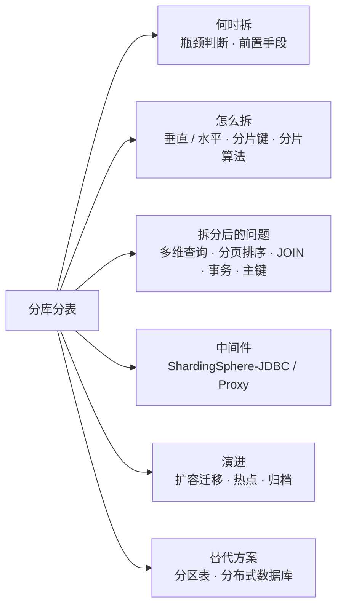
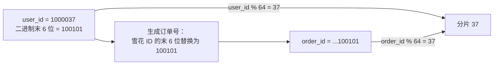
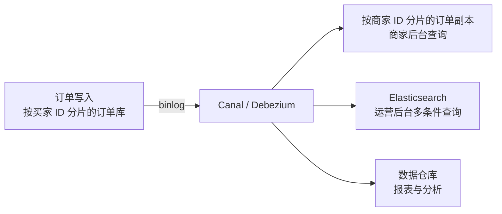
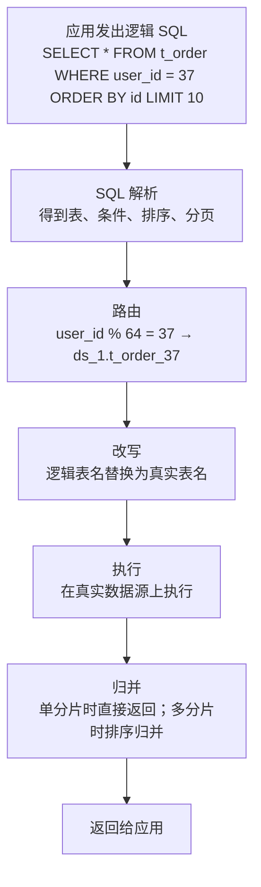
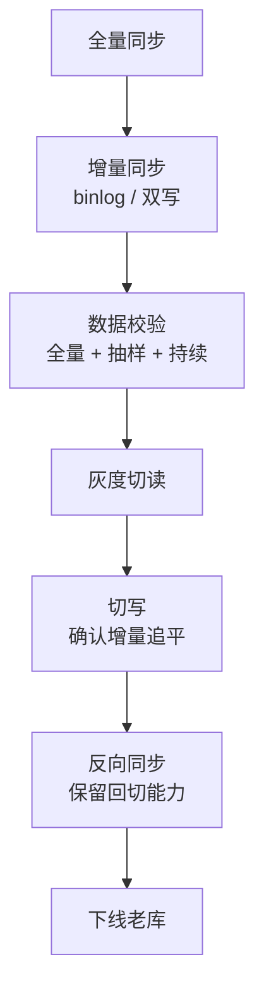

# 16 · 分库分表

> 适用岗位：Java 资深开发 / 架构师
> 版本基线：Apache ShardingSphere 5.x，MySQL 8.4；分布式数据库以 TiDB、OceanBase 为代表
> 相关分类：[《09 分布式理论》](../03-分布式与微服务/09-分布式理论.md)（分布式 ID、分布式事务、一致性哈希）、[《15 MySQL》](15-MySQL.md)、[《19 Elasticsearch》](19-Elasticsearch.md)（异构索引）、[《29 场景题》](../06-三高与架构/29-场景题.md)

## 知识地图

## 题目索引

| 编号 | 题目 | 难度 | 层级 |
| --- | --- | --- | --- |
| 16-01 | 什么时候需要分库分表？之前应该先做什么？ | ★★ | 资深 / 架构师 |
| 16-02 | 垂直拆分与水平拆分；分库与分表各解决什么问题？ | ★★ | 资深 |
| 16-03 | 分片键怎么选？ | ★★★ | 资深 / 架构师 |
| 16-04 | 有哪些分片算法？什么是基因法？ | ★★★ | 资深 |
| 16-05 | 分片后，非分片键的查询怎么办？ | ★★★ | 架构师 |
| 16-06 | 跨分片的分页、排序、聚合怎么做？ | ★★★ | 资深 |
| 16-07 | 跨分片 JOIN 怎么处理？ | ★★ | 资深 |
| 16-08 | 分库分表后的主键与事务 | ★★ | 资深 |
| 16-09 | ShardingSphere 的工作原理 | ★★★ | 资深 |
| 16-10 | ShardingSphere-JDBC 和 ShardingSphere-Proxy 怎么选？ | ★★ | 架构师 |
| 16-11 | 如何不停机地扩容和迁移数据？ | ★★★ | 架构师 |
| 16-12 | 数据倾斜和热点怎么处理？ | ★★★ | 架构师 |
| 16-13 | MySQL 分区表能代替分表吗？ | ★★ | 资深 |
| 16-14 | 历史数据归档怎么设计？ | ★★ | 资深 / 架构师 |
| 16-15 | 分库分表和分布式数据库怎么选？ | ★★★ | 架构师 |

---

## 一、何时拆、怎么拆

### 16-01 什么时候需要分库分表？之前应该先做什么？

> ★★ ｜ 资深 / 架构师 ｜ 高频

**考察意图**：是否把分库分表当作"最后的手段"，能否准确判断瓶颈。

**30 秒版回答**

- 分库分表的代价很高：SQL 能力受限、跨分片查询和事务复杂、运维和迁移成本大，而且一旦拆了很难合回去。所以要先确认**瓶颈到底在哪里**：

| 瓶颈 | 表现 | 优先的手段 |
| --- | --- | --- |
| 单表数据量大，查询变慢 | 索引层数增加、大量冷数据 | 优化索引；**归档历史数据**（往往能解决大部分问题） |
| 读压力大 | CPU、IO 被读请求占满 | **缓存**；**读写分离** |
| 写压力大 | 主库写入 TPS 达到上限、磁盘 IO 饱和 | 合并写入、异步化；升级硬件；最后才是**分库** |
| 单库容量大 | 磁盘接近上限，备份恢复时间过长 | 归档；垂直拆分；水平分库 |
| 连接数不够 | 应用实例多，连接数打满 | 连接池调优、数据库代理；分库 |

- 一个常见的误区是"单表超过 500 万 / 2000 万行就必须分表"。行数本身不是问题，关键是查询是否走索引、热数据有多大、写入压力有多高。合理建索引的表，上亿行也可以有很好的查询性能（参考[《15 MySQL》](15-MySQL.md)15-01 中的估算）。
- 需要分库分表时，要按**3 ~ 5 年的数据增长**来规划分片数量，避免频繁扩容。

---

### 16-02 垂直拆分与水平拆分；分库与分表各解决什么问题？

> ★★ ｜ 资深 ｜ 高频

**考察意图**：是否分清几种拆分方式的目的。

**30 秒版回答**

| 方式 | 做法 | 解决的问题 |
| --- | --- | --- |
| **垂直分库** | 按业务拆分到不同的库（用户库、订单库、商品库） | 业务解耦，各库独立扩容；通常与微服务拆分同步进行 |
| **垂直分表** | 把一张宽表按列拆成两张（常用字段一张，大字段和不常用字段一张） | 减少单行大小，提高缓存效率 |
| **水平分表** | 同一张表的数据按规则分到同一个库中的多张表 | 单表数据量过大的问题；**不能**分担数据库实例的 CPU、IO 和连接压力 |
| **水平分库** | 数据按规则分到多个数据库实例 | 分担写入压力、容量压力和连接压力 |

- 实践中常常是**分库 + 分表**组合使用，例如 8 个库 × 每库 32 张表 = 256 个分片。分表数量多一些的好处是：将来扩容时，可以通过**移动整张表**（而不是拆分表中的数据）把分片迁移到新的库上，见 16-11。

---

### 16-03 分片键怎么选？

> ★★★ ｜ 资深 / 架构师 ｜ 高频

**考察意图**：能否结合查询模式和数据分布选择分片键。

**30 秒版回答**

选择分片键的原则：

1. **绝大多数查询都带有这个字段**：否则这些查询要广播到所有分片，性能会急剧下降；
2. **数据分布均匀**：避免数据和访问集中在少数分片上；
3. **业务上不会修改**：分片键一旦修改，数据就要从一个分片迁移到另一个分片；
4. **让需要在一个事务中操作的数据落在同一个分片**：尽量避免分布式事务。

以订单表为例：

- 用户在 App 中看"我的订单"，按 **用户 ID**（买家 ID）查询，频率最高；
- 商家在后台看自己店铺的订单，按**商家 ID**查询；
- 客服、运营按订单号查询。

通常选择**买家 ID**作为分片键：同一个用户的订单在同一个分片，"我的订单"只查一个分片；再通过**基因法**让订单号中带有用户 ID 的分片信息，使按订单号的查询也能直接定位分片（见 16-04）；商家维度的查询通过**异构数据**解决（见 16-05）。

**追问链**

1. **选订单 ID 做分片键行不行？**
   数据分布最均匀，但"查某个用户的所有订单"这个最高频的查询就要广播到所有分片，几乎不可接受。

---

### 16-04 有哪些分片算法？什么是基因法？

> ★★★ ｜ 资深 ｜ 高频

**考察意图**：能否比较各种分片算法，并掌握让多个查询维度都能路由的基因法。

**30 秒版回答**

| 算法 | 做法 | 优点 | 缺点 |
| --- | --- | --- | --- |
| **取模（哈希）** | `分片号 = hash(分片键) % 分片数` | 分布均匀 | 扩容时大部分数据需要迁移（分片数按 2 的倍数扩容可以缓解，见 16-11） |
| **范围** | 按 ID 或时间区间划分，例如每 1000 万个 ID 一个分片、每个月一张表 | 扩容简单，只需新增分片；适合按时间查询 | 写入集中在最新的分片上（热点）；数据分布不均 |
| **一致性哈希** | 见[《09 分布式理论》](../03-分布式与微服务/09-分布式理论.md)09-19 | 扩容时迁移量小 | 实现复杂，分布式数据库中常用，业务分片中较少使用 |
| **映射表（目录）** | 单独维护"分片键 → 分片"的映射 | 最灵活，可以手工调整热点 | 多一次查询；映射表本身成为依赖 |
| **组合** | 先按范围、再按哈希（例如先按年份分库，库内按用户 ID 取模） | 兼顾两者的优点 | 规则复杂 |

- **基因法**：如果按用户 ID 分片，同时希望按订单号也能直接找到分片，就把**用户 ID 的分片"基因"嵌入订单号中**。例如共 64 个分片，`分片号 = user_id % 64`，只取决于 user_id 的**最低 6 位**；生成订单号时，把订单号的最低 6 位设置为 user_id 的最低 6 位。这样 `order_id % 64 == user_id % 64`，按任意一个字段都能计算出同一个分片。

**深入剖析**

基因法的代价是订单号中能用于序列的位数变少，需要在 ID 生成方案中预留这些位。

---

### 16-05 分片后，非分片键的查询怎么办？

> ★★★ ｜ 架构师 ｜ 高频

**考察意图**：能否为多维度查询提供可落地的方案。

**30 秒版回答**

以"按买家 ID 分片的订单表，商家要按商家 ID 查询"为例：

| 方案 | 做法 | 优点 | 缺点 |
| --- | --- | --- | --- |
| 广播查询 | 向所有分片发送查询，再合并结果 | 不需要额外的存储 | 分片越多越慢，对所有分片造成压力；只能用于低频查询 |
| **索引表（映射表）** | 维护一张"商家 ID → 订单 ID / 买家 ID"的表（本身也按商家 ID 分片），先查索引表，再按买家 ID 定位分片 | 精确路由 | 多一次查询；索引表和订单表之间的一致性需要保证 |
| **异构冗余** | 再存一份**按商家 ID 分片**的完整订单数据，通过 binlog（Canal、Debezium）同步 | 两个维度的查询都只查一个分片 | 存储翻倍；同步有延迟 |
| **搜索引擎** | 把订单数据同步到 Elasticsearch，复杂的多条件查询、运营后台的查询都走 ES | 支持任意维度的组合查询 | 有同步延迟；ES 不能作为数据的唯一来源 |

- 实践中的组合：**C 端高频查询**通过分片键和基因法直接路由；**B 端（商家）查询**使用按商家 ID 分片的异构数据；**运营后台的复杂查询**统一走 ES；**报表和数据分析**同步到数据仓库。

**深入剖析**

---

### 16-06 跨分片的分页、排序、聚合怎么做？

> ★★★ ｜ 资深 ｜ 高频

**考察意图**：是否理解跨分片深分页的性能问题，以及几种解决方案的取舍。

**30 秒版回答**

- **排序 + 分页**：查询第 N 页（每页 M 条），每个分片都必须返回**前 N × M 条**数据，由中间件归并排序后取出第 N 页。页数越深，每个分片返回的数据越多，代价随分片数成倍放大。
- 解决方案：

| 方案 | 做法 | 代价 |
| --- | --- | --- |
| **禁止跳页** | 只提供"下一页"，用上一页最后一条的排序值做条件：`WHERE create_time < ? ORDER BY create_time DESC LIMIT 10`，每个分片只需返回 10 条 | 不能跳到任意页（大多数 C 端场景都可以接受） |
| **二次查询法** | 先把全局的 offset 平均分到各分片查询，找到全局最小值后，第二次查询修正各分片的 offset，得到精确结果 | 需要两轮查询，实现复杂 |
| **走搜索引擎** | 复杂的分页、排序交给 ES | ES 自身的深分页也有限制，需要用 `search_after` |
| **限制最大页数** | 产品层面只允许查看前 N 页 | 需要产品配合 |

- **聚合**：`COUNT`、`SUM`、`MAX`、`MIN` 可以在每个分片上计算后再合并；**`AVG` 不能直接对各分片的平均值求平均**，要改写成 `SUM` 和 `COUNT` 分别汇总后再相除（ShardingSphere 会自动改写）。`COUNT(DISTINCT)` 跨分片也无法简单合并。

---

### 16-07 跨分片 JOIN 怎么处理？

> ★★ ｜ 资深 ｜ 中频

**考察意图**：是否知道广播表、绑定表等方案。

**30 秒版回答**

- 原则：**尽量避免跨分片 JOIN**。
- 方案：
  - **绑定表**：分片规则完全相同的表（订单表和订单明细表都按买家 ID 分片），同一个分片键的数据在同一个分片中，它们之间的 JOIN 不需要跨分片；
  - **广播表**：数据量小、变化少的表（地区、字典、配置）在**每个分片中都存一份完整的副本**，可以与任意分片表 JOIN；
  - **字段冗余**：把需要关联查询的字段冗余到主表中（订单中冗余商品名称和价格快照）；
  - **应用层组装**：分别查询，在内存中拼接，见[《06 MyBatis》](../02-框架与容器/06-MyBatis.md)06-09；
  - 实在需要复杂关联的分析查询，放到数据仓库中处理。

---

### 16-08 分库分表后的主键与事务

> ★★ ｜ 资深 ｜ 高频

**考察意图**：是否清楚分片后自增主键和本地事务的局限。

**30 秒版回答**

- **主键**：各分片的自增 ID 会重复，必须使用**全局唯一 ID**，例如雪花算法、号段模式，并考虑基因法的需要，见[《09 分布式理论》](../03-分布式与微服务/09-分布式理论.md)09-16。
- **事务**：
  - 同一个分片键的数据在同一个分片中，**单分片事务**仍然是普通的本地事务，这也是选择分片键时要考虑"事务内的数据落在一起"的原因；
  - 跨分片的事务：ShardingSphere 支持 XA（强一致、性能较低）和集成 Seata（柔性事务）；更推荐从业务设计上避免，或者使用可靠消息实现最终一致，见[《09 分布式理论》](../03-分布式与微服务/09-分布式理论.md)09-08。

---

## 二、中间件

### 16-09 ShardingSphere 的工作原理

> ★★★ ｜ 资深 ｜ 中频

**考察意图**：是否理解分片中间件处理一条 SQL 的完整流程。

**30 秒版回答**

ShardingSphere 处理一条 SQL 的步骤：

1. **SQL 解析**：解析成抽象语法树，提取出表名、条件、排序、分组、分页等信息；
2. **路由**：根据分片规则和条件中的分片键的值，计算出要访问哪些库、哪些表：
   - 条件中有分片键的等值或 IN：精确路由到对应的分片；
   - 有分片键的范围条件：按算法路由到一个或多个分片；
   - 没有分片键：**广播**到所有分片；
3. **改写**：把逻辑表名改写成真实的表名（`t_order` → `t_order_05`）；分页改写（`LIMIT 100, 10` → 每个分片 `LIMIT 0, 110`）；补充排序和聚合需要的列（`AVG` 改写为 `SUM` 和 `COUNT`）；
4. **执行**：并行地在各个真实的数据源上执行，自动选择连接模式（控制每个数据源使用的连接数）；
5. **归并**：把多个分片的结果合并成一个，包括遍历、排序归并、分组归并、聚合归并、分页归并。

**深入剖析**

---

### 16-10 ShardingSphere-JDBC 和 ShardingSphere-Proxy 怎么选？

> ★★ ｜ 架构师 ｜ 中频

**考察意图**：能否比较客户端分片和代理分片两种架构。

**30 秒版回答**

| 维度 | ShardingSphere-JDBC（客户端） | ShardingSphere-Proxy（代理） |
| --- | --- | --- |
| 形态 | 以 jar 包的形式嵌入应用，增强了 JDBC 的 DataSource | 独立部署的服务，实现了 MySQL / PostgreSQL 协议，应用像连接普通数据库一样连接它 |
| 性能 | 好，没有额外的网络跳转 | 多一次网络跳转 |
| 语言 | 只支持 Java | 任何语言、任何数据库客户端（包括 DBA 使用的命令行工具） |
| 连接数 | 每个应用实例都直接连接所有分片，实例多时连接数很大 | 由代理统一管理到数据库的连接 |
| 运维 | 分片规则随应用一起发布，升级要更新所有应用 | 规则集中管理，但代理本身需要高可用部署 |

- 常见组合：**业务应用使用 JDBC**（性能好），**DBA 运维、数据修复、异构语言使用 Proxy**。

---

## 三、演进与运维

### 16-11 如何不停机地扩容和迁移数据？

> ★★★ ｜ 架构师 ｜ 高频

**考察意图**：是否有可回滚、可校验的迁移方案。

**30 秒版回答**

- **预先规划，减少迁移**：
  - **分表数量多于分库数量**（例如 4 个库 × 64 张表）。扩容时把整张表从老库迁移到新库（比如从 4 个库扩到 8 个库，每个库迁出一半的表），**分片规则（取模 64）不变**，只修改"表在哪个库"的映射，避免数据的重新分布；
  - 按 2 的倍数扩容：取模分片从 N 扩到 2N 时，每条数据要么留在原分片，要么移动到 `原分片 + N`，迁移量最多一半，而且规则简单。
- **通用的不停机迁移流程**：
  1. **全量同步**：把存量数据复制到新的分片结构中；
  2. **增量同步**：通过 binlog（CDC）把迁移期间的变更持续同步过去（或者在应用层双写）；
  3. **数据校验**：全量比对加抽样比对，并持续校验增量部分；
  4. **切读**：先把读流量逐步切到新库（可以按比例或按用户灰度），观察；
  5. **切写**：短暂停写或者通过开关原子地切换写入目标，确认增量追平后完成切换；
  6. **保留反向同步**：切换后的一段时间内，把新库的变更反向同步回老库，出现问题时可以**快速回切**；
  7. 稳定运行一段时间后下线老库。

**深入剖析**

每一步都要能回退到上一步：切读出问题就把读切回老库；切写之后靠反向同步保留回切能力。

---

### 16-12 数据倾斜和热点怎么处理？

> ★★★ ｜ 架构师 ｜ 中频

**考察意图**：是否遇到过"某个分片特别忙"的问题。

**30 秒版回答**

- 两类问题：
  - **数据倾斜**：某些分片的数据量明显大于其他分片（按范围分片、按商家分片时，大商家的数据集中在一个分片）；
  - **访问热点**：某个分片的访问量远高于其他分片（爆款商品、头部主播）。
- 处理方式：
  - **换用分布更均匀的分片键或算法**（哈希代替范围）；
  - **对大客户单独处理**：通过映射表把头部商家的数据路由到专门的分片，甚至独立的库；
  - **热点数据加缓存**，或者把热点行拆分成多行（例如库存拆成 10 份，分别扣减），分散写入压力；
  - 写入请求先进入队列，合并后批量写入。
- 监控各分片的数据量、QPS、慢查询，及早发现倾斜。

---

### 16-13 MySQL 分区表能代替分表吗？

> ★★ ｜ 资深 ｜ 中频

**考察意图**：是否了解分区表的能力和局限。

**30 秒版回答**

- 分区表在**同一个 MySQL 实例**中，把一张表的数据按规则（RANGE、LIST、HASH、KEY）分到多个物理分区中，对应用透明，SQL 不需要修改。
- 优点：查询条件包含分区键时可以**分区裁剪**，只扫描相关的分区；**按时间删除历史数据非常快**（`ALTER TABLE ... DROP PARTITION`，比 `DELETE` 快得多，也不产生大量的 binlog）。
- 局限：
  - 仍在一个实例中，**不能分担实例的 CPU、IO、连接压力**，解决不了写入瓶颈；
  - 查询条件不包含分区键时，要扫描所有分区；
  - 唯一索引（包括主键）必须包含分区键；
  - 一些 DDL 操作会锁住所有分区；
  - 分区数过多时，打开表的开销变大。
- 结论：分区表**最适合按时间管理数据的场景**（日志、流水），方便归档和删除；需要分担写入压力时仍然要分库。

---

### 16-14 历史数据归档怎么设计？

> ★★ ｜ 资深 / 架构师 ｜ 中频

**考察意图**：是否意识到归档往往是比分库分表更便宜的方案。

**30 秒版回答**

- 多数业务的数据有明显的**冷热之分**：近 3 个月的订单被频繁访问，一年前的几乎不被访问。把冷数据移出在线库，在线库的数据量和索引大小都会显著下降。
- 设计要点：
  - **归档规则**：按时间和状态（只归档已完成、已关闭的订单，进行中的订单不能归档）；
  - **归档过程**：分批迁移（例如每批 1000 条，按主键范围），**先写入归档库、校验，再从在线库删除**；在业务低峰期执行，控制速度，避免主从延迟和锁竞争；
  - **归档存储**：成本更低的存储（归档库、列式存储、对象存储中的文件）；
  - **查询入口**：业务上为历史数据提供单独的查询入口（"查询一年前的订单"），并对历史查询做限流；
  - 归档的数据仍然要满足法规要求的保存期限和审计需求。
- 工具：`pt-archiver`、自研的归档任务，或者对于按时间分区的表，直接交换和删除分区。

---

### 16-15 分库分表和分布式数据库怎么选？

> ★★★ ｜ 架构师 ｜ 高频

**考察意图**：能否从业务需求、团队能力、成本出发做技术选型。

**30 秒版回答**

| 维度 | 分库分表（中间件 + MySQL） | 分布式数据库（TiDB、OceanBase 等） |
| --- | --- | --- |
| 扩展方式 | 手工规划分片，扩容需要迁移数据 | 自动分片、自动均衡，在线扩容 |
| SQL 能力 | 受限：跨分片 JOIN、复杂子查询、跨分片事务都很困难 | 接近单机数据库，支持分布式事务 |
| 对业务的侵入 | 高：分片键的设计渗透到业务逻辑中 | 低：业务基本上可以按单库来写（但分布式事务的延迟和热点问题仍需关注） |
| 性能 | 单分片查询的延迟最低 | 多一层分布式协调，单次请求的延迟通常更高，但整体吞吐可以线性扩展 |
| 运维与生态 | MySQL 生态成熟，团队普遍熟悉 | 需要学习新的运维体系；成本可能更高 |
| 适合 | 访问模式明确、可以围绕分片键设计的高并发核心业务 | 数据量持续增长、查询维度多、希望降低业务复杂度的场景；HTAP 需求 |

- 选型建议：
  - 核心交易链路访问模式简单、对延迟极其敏感、团队有成熟的分库分表经验：分库分表；
  - 业务复杂、需要灵活的查询和事务、不希望在业务代码中处理分片：分布式数据库；
  - 无论哪种选择，都要**先用真实的业务负载做压测**，尤其要验证热点数据、分布式事务和大查询下的表现。

**架构师加分点**

分库分表是一种"**把分布式的复杂度转嫁给业务**"的方案，分布式数据库则是"**把复杂度收敛到基础设施**"。组织的规模和能力决定了把复杂度放在哪一层更合适：小团队通常难以长期维护复杂的分片逻辑，而大团队可以通过中间件和平台把分片能力标准化。
