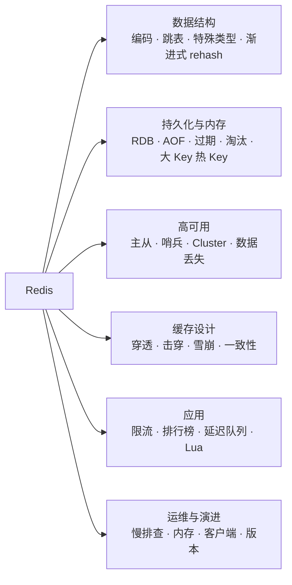
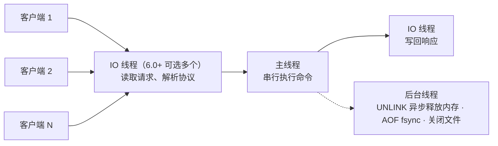
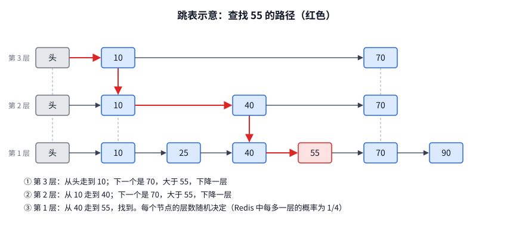
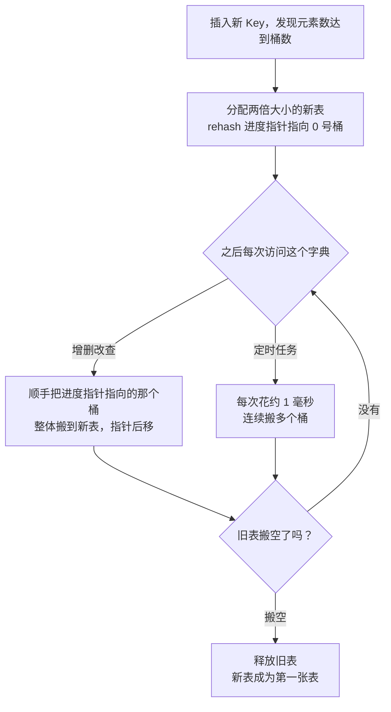
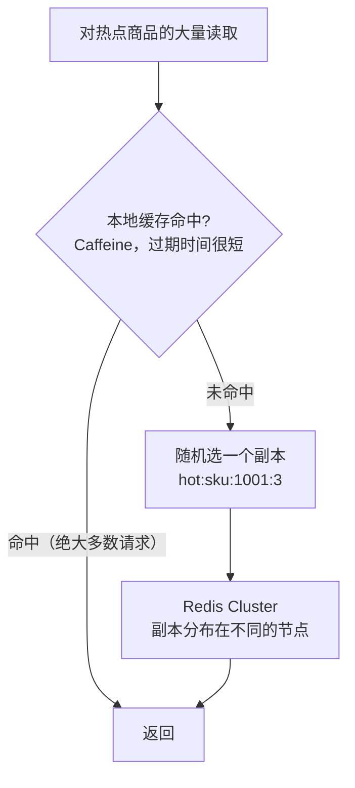
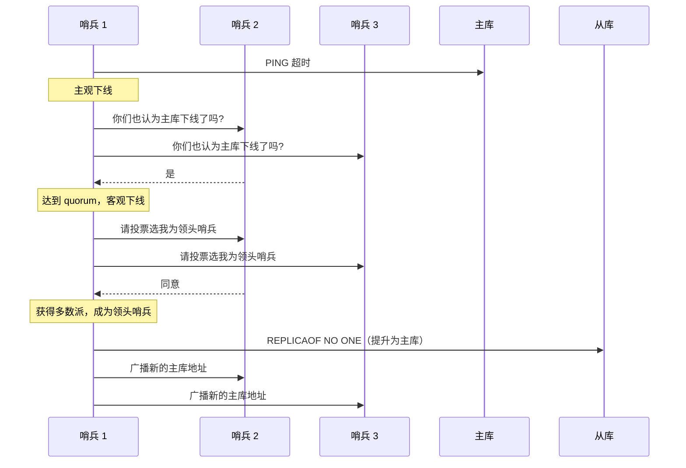
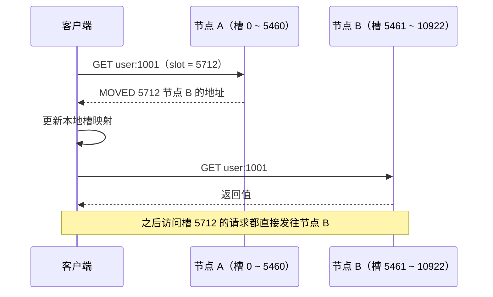
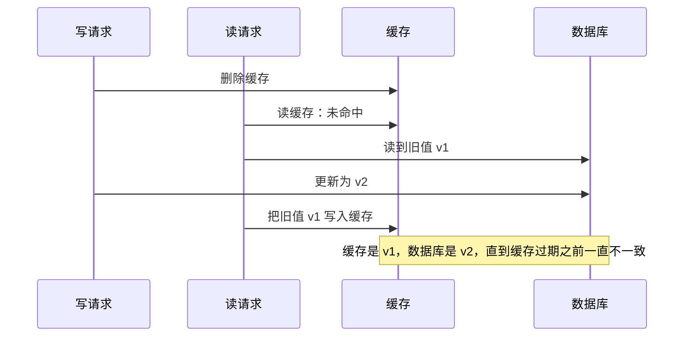
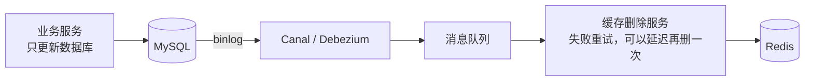

# 17 · Redis

> 适用岗位：Java 资深开发 / 架构师
> 版本基线：Redis 7.x / 8.x（Redis 8 于 2025 年 5 月发布）；Valkey 作为社区分支一并说明
> 事实核对：标「实测」的结论是在本机 Redis 6.2.6 的临时实例上运行得到的（6.2 与 7.x 的差异会注明）；Redisson 的实现来自本机 Redisson 4.2.0 源码；7.4 / 8.0 的新特性与许可证变化查阅了官方文档和公开报道，附有链接
> 相关分类：[《09 分布式理论》](../03-分布式与微服务/09-分布式理论.md)（分布式锁、一致性哈希、Gossip）、[《18 本地缓存》](18-本地缓存.md)（多级缓存）、[《24 高并发》](../06-三高与架构/24-高并发.md)、[《26 高可用》](../06-三高与架构/26-高可用.md)（限流）

## 知识地图



## 题目索引

| 编号 | 题目 | 难度 | 层级 |
| --- | --- | --- | --- |
| 17-01 | Redis 为什么快？它真的是单线程吗？ | ★★ | 资深 |
| 17-02 | 基本数据类型的底层编码是什么？ | ★★★ | 资深 |
| 17-03 | ZSet 为什么用跳表而不是红黑树？ | ★★★ | 资深 |
| 17-04 | Bitmap、HyperLogLog、GEO、Stream 等类型适合什么场景？ | ★★ | 资深 |
| 17-24 | Redis 的哈希表是怎么扩容的？什么是渐进式 rehash？ | ★★ | 资深 |
| 17-05 | RDB 和 AOF 有什么区别？生产中怎么配？ | ★★★ | 资深 |
| 17-06 | 过期键如何删除？内存满了怎么淘汰？ | ★★★ | 资深 |
| 17-07 | 大 Key 和热 Key 如何发现与处理？ | ★★★ | 资深 / 架构师 |
| 17-08 | 主从复制的原理 | ★★★ | 资深 |
| 17-09 | 哨兵是如何完成故障转移的？ | ★★★ | 资深 |
| 17-10 | Redis Cluster 的原理 | ★★★ | 资深 / 架构师 |
| 17-11 | Redis Cluster 有哪些使用限制？ | ★★ | 资深 |
| 17-12 | 主从切换会丢数据吗？什么是脑裂？ | ★★★ | 架构师 |
| 17-13 | 缓存穿透、击穿、雪崩及其解决方案 | ★★★ | 资深 |
| 17-14 | 如何保证缓存与数据库的一致性？ | ★★★ | 资深 / 架构师 |
| 17-15 | 有哪些缓存读写策略？ | ★★ | 资深 |
| 17-16 | 布隆过滤器的原理与使用 | ★★ | 资深 |
| 17-17 | 如何用 Redis 实现限流？ | ★★★ | 资深 / 架构师 |
| 17-18 | 排行榜、计数、去重、延迟队列如何实现？ | ★★ | 资深 |
| 17-19 | 事务、Lua、Pipeline 有什么区别？ | ★★ | 资深 |
| 17-20 | Redis 线上变慢，如何排查？ | ★★★ | 资深 |
| 17-21 | 内存碎片与内存优化 | ★★ | 资深 |
| 17-22 | Lettuce、Jedis、Redisson 怎么选？ | ★★ | 资深 |
| 17-23 | Redis 6、7、8 有哪些重要变化？许可证风波是怎么回事？ | ★★ | 架构师 |

---

## 一、数据结构

### 17-01 Redis 为什么快？它真的是单线程吗？

> ★★ ｜ 资深 ｜ 高频

**考察意图**：能否准确描述 Redis 的线程模型，而不是笼统地说"单线程"。

**30 秒版回答**

- 快的原因：
  1. **纯内存操作**；
  2. **命令执行是单线程的**：没有锁竞争和线程切换，每个命令都是原子的；
  3. **IO 多路复用**：一个线程通过 epoll 处理大量连接，见[《08 Netty》](../02-框架与容器/08-Netty.md)08-01；
  4. **为不同场景优化的数据结构**：小数据用紧凑编码节省内存，大数据切换为高效的查找结构，见 17-02。
- "单线程"指的是**执行命令的主线程只有一个**，Redis 进程中还有其他线程：
  - 后台线程负责关闭文件、AOF 刷盘、**惰性删除**大 Key（`UNLINK`）；
  - **Redis 6.0 起支持多线程 IO**（`io-threads`）：网络读写和协议解析可以由多个 IO 线程并行完成，命令执行仍在主线程中串行进行。高并发、高网络吞吐的场景下可以开启。
- 单线程的代价：**任何一个耗时命令都会阻塞所有请求**。所以要避免 `KEYS *`、对大集合执行 `HGETALL`、`SMEMBERS`、复杂度高的 Lua 脚本等，见 17-20。

**深入剖析**



---

### 17-02 基本数据类型的底层编码是什么？

> ★★★ ｜ 资深 ｜ 高频

**考察意图**：是否理解 Redis 用"小数据紧凑存储、大数据高效查找"的方式在内存和性能之间权衡。

**30 秒版回答**

| 类型 | 编码（Redis 7.x） | 转换条件 |
| --- | --- | --- |
| String | `int`（整数）、`embstr`（≤ 44 字节）、`raw`（> 44 字节） | 实测：12345 为 `int`，44 字节为 `embstr`，45 字节为 `raw` |
| List | `quicklist`（由多个 listpack 组成的双向链表） | — |
| Hash | `listpack` → `hashtable` | 字段数或值的长度超过阈值时转换 |
| Set | `intset`（全是整数）、`listpack`（7.2 起，元素少时）→ `hashtable` | 实测：纯整数为 `intset`，含字符串时（6.2.6）为 `hashtable` |
| ZSet | `listpack` → `skiplist` + `dict` | 实测：元素超过 128 个时转换为 `skiplist` |

- **String 的实现是 SDS**（简单动态字符串）：记录长度（O(1) 获取长度）、预分配空间（减少扩容次数）、二进制安全（可以存放任意字节，包括 `\0`）。`embstr` 把对象头和 SDS 分配在一块连续内存中，只需一次内存分配，适合短字符串。
- **listpack 取代了 ziplist**（Redis 7.0 完成替换）。ziplist 中每个元素记录"前一个元素的长度"，某个元素变长时可能引发后续元素的**连锁更新**；listpack 中每个元素只记录自身的长度，没有这个问题。在 6.2 中看到的编码名称仍是 `ziplist`（本机 6.2.6 实测：小 Hash 和小 ZSet 显示为 `ziplist`）。
- 转换阈值可以配置（6.2 中为 `hash-max-ziplist-entries` 等，7.x 中改名为 `hash-max-listpack-entries` 等）。本机 6.2.6 实测的默认值：Hash 512 个字段、ZSet 128 个元素、intset 512 个元素；具体默认值以所用版本的配置为准。
- 编码转换是**单向**的：转换为 hashtable 或 skiplist 后，即使元素减少也不会转回紧凑编码。

**追问链**

1. **紧凑编码为什么只用于小数据？**
   listpack 是一块连续内存，查找要逐个遍历（O(n)），插入要移动后面的元素。元素少时这些开销可以忽略，而且节省了大量指针和对象头的内存；元素多了就必须换成哈希表或跳表。

---

### 17-03 ZSet 为什么用跳表而不是红黑树？

> ★★★ ｜ 资深 ｜ 高频

**考察意图**：是否理解跳表的结构和它在范围查询上的优势。

**30 秒版回答**

- ZSet 的大编码由两部分组成：**dict**（成员 → 分数，O(1) 查分数）+ **skiplist**（按分数排序，支持范围查询和排名）。
- 跳表：在有序链表的基础上，每个节点**随机地**拥有若干层索引（Redis 中每多一层的概率是 1/4，层数有上限），高层的索引跨越更多节点。查找时从最高层开始，能跳就跳，跳不过去就下降一层，平均复杂度 O(log n)。
- 选择跳表而不是红黑树的理由（Redis 作者给出过类似的解释）：
  - **范围查询更简单高效**：`ZRANGEBYSCORE` 找到起点后，沿着底层链表顺序遍历即可；红黑树要做中序遍历；
  - **实现更简单**，代码更易于理解和调试；
  - 插入和删除只需修改相邻节点的指针，**不需要旋转**来维持平衡；
  - 通过调整层数的概率，可以在内存和速度之间灵活取舍；
  - Redis 的跳表节点还记录了每层的**跨度**（span），可以在 O(log n) 内计算出排名（`ZRANK`）。

**深入剖析**



---

### 17-04 Bitmap、HyperLogLog、GEO、Stream 等类型适合什么场景？

> ★★ ｜ 资深 ｜ 中频

**考察意图**：能否为具体场景选择合适的数据类型，节省内存。

**30 秒版回答**

| 类型 | 原理 | 场景 | 注意 |
| --- | --- | --- | --- |
| **Bitmap** | 在 String 上按位操作 | 签到、每日活跃用户（用户 ID 作为偏移量），一亿用户约 12 MB | 用户 ID 稀疏时浪费空间；偏移量太大会一次性分配大块内存 |
| **HyperLogLog** | 概率算法估算基数，每个 key 最多约 12 KB | 页面 UV、搜索词去重计数 | **有误差**（标准误差约 0.81%），不能取出具体元素 |
| **GEO** | 基于 ZSet，把经纬度编码成 GeoHash 作为分数 | 附近的人、附近的门店 | 精度和半径有关；大规模的空间检索用专门的地理数据库或 ES |
| **Stream** | 仅追加的消息日志，支持消费者组、消息确认、待处理列表 | 轻量的消息队列、事件流 | 可靠性不如专业的 MQ（取决于持久化和主从复制），见 17-18 |
| **Vector Set**（Redis 8.0 新增，测试阶段） | 存储向量并支持相似度检索 | 语义检索、推荐 | API 可能变化（来源：[Redis 8.0 新特性](https://redis.io/docs/latest/develop/whats-new/8-0/)） |

**追问链**

1. **统计 UV 用 Set、Bitmap 还是 HyperLogLog？**
   需要精确值并且量不大：Set；用户 ID 是连续整数、需要精确值且量大：Bitmap；只需要近似值、量非常大：HyperLogLog，内存最省。

---

### 17-24 Redis 的哈希表是怎么扩容的？什么是渐进式 rehash？

> ★★ ｜ 资深 ｜ 高频

**考察意图**：Redis 用单线程处理命令，一次性搬迁几百万个 Key 会让所有请求卡住。面试官想听你讲清它是怎么把这件事摊开做的，以及扩容期间读、写、遍历分别怎么保证正确。

**30 秒版回答**

- Redis 的整个键空间，以及 Hash、Set、ZSet 的大编码，底层都是字典。字典里有**两张哈希表**：平时只用第一张，第二张只在 rehash 期间存在。
- **什么时候扩容**：元素个数达到桶的数量（负载因子为 1）就扩容，新表大小是不小于"元素个数 + 1"的最小 2 的幂。如果此时有子进程在做 RDB 或 AOF 重写，为了减少写时复制带来的内存开销，会推迟到负载因子超过一个更高的阈值才强制扩容（6.2 的源码里是 5）。
- **渐进式 rehash**：扩容时只分配新表，不立刻搬数据。之后分两条路慢慢搬：
  1. **被动**：每次对这个字典做增、删、改、查，顺手搬一个桶；
  2. **主动**：后台定时任务每次拿出大约 1 毫秒帮忙搬，由 `activerehashing` 控制，默认开启。
- **rehash 期间的读写**：查找和删除要**两张表都看**；新增只写入**新表**，保证旧表只减不增，迟早搬空。搬完后新表变成第一张，第二张清空。
- **缩容**：元素个数不到桶数量的 10% 时，定时任务会把表缩小。

**深入剖析**



在本机 Redis 6.2.6 的临时实例上实测。先用 `CONFIG SET activerehashing no` 关掉后台的主动搬迁，写入 70000 个 Key（刚好越过 65536），然后用 `DEBUG HTSTATS 0` 看 0 号库的字典：

```text
--- 写入 70000 个 key 后（已关闭后台主动 rehash）
Hash table 0 stats (main hash table):
 table size: 65536
 number of elements: 44463
Hash table 1 stats (rehashing target):
 table size: 131072
 number of elements: 25537
--- 再执行 3000 次 GET 后
Hash table 0 stats (main hash table):
 table size: 65536
 number of elements: 39746
Hash table 1 stats (rehashing target):
 table size: 131072
 number of elements: 30254
--- 打开后台主动 rehash 并等待 1 秒后
Hash table 0 stats (main hash table):
 table size: 131072
 number of elements: 70000
```

三段输出对应三个事实：

1. 扩容后两张表同时存在，数据分散在两边，新表正好是旧表的两倍；
2. 只执行读命令，旧表的元素也在减少、新表在增加，说明**读操作也会推进搬迁**；
3. 打开主动 rehash 后不到 1 秒就全部搬完，只剩一张 131072 的表。

**追问链**

1. **为什么不像 Java 的 HashMap 那样一次搬完？**
   HashMap 的扩容发生在调用线程里，只影响这一次 `put`；Redis 只有一个线程执行命令，一次搬完几百万个 Key 意味着这段时间所有客户端的请求都在排队。渐进式的做法是把一次大的停顿拆成很多次微小的开销，摊到后续的每个命令上。Java 里思路相近的是 ConcurrentHashMap 的多线程协助迁移，见[《03 Java 并发》](../01-Java核心/03-Java并发.md)03-16。
2. **rehash 期间用 SCAN 遍历，会漏掉或者重复吗？**
   不会漏，可能重复。SCAN 的游标不是简单递增，而是按"高位进位"的顺序走。这样设计的效果是：表扩大或缩小后，已经遍历过的桶对应到新表里的那些桶不会被再次遗漏。rehash 进行中时，SCAN 会把小表的一个桶和它在大表中对应的所有桶一起返回。代价是同一个 Key 可能返回多次，调用方要自己去重或者保证处理是幂等的。
3. **有子进程时为什么要尽量不扩容？**
   RDB 和 AOF 重写靠 `fork` 出来的子进程完成，父子进程通过写时复制共享内存。扩容要分配新表并逐步改写大量内存页，每改一页，操作系统就得为这一页真正复制一份，内存占用和延迟都会上升。所以这段时间 Redis 宁可让哈希冲突多一些。持久化的原理见 17-05。
4. **渐进式 rehash 有没有副作用？**
   有两个：
   - **内存瞬间上涨**：分配新表的那一刻，要为新的桶数组申请一整块内存。键空间有上亿个 Key 时，这块数组本身就是几个 GB，而且两张表要并存一段时间。如果实例已经接近 `maxmemory`，这次扩容会触发大量淘汰，表现为一次明显的延迟毛刺和一批 Key 被驱逐；
   - **个别命令变慢**：搬迁时遇到一个冲突链很长的桶，要把整条链搬完才能返回。

**生产实践 / 踩坑**

- **内存水位贴着 `maxmemory` 运行**：Key 数量增长到 2 的幂附近时突然出现大量淘汰和延迟抖动，原因就是上面说的扩容内存。给实例留出余量，Key 数量在 2 的幂附近时尤其要注意，监控 `INFO memory` 和 `evicted_keys`。
- **把 `activerehashing` 关掉来"降低延迟"**：对延迟极其敏感的场景确实可以关，但代价是空闲的实例永远停在 rehash 中间状态，两张表一直并存，白白多占内存。除非已经确认每次 1 毫秒的后台搬迁是问题所在，否则保持默认。
- **大 Key 自己内部的 rehash**：一个有几百万字段的 Hash，它内部的字典扩容同样走这套流程，同样有内存瞬间上涨的问题。这是不建议存大 Key 的原因之一，见 17-07。

说明：以上行为在 Redis 6.2.6 上实测。7.x 之后字典的内部结构做过调整，渐进式 rehash 的机制没有变；具体的阈值常量以所用版本的源码为准。

---

## 二、持久化与内存

### 17-05 RDB 和 AOF 有什么区别？生产中怎么配？

> ★★★ ｜ 资深 ｜ 高频

**考察意图**：是否理解两种持久化的原理、代价和组合方式。

**30 秒版回答**

| 维度 | RDB（快照） | AOF（追加日志） |
| --- | --- | --- |
| 原理 | `BGSAVE` 时 **fork** 子进程，把某一时刻的全部数据写成一个二进制文件 | 把每个写命令追加到日志文件中 |
| 数据安全 | 两次快照之间的数据会丢失 | 取决于 `appendfsync`：`always`（每条命令都刷盘，最安全，最慢）、**`everysec`（默认，最多丢 1 秒）**、`no`（由操作系统决定） |
| 文件大小 | 紧凑 | 较大，需要定期**重写**（用当前数据生成等价的最少命令） |
| 恢复速度 | 快 | 慢（要重放命令） |
| 对性能的影响 | fork 时可能短暂阻塞；写入多时写时复制会占用额外内存 | 刷盘有开销；重写同样需要 fork |

- **混合持久化**（`aof-use-rdb-preamble yes`）：AOF 重写时，先以 RDB 格式写入当前的全量数据，之后的增量命令再以 AOF 格式追加。兼顾了恢复速度和数据安全，是推荐的配置。
- **Redis 7.0 的 Multi-Part AOF**：AOF 被拆成一个基础文件（RDB 或 AOF 格式）+ 多个增量文件 + 一个清单文件，重写时不再需要在内存中缓冲重写期间的增量命令，降低了内存和磁盘 IO 的开销。
- **fork 的风险**：fork 本身需要复制页表，内存越大耗时越长，期间主线程阻塞；fork 之后，被修改的内存页要复制一份（写时复制），写入频繁时内存占用可能接近翻倍。所以 Redis 实例的内存不宜过大（常见的建议是单实例不超过十几 GB），并且要**关闭操作系统的透明大页**（THP），否则写时复制以 2 MB 为单位进行，开销大增。
- 生产配置：主库可以关闭 RDB 的自动快照以减少 fork，由从库负责持久化（但要防止主库重启后以空数据同步给从库，导致数据被清空）；或者统一使用混合持久化的 AOF + `everysec`。**Redis 作为纯缓存时，可以完全关闭持久化。**

---

### 17-06 过期键如何删除？内存满了怎么淘汰？

> ★★★ ｜ 资深 ｜ 高频

**考察意图**：是否清楚过期删除与内存淘汰是两套机制，以及近似 LRU 和 LFU 的原理。

**30 秒版回答**

- **过期删除**（两种策略结合）：
  - **惰性删除**：访问一个 key 时检查是否过期，过期就删除；
  - **定期删除**：后台按 `hz`（实测默认 10，即每秒 10 次）的频率，从设置了过期时间的 key 中**随机抽样**，删除其中已过期的；如果过期比例较高就继续抽样，同时限制每次执行的时间，避免阻塞。
  - 所以过期的 key **不一定会被立即删除**，可能仍然占用内存。
- **内存淘汰**：内存达到 `maxmemory` 时，按策略淘汰。实测 **默认策略为 `noeviction`**（不淘汰，写入命令直接报错）：

| 策略 | 范围 | 算法 |
| --- | --- | --- |
| `noeviction`（默认） | — | 不淘汰，写入报错 |
| `allkeys-lru` / `volatile-lru` | 所有 key / 设置了过期时间的 key | 近似 LRU |
| `allkeys-lfu` / `volatile-lfu` | 同上 | 近似 LFU |
| `allkeys-random` / `volatile-random` | 同上 | 随机 |
| `volatile-ttl` | 设置了过期时间的 key | 剩余过期时间最短的优先 |

- **近似 LRU**：Redis 不维护全局的 LRU 链表（太耗内存），而是在每个 key 上记录最近访问时间，淘汰时**随机抽样**若干个 key（`maxmemory-samples`，默认 5），淘汰其中最久未访问的，并用一个候选池提高准确性。
- **LFU**（4.0 起）：用一个 8 位的**对数计数器**记录访问频率（访问越多，计数增长越慢），并随时间衰减。比 LRU 更能抵抗"一次性批量访问"造成的缓存污染。
- 选择：作为缓存时一般用 `allkeys-lru` 或 `allkeys-lfu`；同时存放缓存和不能丢失的数据时，用 `volatile-*`，并确保不能丢失的数据没有设置过期时间（更好的做法是把它们分到不同的实例中）。

**追问链**

1. **大量 key 在同一时刻过期，会有什么问题？**
   定期删除的一个周期中需要删除大量 key，可能占用较多 CPU；更大的问题是缓存同时失效，请求全部打到数据库（缓存雪崩），见 17-13。设置过期时间时加上随机值，把过期时间打散。

---

### 17-07 大 Key 和热 Key 如何发现与处理？

> ★★★ ｜ 资深 / 架构师 ｜ 高频

**考察意图**：是否有真实的 Redis 治理经验。

**30 秒版回答**

**大 Key**（常见的判断标准：String 超过 10 KB，集合类元素超过几千个或总大小超过 1 MB）：

- 危害：
  - 读写大 Key 时网络传输大，**阻塞主线程**；
  - 删除大 Key 时释放内存耗时长（`DEL` 一个百万元素的集合可能阻塞秒级）；
  - 在 Cluster 中造成**数据和流量倾斜**；
  - 主从复制和迁移变慢。
- 发现：`redis-cli --bigkeys`、`--memkeys` 扫描；`MEMORY USAGE key`；离线分析 RDB 文件（不影响线上，最推荐）。
- 处理：
  - **拆分**：大 Hash 按字段哈希拆成多个小 Hash；大 List 按时间或序号分段；
  - 删除时使用 **`UNLINK`**（4.0 起，在后台线程中释放内存），或者先用 `HSCAN`、`SSCAN` 分批删除元素；可以开启 `lazyfree-lazy-user-del`，让 `DEL` 也异步释放（本机 6.2.6 实测默认关闭）；
  - 从业务上避免：不要把整个列表、整张表缓存成一个 key。

**热 Key**（某个 key 的访问量远高于其他 key）：

- 危害：在 Cluster 中，一个 key 只会落在一个节点上，**单个节点被打满**，而其他节点空闲，扩容也无济于事。
- 发现：`redis-cli --hotkeys`（需要淘汰策略为 LFU）；客户端或代理层统计；对已知的业务热点（秒杀商品、热搜）提前预判。
- 处理：
  - **本地缓存**：在应用进程内缓存热点数据（Caffeine），绝大部分请求不再访问 Redis，见[《18 本地缓存》](18-本地缓存.md)；
  - **多副本**：把热 Key 复制成 `key:1` ~ `key:N`，读取时随机选择一个，分散到多个节点；
  - **读写分离**：从从节点读取热 Key；
  - 写热点：先在本地或队列中合并，再批量写入。

**深入剖析**



---

## 三、高可用与集群

### 17-08 主从复制的原理

> ★★★ ｜ 资深 ｜ 高频

**考察意图**：能否讲清全量复制、增量复制和复制积压缓冲区。

**30 秒版回答**

- 从库启动或断线重连时，发送 `PSYNC <replid> <offset>`：
  - **全量复制**：第一次复制，或者主库无法提供从 offset 开始的增量数据时：
    1. 主库 `BGSAVE` 生成 RDB（或使用无盘复制，直接通过网络发送）；
    2. 生成期间的新写命令先缓存在发给这个从库的缓冲区中；
    3. 从库清空自己的数据，加载 RDB，再执行缓冲区中的命令；
  - **增量复制**：断线时间较短、从库的 offset 仍在主库的**复制积压缓冲区**（`repl-backlog-size`，一个环形缓冲区）范围内时，主库只发送缺失的那一段命令。
- 正常运行时，主库把每个写命令**异步**地发送给从库（命令传播），从库定期上报自己的 offset。
- Redis 4.0 的 PSYNC2：从库提升为主库后，原来的其他从库可以继续增量同步，不必全量复制。

**追问链**

1. **为什么要调大复制积压缓冲区？**
   默认值较小（1 MB）。写入量大时，从库只要断开几秒，缺失的数据就会超出缓冲区，触发全量复制。全量复制需要 fork、传输大文件，会对主库造成压力；如果在复制完成之前又超出缓冲区，还可能陷入反复全量复制的循环。应该按"写入速率 × 可容忍的断线时间"估算缓冲区大小。

---

### 17-09 哨兵是如何完成故障转移的？

> ★★★ ｜ 资深 ｜ 高频

**考察意图**：能否讲清下线判定、哨兵选举和选择新主库的规则。

**30 秒版回答**

1. **主观下线**：每个哨兵定期向主库发送 PING，超过 `down-after-milliseconds` 没有有效回复，这个哨兵就认为主库**主观下线**；
2. **客观下线**：该哨兵询问其他哨兵，认为主库下线的哨兵数量达到配置的 **quorum** 时，标记为**客观下线**；
3. **选出领头哨兵**：哨兵之间进行一次类似 Raft 的选举，获得**多数派**哨兵投票的成为领头哨兵，由它执行故障转移（所以哨兵至少要部署 3 个）；
4. **选择新主库**：从健康的从库中，依次按以下规则选择：
   - 优先级（`replica-priority`）高的；
   - 复制 **offset 大**的（数据最新）；
   - 运行 ID 小的；
5. **故障转移**：让选中的从库执行 `REPLICAOF NO ONE` 成为主库；让其他从库复制新主库；原主库恢复后成为新主库的从库；**通知客户端**新主库的地址（客户端通过订阅哨兵的消息或询问哨兵得到新地址）。

**深入剖析**



---

### 17-10 Redis Cluster 的原理

> ★★★ ｜ 资深 / 架构师 ｜ 高频

**考察意图**：能否讲清哈希槽、请求重定向、扩缩容和故障转移。

**30 秒版回答**

- **数据分片**：共 **16384 个哈希槽**，`slot = CRC16(key) mod 16384`，每个主节点负责一部分槽。
- **去中心化**：每个节点都保存完整的"槽 → 节点"映射，节点之间通过 **Gossip 协议**交换状态，见[《09 分布式理论》](../03-分布式与微服务/09-分布式理论.md)09-06。
- **请求重定向**：
  - 客户端请求的 key 不在当前节点时，节点返回 **`MOVED 槽号 目标地址`**，客户端更新本地的槽映射，以后直接访问正确的节点（智能客户端会缓存完整的槽映射）；
  - 槽正在迁移时，返回 **`ASK`**：只表示这一次请求去目标节点尝试，客户端不更新映射。
- **扩缩容**：以槽为单位迁移，迁移过程中逐个迁移槽中的 key，期间通过 ASK 重定向保证请求可以被正确处理。
- **故障转移**：主节点被多数主节点判定为下线后，它的从节点发起选举，获得**多数主节点**投票的从节点提升为主节点，接管原来的槽。
- **为什么是 16384 个槽**：节点之间的心跳消息中要携带一个表示槽归属的位图，16384 位 = 2 KB；如果是 65536 个槽，位图就是 8 KB，心跳开销太大。而且官方建议集群中主节点不超过约 1000 个，16384 个槽已经足够。

**深入剖析**



（槽号按 CRC16 实际计算：`user:1001` 落在槽 5712；`{user:1001}:profile` 和 `{user:1001}:orders` 因为 hash tag 也都落在槽 5712。）

---

### 17-11 Redis Cluster 有哪些使用限制？

> ★★ ｜ 资深 ｜ 中频

**考察意图**：是否清楚 Cluster 模式下多 key 操作的限制及其解决方法。

**30 秒版回答**

- **多 key 操作**：`MGET`、`MSET`、事务、Lua 脚本中涉及的多个 key 必须在**同一个槽**中，否则报 `CROSSSLOT` 错误。
  - 解决：使用 **hash tag**，key 中 `{}` 包起来的部分才参与计算槽，例如 `{user:1001}:profile` 和 `{user:1001}:orders` 一定在同一个槽中；
  - 但 hash tag 用得不当（例如所有 key 都用同一个 tag）会导致数据集中在一个节点上。
- 只能使用 **0 号数据库**。
- 客户端 `MGET` 跨槽的多个 key 时，智能客户端会按节点拆分成多个请求再合并，性能不如单节点。
- Lua 脚本中访问的 key 必须通过 `KEYS` 参数显式传入（并在同一个槽中），不能在脚本中拼接 key 名。
- Pub/Sub：普通的发布订阅消息会广播到整个集群的所有节点，开销大；Redis 7.0 起提供**分片发布订阅**（`SPUBLISH` / `SSUBSCRIBE`），消息只在频道所在的槽的节点上传播。

---

### 17-12 主从切换会丢数据吗？什么是脑裂？

> ★★★ ｜ 架构师 ｜ 高频

**考察意图**：是否理解异步复制带来的数据丢失，以及缓解手段的代价。

**30 秒版回答**

- **会丢数据**，两种情况：
  1. **异步复制丢失**：主库已经向客户端返回成功，但还没有同步给从库就宕机了，新主库中没有这些写入；
  2. **脑裂**：主库与哨兵、从库之间发生网络分区，但主库本身仍在运行，客户端仍在向它写入；哨兵选出了新的主库；分区恢复后，旧主库变成从库，**清空自己的数据**并从新主库同步，分区期间写入旧主库的数据全部丢失。
- 缓解措施：
  - `min-replicas-to-write N` + `min-replicas-max-lag 秒数`：主库发现正常同步的从库少于 N 个（或者延迟超过阈值）时，**拒绝写入**。这样分区后的旧主库很快就停止接收写入，丢失的数据被限制在一个很小的时间窗口内；
  - 代价：从库故障或网络抖动时，主库会拒绝写入，**牺牲了可用性**；
  - `WAIT` 命令：同步等待写入被指定数量的从库确认，相当于半同步，但仍不能完全保证不丢（被确认的从库没有被选为新主库时）。
- 结论：**Redis 的主从复制不保证强一致**。不能接受数据丢失的数据不应只存放在 Redis 中；分布式锁这类依赖 Redis 正确性的场景，要考虑丢失锁的后果，见[《09 分布式理论》](../03-分布式与微服务/09-分布式理论.md)09-14。

---

## 四、缓存设计

### 17-13 缓存穿透、击穿、雪崩及其解决方案

> ★★★ ｜ 资深 ｜ 高频

**考察意图**：能否准确区分三者，并给出各自的工程方案。

**30 秒版回答**

| 问题 | 现象 | 解决方案 |
| --- | --- | --- |
| **穿透** | 查询**根本不存在**的数据，缓存和数据库都没有，每次请求都打到数据库（常见于恶意攻击，例如用随机 ID 请求） | ① **缓存空值**（设置较短的过期时间）；② **布隆过滤器**：先判断 key 是否可能存在，一定不存在就直接返回，见 17-16；③ 参数校验，拦截明显非法的 ID |
| **击穿** | 某个**热点 key 过期**的瞬间，大量请求同时发现缓存未命中，一起去查数据库 | ① **互斥锁**：只让一个请求去查库并重建缓存，其他请求等待或返回旧值；② **逻辑过期**：缓存永不过期，值中记录一个逻辑过期时间，发现过期时由一个线程异步重建，其他请求先返回旧值；③ 热点数据不设过期时间，由后台任务主动刷新 |
| **雪崩** | **大量 key 同时过期**，或者 Redis 整体宕机，请求全部涌向数据库 | ① 过期时间加**随机值**；② Redis 高可用（主从 + 哨兵 / Cluster）；③ 数据库前面**限流和熔断**，保护数据库不被压垮；④ 多级缓存（本地缓存兜底）；⑤ 缓存预热 |

**深入剖析**

互斥锁防止击穿：

```java
public Product getProduct(long id) {
    String key = "product:" + id;
    Product cached = redisCache.get(key);
    if (cached != null) {
        return cached.isNullPlaceholder() ? null : cached;      // 空值占位，防止穿透
    }
    RLock lock = redisson.getLock("lock:" + key);
    try {
        if (!lock.tryLock(200, TimeUnit.MILLISECONDS)) {
            return fallback(id);                                // 没抢到锁：降级，例如返回默认值或稍后重试
        }
        try {
            cached = redisCache.get(key);                       // 双重检查：可能已经被其他请求重建
            if (cached != null) {
                return cached.isNullPlaceholder() ? null : cached;
            }
            Product product = productMapper.selectById(id);
            Duration ttl = Duration.ofMinutes(30).plusSeconds(ThreadLocalRandom.current().nextInt(300));   // 随机过期，防止雪崩
            redisCache.set(key, product == null ? Product.NULL_PLACEHOLDER : product,
                    product == null ? Duration.ofMinutes(2) : ttl);
            return product;
        } finally {
            lock.unlock();
        }
    } catch (InterruptedException e) {
        Thread.currentThread().interrupt();
        return fallback(id);
    }
}
```

**追问链**

1. **互斥锁方案在集群中一定要用分布式锁吗？**
   不一定。用本地锁（每个应用实例只放一个请求去查库）就能把数据库的压力从"请求数"降到"实例数"，在大多数情况下已经足够，而且没有分布式锁的开销和风险。

---

### 17-14 如何保证缓存与数据库的一致性？

> ★★★ ｜ 资深 / 架构师 ｜ 高频

**考察意图**：能否分析各种更新顺序的问题，并给出符合业务要求的方案。

**30 秒版回答**

- 最常用的模式是 **Cache Aside**：
  - 读：先读缓存，未命中再读数据库，然后写入缓存；
  - 写：**先更新数据库，再删除缓存**。
- 为什么是"删除"而不是"更新"缓存：
  - 并发写时，两个线程更新数据库和更新缓存的顺序可能交错，缓存中留下旧值；
  - 很多缓存值需要经过计算才能得到，频繁写但很少读的数据，每次都更新缓存是浪费；删除后由下一次读取按需加载。
- 为什么是"先更新数据库、再删除缓存"，而不是反过来：
  - 先删缓存再更新数据库：删除之后、更新完成之前，另一个读请求读到数据库的**旧值**并写回缓存，之后缓存一直是旧值，**发生概率很高**；
  - 先更新数据库再删缓存：只有在"缓存恰好过期 + 读请求读到旧值后，在写请求删除缓存**之后**才把旧值写回缓存"这种时序下才会不一致。因为读数据库通常比写数据库快得多，**概率很低**。
- 剩余的问题与对策：
  - **删除缓存失败**：重试；更可靠的方式是**订阅 binlog**（Canal、Debezium），由独立的消费者删除缓存，失败可以重试，并且与业务代码解耦；
  - **主从延迟**：删除缓存后，读请求从**从库**读到了旧值并写回缓存。可以用**延迟双删**（更新后立即删一次，延迟几百毫秒后再删一次），或者让回填缓存的读请求读主库；
  - 所有缓存都设置**过期时间**，作为最终的兜底：即使出现不一致，也会在过期后自动修正。
- 需要强一致时：缓存本质上是一个副本，无法在不牺牲性能的前提下做到强一致。对强一致有要求的数据（余额、库存的最终扣减）**以数据库为准**，不要依赖缓存的值做决策。

**深入剖析**

"先删缓存、再更新数据库"的问题时序：



基于 binlog 的缓存删除：



---

### 17-15 有哪些缓存读写策略？

> ★★ ｜ 资深 ｜ 中频

**考察意图**：是否了解几种经典缓存模式的区别。

**30 秒版回答**

| 策略 | 读 | 写 | 特点 |
| --- | --- | --- | --- |
| **Cache Aside**（旁路缓存） | 应用先读缓存，未命中再读数据库并回填 | 应用更新数据库，再删除缓存 | 最常用；应用自己管理缓存 |
| **Read Through** | 应用只读缓存，未命中时**由缓存组件**加载数据 | — | 加载逻辑封装在缓存组件中（例如 Caffeine 的 `LoadingCache`） |
| **Write Through** | — | 应用写缓存，**缓存组件同步**写入数据库 | 缓存和数据库同步更新，写入延迟高 |
| **Write Behind**（Write Back） | — | 应用只写缓存，缓存组件**异步批量**写入数据库 | 写入性能最好；缓存宕机时会丢失尚未写入的数据。适合计数、点赞这类允许少量丢失的数据 |

---

### 17-16 布隆过滤器的原理与使用

> ★★ ｜ 资深 ｜ 高频

**考察意图**：是否理解布隆过滤器的误判特性和容量规划。

**30 秒版回答**

- 原理：一个长度为 m 的**位数组** + k 个**哈希函数**。
  - 添加元素：用 k 个哈希函数算出 k 个位置，全部置为 1；
  - 查询元素：k 个位置**全为 1，则"可能存在"**；有任何一位为 0，则"**一定不存在**"。
- 特点：
  - **会误判**（不存在的元素可能被判断为存在，因为它的 k 个位置恰好都被其他元素置为 1），**但不会漏判**；
  - 空间极小：1 亿个元素、误判率 1% 时，大约只需要一百多 MB 的位数组；
  - **不支持删除**（某一位可能被多个元素共用）。需要删除时使用计数布隆过滤器或布谷鸟过滤器，或者定期重建。
- 容量规划：根据预计的元素数量 n 和可接受的误判率 p 计算位数组大小和哈希函数个数。**实际插入的元素远超预估时，误判率会急剧上升**，要监控并按需扩容（重建）。
- 实现：Redisson 的 `RBloomFilter`（基于 Bitmap）；Redis 的布隆过滤器模块（Redis 8 起，概率型数据结构已集成到 Redis 开源版本中）；本地使用 Guava 的 `BloomFilter`。
- 应用：防止缓存穿透、爬虫 URL 去重、推荐系统中过滤已推荐过的内容、垃圾邮件判断。

---

## 五、应用

### 17-17 如何用 Redis 实现限流？

> ★★★ ｜ 资深 / 架构师 ｜ 高频

**考察意图**：能否实现几种限流算法，并保证原子性。

**30 秒版回答**

- 分布式限流要求"判断 + 计数"是**原子**的，所以要用 **Lua 脚本**（或者 Redis 原生命令的组合）。
- 三种常见实现：

| 算法 | 实现 | 特点 |
| --- | --- | --- |
| **固定窗口** | `INCR key` + 首次设置过期时间（key 中带上时间窗口编号） | 最简单；窗口边界处可能出现两倍的突发流量 |
| **滑动窗口** | ZSet：成员为请求 ID、分数为时间戳；每次请求先删除窗口外的记录，再统计窗口内的数量 | 精确，但每个请求占用一个元素，流量大时内存开销大 |
| **令牌桶** | 用 Hash 记录"剩余令牌数 + 上次填充时间"，每次请求时按时间差补充令牌再扣减 | 允许一定的突发，平滑；Spring Cloud Gateway 内置的限流就是这种实现 |

- 算法本身的原理与对比见[《26 高可用》](../06-三高与架构/26-高可用.md)。

**深入剖析**

滑动窗口限流的 Lua 脚本：

```lua
-- KEYS[1] = 限流 key；ARGV[1] = 当前时间（毫秒）；ARGV[2] = 窗口长度（毫秒）；ARGV[3] = 窗口内允许的请求数；ARGV[4] = 本次请求的唯一 ID
local now = tonumber(ARGV[1])
local window = tonumber(ARGV[2])
local limit = tonumber(ARGV[3])
redis.call('ZREMRANGEBYSCORE', KEYS[1], 0, now - window)    -- 删除窗口之外的记录
if redis.call('ZCARD', KEYS[1]) < limit then
    redis.call('ZADD', KEYS[1], now, ARGV[4])
    redis.call('PEXPIRE', KEYS[1], window)
    return 1                                                -- 放行
end
return 0                                                    -- 拒绝
```

实测（本机 Redis 6.2.6）：限制为每 1000 毫秒 3 次，同一时刻连续发出 4 个请求，结果依次为 1、1、1、0；窗口过去之后再次请求，结果为 1。

时间由调用方传入，而不是在脚本中读取 Redis 服务器的时间，便于测试和保证多个调用之间时间来源的一致（同时要求应用服务器之间的时钟基本同步）。

---

### 17-18 排行榜、计数、去重、延迟队列如何实现？

> ★★ ｜ 资深 ｜ 中频

**考察意图**：能否用合适的数据结构解决常见业务问题，并说出其局限。

**30 秒版回答**

| 场景 | 实现 | 注意 |
| --- | --- | --- |
| **排行榜** | ZSet：`ZINCRBY` 加分，`ZREVRANGE` 取前 N 名，`ZREVRANK` 查名次 | 分数相同时按成员的字典序排列；需要"分数相同按时间先后"时，把时间编码进分数（例如 `分数 × 10^10 + (最大时间戳 - 当前时间戳)`）；超大的排行榜按区间拆分 |
| **计数** | `INCR` / `HINCRBY` | 高并发的计数可以先在本地累加，定期批量写入；需要持久化时异步同步到数据库 |
| **去重** | Set（精确）、HyperLogLog（近似计数）、布隆过滤器（大规模判断） | 见 17-04、17-16 |
| **延迟队列** | ZSet：成员为任务 ID、分数为执行时间；消费者定期取出分数小于当前时间的任务 | 多个消费者同时取任务要用 Lua 保证"取出 + 删除"原子；**可靠性有限**（Redis 丢数据、消费者取出后崩溃），重要的延迟任务应该使用 MQ 的定时消息，见[《34 定时任务》](../07-工程实践与稳定性/34-定时任务.md) |
| **消息队列** | List（`BRPOP`）或 Stream（消费者组、确认机制） | List 没有确认机制，消费者崩溃会丢消息；Stream 好一些，但持久化和复制仍然是异步的。重要的消息应该使用专业的 MQ |

---

### 17-19 事务、Lua、Pipeline 有什么区别？

> ★★ ｜ 资深 ｜ 高频

**考察意图**：是否清楚 Redis 事务的"原子性"与数据库事务的不同。

**30 秒版回答**

| 维度 | MULTI / EXEC 事务 | Lua 脚本 / Functions | Pipeline |
| --- | --- | --- | --- |
| 作用 | 把多个命令排队，`EXEC` 时一次性顺序执行 | 在服务端原子地执行一段逻辑 | 客户端把多个命令一次性发送，减少网络往返 |
| 原子性 | 执行期间不会被其他客户端的命令插入；但**某条命令执行出错时，其他命令照样执行，不会回滚** | 执行期间不会被其他命令插入；脚本中途出错时，之前已经执行的写操作**不会回滚** | **不保证原子性**，命令之间可能插入其他客户端的命令 |
| 条件逻辑 | 不支持（只能用 `WATCH` 实现乐观锁：被监视的 key 在 `EXEC` 之前被修改，整个事务放弃执行） | 支持任意的条件判断 | 不支持 |
| 适用 | 简单的批量操作 + 乐观锁 | "读取 → 判断 → 修改"的原子操作（分布式锁、限流、库存扣减） | 大量相互独立的命令，追求吞吐 |

- Redis 7.0 引入了 **Functions**：把 Lua 函数作为库**持久化**在服务端（随 RDB / AOF 保存、随复制同步），通过函数名调用，取代了"每次发送脚本或依赖脚本缓存"的 `EVALSHA` 方式。
- Lua 脚本要**短小**：脚本执行期间整个 Redis 被阻塞。

---

## 六、运维与演进

### 17-20 Redis 线上变慢，如何排查？

> ★★★ ｜ 资深 ｜ 高频

**考察意图**：是否有系统的排查思路。

**30 秒版回答**

先区分是 **Redis 本身慢**，还是**网络或客户端**的问题：在 Redis 所在的机器上用 `redis-cli --latency` 测基准延迟，并查看 `SLOWLOG GET` 中有没有慢命令。

| 原因 | 排查方式 | 处理 |
| --- | --- | --- |
| 复杂度高的命令（`KEYS`、`HGETALL` 大 Hash、`SMEMBERS`、`ZRANGE` 大范围） | `SLOWLOG GET`、`INFO commandstats` | 用 `SCAN` 系列命令代替；拆分大 Key；控制返回的数量 |
| 大 Key 的读写和删除 | `--bigkeys`、`MEMORY USAGE` | 拆分；`UNLINK`，见 17-07 |
| 大量 key 集中过期 | 观察是否在整点等固定时刻变慢 | 过期时间加随机值 |
| 内存达到上限，频繁淘汰 | `INFO stats` 中的 `evicted_keys` | 扩容或优化内存使用 |
| fork 耗时（持久化、全量复制） | `INFO stats` 中的 `latest_fork_usec` | 控制实例内存大小；关闭透明大页；错开持久化时间 |
| AOF 刷盘阻塞 | 磁盘 IO 繁忙时 `everysec` 也会阻塞主线程 | 使用更快的磁盘；避免与其他 IO 密集的程序共用磁盘 |
| 内存被交换到磁盘（swap） | 系统的 swap 使用情况 | 保证物理内存充足，禁用或限制 swap |
| CPU 被抢占、绑核不当 | 系统监控 | 隔离部署 |
| 热点 key、连接数过多 | `INFO clients`、热点统计 | 本地缓存、连接池调优 |

- `LATENCY DOCTOR` 和延迟监控（`latency-monitor-threshold`）可以帮助定位偶发的延迟尖刺。

---

### 17-21 内存碎片与内存优化

> ★★ ｜ 资深 ｜ 中频

**考察意图**：是否了解 Redis 的内存构成和优化手段。

**30 秒版回答**

- **内存碎片**：`INFO memory` 中的 `mem_fragmentation_ratio`（操作系统分配给 Redis 的内存 / Redis 实际使用的内存）：
  - 明显大于 1（例如超过 1.5）：碎片多，大量 key 被删除或修改后，内存没有归还给操作系统。可以开启**主动碎片整理**（`activedefrag yes`，需要 jemalloc），或者在低峰期重启从库再做主从切换；
  - 小于 1：说明部分内存被交换到了磁盘（swap），性能会严重下降，需要立即处理。
- 内存优化：
  - 控制 key 和 value 的长度（key 名不要过长，value 用更紧凑的序列化方式，如 Protobuf、压缩）；
  - **利用紧凑编码**：把大量小 key 合并为 Hash 中的字段（例如按 ID 分桶，`user:{id/100}` 作为 key，`id` 作为字段），让 Hash 保持在 listpack 编码，内存可以下降数倍；
  - 设置合理的过期时间，避免无用数据长期驻留；
  - 选择合适的数据类型（见 17-04）。

---

### 17-22 Lettuce、Jedis、Redisson 怎么选？

> ★★ ｜ 资深 ｜ 中频

**考察意图**：是否了解主流客户端的差异和常见问题。

**30 秒版回答**

| 客户端 | 特点 | 适用 |
| --- | --- | --- |
| **Lettuce**（Spring Boot 的默认客户端） | 基于 Netty，异步非阻塞；**一个连接可以被多个线程共享**（命令在连接上多路复用） | 绝大多数场景 |
| Jedis | 同步阻塞，一个连接同一时刻只能被一个线程使用，需要连接池 | 简单直接；老项目 |
| Redisson | 在客户端之上提供分布式对象和高级功能：分布式锁、限流器、布隆过滤器、延迟队列、本地缓存 + 远程缓存 | 需要这些高级功能时，与 Lettuce 配合使用 |

- Lettuce 的常见问题：
  - **Cluster 拓扑变化后不能及时感知**：默认不会自动刷新集群拓扑，节点故障转移后客户端仍然访问旧的节点，持续报错。需要开启**自适应刷新**和定期刷新（Spring Boot 中通过 `spring.data.redis.lettuce.cluster.refresh.*` 配置）；
  - 共享连接上执行**阻塞命令**（`BLPOP`）或超大的请求，会影响共享这个连接的其他所有命令。阻塞命令要使用独立的连接；
  - 默认的命令超时要显式设置。

---

### 17-23 Redis 6、7、8 有哪些重要变化？许可证风波是怎么回事？

> ★★ ｜ 架构师 ｜ 中频

**考察意图**：是否跟进 Redis 的版本和生态变化，能否做出合适的选型。

**30 秒版回答**

| 版本 | 重要变化 |
| --- | --- |
| 6.0 | **多线程 IO**；**ACL**（细粒度的用户权限）；客户端缓存（服务端协助的客户端缓存失效通知）；RESP3 协议 |
| 7.0 | **listpack 全面取代 ziplist**；**Functions**；**分片发布订阅**；**Multi-Part AOF**；ACL 增强 |
| 7.2 | 小的 Set 也可以使用 listpack 编码 |
| 7.4 | **Hash 字段级过期**（`HEXPIRE` 等命令），可以为 Hash 中的单个字段设置过期时间 |
| 8.0 | 新增 **Vector Set**（测试阶段）；新增 `HGETEX`、`HSETEX`、`HGETDEL` 等 Hash 命令；JSON、时间序列、概率数据结构、查询引擎等原本属于 Redis Stack 的模块被集成到 Redis 开源版本中，Redis Stack 随之被废弃 |

（来源：[Redis 8.0 新特性](https://redis.io/docs/latest/develop/whats-new/8-0/)、[Redis 8.0 命令参考](https://redis.io/docs/latest/commands/redis-8-0-commands/)）

**许可证变化**：

- 2024 年 3 月，Redis 从 BSD 许可证改为 **RSALv2 / SSPLv1 双许可证**（不属于开源许可证），主要限制云厂商直接提供托管服务；
- 随后，Linux 基金会联合多家云厂商基于 Redis 7.2.4 发起了 **Valkey** 分支，继续使用 BSD 许可证；
- 2025 年 5 月，Redis 8 增加了 **AGPLv3** 作为可选的许可证，重新成为 OSI 认可的开源软件（同时仍可以选择 RSALv2 或 SSPLv1）。
- 来源：[InfoQ：Redis 采用 AGPL 许可证](https://www.infoq.com/news/2025/05/redis-agpl-license)、[Techzine 报道](https://www.techzine.eu/news/infrastructure/131056/redis-returns-to-open-source-after-damaging-community-relationship)。

**选型影响**：

- 只是在自己的业务中使用 Redis（不对外提供 Redis 服务），这些许可证变化基本没有影响；
- 使用云厂商的托管服务时，要留意底层是 Redis 还是 Valkey，以及两者之间逐渐出现的功能差异（例如 Redis 8 新增的数据类型与命令）；
- 公司法务对 AGPL 有限制时，需要评估使用方式，或者选择 Valkey。
