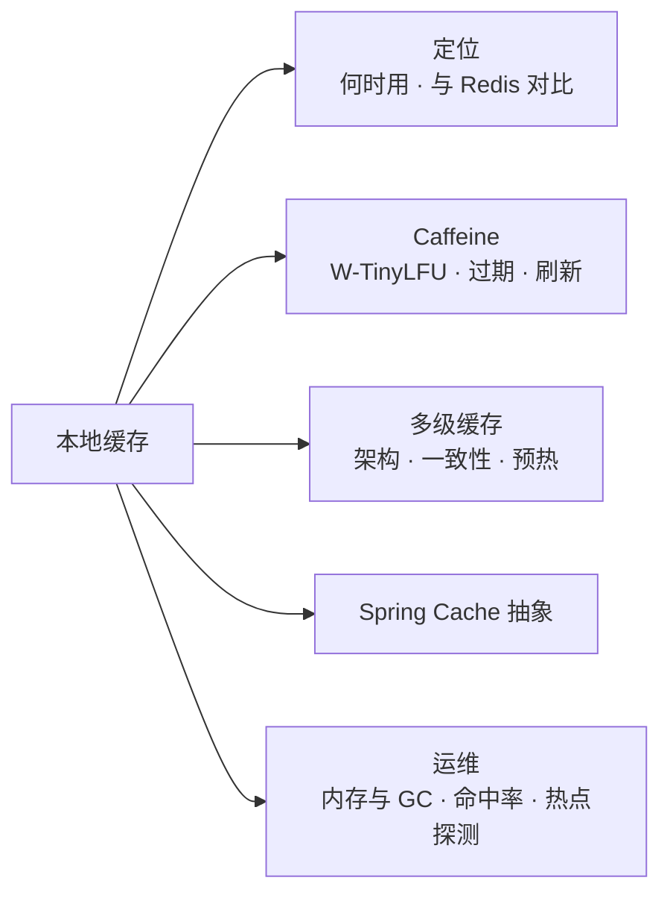
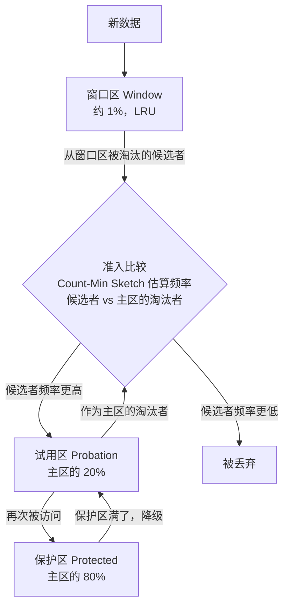
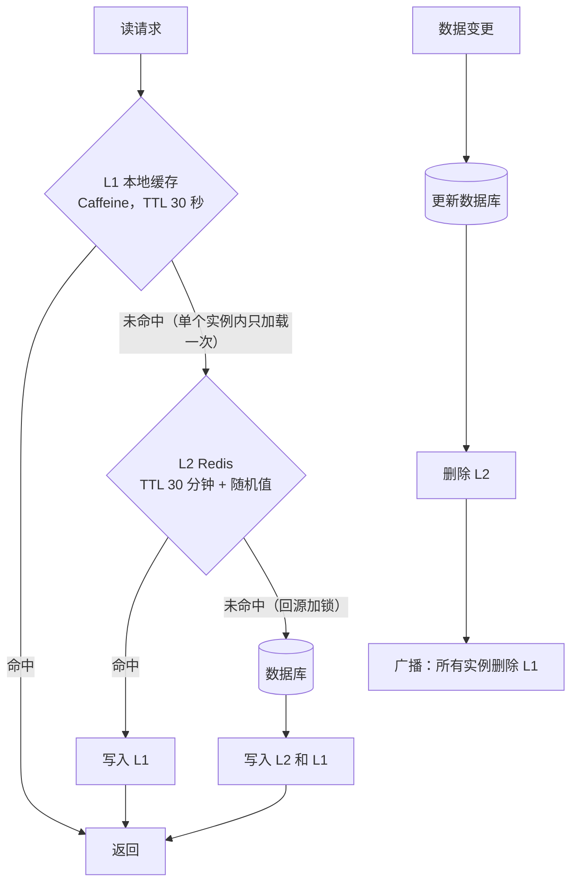
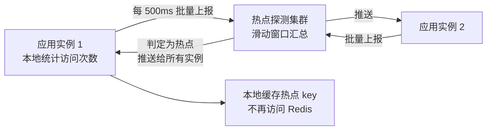

# 18 · 本地缓存

> 适用岗位：Java 资深开发 / 架构师
> 版本基线：Caffeine 3.x（Spring Boot 默认支持的本地缓存）、Guava 33.x
> 事实核对：W-TinyLFU 的分区比例来自本机 Maven 仓库中 Caffeine 3.1.8 的常量（`javap -constants`）；标「实测」的行为已在 JDK 25 + Caffeine 3.1.8 上运行验证
> 相关分类：[《02 集合类》](../01-Java核心/02-集合类.md)（LinkedHashMap 实现 LRU）、[《08 Netty》](../02-框架与容器/08-Netty.md)（时间轮）、[《17 Redis》](17-Redis.md)（热 Key、缓存一致性）、[《24 高并发》](../06-三高与架构/24-高并发.md)

## 知识地图



## 题目索引

| 编号 | 题目 | 难度 | 层级 |
| --- | --- | --- | --- |
| 18-01 | 什么时候用本地缓存？它和 Redis 有什么区别？ | ★★ | 资深 |
| 18-02 | 用 ConcurrentHashMap 做缓存有什么问题？ | ★ | 资深 |
| 18-03 | Guava Cache 和 Caffeine 有什么区别？ | ★★ | 资深 |
| 18-04 | Caffeine 的淘汰算法 W-TinyLFU 是怎么工作的？ | ★★★ | 资深 / 架构师 |
| 18-05 | Caffeine 有哪些过期方式？ | ★★ | 资深 |
| 18-06 | refreshAfterWrite 和 expireAfterWrite 有什么区别？ | ★★★ | 资深 |
| 18-07 | 多级缓存怎么设计？ | ★★★ | 架构师 |
| 18-08 | 多个实例的本地缓存如何保持一致？ | ★★★ | 架构师 |
| 18-09 | 服务重启后缓存为空怎么办？ | ★★ | 资深 |
| 18-10 | Spring Cache 的原理与常见坑 | ★★ | 资深 |
| 18-11 | 本地缓存会给 JVM 带来什么影响？ | ★★ | 资深 |
| 18-12 | 如何监控和提高缓存命中率？ | ★★ | 资深 |
| 18-13 | 如何自动发现热点并放入本地缓存？ | ★★★ | 架构师 |
| 18-14 | 什么是近端缓存（Near Cache）？Redis 的客户端缓存怎么用？ | ★★ | 资深 / 架构师 |
| 18-15 | 本地缓存设计中有哪些常见错误？ | ★★ | 资深 |

---

## 一、定位与选型

### 18-01 什么时候用本地缓存？它和 Redis 有什么区别？

> ★★ ｜ 资深 ｜ 高频

**考察意图**：能否根据数据的特征选择缓存层级。

**30 秒版回答**

| 维度 | 本地缓存（Caffeine） | 分布式缓存（Redis） |
| --- | --- | --- |
| 访问延迟 | 纳秒到微秒级（进程内内存访问，没有网络和序列化） | 亚毫秒到毫秒级（网络往返 + 序列化） |
| 容量 | 受限于单个 JVM 的堆，通常几百 MB 以内 | 可以扩展到几十、上百 GB |
| 一致性 | **每个实例各有一份**，实例之间可能不一致 | 所有实例共享一份 |
| 对 JVM 的影响 | 占用堆内存，影响 GC | 无 |
| 应对热点 | 极强，请求不出进程 | 热 Key 会集中在一个节点上 |

- 适合本地缓存的数据：**读多写少、数据量小、能容忍短时间不一致**，例如：
  - 配置、字典、地区、类目等基础数据；
  - 热点商品、热门内容（配合短过期时间）；
  - 计算代价高的结果（权限树、规则编译结果）。
- 不适合：频繁变化且要求一致的数据（库存、余额）、量大的数据、与用户强相关且无法复用的数据（每个用户的会话）。

---

### 18-02 用 ConcurrentHashMap 做缓存有什么问题？

> ★ ｜ 资深 ｜ 中频

**考察意图**：是否意识到"缓存"与"Map"的区别在于容量和生命周期管理。

**30 秒版回答**

- **没有容量上限**：只放不删，最终内存溢出，这是最常见的本地缓存导致的内存泄漏；
- **没有过期机制**：数据变化后一直返回旧值；
- **没有淘汰策略**：满了之后不知道该删除哪些；
- **没有防止并发加载的机制**：多个线程同时未命中，会重复执行加载逻辑（`computeIfAbsent` 可以避免，但加载期间会阻塞同一个桶上的其他写操作，见[《03 Java 并发》](../01-Java核心/03-Java并发.md)03-16）；
- 没有命中率等统计信息。
- 结论：只有**数据量固定且很小、永远不变**的数据（例如启动时加载的枚举映射）才适合用 Map，其他情况都应该用 Caffeine。

---

### 18-03 Guava Cache 和 Caffeine 有什么区别？

> ★★ ｜ 资深 ｜ 中频

**考察意图**：是否知道为什么 Spring 等框架从 Guava Cache 迁移到 Caffeine。

**30 秒版回答**

| 维度 | Guava Cache | Caffeine |
| --- | --- | --- |
| 淘汰算法 | 分段的 LRU | **W-TinyLFU**，命中率更高，并能抵抗扫描式的缓存污染 |
| 并发设计 | 类似早期 ConcurrentHashMap 的分段锁 | 基于 ConcurrentHashMap，读写操作先记录到**缓冲区**中，再批量、异步地维护淘汰策略，避免锁竞争 |
| 过期 | 写后过期、访问后过期 | 增加了**按条目自定义过期时间**（基于时间轮实现） |
| 刷新 | 同步刷新为主 | **异步刷新**，刷新期间返回旧值 |
| 异步 API | 无 | `AsyncCache`、`AsyncLoadingCache` |
| 状态 | 维护中，官方推荐新项目使用 Caffeine | 活跃，Spring Boot 默认支持 |

- Caffeine 的 API 与 Guava Cache 很相似，迁移成本低。

---

## 二、Caffeine

### 18-04 Caffeine 的淘汰算法 W-TinyLFU 是怎么工作的？

> ★★★ ｜ 资深 / 架构师 ｜ 中频，区分度高

**考察意图**：能否讲清频率统计、准入策略和分区结构，以及它解决的问题。

**30 秒版回答**

- LRU 和 LFU 各有缺陷：
  - **LRU**：一次性的批量访问（全表导出、爬虫扫描）会把热点数据全部挤出缓存；
  - **LFU**：要为每个 key 维护精确的访问次数，内存开销大；历史上访问很多、但现在已经冷下来的数据很难被淘汰。
- **W-TinyLFU** 的设计：
  1. **频率统计用 Count-Min Sketch**（一种类似布隆过滤器的概率结构，每个计数器只有 4 位），以很小的内存近似统计所有 key 的访问频率；并且定期把所有计数**减半**（衰减），让过去的热点逐渐冷却；
  2. **缓存分为两个区域**：
     - **窗口区**（Window），使用 LRU，新数据先进入这里，让刚出现的数据有机会积累访问频率；
     - **主区**（Main），使用分段 LRU，又分为**试用区**（Probation）和**保护区**（Protected）。在试用区中再次被访问的数据会升级到保护区；
  3. **准入策略**（TinyLFU）：数据从窗口区被淘汰时，要和主区的淘汰候选者**比较访问频率**，频率更高的留下。只访问过一次的数据很难挤掉真正的热点。
- 分区比例（已核对 Caffeine 3.1.8 源码中的常量）：主区占 **99%**（`PERCENT_MAIN = 0.99`），即窗口区初始为 **1%**；主区中保护区占 **80%**（`PERCENT_MAIN_PROTECTED = 0.8`）。并且 Caffeine 会用**爬山法**（hill climbing）根据命中率的变化**自动调整**窗口区的大小，以适应不同的访问模式。
- **实测**：容量为 100 的缓存，先让 0 ~ 9 这 10 个 key 各被访问 20 次，然后一次性写入 2000 个新的 key（模拟扫描），**10 个热点 key 全部保留了下来**。

**深入剖析**



---

### 18-05 Caffeine 有哪些过期方式？

> ★★ ｜ 资深 ｜ 中频

**考察意图**：是否清楚几种过期方式的语义和实现。

**30 秒版回答**

| 方式 | 含义 | 适用 |
| --- | --- | --- |
| `expireAfterWrite` | 写入（或更新）后经过固定时间过期 | 最常用；保证数据的最大"陈旧时间" |
| `expireAfterAccess` | 最后一次读或写之后经过固定时间过期 | 会话类数据；**注意：只要一直被访问就永远不会过期**，不适合需要定期更新的数据 |
| `expireAfter(Expiry)` | 为每个条目**单独计算**过期时间 | 不同数据有不同的有效期（例如按接口返回的过期时间缓存令牌） |

- 实现：固定时长的过期只需要按时间顺序维护一个队列；按条目自定义的过期时间使用**分层时间轮**，增删都是 O(1)。
- 过期的数据不是在到期的那一刻被删除，而是在后续的读写操作或维护任务中被清理。需要及时清理时，可以配置一个 `Scheduler`。

---

### 18-06 refreshAfterWrite 和 expireAfterWrite 有什么区别？

> ★★★ ｜ 资深 ｜ 高频

**考察意图**：是否理解"刷新"如何避免缓存过期带来的请求阻塞和击穿。

**30 秒版回答**

- **`expireAfterWrite`**：到期后数据被移除。下一次读取时缓存未命中，**读取线程同步等待**加载完成。热点数据过期的瞬间，所有读取都要等待（虽然 Caffeine 对同一个 key 只会加载一次，其他线程等待结果），表现为周期性的延迟尖刺。
- **`refreshAfterWrite`**：到期后数据**不会被移除**。下一次读取时，触发一次**异步刷新**，在刷新完成之前**返回旧值**，刷新完成后替换。读取永远不会因为加载而阻塞。
- 两者通常**组合使用**：
  - `refreshAfterWrite(1 分钟)`：每分钟最多刷新一次，热点数据始终保持较新；
  - `expireAfterWrite(10 分钟)`：长时间没有被访问的数据（不会触发刷新）最终被移除，避免长期返回非常旧的数据。
- 注意：
  - 刷新是**由读取触发**的，没有被访问的数据不会刷新；
  - 刷新失败时会保留旧值，并在之后的读取中再次尝试，需要监控刷新失败的情况；
  - 刷新的加载逻辑默认在 `ForkJoinPool.commonPool()` 中执行，涉及阻塞 IO 时应该指定专用的 `executor`（与[《03 Java 并发》](../01-Java核心/03-Java并发.md)03-20 中的问题相同）。

**深入剖析**

```java
LoadingCache<Long, ProductDTO> productCache = Caffeine.newBuilder()
        .maximumSize(10_000)
        .refreshAfterWrite(Duration.ofMinutes(1))     // 1 分钟后的第一次读取触发异步刷新，期间返回旧值
        .expireAfterWrite(Duration.ofMinutes(10))     // 10 分钟内一直没有被读取的数据被移除
        .executor(cacheRefreshExecutor)               // 刷新涉及远程调用，使用专用线程池
        .recordStats()
        .build(id -> productClient.query(id));
```

---

## 三、多级缓存

### 18-07 多级缓存怎么设计？

> ★★★ ｜ 架构师 ｜ 高频

**考察意图**：能否说清每一级缓存的职责、过期时间的设定和回源保护。

**30 秒版回答**

- 典型的三级结构：**本地缓存（L1）→ Redis（L2）→ 数据库**。
- 每一级的职责：
  - **L1 本地缓存**：抵御热点，承担绝大多数读请求；容量小、**过期时间短**（秒级到分钟级），以控制实例之间的不一致；
  - **L2 Redis**：所有实例共享，容量大、过期时间较长；防止本地缓存未命中时直接打到数据库；
  - **数据库**：数据的唯一真实来源。
- 设计要点：
  - **过期时间逐级递增**：L1 < L2，L1 过期后可以从 L2 快速恢复；
  - **回源保护**：每一级未命中时只允许一个请求去下一级加载（Caffeine 的加载机制天然保证了单个实例内的合并，L2 回源数据库时用锁或单飞模式），防止击穿；
  - **更新时的失效**：数据变更后先删除 L2，再**广播通知所有实例删除 L1**，见 18-08；
  - 网关、CDN 也可以视为更前面的缓存层（静态内容、可以公开缓存的接口）。

**深入剖析**



---

### 18-08 多个实例的本地缓存如何保持一致？

> ★★★ ｜ 架构师 ｜ 高频

**考察意图**：是否有可落地的失效通知方案，并清楚其可靠性边界。

**30 秒版回答**

- 问题：服务部署了 N 个实例，每个实例都有自己的本地缓存。数据更新时只有处理更新请求的那个实例知道，其他实例的缓存仍是旧值。
- 方案（通常组合使用）：

| 方案 | 做法 | 特点 |
| --- | --- | --- |
| **短过期时间** | 本地缓存只保留几秒到几十秒 | 最简单、最可靠的兜底；不一致的时间窗口就是过期时间 |
| **广播失效** | 数据更新后，通过 Redis Pub/Sub 或 MQ 的广播消息通知所有实例删除对应的 key | 实时性好；Redis Pub/Sub 不保证送达（实例断线期间的消息会丢失），可靠性要求高时用 MQ 的广播消费 |
| **监听 binlog** | 由 CDC 组件捕获数据变更并发出失效消息 | 与业务代码解耦，不会遗漏通过其他途径修改数据的情况 |
| **版本号校验** | 在 Redis 中维护每类数据的版本号，实例定期（或每次读取时）比较版本号，不一致则清空本地缓存 | 适合整体刷新的基础数据（配置、字典） |

- 原则：**广播失效 + 短过期时间兜底**。广播保证大部分情况下及时更新，过期时间保证即使广播丢失，不一致也只会持续有限的时间。
- 收到失效通知时，**删除**本地缓存（下次访问时再加载），而不是直接用消息中的数据**更新**本地缓存：消息可能乱序，用旧消息覆盖新数据会造成更长时间的不一致。

---

### 18-09 服务重启后缓存为空怎么办？

> ★★ ｜ 资深 ｜ 中频

**考察意图**：是否考虑过冷启动对下游的冲击。

**30 秒版回答**

- 问题：发布或扩容时，新实例的本地缓存为空，一启动就承接流量，所有请求都穿透到 Redis 甚至数据库。多个实例同时发布时，冲击叠加。
- 方案：
  - **启动时预热**：在应用就绪之前（`ApplicationRunner` 中，并让 Kubernetes 的就绪探针在预热完成后才返回成功）加载热点数据，例如从 Redis 中读取上一次统计的热点 key 列表；
  - **逐步放量**：利用注册中心或负载均衡的**预热权重**，让新实例在启动后的几分钟内只承接部分流量，见[《10 RPC 与 Dubbo》](../03-分布式与微服务/10-RPC与Dubbo.md)10-09；
  - **分批发布**，避免所有实例同时变冷；
  - 预热的数据量要适中，过多会拖慢启动、占满内存。

---

### 18-10 Spring Cache 的原理与常见坑

> ★★ ｜ 资深 ｜ 高频

**考察意图**：是否理解 Spring Cache 是基于 AOP 的缓存抽象，以及使用中的陷阱。

**30 秒版回答**

- 原理：`@EnableCaching` 注册了一个缓存切面（`CacheInterceptor`）。调用带 `@Cacheable` 的方法前，先按 key 查缓存，命中就直接返回，不执行方法；未命中则执行方法并把结果放入缓存。`@CachePut` 总是执行方法并更新缓存，`@CacheEvict` 删除缓存。底层的缓存实现可以是 Caffeine、Redis 等（通过 `CacheManager`）。
- 常见坑：
  - **自调用不生效**：与事务一样，同一个类中的方法调用不经过代理，见[《05 Spring》](../02-框架与容器/05-Spring.md)05-12；
  - **缓存击穿**：默认情况下并发的未命中会同时执行方法。可以设置 `@Cacheable(sync = true)`，让同一个 key 的加载在单个实例内只执行一次；
  - **默认的 key 生成规则**：没有参数时使用一个固定的 key，多个参数时把所有参数组合成 key。参数是复杂对象时，要确保它正确实现了 `equals` 和 `hashCode`，最好显式指定 key；
  - **缓存 null 值**：方法返回 null 时默认也会缓存（取决于 CacheManager 的配置），既可以防止穿透，也可能让一个暂时查询不到的数据长时间返回 null。可以用 `unless = "#result == null"` 控制；
  - **返回可变对象**：使用本地缓存时，调用方修改了返回的对象，就等于修改了缓存中的数据，见 18-15；
  - 一个 CacheManager 只能有一种过期配置时，不同的缓存需要不同的过期时间，要为每个缓存名称单独配置。

```java
@Cacheable(cacheNames = "product", key = "#id", sync = true, unless = "#result == null")
public ProductDTO getProduct(long id) {
    return productClient.query(id);
}

@CacheEvict(cacheNames = "product", key = "#cmd.id")
public void updateProduct(UpdateProductCommand cmd) {
    productRepository.update(cmd);
}
```

---

## 四、运维与设计

### 18-11 本地缓存会给 JVM 带来什么影响？

> ★★ ｜ 资深 ｜ 中频

**考察意图**：是否考虑过缓存对 GC 和内存的影响。

**30 秒版回答**

- 本地缓存中的对象通常**长期存活**，会晋升到老年代，增大老年代的占用和 GC 时扫描、标记的工作量；缓存条目频繁替换时，还会产生大量的老年代垃圾，可能引发更频繁的 Mixed GC 或 Full GC。
- 控制手段：
  - **按权重限制容量**：`maximumWeight` + `weigher`，按对象的估算大小而不是条目数量限制，避免少数大对象撑爆内存；
  - **不要使用 `softValues()`**：软引用对象只在内存不足时才被集中回收，会导致堆长期处于高水位，并在回收时引发长时间的 GC（与[《04 JVM》](../01-Java核心/04-JVM.md)04-06 中的分析相同）；
  - 缓存**精简后的 DTO**，而不是包含大量无用字段的完整实体；
  - 数据量确实很大、又必须放在本地时，考虑**堆外缓存**（例如 OHC），代价是读写都需要序列化。

---

### 18-12 如何监控和提高缓存命中率？

> ★★ ｜ 资深 ｜ 中频

**考察意图**：是否把缓存效果当作可度量的指标来管理。

**30 秒版回答**

- 开启 `recordStats()` 后，Caffeine 提供命中次数、未命中次数、加载耗时、淘汰次数等统计；通过 Micrometer（`CaffeineCacheMetrics`，Spring Boot 会为 CacheManager 中的缓存自动绑定）输出到 Prometheus。
- 要关注的指标：
  - **命中率**：低于预期时要分析原因；
  - **淘汰次数**：淘汰频繁说明容量不够，或者数据的访问分布非常分散；
  - **加载耗时**：反映回源的成本。
- 命中率低的常见原因与对策：
  - 容量太小：调大，或者只缓存真正的热点数据；
  - 过期时间太短：在一致性允许的范围内延长，或者改用刷新（18-06）；
  - key 设计有问题：key 中包含了时间戳、随机数等每次都不同的值，导致缓存永远无法命中；
  - 访问本身就是长尾分布：这种数据不适合缓存。

---

### 18-13 如何自动发现热点并放入本地缓存？

> ★★★ ｜ 架构师 ｜ 中频

**考察意图**：能否设计一个热点探测系统，应对突发热点。

**30 秒版回答**

- 背景：预先配置的本地缓存只能覆盖已知的热点；而突发热点（突然爆火的商品、热搜事件）事先无法预知，等人工发现时，Redis 的某个节点可能已经被打满。
- 设计思路（京东开源的 hotkey 框架是一个典型实现）：
  1. **客户端上报**：每个应用实例在本地统计 key 的访问次数，定期（比如每 500 毫秒）把访问次数较高的 key 批量上报给探测集群；
  2. **探测集群汇总**：按 key 汇总所有实例上报的访问量，用滑动窗口计算，超过阈值就判定为热点；
  3. **推送热点**：把热点 key 推送给所有应用实例；
  4. **客户端缓存热点**：实例收到推送后，把这个 key 的值放入本地缓存，之后对它的访问不再请求 Redis；热点消退后自动移除。
- 关键在于**秒级发现、秒级推送**，以及上报和推送本身不能成为新的瓶颈（批量、采样、按 key 哈希分配到不同的探测节点）。

**深入剖析**



---

### 18-14 什么是近端缓存（Near Cache）？Redis 的客户端缓存怎么用？

> ★★ ｜ 资深 / 架构师 ｜ 中频

**考察意图**：是否了解由缓存服务端协助失效的本地缓存方案。

**30 秒版回答**

- **近端缓存**：在客户端本地保存一份远程缓存数据的副本，并由**服务端**在数据变化时通知客户端失效。与自己维护的"本地缓存 + 广播失效"相比，失效通知由缓存系统本身保证，更不容易遗漏。
- **Redis 的客户端缓存**（6.0 起，基于 RESP3 协议的 `CLIENT TRACKING`）：
  - 客户端开启跟踪后，服务端会记住这个客户端读取过哪些 key；
  - 这些 key 被修改时，服务端主动向客户端发送**失效消息**；
  - 也可以使用广播模式：客户端订阅一些 key 前缀，这些前缀下的任何 key 发生变化都会收到通知（服务端不需要记录每个客户端读过哪些 key）。
- 实现：Redisson 的 `RLocalCachedMap`、Lettuce 的客户端缓存支持。
- 注意：失效消息仍然是异步送达的，存在短暂的不一致；连接断开期间的失效消息会丢失，重连后需要清空本地缓存。

---

### 18-15 本地缓存设计中有哪些常见错误？

> ★★ ｜ 资深 ｜ 中频

**考察意图**：是否踩过本地缓存的坑。

**30 秒版回答**

| 错误 | 后果 | 正确做法 |
| --- | --- | --- |
| 缓存**可变对象**，调用方修改了返回值 | 缓存中的数据被篡改，影响所有后续的读取者，且极难排查 | 缓存不可变对象（record、不可变集合），或者返回副本 |
| 没有设置容量上限 | 内存泄漏、频繁 GC | 一律设置 `maximumSize` 或 `maximumWeight` |
| 缓存了与用户强相关、复用率很低的数据 | 命中率低，白白占用内存 | 只缓存可以复用的数据 |
| 用本地缓存存放需要一致性的数据（库存、余额） | 不同实例返回不同的值，甚至基于错误的值做出决策 | 这类数据以数据库或 Redis 为准 |
| 加载逻辑中执行慢的远程调用，而且使用公共线程池 | 拖慢其他使用公共线程池的任务 | 指定专用的 executor |
| 多个缓存的 key 冲突（不同类型的数据使用了相同的 key） | 数据串了 | 不同用途使用不同的缓存实例，或者给 key 加上类型前缀 |
| 只更新数据库，没有让本地缓存失效 | 长时间返回旧数据 | 广播失效 + 短过期时间，见 18-08 |
