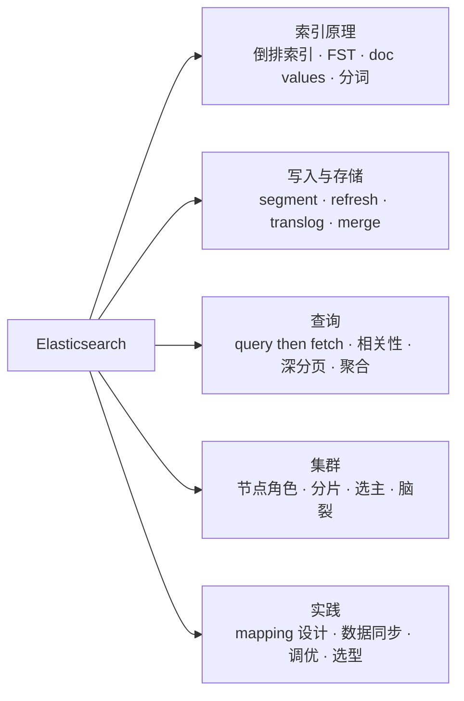
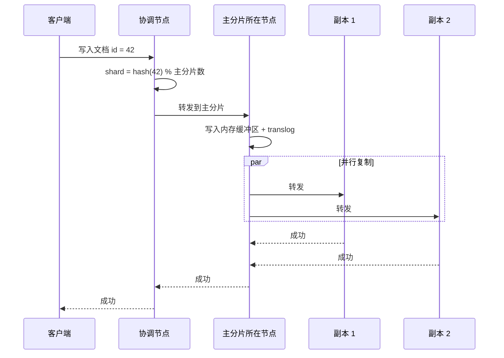
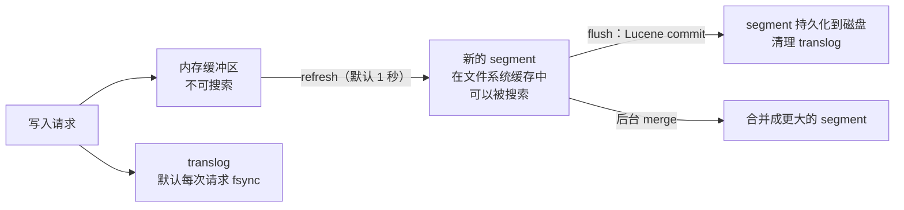
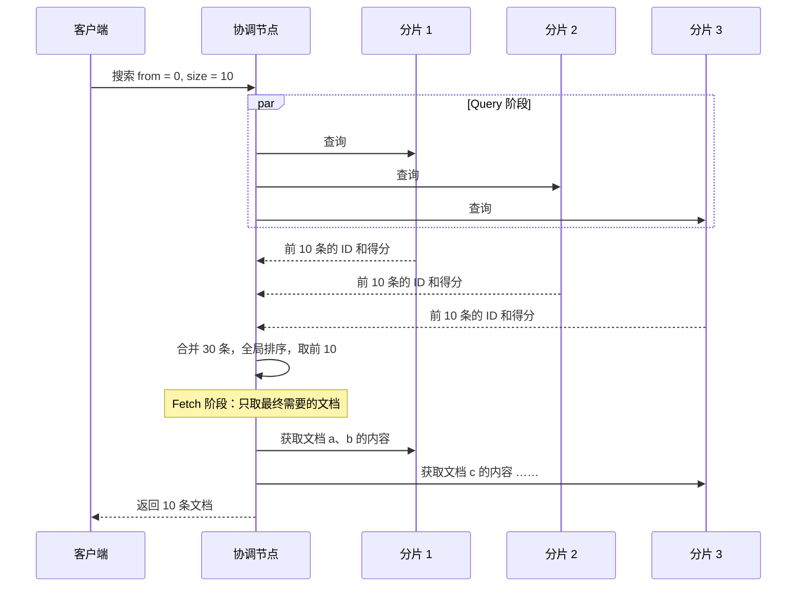
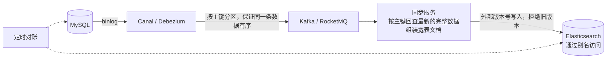

# 19 · Elasticsearch

> 适用岗位：Java 资深开发 / 架构师
> 版本基线：Elasticsearch 8.x / 9.x（9.0 于 2025 年 4 月发布，基于 Lucene 10）；OpenSearch 作为分支一并说明
> 事实核对：本机没有 Elasticsearch 环境，版本信息查阅了 Elastic 官方发布说明与 Maven Central，附有链接；原理部分以官方文档为准
> 相关分类：[《15 MySQL》](15-MySQL.md)（B+ 树索引对比）、[《16 分库分表》](16-分库分表.md)（异构索引）、[《17 Redis》](17-Redis.md)（缓存一致性的思路同样适用于数据同步）

## 知识地图

## 题目索引

| 编号 | 题目 | 难度 | 层级 |
| --- | --- | --- | --- |
| 19-01 | 倒排索引是什么？Elasticsearch 为什么检索快？ | ★★ | 资深 |
| 19-02 | text 和 keyword 有什么区别？分词器如何工作？ | ★★ | 资深 |
| 19-03 | 一条文档的写入流程是怎样的？ | ★★★ | 资深 |
| 19-04 | 为什么说 Elasticsearch 是"近实时"的？refresh、flush、translog 分别做什么？ | ★★★ | 资深 |
| 19-05 | segment 合并是什么？删除和更新是怎么实现的？ | ★★ | 资深 |
| 19-06 | 一次搜索请求是怎么执行的？ | ★★★ | 资深 |
| 19-07 | 相关性评分是怎么计算的？ | ★★ | 资深 |
| 19-08 | 深分页有什么问题？怎么解决？ | ★★★ | 资深 |
| 19-09 | 聚合的原理；为什么 terms 聚合结果可能不准？ | ★★★ | 资深 |
| 19-10 | 集群中有哪些节点角色？如何选主和防止脑裂？ | ★★★ | 资深 / 架构师 |
| 19-11 | 分片数和副本数怎么规划？ | ★★★ | 架构师 |
| 19-12 | Mapping 设计有哪些注意事项？ | ★★ | 资深 |
| 19-13 | MySQL 的数据如何同步到 Elasticsearch？ | ★★★ | 架构师 |
| 19-14 | 写入性能如何优化？ | ★★★ | 资深 |
| 19-15 | 查询性能如何优化？ | ★★★ | 资深 |
| 19-16 | 冷热分离与索引生命周期管理 | ★★ | 架构师 |
| 19-17 | Elasticsearch 8 / 9 有哪些重要变化？与 OpenSearch 怎么选？ | ★★ | 架构师 |

---

## 一、索引原理

### 19-01 倒排索引是什么？Elasticsearch 为什么检索快？

> ★★ ｜ 资深 ｜ 高频

**考察意图**：能否讲清倒排索引及其配套的数据结构。

**30 秒版回答**

- **正排索引**：文档 ID → 文档内容。要找"包含某个词的文档"，只能逐个扫描所有文档。
- **倒排索引**：**词项（term）→ 包含它的文档 ID 列表**（倒排列表，posting list，还可以包含词频和位置）。搜索时直接找到词项，取出它的文档列表，多个词的查询就是对多个列表求交集或并集。
- 为了快速找到词项，Lucene 还有两层结构：
  - **Term Dictionary**：所有词项排序后存放在磁盘上；
  - **Term Index**：用 **FST**（有限状态转换器，一种压缩的前缀树）建立词项前缀到磁盘位置的索引，常驻内存。查找时先在内存中通过 FST 定位，再到磁盘上读取少量数据。
- 倒排列表用**增量编码 + 位压缩**（Frame of Reference）压缩；多个过滤条件的结果可以用**位图**（Roaring Bitmap）缓存并快速求交。
- 另外还有为排序和聚合设计的**列式存储 doc values**（文档 → 字段值），见 19-09。
- 与 MySQL B+ 树索引的区别：B+ 树擅长按**完整值或前缀**精确查找和范围扫描；倒排索引擅长"**哪些文档包含这个词**"的全文检索，以及大量条件的任意组合。

**深入剖析**

---

### 19-02 text 和 keyword 有什么区别？分词器如何工作？

> ★★ ｜ 资深 ｜ 高频

**考察意图**：是否理解分析过程对索引和查询的影响。

**30 秒版回答**

| 类型 | 是否分词 | 适用 | 查询方式 |
| --- | --- | --- | --- |
| `text` | 是，写入时经过分析器拆成多个词项 | 全文检索：标题、正文、描述 | `match` 等全文查询（查询文本也会被分析） |
| `keyword` | 否，整个值作为一个词项 | 精确匹配、排序、聚合：状态、标签、ID、邮箱 | `term`、`terms`，以及排序和聚合 |

- **分析器**（Analyzer）由三部分组成：
  1. **字符过滤器**：处理原始文本，例如去掉 HTML 标签；
  2. **分词器**（Tokenizer）：把文本切分成词，例如标准分词器按空格和标点切分；中文需要专门的分词器（IK、jieba、smartcn 等），否则会被切成单个汉字；
  3. **词项过滤器**：转小写、去停用词、同义词、词干提取。
- 一个常见的错误：对 `text` 字段用 `term` 查询。例如字段值是 "Java Developer"，索引中的词项是 `java` 和 `developer`（已转为小写），用 `term` 查 "Java Developer" 自然查不到。
- 同一个字段可以用 **multi-fields** 同时建立两种索引：`title` 是 `text`，`title.keyword` 是 `keyword`，分别用于搜索和聚合排序。
- 中文分词的实践：索引时用细粒度的分词（`ik_max_word`，召回更多），查询时用粗粒度的分词（`ik_smart`，更精确）；业务专有名词需要维护**自定义词典**，并且词典更新后，已经索引的文档需要重建索引才能生效。

---

## 二、写入与存储

### 19-03 一条文档的写入流程是怎样的？

> ★★★ ｜ 资深 ｜ 高频

**考察意图**：能否讲清路由、主副分片复制和写入确认。

**30 秒版回答**

1. 客户端把请求发给任意节点，这个节点成为**协调节点**；
2. 协调节点计算文档所属的分片：`shard = hash(_routing) % 主分片数`，`_routing` 默认是文档 ID。这也是**主分片数在创建索引后不能直接修改**的原因（只能通过 split / shrink / reindex 改变）；
3. 请求转发给该分片的**主分片**所在的节点；
4. 主分片执行写入（写入内存缓冲区和 translog），然后**并行**转发给所有副本分片；
5. 副本写入成功后回复主分片，主分片向协调节点返回成功，协调节点再返回给客户端。
- `wait_for_active_shards`（默认为 1，即只要求主分片可用）控制写入前需要多少个分片处于活跃状态；副本写入失败时，主节点会把该副本从同步副本集合中移除，并在之后重新分配和恢复。

**深入剖析**

---

### 19-04 为什么说 Elasticsearch 是"近实时"的？refresh、flush、translog 分别做什么？

> ★★★ ｜ 资深 ｜ 高频

**考察意图**：是否理解写入到可搜索之间的延迟，以及数据持久性的保证。

**30 秒版回答**

- 写入时，文档先进入**内存缓冲区**，同时追加到 **translog**（事务日志）。
- **refresh**（默认每 **1 秒**一次）：把内存缓冲区中的文档写成一个新的 **segment**（Lucene 的不可变索引文件），放入操作系统的文件缓存中，**此时文档才可以被搜索到**。这就是"近实时"：写入后最多约 1 秒才能被搜到。
  - 7.0 起有"**搜索空闲**"优化：一个分片如果超过 30 秒没有收到搜索请求，就暂停定时 refresh，直到下一次搜索到来时才刷新，以减少写入密集但很少查询的索引的开销。
- **translog**：保证持久性。refresh 生成的 segment 还在操作系统的缓存中，没有刷到磁盘；进程或机器崩溃后，靠重放 translog 恢复。translog 默认**每次请求都 fsync**（`index.translog.durability: request`），也可以改为异步（`async`，每隔一段时间刷盘，性能更好，崩溃时可能丢失这段时间的数据）。
- **flush**：执行一次 Lucene 的 commit，把文件缓存中的 segment 真正 fsync 到磁盘，然后清空已经不再需要的 translog。由 Elasticsearch 根据 translog 的大小等条件自动触发。
- 写入后需要**立即**可见的场景（例如写入后马上在列表页查询），可以在写入请求上设置 `refresh=wait_for`（等待下一次 refresh 后再返回），**不要**用 `refresh=true` 强制每次都 refresh，那会产生大量的小 segment，严重影响性能。

**深入剖析**

---

### 19-05 segment 合并是什么？删除和更新是怎么实现的？

> ★★ ｜ 资深 ｜ 中频

**考察意图**：是否理解 segment 不可变带来的影响。

**30 秒版回答**

- segment 一旦写入就**不可修改**。好处：不需要加锁，可以被文件系统缓存长期复用，便于压缩。
- 因此：
  - **删除**：只在 `.liv` 文件中把文档**标记为已删除**，搜索时过滤掉；
  - **更新**：等于"标记删除旧文档 + 写入一个新文档"。
- refresh 不断产生小 segment，后台的 **merge** 把小 segment 合并成大 segment，同时**真正清除**被标记为删除的文档。segment 越少，每次搜索需要遍历的 segment 越少，速度越快。
- 影响：
  - 频繁更新同一批文档的场景（例如实时更新的商品库存），会产生大量删除标记和合并开销，Elasticsearch 并不擅长这种负载；
  - 对于不再写入的历史索引，可以执行 `_forcemerge` 合并成一个 segment，提升查询性能、减少资源占用；**不要对还在写入的索引执行强制合并**。

---

## 三、查询

### 19-06 一次搜索请求是怎么执行的？

> ★★★ ｜ 资深 ｜ 高频

**考察意图**：能否讲清 query then fetch 两个阶段，以及由此带来的深分页问题。

**30 秒版回答**

搜索分为两个阶段（**query then fetch**）：

1. **Query 阶段**：
   - 协调节点把请求发给索引的**每一个分片**（每个分片在主分片和副本中选一个，默认使用自适应副本选择，优先选择响应更快的节点）；
   - 每个分片在本地执行查询，计算得分，返回**排序后的前 `from + size` 条**的文档 ID 和排序值（不返回文档内容）；
   - 协调节点合并所有分片的结果，全局排序，选出最终需要的 `size` 条；
2. **Fetch 阶段**：协调节点只向持有这 `size` 条文档的分片请求文档内容（`_source`），组装后返回。

- 由此可知，查询第 `from` 页时，**每个分片都要返回 `from + size` 条**，协调节点要对 `分片数 × (from + size)` 条记录排序。这就是深分页昂贵的原因，见 19-08。

**深入剖析**

---

### 19-07 相关性评分是怎么计算的？

> ★★ ｜ 资深 ｜ 中频

**考察意图**：是否了解 BM25 的基本思想，以及 query 与 filter 的区别。

**30 秒版回答**

- Elasticsearch 5.0 起默认使用 **BM25** 算法。直观理解，一个词对文档得分的贡献取决于：
  - **词频 TF**：词在这个文档中出现得越多，得分越高，但增长会逐渐**饱和**（出现 10 次不会是出现 1 次的 10 倍）；
  - **逆文档频率 IDF**：词在所有文档中越少见，越能区分文档，权重越高（"的"这种词几乎没有区分度）；
  - **字段长度归一化**：同样出现一次，在短字段（标题）中比在长字段（正文）中更重要。
- 调整相关性的手段：字段加权（`title^3`）、`function_score`（结合销量、时间、距离等业务因素）、`rescore`（对前 N 条用更复杂的方式重新打分）。
- **query 上下文 vs filter 上下文**：
  - query 上下文中的条件会**计算得分**；
  - filter 上下文中的条件（`bool` 查询的 `filter`、`must_not`）**只判断是否匹配，不计算得分**，并且结果可以被**缓存**。
  - 所以，不影响排序的精确条件（状态、时间范围、类目）应该放在 `filter` 中，速度更快。
- 注意：IDF 等统计值是**按分片**计算的，数据量很小或分布不均时，同样的文档在不同分片上的得分可能不同。

---

### 19-08 深分页有什么问题？怎么解决？

> ★★★ ｜ 资深 ｜ 高频

**考察意图**：是否了解三种分页方式的取舍。

**30 秒版回答**

- `from + size` 分页的代价随页数线性增加，并乘以分片数（见 19-06）。Elasticsearch 默认限制 `from + size` 不能超过 **10000**（`index.max_result_window`），超出时报错。**不要简单地调大这个值**。
- 三种方式：

| 方式 | 原理 | 适用 |
| --- | --- | --- |
| `from + size` | 每次都从头计算 | 前几页的随机跳页 |
| **`search_after` + PIT** | 用上一页最后一条的排序值作为下一页的起点；PIT（Point In Time，7.10 起）固定一个数据视图，保证翻页过程中结果一致 | **深度翻页、导出全部数据**（推荐） |
| scroll | 创建一个快照，按批次遍历 | 旧的全量导出方式，**现在不再推荐用于深分页**，由 search_after + PIT 取代 |

- `search_after` 的限制：只能"下一页"，不能跳页；排序字段中要包含一个**唯一**的字段（例如 ID）作为最后的排序依据，否则排序值相同的文档可能被跳过或重复。
- 产品层面：搜索结果页通常没有必要支持翻到第 1000 页，可以限制最大页数，或者引导用户增加筛选条件。

---

### 19-09 聚合的原理；为什么 terms 聚合结果可能不准？

> ★★★ ｜ 资深 ｜ 中频

**考察意图**：是否理解 doc values 以及分布式聚合的近似性。

**30 秒版回答**

- 聚合和排序需要"**文档 → 字段值**"的访问方式，倒排索引（词项 → 文档）不适合。Lucene 为此提供了**列式存储 doc values**：在写入时为每个字段按列存储所有文档的值，存放在磁盘上，通过文件系统缓存访问。`keyword`、数值、日期等类型默认开启；`text` 字段没有 doc values，所以**不能直接对 text 字段排序或聚合**（只能开启 fielddata，把数据加载到堆内存中，代价很大，一般不要这样做）。
- **terms 聚合的不准确性**：
  - 求"出现次数最多的前 10 个品牌"时，每个分片只返回**本地**的前 N 个（`shard_size`，默认大于 `size`），协调节点再合并；
  - 某个品牌在每个分片上都排在第 11 名，单个分片都没有返回它，但它的**全局**总数可能进入前 10，结果就漏掉了它；
  - 应对：调大 `shard_size`；数据按聚合字段路由，让同一个品牌的数据落在同一个分片上；响应中的 `doc_count_error_upper_bound` 可以帮助判断误差范围。
- **cardinality 聚合**（去重计数）使用 HyperLogLog++ 算法，本身就是**近似值**，`precision_threshold` 以下的基数接近精确。

---

## 四、集群

### 19-10 集群中有哪些节点角色？如何选主和防止脑裂？

> ★★★ ｜ 资深 / 架构师 ｜ 高频

**考察意图**：是否了解节点角色的划分和 7.0 之后的集群协调机制。

**30 秒版回答**

| 角色 | 职责 |
| --- | --- |
| 主节点（master-eligible） | 管理集群状态：索引的创建和删除、分片的分配、节点的加入和离开。**不应承担数据和查询的负载** |
| 数据节点 | 存储数据，执行写入、查询和聚合；可以细分为 `data_hot`、`data_warm`、`data_cold`、`data_frozen`，用于冷热分层（19-16） |
| 协调节点（仅协调） | 不承担其他角色，只负责接收请求、分发和合并结果，适合聚合很重的场景 |
| 预处理节点（ingest） | 在写入前对文档做转换 |
| 机器学习节点 | 运行机器学习任务 |

- **选主与防脑裂**：
  - 7.0 之前：需要手工配置 `discovery.zen.minimum_master_nodes`（应设为主节点数的一半加一），配错就可能脑裂，是常见的事故原因；
  - **7.0 起**使用新的集群协调层：由具备主节点资格的节点组成**投票配置**，选主和集群状态的发布都需要**多数派**同意，节点加入或离开时自动调整投票配置，**不再需要也不再支持手工设置 minimum_master_nodes**。只需在首次启动集群时通过 `cluster.initial_master_nodes` 指定初始的主节点候选列表。
- 生产建议：**3 个专用的主节点**（容忍 1 个故障），配置可以较低但要稳定；数据节点、协调节点按负载水平扩展。

---

### 19-11 分片数和副本数怎么规划？

> ★★★ ｜ 架构师 ｜ 高频

**考察意图**：能否避免"分片过多"和"分片过大"两类常见问题。

**30 秒版回答**

- **主分片数**：创建后不能直接修改，需要提前规划：
  - 单个分片的大小，Elastic 官方的建议是 **10 GB ~ 50 GB** 之间，单个分片的文档数不超过约 2 亿；
  - 分片**过大**：故障恢复和迁移慢，单个分片的查询慢；
  - 分片**过多**（常见错误）：每个分片都要占用堆内存、文件句柄和线程，集群状态变大，主节点压力增加；查询时要访问更多的分片，开销反而更大。
  - 估算：主分片数 ≈ 预计的数据总量 / 目标分片大小；对于按时间滚动的日志类数据，用**索引生命周期管理**（ILM）在单个索引达到一定大小或时间时自动滚动到新索引，而不是给一个索引分配大量分片。
- **副本数**：
  - 提供**高可用**（主分片所在节点宕机时，副本被提升为主分片）和**查询吞吐**（查询可以由副本承担）；
  - 生产中至少 1 个副本；副本越多，写入的开销越大；
  - **副本数可以随时动态调整**。大批量导入数据时可以先把副本设为 0，导入完成后再恢复，见 19-14。
- 节点数要能容纳分片的分布：主分片和它的副本不会分配在同一个节点上。

---

## 五、实践

### 19-12 Mapping 设计有哪些注意事项？

> ★★ ｜ 资深 ｜ 中频

**考察意图**：是否踩过动态映射的坑，能否设计合理的字段类型。

**30 秒版回答**

- **不要依赖动态映射**：
  - 字符串会被同时映射为 `text` 和 `keyword` 两种，浪费空间；
  - 字段类型由第一条数据决定，"123" 可能被映射成 long，之后出现非数字时写入失败；
  - 日志中不断出现新的字段名时，字段数量不断膨胀（**映射爆炸**），默认上限为 1000 个字段（`index.mapping.total_fields.limit`）。
  - 生产中应该**显式定义 mapping**，并设置 `dynamic: strict`（遇到未定义的字段直接报错）或 `dynamic: false`（不为未定义的字段建立索引）。
- 字段设计：
  - 只需要精确匹配、排序、聚合的字段用 `keyword`；
  - 不需要搜索的字段设置 `index: false`；不需要排序和聚合的字段关闭 `doc_values`，节省磁盘；
  - 数值类型选择合适的精度；ID 这类不做范围查询的数字，用 `keyword` 往往比数值类型的精确查询更快。
- **mapping 中已有字段的类型不能修改**，只能新建索引后 **reindex**。所以应该通过**索引别名**访问索引，需要修改 mapping 时，创建新索引、重建数据，再把别名原子地切换到新索引，对应用透明。
- 关联关系：Elasticsearch 不擅长关联。优先**反范式化**（把需要的数据冗余到一个文档中）；数组中的对象需要独立匹配时用 `nested` 类型（代价是每个嵌套对象都是一个隐藏的文档）；`join`（父子文档）类型的查询代价很高，尽量避免。

---

### 19-13 MySQL 的数据如何同步到 Elasticsearch？

> ★★★ ｜ 架构师 ｜ 高频

**考察意图**：能否比较几种同步方案，并处理好一致性和顺序问题。

**30 秒版回答**

| 方案 | 做法 | 优点 | 缺点 |
| --- | --- | --- | --- |
| 同步双写 | 业务代码写 MySQL 后再写 ES | 简单，延迟低 | 两次写入无法保证同时成功；ES 故障拖慢主流程；与业务代码耦合 |
| 异步双写（MQ） | 写 MySQL 后发消息，消费者写 ES | 解耦、可以重试 | 发送消息与写数据库之间的一致性需要额外保证（见[《05 Spring》](../02-框架与容器/05-Spring.md)05-13） |
| **基于 binlog 的 CDC**（推荐） | Canal、Debezium 捕获 binlog → MQ → 同步服务写入 ES | 对业务代码无侵入，不会遗漏任何修改途径 | 链路较长，需要维护 CDC 组件；有秒级延迟 |
| 定时任务扫描 | 按 `update_time` 定期拉取变更 | 实现简单 | 延迟大；扫描给数据库带来压力；无法感知物理删除 |

- 关键的工程问题：
  - **乱序**：同一条数据的多次变更必须按顺序应用。MQ 中按主键分区，保证同一条数据的消息有序；写入 ES 时使用**外部版本号**（`version_type=external`，以数据库中的版本号或更新时间为准），旧版本的写入会被拒绝；
  - **宽表组装**：ES 中的一个文档往往来自多张表，任何一张表的变更都要触发整个文档的重建（查询数据库得到最新的完整数据再写入，而不是只用 binlog 中的那一行数据拼接，可以避免很多一致性问题）；
  - **全量重建**：新增字段或修复数据时，需要全量重建索引。在新索引上全量导入，同时把增量变更也写入新索引，追平后切换别名；
  - **对账**：定期比对 MySQL 和 ES 中的数据（数量、抽样比对），发现差异自动修复。
- 原则：**MySQL 是数据的唯一来源，ES 只是一个可以重建的副本**，不要把 ES 当作主存储。

**深入剖析**

---

### 19-14 写入性能如何优化？

> ★★★ ｜ 资深 ｜ 中频

**考察意图**：是否有大批量写入的调优经验。

**30 秒版回答**

- 使用 **Bulk API** 批量写入，单批大小以几 MB 到十几 MB 为宜（通过压测确定），多个线程并发提交；
- 大批量导入期间：
  - `refresh_interval` 设为 `-1`（关闭 refresh），导入完成后恢复；
  - **副本数设为 0**，导入完成后再恢复，由副本从主分片复制数据，比每条写入都复制两次更快；
- 日常写入：适当增大 `refresh_interval`（比如 30 秒），在实时性允许的情况下大幅减少 segment 的生成和合并；
- 可以容忍少量丢失的数据（日志），可以把 translog 改为异步刷盘；
- 让 ES **自动生成文档 ID**：使用自己的 ID 时，每次写入都要先检查这个 ID 是否已存在，开销更大；
- 精简 mapping：不需要搜索的字段关闭索引，不需要聚合的字段关闭 doc values；
- 硬件：使用 SSD；JVM 堆不超过约 31 GB（保持压缩指针，见[《04 JVM》](../01-Java核心/04-JVM.md)04-02），并且不超过机器内存的一半，**剩下的内存留给文件系统缓存**，Lucene 的性能高度依赖它。

---

### 19-15 查询性能如何优化？

> ★★★ ｜ 资深 ｜ 中频

**考察意图**：是否能定位慢查询并给出针对性的优化。

**30 秒版回答**

- **不影响得分的条件放在 `filter` 中**，利用缓存，见 19-07；
- **避免高代价的查询**：
  - 前置通配符（`*abc`）、正则查询：需要遍历大量词项。确实需要时，可以使用 `wildcard` 字段类型或 ngram 分词；
  - 深分页，见 19-08；
  - `script` 查询和排序；
  - 对 `text` 字段排序或聚合；
- **路由**：查询总是带有某个条件（例如用户 ID）时，写入和查询都按它设置 `routing`，查询只访问一个分片，而不是所有分片；
- 只返回需要的字段（`_source` 过滤）；
- 时间范围查询使用**按时间滚动的索引**，只查询相关时间段的索引；
- 对不再写入的索引执行 `_forcemerge`；
- 排查工具：慢查询日志（`index.search.slowlog`）；`profile` API 查看查询每一步的耗时；节点和分片的监控指标。

---

### 19-16 冷热分离与索引生命周期管理

> ★★ ｜ 架构师 ｜ 中频

**考察意图**：是否了解大数据量下的成本优化手段。

**30 秒版回答**

- 日志、监控、订单历史这类数据，越新越常被查询，越旧越少被访问。把所有数据都放在高配置的节点上很浪费。
- **冷热分层**：按节点角色把数据放在不同配置的节点上：
  - **hot**：最新的数据，承担写入和大部分查询，使用 SSD 和较强的 CPU；
  - **warm**：不再写入、偶尔查询，配置可以较低；
  - **cold** / **frozen**：很少查询，可以使用可搜索快照（数据存放在对象存储中，查询时按需加载），成本最低。
- **索引生命周期管理**（ILM）自动完成：
  - **滚动**（rollover）：当前写入的索引达到指定大小、文档数或时间时，自动创建新索引并切换写入别名；
  - 按时间把索引迁移到 warm、cold 节点，同时减少副本、强制合并、收缩分片；
  - 到期后自动删除。

---

### 19-17 Elasticsearch 8 / 9 有哪些重要变化？与 OpenSearch 怎么选？

> ★★ ｜ 架构师 ｜ 中频

**考察意图**：是否跟进 Elasticsearch 的版本和生态变化。

**30 秒版回答**

- **Elasticsearch 8.x**：
  - **默认开启安全功能**：首次启动时自动生成 TLS 证书和 `elastic` 用户的密码，客户端必须使用 HTTPS 和认证；
  - 彻底移除了映射类型（type），一个索引只有一种文档结构；
  - **向量检索**：`dense_vector` 字段 + 基于 HNSW 的近似 kNN 检索，可以与全文检索组合成混合检索，用于语义搜索和 RAG 场景；
  - 新的 Java 客户端（Elasticsearch Java API Client）取代了已废弃的 RestHighLevelClient；
  - ES|QL 查询语言。
- **Elasticsearch 9.0**（2025 年 4 月，与 8.18 同时发布）：基于 **Lucene 10**；向量量化技术 **BBQ**（Better Binary Quantization）正式可用，显著减少向量检索的内存占用；ES|QL 支持 JOIN（来源：[Elastic 9.0 / 8.18 发布说明](https://www.elastic.co/blog/whats-new-elastic-9-0-0)）。
- **许可证与 OpenSearch**：
  - 2021 年 Elastic 把许可证从 Apache 2.0 改为 SSPL / Elastic License，AWS 随后发起了 **OpenSearch** 分支（基于 Elasticsearch 7.10，Apache 2.0 许可证）；
  - 之后 Elastic 增加了 **AGPLv3** 作为可选许可证，9.0 的发布构件同时列出了 Elastic License 2.0、AGPLv3 和 SSPL 三种许可证（来源：[Maven Central 上的 Elasticsearch 9.0.0-beta1](https://central.sonatype.com/artifact/org.elasticsearch/elasticsearch/9.0.0-beta1)）。
- 选择：
  - 需要 Elastic 的最新功能（向量检索优化、ES|QL、Kibana 生态的完整能力）：Elasticsearch；
  - 使用 AWS 的托管服务、或者对 Apache 2.0 许可证有硬性要求：OpenSearch；
  - 两者的 API 已经逐渐分化，**客户端和查询语法不能保证互相兼容**，选定之后迁移成本不低。
