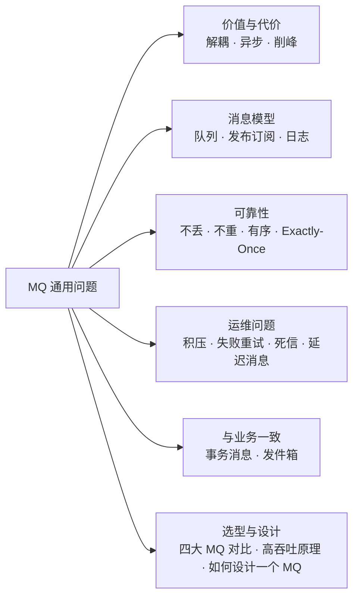
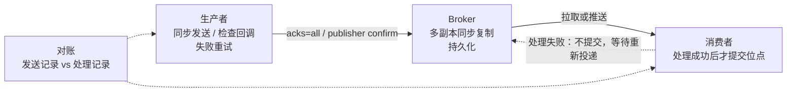
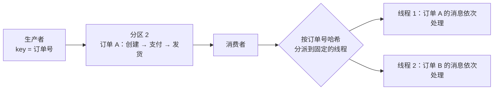
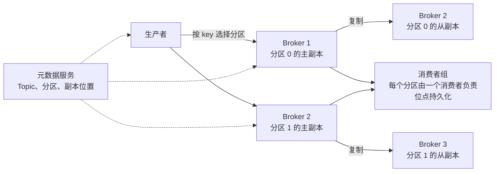

# 20 · MQ 通用与选型

> 适用岗位：Java 资深开发 / 架构师
> 版本基线：Kafka 4.x、RocketMQ 5.x、RabbitMQ 4.x、Pulsar 3.x / 4.x
> 说明：本类讲各种消息队列都会遇到的共性问题（可靠性、幂等、顺序、积压、延迟、事务）和选型；各产品的实现细节分别见[《21 Kafka》](21-Kafka.md)[《22 RocketMQ》](22-RocketMQ.md)[《23 RabbitMQ》](23-RabbitMQ.md)
> 相关分类：[《05 Spring》](../02-框架与容器/05-Spring.md)（事务发件箱）、[《09 分布式理论》](../03-分布式与微服务/09-分布式理论.md)（幂等、分布式事务）、[《38 操作系统》](../08-计算机基础/38-操作系统.md)（页缓存、零拷贝）

## 知识地图

## 题目索引

| 编号 | 题目 | 难度 | 层级 |
| --- | --- | --- | --- |
| 20-01 | 为什么要用消息队列？代价是什么？ | ★ | 资深 |
| 20-02 | 消息模型有哪些？队列模型和日志模型有什么区别？ | ★★ | 资深 |
| 20-03 | 如何保证消息不丢失？ | ★★★ | 资深 |
| 20-04 | 如何避免重复消费？ | ★★★ | 资深 |
| 20-05 | 如何保证消息的顺序？ | ★★★ | 资深 / 架构师 |
| 20-06 | 消息积压了怎么办？ | ★★★ | 资深 / 架构师 |
| 20-07 | 消费失败如何重试？死信队列有什么用？ | ★★ | 资深 |
| 20-08 | 延迟消息有哪些实现方式？ | ★★ | 资深 |
| 20-09 | 如何保证本地事务与发送消息的一致性？ | ★★★ | 架构师 |
| 20-10 | 推模式和拉模式有什么区别？ | ★★ | 资深 |
| 20-11 | 消息队列为什么能做到高吞吐？ | ★★★ | 资深 |
| 20-12 | 消息队列有 Exactly-Once 吗？ | ★★★ | 架构师 |
| 20-13 | Kafka、RocketMQ、RabbitMQ、Pulsar 怎么选？ | ★★★ | 架构师 |
| 20-14 | 如果让你设计一个消息队列，要考虑哪些问题？ | ★★★ | 架构师 |
| 20-15 | 团队使用 MQ 应该有哪些规范？ | ★★ | 架构师 |

---

## 一、价值与模型

### 20-01 为什么要用消息队列？代价是什么？

> ★ ｜ 资深 ｜ 高频

**考察意图**：能否结合具体场景说明 MQ 的价值，并清楚它引入的复杂度。

**30 秒版回答**

- 三大价值：
  - **解耦**：下单服务只需发布"订单已创建"事件，积分、物流、营销各自订阅，新增一个下游不需要修改下单服务；
  - **异步**：非核心的后续处理（发短信、发券）从同步调用链中移出，缩短主流程的响应时间；
  - **削峰填谷**：秒杀等突发流量先写入 MQ，下游按自己的处理能力匀速消费，保护数据库。
- 代价：
  - **系统复杂度增加**：要处理消息丢失、重复、乱序、积压；
  - **一致性变为最终一致**：上游已经成功，下游可能还没处理，或者处理失败；
  - **可用性依赖**：MQ 本身成为关键组件，需要高可用部署和运维；
  - **排查变难**：调用链被打断，需要完善的链路追踪和消息轨迹。
- 判断标准：调用方**不需要立即知道结果**才适合异步化。需要同步拿到结果的调用（下单时查库存、算价格）不应该用 MQ。

---

### 20-02 消息模型有哪些？队列模型和日志模型有什么区别？

> ★★ ｜ 资深 ｜ 中频

**考察意图**：是否理解不同 MQ 在存储和消费模型上的根本差异。

**30 秒版回答**

- 两种经典的消息语义：
  - **点对点**：一条消息只被一个消费者处理（任务分发）；
  - **发布订阅**：一条消息被所有订阅者各自处理一次（事件广播）。
- 两种实现模型：

| 维度 | 队列模型（RabbitMQ） | 日志模型（Kafka、RocketMQ、Pulsar） |
| --- | --- | --- |
| 存储 | 消息在队列中，**消费确认后删除** | 消息追加写入日志，**按保留时间或大小删除**，与是否被消费无关 |
| 多个订阅方 | 交换机把消息**复制**到多个队列，每个订阅方一个队列 | 多个消费者组**各自维护消费位置**（offset），读取同一份数据 |
| 回溯消费 | 不支持（消息已删除） | **支持**，重置 offset 即可重新消费历史消息 |
| 消费并行度 | 一个队列可以有多个消费者竞争消费 | 以**分区**为并行单位，一个分区同一时刻只被组内一个消费者消费（Kafka 4.x 的共享组、RocketMQ 5.x 的 POP 模式放宽了这一限制） |
| 路由能力 | 强：交换机按路由键、模式、消息头灵活路由 | 弱：按 Topic（和 Tag / Key 过滤） |
| 适合 | 复杂路由的业务消息、任务队列 | 高吞吐的事件流、日志采集、需要回放的场景 |

---

## 二、可靠性

### 20-03 如何保证消息不丢失？

> ★★★ ｜ 资深 ｜ 高频

**考察意图**：能否分阶段分析丢失的可能，并给出每个阶段的措施。

**30 秒版回答**

消息可能在三个阶段丢失，要分别保证：

| 阶段 | 丢失原因 | 措施 |
| --- | --- | --- |
| **生产** | 网络故障；发送是异步的，没有检查结果 | 使用**同步发送或检查异步回调**；失败时**重试**；Kafka 设置 `acks=all`；RabbitMQ 开启 **publisher confirm**；无法重试成功的消息落库或记录日志，后续补偿 |
| **存储** | Broker 宕机时消息还在内存中；主节点宕机时消息还没有复制到从节点 | **多副本**同步复制；Kafka 设置 `min.insync.replicas ≥ 2`，并关闭 unclean 选主；RocketMQ 使用同步刷盘 / 同步复制或 Controller 模式；RabbitMQ 使用**仲裁队列**和持久化消息 |
| **消费** | 消费者**先提交位点（或先确认）再处理**，处理失败或崩溃时消息就丢了 | **处理成功后再提交位点 / 确认**；关闭自动提交，或者确保自动提交发生在处理完成之后 |

- 端到端的兜底：发送方在业务库中记录"消息已发送"，消费方处理后回写或上报，定期**对账**发现丢失的消息并补发。
- 代价：每一项可靠性措施都会降低吞吐或增加延迟，要按业务的重要程度选择。日志采集类数据可以容忍少量丢失，订单、支付类消息不能。

**深入剖析**

---

### 20-04 如何避免重复消费？

> ★★★ ｜ 资深 ｜ 高频

**考察意图**：是否清楚重复不可避免，关键在于消费端幂等。

**30 秒版回答**

- **重复消息是不可避免的**：
  - 生产者发送后没收到确认，重试，Broker 中就有了两条（Kafka 的幂等生产者能消除这种情况下单个分区内的重复）；
  - 消费者处理完、还没来得及提交位点就崩溃了，重启后从旧位点重新消费；
  - 消费者组再平衡时，分区被分给另一个消费者，未提交的消息被再次消费。
- 所以 MQ 只能保证"**至少一次**"，**消费端必须幂等**。常用手段（详见[《09 分布式理论》](../03-分布式与微服务/09-分布式理论.md)09-17）：
  - **业务唯一键 + 唯一索引**：例如以订单号建立唯一索引，重复插入失败即忽略；
  - **状态机条件更新**：`UPDATE order SET status = 'PAID' WHERE order_no = ? AND status = 'UNPAID'`；
  - **消费记录表**：以"消息 ID 或业务键 + 消费者组"为唯一键，与业务操作在**同一个本地事务**中写入；
  - Redis `SET NX` 去重：只能作为前置的快速过滤，与业务数据不在一个事务中，不能作为唯一保证。
- 注意：**不要用 MQ 生成的消息 ID 作为幂等键**。生产者重试发送时，两条消息的 ID 是不同的。应该使用业务上有意义的唯一键（订单号 + 事件类型）。

---

### 20-05 如何保证消息的顺序？

> ★★★ ｜ 资深 / 架构师 ｜ 高频

**考察意图**：能否区分全局有序和分区有序，并指出破坏顺序的各种环节。

**30 秒版回答**

- **全局有序**：整个 Topic 只有一个分区、一个消费者，吞吐极低，几乎不应该使用。
- **局部有序**（业务上真正需要的）：只需要**同一个业务实体**的消息有序，例如同一个订单的"创建 → 支付 → 发货"。做法：
  1. **生产端**：以订单号作为消息的 key（Kafka）或 sharding key（RocketMQ），同一个订单的消息发到**同一个分区**；同一个订单的消息由**同一个线程**按顺序发送，不能并发发送；
  2. **存储**：分区内的消息天然有序；
  3. **消费端**：一个分区同一时刻只被一个消费者消费；如果消费者内部使用多线程处理，要按订单号把消息分派到**固定的线程**（例如按订单号哈希到 N 个内存队列），而不是随意交给线程池。
- 破坏顺序的环节：
  - 生产者重试（Kafka 在 `max.in.flight.requests.per.connection > 1` 且没有开启幂等时，重试可能导致乱序；开启幂等后可以保证）；
  - 分区数变化：扩容分区后，同一个 key 可能被分到新的分区；
  - 消费失败后的重试：失败的消息被放到重试队列，后面的消息先被处理了。严格有序的场景中，失败时要阻塞当前分区（或当前 key）直到成功，这会影响吞吐。
- 更稳健的做法是**让消费逻辑不依赖到达顺序**：消息中携带版本号或状态，消费方只接受比当前状态更新的消息（例如状态机只允许 待支付 → 已支付，不允许回退）。

**深入剖析**

---

### 20-06 消息积压了怎么办？

> ★★★ ｜ 资深 / 架构师 ｜ 高频

**考察意图**：能否快速止血，并找到根本原因。

**30 秒版回答**

**先定位原因**：

- 消费者**处理变慢**（下游数据库慢、调用的外部接口慢、出现了锁竞争）；
- 消费者**大量失败、不断重试**；
- 生产流量**突然增大**（大促、上游批量补数据）；
- 消费者实例变少，或者消费者组在频繁**再平衡**。

**止血手段**：

1. **扩容消费者**：增加消费者实例；但**消费者数量不能超过分区数**，多出来的实例会空闲。分区数不够时：
2. **临时扩容的转发方案**：写一个临时的消费者程序，只把积压的消息**原样转发**到一个分区数更多的临时 Topic，再部署大量消费者消费临时 Topic；
3. **提高单个消费者的处理能力**：批量消费、批量写库；消费者内部使用多线程并行处理（注意顺序和位点提交）；
4. **降级**：暂时跳过非核心的处理逻辑，或者丢弃已经过期、失去意义的消息（例如一小时前的实时推荐），事后再补偿；
5. 修复导致失败或变慢的根本原因。

**预防**：

- 监控**积压量（消费延迟）**并设置告警，在积压很少时就发现；
- 分区数按峰值流量预留余量；
- 消费逻辑设置超时，单条消息的处理失败不能卡住整个分区。

---

### 20-07 消费失败如何重试？死信队列有什么用？

> ★★ ｜ 资深 ｜ 中频

**考察意图**：是否了解重试与死信的设计，以及"毒消息"的处理。

**30 秒版回答**

- 消费失败的消息需要**重试**，但不能**原地无限重试**：一条永远无法处理成功的消息（数据格式错误、引用的数据已被删除，称为"毒消息"）会一直阻塞后面的消息。
- 常见的做法：
  - **退避重试**：失败的消息进入**重试队列**，间隔逐渐变长后再次投递（RocketMQ 内置了 16 级逐步变长的重试间隔；Kafka 需要应用层自己实现，例如 Spring Kafka 的重试主题）；
  - **死信队列**（DLQ）：超过最大重试次数的消息进入死信队列，**不再自动重试**，触发告警，由人工或专门的程序分析处理，修复后重新投递；
  - 区分**可重试的错误**（下游超时、暂时不可用）和**不可重试的错误**（参数错误、反序列化失败），后者应该直接进入死信队列，不浪费重试。
- 死信队列中的消息要有人负责处理。很多团队配置了死信队列却没有监控，消息静悄悄地堆在里面，等同于丢失。

---

### 20-08 延迟消息有哪些实现方式？

> ★★ ｜ 资深 ｜ 高频

**考察意图**：能否比较各种实现的精度、可靠性和规模。

**30 秒版回答**

| 实现 | 原理 | 特点 |
| --- | --- | --- |
| **RocketMQ 定时消息** | 4.x 只支持固定的 18 个延迟级别；**5.x 基于时间轮支持任意时间**的定时消息 | 可靠、可以支撑大规模，推荐 |
| RabbitMQ | 死信队列 + 消息 TTL（同一个队列中的消息只能按队首依次过期，不同 TTL 的消息混在一起会互相阻塞）；或使用延迟消息插件 | 规模大时插件有性能和可靠性的限制 |
| Kafka | 不原生支持，需要按延迟等级建立多个 Topic，由程序轮询转发 | 实现复杂 |
| Redis ZSet | 分数为执行时间，轮询取出到期任务 | 简单，但可靠性有限，见[《17 Redis》](../04-数据存储/17-Redis.md)17-18 |
| 数据库 + 定时任务扫描 | 任务表按执行时间建立索引，定时扫描 | 可靠、可查询；扫描有延迟，数据量大时扫描成本高 |
| 时间轮（内存） | 见[《08 Netty》](../02-框架与容器/08-Netty.md)08-15 | 进程内、高效，但重启会丢失 |

- 典型场景："订单 30 分钟未支付自动关闭"。推荐 MQ 的定时消息：下单时发一条 30 分钟后投递的消息，到期时检查订单状态，仍是"待支付"就关闭。同时用一个**定时扫描任务兜底**（扫描超时仍未关闭的订单），防止消息丢失。见[《34 定时任务》](../07-工程实践与稳定性/34-定时任务.md)。

---

### 20-09 如何保证本地事务与发送消息的一致性？

> ★★★ ｜ 架构师 ｜ 高频

**考察意图**：能否讲清两种主流方案的原理和取舍。

**30 秒版回答**

- 问题：先提交数据库事务再发消息，发送可能失败；先发消息再提交事务，事务可能回滚。两者之间没有原子性。
- 两种主流方案：

| 方案 | 原理 | 依赖 | 特点 |
| --- | --- | --- | --- |
| **事务发件箱**（本地消息表） | 业务数据和"待发送的消息"在**同一个本地事务**中写入数据库；由后台任务或 CDC 读取并投递，成功后标记已发送 | 只依赖数据库 | 通用，适用于任何 MQ；消息可能重复，下游要幂等 |
| **RocketMQ 事务消息** | 先发送**半消息**（对消费者不可见）→ 执行本地事务 → 根据结果提交或回滚半消息；Broker 长时间收不到结果时，**回查**生产者的本地事务状态 | RocketMQ | 不需要额外的消息表；需要实现回查接口 |

- Kafka 的"事务"指的是**多个分区写入的原子性**（和"消费-处理-生产"的 Exactly-Once），**不能**把数据库事务和消息发送绑定在一起，见 20-12。
- 详细流程见[《05 Spring》](../02-框架与容器/05-Spring.md)05-13 和[《22 RocketMQ》](22-RocketMQ.md)。

---

## 三、原理与选型

### 20-10 推模式和拉模式有什么区别？

> ★★ ｜ 资深 ｜ 中频

**考察意图**：是否理解两种消费方式的取舍以及"长轮询"的折中。

**30 秒版回答**

| 维度 | 推模式（RabbitMQ） | 拉模式（Kafka） |
| --- | --- | --- |
| 实时性 | 好，消息到达立即推送 | 依赖拉取频率 |
| 流量控制 | Broker 控制，消费者处理不过来时容易被压垮，需要 **prefetch** 限制未确认消息的数量 | **消费者自己控制节奏**，天然有背压 |
| 批量 | 较难 | 容易，一次拉取一批 |
| 实现复杂度 | Broker 要维护每个消费者的状态 | Broker 简单，状态在消费者端 |

- **长轮询**是两者的折中：消费者发起拉取请求，没有消息时 Broker 挂起这个请求，有新消息或超时再返回。既有拉模式的流量控制，又有接近推模式的实时性。Kafka 的 `fetch.max.wait.ms`、RocketMQ 的 PushConsumer（实际上是长轮询实现的"推"）都是这样。

---

### 20-11 消息队列为什么能做到高吞吐？

> ★★★ ｜ 资深 ｜ 高频

**考察意图**：能否从磁盘、内存、网络几个层面解释 Kafka / RocketMQ 的性能来源。

**30 秒版回答**

1. **顺序写磁盘**：消息以追加的方式写入日志文件。磁盘的顺序写速度远高于随机写，甚至可以接近内存的随机访问速度；
2. **利用操作系统的页缓存**：写入时只写入页缓存，由操作系统异步刷盘；读取时，刚写入的消息通常还在页缓存中，消费者直接从内存读取。Kafka 自己不在 JVM 堆中缓存消息，避免了 GC 压力，进程重启后缓存依然有效；
3. **零拷贝**：消费者读取消息时，通过 `sendfile`（Kafka）或 `mmap`（RocketMQ）直接把数据从页缓存发到网卡，不经过用户空间，见[《08 Netty》](../02-框架与容器/08-Netty.md)08-09；
4. **批量**：生产者把多条消息攒成一批发送，Broker 按批写入，消费者按批拉取，大幅减少网络往返和系统调用；
5. **压缩**：批量消息整体压缩（lz4、zstd 等），减少网络和磁盘的数据量；
6. **分区并行**：一个 Topic 分成多个分区，分布在不同的 Broker 上，写入和消费都可以水平扩展。

- Kafka 与 RocketMQ 在存储设计上的差异见[《22 RocketMQ》](22-RocketMQ.md)：Kafka 每个分区一组文件，RocketMQ 所有消息写入同一个 CommitLog。

---

### 20-12 消息队列有 Exactly-Once 吗？

> ★★★ ｜ 架构师 ｜ 中频，区分度高

**考察意图**：能否区分不同范围的"精确一次"，避免被宣传误导。

**30 秒版回答**

- 三种投递语义：**至多一次**（可能丢，不重复）、**至少一次**（不丢，可能重复）、**精确一次**（不丢不重）。
- Kafka 提供的 Exactly-Once 是有**范围**的：
  - **幂等生产者**：同一个生产者会话中，对**单个分区**的重试不会产生重复（Broker 根据生产者 ID 和序列号去重）；
  - **事务**：一个生产者可以原子地写入多个分区，并且把**消费位点的提交**也纳入同一个事务。所以在 "**从 Kafka 读 → 处理 → 写回 Kafka**" 这个闭环中（例如 Kafka Streams），可以做到精确一次；
  - 只要处理过程涉及**外部系统**（写数据库、调用外部接口），Kafka 的事务就无法覆盖。
- 端到端的"精确一次"在工程上的实现方式是：**至少一次投递 + 消费端幂等**（或者把消费位点和业务结果写在同一个数据库事务中）。这也是面试中最应该给出的答案。

---

### 20-13 Kafka、RocketMQ、RabbitMQ、Pulsar 怎么选？

> ★★★ ｜ 架构师 ｜ 高频

**考察意图**：能否结合业务特征给出有依据的选型。

**30 秒版回答**

| 维度 | Kafka | RocketMQ | RabbitMQ | Pulsar |
| --- | --- | --- | --- | --- |
| 定位 | 高吞吐的分布式日志和事件流平台 | 面向业务消息，可靠性和功能并重 | 灵活路由的传统消息代理 | 计算存储分离的云原生消息与流平台 |
| 吞吐 | 极高 | 高 | 中 | 高 |
| 延迟 | 毫秒级（批量带来一定延迟） | 毫秒级 | 很低（微秒到毫秒级） | 毫秒级 |
| 业务功能 | 较少：没有原生的延迟消息、死信、按 Tag 过滤（需要自己实现） | **丰富**：事务消息、定时消息、死信、重试、Tag 过滤、消息轨迹 | 丰富的路由；延迟依赖插件 | 丰富：延迟、死信、多租户、分层存储 |
| Topic 数量 | 分区过多时性能下降 | 支持大量 Topic | 支持大量队列 | 支持海量 Topic |
| 生态 | **最强**：Kafka Connect、Kafka Streams、Flink 等流处理与大数据生态 | Java 生态，国内使用广泛 | 多语言、多协议（AMQP、MQTT、STOMP） | 生态相对较小 |
| 运维 | Kafka 4.x 去掉 ZooKeeper 后简化了很多 | 中等 | 简单 | 组件多（Broker + BookKeeper），较复杂 |

- 选型建议：
  - **日志采集、行为数据、流处理、数据管道**：Kafka；
  - **电商、金融等核心业务消息**（需要事务消息、定时消息、可靠重试）：RocketMQ；
  - **中小规模、路由规则复杂、对延迟要求极低、多语言**：RabbitMQ；
  - **多租户、海量 Topic、需要存算分离和分层存储的云原生平台**：Pulsar。
- 很多公司同时使用两种：Kafka 处理数据流，RocketMQ 处理业务消息。

---

### 20-14 如果让你设计一个消息队列，要考虑哪些问题？

> ★★★ ｜ 架构师 ｜ 中频

**考察意图**：能否把前面所有的知识点组织成一个完整的系统设计。

**30 秒版回答**

| 方面 | 要回答的问题 | 参考做法 |
| --- | --- | --- |
| 存储 | 消息存在哪里？如何高效写入和读取？ | 追加写的日志文件 + 索引；利用页缓存和零拷贝（20-11） |
| 扩展 | 如何水平扩展？ | Topic 分区，分区分布在多个 Broker 上 |
| 高可用 | 节点宕机怎么办？ | 分区多副本，基于 Raft 或 ISR 的复制与选主 |
| 元数据 | 谁管理 Topic、分区、副本的信息？ | 独立的元数据服务（KRaft、NameServer） |
| 生产 | 如何保证不丢？如何提高吞吐？ | 确认机制、重试、幂等、批量、压缩 |
| 消费 | 如何记录消费进度？如何并行消费？ | 消费者组 + 位点；分区分配与再平衡 |
| 语义 | 至少一次 / 至多一次 / 精确一次？ | 默认至少一次，提供幂等和事务 |
| 业务功能 | 顺序、延迟、重试、死信、事务、过滤 | 按需提供 |
| 运维 | 监控、扩缩容、数据迁移、多租户隔离、权限 | 指标、消息轨迹、配额 |

**深入剖析**

---

### 20-15 团队使用 MQ 应该有哪些规范？

> ★★ ｜ 架构师 ｜ 中频

**考察意图**：是否有把 MQ 用好、管好的工程经验。

**30 秒版回答**

- **Topic 规划**：按业务域和事件类型命名（如 `trade.order.created`）；一个 Topic 只承载一种语义的消息；规划分区数时考虑峰值流量和消费者数量。
- **消息设计**：
  - 消息体尽量小（几 KB 以内），大数据放在对象存储中，消息只传引用；
  - 包含**业务唯一键**（用于幂等和排查）、事件时间、版本号；
  - 使用有 Schema 管理的格式（JSON Schema、Avro、Protobuf），并遵守向后兼容的演进规则；
  - 消息是"**发生了什么事**"（事件），而不是"**让你去做什么**"（命令），这样新增消费者不需要修改生产者。
- **生产端**：处理发送失败；重要消息使用发件箱或事务消息；设置消息 key，便于排序和查询。
- **消费端**：**必须幂等**；处理成功后才提交位点；设置超时；区分可重试和不可重试的错误；配置死信队列并监控。
- **可观测性**：监控发送失败率、消费延迟（积压量）、消费失败率、死信数量；开启消息轨迹，可以按业务键查到一条消息从发送到消费的完整路径。
- **治理**：Topic 和消费者组的申请与审批，明确负责人；不再使用的 Topic 和消费者组定期清理（遗留的消费者组仍在消费，会造成误解和资源浪费）。
