# 21 · Kafka

> 适用岗位：Java 资深开发 / 架构师
> 版本基线：Apache Kafka 4.x（4.0 于 2025 年 3 月发布，只支持 KRaft 模式）；3.x 的差异单独标注
> 事实核对：本机没有 Kafka 环境，4.x 的版本变化查阅了 Apache Kafka 官方发布公告和 KIP 文档，附有链接；原理部分以官方文档为准
> 相关分类：[《14 ZooKeeper》](../03-分布式与微服务/14-ZooKeeper.md)（KRaft 取代 ZooKeeper）、[《20 MQ 通用与选型》](20-MQ通用与选型.md)（可靠性、顺序、积压、Exactly-Once）、[《22 RocketMQ》](22-RocketMQ.md)

## 知识地图

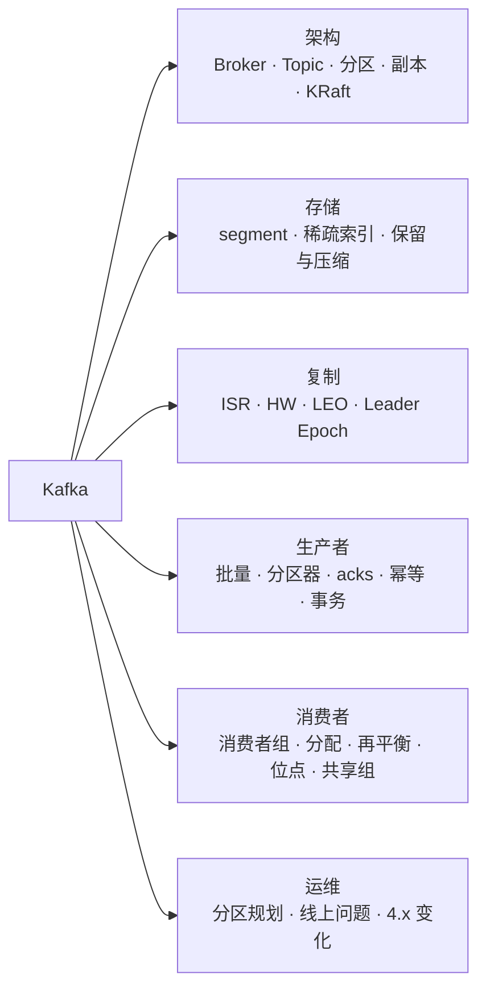

## 题目索引

| 编号 | 题目 | 难度 | 层级 |
| --- | --- | --- | --- |
| 21-01 | Kafka 的整体架构与核心概念 | ★★ | 资深 |
| 21-02 | Kafka 的消息是如何存储和查找的？ | ★★★ | 资深 |
| 21-03 | 副本机制：ISR、HW、LEO 是什么？ | ★★★ | 资深 |
| 21-04 | acks 和 min.insync.replicas 怎么配才不丢消息？ | ★★★ | 资深 |
| 21-05 | 只靠 HW 会出什么问题？Leader Epoch 解决了什么？ | ★★★ | 资深 / 架构师 |
| 21-06 | 生产者是怎么发送消息的？ | ★★★ | 资深 |
| 21-07 | 消费者组如何分配分区？ | ★★ | 资深 |
| 21-08 | 再平衡有什么问题？新的再平衡协议做了什么改进？ | ★★★ | 资深 / 架构师 |
| 21-09 | 位点如何提交？什么情况下会重复或丢失？ | ★★ | 资深 |
| 21-10 | Kafka 的幂等与事务是怎么实现的？ | ★★★ | 资深 |
| 21-11 | KRaft 模式是怎么工作的？ | ★★★ | 架构师 |
| 21-12 | 日志保留策略与日志压缩 | ★★ | 资深 |
| 21-13 | 分区数如何确定？分区越多越好吗？ | ★★★ | 架构师 |
| 21-14 | Kafka 常见的线上问题有哪些？ | ★★★ | 资深 |
| 21-15 | 共享组（Queues for Kafka）是什么？ | ★★ | 资深 / 架构师 |
| 21-16 | Spring Kafka 的使用要点 | ★★ | 资深 |
| 21-17 | Kafka 4.x 有哪些重要变化？ | ★★ | 架构师 |

---

## 一、架构与存储

### 21-01 Kafka 的整体架构与核心概念

> ★★ ｜ 资深 ｜ 高频

**考察意图**：能否清楚地说出各个概念及其关系。

**30 秒版回答**

| 概念 | 含义 |
| --- | --- |
| Broker | Kafka 的服务节点 |
| Topic | 消息的逻辑分类 |
| **Partition（分区）** | Topic 的物理分片，是**并行和有序的基本单位**：一个分区内的消息严格有序，不同分区之间无序 |
| Replica（副本） | 每个分区有多个副本，分布在不同的 Broker 上，其中一个是 **Leader**，负责读写，其余是 Follower，从 Leader 复制数据 |
| Producer | 生产者，按分区策略把消息写入某个分区的 Leader |
| **Consumer Group（消费者组）** | 一组消费者共同消费一个 Topic，**每个分区在同一时刻只分配给组内的一个消费者**；不同的组互不影响，各自完整地消费一遍 |
| Offset（位点） | 消息在分区中的序号；消费者组的消费进度保存在内部 Topic `__consumer_offsets` 中 |
| Controller | 负责管理集群元数据（分区 Leader 的选举、副本分配）。Kafka 4.x 中由一组运行 Raft 协议的 Controller 节点承担，见 21-11 |

**深入剖析**

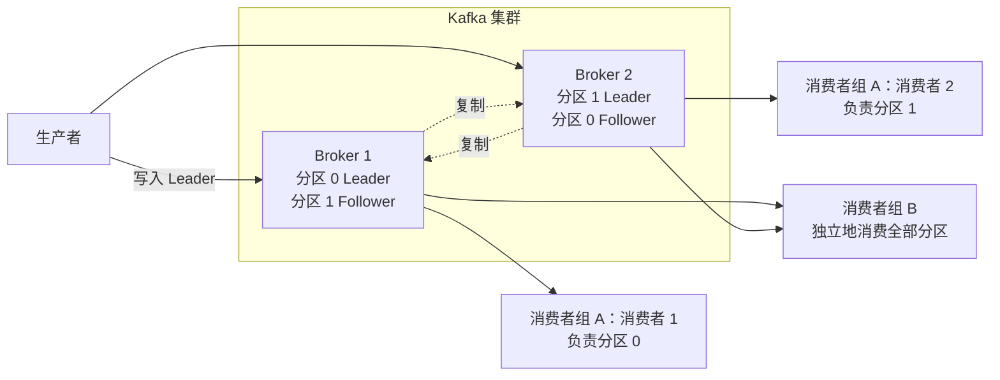

---

### 21-02 Kafka 的消息是如何存储和查找的？

> ★★★ ｜ 资深 ｜ 高频

**考察意图**：是否理解分区、segment 和稀疏索引的设计。

**30 秒版回答**

- 每个分区在磁盘上是一个目录，目录中的数据被切分为多个 **segment**（默认每个 1 GB），每个 segment 包含：
  - `.log`：消息数据，**只追加写入**；
  - `.index`：**位点索引**，记录"位点 → 在 .log 文件中的物理位置"；
  - `.timeindex`：**时间索引**，记录"时间戳 → 位点"。
  - 文件名是这个 segment 第一条消息的位点（基准位点），例如 `00000000000000368769.log`。
- 索引是**稀疏的**：不是每条消息都建索引，而是每写入一定量的数据（默认 4 KB）才记录一条，所以索引文件很小，可以通过 mmap 映射到内存中。
- 按位点查找消息：
  1. 在所有 segment 的基准位点中**二分查找**，确定消息在哪个 segment 中；
  2. 在这个 segment 的 `.index` 中**二分查找**不大于目标位点的最大索引项，得到一个物理位置；
  3. 从这个位置开始**顺序扫描** `.log`，直到找到目标位点。
- 按时间查找（例如"从 1 小时前开始消费"）：先通过 `.timeindex` 找到位点，再按位点查找。
- segment 的设计让**过期删除**非常高效：直接删除整个旧的 segment 文件，不需要在文件中间删除数据。

**深入剖析**

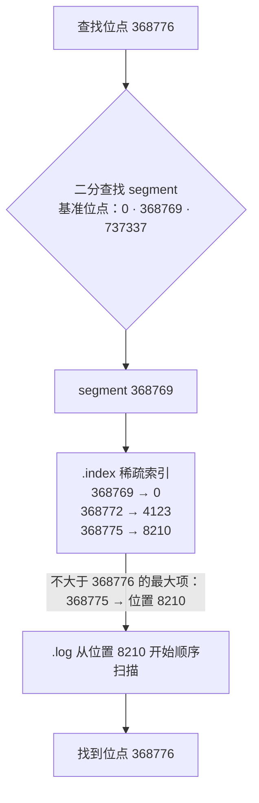

---

### 21-03 副本机制：ISR、HW、LEO 是什么？

> ★★★ ｜ 资深 ｜ 高频

**考察意图**：能否讲清副本同步状态的几个核心概念。

**30 秒版回答**

- **AR**（Assigned Replicas）：分区的所有副本。
- **ISR**（In-Sync Replicas）：与 Leader **保持同步**的副本集合（包括 Leader 自己）。Follower 在 `replica.lag.time.max.ms`（默认 30 秒）内没有追上 Leader，就被移出 ISR；追上后再加回来。
- **LEO**（Log End Offset）：每个副本日志中**下一条待写入**消息的位点。
- **HW**（High Watermark，高水位）：ISR 中所有副本的 **LEO 的最小值**。**消费者只能读到 HW 之前的消息**，也就是已经被 ISR 中所有副本复制的消息，这样 Leader 切换后，消费者已经读到的消息不会"消失"。
- Leader 选举只会从 ISR 中选择（除非开启了 unclean 选举，见 21-04）。

**深入剖析**

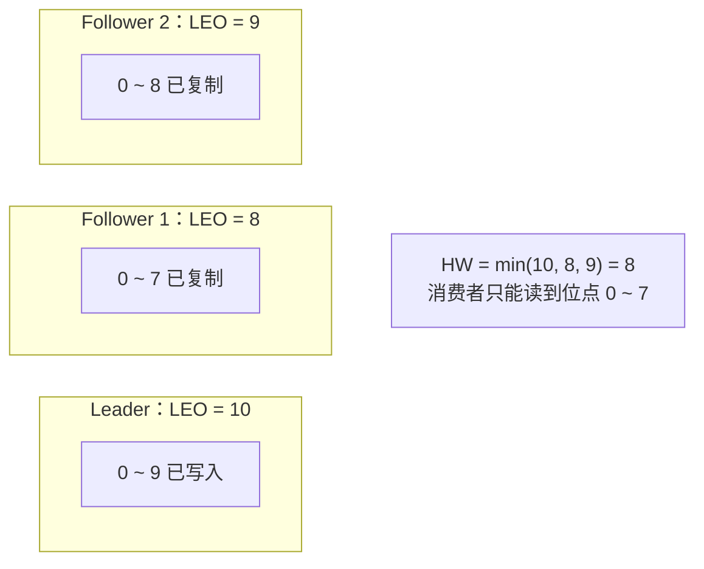

---

### 21-04 acks 和 min.insync.replicas 怎么配才不丢消息？

> ★★★ ｜ 资深 ｜ 高频

**考察意图**：能否把生产者参数和 Broker 参数组合起来分析。

**30 秒版回答**

- 生产者的 `acks`：

| acks | 含义 | 可靠性 |
| --- | --- | --- |
| 0 | 发出即认为成功，不等待任何确认 | 最低，可能丢 |
| 1 | Leader 写入本地日志即返回 | Leader 在 Follower 复制之前宕机就会丢 |
| **all**（即 -1） | **ISR 中所有副本**都写入后才返回 | 最高（Kafka 3.0 起生产者的默认值就是 `all`，并默认开启幂等） |

- **只设置 `acks=all` 还不够**：如果 ISR 收缩到只剩 Leader 自己，`acks=all` 就退化成了 `acks=1`。所以还要在 Broker 或 Topic 上设置 **`min.insync.replicas`**（默认为 1）：ISR 中的副本数少于这个值时，写入直接失败（`NotEnoughReplicas`），宁可不可用也不冒丢数据的风险。
- **`unclean.leader.election.enable=false`**（默认值）：不允许从 ISR 之外的副本中选举 Leader。否则选出的 Leader 可能落后很多，导致已确认的消息丢失。
- **推荐的组合**：副本数 3 + `min.insync.replicas=2` + `acks=all` + 关闭 unclean 选举。这样可以容忍一个副本故障而不影响写入，同时保证每条已确认的消息至少存在于两个副本上。
- 再加上生产者的重试和消费者"处理成功后再提交位点"，见[《20 MQ 通用与选型》](20-MQ通用与选型.md)20-03。

---

### 21-05 只靠 HW 会出什么问题？Leader Epoch 解决了什么？

> ★★★ ｜ 资深 / 架构师 ｜ 中频，区分度高

**考察意图**：是否理解 HW 的更新存在延迟，以及由此导致的数据丢失和不一致。

**30 秒版回答**

- 问题根源：Follower 的 HW 是在**下一次**拉取请求的响应中才从 Leader 那里得知的，比 Leader 的 HW **滞后一轮**。
- 早期版本中，副本重启后会把日志**截断到自己记录的 HW**。由于 HW 滞后，可能出现：
  - **数据丢失**：Follower B 已经有消息 m2，但它的 HW 还没更新，重启后把 m2 截掉；此时 Leader A 宕机，B 成为 Leader，A 恢复后作为 Follower 又按 B 的状态截断了 m2，m2 被彻底丢失；
  - **数据不一致**：两个副本在同一个位点上存放了不同的消息。
- **Leader Epoch**（Kafka 0.11 引入）：每一任 Leader 有一个递增的 epoch 编号，每个副本记录"每个 epoch 从哪个位点开始"。副本重启或成为 Follower 时，**不再依据自己的 HW 截断**，而是向当前 Leader 询问"我的最后一个 epoch 在你那里结束于哪个位点"，再截断到这个准确的位置。这样就避免了因 HW 滞后造成的误截断。

**深入剖析**

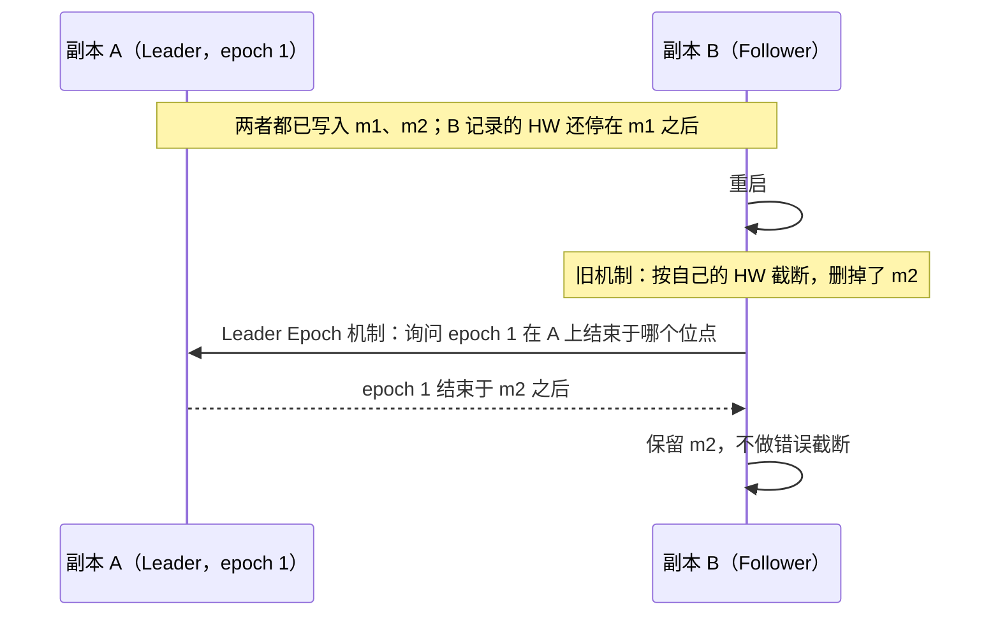

---

## 二、生产与消费

### 21-06 生产者是怎么发送消息的？

> ★★★ ｜ 资深 ｜ 高频

**考察意图**：是否理解生产者的批量发送机制及其关键参数。

**30 秒版回答**

1. 调用 `send()` 的线程依次执行：拦截器 → **序列化** → **分区器**选择分区；
2. 消息被放入 **RecordAccumulator**（消息累加器）中这个分区对应的队列，与其他消息合并成一个**批次**（ProducerBatch），`send()` 立即返回一个 Future；
3. 后台的 **Sender 线程**把可以发送的批次按 Broker 分组，发送给各分区的 Leader；
4. 收到响应后完成 Future、触发回调；失败时按配置重试。

关键参数：

| 参数 | 作用 |
| --- | --- |
| `batch.size`（默认 16 KB） | 单个批次的最大大小 |
| `linger.ms` | 批次没满时最多等待多久再发送。**Kafka 4.0 起默认值由 0 改为 5 毫秒**（KIP-1030），用少量延迟换取更好的批量效果 |
| `buffer.memory`（默认 32 MB） | 累加器的总内存，写满后 `send()` 会阻塞，最多 `max.block.ms` |
| `compression.type` | 按批次压缩（lz4、zstd 等） |
| `max.in.flight.requests.per.connection` | 每个连接上未确认的请求数；开启幂等时不超过 5 仍能保证分区内有序 |
| `enable.idempotence`（3.0 起默认 true） | 幂等发送，见 21-10 |

- **分区器**：消息有 key 时按 key 的哈希选择分区（同一个 key 总是进入同一个分区）；**没有 key 时使用粘性分区**（2.4 起）：持续往同一个分区发送，直到当前批次满了再换一个分区，比逐条轮询能形成更大的批次。
- 来源：[KIP-1030](https://cwiki.apache.org/confluence/display/KAFKA/KIP-1030:+Change+constraints+and+default+values+for+various+configurations)。从 3.x 升级到 4.x 后，对延迟非常敏感的场景要留意 `linger.ms` 默认值的变化。

**深入剖析**

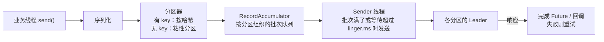

---

### 21-07 消费者组如何分配分区？

> ★★ ｜ 资深 ｜ 中频

**考察意图**：是否了解几种分配策略及其区别。

**30 秒版回答**

- 一个分区在同一时刻只能分配给消费者组中的一个消费者，所以**组内的消费者数量超过分区数时，多出来的消费者会空闲**。
- 传统（classic）协议中，由组内的一个消费者（Leader 消费者）在客户端执行分配策略：

| 策略 | 做法 | 特点 |
| --- | --- | --- |
| Range | 对每个 Topic，把分区按范围平均分给消费者 | 订阅多个 Topic 时，排在前面的消费者可能分到更多分区 |
| RoundRobin | 把所有 Topic 的分区轮流分给消费者 | 更均匀 |
| Sticky | 尽量均匀，并且再平衡时**尽量保持原来的分配** | 减少分区的迁移 |
| **CooperativeSticky** | 在 Sticky 的基础上使用**增量协作式再平衡** | 再平衡时只撤销需要移动的分区，其他分区继续消费，见 21-08 |

- Kafka 3.0 起，消费者的默认配置是 `[RangeAssignor, CooperativeStickyAssignor]`。
- Kafka 4.0 正式推出的**新消费者组协议**（KIP-848）把分配逻辑移到了服务端的组协调器中，见 21-08。

---

### 21-08 再平衡有什么问题？新的再平衡协议做了什么改进？

> ★★★ ｜ 资深 / 架构师 ｜ 高频

**考察意图**：是否遇到过频繁再平衡的问题，是否了解 Kafka 4.0 的新协议。

**30 秒版回答**

- **触发条件**：消费者加入或离开（包括崩溃、发布重启）；消费者被判定为失效（心跳超时，或两次 `poll` 之间的间隔超过 `max.poll.interval.ms`，默认 5 分钟）；订阅的 Topic 的分区数变化。
- **传统协议（eager）的问题**：再平衡开始时，**所有消费者都放弃自己的全部分区**，等待重新分配，期间整个组停止消费（类似一次全局停顿）。消费者越多、再平衡越频繁，影响越大。滚动发布时，每重启一个实例就触发一次再平衡。
- 改进的历程：
  1. **增量协作式再平衡**（2.4，CooperativeStickyAssignor）：只撤销需要移动到其他消费者的那部分分区，其余分区继续消费；
  2. **静态成员**（`group.instance.id`，2.3）：消费者有固定的身份，在会话超时之前重启回来，不会触发再平衡，适合滚动发布；
  3. **新的消费者组协议**（KIP-848，**Kafka 4.0 正式发布**）：
     - 分配由**服务端的组协调器**完成，不再依赖客户端的 Leader 消费者；
     - 完全是**增量**的：每个消费者通过心跳独立地获取自己的目标分配，没有全组的同步屏障，一个消费者的变化不会让整个组停下来；
     - Broker 端默认开启，**但消费者客户端默认仍使用旧协议**，需要设置 `group.protocol=consumer` 才会启用（来源：[Apache Kafka 4.0.0 发布公告](https://kafka.apache.org/blog/2025/03/18/apache-kafka-4.0.0-release-announcement/)）。
- 避免意外再平衡的常见措施：
  - 单次 `poll` 返回的消息要能在 `max.poll.interval.ms` 内处理完，必要时调小 `max.poll.records`；
  - 耗时的处理不要放在 `poll` 循环中同步执行；
  - 使用静态成员或新协议。

---

### 21-09 位点如何提交？什么情况下会重复或丢失？

> ★★ ｜ 资深 ｜ 高频

**考察意图**：是否理解提交时机与处理时机的关系。

**30 秒版回答**

- 位点保存在内部 Topic `__consumer_offsets` 中（默认 50 个分区，按消费者组哈希分布）。
- 提交方式：
  - **自动提交**（`enable.auto.commit=true`，默认每 5 秒）：在 `poll` 时提交**上一次 poll 返回的**消息的位点。如果在下一次 `poll` 之前就把消息交给其他线程异步处理，可能出现"位点已提交、消息还没处理完"的情况，崩溃时就会**丢失**；
  - **手动同步提交**（`commitSync`）：可靠，但会阻塞；
  - **手动异步提交**（`commitAsync`）：不阻塞，失败不会自动重试（因为重试可能用旧位点覆盖新位点），通常在关闭前再同步提交一次。
- 两类问题：
  - **先提交、后处理** → 崩溃时**丢失**；
  - **先处理、后提交** → 崩溃时**重复**（处理完还没来得及提交）。
- 结论：采用"**先处理、后提交**"，接受可能的重复，由**消费端幂等**来解决，见[《20 MQ 通用与选型》](20-MQ通用与选型.md)20-04。
- 需要严格不重复时，可以把位点和处理结果**在同一个数据库事务中**保存，启动时从数据库中读取位点，用 `seek` 定位。

---

### 21-10 Kafka 的幂等与事务是怎么实现的？

> ★★★ ｜ 资深 ｜ 中频

**考察意图**：是否理解幂等生产者和事务的实现原理与适用范围。

**30 秒版回答**

- **幂等生产者**：
  - 生产者初始化时获得一个**生产者 ID**（PID），发往每个分区的消息带有一个**单调递增的序列号**；
  - Broker 为每个"PID + 分区"记录最近的序列号，收到序列号重复的消息就丢弃（仍返回成功），序列号不连续就报错；
  - 效果：生产者的重试不会在**单个分区**中产生重复，并且在开启幂等时能保证分区内的顺序。
  - 局限：只在一个生产者会话内有效，生产者重启后 PID 会变。
- **事务**：
  - 配置 `transactional.id`（跨重启保持不变），由**事务协调器**管理事务状态（记录在内部 Topic `__transaction_state` 中）；
  - 一个事务可以原子地写入**多个分区**，并且可以把**消费位点的提交**也加入同一个事务（`sendOffsetsToTransaction`）；
  - 提交时采用两阶段：协调器先写入"准备提交"，再向涉及的分区写入**事务标记**（控制消息）；
  - 消费者设置 `isolation.level=read_committed` 时，只能读到已提交事务中的消息。
  - 同一个 `transactional.id` 的新生产者实例启动后，旧实例会被**隔离**（通过递增的 epoch），防止"僵尸实例"继续写入。
- 适用范围："从 Kafka 读、处理、写回 Kafka"的闭环（Kafka Streams 的 `exactly_once_v2`）。涉及外部数据库时不能保证，见[《20 MQ 通用与选型》](20-MQ通用与选型.md)20-12。

---
## 三、集群与运维

### 21-11 KRaft 模式是怎么工作的？

> ★★★ ｜ 架构师 ｜ 高频

**考察意图**：是否理解 Kafka 为什么去掉 ZooKeeper，以及新的元数据管理方式。

**30 秒版回答**

- KRaft 把集群元数据（Topic、分区、副本分配、ISR、Broker 注册信息、配置、ACL 等）从 ZooKeeper 搬回 Kafka 自己管理。
- 若干个节点担任 **Controller**（通常 3 个或 5 个），用 Raft 协议组成一个仲裁组，选出一个 **Active Controller** 处理所有元数据变更。
- 元数据变更被写成一条条记录，追加到内部 Topic **`__cluster_metadata`**（只有一个分区），由 Raft 复制到多数派 Controller 后才算提交。
- Broker 主动从 Active Controller **拉取**这份元数据日志，按顺序应用到内存中的元数据视图；日志定期生成快照，防止无限增长。
- 时间线：3.3 起 KRaft 可用于生产；3.9 是最后一个支持 ZooKeeper 的版本，也是迁移的桥梁；**4.0 彻底移除 ZooKeeper**。

**深入剖析**

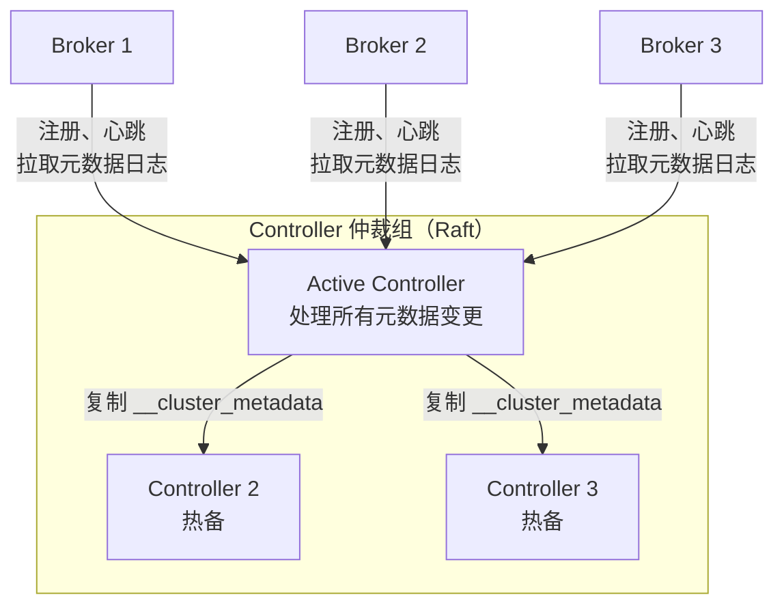

和 ZooKeeper 模式相比，根本变化是**元数据从"一份需要反复同步的状态"变成了"一条有序的事件日志"**：

| 对比项 | ZooKeeper 模式 | KRaft 模式 |
| --- | --- | --- |
| 元数据存放 | ZooKeeper 的 znode | `__cluster_metadata` 日志 + 快照 |
| Controller | 某个 Broker 抢到 ZooKeeper 临时节点后成为 Controller | 专门的 Controller 仲裁组，Raft 选主 |
| Controller 故障切换 | 新 Controller 要从 ZooKeeper **重新加载全部元数据**，分区越多越慢 | 热备 Controller 内存中已有最新元数据，切换快 |
| 元数据传播 | Controller 向每个 Broker 推送更新请求，可能不一致 | Broker 按位点拉取日志，清楚知道自己落后多少 |
| 运维 | 两套系统，各自部署、监控、做安全配置 | 一套系统 |

KRaft 的 Raft 实现和教科书上的 Raft 有一个明显区别：Follower 是**主动拉取**日志（和 Kafka 分区副本的复制方式一致），而不是由 Leader 推送（KIP-595）。

**追问链**

1. **Controller 为什么部署 3 个或 5 个，而不是 4 个？** Raft 需要多数派存活：3 个容忍 1 个故障，5 个容忍 2 个；4 个仍然只能容忍 1 个故障，多一台机器没有带来更高的容错能力，原理见[《09 分布式理论》](../03-分布式与微服务/09-分布式理论.md)中的 Raft 部分。
2. **Controller 和 Broker 能部署在同一个进程里吗？** 可以（`process.roles=broker,controller`，称为合并模式），适合开发测试；生产环境建议 Controller 独立部署，避免 Broker 的负载影响元数据管理。
3. **Controller 的成员能在线调整吗？** 3.9 引入了动态仲裁组（KIP-853），可以在线增减 Controller；之前的静态配置方式需要停机修改。
4. **ZooKeeper 模式的集群怎么升级到 4.x？** 不能直接升级。要先在 3.x（推荐 3.9）上完成迁移：部署 KRaft Controller 并开启迁移模式 → Controller 从 ZooKeeper 复制元数据 → 逐个重启 Broker 切换到 KRaft → 确认无误后结束迁移。结束迁移后不能回退，然后才能升级到 4.x。

**架构师加分点**

- 迁移是一次元数据层的切换，最好安排在业务低峰，并提前在演练环境中完整走一遍，包括"迁移中途回退"的预案。
- 原来依赖 ZooKeeper 的外围工具（例如直接读 ZooKeeper 节点的监控脚本、老版本的管理平台）在 4.x 上都会失效，要提前盘点。

---

### 21-12 日志保留策略与日志压缩

> ★★ ｜ 资深 ｜ 中频

**考察意图**：是否清楚 Kafka 两种清理策略的语义和适用场景。

**30 秒版回答**

- 由 Topic 的 `cleanup.policy` 决定，有三种取值：`delete`（默认）、`compact`、`compact,delete`。
- **delete（按时间或大小删除）**：
  - `retention.ms` 默认 7 天，`retention.bytes` 默认 -1（不按大小限制，且这个值是**每个分区**的上限）；
  - 删除以 **segment 为单位**：只有整个 segment 都过期才会被删除，正在写入的 active segment 不会被删除，所以实际保留时间会比配置的长一些；
  - 按时间判断时，使用的是 segment 中消息的**最大时间戳**。
- **compact（日志压缩）**：同一个 key 只保留**最新的一条**，key 相同的旧值会被清理。
  - 典型用途：`__consumer_offsets`、Kafka Streams 的状态变更日志、用 Kafka 保存"每个实体的最新状态"。

**深入剖析**

日志压缩前后对比（示例）：

| 位点 | 0 | 1 | 2 | 3 | 4 | 5 | 6 |
| --- | --- | --- | --- | --- | --- | --- | --- |
| 压缩前 | K1=a | K2=b | K1=c | K3=d | K2=null | K1=e | K3=f |
| 压缩后 | | | | | K2=null | K1=e | K3=f |

需要注意的几点：

- **位点不变**：压缩只删除记录，不会重新编号，所以压缩后位点之间会有空洞，消费者读取时会自动跳过。
- **顺序不变**：保留下来的记录仍然按原来的顺序排列。
- **删除用墓碑**：value 为 `null` 的记录叫**墓碑**（tombstone），表示删除这个 key。墓碑本身会再保留 `delete.retention.ms`（默认 1 天），让落后的消费者也有机会看到"这个 key 被删除了"，之后墓碑也会被清理。
- **压缩不是实时的**：后台的 cleaner 线程只处理非 active 的 segment，并且要等"未压缩部分"的占比超过 `min.cleanable.dirty.ratio`（默认 0.5）才会开始。所以消费者**仍然可能读到同一个 key 的多个旧值**，不能把压缩当成"读到的一定是唯一值"。

**追问链**

1. **压缩 Topic 能当数据库用吗？** 可以用来保存"每个 key 的最新状态"并在启动时重建本地状态（Kafka Streams 的 KTable 就是这么做的），但它不支持按 key 查询，也不保证读到的是唯一值，不能替代数据库。
2. **`compact,delete` 有什么用？** 既按 key 去重，又给整体数据设置过期时间。适合"保留最近一段时间内每个 key 的最新值"。
3. **数据要保存很久但磁盘不够怎么办？** 使用分层存储（Tiered Storage，3.9 起官方标注为生产可用）：Broker 本地只保留最近的数据（`local.retention.ms`），更早的 segment 上传到对象存储，`retention.ms` 控制总保留时间，消费者读旧数据时由 Broker 从远端读取。

**生产实践 / 踩坑**

- 某个分区流量特别大，`retention.bytes` 没配，磁盘被写满导致 Broker 下线。按大小限制时要记住它是**每个分区**的上限，总占用 = 分区数 × 副本数 × `retention.bytes`。
- 业务以为"7 天后消息就没了"，但 segment 一直没滚动（流量很小，`segment.ms` 默认也是 7 天），实际保留接近 14 天。对保留时间有合规要求的 Topic，要同时调小 `segment.ms`。

---

### 21-13 分区数如何确定？分区越多越好吗？

> ★★★ ｜ 架构师 ｜ 高频

**考察意图**：能否量化地规划分区数，并说出分区过多的代价。

**30 秒版回答**

- 分区是并行的上限：一个消费者组里，**同时工作的消费者数不会超过分区数**。
- 常用的估算方法：先压测出单个分区的生产吞吐 Tp 和消费吞吐 Tc，目标吞吐为 T，则分区数至少为 `max(T / Tp, T / Tc)`，再按未来一到两年的增长留出余量。
- 分区不是越多越好，代价有：
  - 每个分区副本都对应一组 segment 文件和索引文件，占用文件句柄和内存；
  - Follower 要为每个分区拉取数据，分区越多复制开销越大，`acks=all` 的延迟可能上升；
  - 生产者按分区攒批，分区越多，每批越小，批量和压缩的效果越差，占用的缓冲区也越多；
  - Broker 故障时需要切换 Leader 的分区越多，恢复时间越长。
- **分区只能增加，不能减少**；而且增加分区会改变 key 到分区的映射，破坏按 key 的顺序。

**深入剖析**

为什么增加分区会破坏顺序：默认分区器对 key 计算哈希，再对分区数取模。分区数变了，同一个 key 会被路由到另一个分区。

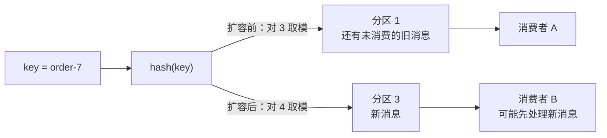

图中的分区号是示例值。关键在于：扩容的那一刻，同一个订单的旧消息和新消息分别在两个分区，由两个消费者并行处理，新消息可能先于旧消息被处理。

**追问链**

1. **需要按 key 有序的 Topic，以后流量涨了怎么办？** 一开始就按长期峰值预留足够的分区；确实要扩容时，选择业务低峰，先停止生产、等旧分区消费完，再扩分区、恢复生产，或者新建 Topic 做迁移。
2. **分区数已经到上限，消费还是跟不上？** 不一定要加分区：可以在消费者内部按 key 把消息分发到多个线程（同一个 key 进同一个线程，保持顺序）；不要求顺序的场景，可以考虑 4.2 起生产可用的共享组（见 21-15）。
3. **分区数怎么取值？** 尽量取消费者实例数的整数倍（例如 12、24、48），让分配更均匀。

**架构师加分点**

- 分区数是 Topic 设计中最难修改的参数，要和"是否需要按 key 有序""消费者能扩到多少个实例"一起设计，并写进 Topic 的设计评审。
- 单个 Broker 能承载的分区副本数有经验上限，KRaft 提高了集群整体的上限，但每个分区的文件、内存、复制成本依然存在，具体数值以所用版本和云厂商的建议为准。

---

### 21-14 Kafka 常见的线上问题有哪些？

> ★★★ ｜ 资深 ｜ 高频

**考察意图**：是否有真实的 Kafka 运维和排障经验。

**30 秒版回答**

| 现象 | 常见原因 | 处理方式 |
| --- | --- | --- |
| 消费积压持续增长 | 消费逻辑慢、下游慢、消费者数不足 | 见[《20 MQ 通用与选型》](20-MQ通用与选型.md)中的积压处理 |
| 频繁再平衡，日志里出现 poll 超时 | 单次 poll 的消息处理时间超过 `max.poll.interval.ms`（默认 5 分钟） | 调小 `max.poll.records`、优化处理逻辑、使用静态成员或新协议 |
| 重复消费 | 再平衡或崩溃时位点还没提交 | 消费端幂等 |
| 生产者发送超时 | Broker 慢；`buffer.memory`（默认 32 MB）写满后阻塞超过 `max.block.ms`（默认 60 秒）；`delivery.timeout.ms`（默认 2 分钟）内没有成功 | 查 Broker 负载；不要在发送回调里做耗时操作 |
| 写入报 NotEnoughReplicas | ISR 数量低于 `min.insync.replicas` | 查 Follower 为什么跟不上 |
| ISR 频繁收缩、扩张 | Follower 落后超过 `replica.lag.time.max.ms`（默认 30 秒）：磁盘 IO 慢、网络抖动、GC 停顿 | 查磁盘、网络、GC 日志 |
| 磁盘写满，Broker 下线 | 保留策略配置不当、某个分区数据倾斜 | 加磁盘、调保留策略、做好磁盘告警 |
| 报 RecordTooLargeException | 消息超过 1 MB 左右的默认上限 | 压缩；大内容存对象存储，消息里只放引用 |
| 某个分区特别忙 | 热点 key | 拆分热点 key（会失去这个 key 的顺序）或自定义分区器 |
| 开启 TLS 后 Broker CPU 明显升高 | 数据要在用户态加密，无法再使用 sendfile 零拷贝 | 评估 CPU 余量，按需扩容 |

**深入剖析**

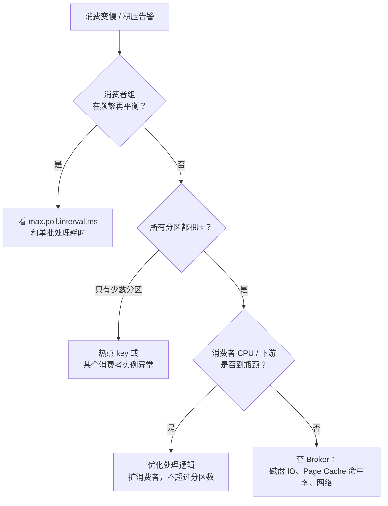

排查常用工具和指标：

- `kafka-consumer-groups.sh --describe --group <组名>`：看每个分区的 LAG 和当前分配给哪个消费者。
- `kafka-topics.sh --describe --under-replicated-partitions`：找出副本不足的分区。
- Broker 指标：`UnderReplicatedPartitions`、`UnderMinIsrPartitionCount`、`OfflinePartitionsCount`、`RequestHandlerAvgIdlePercent`（请求处理线程的空闲率，持续偏低说明 Broker 忙不过来）。

**生产实践 / 踩坑**

- **回溯消费拖慢整个集群**：某个消费者从几天前的位点开始重新消费，大量读取不在 Page Cache 中的旧 segment，磁盘 IO 打满，同时把热数据挤出了 Page Cache，导致其他正常消费者也变慢。回溯要限速，或者放到业务低峰进行。
- **消息大小的限制有三层**：Broker 的 `message.max.bytes`、Topic 的 `max.message.bytes`、生产者的 `max.request.size`，消费者一侧还有拉取大小的配置。只改其中一处，问题会换个地方出现。

---

## 四、新特性与框架

### 21-15 共享组（Queues for Kafka）是什么？

> ★★ ｜ 资深 / 架构师 ｜ 中频（新特性）

**考察意图**：是否关注 Kafka 的新特性，能否说清它和传统消费者组的区别。

**30 秒版回答**

- 共享组（Share Group，KIP-932）给 Kafka 加上了"队列"语义：**同一个分区的消息可以被组内多个消费者同时消费**，并行度不再受分区数限制。
- 消息**逐条确认**，每条消息有投递次数；处理失败的消息可以放回去重新投递，超过次数上限后不再投递。
- 代价是**不保证顺序**。
- 版本：4.0 抢先体验，4.1 预览，**4.2（2026 年 2 月）官方宣布生产可用**（来源：[Apache Kafka 4.2.0 发布公告](https://kafka.apache.org/blog/2026/02/17/apache-kafka-4.2.0-release-announcement/)）。

**深入剖析**

每条消息在共享组中的状态变化：

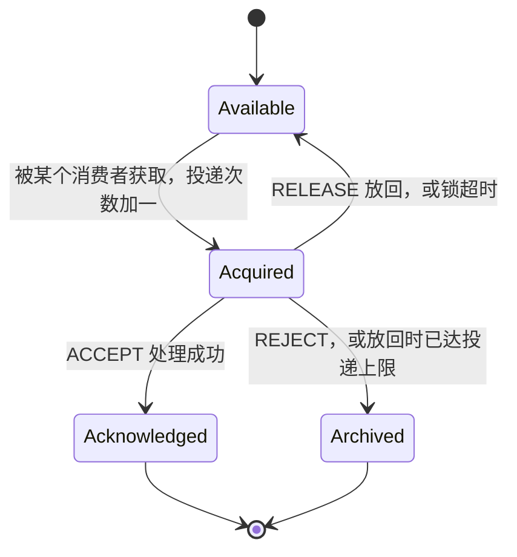

- 消费者获取消息时，消息被加上一把**有时限的锁**（KIP-932 中默认 30 秒），锁到期还没确认，消息回到可投递状态。
- 投递次数的上限在 KIP-932 中默认是 5 次。
- 处理时间较长时，4.2 新增的 `RENEW` 确认类型可以延长锁的时间。
- 共享组的状态由 Broker 上的共享协调器管理，持久化在内部 Topic `__share_group_state` 中。

和传统消费者组的对比：

| 对比项 | 消费者组 | 共享组 |
| --- | --- | --- |
| 分区分配 | 一个分区同一时刻只分给一个消费者 | 一个分区可以同时被多个消费者消费 |
| 并行度上限 | 分区数 | 不受分区数限制 |
| 顺序 | 分区内有序 | 不保证 |
| 确认方式 | 提交位点（批量、累积） | 逐条确认 |
| 失败重投 | 需要自己 seek 或借助框架 | 内置，带投递次数 |
| 适合场景 | 事件流、需要按 key 有序的处理 | 任务队列：每条消息独立处理，耗时差异大 |

**追问链**

1. **有了共享组，还需要 RabbitMQ 吗？** 如果已经在用 Kafka，又只需要"多个消费者分摊任务、失败重投"，共享组可以减少引入第二套 MQ。但延迟消息、优先级、灵活的路由规则仍然是 RabbitMQ / RocketMQ 的强项，见[《20 MQ 通用与选型》](20-MQ通用与选型.md)。
2. **共享组能和消费者组同时消费同一个 Topic 吗？** 可以。它们是不同的组，各自维护自己的消费进度，互不影响。

**架构师加分点**

- 新特性落地要看整条链路：Broker 版本、客户端版本、框架支持（Spring Kafka 4.0 中为抢先体验，4.1 配合 Kafka 4.2 转为正式支持，来源：[Spring for Apache Kafka 文档](https://docs.spring.io/spring-kafka/reference/kafka/kafka-queues.html)）、监控指标（4.2 新增了共享分区的积压指标）都要跟上，再决定是否用于核心业务。

---

### 21-16 Spring Kafka 的使用要点

> ★★ ｜ 资深 ｜ 高频

**考察意图**：是否在 Spring 项目中正确使用过 Kafka，知道框架默认行为。

**30 秒版回答**

- **并发**：`@KafkaListener` 的 `concurrency` 表示一个应用实例内启动几个消费者线程，每个线程是一个独立的 KafkaConsumer。所有实例的线程总数超过分区数时，多出来的线程会空闲。
- **位点提交**：Spring Kafka 默认关闭客户端的自动提交，由容器负责提交。默认的 `AckMode.BATCH` 在一次 poll 返回的消息**全部处理完之后**才提交，已经是"先处理、后提交"。只有把消息交给其他线程异步处理时，才需要改成 `MANUAL` / `MANUAL_IMMEDIATE`，在处理完成后手动确认。
- **异常处理**：默认的 `DefaultErrorHandler` 在监听方法抛异常后，把位点 seek 回失败的那条消息，**默认最多投递 10 次**（第一次加 9 次重试，没有间隔），用完后记录日志并跳过。生产环境一般配置重试间隔，并在重试耗尽后发到**死信 Topic**。
- **非阻塞重试**：`@RetryableTopic` 把失败的消息转发到专门的重试 Topic 中延迟处理，不阻塞原分区，但会**失去顺序**。

**深入剖析**

`DefaultErrorHandler` 的处理流程：

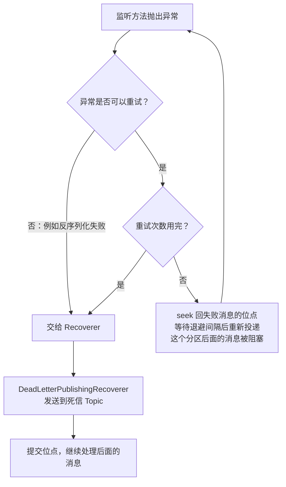

配置示例（Spring Boot 会把容器中的 `CommonErrorHandler` Bean 自动设置到默认的监听容器工厂上）：

```java
@Configuration
public class KafkaErrorHandlingConfig {

    /** 重试间隔（毫秒） */
    private static final long RETRY_INTERVAL_MS = 1_000L;
    /** 重试次数，不含第一次投递 */
    private static final long MAX_RETRIES = 3L;

    @Bean
    public DefaultErrorHandler kafkaErrorHandler(KafkaTemplate<Object, Object> kafkaTemplate) {
        // 重试耗尽后发送到死信 Topic，默认发到与原消息相同编号的分区
        DeadLetterPublishingRecoverer recoverer = new DeadLetterPublishingRecoverer(kafkaTemplate);
        DefaultErrorHandler handler =
                new DefaultErrorHandler(recoverer, new FixedBackOff(RETRY_INTERVAL_MS, MAX_RETRIES));
        // 参数校验类异常重试也不会成功，直接进入死信
        handler.addNotRetryableExceptions(IllegalArgumentException.class);
        return handler;
    }
}
```

**追问链**

1. **消息反序列化失败会怎样？** 如果直接用普通的反序列化器，异常发生在 poll 阶段，监听方法根本拿不到这条消息，容器会反复失败（俗称"毒丸消息"）。要用 `ErrorHandlingDeserializer` 包装真正的反序列化器，让失败作为异常交给错误处理器，最终进入死信。
2. **重试间隔能不能配得很长？** 阻塞式重试期间这个分区停止前进，并且总等待时间要明显小于 `max.poll.interval.ms`，否则会触发再平衡。需要长时间延迟的重试，用 `@RetryableTopic`。
3. **怎么保证数据库操作和发消息的一致性？** `@Transactional` 同时包含数据库操作和 `KafkaTemplate.send`，并不能让两者原子提交，两个事务中的一个仍可能失败。可靠的做法是本地消息表（Outbox），见[《20 MQ 通用与选型》](20-MQ通用与选型.md)。
4. **`KafkaTemplate.send` 的返回值怎么处理？** 3.0 起返回 `CompletableFuture`。发送是异步的，失败要在回调中处理（记录日志、告警或落库补偿），否则失败会被悄悄忽略。

**生产实践 / 踩坑**

- **死信 Topic 的分区数**：`DeadLetterPublishingRecoverer` 默认把消息发到死信 Topic 中**与原分区编号相同**的分区。死信 Topic 的分区数比原 Topic 少时，发送会失败。要么让死信 Topic 的分区数不少于原 Topic，要么自定义目标分区。
- 发布时扩容了实例，但 `concurrency` 没有调整，"实例数 × concurrency"超过了分区数，新扩的实例全部空闲，积压没有任何改善。

---

### 21-17 Kafka 4.x 有哪些重要变化？

> ★★ ｜ 架构师 ｜ 中频

**考察意图**：是否了解近期版本演进，能否评估升级影响。

**30 秒版回答**

| 版本 | 时间 | 重要变化 |
| --- | --- | --- |
| 4.0 | 2025 年 3 月 | 只支持 KRaft，移除 ZooKeeper；新的消费者组协议（KIP-848）正式发布，客户端需设置 `group.protocol=consumer` 启用；共享组抢先体验；客户端和 Kafka Streams 要求 Java 11，Broker、Connect 和工具要求 Java 17；移除 v0 / v1 消息格式（KIP-724）；移除旧的协议版本（KIP-896），**2.1 以前的客户端无法连接**；生产者 `linger.ms` 默认值从 0 改为 5 毫秒（KIP-1030） |
| 4.1 | 2025 年 | 共享组进入预览 |
| 4.2 | 2026 年 2 月 | 共享组生产可用，新增 `RENEW` 确认类型和共享分区的积压指标 |

来源：[Kafka 4.0.0 发布公告](https://kafka.apache.org/blog/2025/03/18/apache-kafka-4.0.0-release-announcement/)、[Kafka 4.0.0 Release Notes](https://mirrors.huaweicloud.com/repository/apache/kafka/4.0.0/RELEASE_NOTES.html)、[Kafka 4.2.0 发布公告](https://kafka.apache.org/blog/2026/02/17/apache-kafka-4.2.0-release-announcement/)。

**深入剖析**

从 3.x 升级到 4.x 的检查清单：

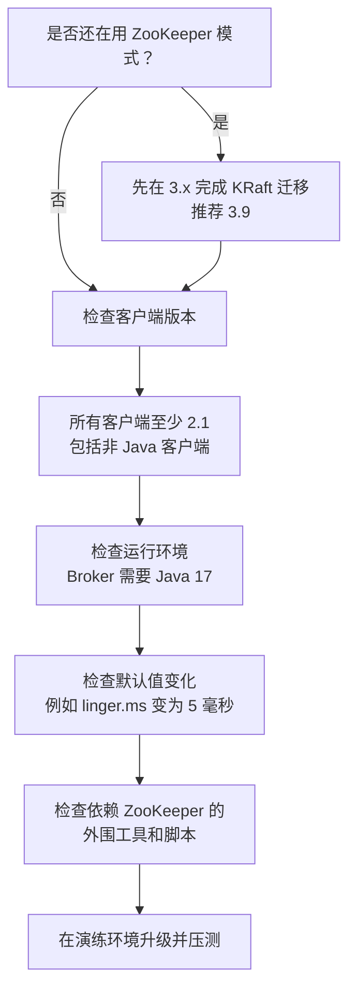

**追问链**

1. **升级到 4.0 后消费者组会自动使用新的再平衡协议吗？** 不会。Broker 端默认支持，但客户端默认仍是旧协议，需要逐个应用设置 `group.protocol=consumer`。同一个组可以从旧协议在线切换到新协议。
2. **`linger.ms` 改成 5 毫秒有什么影响？** 生产者会多等最多 5 毫秒来攒批，吞吐和压缩效果通常更好，但对延迟极其敏感的场景，要评估是否显式改回 0。

**架构师加分点**

- 4.0 是一次"清理技术债"的大版本，最大的风险不在 Broker 本身，而在**周边**：老旧客户端（尤其是其他语言的客户端和第三方组件中内嵌的客户端）、依赖 ZooKeeper 的工具、Java 运行环境。升级前先盘点这些依赖，比研究新特性更重要。
