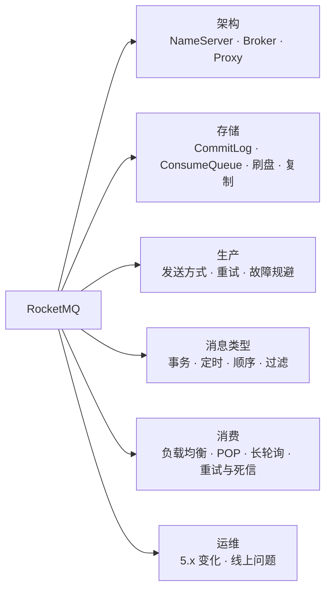
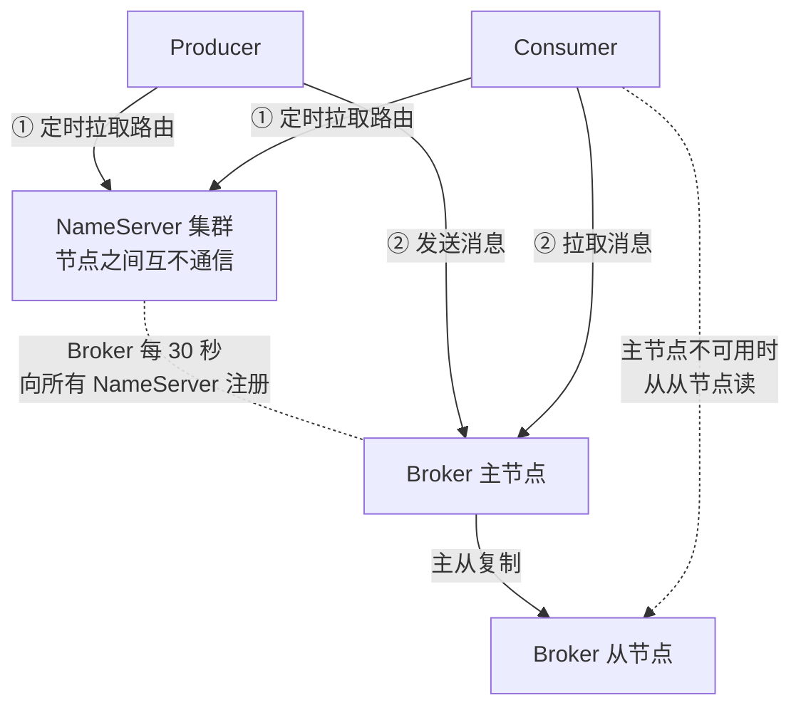
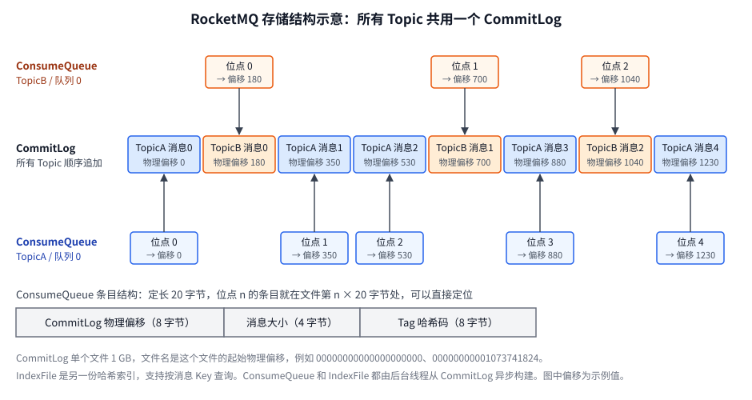
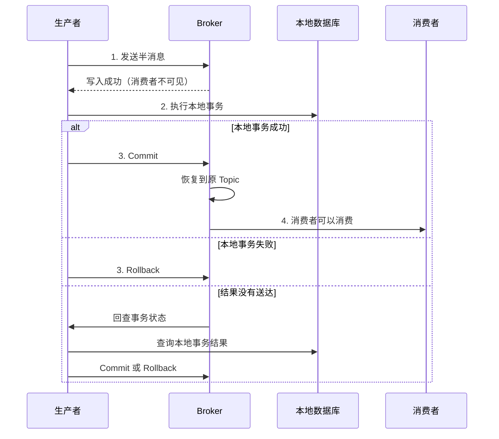
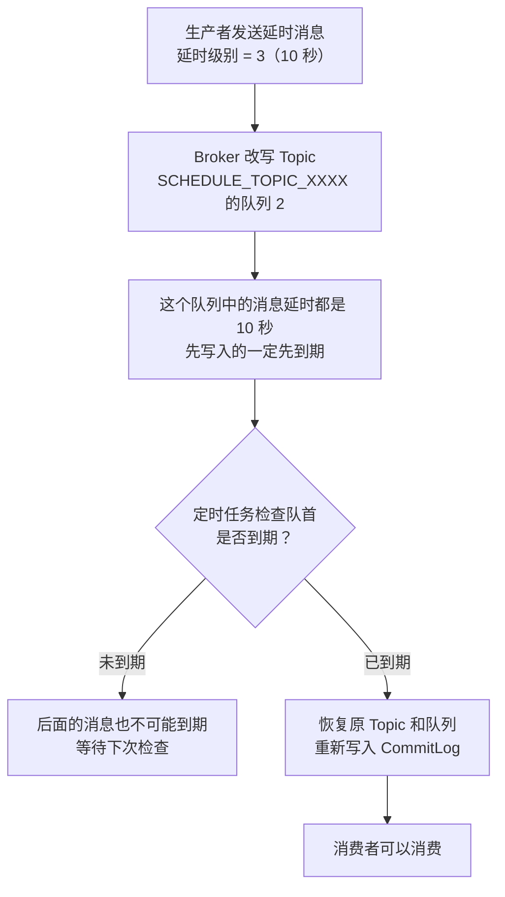
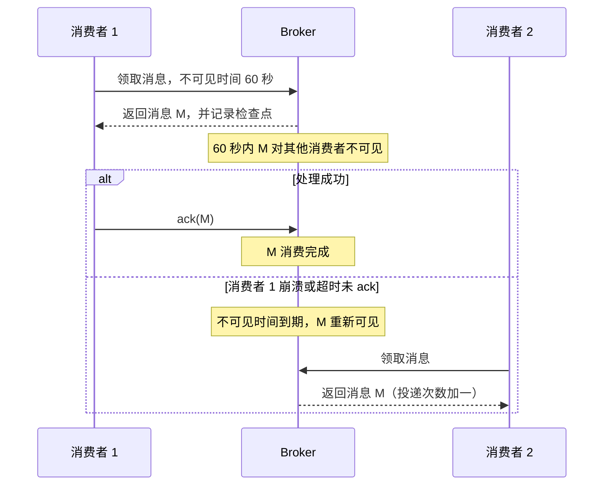
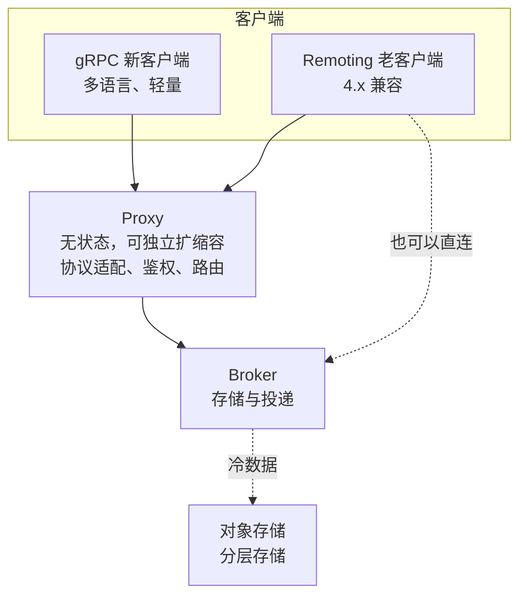

# 22 · RocketMQ

> 适用岗位：Java 资深开发 / 架构师
> 版本基线：Apache RocketMQ 5.x（截至 2026 年下半年最新为 5.5.x）；4.x 的差异单独标注
> 事实核对：标注「已核对」的默认值来自 RocketMQ 5.5.0 官方源码（`BrokerConfig`、`MessageStoreConfig`、`DefaultMQPushConsumer` 等）和本机 4.3 客户端 jar 的字节码；5.x 新特性查阅了官方文档和发布说明，附有链接
> 相关分类：[《20 MQ 通用与选型》](20-MQ通用与选型.md)（可靠性、幂等、积压、选型）、[《21 Kafka》](21-Kafka.md)（存储与复制的对比）、[《09 分布式理论》](../03-分布式与微服务/09-分布式理论.md)（事务消息与最终一致性）

## 知识地图

## 题目索引

| 编号 | 题目 | 难度 | 层级 |
| --- | --- | --- | --- |
| 22-01 | RocketMQ 的整体架构 | ★★ | 资深 |
| 22-02 | NameServer 为什么不用 ZooKeeper？路由信息怎么更新？ | ★★ | 资深 |
| 22-03 | RocketMQ 的存储结构：CommitLog、ConsumeQueue、IndexFile | ★★★ | 资深 |
| 22-04 | 刷盘和主从复制怎么配置才不丢消息？ | ★★★ | 资深 / 架构师 |
| 22-05 | RocketMQ 和 Kafka 的存储设计有什么区别？ | ★★★ | 架构师 |
| 22-06 | 生产者有几种发送方式？失败了怎么重试？ | ★★ | 资深 |
| 22-07 | 事务消息是怎么实现的？ | ★★★ | 资深 / 架构师 |
| 22-08 | 延时消息：从 18 个级别到任意时间定时 | ★★★ | 资深 |
| 22-09 | 顺序消息是怎么实现的？ | ★★★ | 资深 |
| 22-10 | 消息过滤：Tag 与 SQL92 | ★★ | 资深 |
| 22-11 | 消费负载均衡：队列级与消息级（POP） | ★★★ | 资深 / 架构师 |
| 22-12 | Push 消费的本质是什么？长轮询怎么实现？ | ★★ | 资深 |
| 22-13 | 消费重试和死信队列 | ★★ | 资深 |
| 22-14 | 消费线程池与流控：为什么调大 consumeThreadMax 没用？ | ★★★ | 资深 |
| 22-15 | RocketMQ 5.x 有哪些重要变化？ | ★★ | 架构师 |
| 22-16 | RocketMQ 常见的线上问题有哪些？ | ★★★ | 资深 |

---

## 一、架构与存储

### 22-01 RocketMQ 的整体架构

> ★★ ｜ 资深 ｜ 高频

**考察意图**：能否讲清各个角色的职责和交互关系。

**30 秒版回答**

| 角色 | 职责 |
| --- | --- |
| NameServer | 路由注册中心：保存"Topic 在哪些 Broker 上、有几个队列"。多个 NameServer 之间**互不通信**，每个都保存完整的路由信息 |
| Broker | 存储和投递消息。按 Broker 组部署，每组一个主节点和若干从节点 |
| Proxy（5.x 新增） | 无状态的接入层，客户端通过 gRPC 连接 Proxy，由 Proxy 转发到 Broker。可以和 Broker 部署在同一进程（Local 模式），也可以独立部署（Cluster 模式） |
| Producer | 从 NameServer 获取路由，选择一个队列发送消息 |
| Consumer | 从 NameServer 获取路由，从 Broker 拉取消息并消费 |

- **队列（MessageQueue）** 是 RocketMQ 中的分片单位，对应 Kafka 的分区。一个 Topic 的队列可以分布在多个 Broker 组上。
- **消费者组**：组内的消费者共同分担一个 Topic 的消息（集群消费），也可以设置为每个消费者都收到全量消息（广播消费）。

**深入剖析**

5.x 中，使用新的 gRPC 客户端时，Producer 和 Consumer 只和 Proxy 打交道，路由查询、负载均衡等逻辑大多移到了 Proxy 和 Broker 一侧，客户端变得很轻。

---

### 22-02 NameServer 为什么不用 ZooKeeper？路由信息怎么更新？

> ★★ ｜ 资深 ｜ 中频

**考察意图**：是否理解 RocketMQ 在路由一致性上的设计取舍。

**30 秒版回答**

- 路由信息变化不频繁，而且**短暂不一致是可以接受的**：发往一个刚下线 Broker 的消息会失败，生产者重试时换一个 Broker 即可。所以没必要引入 ZooKeeper 这种强一致的协调服务，用最简单的无状态节点就够了。
- 更新机制（已核对 5.5.0 源码）：
  - Broker 每 **30 秒**向所有 NameServer 注册一次（`registerNameServerPeriod`）；
  - NameServer 每 **5 秒**扫描一次（`scanNotActiveBrokerInterval`），超过 **2 分钟**没有收到注册的 Broker 会被移除；
  - 客户端每 **30 秒**从 NameServer 拉取一次路由（`pollNameServerInterval`，4.3 客户端字节码已核对）。
- 代价：Broker 宕机后，最长要过一段时间路由才会更新，这期间要靠**客户端的重试和故障规避**来兜底（见 22-06）。

**架构师加分点**

- 这是一个典型的 **AP 取舍**：用"最终一致 + 客户端容错"替代"强一致的协调服务"，换来了部署简单、没有单点、NameServer 可以随意扩缩容。和 Kafka 选择把元数据放进 Raft 仲裁组（见[《21 Kafka》](21-Kafka.md)21-11）是两种不同的思路：Kafka 的元数据包括 ISR、Leader 等需要强一致的信息，而 RocketMQ 的主从关系在传统模式下是**静态配置**的，NameServer 只管"在哪"，不管"谁是主"。

---

### 22-03 RocketMQ 的存储结构：CommitLog、ConsumeQueue、IndexFile

> ★★★ ｜ 资深 ｜ 高频

**考察意图**：是否理解 RocketMQ 存储设计的核心思想。

**30 秒版回答**

- **CommitLog**：一个 Broker 上**所有 Topic 的消息**都按到达顺序追加写入同一组文件，单个文件 1 GB（已核对：`mappedFileSizeCommitLog`），文件名是这个文件的起始物理偏移。写入完全是顺序写。
- **ConsumeQueue**：每个"Topic + 队列"一份，是 CommitLog 的**索引**。每个条目定长 **20 字节**（已核对：`CQ_STORE_UNIT_SIZE = 20`）：CommitLog 物理偏移 8 字节 + 消息大小 4 字节 + Tag 哈希码 8 字节。
- **IndexFile**：哈希索引，支持按消息 Key 查询，用于排查问题。
- ConsumeQueue 和 IndexFile 由后台线程从 CommitLog **异步构建**。
- 消费时：先按队列位点在 ConsumeQueue 中找到条目（定长，可以直接算出位置），再根据物理偏移到 CommitLog 中读取消息。

**深入剖析**

- **为什么所有 Topic 共用一个 CommitLog**：无论有多少个 Topic，磁盘上只有一个写入点，始终是顺序写。Topic 和队列数很多时，写入性能也不会下降。
- **代价是读取变成随机读**：同一个队列的消息在 CommitLog 中是分散的。RocketMQ 依靠**操作系统的 Page Cache** 缓解：刚写入的消息大概率还在内存中，正常消费基本不会读磁盘；消费严重滞后、要读很久以前的消息时，才会真正去读磁盘。
- **ConsumeQueue 很小**：每条消息只占 20 字节，基本可以常驻内存。
- 文件通过 **mmap**（内存映射）读写，减少一次从内核到用户空间的拷贝。

**追问链**

1. **ConsumeQueue 还没构建好，消息能被消费吗？** 不能。消费者只能看到 ConsumeQueue 中已经存在的消息。构建是异步的，正常情况下延迟非常小。
2. **Broker 异常重启后，ConsumeQueue 和 CommitLog 不一致怎么办？** 启动时会检查 CommitLog 中最后几个文件，根据 CommitLog 修正 ConsumeQueue（CommitLog 是唯一的数据来源，ConsumeQueue 可以重建）。
3. **为什么条目中存的是 Tag 的哈希码而不是 Tag 字符串？** 为了让条目定长，可以直接按位点计算出条目在文件中的位置。哈希码可能冲突，所以消费者拿到消息后还会再用 Tag 字符串比对一次（见 22-10）。

---

### 22-04 刷盘和主从复制怎么配置才不丢消息？

> ★★★ ｜ 资深 / 架构师 ｜ 高频

**考察意图**：是否理解"单机持久化"和"多副本"两层可靠性，以及性能代价。

**30 秒版回答**

消息不丢需要两层保证：

| 层面 | 选项 | 默认值（已核对） | 说明 |
| --- | --- | --- | --- |
| 刷盘 | `ASYNC_FLUSH` / `SYNC_FLUSH` | 异步刷盘 | 异步刷盘：消息写入 Page Cache 就返回成功，后台线程定期刷盘（默认间隔 500 毫秒），**机器断电**会丢失还没刷盘的数据 |
| 主从复制 | `ASYNC_MASTER` / `SYNC_MASTER` | 异步复制 | 异步复制：主节点写入成功就返回，**主节点磁盘损坏**时会丢失还没复制到从节点的数据 |

- 对可靠性要求很高的场景：**同步复制 + 异步刷盘**是常见的折中：数据同时在两台机器的内存中，两台同时断电的概率很低，性能又比同步刷盘好很多。
- 金融等极端场景才考虑**同步刷盘 + 同步复制**，代价是写入延迟和吞吐明显变差。

**深入剖析**

主从切换的三种方式：

| 方式 | 版本 | 故障切换 | 说明 |
| --- | --- | --- | --- |
| 传统主从 | 一直都有 | **不能自动切换** | 主节点挂了，从节点只能提供读，不能写入。这个 Broker 组上的队列暂时无法写入，生产者会发到其他 Broker 组 |
| DLedger 模式 | 4.5 起 | 自动切换 | 用 Raft 复制 CommitLog，至少 3 个节点，选主和存储绑定在一起 |
| Controller 模式 | 5.0 起 | 自动切换 | 选主交给独立的 Controller 组件（可以内嵌在 NameServer 中），Broker 只负责存储和复制。维护一个**同步副本集合**（SyncStateSet），思路接近 Kafka 的 ISR，两个副本也能实现自动切换 |

**追问链**

1. **同步复制时，从节点挂了会怎样？** 传统模式下，主节点等待复制超时后会给生产者返回 `FLUSH_SLAVE_TIMEOUT` 或 `SLAVE_NOT_AVAILABLE` 这类状态，**消息其实已经写入主节点**。生产者如果把它当作失败去重试，会造成重复。所以发送结果要区分"失败"和"已写入但未达到期望的副本数"。
2. **异步刷盘为什么还能保证进程崩溃不丢？** 进程崩溃时，已经写入 Page Cache 的数据由操作系统负责刷盘，不会丢失；只有整台机器断电或操作系统崩溃才会丢。

**生产实践 / 踩坑**

- 生产者只检查"没抛异常"，没有检查 `SendResult` 的状态，同步复制超时的情况被当成了成功，或者反过来被当成失败重复发送。

---

### 22-05 RocketMQ 和 Kafka 的存储设计有什么区别？

> ★★★ ｜ 架构师 ｜ 高频

**考察意图**：能否从存储设计推导出两者的适用场景。

**30 秒版回答**

| 对比项 | Kafka | RocketMQ |
| --- | --- | --- |
| 数据文件 | **每个分区一组** segment 文件 | 一个 Broker 上**所有 Topic 共用一个 CommitLog** |
| 写入 | 每个分区内顺序写，分区很多时整体接近随机写 | 始终只有一个写入点，纯顺序写 |
| 读取 | 分区内顺序读 | 先读 ConsumeQueue，再随机读 CommitLog，依赖 Page Cache |
| 分区 / 队列很多时 | 文件数量多，写入性能下降明显 | 写入不受影响 |
| 高可用 | 分区级多副本，ISR，自动选主 | 传统主从（不能自动切换）；DLedger / Controller 模式可以自动切换 |
| 发送数据到网络 | `sendfile` 零拷贝 | `mmap`，读取后再写入 Socket |

- 结论：Kafka 的设计更适合**少量 Topic、超大吞吐**的日志和流处理场景；RocketMQ 更适合**大量 Topic、业务消息**的场景，并且自带事务消息、定时消息、重试和死信等业务功能。

**架构师加分点**

- 两者的设计取舍可以归结为"写放大"和"读放大"：Kafka 让读最简单（分区内顺序读），代价是分区多时写入变成多点写；RocketMQ 让写最简单（单点顺序写），代价是读取需要二次寻址和随机读。没有绝对的优劣，取决于 Topic 数量和读写模式。
- 很多"Kafka 分区多了性能下降"的结论来自 ZooKeeper 时代和机械硬盘，在 SSD 和 KRaft 下差距缩小了不少，选型时要用自己的数据压测，不要直接套用旧结论。

---

## 二、生产与消息类型

### 22-06 生产者有几种发送方式？失败了怎么重试？

> ★★ ｜ 资深 ｜ 中频

**考察意图**：是否了解发送的可靠性机制和默认参数。

**30 秒版回答**

- 三种发送方式：
  - **同步发送**：等待 Broker 返回结果，最可靠，最常用；
  - **异步发送**：通过回调获得结果，适合对延迟敏感的场景，**必须在回调中处理失败**；
  - **单向发送**（oneway）：不等待结果，可能丢失，只适合日志这类可以丢的数据。
- 默认参数（4.3 客户端字节码已核对）：发送超时 3 秒；同步发送失败**重试 2 次**（最多发 3 次），重试时会**换一个 Broker** 发送；消息体超过 4 KB 时压缩；消息大小上限 4 MB。
- **故障规避**：开启 `sendLatencyFaultEnable` 后，生产者会记录每个 Broker 的发送延迟，延迟过高或失败的 Broker 会被暂时排除一段时间，避免路由还没更新时反复发到有问题的节点。

**追问链**

1. **重试会导致重复吗？** 会。例如 Broker 已经写入成功，但响应在网络中丢失，生产者超时后重试，就会产生两条相同的消息。所以消费端必须幂等，见[《20 MQ 通用与选型》](20-MQ通用与选型.md)20-04。
2. **消息的唯一标识用哪个？** 客户端生成的 `msgId`（UNIQ_KEY）在重试时保持不变，但不同的生产者实例可能对同一个业务事件生成不同的 msgId。幂等应该基于**业务唯一键**（例如订单号），可以放在消息的 Key 中，同时便于用 IndexFile 查询。

---

### 22-07 事务消息是怎么实现的？

> ★★★ ｜ 资深 / 架构师 ｜ 高频

**考察意图**：是否理解半消息和回查机制，以及事务消息能保证什么、不能保证什么。

**30 秒版回答**

- 目标：保证"**本地事务执行**"和"**消息发送**"的结果一致，要么都成功，要么都不生效。
- 流程：
  1. 生产者先发送一条**半消息**：Broker 把它存到内部 Topic `RMQ_SYS_TRANS_HALF_TOPIC` 中，消费者看不到；
  2. 半消息写入成功后，生产者执行本地事务；
  3. 根据本地事务的结果，向 Broker 提交 **Commit** 或 **Rollback**。Commit 时，Broker 把消息恢复到原 Topic，消费者才能看到；
  4. 如果 Broker 迟迟没有收到结果（生产者崩溃、网络中断），Broker 会**主动回查**生产者，由生产者检查本地事务的状态再决定提交还是回滚。
- 回查参数（已核对 5.5.0 源码）：半消息超过 6 秒（`transactionTimeOut`）还没有结果才开始回查，每 30 秒检查一次（`transactionCheckInterval`），最多回查 15 次（`transactionCheckMax`），超过后丢弃。注意 4.3 版本的默认值是检查间隔 60 秒、最多 5 次，网上不少资料用的是旧值。

**深入剖析**

- Broker 怎么知道哪些半消息已经有结果：提交或回滚时，Broker 向另一个内部 Topic `RMQ_SYS_TRANS_OP_HALF_TOPIC` 写一条记录。回查线程对比这两个 Topic，找出还没有结果的半消息。
- **回查接口必须能查出本地事务的真实结果**，通常在本地事务中同时写一条"事务记录"，回查时按事务 ID 查询这条记录。

**追问链**

1. **事务消息能保证消费者一定处理成功吗？** 不能。它只保证"本地事务"和"消息发出"一致。消费端失败要靠重试，最终还是失败要靠人工或补偿，属于最终一致性方案，见[《09 分布式理论》](../03-分布式与微服务/09-分布式理论.md)。
2. **和本地消息表（Outbox）相比怎么选？** 事务消息不需要额外的消息表和扫描任务，但要实现回查接口，并且依赖 RocketMQ；本地消息表与 MQ 无关，换 MQ 不用改业务代码，见[《20 MQ 通用与选型》](20-MQ通用与选型.md)。

**生产实践 / 踩坑**

- 回查接口查不到记录时直接返回 Rollback，但本地事务其实还在执行中（长事务），结果把一条本来应该提交的消息回滚了。查不到时应该返回 `UNKNOW`，等待下一次回查。

---

### 22-08 延时消息：从 18 个级别到任意时间定时

> ★★★ ｜ 资深 ｜ 高频

**考察意图**：是否了解两代实现的差异和各自的限制。

**30 秒版回答**

- **4.x：固定的 18 个延时级别**（已核对 5.5.0 源码中 `messageDelayLevel` 的默认值）：`1s 5s 10s 30s 1m 2m 3m 4m 5m 6m 7m 8m 9m 10m 20m 30m 1h 2h`。
  - 实现：消息先被改写到内部 Topic `SCHEDULE_TOPIC_XXXX`，**每个级别一个队列**；每个队列内的消息延时相同，所以天然按到期时间排序，一个定时任务按顺序检查队首是否到期，到期后恢复到原 Topic。
  - 限制：只能选这 18 个级别，不能指定任意时间。
- **5.x：任意时间的定时消息**：
  - 基于**时间轮**实现，精度默认 1 秒（`timerPrecisionMs`），最长延时默认 **3 天**（`timerMaxDelaySec`，已核对）；
  - 定时消息先写入内部 Topic `rmq_sys_wheel_timer`，由时间轮调度，到期后再恢复到原 Topic。

**深入剖析**

4.x 为什么"每个级别一个队列"就能高效调度：

任意时间的延时打破了"同一队列内先进先到期"的前提，所以 5.x 改用时间轮：把时间划分为固定的槽，每个槽记录这一秒到期的消息链表，指针每秒移动一格，取出到期的消息。时间轮的通用原理见[《08 Netty》](../02-框架与容器/08-Netty.md)中的 HashedWheelTimer。

**追问链**

1. **大量消息在同一时刻到期会怎样？** 会在短时间内集中投递，造成消费端的流量尖峰。业务上可以给到期时间加一个随机的偏移，把投递打散。
2. **订单 30 分钟未支付自动取消，用延时消息还是定时任务？** 用延时消息：每个订单在创建时发送一条 30 分钟后的定时消息，到期后检查订单状态，未支付才取消。比定时扫表的延迟更低，对数据库的压力也小。但仍然要有一个低频的兜底扫描，防止消息异常丢失，见[《34 定时任务》](../07-工程实践与稳定性/34-定时任务.md)。

---

### 22-09 顺序消息是怎么实现的？

> ★★★ ｜ 资深 ｜ 高频

**考察意图**：是否理解生产、存储、消费三个环节都要保证顺序。

**30 秒版回答**

RocketMQ 保证的是**分区顺序**（同一个队列内有序），要求三个环节都配合：

1. **生产**：同一个业务 ID（例如订单号）的消息发到**同一个队列**。4.x 用 `MessageQueueSelector` 按订单号选择队列；5.x 给消息设置**消息组**（MessageGroup），同一个消息组的消息保证有序。并且要**同步发送**，前一条成功后再发下一条。
2. **存储**：同一个队列内的消息天然按写入顺序存储。
3. **消费**：同一个队列同一时刻只能被一个线程消费。4.x 的顺序消费模式通过加锁保证：
   - 向 Broker 申请锁定这个队列，防止再平衡期间两个消费者同时消费；
   - 本地对队列加锁，保证只有一个线程在处理。

**追问链**

1. **顺序消费时某条消息处理失败了怎么办？** 不能跳过，否则后面的消息会先于它被处理。4.x 中顺序消费失败后会**暂停这个队列**一小段时间（默认 1 秒，`suspendCurrentQueueTimeMillis`）再重试，默认重试次数是 `Integer.MAX_VALUE`（4.3 客户端字节码已核对），也就是一直重试，这个队列后面的消息全部被阻塞。所以顺序消费的处理逻辑要尽量保证能成功，并对"同一条消息重试次数过多"做告警。
2. **一个 Broker 宕机后，顺序还能保证吗？** 如果按"订单号对队列数取模"选择队列，Broker 宕机导致可用队列数变化时，同一个订单号会被路由到其他队列，顺序被打破。严格要求时，宁可发送失败，也不能换队列。
3. **全局有序怎么做？** 只用一个队列，吞吐受限于单个队列，一般不推荐。绝大多数业务只需要"同一个业务 ID 内有序"。

---

### 22-10 消息过滤：Tag 与 SQL92

> ★★ ｜ 资深 ｜ 中频

**考察意图**：是否了解过滤发生在哪里，以及 Tag 的设计用法。

**30 秒版回答**

- **Tag 过滤**：一条消息只能有一个 Tag。消费者订阅时指定 Tag 表达式（例如 `TagA || TagB`）。
  - Broker 端：用 ConsumeQueue 条目中的 **Tag 哈希码**过滤，不需要读取 CommitLog，代价很低；
  - 客户端：拿到消息后再用 Tag 字符串比对一次，排除哈希冲突的消息。
- **SQL92 过滤**：根据消息的**自定义属性**过滤（例如 `region = 'hz' AND amount > 100`），需要在 Broker 上开启，过滤时需要读取消息属性，开销比 Tag 大。
- **订阅关系一致**：同一个消费者组内所有消费者的订阅（Topic + Tag）必须完全一致，否则会出现消息丢失或被错误过滤的现象，见 22-16。

**架构师加分点**

- Topic 和 Tag 的划分原则：业务上完全不相关的消息用不同的 Topic；同一个业务领域内的不同类型（例如"订单创建""订单支付"）用同一个 Topic 的不同 Tag。消费者只关心其中一部分时，用 Tag 过滤即可，不需要拆成多个 Topic。

---
## 三、消费

### 22-11 消费负载均衡：队列级与消息级（POP）

> ★★★ ｜ 资深 / 架构师 ｜ 中频

**考察意图**：是否理解 4.x 负载均衡的局限，以及 5.x 的 POP 解决了什么。

**30 秒版回答**

- **队列级负载均衡（4.x 的默认方式）**：
  - 没有中心协调者。每个消费者每隔 20 秒（已核对 5.5.0 源码中 `RebalanceService` 的默认间隔），或者收到"组成员变化"的通知时，自己做一次再平衡：拿到这个 Topic 的全部队列和组内全部消费者 ID，**排序后用相同的算法**（默认平均分配）算出自己负责哪些队列。因为输入和算法一样，各自算出的结果不会冲突；
  - 局限：消费者数量超过队列数时，多出来的消费者空闲；某个消费者处理得慢，它负责的队列就会积压，其他消费者帮不上忙；再平衡期间，队列可能短暂地被两个消费者同时消费，产生重复。
- **消息级负载均衡（5.x 的 POP 消费）**：
  - 消费者不再"占有"队列，而是向 Broker **按消息领取**（pop），Broker 可以从任意队列给它分配消息；
  - 领取的消息在一段时间内（**不可见时间**）对其他消费者不可见，消费者处理完后确认（ack）；超时没有确认的消息会重新变得可见，再投递给其他消费者；
  - 好处：消费者数量不受队列数限制，慢消费者不会拖住某个队列，扩缩容不需要再平衡。

**深入剖析**

两种方式的对比：

| 对比项 | 队列级（4.x 默认） | 消息级（POP，5.x） |
| --- | --- | --- |
| 分配单位 | 队列 | 消息 |
| 谁来分配 | 每个消费者自己计算 | Broker |
| 消费者数量上限 | 队列数 | 不受队列数限制 |
| 慢消费者的影响 | 它负责的队列积压 | 影响很小，消息会被其他消费者领取 |
| 消费者状态 | 有状态（持有队列、维护位点） | 基本无状态 |
| Broker 的负担 | 较轻 | 要记录每条消息的领取和确认状态，负担更重 |

**追问链**

1. **5.x 一定用 POP 吗？** 5.x 的 gRPC 新客户端（SimpleConsumer、PushConsumer）消费普通消息时使用消息级负载均衡；原来的 Remoting 客户端默认仍是队列级的，也可以通过管理命令把消费组切换为 POP 模式。
2. **POP 模式下顺序消息怎么办？** 同一个消息组的消息会进入同一个队列。对顺序消费的组，Broker 会记录每个队列的投递进度，前面领取的消息确认之前，不会把这个队列后面的消息分配出去，用"逐批放行"换取顺序。

---

### 22-12 Push 消费的本质是什么？长轮询怎么实现？

> ★★ ｜ 资深 ｜ 高频

**考察意图**：是否理解 Push 模式其实是拉取，以及长轮询如何兼顾实时性和效率。

**30 秒版回答**

- RocketMQ 的 Push 消费者（4.x 的 `DefaultMQPushConsumer`）**本质上是拉取**：客户端有一个拉取线程，不断地向 Broker 发送拉取请求，拉到的消息放进本地缓存，再交给消费线程池处理。框架把这个过程封装成了"消息推送过来"的回调形式。
- 拉取的好处是**消费者自己控制速度**：本地缓存满了就暂停拉取（见 22-14），不会被 Broker 压垮。
- 拉取的问题是：没有新消息时，频繁拉取浪费资源；拉取间隔太长，实时性又差。**长轮询**解决了这个问题：
  - 没有新消息时，Broker **不立即返回**，而是把请求挂起，最多挂起 15 秒（已核对 5.5.0 源码：`BROKER_SUSPEND_MAX_TIME_MILLIS`）；
  - 这期间一旦有新消息写入这个队列，Broker 立即唤醒挂起的请求，把消息返回给客户端；
  - 超时还没有新消息，就返回空结果，客户端发起下一次拉取。

**追问链**

1. **Broker 是怎么知道有新消息到达的？** 后台线程从 CommitLog 构建 ConsumeQueue 时，会通知挂起请求的管理服务"这个队列有新消息了"，管理服务检查并唤醒等待这个队列的请求。另外还有一个定时检查作为兜底。
2. **和 Kafka 的拉取有什么区别？** 思路一样，Kafka 用 `fetch.max.wait.ms` 和 `fetch.min.bytes` 控制 Broker 等待多久、攒够多少数据再返回，同样是长轮询。

---

### 22-13 消费重试和死信队列

> ★★ ｜ 资深 ｜ 高频

**考察意图**：是否清楚重试的触发方式、间隔、次数和死信后的处理。

**30 秒版回答**

- **触发**：并发消费时，监听方法返回 `RECONSUME_LATER`、返回 null 或抛出异常，都会触发重试。
- **实现（4.x / Remoting 客户端）**：客户端把消息**发回 Broker**，Broker 把它写入这个消费者组的**重试 Topic**（`%RETRY%消费者组名`），并设置延时级别，到期后重新投递给这个消费者组。
- **间隔和次数**：
  - 默认最多重试 **16 次**（已核对：4.3 客户端中 `maxReconsumeTimes = -1` 表示并发消费 16 次；5.5.0 源码中消费者组配置 `retryMaxTimes = 16`）；
  - 间隔逐渐变长，对应延时级别的第 3 到第 18 级：10 秒、30 秒、1 分钟、2 分钟……20 分钟、30 分钟、1 小时、2 小时，全部重试完大约要 4 个多小时。
- **死信**：重试次数用完后，消息被写入**死信 Topic**（`%DLQ%消费者组名`），不再自动投递，需要人工处理或者写程序订阅死信 Topic 做补偿。
- 广播消费模式**没有重试**，失败就算了。
- 5.x 的 gRPC 客户端中：PushConsumer 的普通消息仍按上面的阶梯间隔重试；SimpleConsumer 的重试间隔就是领取消息时设置的**不可见时间**。

**追问链**

1. **重试的消息是新消息吗？** 重试时 Broker 写入的是一条新消息，但原始的消息 ID 会保存在属性中，`getMsgId()` 返回的仍是原始 ID，`getReconsumeTimes()` 返回已经重试的次数。幂等仍然建议用业务唯一键。
2. **哪些失败不应该重试？** 参数错误、数据格式错误这类重试也不会成功的情况，应该直接记录下来并返回成功（或者直接投递到自己的错误表），不要白白重试 16 次。
3. **死信 Topic 能直接订阅吗？** 能。5.5.0 源码中 Broker 自动创建死信 Topic 时设置的权限是可读可写。死信消息也有保留期限，和普通消息一样会被定期清理，要及时处理。

**生产实践 / 踩坑**

- 处理逻辑里调用了一个慢接口，单条消息处理超过了 15 分钟（`consumeTimeout` 默认 15 分钟，已核对），客户端会把这条消息当作超时发回 Broker 重试，结果同一条消息被处理了两次。

---

### 22-14 消费线程池与流控：为什么调大 consumeThreadMax 没用？

> ★★★ ｜ 资深 ｜ 中频

**考察意图**：是否读过 RocketMQ 客户端的源码，知道默认参数的真实行为。

**30 秒版回答**

- 并发消费的线程池（已核对 4.3 客户端字节码和 5.5.0 源码）：`new ThreadPoolExecutor(consumeThreadMin, consumeThreadMax, ..., new LinkedBlockingQueue<>())`，用的是**无界队列**。
- 根据线程池的规则（见[《03 Java 并发》](../01-Java核心/03-Java并发.md)中线程池的执行流程），队列满了才会创建超过核心数的线程，而无界队列永远不会满，所以**线程数永远等于 `consumeThreadMin`**，`consumeThreadMax` 不起作用。
- 默认值：4.3 客户端是 20 / 64，很容易让人误以为能扩到 64 个线程；5.5.0 的 Remoting 客户端已经改成了 20 / 20。
- 想提高并发度，要调大 **`consumeThreadMin`**（同时让 `consumeThreadMax` 不小于它）。

**深入剖析**

客户端流控（已核对 5.5.0 源码）。以下任意一个条件满足时，暂停这个队列的拉取 50 毫秒后再试：

| 条件 | 默认值 | 含义 |
| --- | --- | --- |
| 本地缓存的消息条数 > `pullThresholdForQueue` | 1000 | 每个队列最多缓存 1000 条 |
| 本地缓存的消息大小 > `pullThresholdSizeForQueue` | 100 MB | 每个队列最多缓存 100 MB |
| 缓存中最小位点和最大位点的跨度 > `consumeConcurrentlyMaxSpan` | 2000 | 并发消费时，有消息长时间没处理完 |

第三条和**位点提交**的方式有关。并发消费时，多条消息由不同线程同时处理，完成顺序是乱的。客户端提交的位点是**缓存中还没处理完的最小位点**：

| 位点 | 100 | 101 | 102 | 103 | 104 | …… | 110 |
| --- | --- | --- | --- | --- | --- | --- | --- |
| 状态 | 完成 | 完成 | 完成 | **处理中** | 完成 | …… | 完成 |

这时能提交的位点只有 103。如果 103 卡住了，后面的消息即使全部处理完，位点也一直停在 103；消费者重启后，会从 103 开始**重新消费 104 之后的所有消息**。跨度流控就是为了防止这个差距无限扩大。

**生产实践 / 踩坑**

- 积压时把 `consumeThreadMax` 从 64 调到 200，发布后消费速度毫无变化，因为线程数仍然是 `consumeThreadMin` 的 20。
- 某条消息调用的下游接口卡住，导致跨度流控触发，这个队列停止拉取，监控上看到的是"消费者在线、但积压不断增长"。排查时 jstack 看消费线程卡在哪里，见[《33 线上问题排查》](../07-工程实践与稳定性/33-线上问题排查.md)。

---

## 四、版本与实践

### 22-15 RocketMQ 5.x 有哪些重要变化？

> ★★ ｜ 架构师 ｜ 中频

**考察意图**：是否了解 5.x 的架构演进方向。

**30 秒版回答**

| 变化 | 说明 |
| --- | --- |
| **Proxy 与 gRPC 客户端** | 新增无状态的 Proxy 层，客户端通过 gRPC 接入，多语言客户端统一。原来的 Remoting 协议客户端仍然可以使用 |
| **POP 消费** | 消息级负载均衡，消费者不再受队列数限制，见 22-11 |
| **任意时间定时消息** | 基于时间轮，默认最长 3 天，见 22-08 |
| **Controller 模式** | 选主和存储分离，两个副本也能自动切换，见 22-04 |
| **轻量化的客户端模型** | SimpleConsumer：应用自己控制领取、处理和确认的节奏；Topic 声明消息类型（普通、顺序、定时、事务） |
| **存储演进** | 陆续引入分层存储（冷数据转存到对象存储）、基于 RocksDB 的元数据和消费队列存储等 |
| **LiteTopic（5.5.0）** | 面向海量轻量级 Topic 的新模型，官方介绍的目标场景是数量巨大的 AI 会话，来源：[阿里云社区对 5.5.0 的介绍](https://www.alibabacloud.com/blog/apache-rocketmq-5-5-0-open-source-litetopic-dedicated-channel-for-millions-of-ai-sessions_603233) |

版本信息来源：[RocketMQ 发布说明](https://rocketmq.apache.org/release-notes)（5.5.0 于 2026 年 4 月发布，5.5.1 于 2026 年 8 月发布）。

**深入剖析**

5.x 的方向可以概括为"**存算分离、客户端变轻**"：

**追问链**

1. **升级到 5.x，业务代码要改吗？** Broker 升级后，原来的 Remoting 客户端仍然可以继续使用，可以先升级服务端，客户端再逐步迁移到新 SDK。
2. **Proxy 多了一跳，性能会受影响吗？** 多一次网络转发，延迟会略有增加，换来的是客户端轻量化、多语言统一和接入层独立扩缩容。对延迟极其敏感的场景，可以使用 Local 模式（Proxy 和 Broker 在同一个进程中）。

---

### 22-16 RocketMQ 常见的线上问题有哪些？

> ★★★ ｜ 资深 ｜ 高频

**考察意图**：是否有真实的 RocketMQ 运维和排障经验。

**30 秒版回答**

| 现象 | 原因 | 处理方式 |
| --- | --- | --- |
| 部分消息"丢失"，或者消费者收到不该收的消息 | 同一个消费者组内各实例的**订阅关系不一致**（Topic 或 Tag 不同），队列分配和过滤互相干扰 | 同一个组的订阅必须完全一致；订阅不同就用不同的消费者组 |
| 发送报 `[TIMEOUT_CLEAN_QUEUE]broker busy` | 发送请求在 Broker 的队列中等待超过 200 毫秒（`waitTimeMillsInSendQueue`，已核对），Broker 主动快速失败 | 查 Broker 的磁盘 IO、GC；扩容 Broker；不要只是调大等待时间 |
| 发送报 `[PCBUSY_CLEAN_QUEUE]broker busy` | 写 CommitLog 时持有锁的时间超过 1 秒（`osPageCacheBusyTimeOutMills`，已核对），通常是 Page Cache 或磁盘繁忙 | 同上 |
| Broker 拒绝写入 | 磁盘使用率超过 90%（`diskSpaceWarningLevelRatio`，已核对） | 扩磁盘，调整保留时间 |
| 新消费者组上线，从很早的消息开始消费 | 见下方的"新消费组的起始位点" | 上线前用管理命令重置位点 |
| 重启后大量重复消费 | 某条消息卡住导致位点无法前进，见 22-14 | 查卡住的原因，消费端幂等 |
| 消费者扩容后速度没有提升 | 4.x 队列级负载均衡，消费者数超过了队列数 | 增加队列数，或使用 POP |

**深入剖析**

磁盘相关的几个阈值（已核对 5.5.0 源码中 `MessageStoreConfig` 的默认值）：

| 参数 | 默认值 | 作用 |
| --- | --- | --- |
| `fileReservedTime` | 72 小时 | 文件的保留时间 |
| `deleteWhen` | `"04"` | 每天凌晨 4 点删除过期文件 |
| `diskMaxUsedSpaceRatio` | 75 | 超过后不再等到 4 点，立即开始清理过期文件 |
| `diskSpaceCleanForciblyRatio` | 85 | 超过后开始强制清理，未过期的文件也可能被删除 |
| `diskSpaceWarningLevelRatio` | 90 | 超过后标记磁盘已满，拒绝写入 |

**新消费组的起始位点**（已核对 5.5.0 源码）：新消费组设置了"从最新位点开始消费"（`CONSUME_FROM_LAST_OFFSET`，默认值），但 Broker 上没有这个组的位点记录时，Broker 会检查这个队列：如果队列的最小位点是 0，而且第 0 条消息还在内存中，就直接返回位点 0，结果新消费组**从头开始消费**了这个队列中的全部消息。这种情况常见于新建不久、数据量不大的 Topic。所以新消费组上线前，最好先用管理工具把位点重置到需要的时间点。

**架构师加分点**

- RocketMQ 的大多数"消息丢失"最后查下来并不是真的丢了，而是：订阅关系不一致被过滤掉了、消费者组名写错了、消费成功但业务逻辑没执行（例如异常被吞掉后返回了成功）。排查时先用消息 Key 在控制台查询消息的**消费轨迹**，确认消息是否投递、被哪个消费者实例消费、返回了什么结果，再下结论。
