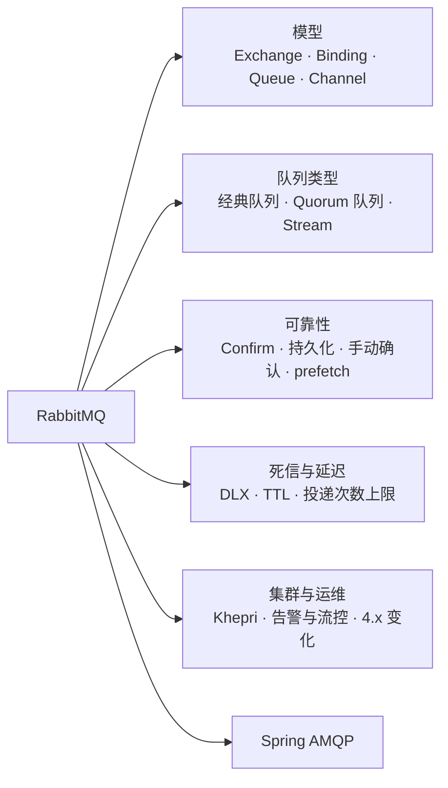
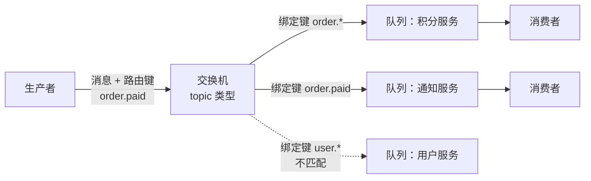
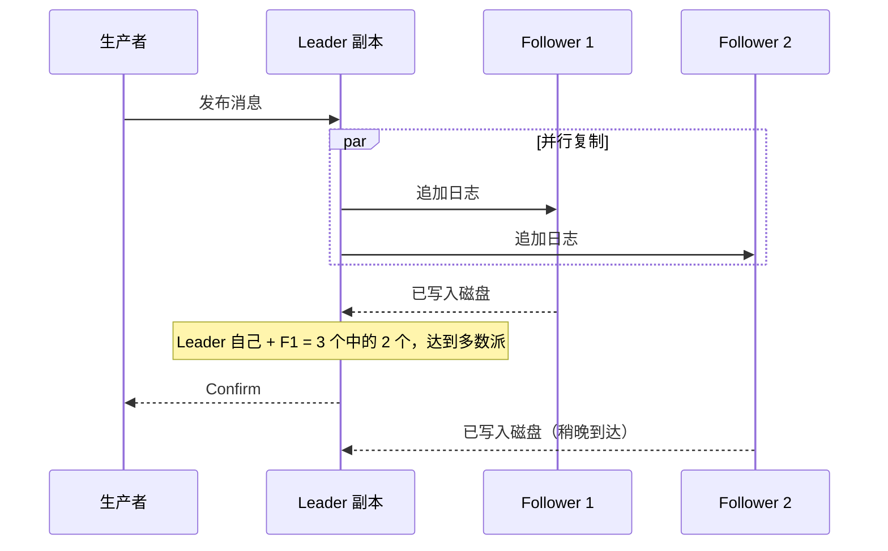
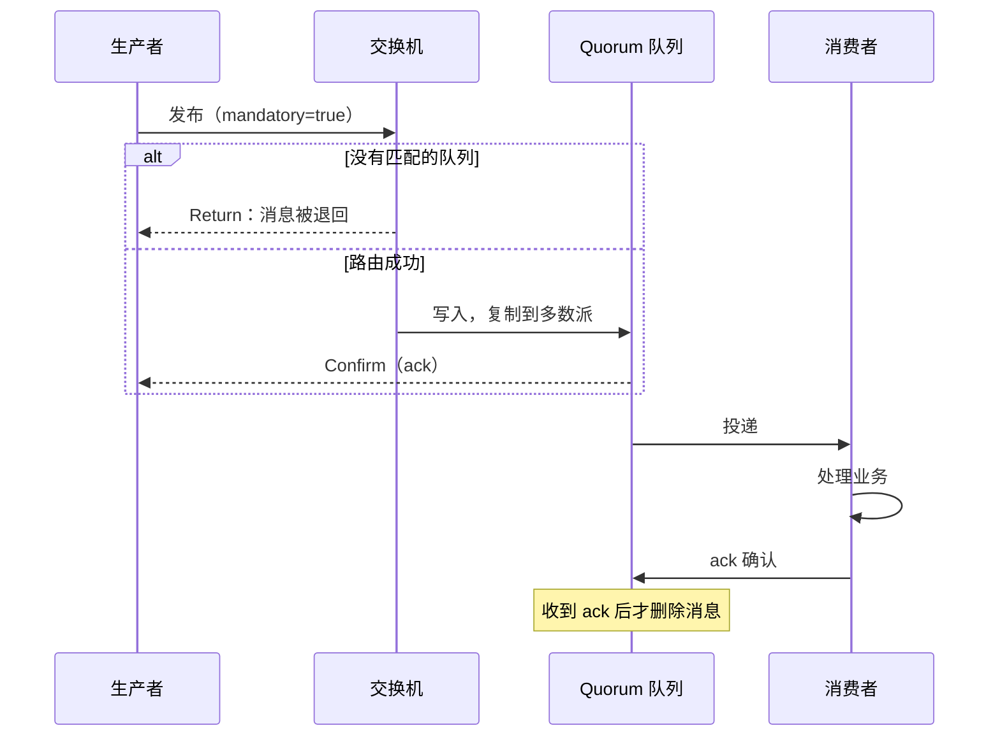
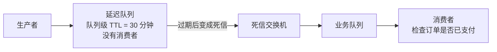
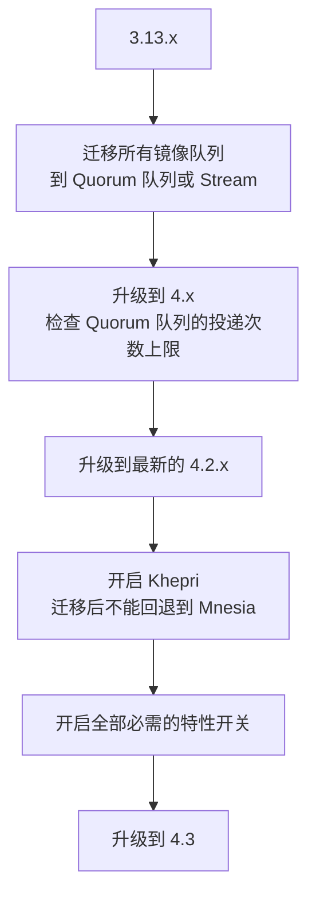

# 23 · RabbitMQ

> 适用岗位：Java 资深开发 / 架构师
> 版本基线：RabbitMQ 4.x（4.0 于 2024 年 9 月发布；4.2 起新部署默认使用 Khepri；4.3 移除了 Mnesia）；Spring AMQP 4.x（随 Spring Boot 4）
> 事实核对：本机没有 RabbitMQ 环境，4.x 的版本变化查阅了 RabbitMQ 官方文档、发布说明和官方博客，附有链接；原理部分以官方文档为准
> 相关分类：[《20 MQ 通用与选型》](20-MQ通用与选型.md)（可靠性、幂等、选型）、[《21 Kafka》](21-Kafka.md)（Stream 与 Kafka 对比）、[《22 RocketMQ》](22-RocketMQ.md)（延时消息的另一种实现）、[《09 分布式理论》](../03-分布式与微服务/09-分布式理论.md)（Raft）

## 知识地图



## 题目索引

| 编号 | 题目 | 难度 | 层级 |
| --- | --- | --- | --- |
| 23-01 | RabbitMQ 的核心概念与消息流转 | ★ | 资深 |
| 23-02 | 四种交换机类型及路由规则 | ★★ | 资深 |
| 23-03 | Connection 和 Channel 是什么关系？ | ★★ | 资深 |
| 23-04 | 经典队列、Quorum 队列、Stream 怎么选？ | ★★★ | 资深 / 架构师 |
| 23-05 | Quorum 队列的原理 | ★★★ | 资深 / 架构师 |
| 23-06 | RabbitMQ Stream 和 Kafka 有什么异同？ | ★★ | 架构师 |
| 23-07 | 如何保证消息不丢？ | ★★★ | 资深 |
| 23-08 | 消费确认：ack、nack、reject 与重新入队的陷阱 | ★★ | 资深 |
| 23-09 | prefetch 怎么设置？ | ★★ | 资深 |
| 23-10 | 死信交换机、TTL 与延迟消息 | ★★★ | 资深 |
| 23-11 | 集群架构与网络分区 | ★★★ | 架构师 |
| 23-12 | 内存告警、磁盘告警与流控 | ★★ | 资深 |
| 23-13 | 如何保证消息的顺序？ | ★★ | 资深 |
| 23-14 | Spring AMQP 的使用要点 | ★★ | 资深 |
| 23-15 | RabbitMQ 4.x 有哪些重要变化？ | ★★ | 架构师 |

---

## 一、模型

### 23-01 RabbitMQ 的核心概念与消息流转

> ★ ｜ 资深 ｜ 高频

**考察意图**：是否理解 AMQP 0-9-1 模型中"生产者不直接发给队列"这一点。

**30 秒版回答**

| 概念 | 含义 |
| --- | --- |
| Exchange（交换机） | 接收生产者的消息，按规则路由到队列。**生产者只把消息发给交换机，不直接发给队列** |
| Queue（队列） | 存储消息，等待消费者取走 |
| Binding（绑定） | 交换机和队列之间的路由规则，带一个绑定键（binding key） |
| Routing Key（路由键） | 生产者发送消息时指定，交换机用它和绑定键匹配 |
| Virtual Host | 逻辑隔离单元，类似命名空间，不同 vhost 的交换机、队列、权限互相隔离 |
| Connection / Channel | 一个 TCP 连接上可以开多个 Channel（信道），大部分操作都在 Channel 上进行 |

**深入剖析**



这种"交换机 + 绑定"的设计，让生产者完全不需要知道有哪些消费者：新增一个下游，只需要新建队列并绑定到交换机，生产者代码不用改。

---

### 23-02 四种交换机类型及路由规则

> ★★ ｜ 资深 ｜ 高频

**考察意图**：能否根据业务选择交换机类型。

**30 秒版回答**

| 类型 | 路由规则 | 典型用途 |
| --- | --- | --- |
| direct | 路由键和绑定键**完全相等** | 按类型精确分发，例如按日志级别 |
| fanout | **忽略路由键**，发给所有绑定的队列 | 广播，例如配置变更通知 |
| topic | 路由键和绑定键**按模式匹配**：用 `.` 分隔单词，`*` 匹配一个单词，`#` 匹配零个或多个单词 | 按多个维度订阅，例如 `order.*.cn` |
| headers | 按消息头的键值匹配，不看路由键 | 很少使用，性能比前三种差 |

- **默认交换机**：名字是空字符串的 direct 交换机，每个队列都自动以**队列名**作为绑定键绑定到它上面。所以"直接发给某个队列"本质上是发给默认交换机，路由键填队列名。
- 消息**没有匹配到任何队列**时，默认会被丢弃。要发现这种情况，可以设置 `mandatory` 标志（消息会被退回给生产者），或者给交换机配置**备用交换机**（alternate exchange）。

**追问链**

1. **topic 交换机中 `order.#` 和 `order.*` 的区别？** `order.*` 只匹配 `order.paid` 这种两段的路由键；`order.#` 能匹配 `order`、`order.paid`、`order.paid.cn`。
2. **一条消息能进入多个队列吗？** 能。所有匹配的绑定对应的队列都会收到一份副本，这就是 RabbitMQ 实现"发布 / 订阅"的方式。

---

### 23-03 Connection 和 Channel 是什么关系？

> ★★ ｜ 资深 ｜ 中频

**考察意图**：是否了解客户端资源的正确使用方式。

**30 秒版回答**

- **Connection** 是一个 TCP 连接，建立成本高（TCP 握手、TLS、认证），并且占用 Broker 的资源。
- **Channel** 是建立在 Connection 之上的**虚拟连接**，多个 Channel 复用同一个 TCP 连接，每个 Channel 有独立的编号。发布、消费、声明队列等操作都在 Channel 上进行。
- 使用原则：
  - 一个应用通常只需要少量 Connection，在其上为不同的线程创建 Channel；
  - **Channel 不要在多个线程之间共享来并发发布消息**，Java 客户端的官方文档明确不建议这样做，会导致帧交错和 Confirm 错乱；
  - Channel 也不要频繁创建和关闭，Spring 的 `CachingConnectionFactory` 默认会缓存 Channel。

**追问链**

1. **发布和消费用同一个 Connection 有什么问题？** RabbitMQ 的流控（见 23-12）是按 Connection 阻塞的。如果发布速度过快触发流控，同一个 Connection 上的消费也会受影响，消费变慢又会让积压更严重。官方建议**发布和消费使用不同的 Connection**。

---

## 二、队列类型

### 23-04 经典队列、Quorum 队列、Stream 怎么选？

> ★★★ ｜ 资深 / 架构师 ｜ 高频

**考察意图**：是否知道 4.x 中镜像队列已经被移除，以及三种队列的定位。

**30 秒版回答**

| 类型 | 复制 | 消费方式 | 适合场景 |
| --- | --- | --- | --- |
| 经典队列（Classic） | **4.0 起不再支持复制**（镜像队列已移除） | 消费后删除 | 临时队列、可以丢失的数据、对延迟要求极高的场景 |
| **Quorum 队列** | 基于 Raft 的多副本 | 消费后删除 | **需要高可用和数据安全的业务消息，4.x 的首选** |
| Stream | 多副本 | **消费后不删除**，按位点读取，可以重复读取 | 大量消费者读同一份数据（扇出很大）、需要回放历史消息、超大积压 |

- 4.0 是一个分水岭：经典队列的**镜像功能被彻底移除**，升级后与镜像相关的策略配置不再生效，需要复制的队列应该迁移到 Quorum 队列或 Stream（来源：[RabbitMQ 4.0 新特性](https://blog.rabbitmq.com/docs/4.0/whats-new)）。

**追问链**

1. **Quorum 队列有什么不支持的？** 不支持非持久化（durable=false）、排他队列（exclusive）、全局 QoS 等。临时性质的队列仍然用经典队列。
2. **为什么不推荐用经典队列 + 镜像了？** 镜像队列的同步机制有多年积累的问题：节点重新加入时要全量同步，同步期间队列阻塞；网络分区后容易丢数据。Quorum 队列基于 Raft，语义清晰，这也是它被移除的原因。

**架构师加分点**

- 从 3.x 升级到 4.x 前，必须先把所有依赖镜像的队列迁移完。迁移的常见做法是新建 Quorum 队列，修改绑定，让新消息进入新队列，等旧队列消费完再删除；队列类型不能原地修改。

---

### 23-05 Quorum 队列的原理

> ★★★ ｜ 资深 / 架构师 ｜ 高频

**考察意图**：是否理解 Quorum 队列的复制、确认和毒消息处理机制。

**30 秒版回答**

- 每个 Quorum 队列是一个**独立的 Raft 组**：一个 Leader 和若干 Follower，分布在不同节点上，副本数一般取奇数（3 或 5）。
- 写入：生产者的消息发给 Leader，Leader 复制给 Follower，**多数派**写入磁盘后，才向生产者返回 Confirm。
- Leader 所在节点宕机，剩余的多数派会选出新的 Leader，队列继续可用；少于多数派存活时，队列不可用（不会出现数据分叉）。
- **毒消息保护**：Quorum 队列会记录每条消息的投递次数。4.0 起默认**投递次数上限为 20**，超过后消息被丢弃，配置了死信交换机则进入死信（来源：[Quorum Queues in 4.0](https://www.rabbitmq.com/blog/2024/08/28/quorum-queues-in-4.0)）。
- 4.0 起 Quorum 队列也支持消息优先级，但机制和经典队列不同（官方说明见同一篇文章）。

**深入剖析**



Raft 的选主和日志复制原理见[《09 分布式理论》](../03-分布式与微服务/09-分布式理论.md)。

**追问链**

1. **为什么默认的投递次数上限从"无限"改成了 20？** 如果一条消息每次处理都失败、被重新入队，它会被无限次地投递，占用消费者资源，还可能阻塞后面的消息。设置上限后，这类"毒消息"最终会被移走。
2. **Quorum 队列的性能比经典队列差吗？** 每条消息都要复制到多数派并写磁盘，单队列的吞吐和延迟不如不复制的经典队列，但换来了数据安全。对可靠性有要求的业务，这个代价是值得的。

**生产实践 / 踩坑**

- 从 3.x 升级到 4.x 后，一些原来"一直重新入队、一直重试"的消息，在第 20 次投递后突然消失了。原因就是默认投递次数上限的变化。升级前要给重要队列配置死信交换机，或者通过策略显式设置 `delivery-limit`。

---

### 23-06 RabbitMQ Stream 和 Kafka 有什么异同？

> ★★ ｜ 架构师 ｜ 中频

**考察意图**：能否说清 Stream 的定位，避免"RabbitMQ 有了 Stream 就能替代 Kafka"这种结论。

**30 秒版回答**

- **相同点**：都是**只追加的日志**，消费不删除，消费者按位点读取，可以从任意位置回放；都支持多副本。
- RabbitMQ Stream 的特点：
  - 可以通过 AMQP 协议当作一个普通队列使用，也可以用专门的 Stream 协议获得更高的吞吐；
  - 单个 Stream 相当于 Kafka 的**一个分区**；需要水平扩展时用**超级流**（Super Stream），把多个 Stream 组成一个逻辑整体，类似 Kafka 的多分区 Topic；
  - 消费位点可以保存在服务端。
- 选择：
  - 已经在用 RabbitMQ，需要"消息被多个消费者重复读取"或"回放"的场景，用 Stream 可以避免再引入一套 Kafka；
  - 以日志采集、流处理、大数据生态为核心的场景，Kafka 的生态（Connect、Streams、各种计算引擎的连接器）仍然有明显优势。

---
## 三、可靠性

### 23-07 如何保证消息不丢？

> ★★★ ｜ 资深 ｜ 高频

**考察意图**：能否按消息流转的每个环节说出对应的保护措施。

**30 秒版回答**

按环节逐一保证：

| 环节 | 可能丢失的原因 | 保护措施 |
| --- | --- | --- |
| 生产者 → 交换机 | 网络中断、Broker 异常 | **Publisher Confirm**：Broker 确认收到后才算发送成功，没收到确认就重发 |
| 交换机 → 队列 | 没有匹配的队列，消息被丢弃 | 设置 `mandatory`，路由失败的消息会退回给生产者；或者配置备用交换机 |
| 队列存储 | Broker 重启、节点宕机 | 交换机、队列声明为持久化，消息设置为持久化；使用 **Quorum 队列**多副本 |
| 队列 → 消费者 | 消费者收到消息后崩溃 | **手动确认**（或框架的自动确认模式）：处理成功后再确认，未确认的消息会重新投递 |

**深入剖析**



- **Confirm 的时机**：持久化消息进入持久化队列时，Broker 要在消息**写入磁盘**（Quorum 队列是多数派写入）后才返回确认，所以收到确认就意味着消息已经安全。
- 收到 Return 之后，同一条消息仍然会收到 Confirm（ack），因为对 Broker 来说"处理完了"。判断发送是否真正成功，要同时看 Confirm 和有没有 Return。

**追问链**

1. **Confirm 用同步等待还是异步回调？** 每发一条就同步等待，吞吐很低；生产环境用异步回调，按消息的序号或关联 ID 找到对应的消息，没收到 ack（收到 nack 或超时）的消息重发。重发会产生重复，所以消费端要幂等。
2. **都做到了还会丢吗？** Confirm 之前，消息还在生产者的内存中，生产者进程崩溃就会丢失。要彻底解决，需要在发送前先把消息落库（本地消息表），见[《20 MQ 通用与选型》](20-MQ通用与选型.md)。

---

### 23-08 消费确认：ack、nack、reject 与重新入队的陷阱

> ★★ ｜ 资深 ｜ 高频

**考察意图**：是否理解几种确认方式的区别，以及 requeue 可能造成的问题。

**30 秒版回答**

| 操作 | 含义 |
| --- | --- |
| `basicAck` | 处理成功，Broker 删除消息。`multiple=true` 时确认这个序号及之前的所有消息 |
| `basicNack` | 处理失败，可以批量；`requeue=true` 重新入队，`false` 丢弃或进入死信 |
| `basicReject` | 和 nack 一样，但只能处理单条 |

- **重新入队的陷阱**：一条每次都会失败的消息（例如数据格式错误），`requeue=true` 会让它立即重新投递、再次失败，形成**死循环**，消费者 CPU 打满，日志刷屏。经典队列中这种循环会一直持续；Quorum 队列在 4.0 起有默认 20 次的投递上限。
- 正确做法：区分失败类型。可能恢复的错误（下游超时）有限次重试；不可能恢复的错误（数据错误）直接拒绝且不重新入队，让消息进入死信交换机。
- **确认超时**：消费者拿到消息后迟迟不确认，超过 `consumer_timeout`（默认 30 分钟），Broker 会关闭这个 Channel，消息重新投递给其他消费者。处理耗时很长的任务时要注意这个限制。

**追问链**

1. **忘记 ack 会怎样？** 消息一直处于"已投递、未确认"状态，不会投递给其他消费者，也不会被删除。prefetch 额度用完后，这个消费者就再也收不到新消息了；Channel 关闭后，这些消息会重新入队。
2. **自动确认模式（autoAck=true）有什么问题？** 这是 AMQP 协议层面的自动确认：消息**发出去**就算确认，消费者处理失败或崩溃，消息就丢了。不要和 Spring 的 `AcknowledgeMode.AUTO` 混淆，后者是"方法正常返回后由框架确认"，见 23-14。

---

### 23-09 prefetch 怎么设置？

> ★★ ｜ 资深 ｜ 中频

**考察意图**：是否理解 prefetch 对吞吐、延迟和负载均衡的影响。

**30 秒版回答**

- prefetch（`basicQos`）限制一个消费者**最多持有多少条未确认的消息**。达到上限后，Broker 暂停给这个消费者投递，直到它确认了一部分。
- 不设置（0，表示不限制）：Broker 会把队列中的消息尽可能多地推给消费者，消息堆在消费者内存中，可能导致 OOM；而且多个消费者之间分配不均，先连上的消费者拿走了大部分消息。
- 设置原则：
  - 处理快、追求吞吐：设大一些，减少等待；
  - 处理慢或耗时差异大：设小一些（例如 1～10），让空闲的消费者能拿到消息，负载更均衡；
  - Spring AMQP 的默认值是 250。

**架构师加分点**

- prefetch 本质上是消费端的**背压**（反压）机制：用"未确认消息的数量"控制 Broker 的推送速度，和 RocketMQ、Kafka 的"消费者主动拉取"殊途同归。

---

### 23-10 死信交换机、TTL 与延迟消息

> ★★★ ｜ 资深 ｜ 高频

**考察意图**：是否清楚消息变成死信的条件，以及 RabbitMQ 实现延迟消息的方法和限制。

**30 秒版回答**

- 给队列配置**死信交换机**（`x-dead-letter-exchange`）后，以下情况的消息会被转发到死信交换机：
  1. 被消费者拒绝，且不重新入队（`nack` / `reject`，`requeue=false`）；
  2. 消息过期（TTL）；
  3. 队列长度超过上限，被挤出的消息；
  4. Quorum 队列中超过投递次数上限的消息。
- 死信消息的头部 `x-death` 中记录了变成死信的原因、来源队列和次数，便于排查。
- **RabbitMQ 没有内建的任意时间延迟消息**，常见实现：
  - **TTL + 死信交换机**：消息先进入一个没有消费者的"延迟队列"，过期后成为死信，转发到真正的业务队列；
  - **延迟消息插件**（rabbitmq-delayed-message-exchange）：官方仓库**已经归档、不再维护**，新项目不建议依赖它。

**深入剖析**

TTL + 死信实现延迟的流程：



**按消息设置 TTL 的陷阱**：如果同一个队列中的消息 TTL 各不相同，RabbitMQ 只在消息到达**队头**时才检查它是否过期。队头是一条 30 分钟的消息，它后面一条 10 秒的消息即使早就过期，也要等前面那条处理掉才会被转发。

解决办法是**每种延迟时间一个队列，使用队列级 TTL**（同一个队列中的消息 TTL 相同，先进入的一定先过期），这和 RocketMQ 4.x 中"每个延时级别一个队列"的思路一样，见[《22 RocketMQ》](22-RocketMQ.md)22-08。

**追问链**

1. **需要任意时间的延迟怎么办？** RabbitMQ 本身不擅长。可以使用支持任意时间定时消息的 MQ（例如 RocketMQ 5.x），或者用 Redis 的有序集合、数据库加定时扫描实现，见[《34 定时任务》](../07-工程实践与稳定性/34-定时任务.md)。
2. **死信交换机会不会也丢消息？** 死信转发默认是"至多一次"：如果死信交换机路由失败，消息就丢了。Quorum 队列支持"至少一次"的死信转发（`dead-letter-strategy=at-least-once`），对死信也有可靠性要求时使用。

---

## 四、集群与运维

### 23-11 集群架构与网络分区

> ★★★ ｜ 架构师 ｜ 中频

**考察意图**：是否理解 RabbitMQ 集群中"元数据"和"消息数据"的不同处理方式。

**30 秒版回答**

- **元数据**（交换机、队列定义、绑定、用户、权限、策略）在**所有节点上都有**：
  - 4.2 之前默认用 Erlang 自带的数据库 **Mnesia** 存储；
  - 4.2 起新部署默认使用基于 Raft 的 **Khepri**，已有集群升级后要由管理员显式开启（来源：[RabbitMQ 文档：Metadata store](https://www.rabbitmq.com/docs/4.2/metadata-store)）；
  - 4.3 彻底移除了 Mnesia，Khepri 是唯一的元数据存储，并且只支持从 4.2.x 升级到 4.3。
- **消息数据**：
  - 经典队列只存在于**一个节点**上，其他节点只知道它的元数据，客户端连到其他节点时，消息会在集群内部转发；
  - Quorum 队列和 Stream 在多个节点上有副本。
- **网络分区**：
  - Mnesia 时代需要配置分区处理策略（`pause_minority`、`autoheal` 等），处理不好会出现两边各自写入、恢复后数据冲突；
  - Khepri 和 Quorum 队列都基于 Raft，**少数派一侧无法修改元数据，也无法写入**，避免了数据分叉。

**追问链**

1. **客户端连接集群中的哪个节点？** 前面放一个负载均衡（或者客户端配置多个地址），任意节点都可以接入。但为了减少集群内部转发，可以让消费者尽量连到队列 Leader 所在的节点。
2. **集群节点数取多少？** 和 Raft 一样取奇数，常见 3 个或 5 个。

**架构师加分点**

- RabbitMQ 的集群设计假设节点之间是**低延迟的局域网**，不适合跨地域部署成一个集群。跨机房的数据同步使用 Federation 或 Shovel 插件，在两个独立集群之间转发消息。

---

### 23-12 内存告警、磁盘告警与流控

> ★★ ｜ 资深 ｜ 中频

**考察意图**：是否了解 RabbitMQ 的自我保护机制和它对生产者的影响。

**30 秒版回答**

- **内存告警**：节点使用的内存超过 `vm_memory_high_watermark`（相对值，**4.0 起默认 0.6**，即可用内存的 60%，3.x 中默认 0.4，来源：[RabbitMQ 4.0 内存文档](https://www.rabbitmq.com/docs/4.0/memory)）时触发。
- **磁盘告警**：剩余磁盘空间低于 `disk_free_limit`（默认 50 MB，官方建议生产环境调高）时触发。
- 告警触发后，**整个集群中所有发布消息的连接都会被阻塞**，直到告警解除；消费不受影响，可以继续消费来释放资源。
- **流控**（credit flow）：即使没有触发告警，当某个环节（例如队列）处理不过来时，RabbitMQ 也会逐级减慢上游的读取速度，最终表现为发布者所在的 Connection 状态变成 `flow`，发送变慢。

**追问链**

1. **生产者发现发送卡住了，怎么排查？** 看管理界面中 Connection 的状态：`blocked` / `blocking` 说明触发了资源告警，看节点的内存和磁盘；`flow` 说明触发了流控，看下游哪个队列处理不过来。
2. **为什么容器环境中特别容易触发内存告警？** 如果 RabbitMQ 识别到的"可用内存"是宿主机的内存而不是容器的限制，水位线会算得过高，容器先被 OOM Kill。要确认 RabbitMQ 正确识别了容器的内存限制，或者用绝对值配置水位线，原理类似[《04 JVM》](../01-Java核心/04-JVM.md)中容器内存的问题。

---

### 23-13 如何保证消息的顺序？

> ★★ ｜ 资深 ｜ 中频

**考察意图**：是否清楚 RabbitMQ 在什么情况下会打乱顺序。

**30 秒版回答**

- **单个队列**本身是先进先出的，但以下情况会打乱顺序：
  - 一个队列有**多个消费者**，消息被并行处理，完成顺序不确定；
  - 消息被 `nack` / `reject` 后**重新入队**，会被放回队列中原来的位置附近，但这时后面的消息可能已经被别的消费者处理了；
  - 消费者内部用线程池并行处理。
- 保证顺序的方法：
  - 需要顺序的消息进入**同一个队列**，并且这个队列同一时刻只有一个消费者在消费：使用**单活消费者**（Single Active Consumer）特性，多个消费者中只有一个处于活动状态，它下线后另一个自动接替；
  - 需要扩展时，按业务 ID 把消息**分到多个队列**（例如用一致性哈希交换机插件，或者生产者按业务 ID 取模选择路由键），每个队列一个活动消费者。这和 Kafka 分区、RocketMQ 队列的顺序模型是一样的。

---

### 23-14 Spring AMQP 的使用要点

> ★★ ｜ 资深 ｜ 高频

**考察意图**：是否知道 Spring AMQP 的默认行为，特别是异常处理。

**30 秒版回答**

- **确认模式**：监听容器默认使用 `AcknowledgeMode.AUTO`：监听方法正常返回，框架发送 ack；抛出异常，框架发送 nack。
- **异常后默认重新入队**：默认情况下（`defaultRequeueRejected=true`），抛出普通异常的消息会被重新入队，容易形成 23-08 所说的死循环。避免的方法：
  - 抛出 `AmqpRejectAndDontRequeueException`，消息被拒绝且不重新入队，进入死信；
  - 消息转换失败这类"致命错误"，框架默认的错误处理器会直接拒绝且不重新入队；
  - 开启重试（`spring.rabbitmq.listener.simple.retry.enabled=true`）：在消费者本地有限次重试，用完后默认拒绝且不重新入队；
  - 使用 Quorum 队列的投递次数上限兜底。
- **发送端**：开启 Publisher Confirm（`spring.rabbitmq.publisher-confirm-type=correlated`）和 Return（`publisher-returns=true`，并设置 `RabbitTemplate` 的 `mandatory=true`），在回调中处理失败。
- **prefetch**：默认 250，按 23-09 的原则调整。

**深入剖析**

声明一个带死信和投递上限的 Quorum 队列，并在监听器中区分"可以重试"和"不能重试"的失败：

```java
@Configuration
public class OrderPaidQueueConfig {

    public static final String ORDER_EXCHANGE = "order.exchange";
    public static final String ORDER_PAID_QUEUE = "order.paid.points";
    public static final String ORDER_PAID_ROUTING_KEY = "order.paid";
    public static final String ORDER_DLX = "order.dlx";
    /** 投递次数上限：超过后消息进入死信交换机 */
    private static final int DELIVERY_LIMIT = 5;

    @Bean
    public Queue orderPaidQueue() {
        return QueueBuilder.durable(ORDER_PAID_QUEUE)
                .quorum()
                .deliveryLimit(DELIVERY_LIMIT)
                .deadLetterExchange(ORDER_DLX)
                .build();
    }

    @Bean
    public TopicExchange orderExchange() {
        return new TopicExchange(ORDER_EXCHANGE);
    }

    @Bean
    public Binding orderPaidBinding(Queue orderPaidQueue, TopicExchange orderExchange) {
        return BindingBuilder.bind(orderPaidQueue).to(orderExchange).with(ORDER_PAID_ROUTING_KEY);
    }
}
```

```java
@Slf4j
@Component
@RequiredArgsConstructor
public class OrderPaidListener {

    private final PointsService pointsService;

    @RabbitListener(queues = OrderPaidQueueConfig.ORDER_PAID_QUEUE)
    public void onMessage(OrderPaidEvent event) {
        if (!event.isValid()) {
            // 数据本身有问题，重试也不会成功：拒绝且不重新入队，直接进入死信
            throw new AmqpRejectAndDontRequeueException("invalid order paid event, orderNo=" + event.orderNo());
        }
        // 下游超时等异常直接抛出：重新入队后再次投递，超过投递上限后进入死信
        // 幂等：以订单号为唯一键，重复投递时直接跳过
        pointsService.grantOnce(event.orderNo(), event.points());
        log.info("points granted, orderNo={}", event.orderNo());
    }
}
```

**追问链**

1. **Spring AMQP 4.0 有什么变化？** 随 Spring Boot 4 发布，新增了基于 RabbitMQ AMQP 1.0 客户端的 `spring-rabbitmq-client` 模块，JSON 转换支持 Jackson 3，重试改为使用 Spring Framework 7 内置的重试能力。原来基于 AMQP 0-9-1 的 `spring-rabbit` 模块继续可用（来源：[Spring AMQP 4.0.0 发布公告](https://spring.io/blog/2025/11/19/spring-amqp-4-0-0-available/)）。
2. **本地重试和重新入队有什么区别？** 本地重试在同一个消费者线程中进行，期间这条消息一直占着 prefetch 额度，也阻塞这个线程；重新入队把消息还给 Broker，可能被其他消费者处理。重试间隔较长时，更好的办法是把消息发到一个带 TTL 的重试队列中。

---

### 23-15 RabbitMQ 4.x 有哪些重要变化？

> ★★ ｜ 架构师 ｜ 中频

**考察意图**：是否了解版本演进，能否评估升级影响。

**30 秒版回答**

| 版本 | 重要变化 |
| --- | --- |
| 4.0（2024 年 9 月） | **移除经典队列镜像**；AMQP 1.0 成为原生的核心协议，不再需要插件；Quorum 队列默认投递次数上限 20、支持优先级；Khepri 正式支持（需要手动开启）；内存水位线默认值从 0.4 改为 0.6 |
| 4.2 | **新部署默认使用 Khepri**，已有集群升级后仍用 Mnesia，直到管理员开启 |
| 4.3 | **移除 Mnesia**，Khepri 成为唯一的元数据存储；只支持从 4.2.x 升级；4.2 及以前引入的特性开关全部变为必需 |

来源：[RabbitMQ 4.0 新特性](https://blog.rabbitmq.com/docs/4.0/whats-new)、[RabbitMQ 4.0.1 发布说明](https://github.com/rabbitmq/rabbitmq-server/releases/tag/v4.0.1)、[Khepri 成为默认元数据存储的路线图](https://www.rabbitmq.com/blog/2025/09/01/6-khepri-default)、[RabbitMQ 4.3.0 发布说明](https://newreleases.io/project/github/rabbitmq/rabbitmq-server/release/v4.3.0)。

**深入剖析**

从 3.x 升级到 4.3 的路径：



**架构师加分点**

- 4.x 的主线是"**用 Raft 统一一致性**"：队列复制用 Quorum 队列（Raft），元数据用 Khepri（Raft），把过去镜像队列和 Mnesia 在网络分区下的各种问题从根上去掉。代价是对节点数（奇数）、磁盘性能和多数派存活有了明确要求。
- 依赖 Mnesia 的社区插件在 4.3 上会受影响，延迟消息插件的仓库也已经归档。升级前要盘点所有插件。
