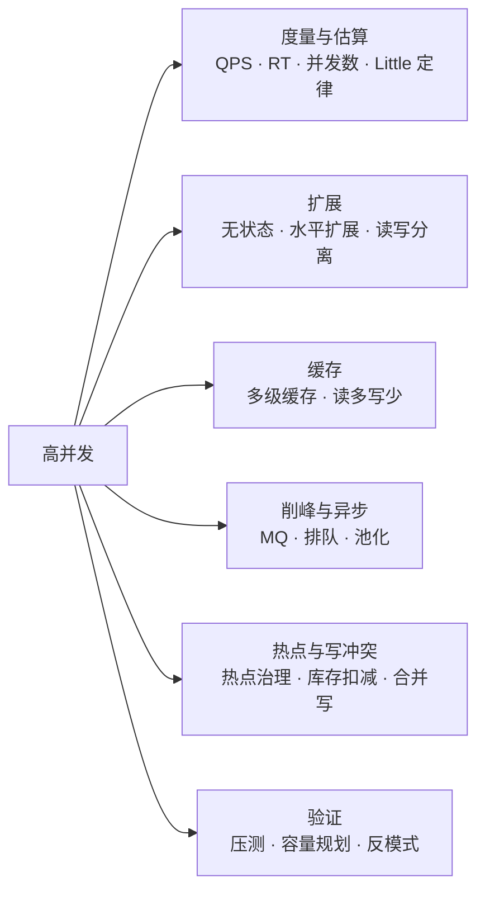
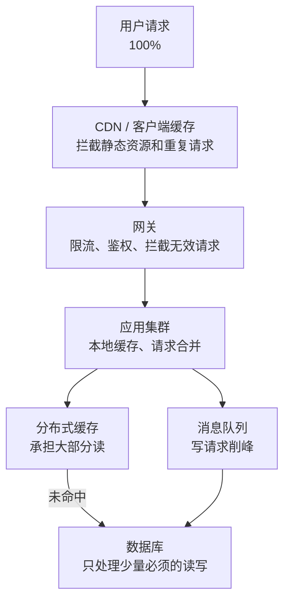
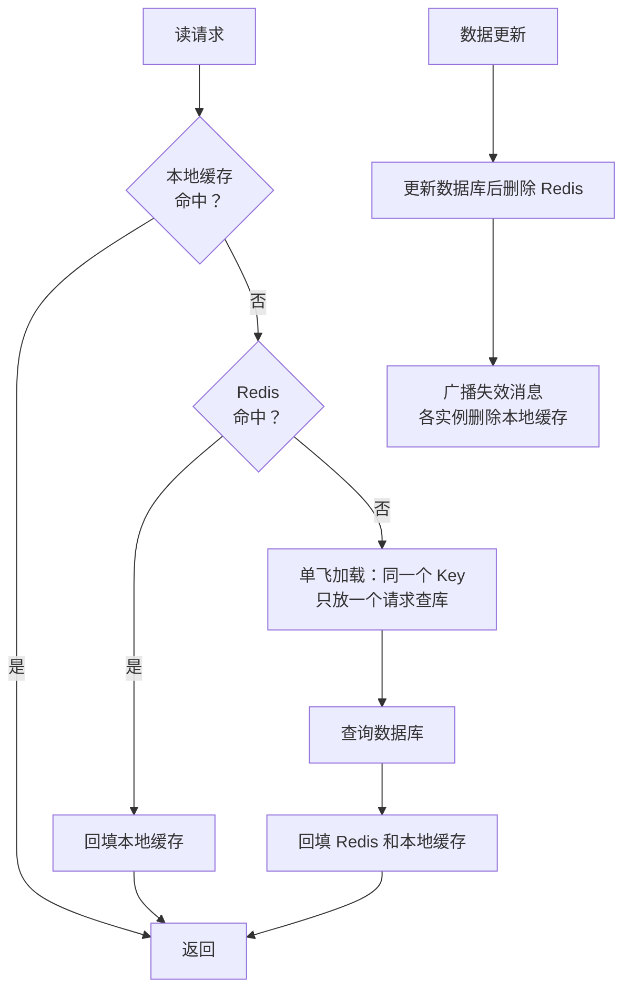
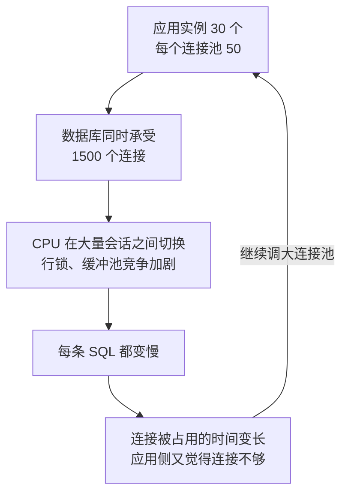
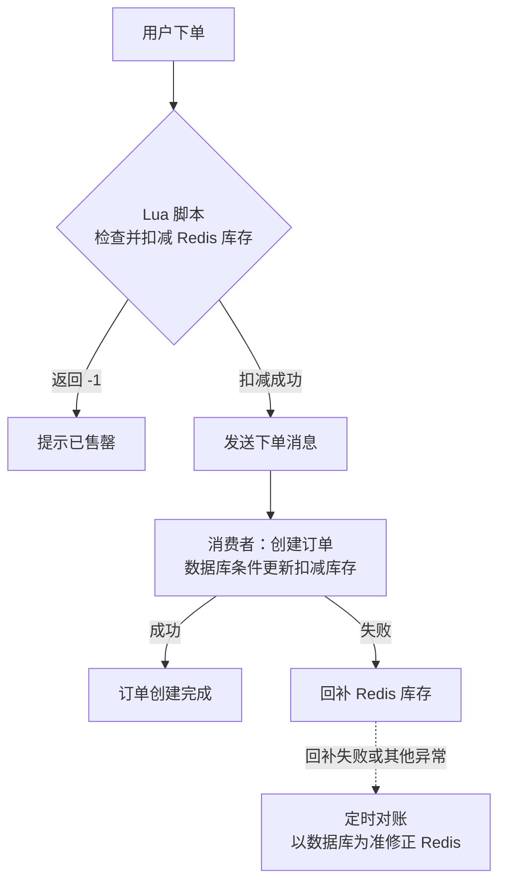
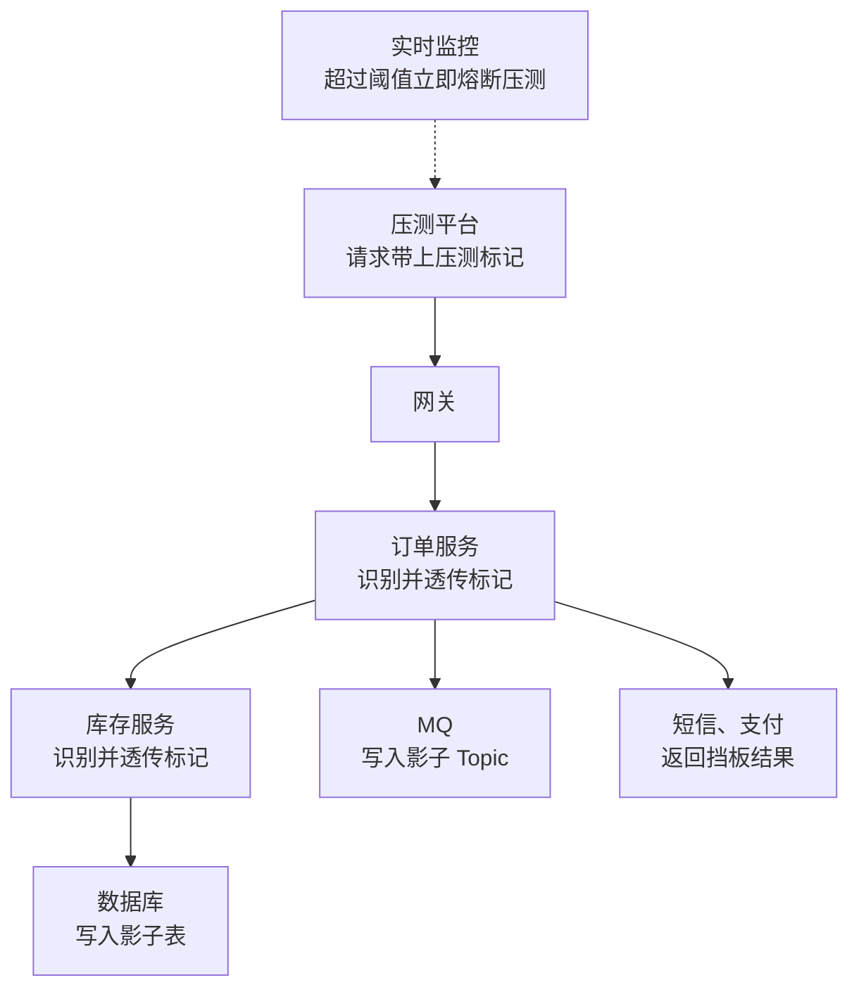

# 24 · 高并发

> 适用岗位：Java 资深开发 / 架构师
> 版本基线：JDK 21 / 25、Spring Boot 3.x / 4.x、MySQL 8.4、Redis 7.x / 8.x
> 事实核对：HikariCP 默认连接数来自本机 HikariCP 7.0.2 jar（`DEFAULT_POOL_SIZE = 10`）；库存扣减 Lua 脚本已在本机 Redis 上运行验证；容量估算中的数字是示例，用来演示方法
> 相关分类：[《03 Java 并发》](../01-Java核心/03-Java并发.md)（线程池、虚拟线程）、[《17 Redis》](../04-数据存储/17-Redis.md)[《18 本地缓存》](../04-数据存储/18-本地缓存.md)（缓存）、[《20 MQ 通用与选型》](../05-消息队列/20-MQ通用与选型.md)（削峰、异步）、[《15 MySQL》](../04-数据存储/15-MySQL.md)（读写分离、主从延迟）、[《25 高性能》](25-高性能.md)、[《26 高可用》](26-高可用.md)、[《29 场景题》](29-场景题.md)（秒杀）

## 知识地图



## 题目索引

| 编号 | 题目 | 难度 | 层级 |
| --- | --- | --- | --- |
| 24-01 | 衡量并发能力的指标有哪些？它们是什么关系？ | ★★ | 资深 |
| 24-02 | 设计一个高并发系统的整体思路 | ★★ | 资深 / 架构师 |
| 24-03 | 如何估算系统需要多大的容量？ | ★★★ | 架构师 |
| 24-04 | 为什么说"无状态"是水平扩展的前提？ | ★★ | 资深 |
| 24-05 | 多级缓存架构怎么设计？ | ★★★ | 资深 / 架构师 |
| 24-06 | 读写分离有哪些问题？ | ★★★ | 资深 |
| 24-07 | 读多写少和写多读少的系统，优化思路有什么不同？ | ★★★ | 架构师 |
| 24-08 | 流量削峰有哪些手段？ | ★★ | 资深 |
| 24-09 | 同步改异步的边界在哪里？ | ★★ | 资深 / 架构师 |
| 24-10 | 连接池、线程池的大小怎么定？ | ★★★ | 资深 |
| 24-11 | 热点数据怎么发现和治理？ | ★★★ | 资深 / 架构师 |
| 24-12 | 高并发下的库存扣减怎么防止超卖？ | ★★★ | 资深 |
| 24-13 | 点赞、浏览量这类高频计数怎么做？ | ★★ | 资深 |
| 24-14 | 虚拟线程能解决高并发问题吗？ | ★★★ | 资深 / 架构师 |
| 24-15 | 如何做全链路压测？ | ★★★ | 架构师 |
| 24-16 | 高并发系统中有哪些常见的反模式？ | ★★ | 资深 |

---

## 一、度量与方法

### 24-01 衡量并发能力的指标有哪些？它们是什么关系？

> ★★ ｜ 资深 ｜ 高频

**考察意图**：能否用量化的方式讨论并发，而不是只说"并发很高"。

**30 秒版回答**

| 指标 | 含义 |
| --- | --- |
| QPS / TPS | 每秒处理的请求数 / 事务数，表示**吞吐** |
| RT（响应时间） | 一个请求从发出到收到响应的时间，要看 **P99、P999**，不能只看平均值 |
| 并发数 | 同一时刻**正在处理中**的请求数 |
| 资源利用率 | CPU、内存、连接数、线程数的使用比例 |

三者的关系是 **Little 定律**：

> 系统中的平均并发数 = 吞吐 × 平均响应时间

**深入剖析**

用 Little 定律可以解释很多线上现象。以 Tomcat 默认 200 个工作线程为例（见[《07 Tomcat》](../02-框架与容器/07-Tomcat.md)）：

| 场景 | 平均 RT | 200 个线程能支撑的最大吞吐 |
| --- | --- | --- |
| 正常 | 100 毫秒 | 200 ÷ 0.1 = 2000 QPS |
| 下游变慢 | 1 秒 | 200 ÷ 1 = 200 QPS |

请求量没有变，只是**下游变慢了**，系统的承载能力就降到了原来的十分之一，多出来的请求在队列中排队，RT 进一步上升，最终线程耗尽、服务不可用。这就是为什么**超时设置**是高并发系统最基本的保护：它给 RT 设了上限，也就给并发数设了上限。

**追问链**

1. **为什么不能只看平均 RT？** 平均值会掩盖长尾。99% 的请求 10 毫秒，1% 的请求 2 秒，平均值只有 30 毫秒左右，但每 100 个用户就有 1 个感觉很卡。一个页面如果要调用 10 个接口，至少遇到一次慢请求的概率接近 10%。
2. **QPS 和并发数哪个更能说明压力？** 并发数直接决定了线程、连接这些资源的占用；QPS 相同时，RT 越长，并发数越高，资源压力越大。

---

### 24-02 设计一个高并发系统的整体思路

> ★★ ｜ 资深 / 架构师 ｜ 高频

**考察意图**：是否有分层治理的系统思维，而不是只会说"加缓存、加机器"。

**30 秒版回答**

核心思路是**让请求尽量少地到达最昂贵的资源**（通常是数据库），按层层过滤的方式设计：

1. **前端与边缘**：静态资源走 CDN；按钮防重复点击；客户端做本地缓存和请求合并。
2. **接入层**：网关限流、鉴权，过滤恶意和无效请求。
3. **应用层**：无状态、水平扩展；本地缓存；异步化；池化。
4. **缓存层**：分布式缓存承担绝大部分读请求。
5. **消息队列**：写请求削峰填谷，异步处理非核心逻辑。
6. **数据层**：读写分离、分库分表，数据库只承担必须由它完成的工作。

同时要有兜底：限流、熔断、降级，保证超出容量时系统不会整体崩溃，见[《26 高可用》](26-高可用.md)。

**深入剖析**



**架构师加分点**

- 每一层都要回答两个问题：**这一层能挡掉多少比例的请求**、**这一层的容量上限是多少**。把各层的比例和上限写成一张表，就能找到真正的瓶颈，而不是凭感觉加缓存。
- 高并发设计的本质是**对资源的保护和对一致性的取舍**：缓存、异步、读写分离都在用"一定程度的不一致"换取吞吐，设计时要明确每个业务能接受多大程度的不一致。

---

### 24-03 如何估算系统需要多大的容量？

> ★★★ ｜ 架构师 ｜ 高频

**考察意图**：是否能从业务数据推导出技术指标，这是系统设计题的基本功。

**30 秒版回答**

按"**业务量 → 平均 QPS → 峰值 QPS → 机器数**"的顺序估算，每一步都写清假设：

1. 日活用户数 × 人均请求数 = 每日请求总量；
2. 每日请求总量 ÷ 86400 = 平均 QPS；
3. 平均 QPS × 峰值系数 = 峰值 QPS。峰值系数可以用历史监控数据，没有数据时常用"二八原则"估算（80% 的请求集中在 20% 的时间内）；
4. 峰值 QPS ÷ 单机安全容量 = 机器数，再加上冗余。单机容量通过**压测**获得，安全容量一般取压测极限的 60%～70%。

**深入剖析**

示例（数字只用来演示方法）：

| 步骤 | 计算 | 结果 |
| --- | --- | --- |
| 每日请求量 | 1000 万日活 × 每人 20 次 | 2 亿次 |
| 平均 QPS | 2 亿 ÷ 86400 | 约 2300 |
| 峰值 QPS（二八原则） | 2 亿 × 80% ÷（86400 × 20%） | 约 9300 |
| 单机安全容量 | 压测极限 800 QPS × 65% | 约 520 |
| 机器数 | 9300 ÷ 520 ≈ 18，再加 30%～50% 冗余（应对单机故障、发布时部分实例下线、估算误差） | 约 24～27 台 |

如果是双机房且要求一个机房故障时另一个能承担全部流量，每个机房都要按 18 台的容量准备，总数接近翻倍，这类要求要在估算时明确写出来。

再按同样的方法推导下游：缓存命中率 95% 时，数据库读 QPS 约为 9300 × 5% ≈ 470；每条记录 1 KB、每天新增 500 万条，一年约 1.8 TB 数据，决定了是否需要分库分表（见[《16 分库分表》](../04-数据存储/16-分库分表.md)）。

**追问链**

1. **大促这种峰值怎么估？** 不能用日常数据推算。要用历史大促的数据，结合运营目标（例如预计成交量、参与人数）估算，并为预热、零点开抢这类瞬时峰值单独估算。
2. **估算结果不准怎么办？** 估算的意义在于确定**数量级**，判断是 1 台、10 台还是 100 台机器，方案是否需要分库分表、是否需要削峰。精确的数字要靠压测校准，见 24-15。

---

## 二、扩展与缓存

### 24-04 为什么说"无状态"是水平扩展的前提？

> ★★ ｜ 资深 ｜ 中频

**考察意图**：是否理解状态对扩展、发布、故障转移的影响。

**30 秒版回答**

- **无状态**指应用实例不在本地保存"只有它自己知道、别的实例不知道"的业务数据。任意请求可以路由到任意实例，所以：
  - 扩容只需要加实例，负载均衡自动分摊；
  - 某个实例宕机，请求切到其他实例即可；
  - 发布时可以逐个重启。
- 常见的"状态"及处理方式：

| 状态 | 处理方式 |
| --- | --- |
| 用户会话（Session） | 存到 Redis（Spring Session），或者改用 JWT 这类自包含令牌 |
| 本地缓存 | 允许存在，但要能容忍各实例之间短暂不一致，见[《18 本地缓存》](../04-数据存储/18-本地缓存.md) |
| 上传的文件 | 存对象存储，不存本地磁盘，见[《35 文件处理》](../07-工程实践与稳定性/35-文件处理.md) |
| 定时任务 | 用分布式调度，避免每个实例都执行一遍，见[《34 定时任务》](../07-工程实践与稳定性/34-定时任务.md) |
| WebSocket 长连接 | 天然有状态，需要额外的路由层记录"用户连在哪个实例" |

**追问链**

1. **会话粘滞（sticky session）能代替无状态吗？** 能临时缓解，但实例宕机时会话丢失，扩缩容时负载不均，不能作为长期方案。

---

### 24-05 多级缓存架构怎么设计？

> ★★★ ｜ 资深 / 架构师 ｜ 高频

**考察意图**：能否设计一个分层的缓存体系，并处理好一致性和热点问题。

**30 秒版回答**

典型的多级缓存从外到内：

| 层级 | 位置 | 特点 |
| --- | --- | --- |
| 客户端缓存 | 浏览器、App | 离用户最近，难以主动失效 |
| CDN | 边缘节点 | 适合静态资源和可以短暂过期的页面 |
| 网关 / Nginx 缓存 | 接入层 | 拦截热点读请求 |
| 本地缓存 | 应用进程内（Caffeine） | 没有网络开销，容量小，各实例之间不一致 |
| 分布式缓存 | Redis | 容量大，所有实例共享 |
| 数据库 | MySQL | 最终的数据来源 |

设计要点：

- **越靠外，数据越"旧"、过期时间越短**，只缓存能容忍不一致的数据；
- 本地缓存主要用来**扛热点**（少量 Key 承担大量请求），过期时间设得很短，并通过消息广播主动失效；
- 每一层都要防止穿透、击穿、雪崩，见[《17 Redis》](../04-数据存储/17-Redis.md)17-13。

**深入剖析**



**追问链**

1. **本地缓存的一致性怎么保证？** 不能做到强一致。常用"短过期时间 + 变更广播"：数据变更后通过 MQ 或 Redis 的发布订阅通知所有实例删除本地缓存，广播丢失时靠过期时间兜底。详见[《18 本地缓存》](../04-数据存储/18-本地缓存.md)。
2. **什么数据适合放本地缓存？** 访问极其集中、变化不频繁、能容忍秒级不一致的数据，例如商品详情、配置、字典数据。库存、余额这类强一致的数据不适合。

---

### 24-06 读写分离有哪些问题？

> ★★★ ｜ 资深 ｜ 高频

**考察意图**：是否意识到读写分离带来的主从延迟问题，以及如何处理。

**30 秒版回答**

- 读写分离用主库处理写、从库处理读，提高读的承载能力。最大的问题是**主从延迟**：写入主库后，从库可能还没同步，马上读从库会读到旧数据（例如用户刚下单，在订单列表里看不到）。
- 常见处理方式：

| 方式 | 说明 |
| --- | --- |
| 关键读走主库 | 写完后立即要读的场景（例如下单后跳转订单详情）强制读主库 |
| 会话级读主 | 某个用户写入后的几秒内，他的读请求都走主库 |
| 等待从库追上 | 读之前检查从库是否已经应用了这次写入（例如基于 GTID 判断），超时则读主库 |
| 业务上容忍 | 页面提示"处理中"，或者前端先展示本地的结果 |

- 其他问题：从库数量增加会加重主库的复制负担；从库宕机时，读请求要能自动切走；事务内的读写必须走同一个库。

**追问链**

1. **主从延迟一般多大？什么情况下会变大？** 正常情况下很小，但大事务、大批量更新、DDL、从库负载过高时会明显变大。监控上要有主从延迟的告警。详见[《15 MySQL》](../04-数据存储/15-MySQL.md)中复制部分。
2. **读写分离和缓存怎么选？** 读写分离提高的是数据库的读能力，读请求最终仍然落到数据库；缓存能挡掉绝大部分读请求。读压力很大时，先考虑缓存，再考虑读写分离。

---

### 24-07 读多写少和写多读少的系统，优化思路有什么不同？

> ★★★ ｜ 架构师 ｜ 中频

**考察意图**：能否根据读写特征选择不同的技术路线。

**30 秒版回答**

| 对比项 | 读多写少（商品详情、文章、配置） | 写多读少（日志、埋点、监控指标、订单流水） |
| --- | --- | --- |
| 核心手段 | **缓存**、读写分离、CDN、静态化 | **异步写**、批量写、顺序写、分片 |
| 存储选择 | 关系型数据库 + 缓存 | 消息队列 + 面向写入优化的存储（LSM 树结构的数据库、时序数据库、Elasticsearch、ClickHouse 等） |
| 一致性 | 缓存与数据库的一致性是主要问题 | 写入不丢、不重是主要问题 |
| 扩展方式 | 增加缓存和从库 | 按写入维度分片，增加分区 |

- 关键的认识：缓存只能解决**读**的问题。写多的系统加缓存不仅没用，还会增加一致性的负担。写的优化本质上是**把随机写变成顺序写、把单条写变成批量写**，这也是 Kafka、RocketMQ、LSM 树这些系统高吞吐的原因。

**架构师加分点**

- 很多系统是"读写都多"，例如社交 Feed、IM。这时通常要拆开设计：写路径追求可靠和吞吐（MQ + 批量写），读路径追求延迟（预计算 + 缓存），中间通过异步同步连接，即 CQRS 的思路，见[《27 DDD》](27-DDD.md)。

---

## 三、削峰与异步

### 24-08 流量削峰有哪些手段？

> ★★ ｜ 资深 ｜ 高频

**考察意图**：是否知道削峰不只是"加 MQ"。

**30 秒版回答**

削峰的本质是**把瞬时的高峰摊到更长的时间里**，或者**在入口处就挡掉超出容量的部分**：

| 手段 | 做法 | 适用场景 |
| --- | --- | --- |
| 消息队列 | 请求先写入 MQ，后端按自己的能力匀速消费 | 可以异步处理的写请求，例如下单后的发货、积分 |
| 排队 | 请求进入排队系统，前端显示排队进度 | 秒杀、抢票 |
| 答题 / 验证码 | 增加一个人工步骤，把请求时间拉开，同时拦截机器请求 | 秒杀 |
| 分时分批 | 不同用户、不同区域错开时间开放 | 大型活动 |
| 限流 | 超出容量的请求直接拒绝或降级 | 所有入口都应该有 |
| 预热与预计算 | 提前把数据加载进缓存，提前生成结果 | 活动开始前 |

**追问链**

1. **用 MQ 削峰，用户怎么知道结果？** 接口立即返回"已受理"，结果通过轮询、推送或者站内消息通知用户。交互上要接受"异步"，这需要和产品一起设计。
2. **削峰之后，MQ 积压了怎么办？** 削峰本来就是让消息在 MQ 中暂存。关键是确认消费能力能在可接受的时间内消化完，并监控积压量，见[《20 MQ 通用与选型》](../05-消息队列/20-MQ通用与选型.md)20-06。

---
### 24-09 同步改异步的边界在哪里？

> ★★ ｜ 资深 / 架构师 ｜ 中频

**考察意图**：是否知道哪些可以异步、哪些不能，以及异步带来的代价。

**30 秒版回答**

- 判断标准：**用户在这次请求中是否必须知道这一步的结果**。
  - 必须同步：决定请求成败的核心步骤，例如下单时的库存校验、支付时的扣款；
  - 可以异步：结果不影响这次响应的步骤，例如下单后的发短信、加积分、写搜索索引、数据统计。
- 两种异步方式：
  - **进程内异步**（线程池、`CompletableFuture`）：实现简单，但进程崩溃时任务丢失，只适合可以丢失的操作，或者用来**并行调用**多个下游以降低 RT；
  - **跨进程异步**（消息队列）：可靠，可以削峰，但引入了 MQ 的复杂度和最终一致性。
- 异步的代价：结果不再立即可见；失败要有重试和补偿；问题排查需要跨越多个服务和时间点，必须有链路追踪（见[《32 日志与可观测性》](../07-工程实践与稳定性/32-日志与可观测性.md)）。

**追问链**

1. **用 `@Async` 发短信有什么风险？** 默认线程池配置不当可能无界堆积（见[《05 Spring》](../02-框架与容器/05-Spring.md)）；应用重启时队列里的任务丢失；异常默认只打印日志。重要的通知应该用 MQ。
2. **并行调用多个下游能降低多少 RT？** 串行时 RT 约等于各下游之和，并行时约等于最慢的那个。但并行会让瞬时并发数成倍增加，下游要能承受。

---

### 24-10 连接池、线程池的大小怎么定？

> ★★★ ｜ 资深 ｜ 高频

**考察意图**：能否用量化的方法确定池大小，而不是凭感觉设一个很大的数。

**30 秒版回答**

- **原则：池不是越大越好**。池的大小应该由**下游资源的处理能力**决定，而不是由上游的请求量决定。
- **数据库连接池**：
  - 数据库能同时高效执行的查询数受限于它的 CPU 核数和磁盘，连接过多只会增加上下文切换和锁竞争。HikariCP 文档中给出的经验公式是 `连接数 = CPU 核数 × 2 + 有效磁盘数`，这里的 CPU 核数指**数据库服务器**的核数；
  - 用 Little 定律验证：单实例数据库 QPS 2000，平均查询耗时 5 毫秒，需要的并发连接数只有 2000 × 0.005 = 10。HikariCP 的默认值就是 10（已核对 HikariCP 7.0.2）；
  - 多个应用实例共享一个数据库时，**所有实例的连接数之和**不能超过数据库能承受的连接数。
- **线程池**：CPU 密集型任务接近 CPU 核数；IO 密集型任务用 Little 定律估算：`线程数 = 目标吞吐 × 平均 RT`，再通过压测校准。详见[《03 Java 并发》](../01-Java核心/03-Java并发.md)03-13。

**深入剖析**

为什么连接池太大反而更慢：



**生产实践 / 踩坑**

- 应用扩容了一倍，每个实例的连接池没变，数据库总连接数翻倍，数据库 CPU 飙升，所有接口变慢。**扩容应用前，要先算数据库的总连接数**。
- 连接池获取连接的超时（HikariCP 的 `connectionTimeout`）设得太长，数据库变慢时，请求在获取连接这一步排队，占满了 Tomcat 线程。获取连接的超时应该比较短，快速失败。

---

## 四、热点与写冲突

### 24-11 热点数据怎么发现和治理？

> ★★★ ｜ 资深 / 架构师 ｜ 高频

**考察意图**：是否有处理"少量数据承担大量流量"问题的经验。

**30 秒版回答**

- **热点**分两类：
  - **读热点**：某个商品、某条微博被大量访问，集中到缓存的一个 Key 或一个分片上；
  - **写热点**：大量请求同时修改同一行数据，例如热门商品的库存、直播间的点赞数。
- **发现**：
  - 提前预判：运营活动、大 V 发布内容；
  - 实时探测：在客户端或代理层统计 Key 的访问频率，滑动窗口内超过阈值的标记为热点；Redis 也提供了热 Key 分析的手段，见[《17 Redis》](../04-数据存储/17-Redis.md)17-07。
- **治理**：

| 类型 | 手段 |
| --- | --- |
| 读热点 | 本地缓存（最有效）；热点 Key 复制多份（`key_1`～`key_N`），随机读其中一份；网关层缓存 |
| 写热点 | 拆分（库存分桶）；合并写（请求合并、批量提交）；把写操作移到 Redis 等内存中执行，再异步落库；排队串行化 |

**架构师加分点**

- 热点问题的本质是**分片失效**：数据分片、负载均衡都假设流量是均匀的，热点打破了这个假设。所以治理热点的方向只有两个：把一份热点**复制**成多份（读），或者把一个热点**拆分**成多个（写）。
- 京东、阿里等公司都公开介绍过自研的"热点探测"系统，思路都是实时统计、秒级推送热点 Key 到各个应用实例的本地缓存。

---

### 24-12 高并发下的库存扣减怎么防止超卖？

> ★★★ ｜ 资深 ｜ 高频

**考察意图**：能否给出从数据库到 Redis 的多种方案，并说清各自的并发能力和一致性风险。

**30 秒版回答**

| 方案 | 做法 | 并发能力 | 风险 |
| --- | --- | --- | --- |
| 数据库条件更新 | `UPDATE ... SET stock = stock - n WHERE sku_id = ? AND stock >= n`，根据影响行数判断是否成功 | 受单行锁限制，适合普通商品 | 热门商品的同一行锁竞争严重 |
| Redis 预扣减 | 用 Lua 脚本原子地"检查并扣减"，成功后再异步创建订单、落库 | 高 | Redis 和数据库不一致，需要对账和回补 |
| 库存分桶 | 把一个商品的库存拆到 N 行或 N 个 Key 中，请求随机或按用户分散 | 约为单行的 N 倍 | 某些桶卖完、其他桶还有剩余时要处理 |
| 请求合并 | 把短时间内的多个扣减请求合并成一次批量扣减 | 高 | 实现复杂，增加少量延迟 |

- **不要用"先查询库存、判断够了再扣减"的写法**，查询和扣减之间有并发窗口，必然超卖。判断和扣减必须是**一个原子操作**。

**深入剖析**

数据库条件更新：

```java
@Mapper
public interface StockMapper {

    /**
     * 扣减库存：判断和扣减在一条 SQL 中完成，依靠行锁保证原子性。
     * 返回影响行数，0 表示库存不足
     */
    @Update("UPDATE t_stock SET available = available - #{qty} "
            + "WHERE sku_id = #{skuId} AND available >= #{qty}")
    int deduct(@Param("skuId") long skuId, @Param("qty") int qty);
}
```

Redis Lua 脚本（已在本机 Redis 上验证：库存 3，依次扣 2、2、1，返回 1、-1、0；Key 不存在时返回 -1）：

```lua
-- KEYS[1]：库存 Key；ARGV[1]：扣减数量
-- 返回扣减后的库存，-1 表示库存不足
local stock = tonumber(redis.call('GET', KEYS[1]) or '0')
local n = tonumber(ARGV[1])
if stock < n then
    return -1
end
return redis.call('DECRBY', KEYS[1], n)
```

Redis 预扣减的完整流程：



**追问链**

1. **Redis 扣减成功但发消息失败怎么办？** 回补 Redis 库存。如果回补也失败，依靠定时对账修正。Redis 库存只是"闸门"，**数据库才是最终的库存**，数据库的条件更新仍然要做，这样即使 Redis 出错也不会超卖，最多是少卖。
2. **用户下单后不付款，库存怎么处理？** 下单时"锁定"库存，支付超时（例如 30 分钟）后释放。超时取消通常用延时消息实现，见[《22 RocketMQ》](../05-消息队列/22-RocketMQ.md)22-08。
3. **Redis 主从切换会导致超卖吗？** 主从异步复制，切换时可能丢失最近的扣减记录，新主库的库存比实际多。因为数据库仍然有条件更新兜底，结果是部分订单在落库时失败，不会真正超卖。

---

### 24-13 点赞、浏览量这类高频计数怎么做？

> ★★ ｜ 资深 ｜ 中频

**考察意图**：是否会用"合并写"降低存储压力。

**30 秒版回答**

- 特点：写入频率极高，单条数据的精确性要求不高，可以接受短暂延迟。
- 常见做法：
  1. **Redis 计数**：`INCR` 原子递增，读也从 Redis 读；
  2. **定期落库**：后台任务定期把 Redis 中的计数批量写入数据库，数据库只用于持久化和离线分析；
  3. **本地聚合**：流量特别大时，先在应用内存中累加，每秒合并一次再写入 Redis，写入次数从"每次请求一次"降到"每个实例每秒一次"。
- 点赞还需要**去重**（同一个用户只能点一次），用 Redis 的 Set 记录点赞的用户，或者用数据库唯一索引保证。

**深入剖析**

本地聚合的示意代码：

```java
@Component
@RequiredArgsConstructor
public class ViewCountAggregator {

    private final StringRedisTemplate redisTemplate;
    /** 本地累加的浏览量：文章 ID → 增量 */
    private final ConcurrentHashMap<Long, LongAdder> pending = new ConcurrentHashMap<>();

    private static final String VIEW_COUNT_KEY_PREFIX = "article:view:";

    /** 每次浏览只在内存中累加，不访问 Redis */
    public void increment(long articleId) {
        pending.computeIfAbsent(articleId, id -> new LongAdder()).increment();
    }

    /** 每秒把累加的增量合并写入 Redis */
    @Scheduled(fixedRate = 1000)
    public void flush() {
        for (Long articleId : pending.keySet()) {
            LongAdder adder = pending.remove(articleId);
            long delta = adder.sum();
            if (delta > 0) {
                redisTemplate.opsForValue().increment(VIEW_COUNT_KEY_PREFIX + articleId, delta);
            }
        }
    }
}
```

`remove` 之后才读取 `sum`，`remove` 和下一次 `computeIfAbsent` 之间到达的浏览会进入一个新的 `LongAdder`，不会丢失；`remove` 前一刻正在累加的那一次可能在 `sum` 之后才完成，会有极少量误差。浏览量能接受这个误差；实例宕机时丢失最近一秒内的增量也可以接受。如果计数涉及金额等需要精确的场景，不能用这种方式。

---

## 五、验证与反模式

### 24-14 虚拟线程能解决高并发问题吗？

> ★★★ ｜ 资深 / 架构师 ｜ 高频

**考察意图**：是否理解虚拟线程解决的是什么问题、不解决什么问题。

**30 秒版回答**

- 虚拟线程（JDK 21 正式发布）解决的是"**线程太贵**"的问题：阻塞式 IO 代码可以用"一个请求一个线程"的写法支撑大量并发，不必改成响应式编程。Spring Boot 3.2 起可以通过 `spring.threads.virtual.enabled=true` 开启。
- 它**不解决**的问题：
  - 不会让数据库、Redis、下游服务变快，也不会增加它们的容量；
  - CPU 密集型任务没有收益；
  - 线程不再是瓶颈后，**压力会直接传导到下游**：原来 200 个 Tomcat 线程天然限制了最多 200 个并发访问数据库，换成虚拟线程后，可能有几千个请求同时等数据库连接。
- 所以使用虚拟线程时，要用**信号量或连接池**等手段显式地限制对下游的并发。
- JDK 21～23 中，虚拟线程在 `synchronized` 中阻塞会钉住载体线程；JDK 24 起（JEP 491）已解决。详见[《03 Java 并发》](../01-Java核心/03-Java并发.md)03-22、03-23。

**深入剖析**

用信号量限制对下游的并发：

```java
@Component
@RequiredArgsConstructor
public class InventoryClient {

    /** 对库存服务的最大并发调用数，按库存服务的容量设定 */
    private static final int MAX_CONCURRENT_CALLS = 100;
    /** 获取许可的最长等待时间（毫秒） */
    private static final long ACQUIRE_TIMEOUT_MS = 200L;

    private final Semaphore permits = new Semaphore(MAX_CONCURRENT_CALLS);
    private final RestClient inventoryRestClient;

    public InventoryDTO query(long skuId) throws InterruptedException {
        if (!permits.tryAcquire(ACQUIRE_TIMEOUT_MS, TimeUnit.MILLISECONDS)) {
            // 拿不到许可说明下游已经饱和，快速失败，交给上层降级
            throw new DownstreamBusyException(ErrorCode.INVENTORY_BUSY, skuId);
        }
        try {
            return inventoryRestClient.get()
                    .uri("/inventory/{skuId}", skuId)
                    .retrieve()
                    .body(InventoryDTO.class);
        } finally {
            permits.release();
        }
    }
}
```

---

### 24-15 如何做全链路压测？

> ★★★ ｜ 架构师 ｜ 中频

**考察意图**：是否了解在生产环境压测的方法和风险控制。

**30 秒版回答**

- **为什么要在生产环境压**：测试环境的机器规模、数据量、网络拓扑、依赖服务都和生产不同，压测结果没有参考价值，大促前必须在生产环境验证真实容量。
- 关键技术：
  1. **流量标记**：压测请求带上特殊标记（例如请求头），标记随调用链路透传到所有下游服务和中间件（见[《12 Spring Cloud》](../03-分布式与微服务/12-SpringCloud.md)12-13 的上下文传递）；
  2. **数据隔离**：带标记的请求写入**影子库 / 影子表**、影子 Topic，不污染真实数据；
  3. **外部依赖挡板**：短信、支付等第三方调用在识别到压测标记时返回模拟结果；
  4. **逐步加压**：从低流量开始阶梯式增加，实时观察各项指标，达到预设的阈值（例如错误率、RT、CPU）立即停止；
  5. **压测数据构造**：数据量和分布要接近真实，例如热点商品的比例。
- 输出：每个服务、每种资源的容量上限和瓶颈点，以及扩容方案。

**深入剖析**



**追问链**

1. **全链路压测最大的风险是什么？** 压测数据泄漏到真实业务中（标记丢失导致写了真实表、发了真实短信），以及压测把生产环境压垮。前者靠标记透传的完整性检查和数据隔离的兜底校验；后者靠逐步加压和自动熔断。
2. **线程池、异步任务中标记会丢失吗？** 会。`ThreadLocal` 中的标记在切换线程时丢失，要用支持上下文传递的线程池包装，或者使用 OpenTelemetry 的上下文传播。

---

### 24-16 高并发系统中有哪些常见的反模式？

> ★★ ｜ 资深 ｜ 中频

**考察意图**：是否有足够的踩坑经验。

**30 秒版回答**

| 反模式 | 后果 | 正确做法 |
| --- | --- | --- |
| 远程调用不设超时 | 下游变慢时线程全部被占满 | 所有远程调用都设置连接和读取超时 |
| 循环中逐条调用远程接口或查数据库 | RT 与数据量成正比 | 批量接口、批量查询 |
| 大事务：事务中包含远程调用或耗时计算 | 长时间持有数据库连接和行锁 | 事务只包含必要的数据库操作 |
| 无界的线程池队列、无限制的缓存 | 积压时内存溢出 | 有界队列 + 拒绝策略；缓存设置容量上限 |
| 大量 Key 设置相同的过期时间 | 同时过期，请求集中打到数据库 | 过期时间加随机值 |
| 失败后无限制地立即重试 | 下游刚恢复又被打垮（重试风暴） | 有限次数、指数退避、加随机抖动，见[《26 高可用》](26-高可用.md) |
| 同步打印大量日志 | 日志 IO 成为瓶颈 | 控制日志量；使用异步日志，见[《32 日志与可观测性》](../07-工程实践与稳定性/32-日志与可观测性.md) |
| 所有请求都查同一条数据，没有本地缓存 | 热点打垮单个缓存分片 | 本地缓存，见 24-11 |
| 用 `count(*)` 实时统计大表 | 数据库扫描大量数据 | 计数单独维护，见 24-13 |
