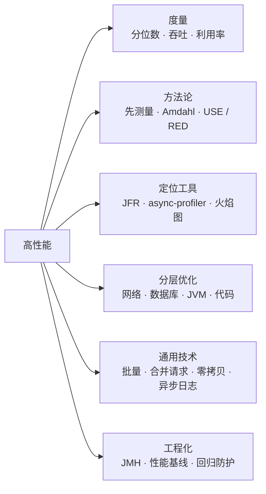
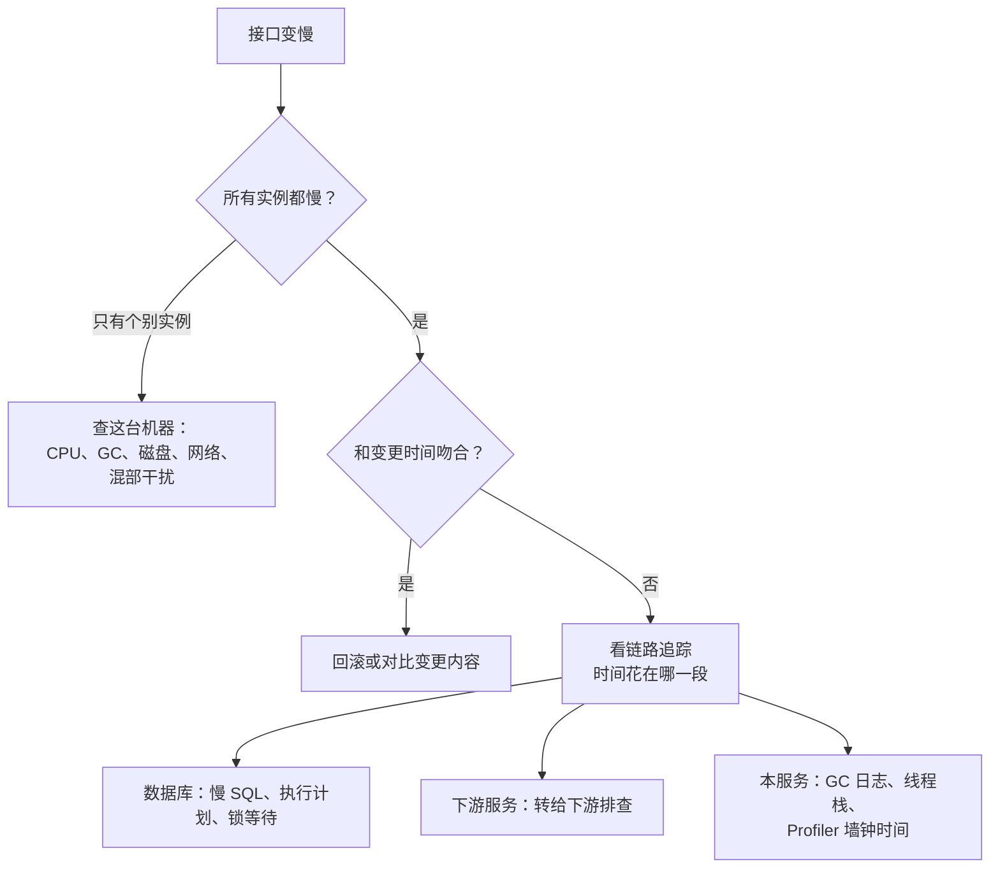
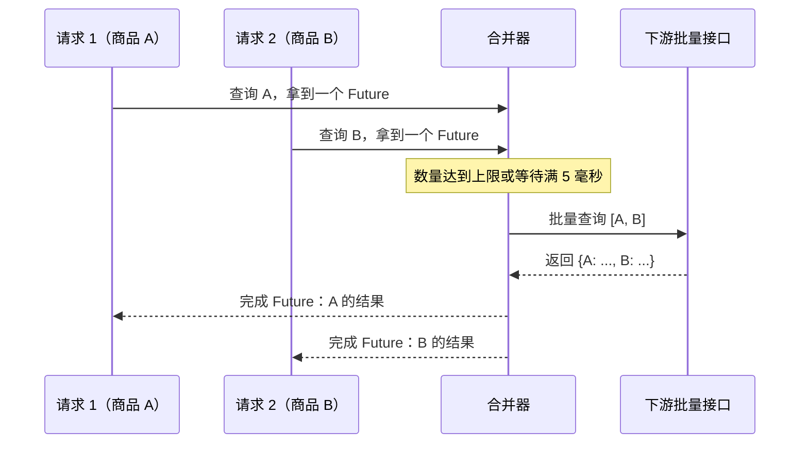

# 25 · 高性能

> 适用岗位：Java 资深开发 / 架构师
> 版本基线：JDK 21 / 25、Spring Boot 3.x / 4.x、Logback 1.5
> 事实核对：Logback 异步 Appender 的默认值来自本机 logback-core 1.5.32 jar；延迟数量级引用的是业界广泛使用的估算值，只用来建立数量级的直觉
> 相关分类：[《04 JVM》](../01-Java核心/04-JVM.md)（GC 与调优）、[《15 MySQL》](../04-数据存储/15-MySQL.md)（SQL 与索引）、[《24 高并发》](24-高并发.md)、[《33 线上问题排查》](../07-工程实践与稳定性/33-线上问题排查.md)（排查工具与方法）、[《38 操作系统》](../08-计算机基础/38-操作系统.md)（IO 模型与零拷贝）

## 知识地图



## 题目索引

| 编号 | 题目 | 难度 | 层级 |
| --- | --- | --- | --- |
| 25-01 | 性能指标为什么要看分位数？压测数据会骗人吗？ | ★★ | 资深 |
| 25-02 | 性能优化的方法论是什么？ | ★★★ | 资深 / 架构师 |
| 25-03 | USE 方法和 RED 方法是什么？ | ★★ | 资深 |
| 25-04 | 有哪些延迟数量级需要心里有数？ | ★★ | 资深 |
| 25-05 | Java 性能分析有哪些工具？火焰图怎么看？ | ★★★ | 资深 |
| 25-06 | 接口 RT 从 50 毫秒涨到 500 毫秒，怎么排查？ | ★★★ | 资深 |
| 25-07 | 网络与远程调用层面有哪些优化手段？ | ★★ | 资深 |
| 25-08 | 数据库层面的优化思路 | ★★ | 资深 |
| 25-09 | JVM 层面有哪些优化手段？ | ★★ | 资深 |
| 25-10 | 代码层面有哪些常见的性能问题？ | ★★ | 资深 |
| 25-11 | 批量处理和请求合并怎么设计？ | ★★★ | 资深 / 架构师 |
| 25-12 | 零拷贝、mmap 和 Page Cache 在中间件中是怎么用的？ | ★★★ | 资深 |
| 25-13 | 日志对性能有什么影响？ | ★★ | 资深 |
| 25-14 | 如何用 JMH 做微基准测试？有哪些坑？ | ★★★ | 资深 |
| 25-15 | 如何防止性能退化？ | ★★ | 架构师 |

---

## 一、度量与方法

### 25-01 性能指标为什么要看分位数？压测数据会骗人吗？

> ★★ ｜ 资深 ｜ 高频

**考察意图**：是否理解延迟分布的特点和常见的度量陷阱。

**30 秒版回答**

- 延迟的分布通常是**长尾**的：大部分请求很快，少数请求非常慢。平均值会被大量快请求"稀释"，掩盖长尾。所以要看 **P50、P99、P999** 等分位数：P99 = 200 毫秒表示 99% 的请求在 200 毫秒以内。
- 对用户体验影响最大的往往是长尾：一个页面调用多个接口，任何一个慢了页面就慢；一个用户一天发出很多请求，几乎一定会遇到 P99 级别的慢请求。
- 分位数**不能求平均**：10 台机器各自的 P99 取平均，不等于整体的 P99。要汇总原始数据或者直方图后再计算。
- 压测数据会骗人：
  - **协同遗漏**（coordinated omission）：压测工具如果等上一个请求返回后才发下一个，系统卡住的那段时间里本来应该发出的请求根本没有发出，慢请求的数量被严重低估。应该使用按固定速率发送请求的压测方式；
  - 压测数据和真实数据分布不同（例如缓存全部命中）；
  - 压测时间太短，没有触发 GC、缓存过期、连接重建等周期性事件。

**追问链**

1. **监控里看到的 P99 为什么有时候比压测结果高很多？** 生产环境有压测没有覆盖的因素：真实的热点分布、其他业务的干扰、GC、下游抖动。压测结果是"实验室数据"，要以生产监控为准。

---

### 25-02 性能优化的方法论是什么？

> ★★★ ｜ 资深 / 架构师 ｜ 高频

**考察意图**：是否有系统化的优化流程，而不是凭经验到处改。

**30 秒版回答**

1. **明确目标**：要优化的指标是什么（P99 RT、吞吐、资源成本），目标值是多少。没有目标的优化没有终点。
2. **先测量，再优化**：用监控、链路追踪、Profiler 找到时间真正花在哪里，**不要猜**。
3. **找到最大的瓶颈**：只优化瓶颈，非瓶颈的优化对整体没有帮助。
4. **一次只改一处**，改完再测量，确认效果，避免多个改动互相干扰、无法归因。
5. **评估代价**：很多优化以复杂度、可维护性或一致性为代价，要权衡是否值得。

**深入剖析**

**Amdahl 定律**说明了"只优化瓶颈"的道理：如果某部分占总耗时的比例是 p，把它加速 s 倍，整体的加速比是

> 1 ÷ ((1 − p) + p ÷ s)

| 被优化部分的占比 p | 加速倍数 s | 整体加速比 |
| --- | --- | --- |
| 10% | 无穷大（耗时降为 0） | 约 1.11 倍 |
| 50% | 2 倍 | 约 1.33 倍 |
| 80% | 4 倍 | 2.5 倍 |

把占 10% 的部分优化到零，整体也只快了 11%。所以优化之前，先确认要优化的部分占了多大比例。

**架构师加分点**

- 性能优化的优先级通常是：**架构和设计 > 算法和数据结构 > 资源配置 > 代码细节**。减少一次远程调用、加一层缓存带来的收益，往往远大于代码层面的微调。
- 要警惕"过早优化"，但也不能把性能完全留到最后。在设计阶段就要识别出关键路径和容量要求，见[《24 高并发》](24-高并发.md)24-03。

---

### 25-03 USE 方法和 RED 方法是什么？

> ★★ ｜ 资深 ｜ 中频

**考察意图**：是否掌握系统化的性能检查清单。

**30 秒版回答**

| 方法 | 针对对象 | 检查项 |
| --- | --- | --- |
| **USE**（Brendan Gregg 提出） | **资源**：CPU、内存、磁盘、网络、连接池、线程池 | **U**tilization 使用率、**S**aturation 饱和度（排队程度）、**E**rrors 错误数 |
| **RED** | **服务**：每个接口、每个服务 | **R**ate 请求速率、**E**rrors 错误率、**D**uration 耗时分布 |

- 两者互补：RED 告诉你"哪个服务出了问题"，USE 告诉你"这个服务的哪个资源到了瓶颈"。
- 饱和度往往比使用率更能说明问题：CPU 使用率 70% 看起来不高，但如果运行队列很长（例如 Linux 的 load 远高于核数），说明已经有大量任务在排队。线程池的"队列长度"、连接池的"等待获取连接的线程数"都是饱和度指标。

---

### 25-04 有哪些延迟数量级需要心里有数？

> ★★ ｜ 资深 ｜ 中频

**考察意图**：是否能在设计时快速判断某个方案的性能量级。

**30 秒版回答**

下表是业界常用的**数量级**估算（最早由 Jeff Dean 等人整理，具体数值随硬件变化，记住数量级即可）：

| 操作 | 数量级 |
| --- | --- |
| CPU L1 缓存访问 | 约 1 纳秒 |
| 内存访问 | 约 100 纳秒 |
| 获取或释放一个无竞争的锁 | 几十纳秒 |
| SSD 随机读一次 | 几十到一百多微秒 |
| 同机房网络往返 | 约 0.5 毫秒 |
| 从 SSD 顺序读 1 MB | 约 1 毫秒 |
| 机械硬盘寻道一次 | 约 10 毫秒 |
| 跨洲网络往返 | 约 150 毫秒 |

用这些数量级可以快速得出结论：

- 一次同机房的 Redis 访问（约 0.5 毫秒）比一次本地缓存访问（百纳秒级）慢上千倍，热点数据适合放本地缓存；
- 一个接口串行调用 20 次下游，光网络往返就有 10 毫秒以上，应该改成批量接口或并行调用；
- 跨地域的同步调用要尽量避免，每次至少上百毫秒，这也是异地多活要做"单元化"的原因，见[《26 高可用》](26-高可用.md)。

---

## 二、定位工具

### 25-05 Java 性能分析有哪些工具？火焰图怎么看？

> ★★★ ｜ 资深 ｜ 高频

**考察意图**：是否实际用过 Profiler 定位问题。

**30 秒版回答**

| 工具 | 特点 | 适合 |
| --- | --- | --- |
| **JFR**（JDK Flight Recorder） | JDK 内置，开销低，可以在生产环境长期开启；记录 CPU、分配、锁、GC、IO 等事件 | 生产环境的持续记录和事后分析 |
| **async-profiler** | 基于采样，没有安全点偏差，支持 CPU、内存分配、锁、墙钟时间等模式，直接生成火焰图 | 定位 CPU 热点和分配热点 |
| **Arthas** | 在线诊断，不需要重启：查看方法调用耗时（`trace`）、参数和返回值（`watch`）、线程（`thread`），内置火焰图 | 线上问题的快速定位 |
| JMC | 分析 JFR 文件的图形工具 | 分析 JFR 记录 |

**火焰图怎么看**：

- 纵轴是**调用栈**，下面是调用者，上面是被调用者；
- 横轴是**采样数**，宽度代表这个方法（包括它调用的方法）占用的时间比例，**横轴不是时间顺序**，同一层的方法按字母排序；
- 看的方法：找**顶部又宽又平的"平顶"**，它说明这个方法本身就占用了大量时间（而不是它调用的方法），通常就是热点。

**追问链**

1. **为什么说 async-profiler 没有安全点偏差？** 很多基于 JVM 接口的采样工具只能在线程到达安全点时采样，热点循环中的代码很难被采到，结果有偏差。async-profiler 利用操作系统的信号和 JVM 内部接口在任意时刻采样，结果更准确。
2. **CPU 火焰图看不出问题，但接口就是慢，怎么办？** 慢可能不是因为占用 CPU，而是在**等待**（IO、锁、下游）。这时要用**墙钟时间**模式（async-profiler 的 `wall` 模式）或者锁分析模式，它会把等待的时间也统计进去。

---

### 25-06 接口 RT 从 50 毫秒涨到 500 毫秒，怎么排查？

> ★★★ ｜ 资深 ｜ 高频

**考察意图**：是否有清晰的排查思路，能逐步缩小范围。

**30 秒版回答**

先确定范围，再深入定位：

1. **影响范围**：所有接口都慢，还是只有这个接口慢？所有实例都慢，还是个别实例慢？所有用户都慢，还是特定参数的请求慢？
2. **时间点**：从什么时候开始的？和发布、配置变更、流量变化、下游变更的时间是否吻合？大部分性能问题都和**变更**有关。
3. **链路追踪**：看慢请求的调用链，时间花在了哪一段：本服务内部、数据库、缓存还是下游服务？
4. **按定位到的环节深入**：数据库慢查慢 SQL 和执行计划；下游慢就找下游；本服务内部慢就看 CPU、GC、线程状态、锁竞争。

**深入剖析**



**生产实践 / 踩坑**

- 一次排查中，链路追踪显示时间都花在本服务内部，CPU 火焰图却看不出热点。用 Arthas 的 `thread` 命令发现大量线程在等待获取数据库连接，原因是另一个新上线的批处理任务占满了连接池。**等待类的问题，CPU 火焰图是看不出来的**。
- 只有部分请求慢，最后发现是特定的大客户数据量大，SQL 走了不同的执行计划。排查时要拿到**具体的慢请求参数**，不要只看平均值。

---
## 三、分层优化

### 25-07 网络与远程调用层面有哪些优化手段？

> ★★ ｜ 资深 ｜ 中频

**考察意图**：是否了解远程调用的开销来源。

**30 秒版回答**

远程调用的开销主要来自：建立连接、网络往返、序列化、数据传输量。对应的优化：

| 方向 | 手段 |
| --- | --- |
| 减少建连 | 连接池、长连接、HTTP Keep-Alive；HTTP/2 在一个连接上多路复用 |
| 减少往返次数 | 批量接口代替循环调用；并行调用代替串行调用；合并多个小请求 |
| 减少数据量 | 只返回需要的字段；分页；压缩（gzip、zstd）；更紧凑的序列化格式（Protobuf） |
| 缩短距离 | 就近部署（同机房、同可用区）；CDN；避免跨地域的同步调用 |
| 减少调用 | 缓存下游的结果；合并服务（拆分过细时） |

**追问链**

1. **压缩一定能提升性能吗？** 不一定。压缩用 CPU 换带宽。数据很小或者网络带宽充足时，压缩的 CPU 开销可能大于节省的传输时间。一般只对超过一定大小的响应压缩。
2. **HTTP 客户端的连接池要注意什么？** 设置合理的最大连接数（总数和每个目标主机的上限）、连接超时、读取超时、空闲连接的回收时间。空闲连接被服务端或中间的负载均衡关闭后，客户端还在用，会出现"连接被重置"的错误，所以空闲回收时间要短于对端的空闲超时。

---

### 25-08 数据库层面的优化思路

> ★★ ｜ 资深 ｜ 高频

**考察意图**：是否有从 SQL 到架构的完整优化清单。

**30 秒版回答**

由近及远：

1. **SQL 与索引**：用 `EXPLAIN` 检查执行计划；建立合适的索引，利用覆盖索引避免回表；避免索引失效的写法；深分页改为基于游标的分页。详见[《15 MySQL》](../04-数据存储/15-MySQL.md)。
2. **减少访问次数**：批量查询、批量写入代替循环；避免 N+1 查询（ORM 中尤其常见）。
3. **事务**：缩短事务，事务中不做远程调用和耗时计算，减少锁持有时间。
4. **连接**：合理的连接池大小，见[《24 高并发》](24-高并发.md)24-10。
5. **数据量**：冷热数据分离、归档历史数据，让热数据的表和索引保持在较小的规模。
6. **架构**：缓存挡读、读写分离、分库分表，见[《16 分库分表》](../04-数据存储/16-分库分表.md)。

**追问链**

1. **什么是 N+1 查询？** 先查出 N 条主记录（1 次查询），再对每条主记录查询它的关联数据（N 次查询）。数据量大时数据库访问次数激增。解决方法是用一次 `IN` 查询批量获取关联数据，再在内存中组装。

---

### 25-09 JVM 层面有哪些优化手段？

> ★★ ｜ 资深 ｜ 中频

**考察意图**：是否知道 JVM 层面优化的重点和边界。

**30 秒版回答**

- **先看 GC 是否真的是问题**：GC 日志中停顿的时间和频率是否影响了 RT。很多时候问题不在 GC。
- **选择合适的收集器**：JDK 21 / 25 默认使用 G1；对停顿时间非常敏感的场景考虑分代 ZGC（JDK 23 起 ZGC 默认分代）。详见[《04 JVM》](../01-Java核心/04-JVM.md)。
- **降低分配速率**：GC 的压力主要来自对象的分配速率。减少临时对象（例如在循环中拼接字符串、频繁装箱拆箱、不必要的对象拷贝）比调 GC 参数更有效。用 async-profiler 的内存分配模式找出分配最多的代码。
- **容器环境的内存配置**：用 `-XX:MaxRAMPercentage` 而不是固定的 `-Xmx`，并给堆外内存、元空间、线程栈留出空间。
- **启动速度**：类数据共享（CDS）、JDK 24 起的 AOT 缓存（JEP 483）可以缩短启动时间，见[《04 JVM》](../01-Java核心/04-JVM.md)。

**架构师加分点**

- JVM 调优的收益通常有限，而且参数调优的结果和负载强相关，换个负载可能就失效了。优先从**代码和架构**上减少不必要的工作，再考虑 JVM 参数。

---

### 25-10 代码层面有哪些常见的性能问题？

> ★★ ｜ 资深 ｜ 中频

**考察意图**：是否有扎实的编码习惯。

**30 秒版回答**

| 问题 | 例子 | 改进 |
| --- | --- | --- |
| 锁竞争 | 在锁中做 IO 或远程调用；锁的范围过大 | 缩小锁的范围；用并发容器、`LongAdder`；读多写少用读写锁或写时复制 |
| 不必要的对象创建 | 循环中用 `+` 拼接字符串；频繁装箱拆箱 | `StringBuilder`；使用基本类型的集合或数组 |
| 集合使用不当 | `ArrayList.contains` 在大列表中查找；`HashMap` 没有预设容量导致多次扩容 | 用 `HashSet` 查找；预估容量 |
| 异常作为控制流 | 用抛异常表示"没找到" | 异常创建时要填充调用栈，开销大；用返回值表示正常的业务分支 |
| 正则表达式 | 每次调用都 `Pattern.compile` | 预编译成静态常量 |
| 反射 | 在高频路径中反复反射获取方法 | 缓存 `Method` 对象，或用 `MethodHandle` |
| 日志 | 拼接日志字符串后才判断级别 | 用占位符，见 25-13 |
| 序列化 | 对象之间反复 JSON 序列化再反序列化来"拷贝" | 用专门的映射工具或手写转换 |

---

## 四、通用技术

### 25-11 批量处理和请求合并怎么设计？

> ★★★ ｜ 资深 / 架构师 ｜ 中频

**考察意图**：是否理解批量在吞吐和延迟之间的取舍，以及如何实现请求合并。

**30 秒版回答**

- 批量的本质是**把固定开销（网络往返、系统调用、事务提交、磁盘刷盘）分摊到多条数据上**，以少量的延迟换取大幅的吞吐提升。Kafka 的生产者攒批、MySQL 的组提交、RocketMQ 的批量刷盘都是这个思路。
- 批量要有**两个触发条件**：数量达到上限，或者等待时间达到上限，满足任意一个就发送。只有数量条件，低流量时会一直等；只有时间条件，高流量时一批可能过大。Kafka 的 `batch.size` 和 `linger.ms` 就是这两个条件。
- **请求合并**：多个独立的并发请求查询相似的数据（例如不同用户查不同商品），在服务端短暂收集后，合并成一次批量查询，再把结果分发回各自的请求。

**深入剖析**

请求合并的实现思路：



关键点：

- 每个请求拿到一个 `CompletableFuture`，合并器批量查询后按 ID 完成对应的 Future；
- 批量查询失败时，要让这一批所有的 Future 都以异常结束，不能让请求一直挂着；
- 合并窗口很短（几毫秒），只在**并发很高**时有明显收益；并发低时只会增加延迟。

**追问链**

1. **批量写数据库，一批多大合适？** 太小收益不明显，太大会导致事务过长、单条 SQL 过大（受 `max_allowed_packet` 限制）、失败时重试的代价大。一般几百到几千条一批，用压测确定。
2. **批量中有一条失败怎么办？** 取决于业务：要么整批失败重试（要求幂等），要么记录失败的条目单独重试。设计批量接口时，返回结果要能体现每一条的成败。

---

### 25-12 零拷贝、mmap 和 Page Cache 在中间件中是怎么用的？

> ★★★ ｜ 资深 ｜ 中频

**考察意图**：是否能把操作系统的知识和中间件的设计联系起来。

**30 秒版回答**

- **Page Cache**：操作系统用空闲内存缓存文件内容。写文件先写入 Page Cache 就返回，由操作系统异步刷盘；读文件时如果 Page Cache 中有，就不需要读磁盘。MQ 的高性能很大程度上依赖它：刚写入的消息马上被消费，基本都在 Page Cache 中命中。
- **mmap**：把文件映射到进程的地址空间，读写文件像读写内存一样，省去了内核缓冲区和用户缓冲区之间的拷贝。RocketMQ 的 CommitLog 用 mmap 读写（Java 中的 `MappedByteBuffer`）。
- **sendfile（零拷贝）**：把文件内容直接从 Page Cache 发送到网卡，数据不经过用户空间。Kafka 发送消息给消费者时用 `FileChannel.transferTo`，在 Linux 上对应 sendfile。
- 各种拷贝路径的逐步对比见[《38 操作系统》](../08-计算机基础/38-操作系统.md)。

| 中间件 | 用法 |
| --- | --- |
| Kafka | 写入依赖 Page Cache；发送给消费者用 sendfile；开启 TLS 后数据必须在用户空间加密，零拷贝失效，见[《21 Kafka》](../05-消息队列/21-Kafka.md)21-14 |
| RocketMQ | CommitLog 和 ConsumeQueue 用 mmap；同样依赖 Page Cache，见[《22 RocketMQ》](../05-消息队列/22-RocketMQ.md)22-03 |
| Netty | `FileRegion` 底层调用 `transferTo` 发送文件；`CompositeByteBuf` 在用户态避免合并缓冲区时的拷贝，见[《08 Netty》](../02-框架与容器/08-Netty.md) |

**追问链**

1. **依赖 Page Cache 有什么风险？** 内存被其他进程挤占时，Page Cache 被回收，读写会落到磁盘上，性能急剧下降；回溯读取大量旧数据会把热数据挤出 Page Cache。所以 MQ 的机器最好独占，不要和其他内存消耗大的服务混部。
2. **Java 程序能直接控制 Page Cache 吗？** 不能直接控制，只能间接影响：`FileChannel.force` 强制刷盘；mmap 的映射区可以预热（例如提前写入或读取，让页面加载进内存）。

---

### 25-13 日志对性能有什么影响？

> ★★ ｜ 资深 ｜ 中频

**考察意图**：是否意识到日志可能成为性能瓶颈，以及异步日志的风险。

**30 秒版回答**

- **同步日志**：每条日志都要写文件，日志量大时磁盘 IO 成为瓶颈，而且写日志通常要加锁，大量线程会在这里排队。
- **字符串拼接**：`log.debug("user=" + user)` 即使 debug 级别没有开启，字符串拼接和 `toString` 也已经执行了。要用占位符 `log.debug("user={}", user)`，级别不满足时不会格式化。
- **输出调用位置**：日志格式中的行号、方法名（例如 Logback 的 `%L`、`%M`）需要获取调用栈，开销很大，生产环境不要开。
- **异步日志**：日志事件先放进内存队列，由后台线程写文件，业务线程不再等待 IO。但要了解默认行为（已核对 logback-core 1.5.32 的 `AsyncAppenderBase`）：
  - 队列大小默认 **256**；
  - 队列剩余容量低于 20% 时，**丢弃 TRACE、DEBUG、INFO 级别**的日志，只保留 WARN 和 ERROR（`discardingThreshold` 未设置时取队列大小的五分之一）；
  - 队列满时**默认阻塞**业务线程（`neverBlock` 默认为 false）。
- Log4j2 的异步 Logger 基于无锁的环形队列，吞吐比 Logback 的异步 Appender 更高。

**追问链**

1. **异步日志在应用崩溃时会丢日志吗？** 会。队列中还没写入的日志会丢失，所以排查崩溃问题时，最后几条日志可能看不到。正常停机时要确保关闭日志框架，让它把队列中的日志写完。
2. **日志量太大，怎么在不丢关键信息的前提下减少？** 按级别控制；对高频的相同日志做采样或合并（例如每分钟只打印一次并附带次数）；把明细数据放到链路追踪中，而不是日志中，见[《32 日志与可观测性》](../07-工程实践与稳定性/32-日志与可观测性.md)。

**生产实践 / 踩坑**

- 一次大促中，大量请求失败，每个失败请求都打印完整的异常栈，日志量暴涨，异步日志队列被打满后阻塞了业务线程，**日志把系统拖垮了**。对高频错误要限制打印频率，异常栈不需要每次都打。

---

## 五、工程化

### 25-14 如何用 JMH 做微基准测试？有哪些坑？

> ★★★ ｜ 资深 ｜ 中频

**考察意图**：是否知道手写计时代码为什么不可靠，以及 JMH 解决了哪些问题。

**30 秒版回答**

- 用 `System.nanoTime()` 前后计时、循环跑几万次的写法**不可靠**，因为 JIT 编译器会干扰结果：
  - **预热**：代码先解释执行，后被 JIT 编译，前期和后期的速度差别很大；
  - **死代码消除**：计算结果没有被使用，JIT 可能直接把计算删掉，测出来"快得离谱"；
  - **常量折叠**：输入是常量时，JIT 可能在编译期就算出结果；
  - **循环优化**：手写循环可能被展开、合并，测的不再是单次操作的耗时。
- JMH（OpenJDK 提供的基准测试工具）专门处理这些问题：自动预热、多次迭代、多个进程隔离、`Blackhole` 消费结果防止死代码消除、`@State` 管理输入防止常量折叠。

**深入剖析**

```java
@BenchmarkMode(Mode.AverageTime)
@OutputTimeUnit(TimeUnit.NANOSECONDS)
@Warmup(iterations = 3, time = 1)
@Measurement(iterations = 5, time = 1)
@Fork(2)
@State(Scope.Thread)
public class StringJoinBenchmark {

    /** 参数化：分别测试不同的元素个数（JMH 官方示例中 @Param 字段使用 public） */
    @Param({"10", "100"})
    public int size;

    private List<String> items;

    @Setup
    public void prepare() {
        items = IntStream.range(0, size).mapToObj(Integer::toString).toList();
    }

    @Benchmark
    public String plusInLoop() {
        String result = "";
        for (String item : items) {
            result += item;
        }
        // 返回结果，JMH 会消费它，避免死代码消除
        return result;
    }

    @Benchmark
    public String stringBuilder() {
        StringBuilder sb = new StringBuilder();
        for (String item : items) {
            sb.append(item);
        }
        return sb.toString();
    }
}
```

**追问链**

1. **微基准测试的结论能直接用到生产吗？** 要谨慎。微基准测试只测一个孤立的操作，生产环境中还有缓存、并发、GC、其他代码的干扰。它适合比较两种实现的**相对**快慢，不适合预测系统的绝对性能。

---

### 25-15 如何防止性能退化？

> ★★ ｜ 架构师 ｜ 中频

**考察意图**：是否有把性能纳入工程流程的意识。

**30 秒版回答**

性能退化往往是一点点积累的，每次发布慢一点，几个月后就慢了很多。要把性能当作**持续检查的质量属性**：

1. **建立基线**：关键接口的 P99 RT、吞吐、资源占用要有历史数据，作为对比的基准。
2. **发布前检查**：关键链路在预发环境做性能测试，与基线对比，超过阈值（例如 P99 上升 10%）就拦截发布。
3. **发布后对比**：灰度阶段对比新旧版本的 RT 和错误率，有问题及时回滚，见[《26 高可用》](26-高可用.md)中的灰度发布。
4. **持续监控与告警**：对 RT 的趋势设置告警，不只是对绝对值告警。
5. **代码评审**：关注循环中的远程调用、大事务、无界集合等常见问题，见 25-10。
6. **容量规划**：定期根据业务增长重新评估容量，在问题出现之前扩容或优化。

**架构师加分点**

- 给关键链路设定**性能预算**（例如下单接口 P99 不超过 200 毫秒，其中给库存服务 30 毫秒、给风控服务 50 毫秒），各个团队在自己的预算内负责，新增调用前要评估对预算的影响。
