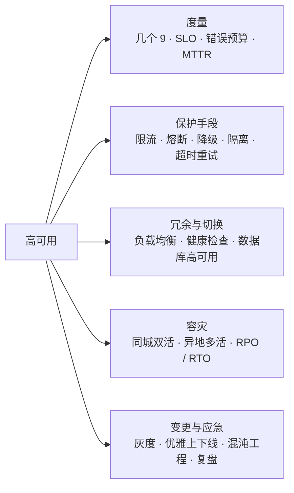
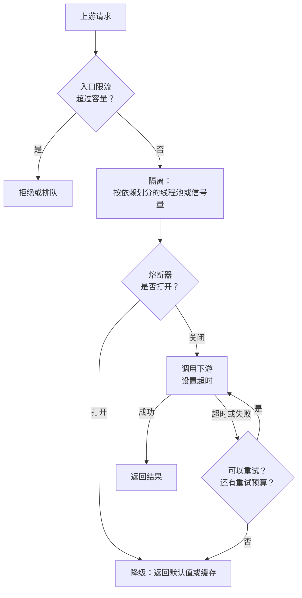
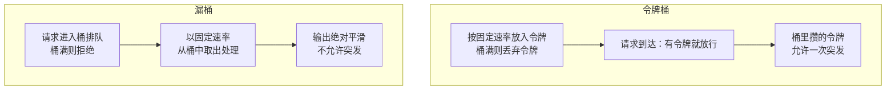
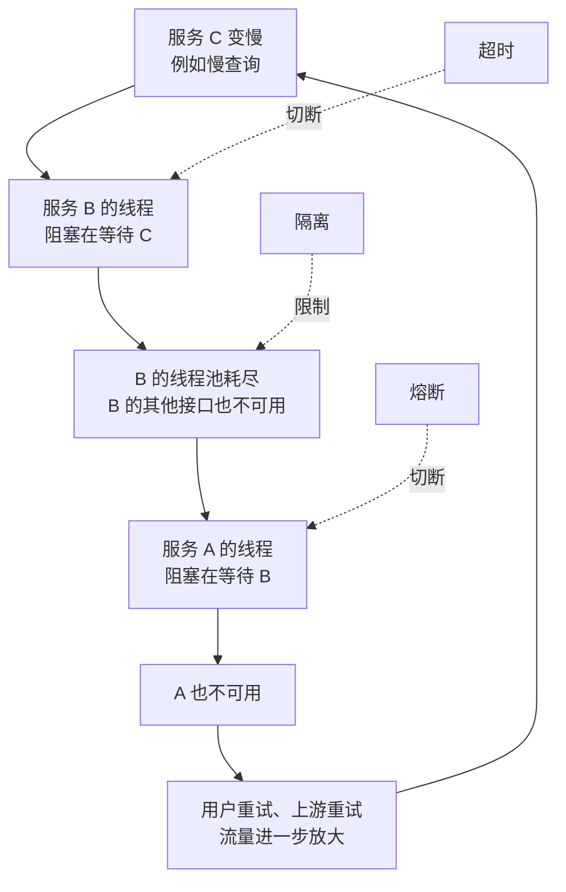
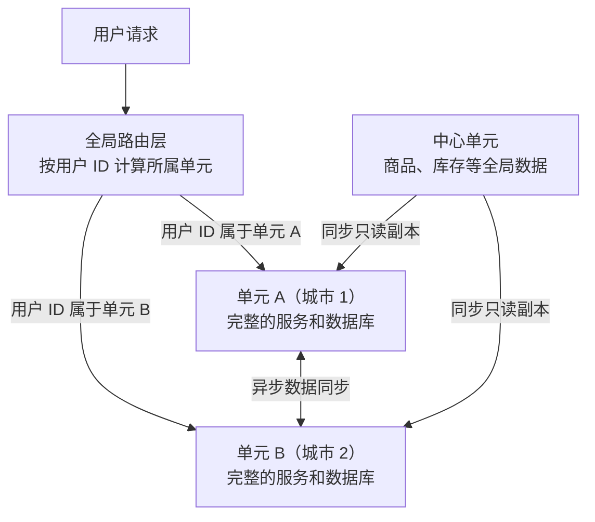

# 26 · 高可用

> 适用岗位：Java 资深开发 / 架构师
> 版本基线：JDK 21 / 25、Spring Boot 3.x / 4.x、Spring Cloud 2025.x、Sentinel / Resilience4j 当前版本
> 事实核对：令牌桶限流器的代码已在本机 JDK 25 上运行验证（容量 5、每秒 10 个令牌：瞬时 7 个请求放行 5 个；300 毫秒后再来 7 个放行 3 个；8 个线程持续请求 2 秒共放行 24 个）；可用性时长按 365 天和 30 天计算
> 相关分类：[《09 分布式理论》](../03-分布式与微服务/09-分布式理论.md)（超时与重试、多数派）、[《12 Spring Cloud》](../03-分布式与微服务/12-SpringCloud.md)（熔断器、Sentinel、网关限流）、[《15 MySQL》](../04-数据存储/15-MySQL.md)（复制与高可用）、[《17 Redis》](../04-数据存储/17-Redis.md)（Redis 限流、哨兵与集群）、[《24 高并发》](24-高并发.md)、[《41 容器与云计算》](../09-云原生/41-容器与云计算.md)

## 知识地图



## 题目索引

| 编号 | 题目 | 难度 | 层级 |
| --- | --- | --- | --- |
| 26-01 | 可用性怎么度量？SLA、SLO、SLI 有什么区别？ | ★★ | 资深 / 架构师 |
| 26-02 | 高可用设计有哪些基本手段？ | ★★ | 资深 |
| 26-03 | 限流算法有哪些？各有什么特点？ | ★★★ | 资深 |
| 26-04 | 单机限流和分布式限流怎么选？限流阈值怎么定？ | ★★★ | 资深 / 架构师 |
| 26-05 | 熔断和降级有什么区别？降级有哪些方式？ | ★★ | 资深 |
| 26-06 | 什么是隔离？舱壁模式怎么用？ | ★★ | 资深 |
| 26-07 | 重试为什么会引发重试风暴？怎么设计重试？ | ★★★ | 资深 / 架构师 |
| 26-08 | 服务雪崩是怎么发生的？如何防止？ | ★★★ | 资深 |
| 26-09 | 什么是自适应限流和过载保护？ | ★★★ | 架构师 |
| 26-10 | 负载均衡和健康检查要注意什么？ | ★★ | 资深 |
| 26-11 | 同城双活和异地多活怎么设计？ | ★★★ | 架构师 |
| 26-12 | RPO 和 RTO 是什么？备份和容灾怎么做？ | ★★ | 架构师 |
| 26-13 | 优雅上下线怎么实现？ | ★★ | 资深 |
| 26-14 | 灰度发布与变更管控 | ★★ | 资深 / 架构师 |
| 26-15 | 什么是混沌工程？怎么落地？ | ★★ | 架构师 |
| 26-16 | 线上故障如何应急和复盘？ | ★★ | 资深 / 架构师 |

---

## 一、度量

### 26-01 可用性怎么度量？SLA、SLO、SLI 有什么区别？

> ★★ ｜ 资深 / 架构师 ｜ 高频

**考察意图**：能否用量化的方式讨论可用性，理解错误预算的思想。

**30 秒版回答**

- 可用性常用"几个 9"表示，对应的允许不可用时长：

| 可用性 | 每年最多不可用 | 每月（30 天）最多不可用 |
| --- | --- | --- |
| 99% | 约 3.65 天 | 约 7.2 小时 |
| 99.9% | 约 8.76 小时 | 约 43 分钟 |
| 99.99% | 约 53 分钟 | 约 4.3 分钟 |
| 99.999% | 约 5.3 分钟 | 约 26 秒 |

- 三个概念：
  - **SLI**（指标）：实际测量的值，例如"成功请求数 ÷ 总请求数"、"P99 RT"；
  - **SLO**（目标）：团队给自己定的目标，例如"月度成功率 ≥ 99.95%"；
  - **SLA**（协议）：对客户的承诺，达不到要赔偿，通常比 SLO 宽松。
- **错误预算**：1 − SLO 就是允许的失败比例。预算充足时可以更激进地发布新功能；预算快用完时，暂停变更，优先修复稳定性问题。这把"稳定性"和"迭代速度"的争论变成了可量化的决策（Google SRE 的实践）。

**深入剖析**

可用性也可以用故障的频率和恢复速度来理解：

> 可用性 ≈ MTBF ÷（MTBF + MTTR）

MTBF 是平均故障间隔，MTTR 是平均恢复时间。提高可用性有两条路：少出故障（MTBF 变大），或者出了故障快速恢复（MTTR 变小）。在复杂系统中，**故障无法完全避免，缩短 MTTR 往往更现实**：快速发现（监控告警）、快速定位（可观测性）、快速止损（回滚、切流、降级）。

**追问链**

1. **整个系统的可用性怎么算？** 串联的依赖可用性相乘：一个请求依赖 5 个可用性都是 99.9% 的服务，整体约 99.5%。这说明依赖越多，整体可用性越低；关键链路上要尽量减少强依赖，或者让非核心依赖失败时可以降级。

---

## 二、保护手段

### 26-02 高可用设计有哪些基本手段？

> ★★ ｜ 资深 ｜ 高频

**考察意图**：是否有完整的高可用工具箱，并知道每种手段解决什么问题。

**30 秒版回答**

| 手段 | 解决的问题 |
| --- | --- |
| **冗余** | 单点故障：多实例、多副本、多机房 |
| **故障转移** | 某个实例或节点故障后，流量自动切到健康的节点 |
| **超时** | 下游变慢时，不让本服务的资源被无限期占用 |
| **重试** | 偶发的、短暂的失败 |
| **限流** | 流量超过容量时，保护自己不被压垮 |
| **熔断** | 下游持续故障时，快速失败，不再调用 |
| **降级** | 资源不足或依赖故障时，放弃非核心功能，保住核心功能 |
| **隔离** | 一个依赖或一类请求的故障不扩散到其他部分 |
| **变更管控** | 大部分故障由变更引起：灰度、可回滚、可观测 |

**深入剖析**

一次远程调用上，各种保护手段的位置：



---

### 26-03 限流算法有哪些？各有什么特点？

> ★★★ ｜ 资深 ｜ 高频

**考察意图**：能否讲清四种经典算法的原理和差异，并手写一种。

**30 秒版回答**

| 算法 | 原理 | 特点 |
| --- | --- | --- |
| **固定窗口计数** | 每个时间窗口（例如 1 秒）一个计数器，超过阈值就拒绝，窗口结束时清零 | 实现最简单；**窗口边界有突刺问题** |
| **滑动窗口** | 把窗口切成多个小格，统计最近 N 个小格的总数；或者记录每个请求的时间戳 | 平滑了边界问题；小格越多越精确，占用内存越多 |
| **漏桶** | 请求进入一个桶，桶以**固定速率**流出处理，桶满就拒绝 | 输出速率绝对平滑，**不允许突发** |
| **令牌桶** | 以固定速率往桶里放令牌，桶满不再放；请求拿到令牌才放行 | 平均速率受控，**允许一定的突发**（最多等于桶容量） |

- 固定窗口的边界问题：限流 100 次 / 秒，0.9 秒到 1.0 秒之间来了 100 个请求，1.0 秒到 1.1 秒之间又来了 100 个，两个窗口都没超限，但 0.2 秒内实际放行了 200 个，是限流值的两倍。
- 选择：大多数接口限流用**令牌桶**或**滑动窗口**；需要严格匀速输出（例如调用有严格 QPS 限制的第三方接口）用**漏桶**。

**深入剖析**

令牌桶的实现（已在本机 JDK 25 上运行验证）。采用"**惰性补充**"：不用定时线程放令牌，每次请求时根据距离上次补充经过的时间，计算应该补充多少令牌。

```java
/**
 * 令牌桶限流器：按固定速率补充令牌，桶满后不再增加；请求拿到令牌才放行。
 * 惰性补充：每次请求时按经过的时间计算应补充的令牌数，不需要定时线程。
 */
public final class TokenBucketRateLimiter {

    private static final long NANOS_PER_SECOND = 1_000_000_000L;

    /** 桶容量：允许的最大突发请求数 */
    private final long capacity;
    /** 生成一个令牌需要的纳秒数 */
    private final double nanosPerToken;
    /** 当前令牌数，允许是小数，避免补充时的精度损失 */
    private double tokens;
    /** 上次补充令牌的时间 */
    private long lastRefillNanos;

    public TokenBucketRateLimiter(long permitsPerSecond, long capacity) {
        if (permitsPerSecond <= 0 || capacity <= 0) {
            throw new IllegalArgumentException("permitsPerSecond and capacity must be positive");
        }
        this.capacity = capacity;
        this.nanosPerToken = (double) NANOS_PER_SECOND / permitsPerSecond;
        // 初始时桶是满的，允许启动后立即有一次突发
        this.tokens = capacity;
        this.lastRefillNanos = System.nanoTime();
    }

    /** 尝试获取一个令牌，拿不到立即返回 false，不等待 */
    public synchronized boolean tryAcquire() {
        refill();
        if (tokens >= 1) {
            tokens -= 1;
            return true;
        }
        return false;
    }

    private void refill() {
        long now = System.nanoTime();
        double newTokens = (now - lastRefillNanos) / nanosPerToken;
        if (newTokens > 0) {
            tokens = Math.min(capacity, tokens + newTokens);
            lastRefillNanos = now;
        }
    }
}
```

令牌桶和漏桶的对比：



**追问链**

1. **Guava 的 RateLimiter 是哪种算法？** 令牌桶的变体。它允许"预支"：当前令牌不够时，本次请求仍然放行，但让**下一个请求**等待相应的时间。另外还有带预热的版本（`SmoothWarmingUp`），启动后逐渐提高速率，适合需要预热缓存或连接的服务。
2. **上面的实现有什么可以改进的地方？** 高并发时 `synchronized` 会成为竞争点，可以用 CAS 更新状态；需要分布式限流时，把同样的逻辑放进 Redis 的 Lua 脚本中原子执行，见[《17 Redis》](../04-数据存储/17-Redis.md)17-17。
3. **被限流的请求怎么处理？** 直接拒绝（返回 429 或业务错误码）、排队等待（设置最长等待时间）、或者降级返回默认结果。对用户可见的接口，要给出明确的提示。

---

### 26-04 单机限流和分布式限流怎么选？限流阈值怎么定？

> ★★★ ｜ 资深 / 架构师 ｜ 高频

**考察意图**：是否理解两种限流的取舍，以及阈值的来源。

**30 秒版回答**

| 对比项 | 单机限流 | 分布式限流 |
| --- | --- | --- |
| 实现 | 进程内计数（Guava、Sentinel 单机模式、Resilience4j） | 集中计数（Redis + Lua、Sentinel 集群流控、网关） |
| 性能 | 没有网络开销 | 每次请求多一次网络调用 |
| 精度 | 总阈值 = 单机阈值 × 实例数，实例数变化或负载不均时不精确 | 精确控制总量 |
| 依赖 | 无 | 依赖 Redis 或令牌服务器，它故障时要有降级（通常退化为单机限流或放行） |

- 选择：
  - 保护**自身**（防止本实例被压垮）用单机限流，阈值来自本实例的压测容量；
  - 控制**总量**（例如调用第三方接口有总配额、按用户或租户限制调用次数）用分布式限流。
- **阈值怎么定**：
  - 来自**压测**：单实例在 RT 和错误率可接受时的最大 QPS，乘以安全系数（例如 70%～80%）；
  - 来自**下游容量**：调用下游的限流不能超过下游的承受能力；
  - 上线后根据监控持续调整，并配合自适应限流（见 26-09）。

**追问链**

1. **网关已经限流了，服务内部还需要限流吗？** 需要。网关限流控制的是入口总流量，但服务之间还有内部调用、定时任务、MQ 消费等流量来源；而且某个实例可能因为负载不均承受了更多流量。每个服务都应该有自我保护。

---

### 26-05 熔断和降级有什么区别？降级有哪些方式？

> ★★ ｜ 资深 ｜ 高频

**考察意图**：是否分清两个概念，并知道降级的具体做法。

**30 秒版回答**

- **熔断**是一种**自动的触发机制**：下游的错误率或慢调用比例超过阈值时，熔断器打开，后续调用直接失败，不再访问下游；一段时间后进入半开状态，放行少量请求试探，成功则关闭熔断。原理见[《12 Spring Cloud》](../03-分布式与微服务/12-SpringCloud.md)12-09。
- **降级**是一种**处理策略**：在资源不足或依赖不可用时，放弃部分功能或返回简化的结果，保证核心功能可用。熔断打开后执行的就是降级逻辑，但降级也可以由人工开关、限流、系统负载触发。
- 常见的降级方式：

| 方式 | 例子 |
| --- | --- |
| 返回默认值 | 推荐服务不可用时，返回热门商品列表 |
| 返回缓存数据 | 实时数据拿不到时，返回最近一次的缓存结果 |
| 关闭非核心功能 | 大促时关闭商品评论、积分展示 |
| 同步改异步 | 积分发放暂时写入 MQ，稍后处理 |
| 简化流程 | 风控服务超时时，小额订单直接放行，大额订单转人工审核 |
| 静态化 | 动态页面临时替换为静态页面 |

**架构师加分点**

- 降级方案要**提前设计、提前演练**。大促前整理一份降级预案：哪些功能可以降级、降级后的影响、谁有权限执行、开关在哪里。故障发生时才临时想降级方案，往往来不及。
- 区分**强依赖和弱依赖**：强依赖失败，主流程必须失败（例如下单时的扣库存）；弱依赖失败，主流程应该继续（例如下单后的发优惠券）。很多故障是因为弱依赖被写成了强依赖。

---

### 26-06 什么是隔离？舱壁模式怎么用？

> ★★ ｜ 资深 ｜ 中频

**考察意图**：是否理解"故障不扩散"的设计。

**30 秒版回答**

- **舱壁模式**来自船舶设计：船体分成多个密封舱，一个舱进水不会导致整艘船沉没。在软件中，就是把资源划分开，让一部分出问题时不影响其他部分。
- 常见的隔离层次：

| 层次 | 做法 |
| --- | --- |
| 依赖隔离 | 调用不同下游使用**独立的线程池或信号量**：一个下游变慢，只会占满它自己的线程池 |
| 业务隔离 | 核心业务和非核心业务部署在不同的集群；读和写分开 |
| 用户 / 租户隔离 | 大客户、VIP 用户使用独立的资源 |
| 数据隔离 | 不同业务使用不同的数据库、缓存实例，避免互相影响 |
| 环境隔离 | 压测、灰度流量和正常流量分开 |

- **线程池隔离和信号量隔离**：
  - 线程池隔离：每个依赖一个线程池，可以设置超时、可以异步执行，但有线程切换的开销；
  - 信号量隔离：只限制并发数，在调用者线程中执行，开销小，但无法单独控制超时。虚拟线程环境中更适合用信号量，见[《24 高并发》](24-高并发.md)24-14。

**生产实践 / 踩坑**

- 所有下游调用共用一个线程池，其中一个不重要的下游（例如日志上报）变慢，占满了线程池，导致核心的下单请求也拿不到线程。这是典型的"没有隔离"导致的故障扩散。

---
### 26-07 重试为什么会引发重试风暴？怎么设计重试？

> ★★★ ｜ 资深 / 架构师 ｜ 高频

**考察意图**：是否理解重试在多层调用中的放大效应。

**30 秒版回答**

- **放大效应**：调用链 A → B → C → D，每一层失败都重试 3 次（共 4 次调用）。D 故障时，A 的一个请求最终会让 D 收到 4 × 4 × 4 = 64 次请求。下游越是出问题，收到的请求越多，越难恢复。
- 重试设计的要点：

| 要点 | 做法 |
| --- | --- |
| 只重试可以重试的错误 | 网络超时、连接失败、503 可以重试；参数错误、业务校验失败不要重试 |
| 只重试幂等的操作 | 非幂等操作（例如扣款）重试前必须有幂等保证，见[《09 分布式理论》](../03-分布式与微服务/09-分布式理论.md)09-17 |
| 限制次数 | 一般 1～3 次 |
| **指数退避 + 随机抖动** | 每次等待时间翻倍，并加上随机值，避免大量客户端在同一时刻重试 |
| **只在一层重试** | 通常在最靠近故障的一层或者最外层重试，中间层不重试 |
| **重试预算** | 限制重试请求占总请求的比例（例如不超过 10%），超过后不再重试 |
| 配合熔断 | 下游已经熔断时，不再重试 |

**深入剖析**

为什么要加随机抖动：大量客户端在同一时刻失败（例如下游重启），如果都等待相同的时间（1 秒、2 秒、4 秒……）再重试，重试请求会在同一时刻集中到达，形成新的峰值。加上随机抖动后，重试被分散到一个时间区间内。常见的做法是"全抖动"：等待时间在 0 到"指数退避值"之间随机取。

**追问链**

1. **超时时间怎么设？** 根据下游的 P99 或 P999 RT 设定，并保证"本次超时 × 重试次数"小于上游给自己的超时，否则上游已经超时放弃了，下游还在重试，白白浪费资源。详见[《09 分布式理论》](../03-分布式与微服务/09-分布式理论.md)09-18。

---

### 26-08 服务雪崩是怎么发生的？如何防止？

> ★★★ ｜ 资深 ｜ 高频

**考察意图**：能否讲清故障的传播过程，并对应到防护手段。

**30 秒版回答**

- **雪崩**：一个服务的故障沿着调用链向上游传播，最终导致整个系统不可用。
- 典型过程：
  1. 下游服务 C 变慢（数据库慢查询、GC、依赖故障）；
  2. 调用 C 的服务 B，线程被大量阻塞在等待 C 的响应上；
  3. B 的线程池耗尽，无法处理其他请求，B 也"变慢"了；
  4. 调用 B 的服务 A 同样被拖垮；
  5. 上游的重试让流量进一步放大。
- 防护手段对应到每一步：超时（限制等待时间）、隔离（限制影响范围）、熔断（停止调用故障服务）、限流（保护自身容量）、降级（放弃非核心功能）、控制重试。

**深入剖析**



---

### 26-09 什么是自适应限流和过载保护？

> ★★★ ｜ 架构师 ｜ 中频

**考察意图**：是否了解固定阈值限流的不足，以及基于系统指标的动态保护。

**30 秒版回答**

- **固定阈值的问题**：阈值来自压测，但系统的真实容量会变化（机器性能差异、下游变慢、请求的构成变化）。阈值设高了起不到保护作用，设低了浪费容量。
- **自适应限流**：根据系统的实时状态动态决定是否放行。常见的信号：
  - **系统负载**：CPU 使用率、Load 超过阈值时开始限流；
  - **并发数与 RT**：根据 Little 定律，系统能承受的并发数约等于"最大吞吐 × 最小 RT"。当前并发数超过这个估算值，说明请求开始排队，应该拒绝新的请求。Sentinel 的系统自适应保护就是这个思路（借鉴了 TCP BBR 拥塞控制算法的思想）。
- **过载保护的其他手段**：
  - **请求排队超时丢弃**：请求在队列中等待太久，即使处理完客户端也已经超时放弃了，应该直接丢弃，不要浪费资源处理；
  - **优先级**：过载时优先处理核心请求（例如下单）、丢弃低优先级请求（例如推荐）；
  - **客户端自适应**：客户端统计下游的拒绝比例，主动减少发送（Google SRE 书中介绍的客户端节流）。

**架构师加分点**

- 过载保护的核心思想是：**系统在过载时，仍然要以接近最大吞吐的速度处理一部分请求，而不是所有请求都变慢、最后一起失败**。没有过载保护的系统，在负载超过容量后吞吐会急剧下降，这比拒绝一部分请求糟糕得多。

---

## 三、冗余与切换

### 26-10 负载均衡和健康检查要注意什么？

> ★★ ｜ 资深 ｜ 中频

**考察意图**：是否了解负载均衡在高可用中的作用和常见问题。

**30 秒版回答**

- **负载均衡算法**：轮询、加权轮询、随机、最少连接、一致性哈希、基于响应时间（例如 P2C：随机挑两个，选负载更低的一个）。
- **健康检查**：
  - **主动检查**：负载均衡器定期探测后端（TCP 端口、HTTP 健康接口），连续失败若干次就摘除；
  - **被动检查**：根据真实请求的失败情况，暂时摘除频繁失败的节点（异常值剔除）。
- 注意事项：
  - 健康检查接口要**反映真实的服务能力**，但不要依赖太多外部组件。例如健康接口检查了数据库，数据库抖动一下，所有实例同时被判定为不健康，整个服务被摘光；
  - 区分**存活检查**（进程是否活着，失败就重启）和**就绪检查**（是否能接收流量，失败就摘除流量），见[《41 容器与云计算》](../09-云原生/41-容器与云计算.md)；
  - 摘除要设置**上限**：如果一半以上的实例都不健康，更可能是健康检查本身或公共依赖出了问题，不应该全部摘除。

---

### 26-11 同城双活和异地多活怎么设计？

> ★★★ ｜ 架构师 ｜ 高频

**考察意图**：是否理解多活的难点在于数据，以及单元化的思路。

**30 秒版回答**

| 方案 | 做法 | 难点 |
| --- | --- | --- |
| 冷备 / 热备 | 备用机房平时不承担流量（或只承担读），主机房故障时切换 | 平时不用，切换时不敢切：没有真实流量验证，切换后可能出问题 |
| **同城双活** | 同一城市的两个机房同时承担流量，网络延迟低（通常 1～2 毫秒以内），数据库可以跨机房同步复制 | 数据库通常仍然是一主多从，写入集中在主库所在的机房 |
| **异地多活** | 不同城市的机房都承担读写流量 | 跨城延迟几十毫秒，**不能跨机房同步写**；数据冲突、数据同步延迟 |

- **异地多活的核心思路是单元化**：
  1. 按某个维度（通常是用户 ID）把用户划分到不同的**单元**，每个单元部署完整的服务和数据库，一个用户的请求在一个单元内闭环完成，不跨城调用；
  2. 入口层根据用户 ID 把请求路由到对应的单元；
  3. 单元之间通过数据同步工具（基于数据库日志）异步同步数据，用于故障时接管；
  4. 无法按用户划分的全局数据（例如商品、库存），放在中心单元，其他单元读取副本，写入集中到中心。
- 某个单元故障时，把它负责的用户路由到其他单元。因为同步是异步的，**切换时可能丢失少量最近的数据**，要有对账和补偿。

**深入剖析**



**追问链**

1. **为什么不能直接让两个城市的数据库都可写，互相同步？** 同一条数据在两边同时被修改，异步同步后会冲突，而且无法确定以哪一边为准。单元化通过"一个用户只在一个单元写"避免了这个问题。
2. **异地多活适合所有业务吗？** 不适合。它对业务的改造量很大（数据要能按用户划分、跨单元的操作要特殊处理），成本也很高。一般只对核心业务做，非核心业务做冷备或同城双活即可。

**架构师加分点**

- 多活的本质是在 CAP 中做选择：跨城网络延迟决定了不能用同步复制保证强一致，所以只能选择**按数据分区（单元化）+ 分区内强一致 + 分区间最终一致**。这也是为什么"多活"首先是一个数据架构问题，而不是部署问题。

---

### 26-12 RPO 和 RTO 是什么？备份和容灾怎么做？

> ★★ ｜ 架构师 ｜ 中频

**考察意图**：是否能用 RPO、RTO 讨论容灾方案。

**30 秒版回答**

- **RPO**（恢复点目标）：故障后**最多允许丢失多长时间的数据**。RPO = 0 表示一条数据都不能丢。
- **RTO**（恢复时间目标）：故障后**多长时间内必须恢复服务**。
- 方案的选择取决于这两个目标：

| 方案 | RPO | RTO | 成本 |
| --- | --- | --- | --- |
| 定期备份到异地 | 备份间隔（小时到天） | 小时到天 | 低 |
| 异步复制的热备 | 秒级到分钟级 | 分钟级 | 中 |
| 同步复制 | 接近 0 | 分钟级 | 高，影响写入性能 |
| 多活 | 秒级 | 秒级到分钟级 | 很高 |

- 备份的要点：
  - 遵循"3-2-1"原则：至少 3 份数据，存放在 2 种不同的介质上，其中 1 份在异地；
  - 备份要**定期做恢复演练**，没有验证过能恢复的备份等于没有备份；
  - 防止误删除：备份要和生产环境的权限隔离，避免一次误操作同时删掉生产数据和备份。

---

## 四、变更与应急

### 26-13 优雅上下线怎么实现？

> ★★ ｜ 资深 ｜ 高频

**考察意图**：是否理解发布过程中请求失败的原因，以及如何做到无损发布。

**30 秒版回答**

- **优雅下线**（停止一个实例时不影响请求）：
  1. 先从注册中心或负载均衡**摘除**这个实例，不再接收新流量；
  2. **等待**调用方的服务列表缓存更新（见[《12 Spring Cloud》](../03-分布式与微服务/12-SpringCloud.md)12-05）；
  3. 等待正在处理的请求完成（Spring Boot 3.4 起默认开启优雅停机，Web 服务器停止接收新请求后会等待已有请求完成，等待时间由 `spring.lifecycle.timeout-per-shutdown-phase` 控制）；
  4. 停止 MQ 消费、定时任务，关闭线程池和连接；
  5. 进程退出。
- **优雅上线**（新实例启动时不出现失败和超时）：
  1. 应用完全启动、**预热完成**（JIT 编译、缓存加载、连接池建立）之后，才注册到注册中心或通过就绪检查；
  2. 刚上线时**逐步增加流量**（预热权重），避免冷启动的实例一下子承担全部流量。

**生产实践 / 踩坑**

- Kubernetes 中删除 Pod 时，"从 Service 的端点中摘除"和"给容器发送终止信号"是**并行**发生的，可能出现进程已经开始关闭，但流量还在进来的情况。常用做法是在 `preStop` 钩子中先等待几秒，让摘除操作生效后再开始关闭，见[《41 容器与云计算》](../09-云原生/41-容器与云计算.md)。

---

### 26-14 灰度发布与变更管控

> ★★ ｜ 资深 / 架构师 ｜ 高频

**考察意图**：是否认识到变更是故障的主要来源，以及如何降低变更风险。

**30 秒版回答**

- 业界的普遍经验是，**大部分线上故障由变更引起**：代码发布、配置修改、数据库变更、基础设施调整。所以变更管控是高可用最重要的一环。
- 变更的"三板斧"：
  - **可灰度**：先在小范围生效（少量实例、少量用户、内部用户），观察没问题再逐步扩大；
  - **可监控**：变更期间重点观察核心指标（错误率、RT、业务量），新旧版本对比；
  - **可回滚**：出问题时能快速回到变更前的状态。数据库变更、数据迁移这类难以回滚的变更，要提前设计回滚方案。
- 其他手段：
  - 避开业务高峰发布，大促前封网；
  - 功能开关：新功能默认关闭，发布后再通过开关逐步打开，出问题时关闭开关比回滚代码更快；
  - 变更记录：所有变更都要记录，故障发生时第一时间查看最近的变更。

---

### 26-15 什么是混沌工程？怎么落地？

> ★★ ｜ 架构师 ｜ 中频

**考察意图**：是否了解主动验证系统韧性的方法。

**30 秒版回答**

- **混沌工程**：在系统中**主动注入故障**（例如杀掉实例、注入网络延迟、模拟依赖不可用、CPU 打满），验证系统的容错设计是否真的有效，在真实故障发生之前发现薄弱环节。
- 落地步骤：
  1. 定义系统的**稳态**指标（例如下单成功率、P99 RT）；
  2. 提出假设："某个依赖故障时，稳态不受影响"；
  3. 在受控的范围内注入故障（先在测试环境，逐步到生产环境的小流量）；
  4. 观察稳态是否保持；不保持就是发现了问题，修复后再次验证；
  5. 控制**爆炸半径**：随时可以停止实验，影响范围可控。
- 常用工具：ChaosBlade、Chaos Mesh（Kubernetes 环境）等。

**架构师加分点**

- 混沌工程的价值不在于"制造故障"，而在于**验证那些平时无法验证的设计**：熔断配置是否合理、降级开关是否真的能用、告警能否在故障发生后及时触发、值班同学能否按预案处理。很多降级预案在第一次真正使用时才发现不可用。

---

### 26-16 线上故障如何应急和复盘？

> ★★ ｜ 资深 / 架构师 ｜ 高频

**考察意图**：是否有故障处理的经验和正确的优先级。

**30 秒版回答**

- **应急的第一原则是先止损，再定位**。用户受影响的每一分钟都是损失，先恢复服务，根因可以事后慢慢查。
- 常见的止损手段：
  - 最近有变更 → **回滚**；
  - 个别实例异常 → **摘除**或重启；
  - 流量异常 → **限流**、封禁异常来源；
  - 依赖故障 → **降级**、切换到备用；
  - 机房故障 → **切流**到其他机房。
- 应急过程中：
  - 明确一个指挥者，统一决策，避免多人同时操作；
  - **保留现场**：重启之前先保存线程栈、堆转储、日志，否则根因可能永远查不到，见[《33 线上问题排查》](../07-工程实践与稳定性/33-线上问题排查.md)；
  - 及时同步进展给相关方。
- **复盘**：
  - 还原时间线：何时发生、何时发现、何时止损、何时恢复；
  - 分析根因，并且追问"为什么没有更早发现"、"为什么影响这么大"；
  - 制定改进项，每项有负责人和完成时间，并跟踪落实；
  - **对事不对人**：复盘的目的是改进系统和流程，不是追究个人责任，否则大家会隐瞒问题。

**架构师加分点**

- 从 MTTR 的角度看，每次复盘都应该检查四个时间段能否缩短：**发现**（监控告警是否覆盖）、**定位**（可观测性是否足够）、**止损**（是否有现成的预案和工具）、**恢复**（恢复过程是否自动化）。
