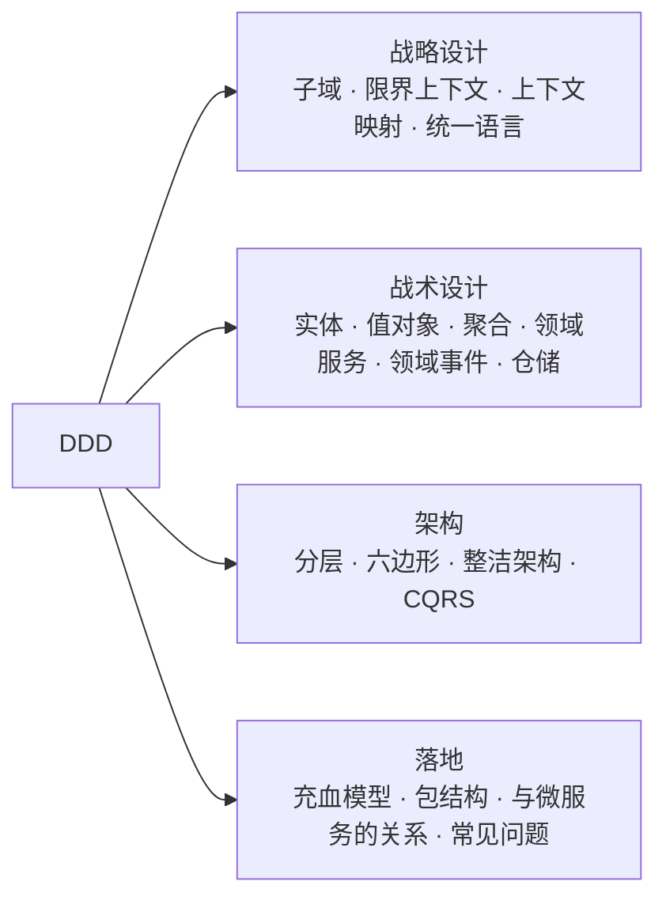
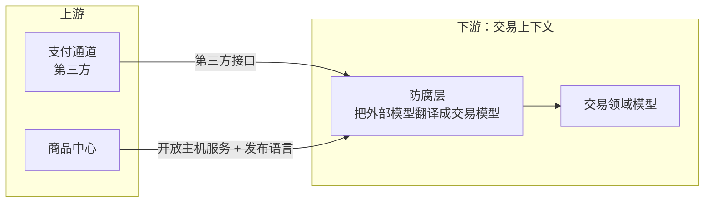
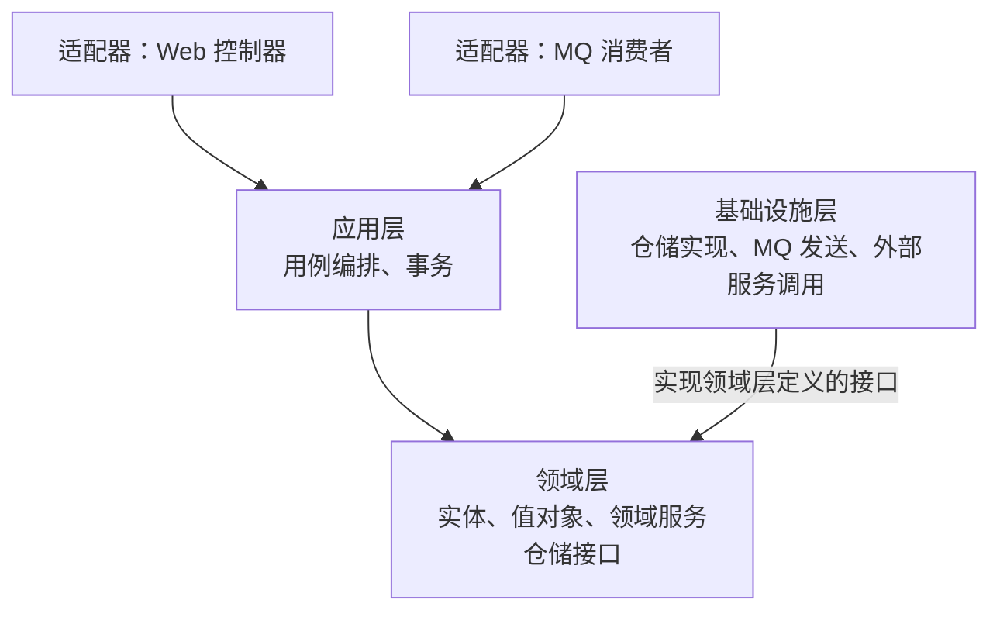
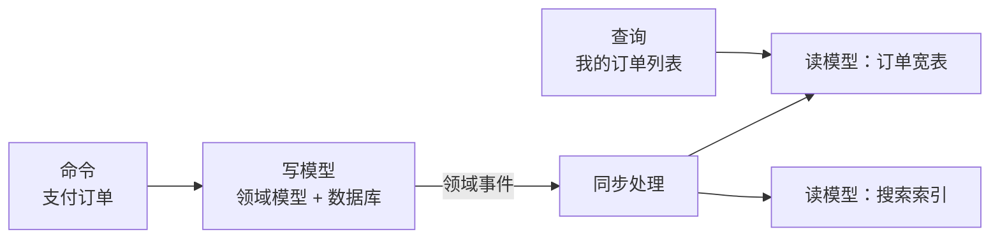

# 27 · DDD

> 适用岗位：Java 资深开发 / 架构师
> 版本基线：JDK 17+（示例使用 record）、Spring Boot 3.x / 4.x、Spring Data 4.x
> 事实核对：订单聚合、金额值对象的示例代码已在本机 JDK 21 上编译运行；Spring Data 的领域事件支持（`AbstractAggregateRoot`、`@DomainEvents`）已在本机 spring-data-commons 4.0.4 jar 中确认
> 相关分类：[《11 微服务》](../03-分布式与微服务/11-微服务.md)（服务拆分）、[《09 分布式理论》](../03-分布式与微服务/09-分布式理论.md)（最终一致性、Saga）、[《20 MQ 通用与选型》](../05-消息队列/20-MQ通用与选型.md)（事件与 Outbox）、[《28 架构设计》](28-架构设计.md)、[《30 设计模式》](../07-工程实践与稳定性/30-设计模式.md)

## 知识地图



## 题目索引

| 编号 | 题目 | 难度 | 层级 |
| --- | --- | --- | --- |
| 27-01 | DDD 解决什么问题？什么时候不该用？ | ★★ | 资深 / 架构师 |
| 27-02 | 核心域、支撑域、通用域怎么区分？ | ★★ | 架构师 |
| 27-03 | 限界上下文是什么？怎么划分？ | ★★★ | 架构师 |
| 27-04 | 上下文映射有哪些模式？ | ★★★ | 架构师 |
| 27-05 | 统一语言和事件风暴是什么？ | ★★ | 资深 / 架构师 |
| 27-06 | 实体和值对象有什么区别？ | ★★ | 资深 |
| 27-07 | 聚合与聚合根：设计原则是什么？ | ★★★ | 资深 / 架构师 |
| 27-08 | 领域服务和应用服务怎么区分？ | ★★★ | 资深 |
| 27-09 | 领域事件怎么设计和发布？ | ★★★ | 资深 / 架构师 |
| 27-10 | 仓储和工厂的职责是什么？ | ★★ | 资深 |
| 27-11 | 分层架构、六边形架构、整洁架构有什么区别？ | ★★★ | 架构师 |
| 27-12 | 充血模型和贫血模型怎么选？ | ★★ | 资深 |
| 27-13 | DDD 和微服务是什么关系？ | ★★★ | 架构师 |
| 27-14 | CQRS 和事件溯源是什么？什么时候用？ | ★★★ | 架构师 |
| 27-15 | DDD 项目的包结构怎么组织？ | ★★ | 资深 |
| 27-16 | DDD 落地有哪些常见问题？ | ★★★ | 架构师 |

---

## 一、战略设计

### 27-01 DDD 解决什么问题？什么时候不该用？

> ★★ ｜ 资深 / 架构师 ｜ 高频

**考察意图**：是否理解 DDD 的出发点，而不是只会背概念。

**30 秒版回答**

- DDD（领域驱动设计，Eric Evans 2003 年提出）要解决的是**业务复杂度**的问题：业务规则多、变化快，代码却和业务"对不上"，需求一变就要改很多地方，没人能说清楚某个规则写在哪里。
- 它的核心做法分两层：
  - **战略设计**：划分业务边界（子域、限界上下文），决定系统怎么拆、团队怎么分工、边界之间怎么协作；
  - **战术设计**：在一个边界内，用实体、值对象、聚合等模式，把业务规则内聚到领域模型中。
- **不该用的场景**：
  - 业务简单、以增删改查为主的系统（后台管理、报表），DDD 的分层和建模成本大于收益；
  - 团队对业务理解不足，又没有领域专家参与，建出来的模型只是"换了名字的数据表"；
  - 技术驱动的系统（例如中间件、数据管道），复杂度在技术而不在业务。

**架构师加分点**

- DDD 不是一种架构，也不是一套框架，而是一种**以业务为中心的建模方法**。判断一个系统是否值得用 DDD，关键看**业务规则的复杂度**和**生命周期**：核心业务、长期演进的系统值得投入。
- 战略设计的价值往往比战术设计更大。即使不在代码中严格使用聚合、仓储等模式，用限界上下文划分系统边界也很有价值。

---

### 27-02 核心域、支撑域、通用域怎么区分？

> ★★ ｜ 架构师 ｜ 中频

**考察意图**：是否理解子域划分对资源投入的指导意义。

**30 秒版回答**

| 类型 | 含义 | 例子（电商） | 投入策略 |
| --- | --- | --- | --- |
| **核心域** | 体现企业核心竞争力、区别于对手的部分 | 交易、营销、推荐 | 投入最好的人，自研，精细建模 |
| **支撑域** | 业务必需但不构成核心竞争力，市面上没有现成方案 | 商品管理、库存 | 自研，但可以简化建模 |
| **通用域** | 很多企业都需要、有成熟方案的部分 | 认证、支付通道、短信、文件存储 | 优先采购或使用开源 |

- 划分的意义在于**分配有限的资源**：把最好的设计和人力投入到核心域，通用域直接用现成的方案，不要在不重要的地方过度设计。
- 同一个子域在不同企业中的分类可能不同。例如支付在电商公司是通用域（接入支付渠道即可），在支付公司就是核心域。

---

### 27-03 限界上下文是什么？怎么划分？

> ★★★ ｜ 架构师 ｜ 高频

**考察意图**：是否理解限界上下文是"语义边界"，并掌握划分的方法。

**30 秒版回答**

- **限界上下文**是一个**语义边界**：在这个边界内，每个业务概念都有唯一、明确的含义，对应一个模型。
- 例子：同一个"商品"，在不同的上下文中含义不同：

| 上下文 | "商品"关注什么 |
| --- | --- |
| 商品中心 | 标题、描述、类目、属性、图片 |
| 交易 | 下单时的价格快照、购买数量 |
| 库存 | 可售数量、锁定数量、仓库 |
| 物流 | 重量、体积、是否易碎 |

如果用一个"大而全"的商品类服务所有场景，它会变得非常臃肿，任何一个场景的修改都可能影响其他场景。限界上下文让每个场景拥有自己的模型。

- **划分的方法**：
  1. 从业务流程出发（事件风暴，见 27-05），找出业务活动和领域事件；
  2. 观察**语言的变化**：同一个词在不同的环节含义不同，往往就是边界所在；
  3. 按**业务能力**和**变化的原因**聚合：经常一起变化的放在一起；
  4. 考虑**团队结构**：一个上下文最好由一个团队负责（康威定律）；
  5. 检查**一致性要求**：需要强一致的数据尽量在一个上下文内。

**追问链**

1. **限界上下文和微服务是一一对应的吗？** 不一定。一个限界上下文是一个微服务的**合理上限**，一个微服务不应该跨越多个限界上下文；但一个上下文可以先放在一个单体中作为一个模块，等需要时再拆出去。见 27-13。

---

### 27-04 上下文映射有哪些模式？

> ★★★ ｜ 架构师 ｜ 中频

**考察意图**：是否知道限界上下文之间的集成方式及其背后的团队关系。

**30 秒版回答**

上下文映射描述两个上下文之间的**关系**，既包括技术集成方式，也反映团队之间的协作关系：

| 模式 | 含义 |
| --- | --- |
| 合作关系（Partnership） | 两个团队共同成功或共同失败，协同规划和发布 |
| 共享内核（Shared Kernel） | 共享一部分模型和代码，修改需要双方协商；共享部分要尽量小 |
| 客户-供应商（Customer-Supplier） | 下游是客户，上游是供应商；上游在规划时考虑下游的需求 |
| 遵奉者（Conformist） | 下游完全接受上游的模型，没有话语权（例如接入大型第三方平台） |
| **防腐层（ACL）** | 下游建立一个翻译层，把上游的模型转换成自己的模型，保护自己的模型不被污染 |
| **开放主机服务（OHS）** | 上游提供一套标准的、公开的接口，供多个下游使用 |
| 发布语言（Published Language） | 通用的、文档化的数据交换格式，常与 OHS 一起使用 |
| 各行其道（Separate Ways） | 两个上下文不集成，各自实现 |

**深入剖析**



**防腐层**在实际项目中最常用：调用外部系统（尤其是老系统、第三方）时，不要把对方的 DTO 直接传进自己的领域层，而是在防腐层中转换成自己的值对象和实体。对方的接口变了，只需要修改防腐层。

---

### 27-05 统一语言和事件风暴是什么？

> ★★ ｜ 资深 / 架构师 ｜ 中频

**考察意图**：是否了解 DDD 中业务和技术协作的方法。

**30 秒版回答**

- **统一语言**：在一个限界上下文内，业务人员和开发人员使用**同一套术语**，并且这套术语直接体现在代码中（类名、方法名、事件名）。例如业务说"订单取消"，代码中就是 `order.cancel()`，而不是 `updateStatus(3)`。
  - 好处：沟通不需要翻译，读代码就能看出业务规则；术语有歧义时，往往说明模型或边界有问题。
- **事件风暴**：一种工作坊形式的建模方法，业务和技术人员一起在白板上：
  1. 用便签写出业务中发生的**领域事件**（用过去时，例如"订单已支付"），按时间排列；
  2. 找出触发事件的**命令**（例如"支付订单"）和执行命令的**角色**；
  3. 找出命令作用的**聚合**，以及需要遵守的业务规则；
  4. 按照语言和职责的变化，划分出**限界上下文**。
- 事件风暴的价值是让所有人对业务流程形成共同的理解，并快速暴露分歧和遗漏。

---

## 二、战术设计

### 27-06 实体和值对象有什么区别？

> ★★ ｜ 资深 ｜ 高频

**考察意图**：能否正确识别值对象，并理解它的好处。

**30 秒版回答**

| 对比项 | 实体 | 值对象 |
| --- | --- | --- |
| 标识 | 有唯一标识，按标识判断相等 | 没有标识，**按所有属性的值**判断相等 |
| 可变性 | 状态会随时间变化 | **不可变**，要修改就创建一个新的 |
| 生命周期 | 有，需要被跟踪 | 无，可以随意替换 |
| 例子 | 订单、用户、账户 | 金额、地址、时间区间、坐标 |

- **值对象被严重低估**。很多系统中金额用 `BigDecimal`、地址用几个 `String` 字段，相关的校验和计算散落在各处。把它们建模成值对象，可以把规则内聚起来，并且不可变带来了线程安全和可共享。
- Java 中用 **record** 实现值对象非常方便：自动生成按值比较的 `equals` 和 `hashCode`，字段不可变。

**深入剖析**

金额值对象（已在本机 JDK 21 上编译运行）：

```java
/**
 * 金额值对象：不可变，按值相等；自带校验和运算，调用方不需要关心精度和币种规则。
 */
public record Money(BigDecimal amount, String currency) {

    private static final int SCALE = 2;
    public static final String CNY = "CNY";

    public Money {
        Objects.requireNonNull(amount, "amount");
        Objects.requireNonNull(currency, "currency");
        if (amount.signum() < 0) {
            throw new IllegalArgumentException("amount must not be negative");
        }
        // 统一精度：否则 BigDecimal 的 equals 会认为 44.8 和 44.80 不相等
        amount = amount.setScale(SCALE, RoundingMode.HALF_UP);
    }

    public static Money cny(String amount) {
        return new Money(new BigDecimal(amount), CNY);
    }

    public Money add(Money other) {
        requireSameCurrency(other);
        return new Money(amount.add(other.amount), currency);
    }

    public Money multiply(int quantity) {
        return new Money(amount.multiply(BigDecimal.valueOf(quantity)), currency);
    }

    private void requireSameCurrency(Money other) {
        if (!currency.equals(other.currency)) {
            throw new IllegalArgumentException("currency mismatch");
        }
    }
}
```

注意紧凑构造器中统一了精度：`BigDecimal` 的 `equals` 会比较精度，`44.8` 和 `44.80` 不相等。把这个规则放进值对象后，`Money.cny("44.8").equals(Money.cny("44.80"))` 为 `true`（运行验证过），使用者不会再踩这个坑。

**追问链**

1. **值对象怎么持久化？** 可以作为所属实体表中的几列（JPA 的 `@Embeddable`），也可以序列化成 JSON 存在一列中。值对象一般不单独建表；如果需要单独建表，往往说明它其实是实体。
2. **同一个概念，什么时候是实体，什么时候是值对象？** 取决于上下文是否关心它的"身份"。地址在用户的收货地址簿中是实体（用户会修改、删除某一条），在订单中是值对象（下单时的地址快照，不会再变）。

---
### 27-07 聚合与聚合根：设计原则是什么？

> ★★★ ｜ 资深 / 架构师 ｜ 高频

**考察意图**：是否理解聚合是"一致性边界"，并掌握设计原则。

**30 秒版回答**

- **聚合**是一组必须保持一致的实体和值对象，作为**一个整体**被修改和持久化。**聚合根**是聚合的入口，外部只能通过聚合根访问和修改聚合内部的对象。
- 聚合的本质是**一致性边界**：聚合内的业务规则（不变量）在每次修改后都必须成立，而且在**一个事务**中完成。
- 设计原则（Vaughn Vernon 在《实现领域驱动设计》中总结）：
  1. **在聚合边界内保护真正的不变量**：只把必须强一致的东西放在一个聚合中；
  2. **设计小聚合**：聚合越大，并发冲突越多，加载越慢；
  3. **通过 ID 引用其他聚合**，不直接持有其他聚合的对象；
  4. **一个事务只修改一个聚合**，聚合之间通过领域事件实现**最终一致**。

**深入剖析**

订单聚合（已在本机 JDK 21 上编译运行：支付后再取消、重复支付都会被拒绝）：

```java
/**
 * 订单聚合根：订单的状态变更规则都内聚在这里，外部只能通过它的方法修改订单。
 * 不变量：订单至少有一个订单行；只有待支付的订单才能支付或取消；支付金额必须等于订单总额。
 */
public class Order {

    private final long id;
    private final long userId;
    /** 订单行是聚合内部的实体；商品通过 skuId 引用，而不是持有商品对象 */
    private final List<OrderItem> items;
    private OrderStatus status;
    /** 本次操作产生、尚未发布的领域事件 */
    private final List<Object> domainEvents = new ArrayList<>();

    private Order(long id, long userId, List<OrderItem> items) {
        if (items == null || items.isEmpty()) {
            throw new IllegalArgumentException("order must have at least one item");
        }
        this.id = id;
        this.userId = userId;
        this.items = List.copyOf(items);
        this.status = OrderStatus.CREATED;
    }

    /** 工厂方法：创建一个新订单 */
    public static Order create(long id, long userId, List<OrderItem> items) {
        return new Order(id, userId, items);
    }

    public Money totalAmount() {
        return items.stream()
                .map(OrderItem::subtotal)
                .reduce(Money.cny("0"), Money::add);
    }

    /** 支付：校验状态和金额，变更状态，并记录领域事件 */
    public void pay(Money paidAmount) {
        if (status != OrderStatus.CREATED) {
            throw new IllegalStateException("order is not payable, status=" + status);
        }
        if (!totalAmount().equals(paidAmount)) {
            throw new IllegalArgumentException("paid amount does not match order total");
        }
        this.status = OrderStatus.PAID;
        domainEvents.add(new OrderPaidEvent(id, userId, paidAmount, Instant.now()));
    }

    public void cancel() {
        if (status != OrderStatus.CREATED) {
            throw new IllegalStateException("order cannot be cancelled, status=" + status);
        }
        this.status = OrderStatus.CANCELLED;
    }

    /** 取出并清空待发布的领域事件，由应用层在事务提交后发布 */
    public List<Object> pullDomainEvents() {
        List<Object> events = List.copyOf(domainEvents);
        domainEvents.clear();
        return events;
    }
}
```

注意这里**没有** `setStatus` 方法。状态只能通过 `pay`、`cancel` 这些有业务含义的方法改变，规则无法被绕过。

**追问链**

1. **订单和用户、商品为什么不放在一个聚合里？** 下单时并不需要"订单、用户、商品同时强一致"。商品的价格在下单时做一份快照存进订单行就够了；用户信息只需要 ID。放在一起会让聚合巨大，并且修改商品时会和下单产生并发冲突。
2. **下单需要扣库存，库存是另一个聚合，怎么办？** 按"一个事务只改一个聚合"的原则，可以先创建订单（待确认状态），再通过领域事件或应用服务调用库存扣减；失败时取消订单。跨服务时就是 Saga 模式，见[《09 分布式理论》](../03-分布式与微服务/09-分布式理论.md)09-11。在单体中，如果业务确实要求强一致，也可以在一个本地事务中修改两个聚合，但要清楚这是有意识的例外。
3. **聚合的并发怎么控制？** 用乐观锁：聚合根上有版本号，保存时检查版本，冲突就重试或报错。聚合越小，冲突越少。

---

### 27-08 领域服务和应用服务怎么区分？

> ★★★ ｜ 资深 ｜ 高频

**考察意图**：能否把业务逻辑放在正确的位置。

**30 秒版回答**

| 对比项 | 应用服务 | 领域服务 |
| --- | --- | --- |
| 所在层 | 应用层 | 领域层 |
| 职责 | **编排**：加载聚合、调用领域对象的方法、保存、发布事件、控制事务、权限校验 | **业务逻辑**：不适合放在任何一个实体或值对象中的业务规则，通常涉及多个聚合 |
| 是否包含业务规则 | 不包含，只是"做事的步骤" | 包含 |
| 依赖 | 仓储、领域服务、外部服务的接口 | 尽量只依赖领域对象 |
| 例子 | `OrderAppService.pay(orderId, payment)` | 转账（涉及两个账户）、根据用户等级和活动计算价格 |

- 判断方法：如果把这段代码交给业务人员看，他能看出其中的**业务规则**，就应该在领域层（优先放在实体或值对象中，放不下再放在领域服务中）；如果只是"先查、再调用、再保存"，就是应用服务。
- 常见的错误：把所有业务逻辑都写在应用服务（或者传统的 Service 类）中，实体只有 getter 和 setter，这就是贫血模型，见 27-12。

**深入剖析**

```java
@Service
@RequiredArgsConstructor
public class OrderAppService {

    private final OrderRepository orderRepository;
    private final ApplicationEventPublisher eventPublisher;

    /** 应用服务只负责编排：加载、调用领域方法、保存、发布事件，不包含业务规则 */
    @Transactional
    public void pay(long orderId, Money paidAmount) {
        Order order = orderRepository.findById(orderId)
                .orElseThrow(() -> new OrderNotFoundException(orderId));
        // 业务规则在聚合内部：状态是否允许、金额是否一致
        order.pay(paidAmount);
        orderRepository.save(order);
        order.pullDomainEvents().forEach(eventPublisher::publishEvent);
    }
}
```

---

### 27-09 领域事件怎么设计和发布？

> ★★★ ｜ 资深 / 架构师 ｜ 高频

**考察意图**：是否理解领域事件在解耦和最终一致性中的作用，以及发布时的一致性问题。

**30 秒版回答**

- **领域事件**表示领域中**已经发生**的、业务关心的事情，用过去时命名，例如 `OrderPaidEvent`（订单已支付）。
- 作用：
  - **解耦**：订单支付后，积分、物流、通知等后续动作通过订阅事件完成，订单聚合不需要知道它们；
  - **实现聚合之间、上下文之间的最终一致**。
- 设计要点：
  - 事件是**不可变**的事实，包含事件 ID、发生时间、聚合 ID 和必要的业务数据；
  - 携带多少数据要权衡：只带 ID，订阅者要回查，增加耦合和负载；带完整数据，事件变大，并且数据结构成为对外的契约。
- **发布的一致性问题**：保存聚合和发布事件必须一致。
  - 进程内事件：用 Spring 的 `@TransactionalEventListener`，在事务**提交后**才处理事件，避免事务回滚了事件却已经被处理；
  - 跨服务事件：不能在事务中直接发 MQ，要用**本地消息表（Outbox）**，把事件和聚合在同一个事务中写入数据库，再由后台任务投递到 MQ，见[《20 MQ 通用与选型》](../05-消息队列/20-MQ通用与选型.md)20-09。

**深入剖析**

Spring Data 提供了从聚合根发布领域事件的支持（已确认 spring-data-commons 4.0.4 中存在这些类）：聚合根继承 `AbstractAggregateRoot` 并调用 `registerEvent`，或者用 `@DomainEvents` 标注返回事件集合的方法，调用仓储的 `save` 后，Spring Data 会自动发布这些事件。

```java
@Component
@RequiredArgsConstructor
public class OrderPaidEventHandler {

    private final PointsAppService pointsAppService;

    /** 订单事务提交成功后才执行；事务回滚则不会执行 */
    @TransactionalEventListener(phase = TransactionPhase.AFTER_COMMIT)
    public void onOrderPaid(OrderPaidEvent event) {
        pointsAppService.grantForOrder(event.orderId(), event.userId(), event.payAmount());
    }
}
```

**追问链**

1. **`AFTER_COMMIT` 中执行失败会怎样？** 订单事务已经提交，事件处理失败不会回滚订单，而且进程内事件没有重试，失败就丢了。对可靠性有要求的后续动作，要用 Outbox + MQ，或者使用 Spring Modulith 提供的事件发布登记（把事件持久化，未完成的可以重新发布）。
2. **领域事件和集成事件有什么区别？** 领域事件在一个限界上下文内部使用，可以包含内部模型；集成事件发给其他上下文，是对外的契约，要稳定、精简，并且有版本管理。通常在上下文边界上把领域事件转换为集成事件。

---

### 27-10 仓储和工厂的职责是什么？

> ★★ ｜ 资深 ｜ 中频

**考察意图**：是否理解仓储和 DAO 的区别。

**30 秒版回答**

- **仓储（Repository）**：为**聚合**提供持久化的抽象，让领域层像操作内存中的集合一样获取和保存聚合，不关心底层是数据库、缓存还是其他存储。
  - 一个**聚合根**对应一个仓储，聚合内部的实体没有自己的仓储；
  - 仓储的**接口定义在领域层**，实现放在基础设施层（依赖倒置）；
  - 仓储以整个聚合为单位存取，保证聚合的完整性。
- **和 DAO 的区别**：DAO 面向**数据表**，一张表一个 DAO，暴露的是数据操作；仓储面向**聚合**，一个聚合可能对应多张表（订单表 + 订单行表），暴露的是领域概念。
- **工厂（Factory）**：封装复杂对象的**创建**逻辑，保证创建出来的聚合满足所有不变量。简单的情况用聚合根上的静态工厂方法（例如 `Order.create`），复杂的情况（需要依赖其他服务的数据）用独立的工厂类。

---

## 三、架构与落地

### 27-11 分层架构、六边形架构、整洁架构有什么区别？

> ★★★ ｜ 架构师 ｜ 高频

**考察意图**：是否理解这几种架构的共同核心：依赖方向。

**30 秒版回答**

| 架构 | 结构 | 依赖方向 |
| --- | --- | --- |
| 传统四层（DDD 经典分层） | 用户接口层 → 应用层 → 领域层 → 基础设施层 | 上层依赖下层，**领域层依赖基础设施层** |
| 六边形架构（端口与适配器） | 核心是应用和领域；外部通过**端口**（接口）与核心交互，**适配器**实现端口（Web、数据库、MQ 都是适配器） | 外部依赖核心 |
| 整洁架构 / 洋葱架构 | 同心圆：实体 → 用例 → 接口适配器 → 框架与驱动 | **依赖只能指向内层** |

- 三者的核心思想是一样的：**让领域层不依赖任何技术细节**。数据库、MQ、Web 框架都是可以替换的"外部"，业务规则在最内层，不受技术变化的影响，也更容易测试。
- 实现的关键是**依赖倒置**：领域层定义接口（例如仓储接口），基础设施层实现接口。

**深入剖析**



注意图中基础设施层的箭头**指向**领域层：基础设施依赖领域（实现领域定义的接口），而不是领域依赖基础设施。这就是"依赖倒置"带来的变化。

**追问链**

1. **领域层可以使用 Spring 的注解吗？** 严格来说，领域层应该是纯 Java，不依赖框架，便于测试和替换。实践中，很多团队允许在领域层使用少量注解（例如 `@Transactional` 放在应用层，而领域层保持纯净），关键是**领域对象的行为不能依赖框架**。

---

### 27-12 充血模型和贫血模型怎么选？

> ★★ ｜ 资深 ｜ 高频

**考察意图**：是否理解两种模型的差异和适用场景，能否在存量代码中平衡。

**30 秒版回答**

- **贫血模型**：实体只有属性和 getter / setter，业务逻辑全部写在 Service 中。
- **充血模型**：实体既有数据也有行为，和自身状态相关的业务规则写在实体中。
- 对比：

| 对比项 | 贫血模型 | 充血模型 |
| --- | --- | --- |
| 业务规则的位置 | 散落在各个 Service 中，同一条规则可能被写多遍 | 内聚在实体中，只有一处 |
| 状态保护 | 任何地方都能 `setStatus`，规则可以被绕过 | 只能通过业务方法修改状态 |
| 测试 | 要测 Service，往往需要模拟大量依赖 | 实体可以直接单元测试 |
| 上手成本 | 低，团队普遍熟悉 | 需要建模能力 |
| 适合 | 简单的增删改查 | 业务规则复杂的核心领域 |

- 选择原则：
  - 新的核心业务，用充血模型；
  - 存量的贫血代码，**不要为了"DDD"大面积重构**。新增的业务规则按职责放到合适的位置：和单个实体状态相关的规则放进实体，跨实体的协调放在服务中，逐步演进。

**追问链**

1. **充血模型的实体能调用仓储或外部服务吗？** 不应该。实体只操作自己的状态，需要外部数据时，由应用服务或领域服务查好后作为参数传进来。实体注入了仓储或远程服务，就变得难以测试，职责也混乱了。

---

### 27-13 DDD 和微服务是什么关系？

> ★★★ ｜ 架构师 ｜ 高频

**考察意图**：是否理解 DDD 对服务拆分的指导作用，以及常见的误区。

**30 秒版回答**

- 微服务最难的问题是**怎么拆**，DDD 的战略设计正好提供了方法：**限界上下文是划分微服务边界的重要依据**。
- 对应关系：
  - 一个微服务**最多**包含一个限界上下文，不应该横跨多个上下文；
  - 一个限界上下文可以对应一个微服务，也可以在初期作为单体中的一个模块（**模块化单体**），需要时再拆分；
  - 聚合是更小的单位，一个服务中包含多个聚合，一般不会一个聚合一个服务（拆得太细会导致大量跨服务调用和分布式事务，见[《11 微服务》](../03-分布式与微服务/11-微服务.md)11-03）。
- 上下文之间的集成方式（防腐层、开放主机服务、领域事件）对应到微服务中，就是服务间的 API 和消息。

**架构师加分点**

- 很多团队先拆微服务，再想业务边界，结果边界划错了，服务之间调用频繁、数据互相依赖，成了"分布式单体"。更稳妥的路径是：**先在单体中用限界上下文划分模块**，模块之间只通过接口和事件交互，边界被验证稳定后再拆成独立服务。Spring Modulith 就是为这种模块化单体提供支持的项目。

---

### 27-14 CQRS 和事件溯源是什么？什么时候用？

> ★★★ ｜ 架构师 ｜ 中频

**考察意图**：是否理解这两种模式的原理、收益和复杂度代价。

**30 秒版回答**

- **CQRS**（命令查询职责分离）：把**写模型**（命令）和**读模型**（查询）分开。
  - 写模型：领域模型，负责业务规则和一致性；
  - 读模型：为查询优化的结构（宽表、缓存、搜索引擎），通过事件从写模型异步同步；
  - 适合：读写的需求差别很大，例如写入要严格校验规则，查询需要跨多个聚合的复杂筛选和统计。
- **事件溯源**（Event Sourcing）：不保存聚合的当前状态，而是保存**导致状态变化的所有事件**，当前状态由事件依次重放得到。
  - 好处：完整的历史记录和审计；可以重建任意时刻的状态；
  - 代价：查询当前状态需要重放（通常配合快照）；事件结构的演进困难；团队学习成本高。
- 两者经常一起使用（事件溯源天然产生事件，用来构建读模型），但**可以单独使用**，CQRS 不需要事件溯源。

**深入剖析**



**追问链**

1. **CQRS 的读模型和写模型不一致怎么办？** 读模型是异步更新的，存在延迟。业务上要能接受（例如用户刚下单，订单列表几百毫秒后才出现）；对"写完立即要读"的场景，可以直接查写模型，或者前端先展示本地结果。
2. **什么系统适合事件溯源？** 对历史和审计要求极高、业务本身就是"一系列事件"的领域，例如账户流水、交易系统、协同编辑。普通的业务系统用事件溯源往往得不偿失。

---

### 27-15 DDD 项目的包结构怎么组织？

> ★★ ｜ 资深 ｜ 中频

**考察意图**：是否能把分层架构落到具体的工程结构中。

**30 秒版回答**

推荐**先按限界上下文（业务模块）划分，再在模块内分层**，而不是先按技术分层：

```text
com.example.mall
├── order                      // 订单上下文
│   ├── interfaces             // 用户接口层：Controller、MQ 消费者、DTO 与转换
│   ├── application            // 应用层：应用服务、命令对象
│   ├── domain                 // 领域层：纯 Java，不依赖框架
│   │   ├── model              // 聚合根、实体、值对象
│   │   ├── event              // 领域事件
│   │   ├── service            // 领域服务
│   │   └── repository         // 仓储接口
│   └── infrastructure         // 基础设施层：仓储实现、持久化对象、外部服务适配（防腐层）
├── inventory                  // 库存上下文，结构相同
└── shared                     // 共享内核：只放真正通用、稳定的少量值对象
```

- **为什么先按业务划分**：修改一个业务功能时，相关的代码都在一个目录下；将来拆分微服务时，整个模块可以直接搬走。
- **持久化对象（PO）和领域对象分开**：领域对象不带 ORM 注解，由仓储实现负责转换，避免数据库结构影响领域模型。代价是多一层转换代码，简单的模块可以适当合并。
- 可以用 ArchUnit 写测试，检查依赖方向（例如领域层不能依赖基础设施层），防止架构在演进中腐化。

---

### 27-16 DDD 落地有哪些常见问题？

> ★★★ ｜ 架构师 ｜ 高频

**考察意图**：是否有真实的落地经验，能识别"形似神不似"的 DDD。

**30 秒版回答**

| 问题 | 表现 | 建议 |
| --- | --- | --- |
| 只做战术，不做战略 | 代码里有聚合、仓储，但服务边界还是按数据表划分的 | 先划分子域和限界上下文 |
| 照搬分层，没有建模 | 目录结构很"DDD"，领域对象仍然是贫血的，逻辑都在应用服务中 | 把业务规则移到实体和值对象中 |
| 聚合过大 | 一个聚合根加载出几十张表的数据，并发冲突严重 | 按真正的不变量缩小聚合，通过 ID 引用 |
| 过度设计 | 简单的增删改查也套用全部模式，代码量成倍增加 | 只在复杂的核心域中使用完整的战术模式 |
| 缺少领域专家 | 开发人员自己"想象"业务，模型和业务不一致 | 让业务人员参与建模，坚持统一语言 |
| 转换代码过多 | DTO、命令、领域对象、PO 之间层层转换 | 用映射工具；简单场景合并部分对象 |
| 一次性推翻重来 | 为了落地 DDD 把老系统全部重写 | 用绞杀者模式逐步演进，见[《28 架构设计》](28-架构设计.md) |

**架构师加分点**

- DDD 落地成功的标志不是代码里出现了多少 DDD 术语，而是：**业务规则有明确的归属**、**需求变化时修改范围可控**、**新人能通过代码理解业务**。用这些标准来评估，而不是用"是否符合 DDD 规范"来评估。
