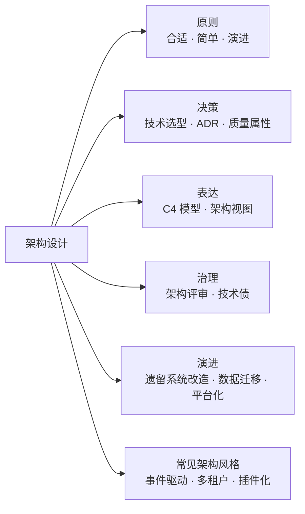
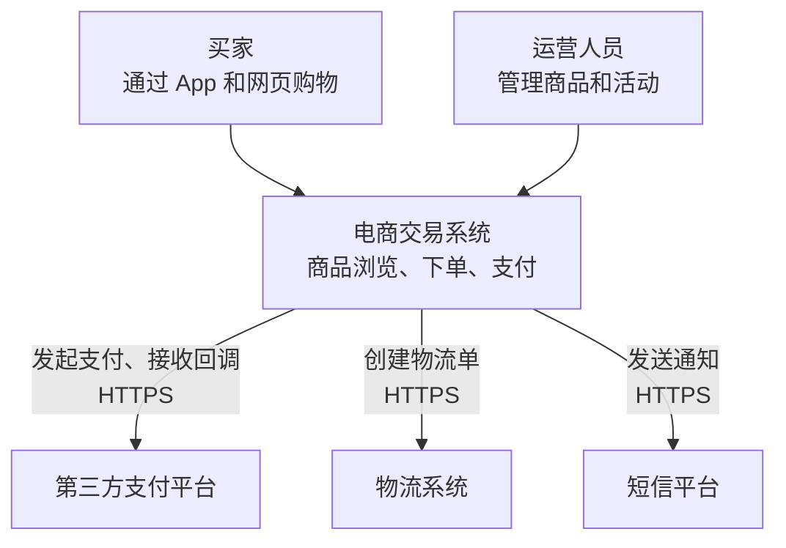
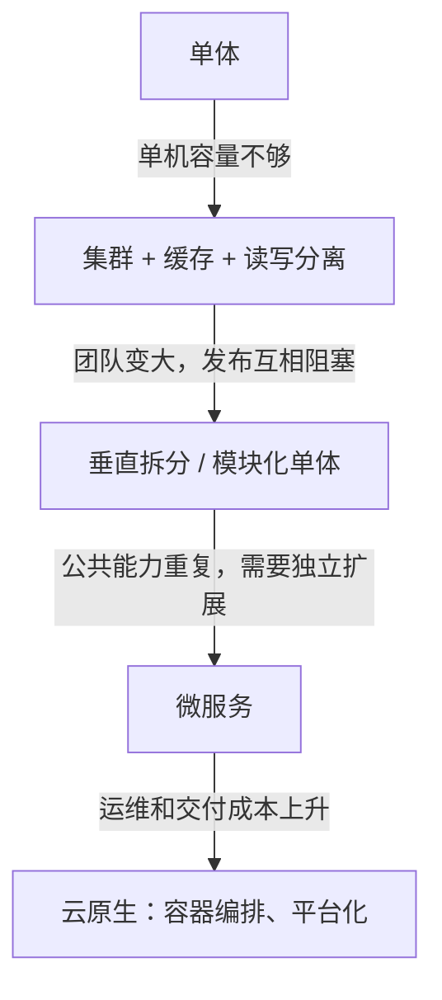
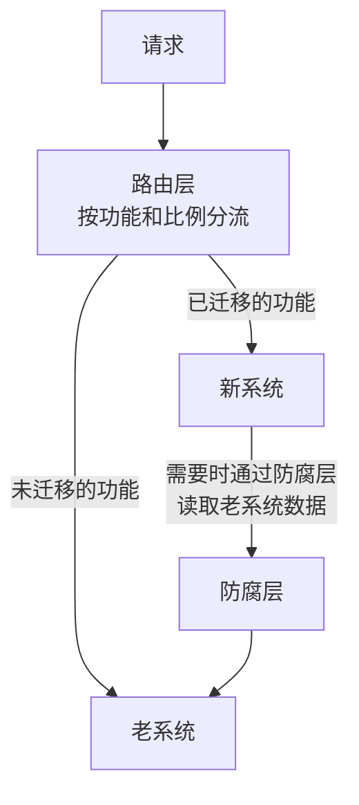
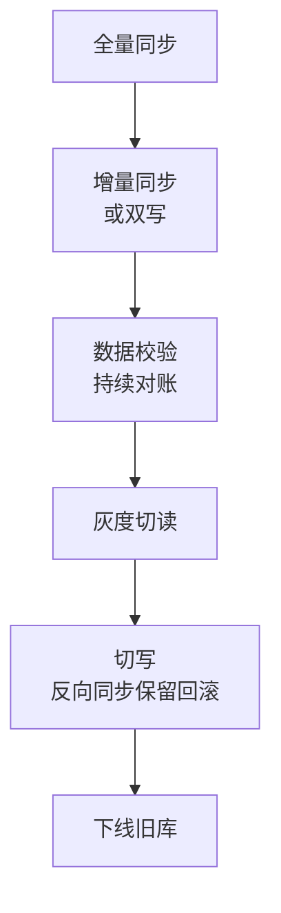

# 28 · 架构设计

> 适用岗位：Java 架构师（资深开发可重点看 28-03、28-10、28-11）
> 版本基线：与具体版本关系不大；涉及的技术以当前主流版本为准
> 事实核对：本分类以方法论为主，C4 模型、ADR、绞杀者模式等均为业界公开的方法，文中注明了出处
> 相关分类：[《11 微服务》](../03-分布式与微服务/11-微服务.md)（拆分与演进）、[《24 高并发》](24-高并发.md)[《25 高性能》](25-高性能.md)[《26 高可用》](26-高可用.md)（质量属性）、[《27 DDD》](27-DDD.md)（边界划分）、[《29 场景题》](29-场景题.md)

## 知识地图



## 题目索引

| 编号 | 题目 | 难度 | 层级 |
| --- | --- | --- | --- |
| 28-01 | 什么是架构？架构师的职责是什么？ | ★★ | 架构师 |
| 28-02 | 架构设计有哪些核心原则？ | ★★ | 架构师 |
| 28-03 | 如何做技术选型？ | ★★★ | 资深 / 架构师 |
| 28-04 | 如何识别和量化非功能需求？ | ★★★ | 架构师 |
| 28-05 | 架构图怎么画？C4 模型是什么？ | ★★ | 架构师 |
| 28-06 | 什么是架构决策记录（ADR）？ | ★★ | 架构师 |
| 28-07 | 架构评审要看什么？ | ★★★ | 架构师 |
| 28-08 | 系统架构一般经历哪些演进阶段？ | ★★ | 资深 / 架构师 |
| 28-09 | 技术债务怎么管理？ | ★★ | 架构师 |
| 28-10 | 遗留系统怎么改造？ | ★★★ | 架构师 |
| 28-11 | 数据迁移怎么做才能不停机、可回滚？ | ★★★ | 资深 / 架构师 |
| 28-12 | 事件驱动架构有什么优缺点？ | ★★ | 架构师 |
| 28-13 | 多租户系统怎么设计？ | ★★★ | 架构师 |
| 28-14 | 如何设计系统的扩展点？ | ★★ | 资深 / 架构师 |
| 28-15 | 中台和平台化的得失是什么？ | ★★ | 架构师 |

---

## 一、原则与决策

### 28-01 什么是架构？架构师的职责是什么？

> ★★ ｜ 架构师 ｜ 高频

**考察意图**：对架构和架构师角色是否有清晰的认识。

**30 秒版回答**

- **架构**是系统中**难以改变的重要决策**的集合：系统由哪些部分组成、它们之间如何交互、遵循什么约束，以及做出这些决策的理由。Martin Fowler 在[《Software Architecture Guide》](https://martinfowler.com/architecture/)中转述了 Ralph Johnson 的观点：架构是"项目早期就希望做对的决策"，归结起来就是"重要的东西，不管它是什么"。
- 架构关注的不是具体的代码，而是**结构**（模块、服务、数据如何划分）、**交互**（同步、异步、协议）、**质量属性**（性能、可用性、安全、可维护性）和**约束**（团队、成本、时间、合规）。
- 架构师的职责：
  1. **识别关键需求**：尤其是非功能需求和约束，见 28-04；
  2. **做出并记录关键决策**，说明取舍，见 28-06；
  3. **把架构落地**：参与关键模块的设计和编码，通过评审、规范、自动化检查保证架构不走样；
  4. **管理技术风险**：识别单点、瓶颈、技术债；
  5. **沟通**：向业务解释技术方案的代价和收益，向团队解释设计意图。

**架构师加分点**

- 架构师最重要的能力是**做取舍**：几乎每个决策都是在一致性与可用性、性能与成本、灵活与简单之间权衡。好的架构师能讲清楚"为什么选 A 不选 B，放弃了什么，什么条件下应该重新考虑"。
- 架构师不能脱离代码。长期不写代码的架构师，做出的决策往往脱离实际，难以落地。

---

### 28-02 架构设计有哪些核心原则？

> ★★ ｜ 架构师 ｜ 高频

**考察意图**：是否有自己的设计原则，并能结合实际说明。

**30 秒版回答**

| 原则 | 含义 | 反例 |
| --- | --- | --- |
| **合适** | 满足当前和可预见的需求，匹配团队能力和资源 | 十几个人的团队照搬大厂的几百个微服务 |
| **简单** | 能用简单方案解决的不用复杂方案；复杂度要有明确的收益 | 为了"以后可能用到"引入多层抽象和配置 |
| **演进** | 架构随业务发展逐步调整，不追求一次设计到位 | 试图在项目初期设计出支撑十年的架构 |
| 高内聚低耦合 | 相关的东西放在一起，模块之间依赖最少 | 修改一个功能要改五个服务 |
| 关注点分离 | 业务逻辑、技术细节、横切关注点分开 | 业务代码中混杂大量缓存、重试、日志逻辑 |
| 为失败而设计 | 假设任何依赖都可能失败 | 远程调用没有超时和降级 |

- 前三条（合适、简单、演进）在很多架构书中都有讨论，它们共同反对的是**过度设计**：为假想的需求预留扩展点、过早地拆分和抽象。

**架构师加分点**

- "演进"不等于"不设计"。对于**难以改变的决策**（数据模型、服务边界、对外接口、核心技术栈），要在一开始就慎重设计；对于容易改变的部分，可以先简单实现，等需求明确再调整。区分这两类决策，是架构设计中最关键的判断之一。

---

### 28-03 如何做技术选型？

> ★★★ ｜ 资深 / 架构师 ｜ 高频

**考察意图**：是否有系统化的选型方法，而不是"哪个火用哪个"。

**30 秒版回答**

1. **明确需求和约束**：要解决什么问题，性能、可用性、一致性的要求是多少，团队熟悉什么，成本和时间的限制。
2. **列出候选方案**：包括"不引入新技术，用现有技术解决"这个选项。
3. **按维度评估**：

| 维度 | 关注点 |
| --- | --- |
| 功能匹配 | 是否满足核心需求，差距多大 |
| 成熟度 | 生产案例、版本稳定性、已知问题 |
| 社区与生态 | 活跃度、文档、与现有技术栈的集成 |
| 团队能力 | 学习成本，出问题时能否自己排查 |
| 运维成本 | 部署、监控、升级、扩容的复杂度 |
| 许可证与供应商 | 开源协议是否有变化风险，是否被单一厂商控制 |
| 退出成本 | 将来要替换时代价多大 |

4. **验证**：对关键指标做原型验证或压测，不要只看宣传材料和别人的测试。
5. **记录决策**：写成 ADR，说明为什么选择、放弃了什么，见 28-06。

**追问链**

1. **新技术什么时候值得引入？** 当它解决的问题足够重要、现有技术确实解决不了或代价过高，并且团队有能力驾驭时。引入任何新技术都会增加系统的复杂度和团队的认知负担，"有趣"不是引入的理由。
2. **许可证风险有真实案例吗？** 有。近几年多个流行的开源项目修改了许可证，例如 Redis 曾改为非开源许可证，后来又增加了 AGPL 选项（见[《17 Redis》](../04-数据存储/17-Redis.md)17-23），Elasticsearch 也经历过类似的变化。选型时要关注项目的治理方式和许可证历史。

**架构师加分点**

- **选型时优先考虑"无聊的技术"**：成熟、被广泛使用、问题已经被充分暴露和解决的技术。创新的预算应该花在核心业务上，而不是基础设施上。
- 选型的风险往往不在技术本身，而在**团队能否驾驭**。一个团队不熟悉的技术，再优秀，出了问题也没人能修。

---

### 28-04 如何识别和量化非功能需求？

> ★★★ ｜ 架构师 ｜ 高频

**考察意图**：是否能把模糊的"高性能、高可用"变成可验证的指标。

**30 秒版回答**

- 非功能需求（质量属性）决定了架构的形态。同样的功能，"每天 1000 个用户"和"每秒 10 万请求"的架构完全不同。
- 常见的质量属性：性能、可用性、可伸缩性、安全性、可维护性、可观测性、成本、合规。
- **量化**：每个质量属性都要写成**可验证的指标**，常用"质量属性场景"的格式（来自卡内基梅隆大学软件工程研究所的架构方法）：

| 要素 | 例子 |
| --- | --- |
| 刺激源 | 用户 |
| 刺激 | 大促零点发起下单请求，峰值 2 万 QPS |
| 环境 | 正常运行，所有依赖可用 |
| 制品 | 下单服务 |
| 响应 | 处理请求 |
| 响应度量 | P99 RT 小于 300 毫秒，成功率大于 99.95% |

- 识别的方法：和业务方、运维、安全、财务等各方沟通；分析历史数据和事故；参考同类系统。

**追问链**

1. **非功能需求之间冲突怎么办？** 例如强一致和高可用、安全和易用、性能和成本。要和业务方一起确定**优先级**，并且针对不同的业务场景分别处理：支付要强一致，商品浏览可以最终一致。
2. **业务方说"越快越好""不能宕机"怎么办？** 把问题转化成**成本**：99.9% 和 99.99% 的成本差距可能是数倍，问业务方是否愿意为此投入。大多数情况下，业务方会给出一个合理的目标。

---

### 28-05 架构图怎么画？C4 模型是什么？

> ★★ ｜ 架构师 ｜ 中频

**考察意图**：是否能清晰地表达架构，针对不同的受众给出不同层次的视图。

**30 秒版回答**

- 架构图常见的问题：一张图想表达所有东西，方框和箭头的含义不明确，不同的人看出不同的意思。
- **C4 模型**（Simon Brown 提出，见 [c4model.com](https://c4model.com/)）用四个层次的图，像地图缩放一样逐层展开：

| 层次 | 内容 | 受众 |
| --- | --- | --- |
| 1. 系统上下文图 | 系统和它的用户、外部系统之间的关系 | 所有人，包括业务方 |
| 2. 容器图 | 系统内部可以独立部署的单元：Web 应用、服务、数据库、MQ | 技术人员 |
| 3. 组件图 | 一个容器内部的主要组件及其职责 | 开发人员 |
| 4. 代码图 | 类图等，通常由工具生成 | 开发人员，按需 |

- 画图的原则：每张图有标题和图例；每个方框写清名称、类型和职责；每条连线写清**做什么**和**用什么协议**；一张图只表达一个层次。

**深入剖析**

一个简化的系统上下文图（第 1 层）：



除了 C4 的静态结构，完整的架构描述通常还需要**动态视图**（关键流程的时序图）和**部署视图**（机房、可用区、实例分布）。

---

### 28-06 什么是架构决策记录（ADR）？

> ★★ ｜ 架构师 ｜ 中频

**考察意图**：是否有记录和传承决策的意识。

**30 秒版回答**

- **ADR**（Architecture Decision Record，Michael Nygard 提出，见[原文](https://cognitect.com/blog/2011/11/15/documenting-architecture-decisions)）用一份简短的文档记录一个重要的架构决策：在什么背景下、做了什么决定、考虑过哪些方案、带来了什么后果。
- 常见的结构：

| 部分 | 内容 |
| --- | --- |
| 标题 | 编号 + 决策的简短描述，例如"ADR-012：订单服务使用 RocketMQ 实现异步通知" |
| 状态 | 提议中 / 已接受 / 已废弃 / 被 ADR-xxx 取代 |
| 背景 | 面临的问题、约束、需求 |
| 决策 | 做出的选择 |
| 备选方案 | 考虑过的其他方案，以及没有选择它们的原因 |
| 后果 | 带来的好处、代价、风险，以及后续需要做的事情 |

- ADR 和代码放在同一个仓库中，用 Markdown 编写，随代码一起评审和版本管理。**已接受的 ADR 不修改**，决策变化时写一份新的 ADR 取代旧的，保留决策的历史。

**架构师加分点**

- ADR 最大的价值是回答一年后新同事的问题："**当初为什么这么设计？**"没有记录的话，后来的人要么不敢改（怕有未知的原因），要么随意改（重复踩当初已经踩过的坑）。

---

### 28-07 架构评审要看什么？

> ★★★ ｜ 架构师 ｜ 高频

**考察意图**：是否有系统化的评审清单和方法。

**30 秒版回答**

架构评审不是挑毛病，而是**在代价最低的阶段发现风险**。常用的检查维度：

| 维度 | 关键问题 |
| --- | --- |
| 需求匹配 | 是否解决了要解决的问题？关键的非功能需求是否有量化指标并被满足？ |
| 边界与职责 | 模块、服务的划分是否合理？职责是否清晰？有没有循环依赖？ |
| 数据 | 数据模型是否合理？数据的归属是否明确？一致性如何保证？数据量增长后怎么办？ |
| 容量与性能 | 有没有容量估算？瓶颈在哪里？ |
| 可用性 | 有没有单点？依赖故障时怎么办？有没有限流、降级方案？ |
| 安全 | 认证授权、敏感数据保护、审计 |
| 可观测性 | 出了问题能否快速发现和定位？ |
| 演进与兼容 | 接口是否兼容？数据如何迁移？如何灰度和回滚？ |
| 成本 | 资源成本、开发成本、运维成本 |
| 风险 | 新技术的风险、团队能力的风险、时间的风险 |

**追问链**

1. **什么样的变更需要架构评审？** 新系统、新的服务拆分、引入新的中间件或技术、跨团队的接口、核心数据模型的变更、对可用性有重大影响的变更。日常的功能开发不需要，否则评审会成为瓶颈。
2. **评审意见有分歧怎么办？** 区分"必须修改"（会导致严重问题的风险）和"建议"（可以改进的地方）。分歧较大时，用数据和原型验证；仍然无法统一时，由决策人拍板，并记录在 ADR 中。

---
## 二、演进与治理

### 28-08 系统架构一般经历哪些演进阶段？

> ★★ ｜ 资深 / 架构师 ｜ 高频

**考察意图**：是否理解每次演进的驱动力，而不是只会背阶段名称。

**30 秒版回答**

| 阶段 | 典型形态 | 驱动下一次演进的问题 |
| --- | --- | --- |
| 单体 | 一个应用、一个数据库 | 流量增长，单机扛不住 |
| 单体集群 + 缓存 + 读写分离 | 应用多实例、Redis、主从数据库 | 代码量和团队变大，所有人改一个工程，发布互相阻塞 |
| 垂直拆分 / 模块化 | 按业务拆成几个独立的应用和数据库 | 公共能力在各个系统中重复建设 |
| 服务化（SOA / 微服务） | 按业务能力拆成服务，服务治理 | 服务数量多，运维、部署、观测成本高 |
| 云原生 | 容器、Kubernetes、服务网格、Serverless | 持续优化成本和效率 |



**架构师加分点**

- 演进的关键是**由问题驱动**，而不是由潮流驱动。没有遇到上一阶段的问题，就不需要进入下一阶段。很多中小系统在"单体集群 + 模块化"阶段就能长期满足需求。
- 也存在**反向演进**：一些团队发现微服务拆得过细、成本过高，又把部分服务合并回去。演进的方向取决于当下的问题，不是单向的。

---

### 28-09 技术债务怎么管理？

> ★★ ｜ 架构师 ｜ 中频

**考察意图**：是否理解技术债的本质，以及如何在业务压力下推动偿还。

**30 秒版回答**

- **技术债**：为了短期的交付速度，选择了一个让将来修改成本更高的方案。和金融债务一样，它会产生"利息"：每次修改相关代码都要付出额外的代价。
- 技术债不一定是坏事：有意识地借债（例如为了赶上市场窗口先上线一个简化版本），只要记录下来并按计划偿还，是合理的决策。危险的是**无意识的、不被记录的债务**。
- 管理方法：
  1. **显性化**：建立技术债清单，记录位置、影响、修复成本；
  2. **量化影响**：用数据说话，例如"这个模块每次需求平均多花 3 天""近半年 5 次故障与此相关"；
  3. **优先偿还"利息"最高的**：经常被修改、经常出问题的代码优先处理；很少改动的代码即使写得差，也可以暂时不动；
  4. **固定投入**：每个迭代预留一定比例的时间偿还技术债，或者在修改相关功能时顺便改进（童子军规则：离开时让营地比来时更干净）；
  5. **防止新增**：代码评审、静态检查、架构规则的自动化检查。

**追问链**

1. **业务方不愿意给时间还技术债怎么办？** 不要用"代码不优雅"这种理由，而要用业务能理解的语言：交付变慢了多少、故障增加了多少、某个业务需求因此无法实现。把技术债的偿还和具体的业务目标绑定在一起推进。

---

### 28-10 遗留系统怎么改造？

> ★★★ ｜ 架构师 ｜ 高频

**考察意图**：是否掌握低风险的渐进式改造方法。

**30 秒版回答**

- **不要轻易推倒重写**。重写的风险：老系统中隐藏着大量没有文档的业务规则；重写期间业务还在变化，新系统一直在追赶；新系统上线时一次性切换，风险集中。
- 推荐**绞杀者模式**（Strangler Fig，Martin Fowler 提出，见[原文](https://martinfowler.com/bliki/StranglerFigApplication.html)）：
  1. 在老系统前面加一层**路由**（网关或代理）；
  2. 每次挑选一个功能，在新系统中实现；
  3. 路由把这个功能的流量**逐步**切到新系统，出问题可以立即切回；
  4. 重复这个过程，直到老系统的功能全部被替代，然后下线老系统。
- 配合使用的手段：
  - **防腐层**：新系统通过防腐层访问老系统的数据和接口，避免老系统的模型污染新系统，见[《27 DDD》](27-DDD.md)27-04；
  - **流量对比**：同一个请求同时发给新老系统，对比结果，在切流之前发现差异；
  - **特征测试**：改造之前先为老系统的现有行为写测试，作为改造的安全网。

**深入剖析**



**追问链**

1. **新老系统的数据怎么处理？** 这通常是改造中最难的部分。常见的做法是新系统有自己的数据库，通过数据同步（基于数据库日志的增量同步）保持新老数据一致，迁移完成后再停止同步。详见 28-11。

---

### 28-11 数据迁移怎么做才能不停机、可回滚？

> ★★★ ｜ 资深 / 架构师 ｜ 高频

**考察意图**：是否有完整的在线数据迁移方案，并能控制风险。

**30 秒版回答**

典型的在线迁移分为几个阶段，**每个阶段都可以独立验证和回滚**：

| 阶段 | 做法 | 回滚方式 |
| --- | --- | --- |
| 1. 全量同步 | 把历史数据复制到新库 | 删除新库数据 |
| 2. 增量同步 / 双写 | 基于数据库日志（例如 Canal 解析 binlog）把增量同步到新库；或者在应用中同时写新旧两个库，以旧库为准 | 停止同步 |
| 3. 数据校验 | 全量和增量对比，修复差异，直到持续一致 | — |
| 4. 切读 | 按比例把读流量切到新库，观察结果 | 读切回旧库 |
| 5. 切写 | 以新库为准，旧库改为从新库反向同步（保留回滚能力） | 写切回旧库 |
| 6. 下线旧库 | 稳定运行一段时间后，停止反向同步，下线旧库 | — |



**追问链**

1. **应用双写和日志同步哪个好？** 应用双写要修改业务代码，两个库的写入无法原子，失败处理复杂；基于日志的同步对业务无侵入，延迟低，是更常用的做法。双写更适合数据结构发生了较大变化、需要在应用中转换的场景。
2. **切写的那一刻怎么保证不丢数据？** 常见做法是短暂地停止写入（或者把写入切到只读状态几秒钟），等增量同步追平、校验一致后再切换。对停写零容忍的业务，需要更复杂的方案（例如按用户逐批切换）。
3. **分库分表的迁移有什么特殊之处？** 新旧库的数据分布不同，同步时要按新的分片规则路由，校验也要按分片进行，见[《16 分库分表》](../04-数据存储/16-分库分表.md)。

---

## 三、架构风格

### 28-12 事件驱动架构有什么优缺点？

> ★★ ｜ 架构师 ｜ 中频

**考察意图**：是否能客观评价事件驱动架构。

**30 秒版回答**

- **事件驱动架构**：服务之间通过**发布和订阅事件**交互，而不是直接调用。发布者只负责发出"发生了什么"，不关心谁来处理。
- 优点：
  - **解耦**：新增下游只需要订阅事件，不需要修改上游；
  - **弹性**：下游暂时不可用不影响上游，事件在 MQ 中暂存；
  - **可扩展**：事件可以被多个消费者并行处理。
- 缺点：
  - **流程不直观**：一个业务流程分散在多个服务的事件处理中，没有一个地方能看到完整的流程；
  - **最终一致**：需要处理中间状态、失败补偿、重复和乱序；
  - **调试和排查困难**：必须依赖链路追踪和事件追踪；
  - **事件契约的演进**：事件结构变化会影响所有订阅者。
- **编排与协同**：
  - **协同**（choreography）：每个服务根据收到的事件自行决定下一步，没有中心；
  - **编排**（orchestration）：一个中心协调者按流程调用各个服务。
  - 流程简单、参与方少时用协同；流程复杂、需要整体可见和控制时用编排（例如 Saga 编排器、工作流引擎）。

---

### 28-13 多租户系统怎么设计？

> ★★★ ｜ 架构师 ｜ 中频

**考察意图**：是否了解 SaaS 系统中数据隔离和资源隔离的方案。

**30 秒版回答**

数据隔离有三种常见模式：

| 模式 | 做法 | 隔离程度 | 成本 | 适合 |
| --- | --- | --- | --- | --- |
| 共享库共享表 | 所有表增加 `tenant_id` 字段，查询时按租户过滤 | 低 | 最低 | 大量中小租户 |
| 共享库独立 Schema | 每个租户一个 Schema | 中 | 中 | 租户数量中等 |
| 独立数据库 | 每个租户一个数据库实例 | 高 | 高 | 大客户、对隔离和合规要求高的租户 |

- 实践中常用**混合模式**：中小租户共享，大客户独立部署。
- 关键问题：
  - **数据泄漏**：共享表模式下，任何一条 SQL 漏掉了 `tenant_id` 条件，就会读到其他租户的数据。不能依赖开发人员自觉，要在框架层统一处理：例如用 MyBatis 拦截器自动给 SQL 加租户条件，租户 ID 从请求上下文中获取；
  - **资源隔离**：一个大租户的大查询或流量高峰不能拖垮其他租户。按租户限流、按租户划分资源池；
  - **租户级的定制**：配置、功能开关、扩展点按租户区分，见 28-14；
  - **运维**：按租户备份和恢复数据、迁移租户（从共享升级到独立）。

**追问链**

1. **租户 ID 在异步线程、MQ 消息中怎么传递？** 和链路追踪的上下文一样，需要显式传递：线程池用支持上下文传递的包装，MQ 消息在消息头中携带租户 ID，消费时恢复到上下文中。

---

### 28-14 如何设计系统的扩展点？

> ★★ ｜ 资深 / 架构师 ｜ 中频

**考察意图**：是否能在需要时设计合理的扩展机制，同时避免过度设计。

**30 秒版回答**

- 扩展点的作用是让系统在**不修改核心代码**的情况下支持新的业务变化（开闭原则）。但扩展点本身有成本，**只在已经出现第二个真实用例时引入**，不为假想的需求预留。
- 常用的实现方式：

| 方式 | 适合 |
| --- | --- |
| 策略模式 + Spring 注入 | 同一个流程中某个步骤有多种实现，例如不同支付渠道、不同的计价规则 |
| Java SPI / Spring 的自动配置 | 框架和组件层面的扩展，例如 JDBC 驱动、Spring Boot Starter |
| 事件 | 主流程之外的附加动作，例如下单后的各种通知 |
| 规则引擎 / 脚本 | 规则变化非常频繁，需要业务人员配置，例如风控规则、营销规则 |
| 插件化（独立的类加载器） | 需要动态加载、卸载第三方扩展，例如 IDE、网关的插件 |

**深入剖析**

最常用的"策略 + 注册表"写法，利用 Spring 把同一个接口的所有实现注入成列表：

```java
public interface PayChannel {

    /** 渠道编码，与订单中的支付方式对应 */
    PayChannelCode code();

    PayResult pay(PayCommand command);
}

@Component
public class PayChannelRouter {

    private final Map<PayChannelCode, PayChannel> channels;

    /** Spring 自动注入所有 PayChannel 实现，新增渠道只需要新增一个实现类 */
    public PayChannelRouter(List<PayChannel> channelList) {
        this.channels = channelList.stream()
                .collect(Collectors.toUnmodifiableMap(PayChannel::code, Function.identity()));
    }

    public PayResult pay(PayCommand command) {
        PayChannel channel = channels.get(command.channelCode());
        if (channel == null) {
            throw new BizException(ErrorCode.PAY_CHANNEL_NOT_SUPPORTED, command.channelCode());
        }
        return channel.pay(command);
    }
}
```

两个实现的 `code()` 重复时，`toUnmodifiableMap` 会在启动时直接抛出异常，问题在启动阶段就会暴露，而不是等到线上调用时才发现。

---

### 28-15 中台和平台化的得失是什么？

> ★★ ｜ 架构师 ｜ 中频

**考察意图**：能否客观评价中台战略，理解平台化成功的条件。

**30 秒版回答**

- **中台**的初衷：把多个业务线中重复建设的能力（用户、商品、交易、营销等）沉淀成共享的服务，新业务可以快速复用，避免重复造轮子。
- **得**：
  - 公共能力复用，新业务启动快；
  - 数据统一，便于跨业务分析。
- **失**（很多公司推行中台后遇到的问题）：
  - 中台团队成为瓶颈：所有业务的需求都要排队等中台开发；
  - 为了"通用"而过度抽象，模型复杂，每个业务用起来都不顺手；
  - 业务差异被忽视，个性化需求只能在中台里堆积各种特殊判断；
  - 组织调整的成本很高。
- 更务实的方向是**平台化**和**自助服务**：平台提供稳定的基础能力和清晰的扩展点，业务团队自助接入和扩展，而不是所有逻辑都由平台团队实现。

**架构师加分点**

- 中台的问题本质上是**抽象的时机和边界**问题：能力在多个业务中被验证是真正通用的，才适合下沉；业务差异大、变化快的部分，留在业务侧。这和代码层面"出现第二个真实用例时才抽象"的原则是一样的，只是放大到了组织层面。
- 从康威定律看，中台是一次组织结构的调整，技术架构跟随组织结构变化。没有组织和流程的配合，只在技术上"建中台"，很难成功。
