# 29 · 场景题（系统设计）

> 适用岗位：Java 资深开发、Java 架构师（架构师面试中占比很高，要求能画出架构图并讲清取舍）
> 版本基线：JDK 21、Redis 7.x / 8.x、RocketMQ 5.x、Kafka 4.x
> 事实核对：Redis 命令的引入版本和弃用信息，已对照 Redis 官方源码中的命令定义（`src/commands/*.json`）核对；ZSET 同分排序、`GEOSEARCH`、抢红包 Lua 脚本已在本机 Redis 6.2.6 上实际运行；红包拆分、签名校验、Base62 编码的代码已在本机 JDK 21 上运行；RocketMQ 定时消息的延时上限已对照 5.5.0 源码核对
> 相关分类：[《24 高并发》](24-高并发.md)（容量估算、库存扣减、计数）、[《16 分库分表》](../04-数据存储/16-分库分表.md)（基因法、非分片键查询）、[《20 MQ 通用与选型》](../05-消息队列/20-MQ通用与选型.md)（延迟消息、幂等）、[《09 分布式理论》](../03-分布式与微服务/09-分布式理论.md)（分布式 ID、幂等、超时重试）、[《26 高可用》](26-高可用.md)（限流、降级）、[《28 架构设计》](28-架构设计.md)

## 知识地图

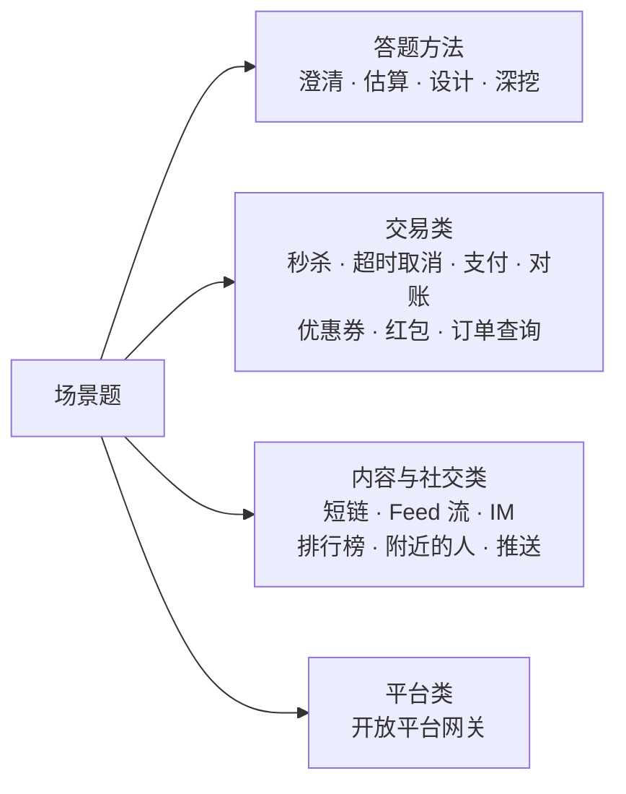

## 题目索引

| 编号 | 题目 | 难度 | 层级 |
| --- | --- | --- | --- |
| 29-01 | 系统设计题怎么答？ | ★★ | 资深 / 架构师 |
| 29-02 | 设计一个秒杀系统 | ★★★ | 资深 / 架构师 |
| 29-03 | 订单超时未支付，怎么自动取消？ | ★★ | 资深 |
| 29-04 | 设计一个支付系统 | ★★★ | 架构师 |
| 29-05 | 设计一个对账系统 | ★★★ | 架构师 |
| 29-06 | 设计一个优惠券系统 | ★★★ | 资深 / 架构师 |
| 29-07 | 设计抢红包 | ★★★ | 资深 |
| 29-08 | 订单表分库分表后，买家、卖家、运营的查询怎么支撑？ | ★★★ | 资深 / 架构师 |
| 29-09 | 设计一个短链系统 | ★★ | 资深 |
| 29-10 | 设计 Feed 流（关注动态） | ★★★ | 架构师 |
| 29-11 | 设计一个 IM 系统 | ★★★ | 架构师 |
| 29-12 | 设计一个实时排行榜 | ★★ | 资深 |
| 29-13 | 设计"附近的人" | ★★ | 资深 |
| 29-14 | 设计一个消息推送平台 | ★★★ | 架构师 |
| 29-15 | 设计一个开放平台 API 网关 | ★★★ | 架构师 |

---

## 一、答题方法

### 29-01 系统设计题怎么答？

> ★★ ｜ 资深 / 架构师 ｜ 高频

**考察意图**：面试官看的不是一个"标准答案"，而是你分析问题、做取舍、控制风险的过程。

**30 秒版回答**

按固定的步骤推进，每一步都和面试官确认：

| 步骤 | 做什么 | 45 分钟面试中的大致时间 |
| --- | --- | --- |
| 1. 澄清需求 | 核心功能是什么，哪些不做；用户量、数据量、读写比例；一致性、延迟、可用性要求 | 5 分钟 |
| 2. 估算容量 | QPS 峰值、存储量、带宽，估算结果决定后面要不要缓存、分片、异步，方法见[《24 高并发》](24-高并发.md)24-03 | 5 分钟 |
| 3. 高层设计 | 画出主要组件和数据流，先让主流程跑通 | 10 分钟 |
| 4. 深入关键点 | 挑这道题真正难的 1～2 个点深入：一致性、热点、峰值、可靠性 | 15～20 分钟 |
| 5. 总结和扩展 | 瓶颈在哪里、怎么监控、规模再大十倍怎么办 | 5 分钟 |

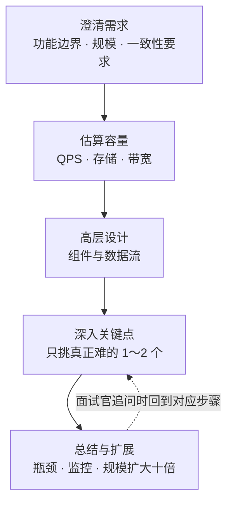

**深入剖析**

几乎所有场景题，难点都能归到下面几类，每一类都有相对固定的工具：

| 难点 | 常用手段 | 对应分类 |
| --- | --- | --- |
| 读流量大 | 多级缓存、CDN、读写分离 | [《24 高并发》](24-高并发.md)[《18 本地缓存》](../04-数据存储/18-本地缓存.md) |
| 瞬时写峰值 | 前置过滤、MQ 削峰、异步化 | [《24 高并发》](24-高并发.md) |
| 数据量大 | 分库分表、冷热分离、归档 | [《16 分库分表》](../04-数据存储/16-分库分表.md) |
| 不能重复、不能超 | 唯一索引、条件更新、Redis 原子操作 | [《09 分布式理论》](../03-分布式与微服务/09-分布式理论.md)09-17 |
| 跨系统一致性 | 状态机 + 幂等 + 重试 + 对账 | [《09 分布式理论》](../03-分布式与微服务/09-分布式理论.md)、本分类 29-05 |
| 延迟任务 | 延迟消息 + 定时扫描兜底 | [《20 MQ 通用与选型》](../05-消息队列/20-MQ通用与选型.md)20-08 |
| 热点 | 本地缓存、拆分热点 Key、请求合并 | [《24 高并发》](24-高并发.md)24-11 |

**生产实践 / 踩坑**

常见的扣分表现：

- 不问需求直接画图，结果设计的系统和面试官想问的不是一回事；
- 不做估算，或者估算完不用：日均 10 万订单的系统直接上分库分表；
- 堆中间件：每个组件都说不出"为什么需要它"；
- 只讲正常流程，不讲失败：网络超时、消息重复、节点宕机时会发生什么。

**架构师加分点**

- 主动说出**取舍**："这里我选择了最终一致性，代价是用户可能在几秒内看到旧数据，换来的是写入路径不依赖下游。"能讲清代价，比方案本身更能体现水平。
- 主动提出**业务层面的解法**：很多技术难题可以通过调整业务规则消除，例如把"秒杀"改成"预约抽签"，峰值直接消失。

---

## 二、交易类

### 29-02 设计一个秒杀系统

> ★★★ ｜ 资深 / 架构师 ｜ 高频

完整版（按面试流程拆成 18 道子题，含本机 Redis 实测和可运行的代码）见[《S01 秒杀系统》](../12-场景设计/S01-秒杀系统.md)。

**考察意图**：能否针对"大量请求争抢少量资源"的特点做分层过滤，同时保证不超卖。

**30 秒版回答**

- **需求特点**：商品少（例如 100 件），瞬时请求多（例如 100 万人同时抢），每人限购 1 件，**不能超卖**，尽量不少卖，**不能影响主站其他业务**。
- **核心思路**：最终只有 100 个请求能成功，所以设计目标是**让绝大部分请求在越靠前的地方被拒绝**，越往后的环节，请求越少、处理越重：
  1. **前端与 CDN**：页面静态化放在 CDN；开始前按钮置灰；秒杀接口的地址在开始时才下发，防止脚本提前请求；
  2. **网关**：限流、黑名单、风控，拦截大部分请求；
  3. **秒杀服务**：独立部署；售罄后在本地内存打上售罄标记，直接拒绝，不再访问 Redis；
  4. **Redis**：用 Lua 脚本**原子地**校验限购并扣减库存，见[《24 高并发》](24-高并发.md)24-12；
  5. **MQ 异步下单**：扣减成功的请求进入 MQ，订单服务按自己的能力消费，创建订单；
  6. **数据库**：用条件更新扣减库存，作为防止超卖的最后一道防线；
  7. 用户在前端轮询下单结果。

**深入剖析**

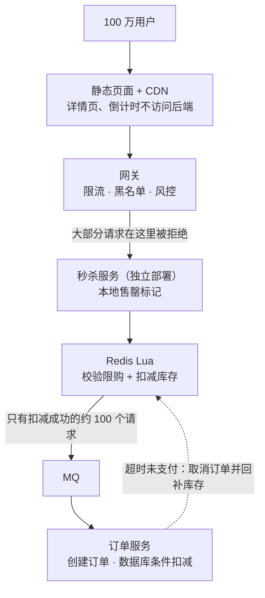

数据库层的条件扣减和唯一索引：

```sql
-- stock >= 1 保证库存不会被扣成负数，即使 Redis 出了问题也不会超卖
UPDATE t_seckill_stock SET stock = stock - 1
WHERE activity_id = ? AND sku_id = ? AND stock >= 1;

-- 同一个活动、同一个用户只能有一笔订单
ALTER TABLE t_seckill_order ADD UNIQUE KEY uk_activity_user (activity_id, user_id);
```

**追问链**

1. **Redis 扣减成功了，但发送 MQ 失败，怎么办？** 发送失败时回补 Redis 库存并清除该用户的限购标记；为防止回补本身也失败，再加一个定时对账：比较 Redis 中已扣减的数量和实际生成的订单数量，差额回补。这里的风险是**少卖**，不是超卖。
2. **Redis 主从切换丢了最近的扣减记录怎么办？** 切换后 Redis 中的库存可能比实际多，放进来的请求会多于库存，但数据库的条件扣减会让多出来的请求失败，**不会超卖**。这就是为什么数据库层的条件扣减不能省。
3. **库存集中在 Redis 的一个 Key 上，会不会成为热点？** 经过前面几层过滤，到达 Redis 的请求已经大幅减少；单个 Redis 分片处理这种简单脚本通常能到每秒数万到十万次的量级（与硬件和脚本复杂度有关），一般足够。还不够时，可以把库存拆成多个 Key 分散到不同分片（分段库存），代价是某一段先卖完时需要去其他段尝试。
4. **怎么防止黄牛和脚本？** 限购（按用户、设备、收货地址）、风控评分、验证码；验证码还能把集中在一秒内的请求拉长到几秒，起到削峰的作用。

**生产实践 / 踩坑**

- **一定要隔离**：秒杀服务、Redis、MQ 使用独立的资源，秒杀被打挂时不能影响主站的正常下单。
- 秒杀开始时间以**服务器时间**为准，前端倒计时只用于展示，不能用客户端时间判断能否下单。
- 活动开始前做**预热**：库存加载到 Redis，商品信息加载到本地缓存，并做压测。

**架构师加分点**

- 从业务上消除峰值：**预约 + 抽签**。用户提前预约，开始后系统随机抽取中签用户，不再需要所有人在同一秒争抢，技术难度大幅降低。很多限量商品的发售已经采用这种方式。

---

### 29-03 订单超时未支付，怎么自动取消？

> ★★ ｜ 资深 ｜ 高频

完整版（10 道子题，含延迟任务平台的设计、本机 Redis 实测的领取脚本和可运行的代码）见[《S02 订单超时取消与延迟任务》](../12-场景设计/S02-订单超时取消与延迟任务.md)。

**考察意图**：是否知道延迟任务的各种实现，以及取消和支付并发时的正确性。

**30 秒版回答**

| 方案 | 做法 | 优点 | 缺点 |
| --- | --- | --- | --- |
| 定时扫表 | 定时任务查询"待支付且创建时间早于 30 分钟前"的订单 | 简单可靠 | 有延迟；订单量大时扫描压力大 |
| 延迟消息 | 下单时发一条 30 分钟后投递的消息，例如 RocketMQ 5.x 的定时消息 | 准时、对数据库无压力 | 依赖 MQ；消息可能因为各种原因没有被处理 |
| Redis ZSET | 以到期时间为 score，定时取出到期的订单 | 实现简单 | 需要自己保证可靠性 |
| 时间轮 | 单机内存中的时间轮（如 Netty `HashedWheelTimer`） | 高效 | 进程重启任务丢失，不能单独使用 |
| Redis 过期事件 | 监听 Key 过期通知 | — | **不可靠**：过期事件是在 Key 实际被删除时才产生的，可能比 TTL 晚；Pub/Sub 不保证送达，客户端断线时事件直接丢失（见 [Redis 文档](https://redis.io/docs/latest/develop/pubsub/keyspace-notifications/)）。不推荐 |

- 推荐：**延迟消息为主 + 定时扫表兜底**。延迟消息保证准时，扫表（频率低一些，例如每 5 分钟一次）保证不漏。
- RocketMQ 5.x 定时消息的最长延时默认是 3 天（`timerMaxDelaySec`），见[《22 RocketMQ》](../05-消息队列/22-RocketMQ.md)22-08；其他实现方式的对比见[《20 MQ 通用与选型》](../05-消息队列/20-MQ通用与选型.md)20-08。

**深入剖析**

真正容易出错的是**取消和支付同时发生**：

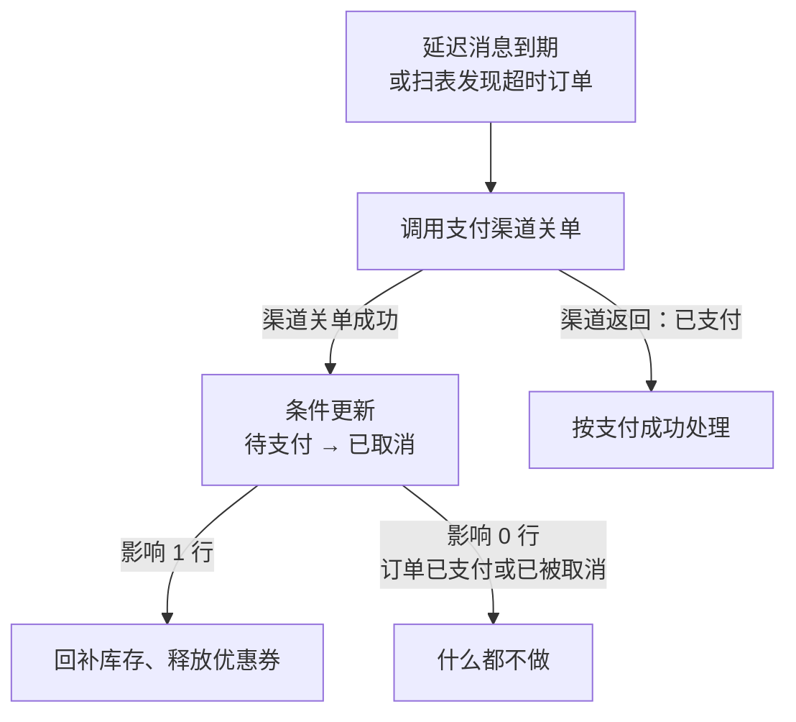

- **先关闭支付渠道上的交易**，再取消订单。否则用户可能在订单取消之后，仍然在支付页面完成了付款。
- **用条件更新代替"先查再改"**：

```sql
UPDATE t_order SET status = 'CANCELLED', update_time = NOW()
WHERE order_id = ? AND status = 'WAIT_PAY';
```

影响行数为 1，才执行回补库存、释放优惠券等后续动作；影响行数为 0，说明订单已经被支付或已经被取消，直接结束。支付回调更新订单时也用同样的条件（`WHERE status = 'WAIT_PAY'`），两者谁先成功谁生效。

**追问链**

1. **订单已经取消了，又收到了支付成功的回调怎么办？** 说明渠道关单之前用户已经付款成功了（例如关单请求失败后走了兜底流程）。此时订单不能复活（库存可能已经卖给别人），应该**自动发起退款**，并记录下来供对账核查。
2. **大促时同一时刻大量订单到期怎么办？** 延迟消息的消费者限速处理；扫表兜底时按订单 ID 分片，由多个实例并行扫描。
3. **时间轮的原理是什么？** 见[《34 定时任务》](../07-工程实践与稳定性/34-定时任务.md)。

---

### 29-04 设计一个支付系统

> ★★★ ｜ 架构师 ｜ 高频

完整版（13 道子题，含状态机、幂等、结果确认、退款、渠道路由和可运行的代码）见[《S03 支付系统》](../12-场景设计/S03-支付系统.md)。

**考察意图**：能否保证资金相关流程的正确性：幂等、状态机、结果确认、对账。

**30 秒版回答**

- **范围**：公司内部的支付中心，对接多个外部支付渠道（第三方支付、银行），为各个业务系统提供统一的支付能力。
- **核心模型**：**业务订单**和**支付单**分开。一个业务订单可以发起多次支付（例如用户换了支付方式），对应多个支付单，但最终只能有一个支付成功。
- **关键设计**：
  1. **状态机**：支付单的状态只能按规定的方向流转，成功是终态；所有状态变更都用条件更新；
  2. **幂等**：创建支付单以业务订单号 + 请求号去重；渠道回调以支付单号 + 当前状态去重；
  3. **结果确认**：**渠道回调 + 主动查询**两条路径，不能只依赖回调，也不能以前端跳转回来的结果为准；
  4. **调用渠道超时不等于失败**：状态保持"支付中"，通过查询确认；
  5. **金额**：用以分为单位的 `long` 或 `BigDecimal`，禁止使用 `double`；回调时校验金额与支付单一致；
  6. **通知业务**：支付成功后通过本地消息表或事务消息通知业务系统，业务系统幂等处理；
  7. **对账兜底**：每天与渠道对账，发现并处理差异，见 29-05。

**深入剖析**

整体架构：

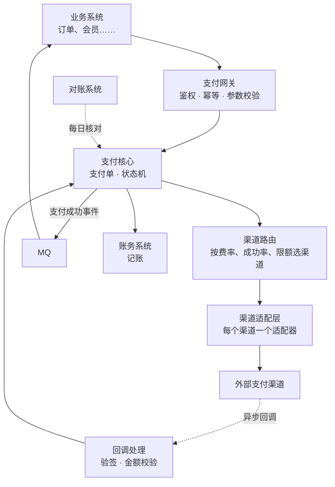

支付单状态机：

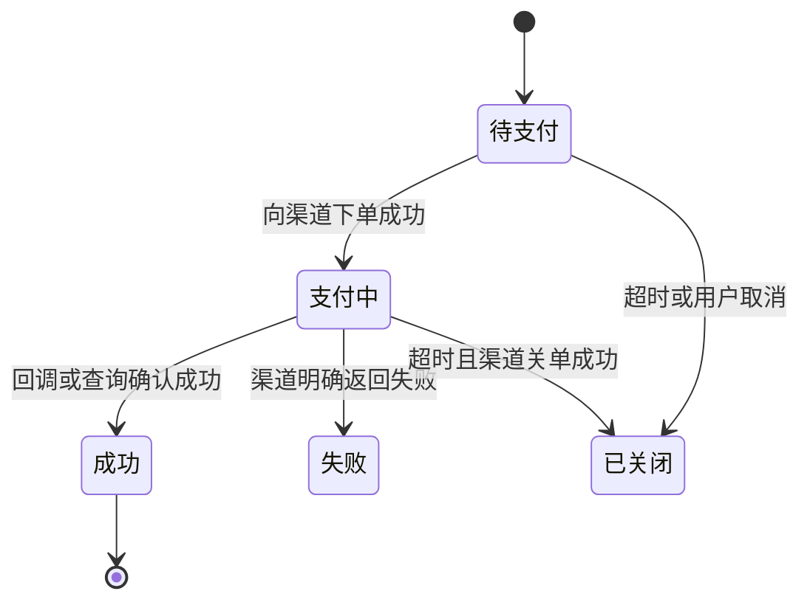

退款不改变支付单的状态，而是创建独立的**退款单**，有自己的状态机。一笔支付可以多次部分退款，累计退款金额不能超过支付金额，同样用条件更新保证：

```sql
UPDATE t_pay_order SET refunded_amount = refunded_amount + ?
WHERE pay_no = ? AND status = 'SUCCESS' AND refunded_amount + ? <= amount;
```

**追问链**

1. **用户付了钱，系统却显示未支付，可能是什么原因？** 回调丢失或处理失败。所以必须有主动查询：支付单在"支付中"停留超过一定时间，就按退避间隔向渠道查询；对账是最后一道兜底。
2. **同一个订单被支付了两次怎么办？** 用户可能在两个渠道各付了一次。第二笔支付成功时发现业务订单已经有成功的支付单，就自动退款，并记录下来。
3. **回调接口要注意什么？** 验签，防止伪造；校验金额和支付单号；幂等，渠道会重复回调；快速返回成功，复杂的业务处理放到异步流程中。
4. **渠道故障怎么办？** 渠道路由根据实时成功率自动降低故障渠道的权重，或者切换到备用渠道。

**架构师加分点**

- **账务用复式记账**：每一笔资金变动同时记录"从哪个账户来、到哪个账户去"，所有账户的借方合计和贷方合计必须相等。这样任何一笔错误都会表现为账不平，可以被及时发现。这是财务系统几百年来验证过的方法。
- 支付系统的设计原则是**宁可慢，不可错**：不确定的状态宁可让它停留在"处理中"，通过查询和对账确认，也不要猜测结果。

---

### 29-05 设计一个对账系统

> ★★★ ｜ 架构师 ｜ 中频

完整版（10 道子题，含分桶核对的可运行代码、挂账、准实时对账和差错处理的风控）见[《S04 对账系统》](../12-场景设计/S04-对账系统.md)。

**考察意图**：是否理解对账在最终一致性系统中的兜底作用，以及差错的分类和处理。

**30 秒版回答**

- **目的**：分布式系统中，即使有幂等、重试、查询，仍然可能因为各种原因出现不一致。对账定期比较两方的记录，**发现并修复差异**，是资金类系统的最后一道防线。
- **流程**：
  1. **获取数据**：下载渠道的对账文件（通常是 T+1，即第二天提供前一天的账单），解析并统一格式后入库；抽取本方同一时间段的交易流水；
  2. **核对**：按交易号匹配两边的记录，比较金额、状态；
  3. **差错处理**：匹配上且一致的记为平账；不一致的进入差错池，按类型自动或人工处理。
- **差错类型**：

| 类型 | 含义 | 常见原因 | 处理 |
| --- | --- | --- | --- |
| 本方单边账 | 本方记录为成功，渠道没有这笔交易 | 跨日（本方记在今天，渠道记在明天）；本方状态错误 | 先挂账，下一轮对账再匹配；仍匹配不上则查询渠道确认，修正本方状态 |
| 渠道单边账 | 渠道显示成功，本方没有或不是成功 | 回调丢失、处理失败 | 补单（把支付单改为成功并通知业务）；业务订单已取消时退款 |
| 金额不一致 | 两边都有，金额不同 | 程序错误、数据被篡改 | 人工核查，这类差错需要告警 |
| 状态不一致 | 例如本方已退款，渠道未退款 | 退款回调丢失 | 查询渠道确认后修正 |

**深入剖析**

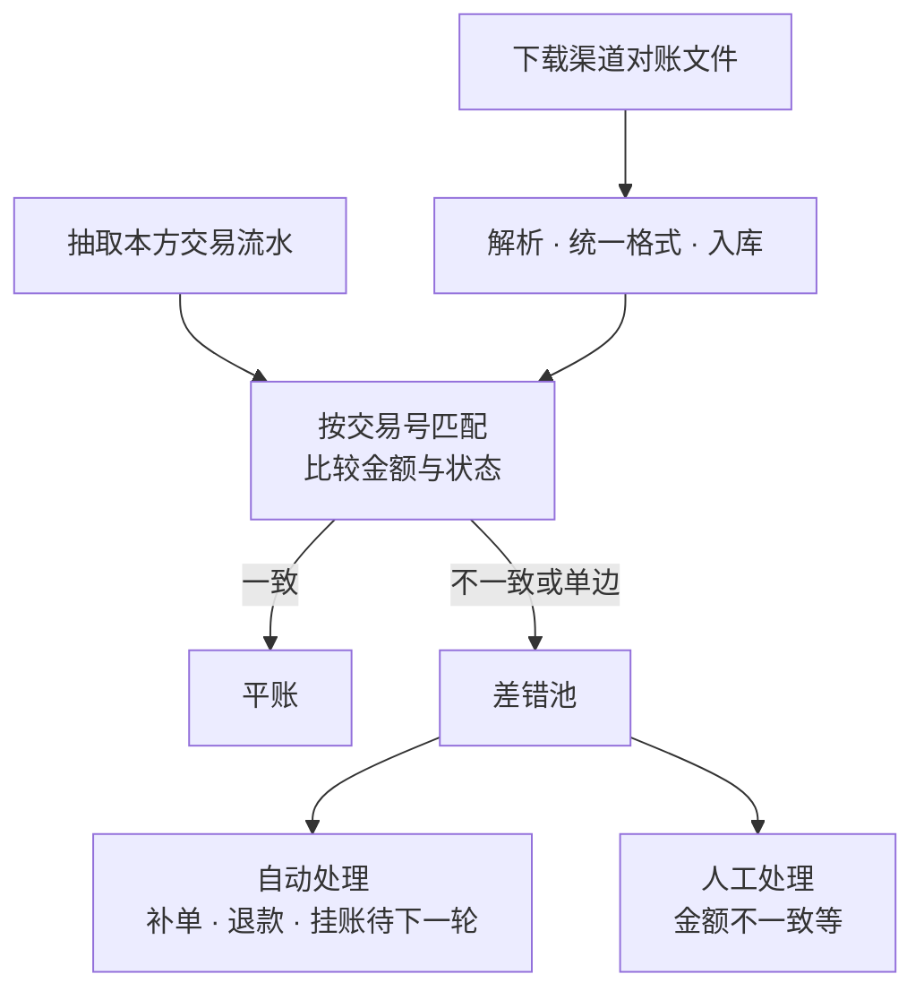

- **跨日问题**：23:59:59 发生的交易，本方记在当天，渠道可能记在第二天。单边账不要立即判定为差错，先**挂账**，下一轮对账时再匹配一次。
- **数据量大时**：每天千万级的交易，不能在 MySQL 中做两张大表的全外连接。常见的做法是按交易号哈希把两边的数据分到 N 个桶，每个桶分别加载到内存中比对，桶之间可以并行；数据量更大时用 Spark 等离线计算平台。

**追问链**

1. **T+1 对账发现问题太晚了怎么办？** 增加**实时对账**：用流处理（例如 Flink）在交易发生后几分钟内核对本方与渠道的交易（依赖渠道的回调和查询数据），尽早发现问题；T+1 的文件对账仍然保留，作为最终的依据。
2. **除了和渠道对账，还要对哪些账？** 内部系统之间也要对账：订单与支付、支付与账务、库存与订单、优惠券发放量与预算。凡是跨系统的最终一致，都应该有对账兜底。

**架构师加分点**

- 对账能力应该在**设计阶段就考虑**：每个系统都要保存可以用来核对的流水（交易号、金额、状态、时间），而不是出了问题才发现没有数据可以比对。

---
### 29-06 设计一个优惠券系统

> ★★★ ｜ 资深 / 架构师 ｜ 高频

完整版（10 道子题，含本机 Redis 并发实测的领券脚本、最优券组合和优惠分摊的可运行代码）见[《S05 优惠券系统》](../12-场景设计/S05-优惠券系统.md)。

**考察意图**：能否处理高并发领券、防止超发，以及用券过程中与订单的状态协同。

**30 秒版回答**

- **模型**：
  - **券模板**：类型（满减、折扣、无门槛）、面额、使用门槛、有效期规则、发行总量、每人限领张数、适用范围；
  - **用户券**：用户 ID、模板 ID、状态、有效期起止时间、使用它的订单号。按用户 ID 分片，"我的券"查询只查一个分片。
- **领券**（高并发）：Redis Lua 脚本**原子地**校验库存和每人限领，扣减成功后通过 MQ 异步写入数据库；数据库唯一索引保证 MQ 重复消费时不会多发。
- **用券**：用户券状态 **未使用 → 锁定 → 已使用**：
  - 下单时锁定（记录订单号）；
  - 支付成功后核销；
  - 订单取消时释放回未使用。
  - 每一步都用条件更新。
- **过期**：不需要定时任务去改状态，查询和使用时按有效期判断即可；过期很久的券定期归档。
- **批量发券**（例如给 1000 万用户各发一张）：拆成批次任务，经 MQ 分发并限速写入；以"批次 ID + 用户 ID"为唯一键保证幂等。

**深入剖析**

领券的 Lua 脚本（已在本机 Redis 上并发测试：库存不会超发，每人限领生效）：

```lua
-- KEYS[1]：券模板剩余库存  KEYS[2]：用户已领数量（Hash：用户 ID → 已领张数）
-- ARGV[1]：用户 ID  ARGV[2]：每人限领张数
local stock = tonumber(redis.call('GET', KEYS[1]) or '0')
if stock <= 0 then
    return -1  -- 已领完
end
local received = tonumber(redis.call('HGET', KEYS[2], ARGV[1]) or '0')
if received >= tonumber(ARGV[2]) then
    return -2  -- 超过每人限领
end
redis.call('DECR', KEYS[1])
-- 返回这是该用户领取的第几张，落库时作为唯一键的一部分
return redis.call('HINCRBY', KEYS[2], ARGV[1], 1)
```

- 脚本返回的"第几张"作为用户券表唯一索引 `(user_id, template_id, receive_seq)` 的一部分。MQ 重复投递同一条领券消息时，唯一索引冲突，不会多发一张券。
- Redis Cluster 中，脚本访问的多个 Key 必须在同一个槽位，用哈希标签保证，例如 `{coupon:9}:stock` 和 `{coupon:9}:received`。

用户券的状态流转：

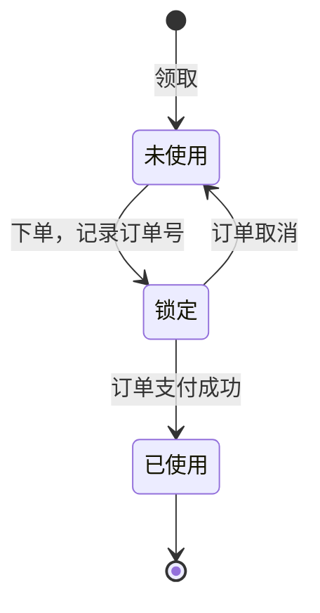

下单锁券的条件更新，同时校验归属、状态和有效期：

```sql
UPDATE t_user_coupon SET status = 'LOCKED', order_id = ?
WHERE id = ? AND user_id = ? AND status = 'UNUSED' AND valid_end_time > NOW();
```

释放时也要带上订单号条件（`WHERE id = ? AND status = 'LOCKED' AND order_id = ?`），防止一个过期的取消消息把已经被其他订单锁定的券释放掉。

**追问链**

1. **下单时怎么帮用户选出最优的券组合？** 先按适用范围、门槛过滤出可用的券，再根据叠加规则（哪些券互斥、哪些可以叠加）计算各种组合的优惠金额，选出最大的一种。券的数量通常不多，直接计算即可；规则复杂时，把计算逻辑独立成"试算服务"。
2. **怎么防止优惠券被刷？** 领券时做风控（设备、账号、IP 维度）；高价值券要求实名或新用户身份；监控核销率和异常账号。
3. **怎么控制成本？** 除了发行数量，还要监控**实际核销金额**和预算的消耗速度，超出预期时可以暂停发放。发放量、核销量和订单优惠金额之间需要对账。

---

### 29-07 设计抢红包

> ★★★ ｜ 资深 ｜ 中频

完整版（10 道子题，含两种拆分算法的对比模拟、本机 Redis 并发实测的抢红包脚本和退回的并发处理）见[《S06 抢红包》](../12-场景设计/S06-抢红包.md)。

**考察意图**：金额拆分算法、高并发下的原子性，以及资金的一致性。

**30 秒版回答**

- **流程**：
  1. **发红包**：扣减发送者余额，创建红包记录，**预先把总金额拆分成 N 份**，写入 Redis 列表；
  2. **抢红包**：Lua 脚本原子地完成"检查是否抢过 → 弹出一份金额 → 记录领取人"；
  3. 抢到后通过 MQ 异步写入领取记录、给领取人入账；
  4. **退回**：发红包时发一条 24 小时后的延迟消息，到期后把未领完的金额退回发送者。
- **金额拆分：二倍均值法**。每次在 [1 分, 剩余金额 ÷ 剩余个数 × 2] 之间随机，每一份的期望大致都等于总均值，先抢后抢在期望上基本公平；但越靠后的人金额波动越大（本机模拟 100 元拆 10 份：第 1 份的标准差约 5.8 元，最后两份约 7.7 元）。
- **资金一致性**：金额全部用"分"为单位的整数；红包总额 = 已领取金额之和 + 退回金额，定期对账。

**深入剖析**

拆分算法（已在本机 JDK 21 上运行 20 万轮验证：总额严格相等、每份不少于 1 分、各位置的平均值都接近总均值）：

```java
public final class RedPacketSplitter {

    /** 每个红包最少 1 分钱 */
    private static final long MIN_AMOUNT_CENT = 1L;

    private RedPacketSplitter() {
    }

    /**
     * 二倍均值法：把 totalCent 分钱拆成 count 份，每份至少 1 分，总和严格等于 totalCent。
     * 参数合法性在发红包的入口处已经校验，这里的检查只用于守住拆分算法自身的前提。
     */
    public static List<Long> split(long totalCent, int count, RandomGenerator random) {
        if (count <= 0 || totalCent < count * MIN_AMOUNT_CENT) {
            throw new IllegalArgumentException("invalid red packet, totalCent=" + totalCent + ", count=" + count);
        }
        List<Long> amounts = new ArrayList<>(count);
        long remainAmount = totalCent;
        for (int remainCount = count; remainCount > 1; remainCount--) {
            // 上限：剩余均值的 2 倍，同时必须给后面的人每人至少留 1 分
            long upper = Math.min(remainAmount * 2 / remainCount,
                    remainAmount - (remainCount - 1) * MIN_AMOUNT_CENT);
            long amount = random.nextLong(MIN_AMOUNT_CENT, upper + 1);
            amounts.add(amount);
            remainAmount -= amount;
        }
        // 最后一个人拿走剩余的全部金额
        amounts.add(remainAmount);
        return amounts;
    }
}
```

注意 `upper` 中的第二项：只用"剩余均值 × 2"做上限是不够的。例如剩 3 分钱、3 个人，剩余均值的 2 倍是 2 分，如果第一个人随机到 2 分，剩下 1 分钱要分给 2 个人，就不满足"每人至少 1 分"了。

抢红包的 Lua 脚本（已在本机 Redis 上用 55 个并发请求测试：3 个红包恰好被 3 个人抢到，同一用户重复抢被拒绝）：

```lua
-- KEYS[1]：预先拆好的金额列表  KEYS[2]：领取记录（Hash：用户 ID → 金额）
-- ARGV[1]：用户 ID
if redis.call('HEXISTS', KEYS[2], ARGV[1]) == 1 then
    return -1  -- 已经领过
end
local amount = redis.call('LPOP', KEYS[1])
if not amount then
    return -2  -- 已经领完
end
redis.call('HSET', KEYS[2], ARGV[1], amount)
return tonumber(amount)
```

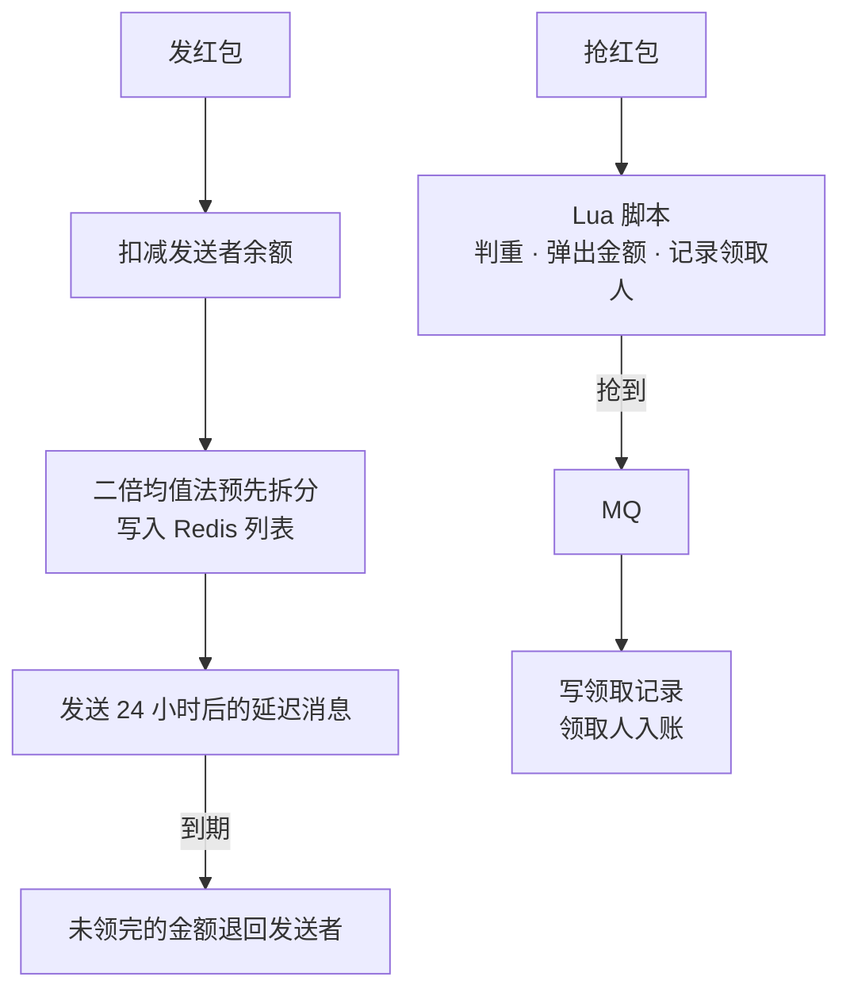

**追问链**

1. **预先拆分和抢的时候实时计算，哪个好？** 预先拆分让"抢"的操作非常简单（一次 `LPOP`），每份金额在发红包时就确定了，便于审计；实时计算不需要预先存储金额列表，但抢的时候要在 Lua 中根据剩余金额和个数计算。两者都可行，预先拆分更容易验证正确性。
2. **Redis 中抢到了，但入账失败怎么办？** 领取记录已经在 Redis 中，MQ 消费失败会重试；入账以"红包 ID + 用户 ID"为唯一键保证幂等。最终用"红包总额 = 已领取 + 退回"的对账兜底。
3. **Redis 宕机丢了数据怎么办？** 红包的状态以数据库为准：数据库中有红包的总额和已入账的领取记录，可以重建 Redis 中剩余的金额列表。资金类数据不能只存在 Redis 中。

---

### 29-08 订单表分库分表后，买家、卖家、运营的查询怎么支撑？

> ★★★ ｜ 资深 / 架构师 ｜ 高频

完整版（10 道子题，含订单模型与拆单、下单链路的防重和撤销、订单号基因法的可运行代码、冷热分离）见[《S07 订单中心》](../12-场景设计/S07-订单中心.md)。

**考察意图**：能否把分片键选择、多维度查询、数据倾斜、冷热分离放在一起，设计出完整的方案。

**30 秒版回答**

- **估算**：日订单 1000 万，保存 3 年约 110 亿条。单表按经验控制在千万级，全部放在在线库需要上千张表；而 3 个月之前的订单很少被修改，查询频率也低得多，所以先做**冷热分离**。
- **分片键**：订单量最大、最频繁的查询来自买家（"我的订单"），所以**按买家 ID 分片**；订单号使用**基因法**嵌入买家 ID 的分片位，按订单号也能直接定位分片，见[《16 分库分表》](../04-数据存储/16-分库分表.md)16-04。
- **卖家查询**：通过 binlog 同步一份**按卖家 ID 分片**的订单副本，见 16-05。
- **运营后台**：多条件组合查询全部走 Elasticsearch；报表走数据仓库。
- **大卖家的数据倾斜**：少数大卖家的订单量可能占总量的很大比例，按卖家 ID 分片时集中在少数分片上。对这些大卖家单独处理：卖家 ID + 时间的组合分片，或者为大卖家分配独立的分片。

**深入剖析**

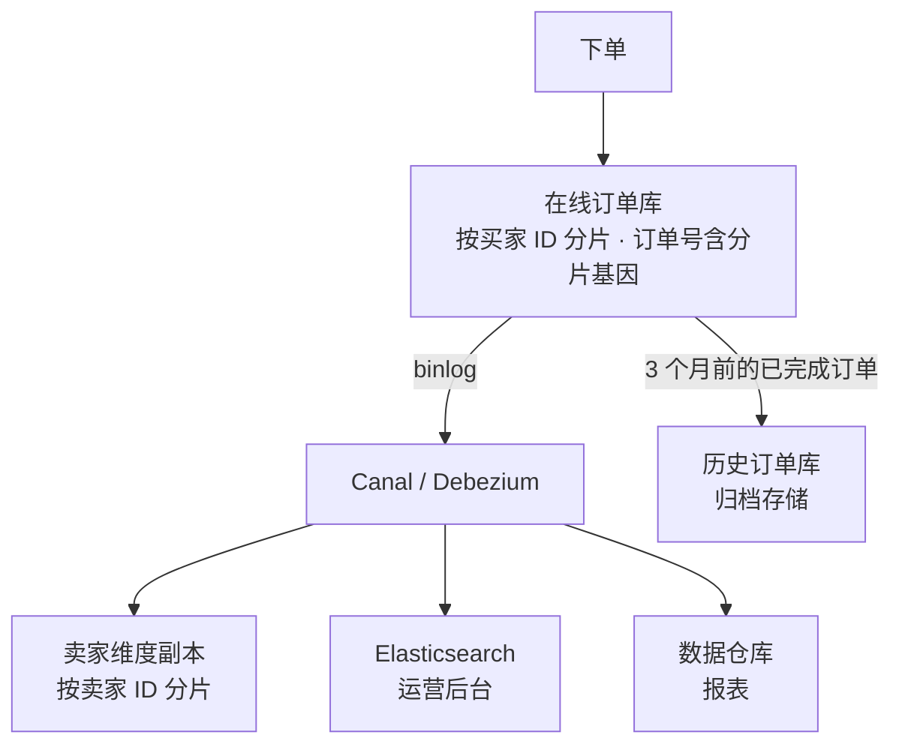

| 查询方 | 典型查询 | 走哪里 |
| --- | --- | --- |
| 买家 | 我的订单列表、订单详情 | 在线库，按买家 ID 或订单号路由到单个分片 |
| 卖家 | 我的店铺订单、按状态筛选 | 卖家维度副本 |
| 客服 | 按订单号、手机号查 | 订单号直接路由；手机号走 ES |
| 运营 | 多条件组合、导出 | ES；大批量导出走数据仓库 |
| 买家查历史订单 | 3 个月前的订单 | 历史库，产品上单独入口 |

分片数量的估算：如果在线库只保留最近 6 个月的订单，约 1000 万 × 180 ≈ 18 亿条，按每张表 2000 万条以内计算需要约 90 张表，取 2 的幂次 128 张（例如 8 个库 × 16 张表），为后续增长留出空间。

**追问链**

1. **卖家刚产生的订单，在卖家副本中查不到怎么办？** binlog 同步通常是秒级延迟。卖家列表页能接受秒级延迟；如果卖家点进具体订单，用订单号直接查主库（基因法可以定位分片），不受同步延迟影响。
2. **买家的订单列表怎么分页？** 买家的数据在一个分片中，不存在跨分片分页的问题。用"上一页最后一条的创建时间 + 订单号"作为游标翻页，避免深分页，见 16-06。
3. **历史订单怎么归档？** 定时任务把已完成超过 3 个月的订单搬到历史库（数据量大时可以用成本更低的存储），确认写入成功后再从在线库删除；搬迁过程要限速，避免影响在线库。

---

## 三、内容与社交类

### 29-09 设计一个短链系统

> ★★ ｜ 资深 ｜ 高频

完整版（10 道子题，含发号器、可逆混淆的可运行代码、读路径的多级缓存与布隆过滤器、点击统计）见[《S11 短链系统》](../12-场景设计/S11-短链系统.md)。

**考察意图**：短码生成方案、跳转方式的选择，以及读多写少场景下的缓存设计。

**30 秒版回答**

- **需求**：把长链接转换成短链接；访问短链接时跳转到原链接；统计点击；支持过期。
- **估算**：每天新生成 1000 万条，平均写入约 116 QPS，按峰值是均值的 10 倍估算约 1200 QPS；访问量通常远大于生成量。每条记录按 500 字节估算，每天约 5 GB，一年约 1.8 TB。
- **短码生成**：推荐**发号器 + Base62 编码**。7 位 Base62 能表示 62⁷ ≈ 3.5 万亿个短码，即使每天生成 1 亿个，也够用约 96 年。
- **跳转**：用 **302**（临时重定向）。301 是永久重定向，浏览器会缓存跳转结果，后续访问不再经过短链服务，就无法统计点击，也无法让短链过期或修改目标。
- **读取**：短码 → 长链接的映射放在 Redis 中，热点短链再加一层本地缓存；不存在的短码用布隆过滤器或缓存空值拦截，防止缓存穿透。
- **统计**：访问日志发到 MQ，由流处理异步汇总，不在跳转的路径上同步写数据库。

**深入剖析**

| 生成方案 | 做法 | 优点 | 缺点 |
| --- | --- | --- | --- |
| **发号器 + Base62** | 号段模式的发号器生成全局唯一的自增 ID，转换成 62 进制 | 不会冲突，不需要查重 | 连续的 ID 生成连续的短码，容易被遍历 |
| 哈希 | 对长链接计算哈希（如 MurmurHash），取前若干位 | 同一个长链接得到同一个短码 | 会冲突，冲突时加盐重新计算，每次都要查库确认 |
| 随机 | 随机生成短码 | 简单 | 需要查重，数据量大时冲突越来越多 |

连续短码容易被遍历的问题，可以先对 ID 做一次**可逆的混淆**（例如乘以一个与取值范围互质的大数后取模，或者打乱 Base62 的字母表顺序），让相邻 ID 生成的短码看起来没有规律。

Base62 编码：

```java
public final class Base62 {

    private static final char[] ALPHABET =
            "0123456789abcdefghijklmnopqrstuvwxyzABCDEFGHIJKLMNOPQRSTUVWXYZ".toCharArray();
    private static final int BASE = ALPHABET.length;

    private Base62() {
    }

    /** 把发号器生成的 ID 编码成短码，ID 必须为非负数 */
    public static String encode(long id) {
        if (id == 0) {
            return String.valueOf(ALPHABET[0]);
        }
        StringBuilder sb = new StringBuilder();
        while (id > 0) {
            sb.append(ALPHABET[(int) (id % BASE)]);
            id /= BASE;
        }
        return sb.reverse().toString();
    }
}
```

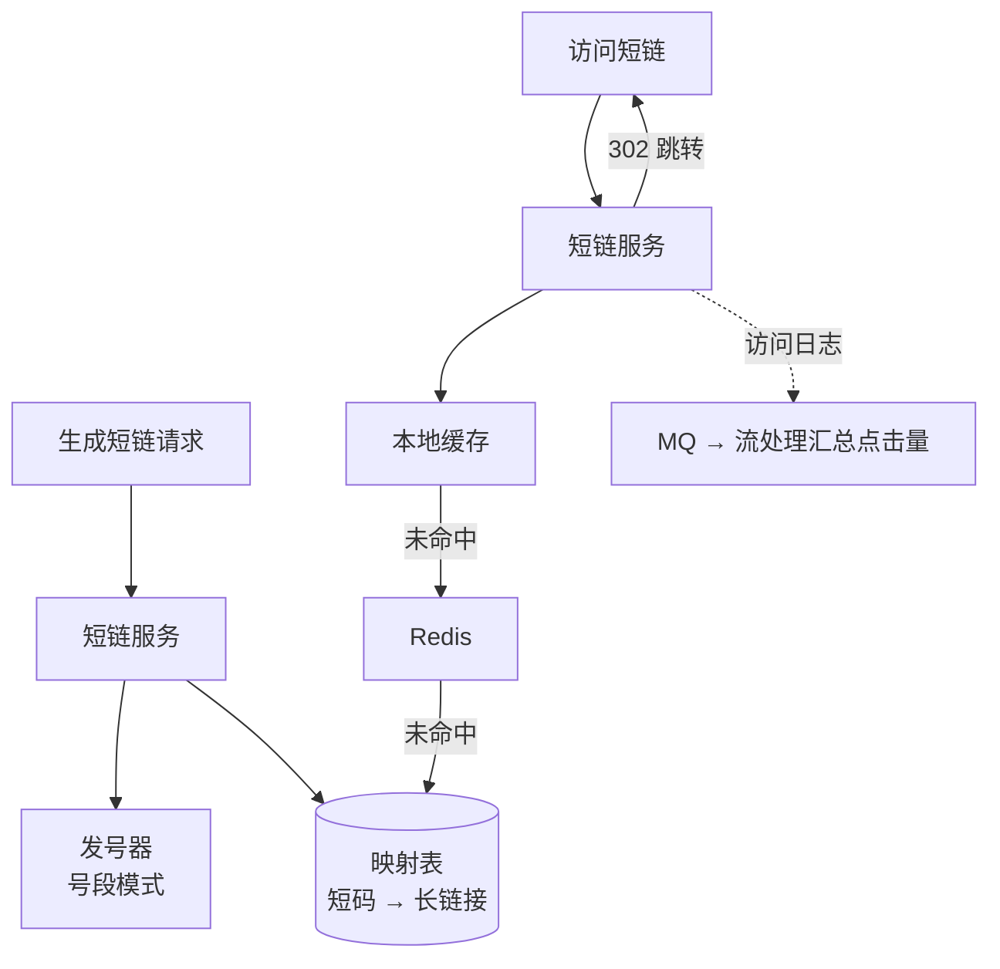

**追问链**

1. **同一个长链接要不要生成同一个短码？** 看需求。需要去重时，存一个"长链接哈希 → 短码"的索引；但很多场景下，不同的人对同一个链接需要各自独立的统计，此时不去重更合理。
2. **自定义短码怎么支持？** 自定义短码和自动生成的短码共用一个命名空间。可以给自定义短码规定不同的格式（例如长度不同），避免和自动生成的冲突；写入时用唯一索引检查是否已被占用。
3. **怎么防止被用来传播恶意链接？** 生成时检查目标链接的域名黑名单和安全评级；跳转前可以对可疑链接显示中间提示页。

---

### 29-10 设计 Feed 流（关注动态）

> ★★★ ｜ 架构师 ｜ 高频

完整版（10 道子题，含推拉结合的写入量对比、多路归并和游标翻页的可运行代码）见[《S12 Feed 流》](../12-场景设计/S12-Feed流.md)。

**考察意图**：推模式、拉模式、推拉结合的取舍，以及大 V 场景的处理。

**30 秒版回答**

- **需求**：用户看到自己关注的人发布的动态，按时间倒序排列，支持下拉刷新和向下翻页。
- **三种模式**：

| 模式 | 做法 | 优点 | 缺点 |
| --- | --- | --- | --- |
| **推（写扩散）** | 发布时把动态 ID 写入**每个粉丝的收件箱** | 读取快，只读自己的收件箱 | 大 V 有上千万粉丝，发一条要写上千万次 |
| **拉（读扩散）** | 读取时去**每个关注的人的发件箱**拉取，再合并排序 | 写入快 | 关注了几百个人，每次读要查几百个发件箱再合并 |
| **推拉结合** | 普通作者用推；大 V 用拉；只推给活跃粉丝 | 平衡读写 | 实现复杂 |

- 实际的大型系统基本都采用**推拉结合**：
  - 粉丝数低于阈值的作者，发布时推送到**活跃粉丝**的收件箱；
  - 粉丝数超过阈值的大 V，不推送；
  - 用户读取时，合并"自己的收件箱"和"关注的大 V 的发件箱"。

**深入剖析**

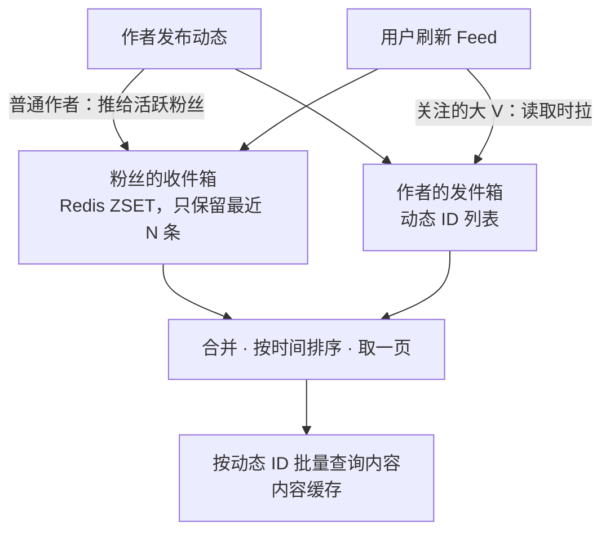

存储设计：

- **动态内容只存一份**，收件箱和发件箱中只存动态 ID 和时间（或者用本身就按时间递增的雪花 ID），用 Redis ZSET 按时间排序；
- 收件箱只保留最近的若干条（例如几百到一千条），更早的内容在翻页时从关注者的发件箱中拉取；
- 内容按 ID 批量查询，走缓存。

**追问链**

1. **翻页为什么不能用 offset？** Feed 流的头部在不断插入新内容，用 offset 翻页时，新插入的内容会把旧内容往后挤，用户会在下一页看到重复的动态。用**游标**：以上一页最后一条的 ID（或时间）为起点继续往后取。
2. **删除动态、取消关注怎么处理？** 不必同步地从所有粉丝的收件箱中删除，**读取时过滤**即可：取出 ID 后查询内容，已删除的跳过；取消关注后，异步清理收件箱，清理完成前在读取时按关注关系过滤。
3. **不活跃的用户怎么办？** 推送时跳过长期不活跃的粉丝，节省大量写入。这些用户重新登录时，用拉模式现场生成一次 Feed，再写入收件箱。
4. **要不要按时间排序？** 很多产品已经改成按推荐算法排序。这时 Feed 流变成"召回（从关注的人和推荐池中取候选）→ 排序 → 过滤"的推荐系统架构，但收件箱和发件箱仍然是召回的重要来源。

**架构师加分点**

- 推和拉本质上是在**写入成本和读取成本之间做交换**。选哪一种取决于读写比例和粉丝分布：大多数用户读多写少，适合推；少数大 V 的写放大太大，适合拉。推拉结合就是对这两类用户分别选择更便宜的那一种。

---
### 29-11 设计一个 IM 系统

> ★★★ ｜ 架构师 ｜ 高频

完整版（11 道子题，含长连接网关、在丢包乱序下保证不丢不重有序的可运行代码、时间线同步、重连风暴）见[《S13 IM 系统》](../12-场景设计/S13-IM系统.md)。

**考察意图**：长连接架构、消息的可靠性（不丢、不重、有序），以及群聊的存储模型。

**30 秒版回答**

- **需求**：单聊、群聊（例如群上限 500 人）、在线消息实时送达、离线消息、多端同步。
- **架构分层**：
  - **接入层**：长连接网关，维持客户端的 TCP / WebSocket 连接和心跳，只负责收发，不处理业务。用户上线时，把"用户 → 所在网关节点"登记到路由表（Redis）；
  - **逻辑层**：消息服务，负责鉴权、分配序号、存储、投递；
  - **存储层**：消息、会话和每个用户的同步进度。
- **可靠性的三个要求**：
  - **不丢**：发送方等服务端确认，超时重发；服务端推送后等接收方确认，未确认则重推；最终兜底是**拉取**，客户端记录每个会话已收到的最大序号，重连或发现序号不连续时，按序号把缺失的消息拉回来；
  - **不重**：发送方为每条消息生成客户端消息 ID，服务端按它去重；接收方按序号去重；
  - **有序**：服务端为**每个会话**分配单调递增的序号，客户端按序号排序显示。不需要全局有序，会话内有序就够了。
- **离线**：用户不在线时，通过手机厂商的推送通道发送通知，见 29-14；用户上线后拉取离线消息。

**深入剖析**

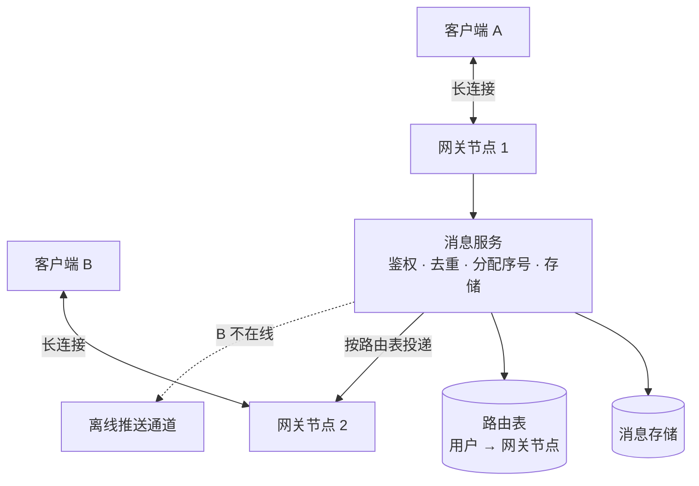

一条单聊消息的投递过程：

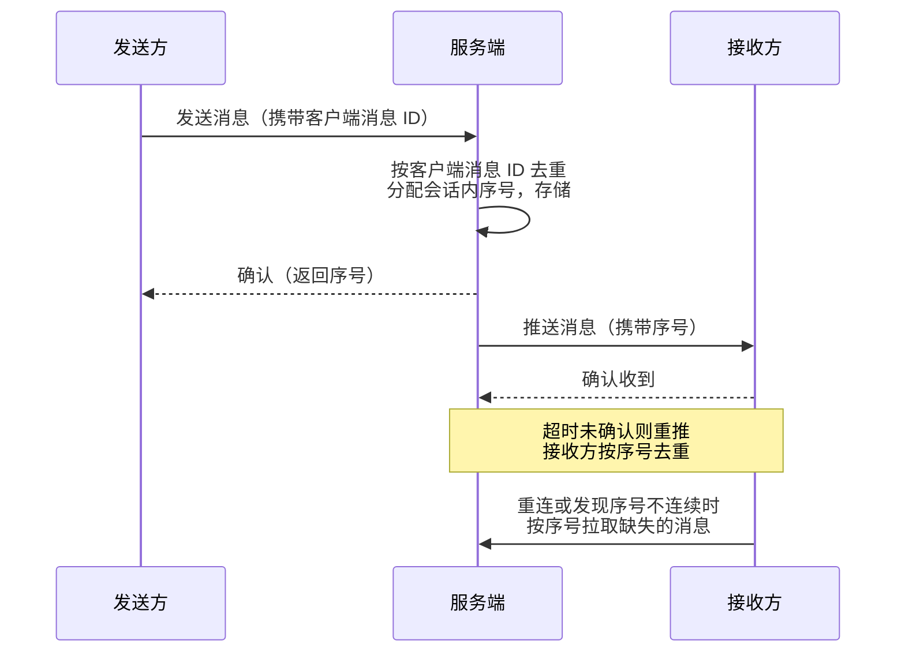

**群聊的存储：读扩散还是写扩散？**

| 方式 | 做法 | 优点 | 缺点 |
| --- | --- | --- | --- |
| 读扩散 | 群消息只存一份；每个成员记录自己在这个群中读到的序号 | 存储小，写入一次 | 用户要分别同步每个群的进度，群多时同步成本高 |
| 写扩散 | 每条群消息给每个成员的收件箱各写一份（通常只写消息 ID），每个用户有一个统一递增的序号 | 多端同步简单：每个设备只需要记录一个序号 | 写放大，群越大写入越多 |

常见的取舍：单聊和小群用写扩散，多端同步更简单；大群用读扩散，避免写放大。

**追问链**

1. **网关节点宕机了怎么办？** 连接断开后客户端自动重连到其他节点，重新登记路由；重连后按序号拉取断线期间的消息，所以不会丢。网关只保存连接，不保存业务状态，宕机的影响只是重连。
2. **怎么判断用户在线？** 依靠心跳：客户端定期发送心跳，网关在一段时间内没有收到心跳就判定连接已断开，清理路由表。心跳间隔要兼顾及时性和手机耗电；移动网络中，运营商会回收长时间空闲的连接，心跳也用于保活。
3. **单个网关能承载多少连接？** 取决于内存和操作系统参数（文件句柄数、端口、TCP 缓冲区），经过调优的单机通常可以维持数十万量级的长连接。网关基于 Netty 等事件驱动框架实现，见[《08 Netty》](../02-框架与容器/08-Netty.md)。
4. **消息序号怎么生成？** 每个会话一个计数器（例如 Redis `INCR`，或者数据库中按会话递增）。不需要全局唯一的雪花 ID 来保证顺序，会话内单调递增即可；消息的全局唯一 ID 可以另外生成。

---

### 29-12 设计一个实时排行榜

> ★★ ｜ 资深 ｜ 高频

完整版（10 道子题，含本机 Redis 实测的复合分数脚本、分片合并与名次估算的可运行代码）见[《S14 实时排行榜》](../12-场景设计/S14-实时排行榜.md)。

**考察意图**：Redis ZSET 的使用，同分排序的处理，以及大规模下的方案。

**30 秒版回答**

- **数据结构**：Redis 有序集合（ZSET），以用户 ID 为成员、积分为分数，插入、更新和查询排名都是 O(log N)。
  - 更新积分：`ZADD` 或 `ZINCRBY`；
  - 查询前 100 名：`ZRANGE key 0 99 REV WITHSCORES`（Redis 6.2 起，`ZREVRANGE` 已被标记为弃用，推荐用 `ZRANGE ... REV` 代替）；
  - 查询自己的排名：`ZREVRANK key 用户ID`，结果加 1 就是名次。
- **同分时先达到者排在前面**：ZSET 中分数相同的成员按**成员名的字典序**排序，不是按时间。需要按时间区分时，把时间编码进分数，见下文。
- **周期榜单**：日榜、周榜各用一个 Key（Key 中带上日期），设置过期时间；周榜也可以用 `ZUNIONSTORE` 合并 7 个日榜生成。
- **积分的权威数据在数据库中**，Redis 中的榜单可以随时根据数据库重建。

**深入剖析**

把积分和时间编码成一个分数：

```text
分数 = 积分 × 10^10 + (9999999999 − 达到该积分时的秒级时间戳)
```

- 积分高的排在前面；积分相同时，时间戳越小（越早达到），后半部分越大，排名越靠前；
- ZSET 的分数是**双精度浮点数**，只能精确表示 2⁵³（约 9 × 10¹⁵）以内的整数，所以积分的上限约为 90 万。积分范围更大时，减少时间部分的位数（例如改用相对于活动开始时间的秒数）；
- 积分变化时，时间部分也要更新成新的时间，不能直接对复合分数做 `ZINCRBY`，而要用 Lua 脚本读出原积分、计算新的复合分数后再 `ZADD`。

本机 Redis 验证：

```text
> ZADD lb 100 user:c 100 user:a 100 user:b 90 user:d
> ZRANGE lb 0 -1 REV WITHSCORES
user:c 100 / user:b 100 / user:a 100 / user:d 90      ← 同分时按成员名倒序，与时间无关

> ZADD lb2 1008237299999 early 1008237299899 late     ← 积分都是 100，early 早 100 秒达到
> ZRANGE lb2 0 -1 REV WITHSCORES
early 1008237299999 / late 1008237299899               ← 先达到的排在前面
```

**追问链**

1. **用户量达到几千万怎么办？** 一个 ZSET 中放几千万成员，会成为大 Key（本机实测 100 万个成员约占 97 MB，几千万成员就是几 GB），迁移、删除和持久化都有风险。两种思路：
   - **分片**：按用户 ID 哈希到 K 个 ZSET。前 100 名：每个分片取前 100 名后合并；某个用户的排名：在每个分片中用 `ZCOUNT` 统计分数比他高的人数，然后相加；
   - **只对头部精确**：前 1 万名精确排名，其余用户只显示"超过了 xx% 的玩家"。按分数区间统计人数即可估算，产品上通常可以接受。
2. **排行榜的结算怎么保证准确？** 活动结束时，以数据库中的积分为准生成最终名次，而不是直接使用 Redis 中的实时榜单；实时榜单只用于展示。

---

### 29-13 设计"附近的人"

> ★★ ｜ 资深 ｜ 中频

完整版（10 道子题，含 GeoHash 的 JDK 实现及与 Redis 结果的对照、边界问题、其他空间索引、位置隐私）见[《S15 附近的人》](../12-场景设计/S15-附近的人.md)。

**考察意图**：是否理解 GeoHash 的原理和边界问题，以及 Redis GEO 的使用。

**30 秒版回答**

- **GeoHash 原理**：
  1. 把经度区间 [-180, 180] 和纬度区间 [-90, 90] 反复二分，每次记录落在左半边（0）还是右半边（1）；
  2. 把经度位和纬度位交错拼接，再每 5 位编码成一个 Base32 字符；
  3. 字符串越长，表示的格子越小。**前缀相同的点，落在同一个格子里**，于是二维的范围查询变成了一维的前缀查询。
- **边界问题**：两个点可能离得很近，却恰好在格子边界的两边，前缀不同。所以搜索时要查**中心格子 + 周围 8 个格子**，再精确计算距离过滤。
- **Redis GEO**：
  - 底层就是 ZSET，分数是 52 位的 GeoHash 整数；
  - 写入用 `GEOADD`；
  - 查询用 `GEOSEARCH`（Redis 6.2 引入，取代已弃用的 `GEORADIUS`）。
  - Redis 内部也是先根据半径选择 GeoHash 精度，再搜索中心格子和周围 8 个格子，最后逐个计算距离过滤（已对照 Redis 源码 `geohash_helper.c` 和 `geo.c` 核对）。
- 其他方案：MySQL 的空间索引、Elasticsearch 的 `geo_point` 类型加 `geo_distance` 查询（适合同时还要按其他条件筛选的场景）。

**深入剖析**

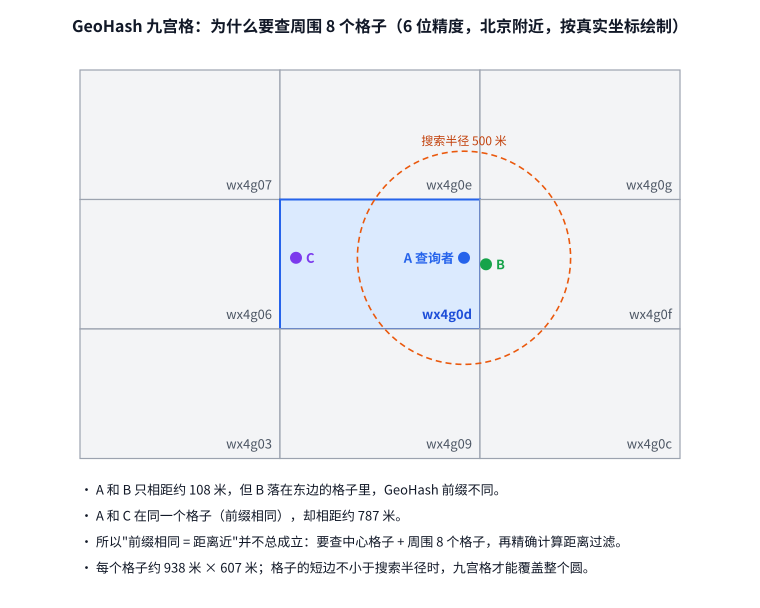

| GeoHash 长度 | 格子大小（赤道附近，宽 × 高） |
| --- | --- |
| 5 | 约 4.9 km × 4.9 km |
| 6 | 约 1.2 km × 0.6 km |
| 7 | 约 153 m × 152 m |
| 8 | 约 38 m × 19 m |

格子的宽度会随纬度升高而变窄，例如北京附近 6 位格子的宽度约为 938 米。上表按 GeoHash 的位数和地球周长计算得出。

Redis 中的用法（本机实际运行）：

```text
> GEOADD geo 116.397128 39.916527 gugong 116.403963 39.915119 tiananmen 116.326836 39.993013 pku
> GEOSEARCH geo FROMLONLAT 116.40 39.915 BYRADIUS 2 km ASC WITHDIST COUNT 10
gugong     0.2980
tiananmen  0.3384                                     ← 距离单位为 km，pku 超出 2 km，被过滤
> GEOHASH geo gugong
wx4g0dtf9e0
```

**追问链**

1. **用户位置频繁变化，怎么处理？** 客户端不需要每秒上报：位置变化超过一定距离，或者间隔超过一定时间时才上报。
2. **怎么清除长时间没有更新位置的用户？** GEO 底层是 ZSET，成员不能单独设置过期时间。另外维护一个"用户 → 最后上报时间"的 ZSET，定期用 `ZRANGEBYSCORE` 找出过期的用户，从两个集合中删除。
3. **全国的用户放在一个 Key 中太大怎么办？** 按城市或者 GeoHash 的前几位分成多个 Key。查询时，根据位置和半径计算出涉及哪几个 Key。
4. **隐私怎么保护？** 不返回对方的精确坐标，只返回模糊的距离（例如"1 km 以内"）；允许用户关闭位置可见；位置数据设置保留期限。

---

### 29-14 设计一个消息推送平台

> ★★★ ｜ 架构师 ｜ 中频

完整版（10 道子题，含优先级隔离与频控的可运行模拟、通道选择、全量推送、令牌管理）见[《S16 消息推送平台》](../12-场景设计/S16-消息推送平台.md)。

**考察意图**：多通道下发、大批量推送的调度、优先级隔离和频率控制。

**30 秒版回答**

- **需求**：各个业务（交易通知、验证码、营销活动、IM 离线消息）通过统一的平台向 App 用户推送通知。支持单推、批量推送、按标签推送和全量推送，并统计送达和点击。
- **通道**：
  - **自建长连接**：App 在前台或在线时使用，实时性最好；
  - **系统推送通道**：App 不在线时使用。iOS 只能通过 APNs；国内 Android 设备主要依赖各手机厂商的系统级推送通道，因为 App 在后台时自建的连接很容易被系统回收；海外 Android 使用 FCM。
- **关键设计**：
  1. **优先级隔离**：验证码、交易通知和营销推送使用**不同的队列和处理资源**，营销推送再多也不能让验证码延迟；
  2. **大批量拆分**：全量推送先把目标用户拆分成批次，经 MQ 分发给多个下发节点并行处理，按各个通道的配额限速；
  3. **频率控制**：每个用户每天收到的营销推送有上限（Redis 计数），夜间免打扰，相同内容去重；
  4. **设备令牌管理**：一个用户可能有多台设备；通道返回令牌无效时及时清理；
  5. **效果统计**：发送 → 通道接收 → 送达 → 点击，形成漏斗。

**深入剖析**

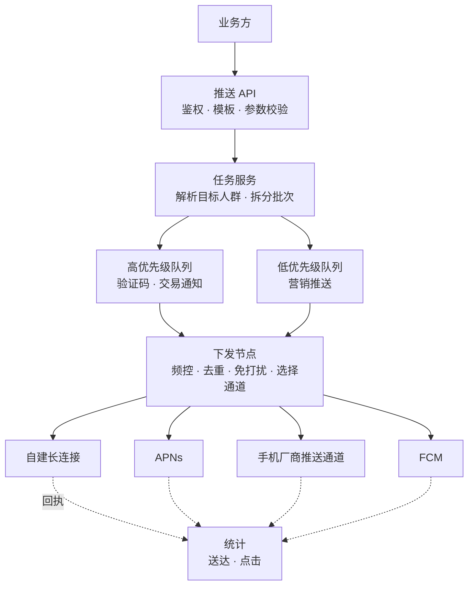

**追问链**

1. **给几千万用户做一次全量推送，怎么在规定时间内完成？** 按用户 ID 分片，多个节点并行下发；下发速度受**通道配额**限制（各手机厂商的推送通道对推送数量和频率有各自的规定，并区分消息类别），需要提前计算所需时间；活跃用户优先推送。
2. **推送失败怎么办？** 区分失败原因：令牌无效时清理令牌，不重试；通道限流或暂时故障时，延迟重试；营销推送超过有效期就放弃，没有必要在活动结束后再送达。
3. **怎么避免重复推送？** 每次推送任务有唯一 ID，以"任务 ID + 用户 ID"去重；下发节点重启后从记录的进度继续，而不是从头开始。

---

## 四、平台类

### 29-15 设计一个开放平台 API 网关

> ★★★ ｜ 架构师 ｜ 中频

**考察意图**：对外开放 API 时的安全设计（认证、防篡改、防重放、授权），以及配额、回调等平台能力。

**30 秒版回答**

- **身份认证**：每个接入应用分配 AppKey 和 AppSecret。AppKey 公开传输，AppSecret 只用于计算签名，**从不在网络上传输**。
- **防篡改**：客户端用 AppSecret 对请求的关键内容（方法、路径、参数、请求体摘要、时间戳、随机数）计算 HMAC-SHA256 签名，服务端用同样的方式计算后比较。
- **防重放**：
  - 请求带时间戳，超出允许范围（例如 ±5 分钟）直接拒绝；
  - 请求带随机数（nonce），在时间窗口内用 Redis `SET NX` 记录，重复出现即拒绝。
- **用户授权**：应用要访问用户的数据时，使用 **OAuth 2.0 授权码模式**，由用户在授权页面同意后，应用获得访问令牌；没有服务端的公开客户端（如纯前端、移动 App）还要配合 PKCE。
- **平台能力**：
  - 按应用和接口的**限流与配额**，见[《26 高可用》](26-高可用.md)26-03、26-04；
  - 接口权限（应用开通了哪些接口）；
  - API 版本管理；
  - 沙箱环境；
  - 调用日志与审计；
  - **事件回调**：通知开发者时同样附带签名，失败按退避重试，同时提供主动查询接口兜底。

**深入剖析**

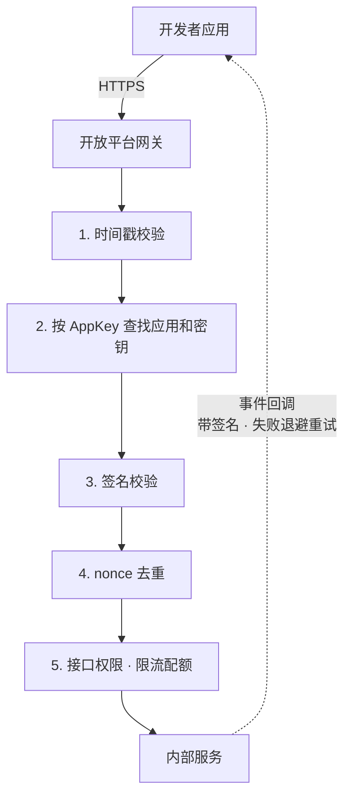

签名校验的实现（已在本机 JDK 21 上测试：正常请求、重放、篡改、过期、未知应用五种情况均符合预期）：

```java
/** 签名请求：网关在入口处把 HTTP 请求解析成这个对象 */
public record SignedRequest(String appKey, String method, String path,
                            SortedMap<String, String> queryParams, String bodySha256Hex,
                            long timestamp, String nonce, String signature) {

    /** 规范化字符串：客户端和服务端必须按完全相同的规则拼接（参数按名称排序，值按约定的规则编码） */
    public String canonicalString() {
        String query = queryParams.entrySet().stream()
                .map(e -> e.getKey() + "=" + e.getValue())
                .collect(Collectors.joining("&"));
        return String.join("\n", method, path, query, bodySha256Hex, String.valueOf(timestamp), nonce);
    }
}

@Component
@RequiredArgsConstructor
public class OpenApiSignatureVerifier {

    private static final Duration MAX_CLOCK_SKEW = Duration.ofMinutes(5);
    private static final String HMAC_ALGORITHM = "HmacSHA256";
    private static final String NONCE_KEY_PREFIX = "openapi:nonce:";

    private final AppSecretRepository appSecretRepository;
    /** nonce 存储，生产中用 Redis 的 SET key value NX EX 实现 */
    private final NonceStore nonceStore;
    private final Clock clock;

    /** 网关入口处调用一次，校验失败直接抛出业务异常，由统一异常处理转换成错误响应 */
    public void verify(SignedRequest request) {
        long skewMillis = Math.abs(clock.millis() - request.timestamp());
        if (skewMillis > MAX_CLOCK_SKEW.toMillis()) {
            throw new BizException(ErrorCode.REQUEST_EXPIRED, request.appKey());
        }
        String secret = appSecretRepository.findSecret(request.appKey())
                .orElseThrow(() -> new BizException(ErrorCode.APP_NOT_FOUND, request.appKey()));
        String expected = hmacSha256Hex(secret, request.canonicalString());
        // 用比较时间与内容无关的方法，防止通过响应时间逐字节猜出签名
        if (!MessageDigest.isEqual(expected.getBytes(StandardCharsets.UTF_8),
                request.signature().getBytes(StandardCharsets.UTF_8))) {
            throw new BizException(ErrorCode.SIGNATURE_INVALID, request.appKey());
        }
        // nonce 去重放在签名校验之后：伪造的请求过不了签名，也就无法占用 nonce 存储
        String nonceKey = NONCE_KEY_PREFIX + request.appKey() + ":" + request.nonce();
        if (!nonceStore.putIfAbsent(nonceKey, MAX_CLOCK_SKEW.multipliedBy(2))) {
            throw new BizException(ErrorCode.REQUEST_REPLAYED, request.appKey());
        }
    }

    private static String hmacSha256Hex(String secret, String data) {
        try {
            Mac mac = Mac.getInstance(HMAC_ALGORITHM);
            mac.init(new SecretKeySpec(secret.getBytes(StandardCharsets.UTF_8), HMAC_ALGORITHM));
            return HexFormat.of().formatHex(mac.doFinal(data.getBytes(StandardCharsets.UTF_8)));
        } catch (GeneralSecurityException e) {
            throw new IllegalStateException("hmac init failed", e);
        }
    }
}
```

- nonce 的保留时间是时间窗口的 2 倍（10 分钟）：时间戳允许前后各偏差 5 分钟，一个请求在 10 分钟的范围内都可能通过时间戳校验，nonce 至少要保留这么久，否则过期后同一个请求可以被重放。
- `HexFormat` 是 JDK 17 引入的，JDK 8 项目可以用 Commons Codec 的 `Hex` 代替。

**追问链**

1. **已经用了 HTTPS，为什么还要签名？** HTTPS 保护的是传输过程，签名解决的是另外的问题：证明请求来自持有密钥的应用，而密钥本身不在网络上传输；签名绑定了请求内容和时间，即使请求被日志、代理等环节记录下来，也无法被篡改或在时间窗口之外重放。
2. **AppSecret 泄露了怎么办？** 支持密钥轮换：允许一个应用同时存在新旧两个密钥，开发者切换到新密钥后再废弃旧密钥。服务端存储密钥时要加密。
3. **回调给开发者失败怎么办？** 按退避间隔重试（例如 1 分钟、5 分钟、30 分钟……），重试一定次数后停止，并在控制台中展示失败记录；开发者的回调接口要幂等，因为同一个事件可能被投递多次；同时提供主动查询接口，开发者可以自己补齐漏掉的事件。

**架构师加分点**

- 开放平台的接口一旦发布，就很难修改，因为调用方不受你控制。所以 API 设计要格外重视**向后兼容**：只增加字段，不修改和删除字段的含义；必须做不兼容的修改时发布新版本，旧版本保留一段时间并提前通知下线。
