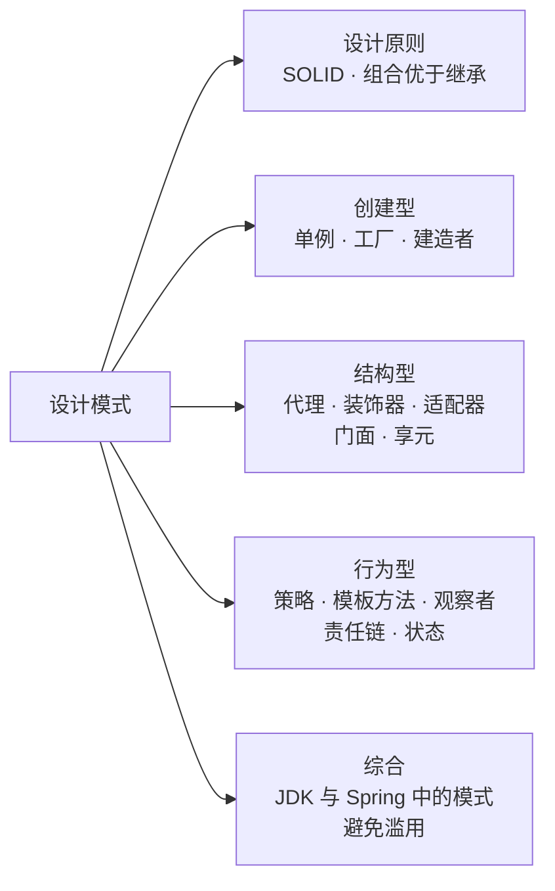
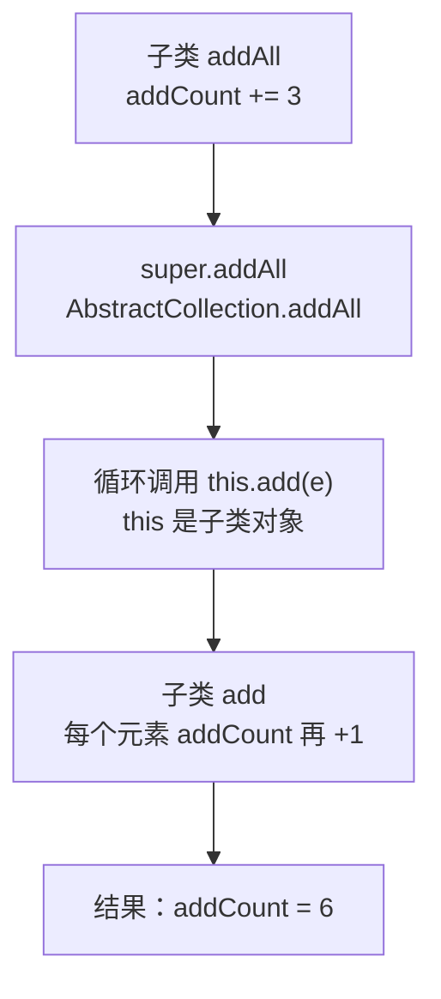
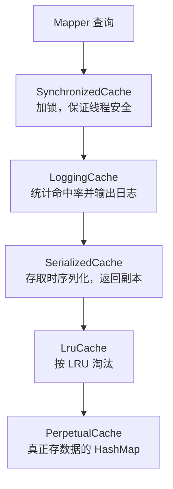
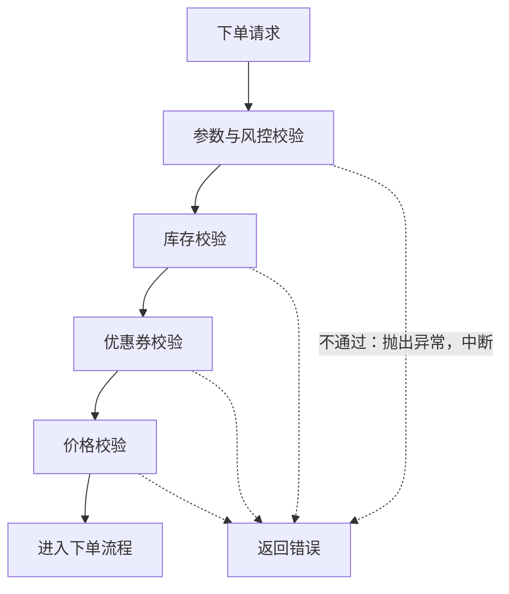
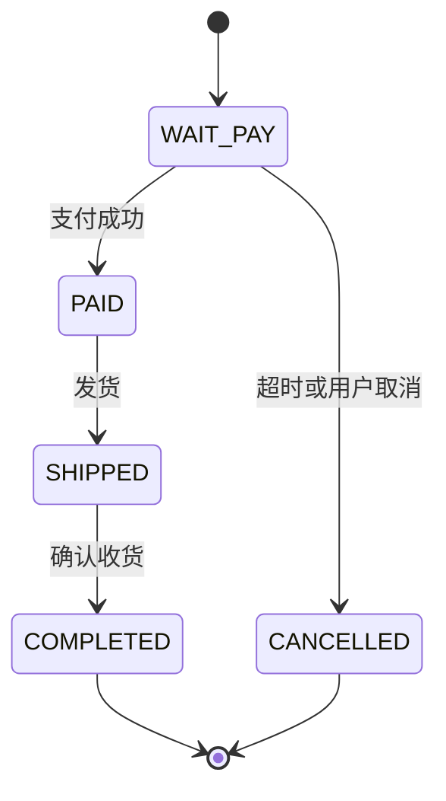
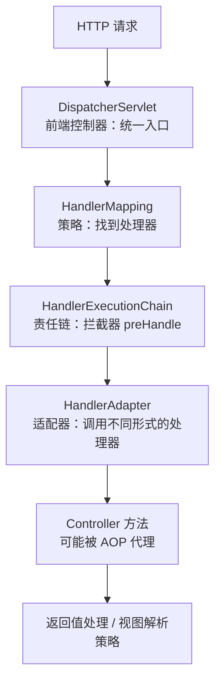

# 30 · 设计模式

> 适用岗位：Java 资深开发（重点：单例、代理、策略、模板方法、责任链）、Java 架构师（重点：设计原则、状态机、何时不用模式）
> 版本基线：JDK 21、Spring Framework 7.0 / Spring Boot 4.0、MyBatis 3.5
> 事实核对：JDK 中的实现（枚举防反射、`Observable` 弃用、`Integer` 缓存、AQS 模板方法、`Executors.RunnableAdapter` 等）已对照本机 OpenJDK 21 的 `src.zip` 核对；Spring 中的实现（`HandlerAdapter` 的实现类、`refresh()` 的钩子方法、`@TransactionalEventListener` 的默认阶段、Spring Boot 默认的代理方式）已对照本机 Spring Framework 7.0.6、Spring Boot 4.0.4 的 jar 核对；MyBatis 二级缓存的装饰顺序已反编译 3.5.19 的 `CacheBuilder` 核对；文中的示例代码均在本机 JDK 21 上运行过
> 相关分类：[《01 Java 基础》](../01-Java核心/01-Java基础.md)（动态代理、包装类缓存）、[《03 Java 并发》](../01-Java核心/03-Java并发.md)（DCL 与 volatile）、[《05 Spring》](../02-框架与容器/05-Spring.md)（AOP、事件机制）、[《06 MyBatis》](../02-框架与容器/06-MyBatis.md)（插件）、[《27 DDD》](../06-三高与架构/27-DDD.md)（充血模型）、[《28 架构设计》](../06-三高与架构/28-架构设计.md)（扩展点）

## 知识地图



## 题目索引

| 编号 | 题目 | 难度 | 层级 |
| --- | --- | --- | --- |
| 30-01 | SOLID 等设计原则怎么理解？ | ★★ | 资深 |
| 30-02 | 为什么说组合优于继承？什么时候该用继承？ | ★★ | 资深 / 架构师 |
| 30-03 | 单例模式有哪些写法？各有什么问题？ | ★★ | 资深 |
| 30-04 | 简单工厂、工厂方法、抽象工厂有什么区别？ | ★★ | 资深 |
| 30-05 | 什么时候用建造者模式？Lombok `@Builder` 有哪些坑？ | ★ | 资深 |
| 30-06 | 代理模式和装饰器模式有什么区别？ | ★★ | 资深 |
| 30-07 | 适配器模式和门面模式分别解决什么问题？ | ★★ | 资深 |
| 30-08 | 享元模式是什么？和对象池有什么区别？ | ★★ | 资深 |
| 30-09 | 如何用策略模式消除大量 if-else？ | ★★ | 资深 |
| 30-10 | 模板方法模式在框架中怎么用？和回调有什么区别？ | ★★ | 资深 |
| 30-11 | 观察者模式、发布订阅、事件驱动有什么区别？ | ★★ | 资深 / 架构师 |
| 30-12 | 责任链模式怎么实现？框架中有哪些应用？ | ★★ | 资深 |
| 30-13 | 状态模式和状态机怎么落地？ | ★★★ | 资深 / 架构师 |
| 30-14 | JDK 中用到了哪些设计模式？ | ★★ | 资深 |
| 30-15 | Spring 中用到了哪些设计模式？ | ★★ | 资深 |
| 30-16 | 怎么避免滥用设计模式？ | ★★ | 架构师 |

---

## 一、设计原则

### 30-01 SOLID 等设计原则怎么理解？

> ★★ ｜ 资深 ｜ 高频

**考察意图**：能否用自己的话讲清每条原则要解决的问题，而不是背定义。

**30 秒版回答**

| 原则 | 一句话 | 违反时的典型表现 |
| --- | --- | --- |
| **单一职责**（SRP） | 一个类只有一个**引起它变化的原因** | 改一个需求要动一个几千行的类，而且会影响不相关的功能 |
| **开闭原则**（OCP） | 对扩展开放，对修改关闭：新增行为时尽量新增代码，而不是修改已有代码 | 每加一种支付方式，都要在多处 `if-else` 中加分支 |
| **里氏替换**（LSP） | 子类必须能替换父类，而不破坏调用方的预期 | 子类重写方法后抛出父类没有声明过的异常，或改变了方法的语义 |
| **接口隔离**（ISP） | 不要强迫调用方依赖它不用的方法，接口要小而专 | 一个接口有二十个方法，实现类大部分是空实现 |
| **依赖倒置**（DIP） | 高层模块和低层模块都依赖抽象；抽象由高层定义 | 领域层直接依赖 MyBatis Mapper 或某个第三方 SDK 的类 |

另外两条常被提到的原则：

- **迪米特法则**（最少知识原则）：只和直接的"朋友"交流，不要出现 `order.getUser().getAddress().getCity()` 这样的链式穿透，否则任何一层结构的变化都会影响调用方；
- **合成复用原则**：优先使用组合而不是继承来复用代码，见 30-02。

**深入剖析**

- **单一职责中的"职责"是按变化原因划分的**，不是按方法数量。例如订单的"价格计算"和"订单导出成 Excel"会因为不同的人（运营、财务）提出的需求而变化，就应该分开；
- **依赖倒置在分层架构中的体现**：领域层定义仓储接口，基础设施层实现它，依赖方向从基础设施指向领域，见[《27 DDD》](../06-三高与架构/27-DDD.md)；
- **里氏替换的反例**：`List.of()` 返回的不可变列表调用 `add` 会抛出 `UnsupportedOperationException`。JDK 在 `List` 接口的文档中把这些修改方法声明为"可选操作"，算是在契约层面做了约定，但调用方仍然很容易踩坑。

**架构师加分点**

- 原则之间存在冲突，需要权衡：过度追求开闭原则会引入大量抽象，反而违背"简单"。**只在已经出现变化的地方应用开闭原则**：第一次写成 `if-else` 没有问题，第二种、第三种变化出现时再重构成策略，见 30-16。

---

### 30-02 为什么说组合优于继承？什么时候该用继承？

> ★★ ｜ 资深 / 架构师 ｜ 中频

**考察意图**：是否理解继承带来的强耦合，以及组合的优势。

**30 秒版回答**

- 继承的问题：
  1. **子类依赖父类的实现细节**（脆弱基类问题）：父类内部的调用关系变化，可能悄悄破坏子类；
  2. **耦合在编译期就固定了**：不能在运行时更换行为；
  3. Java 只能单继承，用继承复用代码，很快会遇到"想同时复用两个类"的困境。
- 组合的做法：持有另一个对象的引用，**把调用转发给它**，只依赖它公开的接口，不依赖内部实现。
- **适合继承的情况**：真正的 "is-a" 关系，并且父类是**为继承而设计的**（有明确的扩展点和文档说明，例如 AQS、`AbstractList`）。

**深入剖析**

经典的反例（来自《Effective Java》，已在本机 JDK 21 上运行）：想统计一个 `HashSet` 一共被添加了多少次元素，于是继承 `HashSet`，重写 `add` 和 `addAll`：

```java
public class InstrumentedHashSet<E> extends HashSet<E> {

    private int addCount = 0;

    @Override
    public boolean add(E e) {
        addCount++;
        return super.add(e);
    }

    @Override
    public boolean addAll(Collection<? extends E> c) {
        addCount += c.size();
        return super.addAll(c);
    }
}
```

调用 `addAll(List.of("a", "b", "c"))` 之后，`addCount` 是 **6** 而不是 3。原因是 `HashSet` 没有重写 `addAll`，继承自 `AbstractCollection` 的 `addAll` 内部逐个调用了 `add`，而 `add` 已经被子类重写：



子类依赖了父类"`addAll` 是否调用 `add`"这个**没有写进契约的实现细节**。用组合改写：实现 `Set` 接口，内部持有一个 `Set` 并转发调用，`addCount` 的统计只依赖 `Set` 接口的公开语义，不受内部实现变化的影响。

**架构师加分点**

- Spring 的整体设计就是组合优先：Bean 之间通过依赖注入组合在一起，AOP 通过代理（组合）增强行为，而不是要求业务类继承某个基类。
- JDK 21 的**密封类**（sealed）让继承变得可控：父类明确声明允许哪些子类，适合"类型是一个封闭集合"的建模，例如表达式树、支付结果类型，配合模式匹配使用，见 30-16。

---

## 二、创建型

### 30-03 单例模式有哪些写法？各有什么问题？

> ★★ ｜ 资深 ｜ 高频

**考察意图**：线程安全、延迟加载，以及反射和序列化对单例的破坏。

**30 秒版回答**

| 写法 | 线程安全 | 延迟加载 | 说明 |
| --- | --- | --- | --- |
| 饿汉式（静态字段直接初始化） | 是 | 否 | 类加载时就创建；简单，绝大多数情况够用 |
| 懒汉式 + `synchronized` 方法 | 是 | 是 | 每次获取都加锁，性能差 |
| 双重检查锁（DCL） | 是（字段必须加 `volatile`） | 是 | 不加 `volatile` 时，可能拿到未初始化完成的对象，见[《03 Java 并发》](../01-Java核心/03-Java并发.md)03-03 |
| **静态内部类（Holder）** | 是 | 是 | 利用类加载机制保证线程安全，推荐 |
| **枚举** | 是 | 否 | 天然防止反射和反序列化创建新实例，《Effective Java》推荐的写法 |

```java
/** 静态内部类：外部类加载时不会加载 Holder，第一次调用 getInstance 时才加载并创建实例 */
public final class IdGenerator {

    private IdGenerator() {
    }

    private static class Holder {
        private static final IdGenerator INSTANCE = new IdGenerator();
    }

    public static IdGenerator getInstance() {
        return Holder.INSTANCE;
    }
}
```

**深入剖析**

普通的单例类可以被两种方式破坏：

1. **反射**：`setAccessible(true)` 后调用私有构造器，可以再创建一个实例。可以在构造器中检查实例是否已存在来防御，但不彻底；
2. **反序列化**：反序列化会创建新的对象，需要实现 `readResolve()` 返回已有的实例。

**枚举单例对这两种情况天然免疫**（已核对 JDK 21 源码）：

- `Constructor.newInstance` 中专门检查了枚举类型，直接抛出 `IllegalArgumentException("Cannot reflectively create enum objects")`；
- 枚举反序列化时，`ObjectInputStream.readEnum` 只读取常量名，通过 `Enum.valueOf` 返回已有的常量，不会创建新对象。

**追问链**

1. **Spring 的单例 Bean 和单例模式是一回事吗？** 不是。单例模式保证**一个类加载器中只有一个实例**；Spring 的单例作用域保证**一个容器中，一个 Bean 定义只有一个实例**。同一个类可以定义多个不同名字的单例 Bean，各自是不同的对象。
2. **单例有什么缺点？** 本质上是全局状态：隐藏了依赖关系，单元测试难以替换。在 Spring 项目中，应该让容器管理单例并通过依赖注入使用，而不是在业务代码中到处调用 `XXX.getInstance()`。

---

### 30-04 简单工厂、工厂方法、抽象工厂有什么区别？

> ★★ ｜ 资深 ｜ 中频

**考察意图**：能否分清几种工厂的结构和适用场景。

**30 秒版回答**

| 模式 | 结构 | 适用场景 |
| --- | --- | --- |
| 简单工厂 | 一个工厂类，用参数决定创建哪种产品（通常是一个 `switch`） | 产品种类少、很少新增 |
| 工厂方法 | 定义一个创建对象的抽象方法，由**子类决定**创建哪种产品 | 框架定义流程，具体创建什么由使用方决定 |
| 抽象工厂 | 一个工厂创建**一族相关的产品**，保证它们彼此匹配 | 多个产品需要成套切换，例如不同数据库的连接、语句、方言 |
| 静态工厂方法 | 用静态方法代替构造器，例如 `List.of`、`Integer.valueOf` | 需要有名字的创建方式、需要缓存实例、需要返回子类型 |

注意区分：《Effective Java》第 1 条说的"静态工厂方法"和 GoF 的"工厂方法模式"不是一回事。前者只是用静态方法代替构造器；后者是一种依赖子类的设计结构。

**深入剖析**

- 在 Spring 项目中，**容器本身就是一个大工厂**（`BeanFactory`），大部分对象的创建不再需要手写工厂。
- 仍然需要手写工厂的场景：**运行时根据参数选择实现**，例如根据支付方式选择支付渠道。这本质上是"策略 + 注册表"，见[《28 架构设计》](../06-三高与架构/28-架构设计.md)28-14。
- `FactoryBean` 是 Spring 提供的工厂扩展点：当一个对象的创建过程很复杂（例如 MyBatis 的 Mapper 代理对象、Feign 客户端），可以实现 `FactoryBean`，由它的 `getObject()` 方法产生真正的 Bean。

---

### 30-05 什么时候用建造者模式？Lombok `@Builder` 有哪些坑？

> ★ ｜ 资深 ｜ 中频

**考察意图**：建造者模式的适用条件，以及 Lombok 的实际使用经验。

**30 秒版回答**

- **适用场景**：参数多，而且**大部分是可选的**。如果用构造器，需要写很多重载（伸缩构造器），调用时也难以分辨每个参数的含义；如果用 setter，对象在构建过程中处于不完整的状态，也无法做成不可变对象。
- 建造者模式把构建过程和最终对象分开：先逐项设置，最后 `build()` 时统一校验并创建一个不可变对象。
- JDK 中的例子：`HttpClient.newBuilder()`（JDK 11）、`Thread.ofVirtual().name("worker-", 0).start(task)`（JDK 21，`Thread.Builder`）、`Locale.Builder`。

**深入剖析**

Lombok `@Builder` 的常见坑：

1. **与 `@Data` 一起使用时没有无参构造器**：`@Builder` 会生成一个全参构造器，类中有了显式构造器后，编译器就不再生成默认的无参构造器。Jackson 反序列化、MyBatis 映射结果时可能因此失败，需要同时加上 `@NoArgsConstructor` 和 `@AllArgsConstructor`；
2. **字段的默认值被忽略**：`private int retry = 3;` 在使用 builder 构建时不会生效，需要加 `@Builder.Default`；
3. **继承时父类的字段不在 builder 中**：需要使用 `@SuperBuilder`。

**追问链**

1. **record 需要建造者吗？** record 只有全参构造器。字段少时直接用构造器即可；字段很多、可选项多时，可以为 record 手写一个静态的 builder，或者重新审视这个 record 是否承担了太多职责。

---

## 三、结构型

### 30-06 代理模式和装饰器模式有什么区别？

> ★★ ｜ 资深 ｜ 高频

**考察意图**：两种结构几乎相同的模式，能否从**意图**上区分。

**30 秒版回答**

- **结构相同**：代理类和装饰器类都实现与目标对象相同的接口，内部持有目标对象，把调用转发过去，并在前后增加逻辑。
- **意图不同**：

| | 代理 | 装饰器 |
| --- | --- | --- |
| 目的 | **控制对目标的访问**：权限、延迟加载、远程调用、事务 | **给目标增加功能**，可以层层叠加 |
| 谁来组装 | 通常由框架创建，调用方**感知不到**代理的存在 | 通常由调用方**显式地**一层层包装 |
| 典型例子 | Spring AOP、`@Transactional`、RPC 客户端、MyBatis Mapper | Java IO 流、`Collections.unmodifiableList`、MyBatis 二级缓存 |

- 代理的实现技术（JDK 动态代理、CGLIB、ByteBuddy）见[《01 Java 基础》](../01-Java核心/01-Java基础.md)01-13；Spring AOP 如何选择代理方式见[《05 Spring》](../02-框架与容器/05-Spring.md)05-09。Spring Boot 默认使用 CGLIB 代理（`spring.aop.proxy-target-class` 的默认值为 `true`，已核对 Spring Boot 4.0.4 的配置元数据）。

**深入剖析**

装饰器的典型应用是 MyBatis 的二级缓存。`CacheBuilder` 先创建基础缓存，再按配置一层层包装（已反编译 MyBatis 3.5.19 的 `CacheBuilder` 核对）：



- 每一层只做一件事，组合起来得到完整的功能；
- 有些层按配置决定是否出现：设置了 `flushInterval` 时多一层 `ScheduledCache`，`readOnly="true"` 时没有 `SerializedCache`，`blocking="true"` 时最外层再加一层 `BlockingCache`；
- 淘汰策略可以更换成 `FifoCache`、`SoftCache`、`WeakCache`，不影响其他层。

如果用继承实现这些组合，就需要"带日志的 LRU 缓存""带日志和序列化的 FIFO 缓存"……类的数量会爆炸。这也是 30-02 中组合优于继承的直接体现。

**追问链**

1. **Spring 中有装饰器吗？** 有。例如 `TaskDecorator`：线程池执行任务前，对 `Runnable` 做一层包装，把提交任务的线程中的上下文（MDC 日志上下文、请求上下文、租户 ID）复制到执行线程中，执行完再清理。

---

### 30-07 适配器模式和门面模式分别解决什么问题？

> ★★ ｜ 资深 ｜ 中频

**考察意图**：两种"包装"的不同目的。

**30 秒版回答**

- **适配器**：**接口不兼容**时做转换，让已有的类能被期望另一种接口的调用方使用。重点是"转换"。
  - `InputStreamReader`：把字节流适配成字符流；
  - `Executors.callable(Runnable)`：把 `Runnable` 适配成 `Callable`，内部的实现类就叫 `RunnableAdapter`（已核对 JDK 21 源码）；
  - Spring MVC 的 `HandlerAdapter`：处理器有多种形式（`@RequestMapping` 方法、`HttpRequestHandler`、`Controller` 接口、`Servlet`、函数式端点），`DispatcherServlet` 通过不同的 `HandlerAdapter` 用统一的方式调用它们，见 30-15。
- **门面**：为一个复杂的子系统提供一个**简化的统一入口**，调用方不需要了解子系统内部的多个组件。重点是"简化"。
  - SLF4J 的名字就是 Simple Logging **Facade** for Java：业务代码只依赖 SLF4J 的 API，底层可以是 Logback 或 Log4j2；
  - 应用层服务（Application Service）对外提供一个用例方法，内部协调多个领域对象和基础设施。

**架构师加分点**

- 在架构层面，这两个模式经常一起出现：对接外部系统时的**防腐层**（见[《27 DDD》](../06-三高与架构/27-DDD.md)27-04）就是"适配器 + 门面"：既把外部模型转换成自己的模型，又把多个外部接口收敛成少数几个对内的方法；支付系统中的**渠道适配层**也是同样的思路，见[《29 场景题》](../06-三高与架构/29-场景题.md)29-04。

---

### 30-08 享元模式是什么？和对象池有什么区别？

> ★★ ｜ 资深 ｜ 中频

**考察意图**：能否分清"共享不可变对象"和"复用昂贵的可变资源"。

**30 秒版回答**

- **享元模式**：把对象中**可以共享的、不变的部分**提取出来，多个使用方**同时共享**同一个实例，以减少对象数量。
  - `Integer.valueOf` 缓存了 -128 到 127 的 `Integer` 对象，上限可以通过 `-XX:AutoBoxCacheMax` 调大（已核对 JDK 21 源码），见[《01 Java 基础》](../01-Java核心/01-Java基础.md)01-03；
  - 字符串常量池；
  - 前提是被共享的对象**不可变**，否则一个使用方的修改会影响所有人。
- **对象池**：复用**创建代价高的可变资源**，使用方**独占**地借出，用完**归还**，例如数据库连接池、线程池。

| | 享元 | 对象池 |
| --- | --- | --- |
| 对象是否可变 | 不可变 | 可变（有状态） |
| 使用方式 | 多方同时共享 | 借出期间独占，用完归还 |
| 目的 | 减少对象数量，节省内存 | 避免频繁创建和销毁的开销 |

**生产实践 / 踩坑**

- `Integer` 缓存导致的经典坑：两个 `Integer` 用 `==` 比较，127 时为 `true`，128 时为 `false`（已在本机运行验证）。包装类型一律用 `equals` 比较。
- 现代 JVM 中，**普通小对象不要自己做池化**：对象分配和年轻代回收都非常廉价，自己维护对象池反而会引入并发问题和内存泄漏。只有创建真正昂贵的资源（连接、线程、大块的直接内存）才值得池化。

---
## 四、行为型

### 30-09 如何用策略模式消除大量 if-else？

> ★★ ｜ 资深 ｜ 高频

**考察意图**：是否会用策略模式组织多分支逻辑，同时知道什么时候没必要。

**30 秒版回答**

- **策略模式**：把一组可以互相替换的算法分别封装起来，调用方通过统一的接口使用，运行时选择具体的算法。
- 在 Java 中常见的三种落地方式：

| 方式 | 适合 | 示例 |
| --- | --- | --- |
| **枚举 + Lambda** | 分支固定、逻辑简单、很少变化 | 会员等级折扣 |
| **接口 + Spring Bean + 注册表** | 分支会持续增加，每个分支有自己的依赖（调用外部服务、读写数据库） | 支付渠道、消息通道，见[《28 架构设计》](../06-三高与架构/28-架构设计.md)28-14 |
| **函数式接口参数** | 调用方临时传入一段行为 | `Comparator`、`list.sort(...)` |

- JDK 中的例子：`Comparator`、线程池的拒绝策略 `RejectedExecutionHandler`。

**深入剖析**

分支固定时，用枚举承载策略就够了，不必为每个分支建一个类和一个 Spring Bean：

```java
/** 会员等级与折扣：等级固定且很少变化，用枚举承载策略 */
public enum MemberLevel {

    NORMAL(amount -> amount),
    GOLD(amount -> amount.multiply(new BigDecimal("0.95"))),
    PLATINUM(amount -> amount.multiply(new BigDecimal("0.90")));

    private final UnaryOperator<BigDecimal> discount;

    MemberLevel(UnaryOperator<BigDecimal> discount) {
        this.discount = discount;
    }

    /** 计算折后金额，保留两位小数 */
    public BigDecimal applyDiscount(BigDecimal amount) {
        return discount.apply(amount).setScale(2, RoundingMode.HALF_UP);
    }
}
```

调用方只需要 `user.getLevel().applyDiscount(amount)`，不再有 `if (level == GOLD) ... else if ...`。新增一个等级时，编译器会强制你为它提供折扣规则。

**追问链**

1. **所有的 if-else 都应该改成策略吗？** 不是。只有两三个分支、而且不会再增加时，`if-else` 或 `switch` 最直观。JDK 21 的 `switch` 模式匹配配合密封类型，在编译期就能检查分支是否覆盖完整。策略模式的价值在于**分支会持续增加**，或者每个分支的逻辑很复杂、需要独立测试的情况。
2. **策略的选择逻辑放在哪里？** 选择逻辑本身也是一种规则。简单的直接用 `Map<类型, 策略>` 查找；复杂的（根据多个条件组合选择）可以单独抽出一个路由组件，见[《29 场景题》](../06-三高与架构/29-场景题.md)29-04 的渠道路由。

---

### 30-10 模板方法模式在框架中怎么用？和回调有什么区别？

> ★★ ｜ 资深 ｜ 中频

**考察意图**：是否理解模板方法的结构，以及框架中用回调代替继承的趋势。

**30 秒版回答**

- **模板方法**：父类定义算法的骨架（固定的步骤和顺序），把其中可变的步骤留给子类实现（抽象方法或钩子方法）。
- 框架中的例子（已核对源码）：
  - **AQS**：`acquire` 的排队、阻塞、唤醒逻辑是固定的骨架；`tryAcquire`、`tryRelease` 留给子类实现，默认直接抛出 `UnsupportedOperationException`。`ReentrantLock`、`Semaphore`、`CountDownLatch` 都基于它；
  - **Spring 的 `AbstractApplicationContext.refresh()`**：容器启动的十几个步骤是固定的，其中 `postProcessBeanFactory`、`onRefresh` 等是留给子类的钩子方法。Spring Boot 就是在 `onRefresh` 中创建内嵌的 Web 服务器（如 Tomcat），开始监听端口则要等到刷新的最后阶段，由生命周期组件 `WebServerStartStopLifecycle` 完成（已反编译 Spring Boot 4.0.4 核对）；
  - `AbstractList`：子类只需实现 `get` 和 `size`，迭代器、`indexOf`、`subList` 等都由父类基于这两个方法实现。
- **模板 + 回调**：`JdbcTemplate`、`TransactionTemplate` 的名字里有 Template，但它们**不要求继承**。骨架（获取连接、开启事务、异常转换、释放资源）在模板类中，可变的部分通过**回调接口**（通常是 Lambda）传入。

**深入剖析**

| | 模板方法（继承） | 模板 + 回调（组合） |
| --- | --- | --- |
| 可变部分怎么提供 | 子类重写方法 | 调用时传入 Lambda 或回调对象 |
| 耦合 | 子类和父类绑定，受单继承限制 | 调用方只依赖回调接口 |
| 适合 | 框架内部、扩展点固定且稳定的场景 | 业务代码中复用"资源管理"类的骨架 |

```java
// TransactionTemplate：开启、提交、回滚由模板负责，回调只写业务逻辑
Long orderId = transactionTemplate.execute(status -> {
    orderRepository.save(order);
    outboxRepository.save(OutboxMessage.of(order.created()));
    return order.getId();
});
```

在业务代码中，需要复用一段"固定流程 + 少量可变步骤"时，优先考虑回调的方式，这是组合优于继承在这个模式上的体现。

---

### 30-11 观察者模式、发布订阅、事件驱动有什么区别？

> ★★ ｜ 资深 / 架构师 ｜ 中频

**考察意图**：能否分清三个经常被混用的概念，以及 Spring 事件的定位。

**30 秒版回答**

| | 观察者模式 | 发布订阅 | 事件驱动架构 |
| --- | --- | --- | --- |
| 范围 | 进程内，对象之间 | 进程内或跨进程 | 系统之间 |
| 发布方是否知道订阅方 | **知道**：被观察者直接持有观察者列表并逐个调用 | **不知道**：通过中间的事件总线或 Broker 转发 | 不知道：通过 MQ |
| 调用方式 | 通常同步 | 同步或异步 | 异步 |
| 例子 | GUI 的监听器、`PropertyChangeListener` | Spring 事件（`ApplicationEventMulticaster` 是中间的分发者）、Guava EventBus | Kafka、RocketMQ，见[《28 架构设计》](../06-三高与架构/28-架构设计.md)28-12 |

- JDK 早期提供的 `java.util.Observable` 和 `Observer` 从 **JDK 9 起已被标记为弃用**（已核对 JDK 21 源码）。官方给出的理由是它的事件模型太有限、通知顺序不确定、状态变化和通知之间不是一一对应的，建议改用 `java.beans` 包、`java.util.concurrent` 中的并发数据结构或 `Flow` API。

**深入剖析**

Spring 事件的使用要点（详见[《05 Spring》](../02-框架与容器/05-Spring.md)05-19）：

- 默认是**同步**的：监听器在发布者的线程中执行，监听器抛出异常会影响发布者；
- 需要异步时加 `@Async`，并配置专门的线程池；
- 在事务中发布的事件，如果监听器需要在**事务提交之后**才执行（例如发消息、清缓存），使用 `@TransactionalEventListener`，它的默认阶段就是 `AFTER_COMMIT`（已核对 Spring Framework 7.0.6）；
- Spring 事件只在进程内传递，进程崩溃时未处理的事件会丢失。需要可靠送达的跨服务通知，应该使用"本地消息表 + MQ"，见[《20 MQ 通用与选型》](../05-消息队列/20-MQ通用与选型.md)。

---

### 30-12 责任链模式怎么实现？框架中有哪些应用？

> ★★ ｜ 资深 ｜ 高频

**考察意图**：责任链的两种形态，以及在框架中的应用。

**30 秒版回答**

- **责任链**：请求沿着一条处理者链传递，每个处理者决定是否处理、是否继续往下传递。发送者不需要知道最终由谁处理。
- 两种常见的形态：
  - **由处理者决定是否继续**：每个节点持有"下一个"的引用，自己调用 `chain.doFilter()` 往下传，不调用就中断。例如 Servlet 的 `Filter`、Spring Security 的过滤器链、Netty 的 `ChannelPipeline`；
  - **管道（Pipeline）**：所有处理者按顺序依次执行，由链本身负责遍历，任何一个处理者抛出异常即中断。例如 Spring MVC 的 `HandlerInterceptor`、业务中的多步校验。
- 其他应用：MyBatis 插件（多层代理形成的拦截链，见[《06 MyBatis》](../02-框架与容器/06-MyBatis.md)06-06）、Sentinel 的处理器插槽链、类加载的双亲委派（一种向上委托的链）。

**深入剖析**

业务中最常用的是管道形态，例如下单前的一系列校验：

```java
public interface OrderValidator {

    /** 校验不通过时直接抛出业务异常，终止后续校验 */
    void validate(OrderSubmitContext context);
}

@Component
@Order(10)
@RequiredArgsConstructor
public class StockValidator implements OrderValidator {

    private final StockQueryService stockQueryService;

    @Override
    public void validate(OrderSubmitContext context) {
        if (!stockQueryService.isEnough(context.skuQuantities())) {
            throw new BizException(ErrorCode.STOCK_NOT_ENOUGH, context.orderToken());
        }
    }
}

@Component
@RequiredArgsConstructor
public class OrderValidationChain {

    /** Spring 注入 List 时会按 @Order 排序，新增校验只需要新增一个实现类 */
    private final List<OrderValidator> validators;

    public void validate(OrderSubmitContext context) {
        validators.forEach(validator -> validator.validate(context));
    }
}
```



**生产实践 / 踩坑**

- **顺序要显式声明**：不加 `@Order` 时，Bean 在列表中的顺序没有保证。要把"先做便宜的校验，再做昂贵的校验"写清楚，例如参数校验放在调用外部服务的校验之前。
- Servlet `Filter` 中忘记调用 `chain.doFilter()`，请求会在这里静默中断，返回空响应。

---

### 30-13 状态模式和状态机怎么落地？

> ★★★ ｜ 资深 / 架构师 ｜ 中频

**考察意图**：业务状态流转的设计能力，以及在不同复杂度下选择合适的方案。

**30 秒版回答**

- 订单、支付、工单这类对象都有状态，核心问题是：**状态只能按规定的方向流转**，非法的流转要被拒绝，并且在并发下仍然正确。
- 按复杂度选择方案：

| 复杂度 | 方案 |
| --- | --- |
| 状态少、每个状态下的行为差别不大 | **枚举 + 流转规则表**，流转方法放在聚合根中（充血模型） |
| 每个状态下的行为差别很大 | **状态模式**：每个状态一个类，实现同一个接口，行为随状态对象变化 |
| 流程长、需要配置化、需要人工审批节点 | **工作流引擎**（如 Flowable、Camunda） |

- 无论哪种方案，**持久化时都要用条件更新**（`WHERE status = 原状态`）防止并发下的重复流转，见[《29 场景题》](../06-三高与架构/29-场景题.md)29-03。

**深入剖析**

大多数业务状态用"枚举 + 规则表"就足够了（已在本机 JDK 21 上运行）：

```java
public enum OrderStatus {

    WAIT_PAY, PAID, SHIPPED, COMPLETED, CANCELLED;

    /** 允许的状态流转：不在表中的流转一律视为非法 */
    private static final Map<OrderStatus, Set<OrderStatus>> TRANSITIONS = Map.of(
            WAIT_PAY, EnumSet.of(PAID, CANCELLED),
            PAID, EnumSet.of(SHIPPED),
            SHIPPED, EnumSet.of(COMPLETED),
            COMPLETED, EnumSet.noneOf(OrderStatus.class),
            CANCELLED, EnumSet.noneOf(OrderStatus.class));

    public boolean canTransitTo(OrderStatus target) {
        return TRANSITIONS.get(this).contains(target);
    }
}
```



聚合根中的流转方法统一经过规则检查，业务代码不能直接 `setStatus`：

```java
public void pay(LocalDateTime paidAt) {
    transitTo(OrderStatus.PAID);
    this.paidAt = paidAt;
}

private void transitTo(OrderStatus target) {
    if (!status.canTransitTo(target)) {
        throw new BizException(ErrorCode.ORDER_STATUS_ILLEGAL, id, status, target);
    }
    this.status = target;
}
```

**追问链**

1. **什么时候需要用真正的状态模式？** 当每个状态下，同一个操作的行为差别很大时。例如工单在"待分配""处理中""挂起"三种状态下，"提交"操作分别对应完全不同的处理逻辑和校验。这时把行为分散到各个状态类中，比在一个方法里写 `switch` 更清晰。
2. **状态流转后需要触发其他动作（发通知、记日志）怎么办？** 聚合根在流转时产生领域事件，由事件处理器执行后续动作，而不是把这些逻辑都写在流转方法中，见[《27 DDD》](../06-三高与架构/27-DDD.md)。

---

## 五、综合

### 30-14 JDK 中用到了哪些设计模式？

> ★★ ｜ 资深 ｜ 中频

**考察意图**：能否把模式和每天使用的 API 联系起来。

**30 秒版回答**

| 模式 | JDK 中的例子 |
| --- | --- |
| 单例 | `Runtime.getRuntime()` |
| 静态工厂方法 | `List.of`、`Integer.valueOf`、`Executors.newFixedThreadPool` |
| 建造者 | `HttpClient.newBuilder()`、`Thread.ofVirtual()`（JDK 21）、`Locale.Builder`、`Stream.builder()` |
| 原型 | `Object.clone()` |
| 适配器 | `InputStreamReader`、`Executors.callable(Runnable)`（内部类 `RunnableAdapter`）、`Arrays.asList` |
| 装饰器 | `BufferedInputStream` 等 `FilterInputStream` 的子类、`Collections.unmodifiableList`、`Collections.synchronizedList` |
| 代理 | `java.lang.reflect.Proxy` |
| 享元 | `Integer` 缓存、字符串常量池 |
| 迭代器 | `Iterator` |
| 策略 | `Comparator`、`RejectedExecutionHandler` |
| 模板方法 | AQS、`AbstractList`、`InputStream.read(byte[], int, int)` 基于抽象的 `read()` 实现 |
| 观察者 | `java.beans.PropertyChangeListener`、`Flow` API（`java.util.Observer` 已于 JDK 9 弃用） |
| 命令 | `Runnable`、`Callable` 提交给线程池执行 |
| 责任链 | 类加载的双亲委派 |

---

### 30-15 Spring 中用到了哪些设计模式？

> ★★ ｜ 资深 ｜ 高频

**考察意图**：对 Spring 设计的整体理解，能否讲出每个模式解决了什么问题。

**30 秒版回答**

| 模式 | Spring 中的体现 | 解决的问题 |
| --- | --- | --- |
| 工厂 | `BeanFactory`、`FactoryBean` | 统一管理对象的创建和依赖 |
| 单例 / 原型 | Bean 的作用域 | 容器级别的实例管理（不是类级别的单例，见 30-03） |
| 代理 | AOP、`@Transactional`、`@Async` | 不修改业务代码的情况下织入横切逻辑 |
| 模板方法 | `AbstractApplicationContext.refresh()` 的钩子方法 | 固定启动流程，留出扩展点 |
| 模板 + 回调 | `JdbcTemplate`、`TransactionTemplate` | 复用资源管理的骨架 |
| 观察者 / 发布订阅 | `ApplicationEvent`、`ApplicationListener`、`ApplicationEventMulticaster` | 模块之间解耦 |
| 适配器 | `HandlerAdapter`（`RequestMappingHandlerAdapter`、`HttpRequestHandlerAdapter`、`SimpleControllerHandlerAdapter`、`SimpleServletHandlerAdapter`、`HandlerFunctionAdapter`，已核对 Spring Framework 7.0.6） | 用统一的方式调用不同形式的处理器 |
| 装饰器 | `TaskDecorator` | 在线程池任务前后传递上下文 |
| 策略 | `PlatformTransactionManager` 的不同实现、`ResourceLoader`、`InstantiationStrategy` | 同一套抽象，适配不同的底层技术 |
| 责任链 | `HandlerExecutionChain` 中的拦截器、Spring Security 的过滤器链 | 请求处理前后的多步横切处理 |
| 建造者 | `BeanDefinitionBuilder`、`UriComponentsBuilder`、`RestClient.builder()` | 构建复杂对象 |

**深入剖析**

`DispatcherServlet` 处理一个请求的过程中就用到了好几种模式：



---

### 30-16 怎么避免滥用设计模式？

> ★★ ｜ 架构师 ｜ 中频

**考察意图**：是否有"简单优先"的工程判断力。

**30 秒版回答**

- 设计模式是**针对反复出现的问题的解法**，先有问题，再有模式。没有问题时引入模式，只会增加理解成本。
- 常见的滥用信号：
  - 接口只有一个实现，而且看不到出现第二个实现的可能（为了"面向接口编程"而写的接口）；
  - 工厂只生产一种产品；
  - 两个永远不会变的分支，被拆成了策略接口加两个实现类；
  - 一个简单的调用要穿过五六层抽象才能找到真正干活的代码。
- 实践方法：
  - **先写最直接的代码**，在第二个、第三个真实的变化出现时再重构成模式（"事不过三"）；
  - **重构到模式**，而不是一开始就设计模式；
  - 用测试保证重构的安全。

**深入剖析**

现代 Java 的语言特性让一些模式变得更轻，甚至不再需要：

| 模式 | 现代写法 |
| --- | --- |
| 策略、命令 | Lambda 和函数式接口，不必为每个策略单独写一个类 |
| 访问者 | 密封接口 + `switch` 模式匹配（JDK 21 正式发布），编译器检查分支是否完整 |
| 值对象的 `equals`、`hashCode` | record |
| 单例 | 交给 Spring 容器管理 |

以访问者模式为例，过去为了"不修改类型层次、又能对不同子类型执行不同操作"，需要定义 `accept` / `visit` 双重分派。现在可以直接写（已在本机 JDK 21 上运行）：

```java
public sealed interface Shape permits Circle, Rect {
}

public record Circle(double r) implements Shape {
}

public record Rect(double w, double h) implements Shape {
}

/** 新增一个 Shape 子类型而这里没有处理时，编译直接失败 */
public static double area(Shape shape) {
    return switch (shape) {
        case Circle c -> Math.PI * c.r() * c.r();
        case Rect r -> r.w() * r.h();
    };
}
```

**架构师加分点**

- 评价一个设计好不好，看的是**修改的成本**：需求变化时，需要改动的地方是否集中、是否容易测试。模式只是降低某一类修改成本的手段，而每引入一层抽象，都会提高阅读成本。两者的平衡点在于：**在已经发生变化的方向上抽象，在没有变化的方向上保持简单**。
