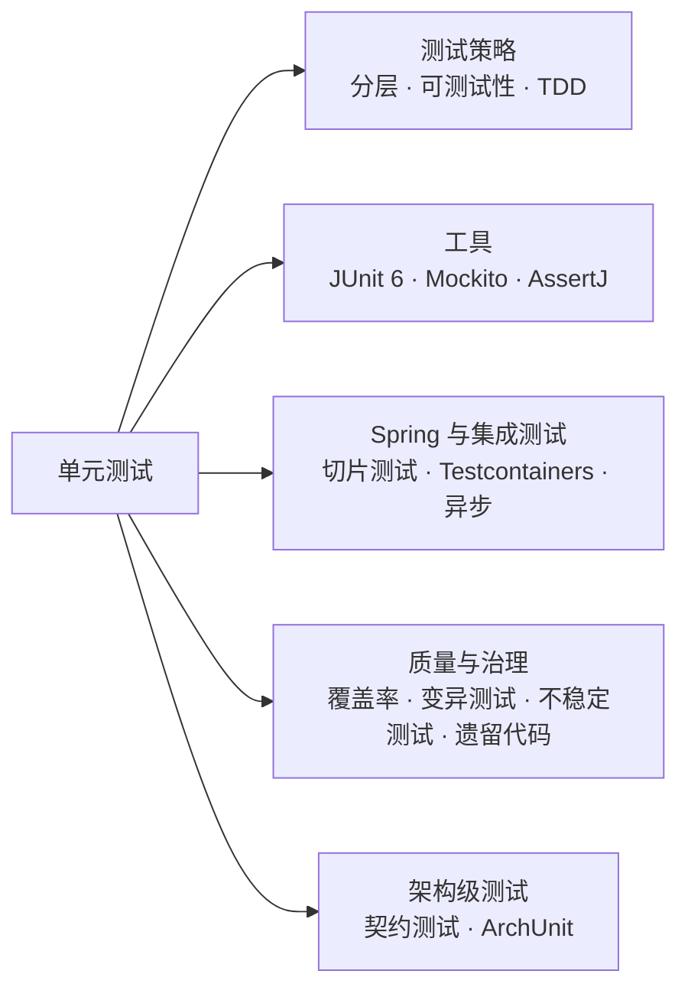
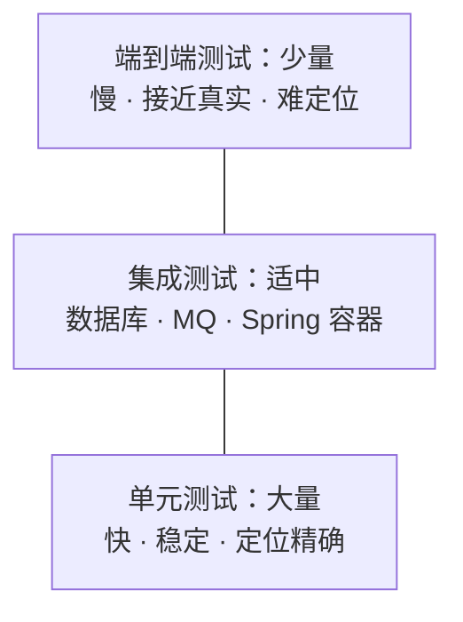
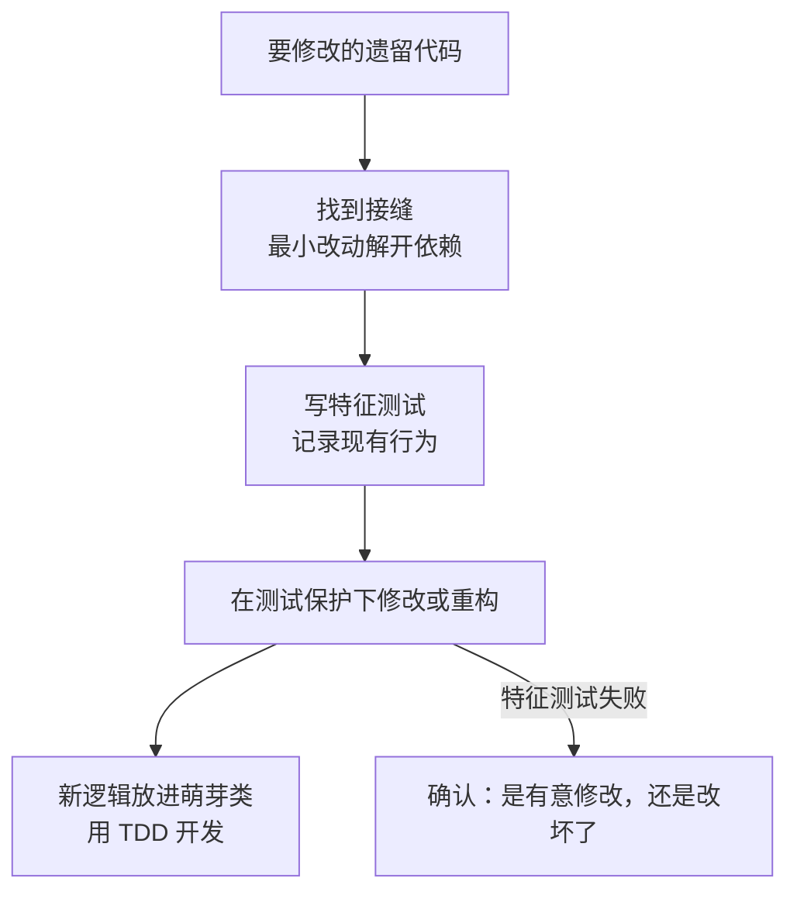
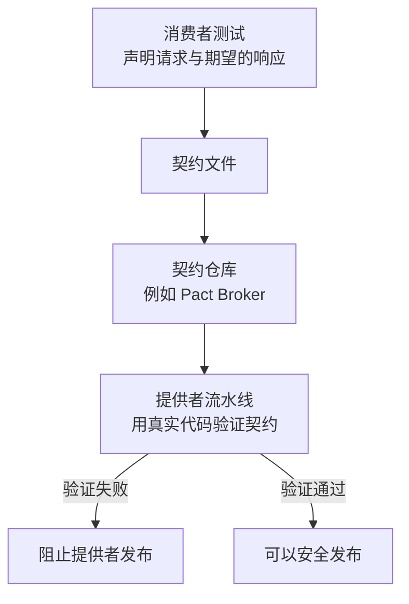

# 31 · 单元测试

> 适用岗位：Java 资深开发（重点：Mockito、Spring Boot 测试、异步测试）、Java 架构师（重点：测试分层、可测试性设计、契约测试、架构测试）
> 版本基线：JUnit 6.0、Mockito 5.x、AssertJ 3.27、Testcontainers 2.0、Spring Framework 7.0 / Spring Boot 4.0（以上版本均为 Spring Boot 4.0.4 依赖管理中的版本：JUnit Jupiter 6.0.3、Mockito 5.20.0、Testcontainers 2.0.4、AssertJ 3.27.7、Awaitility 4.3.0，已核对本机的 `spring-boot-dependencies-4.0.4.pom`）
> 事实核对：
> - JUnit 6 的变化来自 [JUnit 6.0.0 发布说明](https://docs.junit.org/6.0.0/release-notes/)；
> - Testcontainers 2.0 的变化来自 [2.0.0 发布说明](https://github.com/testcontainers/testcontainers-java/releases/tag/2.0.0)；
> - Spring Boot 4 测试相关的变化来自 [Spring Boot 4.0 迁移指南](https://github.com/spring-projects/spring-boot/wiki/Spring-Boot-4.0-Migration-Guide)；
> - Mockito 在 JDK 21 上的代理配置来自 Mockito 源码中的官方文档；
> - Spring 测试上下文缓存的参数已对照本机 `spring-test-7.0.6` 的源码核对；
> - 文中标注"已运行"的测试代码，使用 JUnit 6.0.3 的 API 编译通过，并在本机 JUnit 5.12.2 + Mockito 5.20.0 + AssertJ 3.27.7 上实际运行通过（本机缺少 JUnit 6 的启动器，两个版本中这些 API 相同）
> 相关分类：[《30 设计模式》](30-设计模式.md)（依赖注入与可测试性）、[《33 线上问题排查》](33-线上问题排查.md)、[《36 Maven · Git · IDEA》](36-Maven·Git·IDEA.md)

## 知识地图



## 题目索引

| 编号 | 题目 | 难度 | 层级 |
| --- | --- | --- | --- |
| 31-01 | 单元测试、集成测试、端到端测试怎么分层？ | ★★ | 资深 / 架构师 |
| 31-02 | 什么样的代码好测？怎么提高可测试性？ | ★★ | 资深 / 架构师 |
| 31-03 | TDD 是什么？在实际项目中怎么用？ | ★★ | 架构师 |
| 31-04 | JUnit 5 / JUnit 6 有哪些核心特性？JUnit 6 有什么变化？ | ★★ | 资深 |
| 31-05 | Mockito 的原理是什么？mock 和 spy 有什么区别？ | ★★★ | 资深 |
| 31-06 | 什么该 mock，什么不该 mock？ | ★★ | 资深 / 架构师 |
| 31-07 | Spring Boot 的测试怎么写？切片测试和 `@SpringBootTest` 怎么选？ | ★★★ | 资深 |
| 31-08 | 涉及数据库的测试用 H2 还是 Testcontainers？ | ★★ | 资深 |
| 31-09 | 异步、多线程和依赖时间的代码怎么测？ | ★★★ | 资深 |
| 31-10 | 测试覆盖率怎么看？覆盖率高就够了吗？ | ★★ | 资深 / 架构师 |
| 31-11 | 怎样写出好维护的测试？ | ★★ | 资深 |
| 31-12 | 测试时好时坏（不稳定测试）怎么治理？ | ★★ | 资深 |
| 31-13 | 遗留代码没有测试，怎么补？ | ★★★ | 架构师 |
| 31-14 | 微服务之间的接口怎么测？什么是契约测试？ | ★★★ | 架构师 |
| 31-15 | 怎么用测试守住架构规则？ | ★★ | 架构师 |

---

## 一、测试策略

### 31-01 单元测试、集成测试、端到端测试怎么分层？

> ★★ ｜ 资深 / 架构师 ｜ 高频

**考察意图**：是否理解不同层次测试的成本和收益，能否为团队制定合理的测试策略。

**30 秒版回答**

| 层次 | 测什么 | 速度 | 定位问题 | 数量 |
| --- | --- | --- | --- | --- |
| 单元测试 | 一个类或一小组类的逻辑，外部依赖用替身（mock、fake）代替 | 毫秒级 | 精确 | 最多 |
| 集成测试 | 和真实的数据库、MQ、缓存、Spring 容器协作是否正确 | 秒级 | 较精确 | 适中 |
| 端到端测试 | 从用户入口到最终结果的完整流程 | 分钟级 | 困难 | 最少，只覆盖核心链路 |

- 这就是**测试金字塔**：越往下越多、越快、越稳定；越往上越少、越慢、越接近真实。
- 常见的反模式是"**冰淇淋筒**"：大量依赖人工和端到端测试，单元测试很少。结果是测试慢、不稳定、出了问题难以定位，没人愿意维护。

**深入剖析**



**架构师加分点**

- 分层的依据是**风险在哪里**：领域逻辑复杂的系统，单元测试的价值最高；以"调用数据库、组装数据"为主的系统，单元测试中全是 mock，价值有限，应该把更多精力放在集成测试上（有人称之为"测试奖杯"模型）。
- 不要追求某一层的固定比例，而要问：**这类缺陷，在哪一层发现最便宜？**

---

### 31-02 什么样的代码好测？怎么提高可测试性？

> ★★ ｜ 资深 / 架构师 ｜ 高频

**考察意图**：可测试性本质上是设计质量，能否从设计上解决"难测"的问题。

**30 秒版回答**

难测的代码通常有这些特征，对应的改法如下：

| 难测的原因 | 改法 |
| --- | --- |
| 在方法内部 `new` 依赖对象，或调用静态方法访问外部资源 | **依赖注入**，依赖通过构造器传入，测试时传入替身 |
| 直接调用 `LocalDateTime.now()`、`UUID.randomUUID()`、随机数 | 注入 `Clock`、ID 生成器、`RandomGenerator`，测试时固定下来 |
| 业务逻辑和 IO 混在一起（查库、计算、写库在同一个方法中） | 把计算逻辑抽成**不依赖 IO 的纯函数或领域对象**，单独测试 |
| 一个方法做了太多事情 | 拆分职责，每部分可以单独验证 |
| 内部自己创建线程池并异步执行 | 注入 `Executor`，测试时可以换成同步执行的实现，见 31-09 |

**深入剖析**

- **充血模型天然好测**：领域对象的状态判断和变更都是纯内存操作，不需要 mock 任何东西就能测试，见[《27 DDD》](../06-三高与架构/27-DDD.md)；
- **构造器注入优于字段注入**：用 `@Autowired` 注入字段的类，测试时只能通过反射或者 Spring 容器设置依赖；构造器注入的类可以直接 `new` 出来测试；
- **"难测"是一个设计信号**：如果一个类需要 mock 七八个依赖才能测试，问题不在测试，而在于这个类承担了太多职责。

---

### 31-03 TDD 是什么？在实际项目中怎么用？

> ★★ ｜ 架构师 ｜ 中频

**考察意图**：对 TDD 的理解是否停留在口号，能否务实地使用。

**30 秒版回答**

- **TDD**（测试驱动开发）的循环：
  1. **红**：先写一个会失败的测试，描述期望的行为；
  2. **绿**：写最少的代码让测试通过；
  3. **重构**：在测试的保护下改善代码结构。
- TDD 的主要价值是**驱动设计**：先写测试，迫使你从调用方的角度思考接口，难测的设计会在第一时间暴露出来。
- 务实的用法：
  - 逻辑复杂、规则明确的部分（计价、状态流转、校验规则）适合 TDD；
  - 探索性的、需求还不清楚的代码，可以先写原型，确定方向后再补测试；
  - **修 Bug 时先写一个能复现问题的失败测试**，再修改代码，这是最容易坚持、收益也最直接的 TDD 实践。

---

## 二、工具

### 31-04 JUnit 5 / JUnit 6 有哪些核心特性？JUnit 6 有什么变化？

> ★★ ｜ 资深 ｜ 中频

**考察意图**：对测试框架的熟悉程度，以及对最新版本的了解。

**30 秒版回答**

- **架构**：JUnit Platform（启动器，供 IDE 和构建工具调用）+ JUnit Jupiter（新的编程模型和执行引擎）+ JUnit Vintage（运行 JUnit 4 的旧测试）。
- **常用特性**：
  - 生命周期：`@BeforeEach`、`@AfterEach`、`@BeforeAll`、`@AfterAll`；
  - `@DisplayName` 用中文描述测试意图；`@Nested` 按场景分组；
  - **参数化测试** `@ParameterizedTest`，配合 `@CsvSource`、`@MethodSource`、`@EnumSource`；
  - `assertThrows`、`assertAll`；超时 `@Timeout`；条件执行 `@EnabledOnOs`、`@EnabledIf`；
  - **扩展模型** `@ExtendWith`：取代 JUnit 4 的 Runner 和 Rule，Mockito、Spring 都通过扩展接入，多个扩展可以组合使用。
- **JUnit 6.0**（2025 年 9 月发布）的主要变化：
  - 最低要求 **Java 17**；
  - Platform、Jupiter、Vintage **统一使用一个版本号**（以前是 Platform 1.x、Jupiter 5.x 两套版本号）；
  - 使用 JSpecify 注解标注可空性；
  - `@CsvSource` 改用 FastCSV 解析；
  - 移除了一批已弃用的 API；
  - **JUnit Vintage 引擎被标记为弃用**，发现 JUnit 4 的测试类时会给出提示，JUnit 4 的测试应该尽快迁移。
- Spring Boot 4.0 默认使用 JUnit 6。

**深入剖析**

参数化测试特别适合测试边界条件。下面的测试（已运行）用一个方法覆盖了三种"优惠券不可用"的情况：

```java
@ParameterizedTest(name = "订单 {0} 分，券在 {1} 秒后过期 → 不可用")
@CsvSource({
        "9999,  60",   // 差 1 分钱达到门槛
        "12000, 0",    // 恰好在截止时刻
        "12000, -1"    // 已经过期
})
void shouldRejectCouponWhenNotApplicable(long amountCent, long expireAfterSeconds) {
    given(couponRepository.findById(COUPON_ID))
            .willReturn(Optional.of(new Coupon(COUPON_ID, 10_000, 2_000, NOW.plusSeconds(expireAfterSeconds))));

    assertThatThrownBy(() -> checkoutService.checkout(ORDER_ID, amountCent, COUPON_ID))
            .isInstanceOf(BizException.class)
            .extracting("errorCode").isEqualTo(ErrorCode.COUPON_NOT_APPLICABLE);
    then(couponRepository).should(never()).markUsed(anyLong(), anyLong());
}
```

---

### 31-05 Mockito 的原理是什么？mock 和 spy 有什么区别？

> ★★★ ｜ 资深 ｜ 高频

**考察意图**：是否理解 mock 对象是怎么生成的，以及新版本 Mockito 的变化。

**30 秒版回答**

- **mock**：创建一个"空壳"对象，所有方法默认什么都不做，返回默认值（`null`、0、空集合、空 `Optional`），只有被打桩（`given(...).willReturn(...)`）的方法返回指定的值。Mockito 会记录所有调用，供 `verify` 检查。
- **spy**：包装一个**真实对象**，没有打桩的方法会**调用真实的实现**。适合"大部分用真实逻辑，只替换其中一两个方法"的情况。对 spy 打桩要用 `doReturn(x).when(spy).method()`，因为 `when(spy.method())` 会先真的调用一次该方法。
- **实现原理**：
  - Mockito 通过 ByteBuddy 在运行时修改字节码，拦截方法调用，转交给 Mockito 的处理逻辑：记录调用、匹配桩、返回结果；
  - **从 Mockito 5.0 起，默认的 mock maker 改成了 inline 方式**：利用 Java Agent 的字节码插桩**直接修改目标类**，而不是生成子类。所以可以 mock `final` 类、`final` 方法和静态方法（`mockStatic`）；
  - 以前的子类方式，无法处理 `final` 类和 `final` 方法。

**深入剖析**

**JDK 21 及以上需要显式挂载 Mockito 的 Agent**。JDK 21（JEP 451）开始限制库在运行时动态挂载 Java Agent，inline mock maker 依赖动态挂载，所以会输出警告。在本机 JDK 21 上，不加配置运行测试时输出：

```text
Mockito is currently self-attaching to enable the inline-mock-maker. This will no longer work in future releases of the JDK. ...
WARNING: A Java agent has been loaded dynamically (...byte-buddy-agent-1.17.7.jar)
WARNING: Dynamic loading of agents will be disallowed by default in a future release
```

用 `-javaagent` 把 mockito-core 的 jar 挂载为 Agent 后，警告消失（已在本机用 `java` 命令验证）。Mockito 文档给出的 Maven 配置如下：

```xml
<!-- 先用 maven-dependency-plugin 的 properties 目标，得到依赖 jar 的路径属性 -->
<plugin>
    <groupId>org.apache.maven.plugins</groupId>
    <artifactId>maven-dependency-plugin</artifactId>
    <executions>
        <execution>
            <goals>
                <goal>properties</goal>
            </goals>
        </execution>
    </executions>
</plugin>
<plugin>
    <groupId>org.apache.maven.plugins</groupId>
    <artifactId>maven-surefire-plugin</artifactId>
    <configuration>
        <argLine>@{argLine} -javaagent:${org.mockito:mockito-core:jar}</argLine>
    </configuration>
</plugin>
```

`@{argLine}` 用于保留其他插件（例如 JaCoCo）设置的参数；如果没有其他插件设置过 `argLine`，需要在 POM 中声明一个空的 `<argLine/>` 属性，否则测试进程会启动失败。

**追问链**

1. **`MockitoExtension` 默认的严格模式是什么？** 使用 `@ExtendWith(MockitoExtension.class)` 时，默认是严格打桩：**打了桩但测试中没有用到**，测试会失败并抛出 `UnnecessaryStubbingException`（已在本机验证）。多余的桩会误导阅读测试的人，以为这个调用很重要；严格模式能及时清理它们。
2. **为什么不推荐大量使用 `mockStatic`？** 静态方法被 mock，说明被测代码直接依赖了静态方法访问外部资源，这是可测试性问题。更好的做法是把它包装成可注入的依赖（例如用 `Clock` 代替 `LocalDateTime.now()`），而不是用更强的 mock 工具绕过去。

---

### 31-06 什么该 mock，什么不该 mock？

> ★★ ｜ 资深 / 架构师 ｜ 高频

**考察意图**：过度 mock 是单元测试最常见的问题，能否把握边界。

**30 秒版回答**

| 应该用替身 | 不应该 mock |
| --- | --- |
| 跨进程的依赖：数据库、远程服务、MQ | **值对象和实体**：直接 `new` 真实对象 |
| 慢的、不确定的依赖：时间、随机数、文件系统 | 被测类内部的私有方法 |
| 难以构造某些情况的依赖：网络超时、第三方返回错误 | 简单的工具类、纯函数 |
| | 你不拥有的类型：第三方库的复杂接口（例如 `RestTemplate`、`HttpClient`） |

- **mock 你不拥有的类型**是常见错误：你 mock 出来的行为，只是你**以为**它会这样，未必和真实行为一致。正确的做法是在外面包一层自己的接口（例如 `PaymentGateway`），单元测试 mock 自己的接口；包装层本身用集成测试验证（例如用 WireMock 模拟 HTTP 服务端）。
- **验证结果，而不是验证过程**：优先断言方法的返回值和对象的状态，只在"调用本身就是要验证的行为"时才 `verify`，例如"成功后必须把优惠券标记为已使用"。过多的 `verify` 会让测试和实现细节绑定，重构时大量测试失败，却没有发现任何真正的问题。

**深入剖析**

- **fake 往往比 mock 更好**：例如用一个基于 `HashMap` 的内存仓储实现代替 mock 仓储，测试代码更接近真实使用方式，也不需要为每个测试写打桩代码。
- 如果一个测试的大部分代码都在打桩，这个测试很可能在测试 Mockito，而不是在测试业务逻辑。这时应该考虑：这段逻辑是否更适合用集成测试来验证？

---
## 三、Spring 与集成测试

### 31-07 Spring Boot 的测试怎么写？切片测试和 `@SpringBootTest` 怎么选？

> ★★★ ｜ 资深 ｜ 高频

**考察意图**：能否在速度和真实性之间做取舍，以及是否了解测试上下文缓存和 Spring Boot 4 的变化。

**30 秒版回答**

| 方式 | 加载什么 | 适合 |
| --- | --- | --- |
| 纯单元测试（不启动 Spring） | 什么都不加载，直接 `new` 被测对象 | 领域逻辑、服务的业务分支，**首选** |
| `@WebMvcTest` | 只加载 Web 层：Controller、过滤器、`@ControllerAdvice`、JSON 转换 | 参数校验、序列化、异常到 HTTP 状态码的映射 |
| `@DataJpaTest`、`@JdbcTest` 等 | 只加载持久层 | SQL、映射、查询方法 |
| `@SpringBootTest` | 完整的应用上下文 | 组件之间的装配、端到端的业务链路 |

- 切片测试中，不属于这一层的依赖用 `@MockitoBean` 替换。**Spring Boot 4 已经移除了 `@MockBean` 和 `@SpyBean`**，改用 Spring Framework 自带的 `@MockitoBean` 和 `@MockitoSpyBean`（Spring Framework 6.2 引入）。
- Spring Boot 4 的其他测试变化（来自官方迁移指南）：
  - 切片测试按技术拆到了独立的模块，需要引入对应的测试 starter，例如 `spring-boot-starter-webmvc-test`；
  - `@SpringBootTest` 不再自动提供 `TestRestTemplate`，需要加 `@AutoConfigureTestRestTemplate`，或者改用新的 `RestTestClient`；
  - Spring Boot 3.4 起弃用的 `MockitoTestExecutionListener` 已被移除。如果测试类中的 `@Mock`、`@Captor` 字段不再生效，要改用 Mockito 自己的 `MockitoExtension`。

**深入剖析**

切片测试示例（Spring Boot 4 中 `@WebMvcTest` 位于 `org.springframework.boot.webmvc.test.autoconfigure` 包；类路径中有 AssertJ 时会自动配置 `MockMvcTester`）：

```java
@WebMvcTest(OrderController.class)
class OrderControllerTest {

    @Autowired
    private MockMvcTester mvc;

    @MockitoBean
    private OrderQueryService orderQueryService;

    @Test
    void shouldReturn404WhenOrderNotFound() {
        given(orderQueryService.findById(1001L)).willReturn(Optional.empty());

        assertThat(mvc.get().uri("/orders/{id}", 1001L))
                .hasStatus(HttpStatus.NOT_FOUND);
    }
}
```

**测试上下文缓存**是 Spring 测试速度的关键：

- Spring 会把创建好的应用上下文缓存起来，**配置完全相同**的测试类直接复用，不再重新启动；
- 配置不同就会创建新的上下文：不同的 `@MockitoBean` 组合、不同的 `@TestPropertySource`、不同的 Profile、`@DirtiesContext`，都会导致重新启动；
- 缓存默认最多保存 **32 个**上下文（`spring.test.context.cache.maxSize`，已核对 spring-test 7.0.6）；
- **Spring Framework 7.0 起，缓存中暂时没有使用的上下文会被暂停**：其中的定时任务、消息监听等生命周期组件会停止，避免它们在后台干扰其他测试。暂停策略可以通过 `spring.test.context.cache.pause` 配置（7.0.3 引入），默认值是 `ON_CONTEXT_SWITCH`，即切换到另一个上下文时才暂停当前的上下文（已核对 spring-test 7.0.6 源码）。

**生产实践 / 踩坑**

- 测试越来越慢的常见原因：每个测试类各自声明不同的 `@MockitoBean`，导致几十个不同的上下文被反复创建。解决办法是**收敛测试配置**：定义少数几个公共的测试基类或组合注解，相同类型的测试使用相同的配置。
- 慎用 `@DirtiesContext`：它会让当前的上下文作废，后面的测试必须重新创建。

---

### 31-08 涉及数据库的测试用 H2 还是 Testcontainers？

> ★★ ｜ 资深 ｜ 高频

**考察意图**：是否意识到内存数据库和生产数据库的差异。

**30 秒版回答**

- **H2 等内存数据库的问题**：即使开启 MySQL 兼容模式，SQL 方言、函数、锁的行为、索引、JSON 类型、字符集和排序规则都和真实的 MySQL 存在差异。测试在 H2 上通过，不代表在 MySQL 上正确，反过来也一样。
- **Testcontainers**：在测试时用 Docker 启动一个**真实的数据库**（以及 Redis、Kafka 等），测试结束后自动销毁。测试环境和生产使用同一种数据库，同一个大版本。
- Spring Boot 中配合 `@ServiceConnection`，Spring Boot 会自动从容器中读取连接信息并配置数据源，不需要手写 URL、用户名和密码。
- **Testcontainers 2.0**（2025 年 10 月发布）的变化：
  - 移除了 JUnit 4 支持；
  - 所有模块统一加上 `testcontainers-` 前缀，例如 `org.testcontainers:mysql` 改为 `org.testcontainers:testcontainers-mysql`；
  - 容器类移到 `org.testcontainers.<模块名>` 包下，例如 `org.testcontainers.mysql.MySQLContainer`。

**深入剖析**

```java
@SpringBootTest
@Testcontainers
class OrderRepositoryIntegrationTest {

    /** static：同一个测试类中的所有测试共享一个容器，只启动一次 */
    @Container
    @ServiceConnection
    static MySQLContainer mysql = new MySQLContainer("mysql:8.4");

    @Autowired
    private OrderRepository orderRepository;

    @Test
    void shouldFindRecentOrdersOfUser() {
        // 写入测试数据，调用仓储方法，断言 SQL 在真实 MySQL 上的结果
    }
}
```

（Testcontainers 2.0.4 中 `MySQLContainer` 已不再是泛型类，以上写法已对照其官方源码核对；这段代码需要 Docker 环境，未在本机运行。）

**追问链**

1. **Testcontainers 会不会让测试很慢？** 容器启动需要几秒到十几秒。常用的优化：多个测试类共享同一个容器（单例容器模式）；配合 Spring 的上下文缓存，整个测试过程只启动一次。
2. **测试之间的数据怎么隔离？** 最简单的做法是在测试方法上加 `@Transactional`，测试结束后自动回滚。但要注意：被测代码如果在**另一个线程**中访问数据库，或者使用了 `REQUIRES_NEW` 事务，就看不到测试事务中未提交的数据，回滚也不会撤销它们的写入。这种情况改为每个测试前清理相关的表。

---

### 31-09 异步、多线程和依赖时间的代码怎么测？

> ★★★ ｜ 资深 ｜ 中频

**考察意图**：能否写出既正确又稳定的异步测试。

**30 秒版回答**

- **时间**：不要在代码中直接调用 `LocalDateTime.now()`，而是注入 `Clock`，测试时用 `Clock.fixed(...)` 固定时间。时间相关的边界（恰好过期、跨天、跨月）就能精确地测试。
- **异步**：
  1. **最好的方式是把异步变成同步**：被测代码通过注入的 `Executor` 执行异步任务，测试时传入 `Runnable::run`（在当前线程直接执行），异步逻辑就变成了同步逻辑；
  2. 确实需要测试真实的异步行为时，用 **Awaitility** 轮询等待条件成立，**不要用 `Thread.sleep` 猜一个时间**：等短了，测试偶尔失败；等长了，测试变慢。
- **并发**：用 `CountDownLatch` 让多个线程同时开始，制造竞争；循环执行多次以提高发现问题的概率。验证 Java 内存模型层面的问题（可见性、重排序）需要专门的工具 jcstress。
- **定时任务**：测试定时任务调用的那个业务方法本身，而不是等调度器触发。

**深入剖析**

两种异步测试的写法（已运行）：

```java
@Test
void shouldEventuallyRecordNotification() {
    ShipmentNotifier notifier = new ShipmentNotifier(executor);

    notifier.notifyShipped(1001L);

    // 最多等 2 秒，条件满足立即通过
    await().atMost(Duration.ofSeconds(2))
            .untilAsserted(() -> assertThat(notifier.sentStatus(1001L)).isEqualTo("SHIPPED"));
}

@Test
void shouldRecordSynchronouslyWithDirectExecutor() {
    // 把 Executor 换成"在当前线程直接执行"，异步代码变成同步，测试不再依赖时间
    ShipmentNotifier notifier = new ShipmentNotifier(Runnable::run);

    notifier.notifyShipped(1002L);

    assertThat(notifier.sentStatus(1002L)).isEqualTo("SHIPPED");
}
```

第二种写法能够成立，前提是 `ShipmentNotifier` 通过构造器接收 `Executor`，而不是在内部自己创建线程池。这正是 31-02 中"可测试性是设计出来的"的例子。

---

## 四、质量度量与治理

### 31-10 测试覆盖率怎么看？覆盖率高就够了吗？

> ★★ ｜ 资深 / 架构师 ｜ 高频

**考察意图**：是否理解覆盖率的局限，以及如何真正衡量测试的有效性。

**30 秒版回答**

- **覆盖率**（常用 JaCoCo 统计）：
  - 行覆盖率：执行到的代码行比例；
  - **分支覆盖率**：`if`、`switch`、`&&`、`||` 的每个分支是否都走到过，比行覆盖率更有意义。
- **覆盖率的局限**：它只说明代码**被执行过**，不说明结果**被验证过**。一个没有任何断言的测试，同样能把覆盖率刷到 100%。
- **变异测试**（例如 PIT）衡量的是测试的有效性：工具自动对代码做小的修改（把 `<` 改成 `<=`、把 `+` 改成 `-`、删除一个方法调用），然后运行测试。如果测试仍然全部通过，说明这个修改（变异体）"存活"了，测试没能发现这个错误。
- 实践建议：
  - 覆盖率作为**底线**，而不是目标；
  - 关注**增量覆盖率**（本次修改的代码的覆盖率），而不是全局数字；
  - 核心模块定期跑变异测试。

**深入剖析**

一个真实的例子（已运行）：优惠券的有效期判断是 `now.isBefore(validEnd)`。如果有人把它误改成 `!now.isAfter(validEnd)`，两者只在**恰好等于截止时刻**时结果不同。

- 31-04 中的测试，如果没有"恰好在截止时刻"这一组参数，剩下的用例已经让 `isApplicable` 中 `&&` 的两个条件都分别取到过 `true` 和 `false`，就这个方法而言，行覆盖率和分支覆盖率都已经是 100%；
- 但这个错误改动仍然能通过所有测试。实际运行的结果是：只有"订单 12000 分，券在 0 秒后过期"这一组参数失败，其余测试全部通过。

这就是覆盖率无法回答的问题：**边界值有没有被测到**。变异测试会自动生成这类"把边界移动一位"的变异体，找出这样的漏洞。

---

### 31-11 怎样写出好维护的测试？

> ★★ ｜ 资深 ｜ 中频

**考察意图**：测试代码的工程质量。

**30 秒版回答**

1. **一个测试只验证一个行为**，测试名称说清楚"在什么条件下，期望什么结果"，例如 `shouldRejectCouponWhenExpired`，或者用 `@DisplayName` 写中文；
2. **Given - When - Then 结构**：准备数据、执行、断言三段分明；
3. **只测试公开的行为**，不测试私有方法。私有方法复杂到需要单独测试，说明它应该被提取成一个独立的类；
4. **测试数据构建器**：用 `anOrder().withAmount(12_000).build()` 这样的方式构造测试数据，只写出和当前测试相关的字段，其余使用合理的默认值；
5. **测试中不写逻辑**：不要在测试中写 `if`、循环和计算期望值的代码，期望值直接写成常量，否则测试本身也可能有 Bug；
6. **用 AssertJ 写断言**：链式的断言读起来像句子，失败时的提示信息也更清楚；
7. **避免测试之间共享可变状态**：每个测试都应该能单独运行，也能以任意顺序运行。

**生产实践 / 踩坑**

- 测试代码也是代码，同样需要重构。大量复制粘贴的测试，在需求变化时会成为沉重的负担，最后被整体 `@Disabled`。
- **重构时大量测试失败，却没有发现任何真正的 Bug**，说明测试和实现细节绑得太紧，通常是 `verify` 用得太多，或者测试了内部的调用顺序，见 31-06。

---

### 31-12 测试时好时坏（不稳定测试）怎么治理？

> ★★ ｜ 资深 ｜ 中频

**考察意图**：能否定位不稳定测试的根因。

**30 秒版回答**

不稳定测试（flaky test）的常见原因：

| 原因 | 例子 | 解决 |
| --- | --- | --- |
| 时间 | 依赖当前时间、时区、`Thread.sleep` | 注入 `Clock`；用 Awaitility 代替 `sleep` |
| 测试之间的依赖 | 共享的静态变量、数据库中残留的数据、依赖执行顺序 | 每个测试自己准备和清理数据 |
| 并发 | 竞态条件只在某些调度顺序下出现 | 先确认是测试的问题还是代码的问题，后者是真正的 Bug |
| 外部依赖 | 访问真实的网络、第三方服务 | 用 WireMock、Testcontainers 代替 |
| 无序集合 | 断言 `HashMap`、`HashSet` 的遍历顺序 | 断言时不依赖顺序（例如 AssertJ 的 `containsExactlyInAnyOrder`） |
| 资源冲突 | 并行执行时占用同一个端口、同一个文件 | 使用随机端口和临时目录 |

- 治理流程：
  1. 发现后先**隔离**（单独标记，不阻塞流水线）；
  2. 尽快修复根因；
  3. 统计各个测试的不稳定率。
- **"失败自动重跑"只能用于发现问题，不能作为解决办法**。不稳定测试会让团队习惯性地忽略失败，最终连真正的失败也被忽略。

---

### 31-13 遗留代码没有测试，怎么补？

> ★★★ ｜ 架构师 ｜ 中频

**考察意图**：在没有测试的老代码上安全修改的方法。

**30 秒版回答**

- 遗留代码的困境：要改代码，需要先有测试保护；要写测试，又需要先改代码（解开依赖）。打破这个循环的方法来自《修改代码的艺术》（Michael Feathers）：
  1. **特征测试**：不去判断现有行为"对不对"，而是先把它**记录下来**：用各种输入调用现有代码，把实际输出写成断言。之后的修改只要让这些测试保持通过，就说明行为没有被改变；
  2. **寻找接缝**：找到可以在不修改业务逻辑的情况下替换依赖的位置，例如把方法内部的 `new` 改成构造器参数、提取接口、把静态调用包一层实例方法；
  3. **新功能另起炉灶**：新增的逻辑写在一个新的方法或类中（萌芽方法 / 萌芽类），用 TDD 开发，老代码只增加一行调用。
- **数据量大、输出复杂时**，可以用"黄金样本"的方式：录制一批真实请求和对应的输出，重构后用同样的输入回放，对比输出是否一致。
- **优先级**：先给**经常修改**和**经常出问题**的代码补测试，很少改动的代码可以暂时不动。

**深入剖析**



---

## 五、架构级测试

### 31-14 微服务之间的接口怎么测？什么是契约测试？

> ★★★ ｜ 架构师 ｜ 中频

**考察意图**：是否了解在不依赖完整联调环境的情况下保证服务间兼容性的方法。

**30 秒版回答**

- **问题**：服务 A 调用服务 B。
  - A 的单元测试中 mock 了 B 的接口，但 B 修改了接口之后，A 的测试仍然通过，mock 已经和现实不符；
  - 端到端联调又慢又不稳定，需要所有服务都部署好。
- **消费者驱动的契约测试**：
  1. 消费者（A）在测试中声明"我会这样调用你，期望得到这样的响应"，生成一份**契约**；
  2. 契约发布到共享的位置（例如 Pact Broker）；
  3. 提供者（B）在自己的流水线中**用真实代码回放契约**，验证响应是否满足；
  4. B 的修改破坏了任何一个消费者的契约时，B 的构建失败，问题在 B 发布之前就被发现。
- 常用工具：Pact（跨语言）、Spring Cloud Contract。

**深入剖析**



**架构师加分点**

- 契约测试解决的是"**接口兼容性**"的问题，不能代替对业务流程的端到端验证。核心链路仍然保留少量端到端测试，其余的服务间交互由契约测试保证。
- 更轻量的做法：在 CI 中比较新旧两个版本的 OpenAPI 描述，自动发现删除字段、修改类型等不兼容的变化。

---

### 31-15 怎么用测试守住架构规则？

> ★★ ｜ 架构师 ｜ 中频

**考察意图**：是否知道如何让架构约束自动化，而不是只靠代码评审。

**30 秒版回答**

- 架构规则（分层依赖方向、领域层不依赖框架、命名规范、禁止循环依赖）如果只写在文档里，随着人员变动和赶工期，很快就会被破坏。
- **ArchUnit** 把这些规则写成单元测试，在每次构建时自动检查，违反规则的提交会让构建失败。
- 常见的规则：
  - 领域层不能依赖基础设施层，也不能依赖 Spring；
  - Controller 不能直接调用 Mapper / Repository；
  - 包之间不能有循环依赖；
  - 以 `Service` 结尾的类必须在 `application` 包中。
- 基于 Spring 的模块化单体，还可以使用 Spring Modulith 检查模块之间的依赖。

**深入剖析**

ArchUnit 规则示例（示意代码，未在本机运行）：

```java
@AnalyzeClasses(packages = "com.example.order")
class ArchitectureTest {

    /** 领域层保持纯粹：不依赖基础设施，也不依赖 Spring */
    @ArchTest
    static final ArchRule domainShouldNotDependOnInfrastructure =
            noClasses().that().resideInAPackage("..domain..")
                    .should().dependOnClassesThat()
                    .resideInAnyPackage("..infrastructure..", "org.springframework..");

    /** 包之间不允许出现循环依赖 */
    @ArchTest
    static final ArchRule noCycles =
            slices().matching("com.example.order.(*)..").should().beFreeOfCycles();
}
```

**架构师加分点**

- 架构测试最适合在**规则刚刚确定的时候**加入。对已经大量违反规则的存量代码，可以先把现有的违规记录为基线（ArchUnit 支持冻结已有的违规），只阻止新增的违规，再逐步清理。
