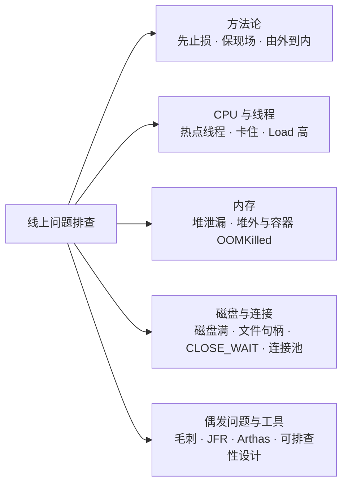
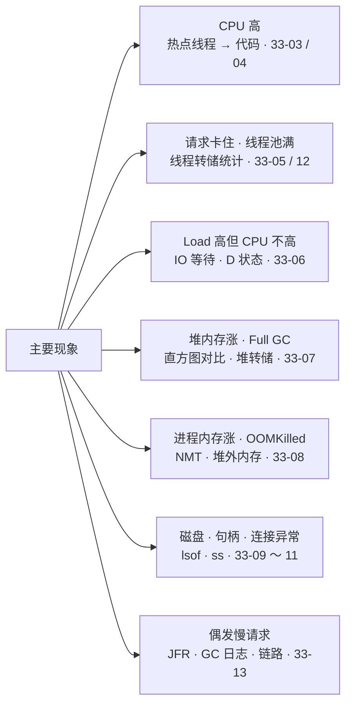
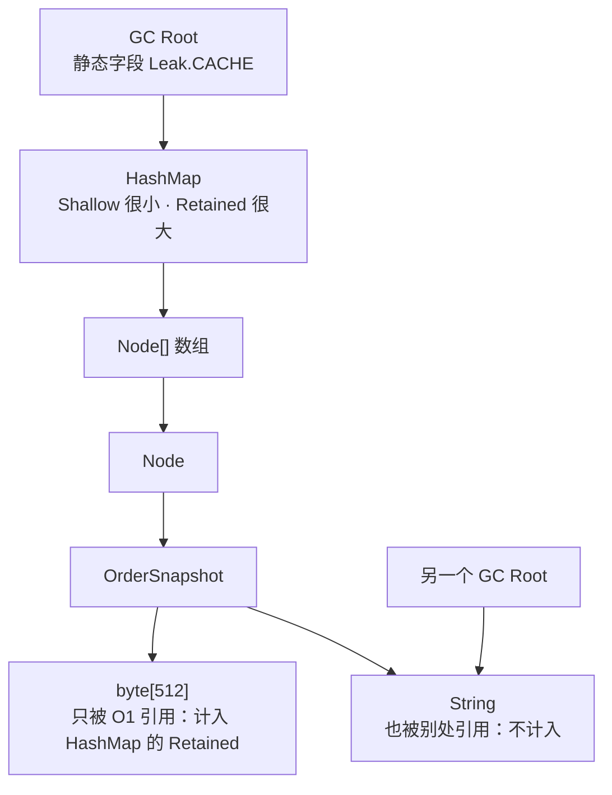
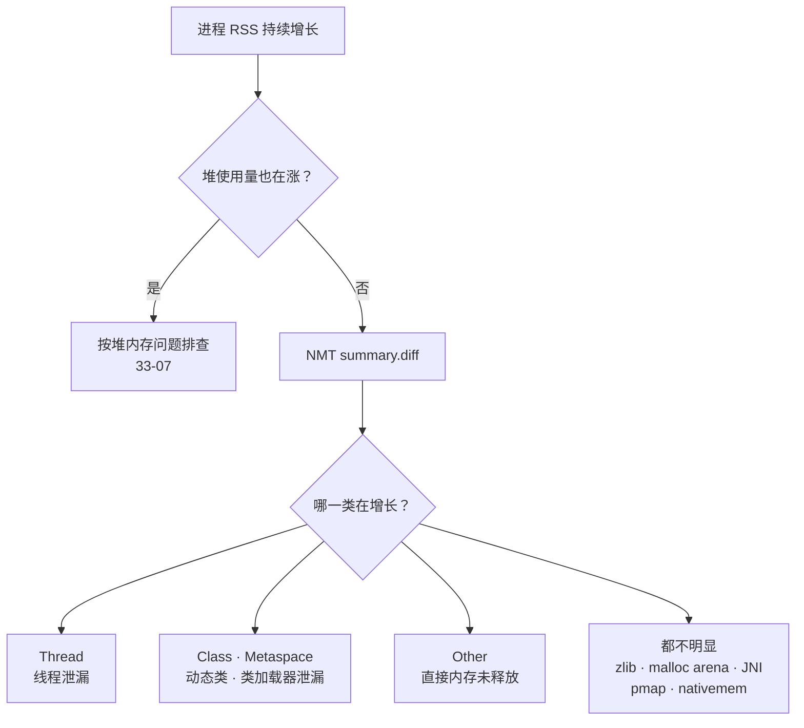
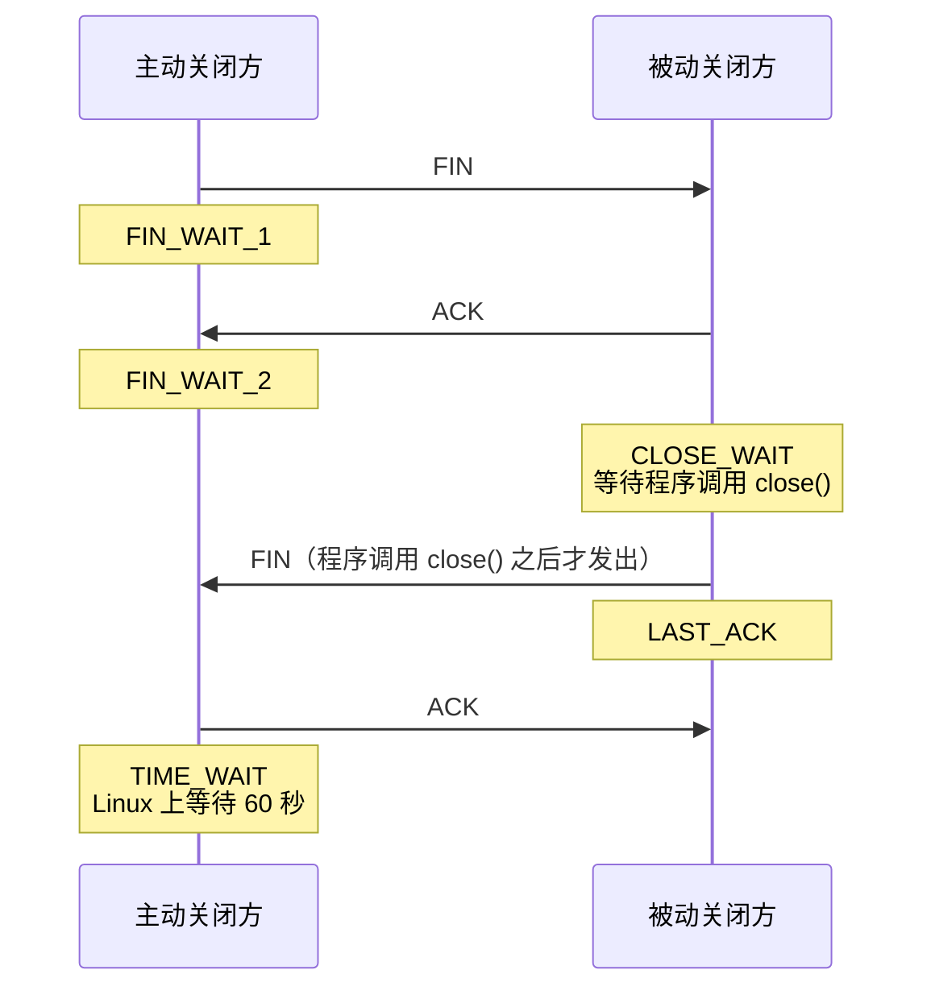
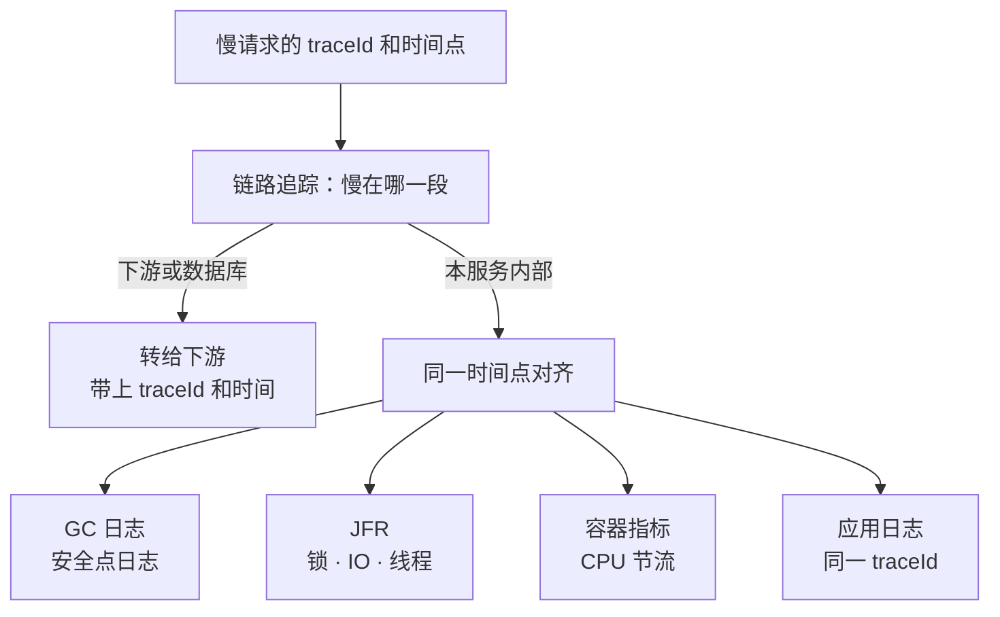
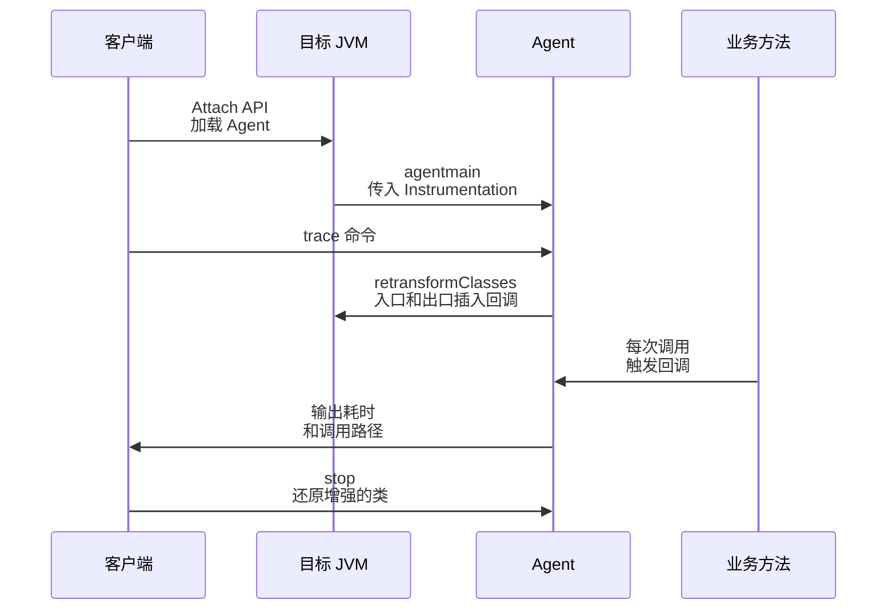
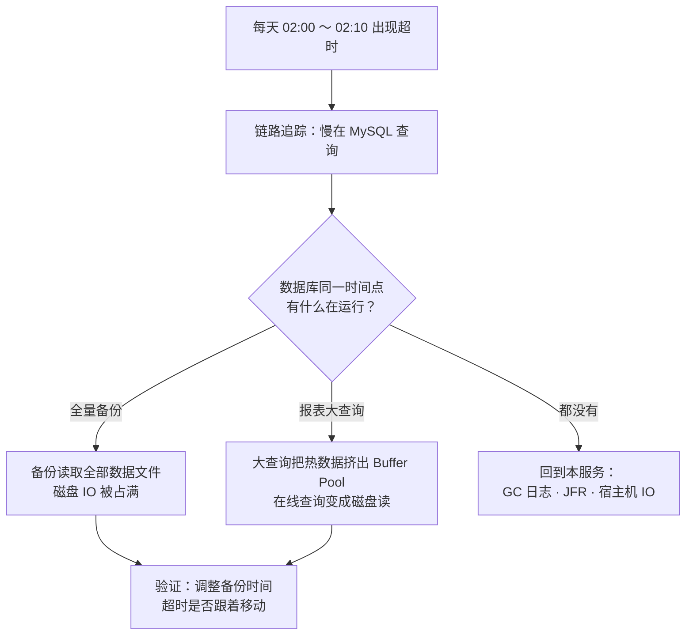

# 33 · 线上问题排查

> 适用岗位：Java 资深开发（重点：CPU、线程、内存、连接、磁盘问题的定位命令和分析方法）、Java 架构师（重点：排查方法论、现场保全、让系统"好排查"的工程设计）
> 版本基线：JDK 25（同时标注 JDK 8 / 17 上不同的地方）、HikariCP 7.0.2（Spring Boot 4.0.4 依赖管理中的版本）、async-profiler 4.6、Arthas 4.x
> 事实核对：
> - 文中的线程转储、类直方图、NMT、JFR、OOM 参数、正则回溯、CLOSE_WAIT、"已删除但未释放的文件"，都在本机（macOS，JDK 8 / 17 / 18 / 19 / 21 / 25）实际运行过，输出摘自运行结果；
> - Linux 专有的命令（`top -H`、`ss`、`vmstat`、`pidstat`、`/proc`）未在本机运行，用法来自 [man7.org 的 Linux 手册页](https://man7.org/linux/man-pages/)；
> - HikariCP 的默认值、报错信息和指标名称来自 [HikariCP 7.0.2 源码](https://github.com/brettwooldridge/HikariCP/tree/HikariCP-7.0.2)；
> - async-profiler 的用法来自 [async-profiler 官方文档](https://github.com/async-profiler/async-profiler/tree/master/docs)；
> - Arthas 的命令和限制来自 [Arthas 官方文档](https://github.com/alibaba/arthas/tree/master/site/docs/doc)
> 相关分类：[《03 Java 并发》](../01-Java核心/03-Java并发.md)（死锁、线程池事故）、[《04 JVM》](../01-Java核心/04-JVM.md)（OOM 类型、GC 排查、诊断工具、安全点）、[《25 高性能》](../06-三高与架构/25-高性能.md)（火焰图、接口变慢的排查）、[《26 高可用》](../06-三高与架构/26-高可用.md)（应急与复盘）、[《32 日志与可观测性》](32-日志与可观测性.md)、[《37 计算机网络》](../08-计算机基础/37-计算机网络.md)（TCP 状态）、[《41 容器与云计算》](../09-云原生/41-容器与云计算.md)（容器资源限制）

## 知识地图



## 题目索引

| 编号 | 题目 | 难度 | 层级 |
| --- | --- | --- | --- |
| 33-01 | 线上出了问题，排查的总体思路是什么？ | ★★ | 资深 / 架构师 |
| 33-02 | 重启之前要保留哪些现场？怎么做到随时能取证？ | ★★★ | 资深 / 架构师 |
| 33-03 | CPU 飙高，怎么定位到具体的代码？ | ★★★ | 资深 |
| 33-04 | CPU 高的常见原因有哪些？正则表达式为什么会把 CPU 打满？ | ★★★ | 资深 |
| 33-05 | 服务"卡住"了，请求不返回、线程池打满，怎么排查？ | ★★★ | 资深 |
| 33-06 | Load 很高，CPU 使用率却不高，是怎么回事？ | ★★ | 资深 |
| 33-07 | 堆内存持续上涨，怎么找到泄漏的对象？ | ★★★ | 资深 |
| 33-08 | 堆没满，进程内存却一直涨，甚至容器被 OOMKilled，怎么查？ | ★★★ | 资深 / 架构师 |
| 33-09 | 磁盘满了，删掉大日志文件后空间却没有释放，为什么？ | ★★ | 资深 |
| 33-10 | 报 Too many open files，怎么排查？ | ★★ | 资深 |
| 33-11 | 服务器上有大量 CLOSE_WAIT 或 TIME_WAIT，怎么办？ | ★★★ | 资深 |
| 33-12 | 数据库连接池被打满，怎么排查？ | ★★★ | 资深 |
| 33-13 | 偶发的慢请求（毛刺）怎么抓？ | ★★★ | 资深 / 架构师 |
| 33-14 | Arthas 的原理是什么？线上使用要注意什么？ | ★★ | 资深 |
| 33-15 | 怎样让系统"好排查"？ | ★★ | 架构师 |
| 33-16 | 综合案例：服务每天凌晨固定时间出现一批超时，怎么查？ | ★★★ | 资深 / 架构师 |

---

## 一、方法论与现场

### 33-01 线上出了问题，排查的总体思路是什么？

> ★★ ｜ 资深 / 架构师 ｜ 高频

**考察意图**：有没有一套稳定的排查顺序，还是上来就凭感觉翻代码。

**30 秒版回答**

1. **先止损，再定位**：回滚、摘除异常实例、限流、降级。用户受影响的时间比找到根因更重要，见[《26 高可用》](../06-三高与架构/26-高可用.md)26-16；
2. **止损前保留现场**：线程转储、堆信息、GC 日志、应用日志，见 33-02；
3. **确定范围**：所有实例还是个别实例？所有接口还是个别接口？所有用户还是特定参数？范围决定了方向：个别实例出问题，多半是这台机器或这个进程的问题；所有实例一起出问题，多半是变更、流量或公共依赖的问题；
4. **找变化**：问题开始的时间点和发布、配置变更、流量变化、下游变更是否吻合。**大部分线上问题都由变更引起**；
5. **由外到内逐层下钻**：
   - 先看资源：CPU、内存、磁盘、网络、连接数（USE 方法，见[《25 高性能》](../06-三高与架构/25-高性能.md)25-03）；
   - 再看进程：GC、线程、堆外内存；
   - 最后看代码：热点方法、锁、慢调用。

**深入剖析**

按"现象"选择排查入口：



**追问链**

1. **为什么强调"先看是不是个别实例"？** 个别实例异常时，最快的止损方式是把它从负载均衡中摘掉，然后在不影响用户的情况下慢慢取证；如果所有实例一起异常，摘实例没有用，要从变更和公共依赖入手。
2. **没有任何变更，问题自己出现了，可能是什么？** 流量变化（大促、爬虫、某个客户的批量调用）、数据变化（某张表的数据量越过了某个阈值，执行计划变了）、时间因素（定时任务、缓存同时过期、证书过期），以及基础设施（同一台宿主机上的其他容器争抢资源、网络抖动）。

---

### 33-02 重启之前要保留哪些现场？怎么做到随时能取证？

> ★★★ ｜ 资深 / 架构师 ｜ 高频

**考察意图**：是否有"保留证据"的意识，以及是否在事前就做了准备。

**30 秒版回答**

- **重启会销毁现场**：线程状态、堆中的对象、连接状态都会消失，根因可能永远找不到。
- 正确的顺序：**先把实例从流量中摘除** → 再取证 → 最后重启。摘除流量后取证，取证本身的停顿就不会影响用户。
- 需要保留的现场（按获取成本从低到高）：

| 现场 | 命令（JDK 25） | 说明 |
| --- | --- | --- |
| 线程转储 | `jcmd <pid> Thread.print > td-1.txt` | 间隔 5 ～ 10 秒取 3 次，才能区分"一直卡在这里"和"刚好经过这里" |
| 堆概况 | `jcmd <pid> GC.heap_info` | 开销很小 |
| 类直方图 | `jcmd <pid> GC.class_histogram > histo.txt` | 默认只统计存活对象，**会触发一次 Full GC**（帮助信息中的影响级别是 High），加 `-all` 可以跳过 |
| JFR 记录 | `jcmd <pid> JFR.dump name=<名称> filename=app.jfr` | 前提是 JFR 一直在后台运行，见下文 |
| 堆转储 | `jcmd <pid> GC.heap_dump /data/dump/heap.hprof` | 停顿时间和文件大小都与存活对象的大小成正比，最后再做 |
| 系统现场 | `top -H -p <pid>`、`ss -tanp`、`lsof -p <pid>`、`df -h` | 线程 CPU、连接状态、文件句柄、磁盘 |

**深入剖析**

现场能不能拿到，很大程度上取决于**启动时有没有准备好**。下面这组参数已在本机 JDK 25 上实际运行验证：

```bash
java \
  -XX:+HeapDumpOnOutOfMemoryError \
  -XX:HeapDumpPath=/data/dump/ \
  -XX:+ExitOnOutOfMemoryError \
  -XX:ErrorFile=/data/dump/hs_err_%p.log \
  '-Xlog:gc*,safepoint:file=/data/logs/gc-%p.log:time,uptime,level,tags:filecount=5,filesize=20m' \
  -XX:StartFlightRecording=name=bg,maxage=30m,settings=profile \
  -jar app.jar
```

| 参数 | 作用 | 本机验证结果 |
| --- | --- | --- |
| `HeapDumpOnOutOfMemoryError` + `HeapDumpPath` | 发生堆 OOM 时自动生成堆转储 | 生成了 `java_pid<pid>.hprof` |
| `ExitOnOutOfMemoryError` | 第一次 OOM 时直接退出进程，交给容器或守护进程重启 | 先写完堆转储，再以**退出码 3** 退出 |
| `-Xlog:gc*,safepoint` | GC 日志和安全点日志，按 20 MB 滚动，保留 5 个 | 文件名中的 `%p` 被替换为进程号；安全点日志中能看到"到达安全点"的耗时 |
| `StartFlightRecording` | JFR 在后台持续记录最近 30 分钟 | 出问题时用 `JFR.dump` 导出 |

**生产实践 / 踩坑**

- **为什么要 `ExitOnOutOfMemoryError`**：OOM 之后，进程往往处于"半死不活"的状态，某些线程因为 OOM 异常退出了，进程却还在，继续接收请求、继续出错。直接退出，由 Kubernetes 或 systemd 重启，行为更可预期。
- **转储文件要写到持久化的位置**：容器重启后，容器内的文件系统会被丢弃，堆转储也就丢了。`HeapDumpPath` 要指向挂载的持久卷。
- **磁盘空间**：堆转储的大小接近存活对象的大小，几个 GB 很常见。确认目标磁盘的空间，避免取证把磁盘写满，引发新的故障。
- **jcmd 的权限**：jcmd 通过 Attach 机制连接目标进程，要求以**和目标进程相同的用户**执行。在容器中，要进入同一个容器执行（`kubectl exec`）。

---

## 二、CPU 与线程

### 33-03 CPU 飙高，怎么定位到具体的代码？

> ★★★ ｜ 资深 ｜ 高频

**考察意图**：经典的排查步骤，以及对新版本 JDK 变化的了解。

**30 秒版回答**

经典的四步（Linux）：

```bash
top -c                                # 1. 找到 CPU 高的 Java 进程，记下 PID
top -H -p <pid>                       # 2. 线程模式，找到 CPU 高的线程，记下线程 ID（十进制）
printf '%x\n' <tid>                   # 3. JDK 17 及以前：把线程 ID 转成十六进制
jstack <pid> | grep -A 20 'nid=0x<十六进制>'    # 4. 在线程转储中找到这个线程的调用栈
```

- **JDK 18 起，线程转储中的 `nid` 改为十进制**，第 3 步不再需要，直接用 `top -H` 看到的十进制线程 ID 搜索 `nid=<tid>`（本机对比验证：JDK 8、17 输出 `nid=0x1503` 这样的十六进制；JDK 18、19、21、25 输出 `nid=5635` 这样的十进制，JDK 19 起线程名后面还多了一个 `[5635]`）。
- 更省事的做法：
  - **Arthas**：`thread -n 3 -i 1000` 直接列出最近 1 秒内 CPU 最高的 3 个线程及其调用栈；
  - **async-profiler**：`asprof -d 30 -f cpu.html <pid>` 采样 30 秒生成火焰图，能看到 CPU 花在哪些方法上，包括 GC 和 JIT 编译等 JVM 内部线程，见[《25 高性能》](../06-三高与架构/25-高性能.md)25-05。

**深入剖析**

本机模拟：一个线程死循环计算，另外 8 个线程抢同一把锁。JDK 25 的线程转储中，这个线程是这样的：

```text
"order-calc-1" #29 [41219] prio=5 os_prio=31 cpu=6789.69ms elapsed=6.82s tid=0x00000077b912a800 nid=41219 runnable  [0x0000000172e32000]
   java.lang.Thread.State: RUNNABLE
	at Busy.spin(Busy.java:27)
```

- `cpu=6789.69ms elapsed=6.82s`：这个线程启动 6.82 秒，用掉了 6.79 秒的 CPU 时间，几乎一直占满一个核。JDK 17 的输出中已经有这两个字段（本机验证），JDK 8 没有。
- 注意 `cpu` 是线程**启动以来的累计值**，长期运行的线程累计值大，不代表现在还在消耗 CPU。要看"现在谁在消耗 CPU"，间隔几秒取两次转储做差，或者直接用 `top -H`、Arthas `thread -n`。

如果 JFR 一直在后台运行，可以直接导出记录查看热点方法（JDK 21 起提供 `jfr view`，以下为本机 JDK 25 的实际输出）：

```text
$ jcmd <pid> JFR.dump name=bg filename=bg.jfr
$ jfr view hot-methods bg.jfr

Method                                                          Samples Percent
--------------------------------------------------------------- ------- -------
Busy.spin()                                                       6,598  99.95%
```

**追问链**

1. **CPU 高的线程不是业务线程，而是 JVM 自己的线程，说明什么？**
   线程名是 `GC Thread#0`、`G1 Conc#0` 这一类时，说明 CPU 花在垃圾回收上，问题在内存，见[《04 JVM》](../01-Java核心/04-JVM.md)04-14；线程名是 `C2 CompilerThread0`、`C1 CompilerThread0` 时，说明 JIT 正在编译，刚启动或刚发布时出现是正常的，持续出现要检查是否频繁去优化或者 Code Cache 满了。
2. **Arthas `thread -n` 统计 CPU 有开销吗？** 有。官方文档提到它依赖的 JDK 接口本身开销较大，建议把采样间隔适当拉长。

---

### 33-04 CPU 高的常见原因有哪些？正则表达式为什么会把 CPU 打满？

> ★★★ ｜ 资深 ｜ 高频

**考察意图**：能否根据调用栈快速判断原因，以及是否了解正则回溯这类隐蔽问题。

**30 秒版回答**

| 原因 | 调用栈或指标上的特征 | 处理方向 |
| --- | --- | --- |
| 死循环、无限重试 | 固定的业务方法一直在栈顶 | 修复代码；重试加上次数和退避 |
| **频繁 GC** | GC 线程 CPU 高，`jstat -gcutil` 中 GC 次数快速增长 | 按内存问题排查，见 04-14 |
| **正则表达式回溯** | 栈顶是 `java.util.regex.Pattern` 的内部类 | 改写正则、限制输入长度，见下文 |
| 大对象的序列化、JSON 处理 | 栈顶是 Jackson、Fastjson 等序列化代码 | 减少字段、分页、避免重复序列化 |
| 日志量过大 | 栈中有大量日志框架的格式化、写入调用 | 降低日志量，见[《32 日志与可观测性》](32-日志与可观测性.md) |
| 激烈的 CAS 自旋竞争 | 栈顶是 `Unsafe.compareAndSet` 所在的循环 | 降低竞争，例如用 `LongAdder` 代替 `AtomicLong` |
| 加解密、压缩 | 栈顶是 `javax.crypto`、`Deflater` 等 | 缓存结果，扩容，或把计算移到专门的服务 |

还有一种情况是"**CPU 使用率不高，但被限流了**"：容器设置了 CPU 上限，进程用满配额后被内核节流（throttling），表现为请求延迟上升，见 33-06 和[《41 容器与云计算》](../09-云原生/41-容器与云计算.md)。

**深入剖析：正则表达式的灾难性回溯**

Java 的正则引擎基于**回溯**：匹配失败时退回去尝试其他的拆分方式。某些写法遇到"差一点就能匹配"的输入时，需要尝试的组合数会随输入长度指数级增长，一个请求就能把一个 CPU 核长时间占满。

本机实测（输入为 n 个重复片段，末尾加一个让匹配失败的 `!`）：

| 正则 | JDK 8 | JDK 17 | JDK 25 |
| --- | --- | --- | --- |
| `^(a+)+$` | n = 27 时 2773 毫秒 | n = 64 时仍为 0 毫秒 | n = 64 时仍为 0 毫秒 |
| `^(\w+\s?)*$`（每段为 `word `） | n = 9 时 11851 毫秒 | n = 64 时仍为 0 毫秒 | n = 64 时仍为 0 毫秒 |
| `^(\d+)*\1$`（带反向引用） | — | n = 26 时 1550 毫秒 | n = 26 时 1551 毫秒 |
| `(.*a){12}` | — | n = 29 时 1608 毫秒 | n = 29 时 1800 毫秒 |

（"—"表示该组合未在 JDK 8 上测试。）

结论：

- 新版本 JDK 对一部分嵌套量词做了优化，**最经典的 `(a+)+` 写法在 JDK 17、25 上已经不会爆炸**，但在 JDK 8 上依然会；
- **带反向引用的写法、多个可以匹配相同内容的 `.*` 叠加**，在 JDK 25 上仍然会耗时爆炸。升级 JDK 不能完全消除这个问题。

**防御方法**：

1. 避免多个量词可以匹配同一段内容的写法；必要时使用独占量词（`a++`）或原子分组（`(?>...)`），禁止回溯；
2. **限制输入长度**，在执行正则之前先检查；
3. 对外部可控的正则或输入，使用线性时间的引擎，例如 RE2/J（代价是不支持反向引用等特性）；
4. 用户可以输入正则的功能（例如搜索、规则配置），要放在独立的线程池里执行并设置超时。

---

### 33-05 服务"卡住"了，请求不返回、线程池打满，怎么排查？

> ★★★ ｜ 资深 ｜ 高频

**考察意图**：能否从成百上千个线程的转储中快速找到规律。

**30 秒版回答**

- "卡住"时 CPU 往往不高，CPU 火焰图看不出问题，**线程转储是最主要的证据**。
- 线程很多时不要一个个看，**先统计再下钻**：
  1. 统计各种线程状态的数量；
  2. 按栈顶方法分组，找到数量最多的那一组；
  3. 如果大量线程在等同一把锁，找到持有这把锁的线程，看它在做什么。
- 间隔 5 ～ 10 秒取 3 次转储：同一个线程三次都停在同一个位置，才说明它真的卡在那里。

**深入剖析**

本机模拟：一个线程拿着锁睡眠，8 个模拟的 Tomcat 工作线程等待这把锁。以下统计命令和输出都来自本机 JDK 25：

```bash
jcmd <pid> Thread.print > td.txt

# 1. 统计线程状态
grep 'java.lang.Thread.State' td.txt | sort | uniq -c | sort -rn
#   10    java.lang.Thread.State: RUNNABLE
#    8    java.lang.Thread.State: BLOCKED (on object monitor)
#    4    java.lang.Thread.State: WAITING (parking)

# 2. 按栈顶方法分组
grep -A1 'java.lang.Thread.State' td.txt | grep '^[[:space:]]*at ' | sort | uniq -c | sort -rn | head
#    8 	at Busy.lambda$main$1(Busy.java:17)
#    4 	at jdk.internal.misc.Unsafe.park(java.base@25/Native Method)

# 3. 大量线程在等哪把锁
grep -o 'waiting to lock <0x[0-9a-f]*>' td.txt | sort | uniq -c
#    8 waiting to lock <0x0000007af729a2e0>
```

再搜索 `- locked <0x0000007af729a2e0>`，所在的线程就是锁的持有者。本例中持有者 `lock-holder` 的状态是 `TIMED_WAITING (sleeping)`：**拿着锁去睡眠（或者拿着锁去做远程调用）**，所有等这把锁的线程都被拖住。Arthas 的 `thread -b` 可以一步找出持有者，但官方文档说明它**只支持 `synchronized`**，不支持 `java.util.concurrent` 的锁。

常见的栈顶特征和含义：

| 大量线程的栈顶 | 含义 | 方向 |
| --- | --- | --- |
| `SocketInputStream.socketRead` / `NioSocketImpl.read` | 在等远程服务或数据库返回 | 下游慢；检查是否设置了读超时 |
| `HikariPool.getConnection` | 在等数据库连接 | 连接池被占满，见 33-12 |
| `BLOCKED`，`waiting to lock` 同一个地址 | 锁竞争，持有者很慢 | 找到持有者，看它在做什么 |
| `CompletableFuture.get` / `FutureTask.get` | 在等异步任务的结果 | 检查是否在线程池中等待提交到**同一个线程池**的子任务（线程池自己把自己锁死） |
| 日志框架的 `AsyncAppender` 放入队列的方法 | 异步日志队列满了，业务线程被阻塞 | 见[《32 日志与可观测性》](32-日志与可观测性.md)32-03 |
| `LinkedBlockingQueue.take`，`WAITING (parking)` | 线程池中的空闲线程在等任务 | 正常，不是问题 |

**追问链**

1. **服务使用了虚拟线程，jstack 中为什么看不到它们？** jstack 和 `Thread.print` 不输出虚拟线程，要用 `jcmd <pid> Thread.dump_to_file -format=json <文件>`，见[《03 Java 并发》](../01-Java核心/03-Java并发.md)03-11。
2. **死锁怎么看？** 线程转储的末尾会直接输出 "Found one Java-level deadlock"，见 03-11。

---

### 33-06 Load 很高，CPU 使用率却不高，是怎么回事？

> ★★ ｜ 资深 ｜ 中频

**考察意图**：是否理解 Linux Load 的真实含义。

**30 秒版回答**

- **Linux 的 Load** 是一段时间内"**正在运行或等待运行（R 状态）**"加上"**处于不可中断睡眠（D 状态，通常是在等磁盘 IO）**"的任务数的平均值（来自 `proc_loadavg(5)` 手册）。很多资料只说"Load 是 CPU 的排队长度"，在 Linux 上并不准确。
- 所以 Load 高、CPU 低，最常见的原因是**大量任务在等 IO**：磁盘慢、磁盘被打满，或者挂载的网络存储（NFS）没有响应。
- 排查：

```bash
vmstat 1        # r 列：可运行的任务数；b 列：等待 IO 而阻塞的任务数；wa 列：IO 等待的 CPU 时间占比
iostat -x 1     # 每块磁盘的使用率和平均响应时间
ps -eLo state,pid,tid,comm | grep '^D'    # 找出处于 D 状态的线程
pidstat -t -p <pid> 1                    # 按线程统计 CPU
```

**追问链**

1. **容器里看到的 Load 是谁的？** 在没有做额外隔离（例如 LXCFS）的情况下，容器中 `/proc/loadavg` 显示的是**宿主机**的 Load，不能用它判断容器自身的负载。
2. **容器的 CPU 使用率不高，接口却变慢了，可能是什么原因？** CPU 节流。容器设置了 CPU 上限后，内核按周期分配配额，一个周期内用完配额就要等到下一个周期。多线程的 Java 应用很容易在一个周期的前半段就用完配额，表现为平均 CPU 使用率不高，请求延迟却出现毛刺。cgroup v2 中可以查看 `cpu.stat` 里的 `nr_throttled`、`throttled_usec` 是否在增长，见[《41 容器与云计算》](../09-云原生/41-容器与云计算.md)。

---

## 三、内存

### 33-07 堆内存持续上涨，怎么找到泄漏的对象？

> ★★★ ｜ 资深 ｜ 高频

**考察意图**：是否掌握"确认泄漏 → 找到增长的对象 → 找到是谁引用着它"的完整流程。OOM 的类型见[《04 JVM》](../01-Java核心/04-JVM.md)04-13，常见的泄漏场景见 04-15，这里讲具体怎么操作。

**30 秒版回答**

1. **确认是泄漏**：每次 Full GC 之后，老年代的占用仍然一次比一次高（见 04-14）。只是上涨但 GC 后能降下来，不是泄漏；
2. **对比两次类直方图**，找到数量持续增长的类。开销比堆转储小得多，很多时候直接就能看出问题；
3. **堆转储 + MAT 分析**，找到这些对象被谁引用着：
   - **Leak Suspects**（泄漏嫌疑报告）：自动给出占用最大的对象和可疑的累积点；
   - **Dominator Tree**（支配树）：按 Retained Heap 排序，找到"一旦释放就能回收最多内存"的对象；
   - **Path to GC Roots**：从可疑对象反查到 GC Root 的引用链，**排除弱引用和软引用**，剩下的就是让它无法回收的那条链。

**深入剖析**

本机模拟：一个静态的 `HashMap` 当作缓存，只放不删。间隔 8 秒取两次类直方图（本机 JDK 25 的实际输出，有删减）：

```text
$ jcmd <pid> GC.class_histogram          # 第一次
 num     #instances         #bytes  class name (module)
   1:         52559       12705256  [B (java.base@25)
   4:         22000         704000  Leak$OrderSnapshot

$ jcmd <pid> GC.class_histogram          # 8 秒后
 num     #instances         #bytes  class name (module)
   1:        212559       57505256  [B (java.base@25)
   3:        102000        3264000  Leak$OrderSnapshot
```

- `[B`（`byte[]`）、`String`、`HashMap$Node` 这些基础类型几乎在所有应用中都排在前面，单看它们看不出问题；
- 要找**业务类**中数量持续增长的：`Leak$OrderSnapshot` 8 秒内从 2.2 万涨到 10.2 万，而且一直只增不减，它就是线索。
- `GC.class_histogram` 默认只统计存活对象，执行前会触发一次 Full GC，所以两次的数字都是"GC 之后仍然存活"的，可以直接比较。

**Shallow Heap 和 Retained Heap**：

- **Shallow Heap**：对象本身占用的内存。一个 `HashMap` 对象本身只有几十字节；
- **Retained Heap**：这个对象被回收后，能**连带**被回收的内存总量，也就是"只能通过它访问到"的所有对象的大小之和。



支配树按 Retained Heap 排序，排在最前面的通常就是"累积点"，例如这个静态的 `HashMap`。

**生产实践 / 踩坑**

- **不方便做堆转储时**：Arthas 的 `vmtool --action getInstances --className <类名> --limit 10` 可以直接查看某个类的若干个存活实例，确认里面存的是什么数据。
- **堆转储很大时**：几 GB 甚至几十 GB 的转储文件，本地电脑打不开，可以在服务器上用 MAT 的命令行模式（`ParseHeapDump.sh`）生成报告，或者给 MAT 分配足够大的内存。
- **对比两次堆转储**：MAT 支持把两次堆转储的直方图做对比，比只看一次更容易发现"一直在增长"的对象。

---

### 33-08 堆没满，进程内存却一直涨，甚至容器被 OOMKilled，怎么查？

> ★★★ ｜ 资深 / 架构师 ｜ 高频（容器化之后）

**考察意图**：能否排查堆外内存问题。JVM 进程内存由哪些部分组成，见[《04 JVM》](../01-Java核心/04-JVM.md)04-03，这里讲排查步骤。

**30 秒版回答**

1. **确认是堆外的问题**：进程的常驻内存（RSS）远大于堆的使用量，而且持续增长；
2. **用 NMT 看 JVM 自己管理的各部分**：启动时加 `-XX:NativeMemoryTracking=summary`（**不能在运行中开启**，没加这个参数时 jcmd 会提示 `Native memory tracking is not enabled`），然后做基线和对比：

```bash
jcmd <pid> VM.native_memory baseline            # 记录基线
# 等待一段时间，内存明显增长后
jcmd <pid> VM.native_memory summary.diff scale=MB   # 和基线对比，看哪一类在增长
```

3. **按增长的类别定位**：

| NMT 中增长的类别 | 可能的原因 |
| --- | --- |
| Thread | 线程数在增长，线程泄漏 |
| Class / Metaspace | 动态生成的类越来越多，或者类加载器泄漏 |
| Other | NIO 直接内存（DirectByteBuffer）没有释放 |
| GC / Code | GC 数据结构、JIT 编译的代码，通常比较稳定 |

4. **NMT 都正常，但进程内存还在涨**：Oracle 的文档说明 NMT **不统计非 JVM 代码的内存分配**。这时问题在 JNI 本地库或者内存分配器上，需要用系统级的工具。

**深入剖析**

本机模拟：每 200 毫秒分配一个 4 MB 的 DirectByteBuffer 并一直持有。NMT 对比的结果（本机 JDK 25 的实际输出，有删减）：

```text
Total: reserved=2190MB +152MB, committed=400MB +213MB

-  Java Heap (reserved=520MB, committed=117MB +57MB)
-     Thread (reserved=54MB -2MB, committed=1MB)
                            (threads #27 -1)
-      Other (reserved=324MB +276MB, committed=324MB +276MB)
                            (malloc=324MB +276MB #81 +69)
```

增长集中在 `Other` 一类，**NIO 的直接内存就记在这里**。

NMT 统计不到时，常见的方向：

- **zlib 压缩、解压**：`GZIPInputStream`、`Inflater`、`Deflater` 使用的内存是 zlib 在本地代码中分配的。没有关闭流或调用 `end()`，这部分内存要等对象被 GC 回收后才会释放；
- **glibc 的 malloc arena**：多线程程序中，glibc 会为线程创建多个内存分配区域（arena），以减少线程之间的竞争。`mallopt(3)` 手册说明 arena 的数量上限"通常是 CPU 核数的若干倍"，glibc 的实现中 64 位系统为 8 倍，每个 arena 预留 64 MB 的地址空间。用 `pmap -x <pid>` 能看到大量 64 MB 左右的匿名内存段。常见的处理方式是设置环境变量 `MALLOC_ARENA_MAX`（例如 2 或 4），或者改用 jemalloc 这样的分配器；
- **本地库自身的泄漏**：async-profiler 提供了 `nativemem` 模式，记录 `malloc` 和 `free` 调用，再用 `jfrconv --total --nativemem --leak` 只保留"分配了却没有释放"的调用栈，生成火焰图。



**追问链**

1. **Netty 的内存泄漏怎么查？** Netty 的 `ByteBuf` 需要手动释放（引用计数）。Netty 的泄漏检测（`-Dio.netty.leakDetection.level`）默认是 `SIMPLE` 级别，对一部分 `ByteBuf` 采样跟踪；排查时在测试环境开到 `PARANOID` 复现，见[《08 Netty》](../02-框架与容器/08-Netty.md)。
2. **容器被 OOMKilled，怎么确认是内存超限而不是别的原因？** Kubernetes 中，`kubectl describe pod` 会显示上一次终止的原因是 `OOMKilled`，退出码 137（128 + 9，被 SIGKILL 终止）。

---

## 四、磁盘、文件与连接

### 33-09 磁盘满了，删掉大日志文件后空间却没有释放，为什么？

> ★★ ｜ 资深 ｜ 高频

**考察意图**：是否理解"文件名"和"文件内容"的关系。

**30 秒版回答**

- 在 Linux 中，`rm` 删除的只是**文件名（目录项）**。如果还有进程打开着这个文件，文件的内容和占用的磁盘空间要等到**最后一个进程关闭它**之后才会释放。
- 典型的现象：`df -h` 显示磁盘快满了，`du -sh` 统计目录却远远小于这个数，差的那部分就是"已删除但仍被打开"的文件。
- 排查和处理：

```bash
lsof +L1                         # 列出链接数为 0（已删除）但仍被打开的文件
: > /proc/<pid>/fd/<fd>          # 已经删掉的文件：通过进程的文件描述符把内容清空
: > app.log                      # 还没删的大日志：清空内容，而不是 rm
```

本机验证（macOS）：一个进程写了 50 MB 的文件后删除文件但不关闭，`lsof` 中这个文件的 `NLINK`（链接数）为 0，`SIZE` 仍是 52428800 字节。Linux 上 `lsof` 还会在文件名后标注 `(deleted)`。

**追问链**

1. **空间还有很多，却提示 "No space left on device"？** 可能是 **inode 用完了**：大量的小文件（例如没有清理的临时文件、会话文件）把 inode 耗尽，用 `df -i` 查看。
2. **日志文件怎么避免把磁盘写满？** 在日志框架中配置滚动和总量上限，而不是依赖外部脚本删除文件。Spring Boot 默认的 Logback 滚动策略：单个文件 10 MB、保留 7 天，**总大小上限默认是 0B，即不限制**（已核对 Spring Boot 4.0.4 的配置元数据），要按磁盘大小设置 `logging.logback.rollingpolicy.total-size-cap`。

---

### 33-10 报 Too many open files，怎么排查？

> ★★ ｜ 资深 ｜ 中频

**考察意图**：是否知道"文件描述符"不只是文件。

**30 秒版回答**

- 在 Linux 中，打开的文件、**网络连接（socket）**、管道都会占用文件描述符。进程能打开的数量有上限，超过就报 `Too many open files`。这个错误在 Java 中最常见的原因其实是**连接泄漏**，而不是文件。
- 排查：

```bash
cat /proc/<pid>/limits | grep 'open files'              # 进程实际生效的上限
ls /proc/<pid>/fd | wc -l                               # 当前打开的数量
lsof -p <pid> | awk '{print $5}' | sort | uniq -c | sort -rn   # 按类型统计（第 5 列 TYPE：IPv4、IPv6、REG、unix 等）
```

- 如果主要是 `IPv4` / `IPv6`，说明是网络连接：继续看连接的状态和对端，见 33-11；如果主要是 `REG`，说明是普通文件：看是哪些文件，通常是打开后没有关闭。

**生产实践 / 踩坑**

- **修改了 `/etc/security/limits.conf` 却不生效**：这个文件由 PAM 在用户登录时应用。通过 systemd 启动的服务不会经过登录流程，需要在 service 文件中配置 `LimitNOFILE`；容器中的上限由容器运行时的配置决定。**以 `/proc/<pid>/limits` 中看到的值为准**。
- **用指标提前发现**：Micrometer 的 `process.files.open` 和 `process.files.max` 两个指标分别是当前打开的数量和上限（已核对 micrometer-core 1.16 的 `FileDescriptorMetrics`），Spring Boot 默认会注册。对两者的比例设置告警，比等到报错再处理要好。

---

### 33-11 服务器上有大量 CLOSE_WAIT 或 TIME_WAIT，怎么办？

> ★★★ ｜ 资深 ｜ 高频

**考察意图**：能否根据 TCP 状态判断"是哪一方、哪段代码"的问题。TCP 状态机的完整讲解见[《37 计算机网络》](../08-计算机基础/37-计算机网络.md)。

**30 秒版回答**

- TCP 关闭连接时，**先发 FIN 的一方（主动关闭方）最后进入 TIME_WAIT**；**收到 FIN 的一方（被动关闭方）进入 CLOSE_WAIT，直到自己的程序调用 `close()`**。
- **大量 CLOSE_WAIT：几乎都是自己代码的问题**。对方已经关闭了连接，我方的程序却一直没有关闭。常见原因：HTTP 客户端的响应没有关闭、连接没有归还给连接池、异常分支中漏掉了 `close()`。每个 CLOSE_WAIT 都占用一个文件描述符，积累下去会导致 33-10 的问题。
- **大量 TIME_WAIT：说明我方频繁地主动关闭连接**，通常是没有使用长连接。TIME_WAIT 是 TCP 正常的设计，Linux 上持续 60 秒。数量多到一定程度时，作为客户端会**耗尽本地端口**（Linux 默认的本地端口范围是 32768 ～ 60999，约 2.8 万个）。

**深入剖析**



本机复现：服务端 accept 连接后，客户端主动关闭，服务端读到了 EOF（`read()` 返回 -1）却不调用 `close()`：

```text
$ netstat -an -p tcp | grep 18099
tcp4  0  0  127.0.0.1.18099   127.0.0.1.57481   CLOSE_WAIT     ← 服务端：等程序 close()
tcp4  0  0  127.0.0.1.57481   127.0.0.1.18099   FIN_WAIT_2     ← 客户端：等对方的 FIN

$ lsof -nP -p <pid> -a -i TCP
java  <pid>  ...  7u  IPv6  ...  TCP 127.0.0.1:18099->127.0.0.1:57479 (CLOSE_WAIT)
java  <pid>  ...  8u  IPv6  ...  TCP 127.0.0.1:18099->127.0.0.1:57480 (CLOSE_WAIT)
```

每个 CLOSE_WAIT 连接都占着一个文件描述符（`7u`、`8u`）。在 Linux 上可以用 `ss -tanp state close-wait` 列出这些连接，按**对端地址**分组统计，就能知道是和哪个下游的连接没有关闭，再去检查调用这个下游的代码。

**生产实践 / 踩坑**

- **TIME_WAIT 多的正确处理**：使用连接池和长连接（HTTP Keep-Alive），从根源上减少连接的建立和关闭。
- **不要随手调内核参数**：
  - `tcp_tw_reuse` 允许在协议上安全时复用 TIME_WAIT 状态的连接，新版内核的默认值是 2（只对本机回环地址启用），内核文档明确写着"没有专家建议不应修改"；
  - 早年流行的 `tcp_tw_recycle` 在 NAT 环境下会导致连接失败，已在 Linux 4.12 中被移除。

---

### 33-12 数据库连接池被打满，怎么排查？

> ★★★ ｜ 资深 ｜ 高频

**考察意图**：连接池问题是 Java 服务最常见的线上问题之一，能否找到"连接被谁占着"。

**30 秒版回答**

- **现象**：HikariCP 报错 `Connection is not available, request timed out after 30000ms`。默认的获取连接超时是 30 秒，所以接口会在 30 秒左右集中超时。
- HikariCP 7.0.2 的关键默认值（已核对源码）：

| 参数 | 默认值 |
| --- | --- |
| `maximumPoolSize` | 10 |
| `connectionTimeout` | 30 秒（获取连接的等待时间） |
| `idleTimeout` | 10 分钟 |
| `maxLifetime` | 30 分钟 |
| `leakDetectionThreshold` | 0，即不开启泄漏检测 |

- **连接被占满的常见原因**：
  1. **慢 SQL**：每个连接被占用的时间变长；
  2. **长事务**：`@Transactional` 方法中包含远程调用、消息发送、大量计算，连接在整个事务期间都被占着；
  3. **连接泄漏**：手动获取的连接没有关闭；
  4. **共用连接池**：批处理任务和在线请求共用一个连接池，批处理任务把连接占满；
  5. **连接池太小**：并发量确实超过了连接池的容量。

**深入剖析**

排查步骤：

1. **看指标**：HikariCP 的 Micrometer 指标（已核对源码中的指标名称）：
   - `hikaricp.connections.active`：正在使用的连接数；
   - `hikaricp.connections.pending`：**正在排队等待连接的线程数**，大于 0 就说明连接池已经不够用了；
   - `hikaricp.connections.usage`：每个连接从借出到归还的时长，变长说明 SQL 或事务变慢；
   - `hikaricp.connections.acquire`：获取连接的等待时间；
   - `hikaricp.connections.timeout`：获取连接超时的次数。
2. **看线程转储**：大量线程停在 `HikariPool.getConnection`，是在**等**连接的线程；更要找的是**正拿着连接的线程**在做什么，例如停在 socket 读上（在等数据库返回，或者在事务中等某个远程调用返回）。
3. **看数据库端**：MySQL 中用 `SHOW PROCESSLIST` 查看正在执行的 SQL；查询 `information_schema.innodb_trx` 找到运行时间很长的事务，见[《15 MySQL》](../04-数据存储/15-MySQL.md)。
4. **开启泄漏检测**：设置 `leakDetectionThreshold`（例如 60 秒），一个连接被借出超过这个时间还没有归还时，HikariCP 会打印一条日志，**附带借出连接时的调用栈**，直接指向泄漏的代码。源码中规定，这个值小于 2 秒或者大于 `maxLifetime` 时，泄漏检测会被自动关闭。

**追问链**

1. **连接池是不是越大越好？** 不是。HikariCP 的 wiki 引用了 PostgreSQL 项目给出的经验公式作为**起点**：连接数 ≈ 数据库服务器的 CPU 核数 × 2 + 有效磁盘数。数据库能同时高效执行的查询数是有限的，连接过多只会增加数据库端的上下文切换和锁竞争。注意这是**数据库端总的活跃连接数**，所有应用实例的连接池加起来不应该远超这个量级，扩容应用实例时要同步考虑。
2. **事务中有远程调用，怎么改？** 把远程调用移到事务之外：先在事务外调用远程服务拿到结果，再开启一个短事务写数据库；需要保证一致性时，用本地消息表等方式，见[《09 分布式理论》](../03-分布式与微服务/09-分布式理论.md)。

---

## 五、偶发问题与工具

### 33-13 偶发的慢请求（毛刺）怎么抓？

> ★★★ ｜ 资深 / 架构师 ｜ 高频

**考察意图**：持续性的慢可以现场排查，偶发的慢等你登录上去时早就消失了。能否用"事前记录、事后对齐时间"的方法解决。持续变慢的排查见[《25 高性能》](../06-三高与架构/25-高性能.md)25-06。

**30 秒版回答**

- **难点**：毛刺持续时间短、无法稳定复现，等到登录服务器时现场已经没了。所以关键是**事前就在记录**：
  - 链路追踪用尾部采样，保留所有慢请求的链路，见[《32 日志与可观测性》](32-日志与可观测性.md)32-11；
  - JFR 在后台常开，GC 日志和安全点日志常开，见 33-02；
  - 指标关注 P99、P999 和最大值，不能只看平均值。
- **定位方法：对齐时间点**。拿到慢请求的 traceId 和发生时间：
  1. 看链路，慢在哪一段；
  2. 如果慢在本服务内部，把这个时间点和 GC 日志、安全点日志、JFR 中的事件对齐；
  3. 还在持续偶发时，用 Arthas 按条件抓取：`trace com.example.OrderService create '#cost > 200'`，只在方法耗时超过 200 毫秒时输出调用路径和每一步的耗时（官方文档中 `watch`、`stack`、`trace` 都支持 `#cost` 条件）。
- async-profiler 的**墙钟模式**（`asprof -e wall -t -d 60 -f wall.html <pid>`）不管线程是在运行还是在等待，都按固定间隔采样，能看到等待花在哪里；CPU 模式只能看到正在运行的代码。

**深入剖析**

毛刺的常见原因和对应的证据：

| 原因 | 证据 |
| --- | --- |
| GC 停顿 | GC 日志中停顿的时间点和时长与毛刺吻合，见[《04 JVM》](../01-Java核心/04-JVM.md)04-14 |
| **等待进入安全点** | 安全点日志中 `Reaching safepoint` 耗时很长（GC 本身很短，线程迟迟到不了安全点），见 04-18 |
| CPU 节流 | 容器 `cpu.stat` 中的 `nr_throttled` 在增长，见 33-06 |
| 发布后的预热 | 毛刺集中在发布后的几分钟：JIT 尚未编译、类首次加载、连接池在建立连接、缓存为空 |
| 连接重建 | 连接池中的连接到达 `maxLifetime` 后被替换；下游的长连接被中间设备断开后重建 |
| DNS 解析 | JDK 默认把成功的 DNS 解析结果缓存 30 秒（JDK 25 的 `java.security` 文件中有说明），缓存过期后的第一次请求要重新解析；DNS 服务慢时就表现为周期性的毛刺 |
| TCP 重传 | 网络丢包时，Linux 上重传至少要等 200 毫秒，表现为"刚好多了 200 毫秒"的慢请求，用 `netstat -s` 查看重传计数 |
| 同步写日志 | 日志盘 IO 抖动，业务线程阻塞在写日志上，见[《32 日志与可观测性》](32-日志与可观测性.md)32-03 |
| 锁竞争 | JFR 中的 `jdk.JavaMonitorEnter`（等待进入 synchronized）、`jdk.ThreadPark`（等待 j.u.c 的锁）事件 |

安全点日志（本机 JDK 25 加 `-Xlog:safepoint` 的实际输出）：

```text
[info][safepoint] Safepoint "G1TryInitiateConcMark", Time since last: 10181625 ns, Reaching safepoint: 1834 ns, At safepoint: 511541 ns, Leaving safepoint: 1584 ns, Total: 514959 ns, Threads: 0 runnable, 10 total
```

- `Reaching safepoint`：所有线程到达安全点花的时间，这一项很长，说明有线程迟迟不能停下来（例如在执行一个很长的计数循环）；
- `At safepoint`：在安全点上执行操作（例如 GC）花的时间。



---

### 33-14 Arthas 的原理是什么？线上使用要注意什么？

> ★★ ｜ 资深 ｜ 高频

**考察意图**：不只是会用命令，还要知道它对线上进程做了什么，以及风险在哪里。常用命令的列表见[《04 JVM》](../01-Java核心/04-JVM.md)04-16。

**30 秒版回答**

- **原理**：
  1. 通过 JDK 的 **Attach API** 连接到目标 JVM，把 Arthas 的 Agent 动态加载进去；
  2. Agent 拿到 `Instrumentation` 对象；
  3. `watch`、`trace`、`stack`、`tt` 这类命令，通过 `retransformClasses` **改写目标类的字节码**，在方法的入口、返回、抛出异常的位置插入回调，采集参数、返回值和耗时；
  4. `thread`、`dashboard`、`vmtool` 这类命令通过 JMX 或 JVMTI 读取 JVM 的状态，不修改字节码。
- **注意事项**：
  - **用完执行 `stop`**：它会还原所有被增强的类。但官方文档特别说明，**用 `redefine`、`retransform` 加载的类不会被还原**；
  - **控制输出量**：在高频调用的方法上 `watch`、`trace`，每次调用都会执行回调；`-x` 展开很深的对象图，开销很大。用 `-n` 限制输出次数，用条件表达式过滤；
  - **安全**：Arthas 可以通过 OGNL 表达式调用任意方法、修改静态字段，生产环境中要做权限控制和操作审计；
  - **热修复要谨慎**：`jad` 反编译、修改源码、`mc` 编译、`retransform` 加载，可以在不重启的情况下替换方法体。但修改**不会持久化**，重启后失效；也只能修改方法体，不能增删字段和方法。只适合紧急止损，之后必须走正式的发布流程。

**深入剖析**



**追问链**

1. **JDK 21 之后用 Arthas 有什么变化？** JDK 21 起（JEP 451），运行中动态加载 Agent 时，JVM 会打印警告，并说明**将来的版本会默认禁止动态加载**。本机 JDK 25 验证：动态加载一个测试 Agent 时打印了 4 行 `WARNING`，Agent 仍然加载成功；启动时加上 `-XX:+EnableDynamicAgentLoading` 后不再出现警告。需要在线上使用 Arthas 这类工具的服务，应该在启动参数中**显式**加上这个参数，避免将来升级 JDK 后无法使用。
2. **Attach 失败，常见的原因？** 执行命令的用户和目标进程的用户不同；目标进程以 `-XX:+DisableAttachMechanism` 启动；容器中工具和目标进程不在同一个容器，看不到对方的进程和临时目录。

---

### 33-15 怎样让系统"好排查"？

> ★★ ｜ 架构师 ｜ 中频

**考察意图**：架构师要在出事之前就把排查能力建好，而不是靠个人英雄主义。

**30 秒版回答**

按"事前、事中、事后"准备：

| 阶段 | 准备什么 |
| --- | --- |
| **事前：数据** | 日志带 traceId 和实例标识；指标覆盖 RED、USE、线程池、连接池等待数（`hikaricp.connections.pending`）、文件句柄数；链路尾部采样；JFR、GC 日志、安全点日志常开 |
| **事前：参数** | OOM 自动转储并退出，转储写到持久卷（33-02）；需要 Arthas 时显式加上 `-XX:+EnableDynamicAgentLoading`（33-14） |
| **事前：工具** | 运行环境中带有诊断工具：jcmd 在 JDK 的 `jdk.jcmd` 模块中，用 jlink 裁剪的运行时如果没有包含这个模块，就没有 jcmd |
| **事中：能力** | 能把单个实例从流量中摘除（不重启）后再取证；有一键取证脚本，结果自动上传到统一的存储；诊断工具的使用有权限控制和审计 |
| **事后：闭环** | 复盘时问"这次缺了什么数据"，把缺的埋点、指标、告警补上；把排查过程写进处理手册；在故障演练中同时演练取证 |

**架构师加分点**

- **持续性能剖析**：在生产环境中以很低的频率持续采样 CPU、内存分配、锁，按时间保存。出问题时可以直接对比"出问题的时间段"和"正常的时间段"的火焰图，而不需要等问题再次出现。async-profiler 官方文档中有持续剖析的用法，也可以使用 JFR 或专门的持续剖析平台。
- **排查能力要演练**：工具平时不用，关键时刻往往发现没权限、镜像里没有工具、转储写不出来。在混沌工程演练中，把"取证"作为固定的一步，见[《26 高可用》](../06-三高与架构/26-高可用.md)26-15。

---

### 33-16 综合案例：服务每天凌晨固定时间出现一批超时，怎么查？

> ★★★ ｜ 资深 / 架构师 ｜ 高频

**考察意图**：综合运用前面的方法。下面是一个**综合了多种常见情况的典型排查过程**，用来演示思路，不是某一个具体事件的记录。

**30 秒版回答**

- **"固定时间"本身就是最重要的线索**：优先怀疑**定时发生的事情**：
  - 本服务或其他服务的定时任务、批处理、报表；
  - 数据库备份、数据同步、统计信息收集；
  - 日志切割和压缩；
  - 缓存在同一时间集中过期；
  - 令牌、证书的定时刷新；
  - 同一台宿主机上其他应用的定时任务。
- 然后按 33-13 的方法**对齐时间点**，逐个排除。

**深入剖析**



一个典型的过程：

1. **看链路**：超时请求的时间都花在一条原本只要几毫秒的 MySQL 查询上，这条 SQL 的执行计划没有变化；
2. **看数据库**：同一时间段，数据库服务器的磁盘使用率接近 100%，慢查询日志中出现了一条全表扫描的报表 SQL，同时运维的全量备份也在 02:00 启动；
3. **验证**：把备份调整到 03:30，第二天超时的时间段跟着移到了 03:30 附近，说明备份是主要原因；
4. **根治**，而不是只挪时间：
   - 备份放到从库上执行；
   - 报表类查询走只读从库或数据仓库，不和在线业务共用主库；
   - 定时任务错开执行时间，并限制速度；
5. **补上监控**：数据库的磁盘 IO、Buffer Pool 命中率加入大盘和告警，下次能直接看到。

**追问链**

1. **如果链路追踪显示慢在本服务内部呢？** 按 33-13 对齐时间点：GC 日志有没有长停顿；宿主机上是不是有日志压缩任务在同一时间运行，导致磁盘 IO 抖动，而应用使用的是同步写日志；JFR 中这个时间段的线程在等什么。
2. **缓存集中过期引起的凌晨毛刺怎么处理？** 过期时间加上随机值，热点数据提前异步刷新，见[《17 Redis》](../04-数据存储/17-Redis.md)17-13。
