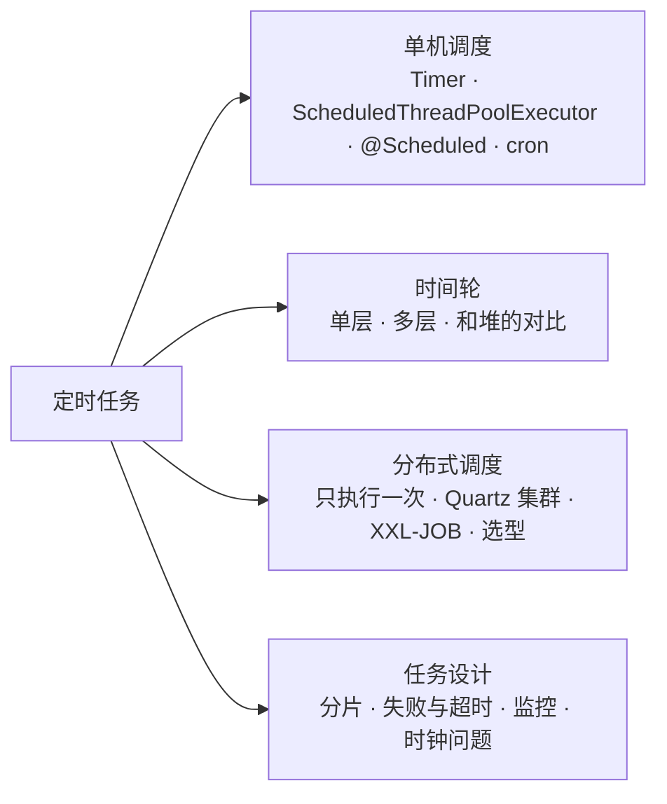
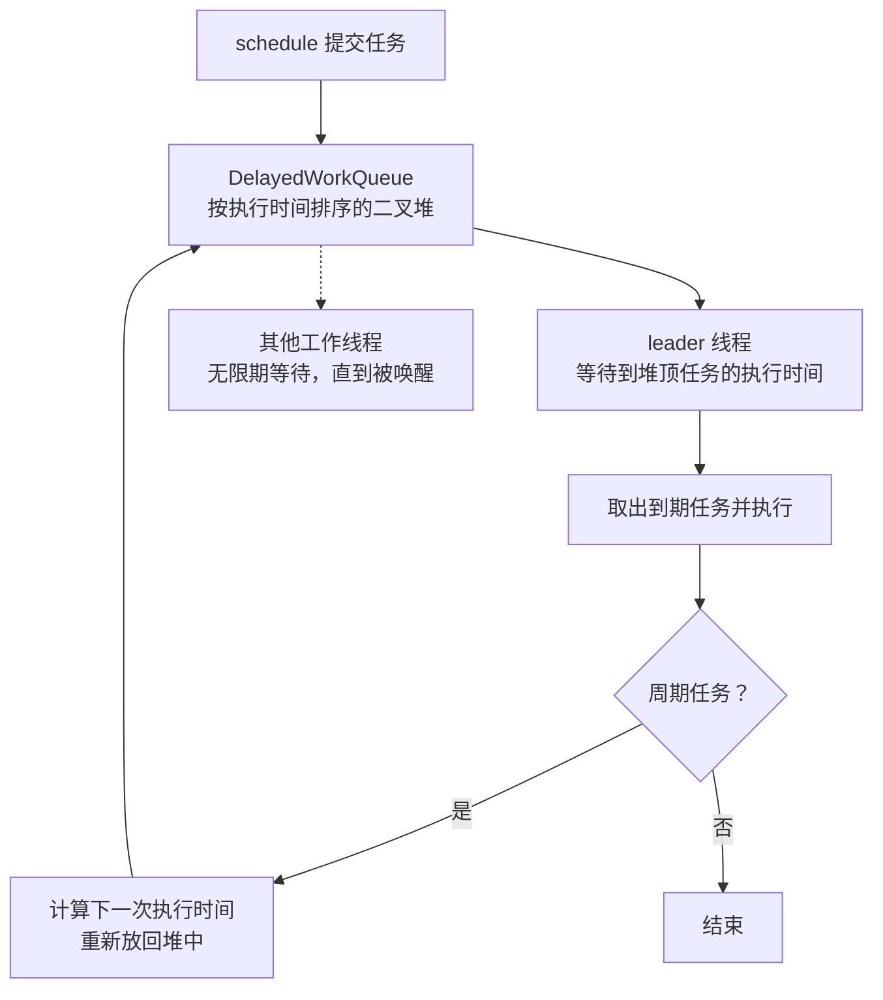
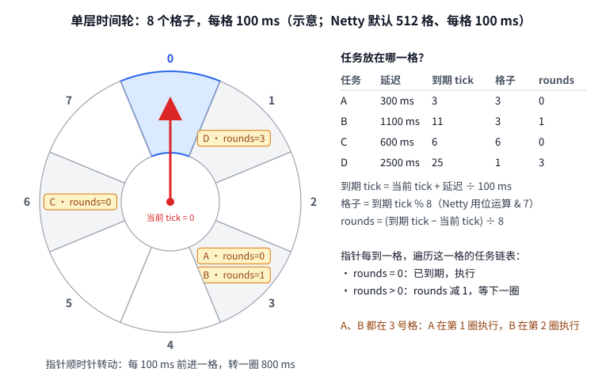
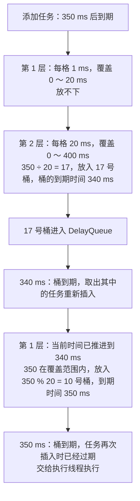
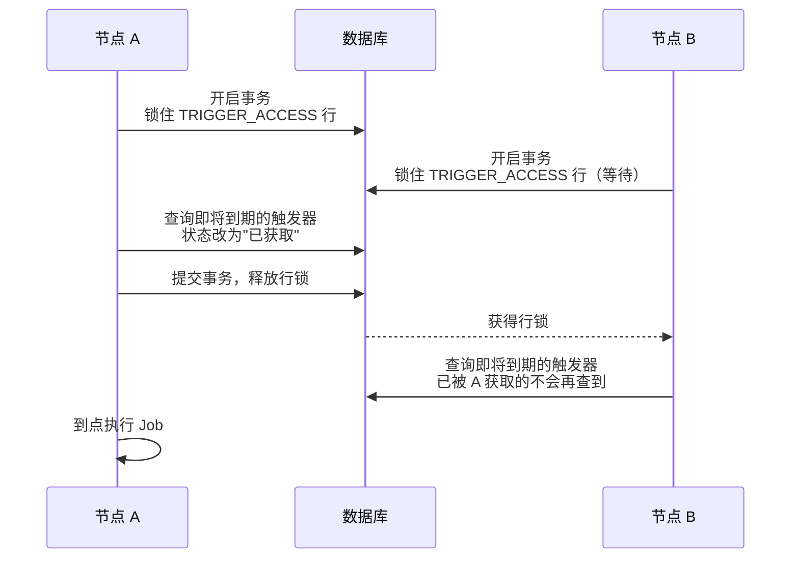
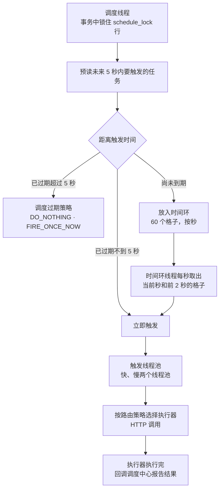
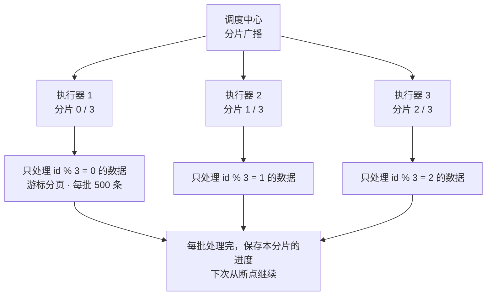
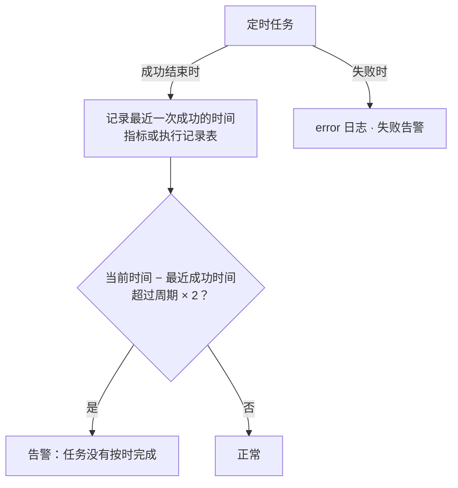

# 34 · 定时任务

> 适用岗位：Java 资深开发（重点：JDK 调度器、Spring `@Scheduled`、cron、Quartz 与 XXL-JOB 的使用和坑）、Java 架构师（重点：时间轮、分布式调度的原理与选型、大批量任务设计、任务监控）
> 版本基线：JDK 25、Spring Framework 7.0.6 / Spring Boot 4.0.4、Quartz 2.5.2、Netty 4.2.10（以上为 Spring Boot 4.0.4 依赖管理中的版本）、XXL-JOB 3.4.0（GitHub 上的最新标签）、ShedLock 7.11.0、Kafka（trunk 分支源码）
> 事实核对：
> - Timer、ScheduledThreadPoolExecutor、Spring `@Scheduled`、Spring 与 Quartz 的 cron 对比，都在本机 JDK 25 上实际运行过，输出摘自运行结果；
> - JDK、Spring、Quartz、Netty、XXL-JOB 执行器的结论已对照本机源码包核对；
> - XXL-JOB 调度中心的原理来自 [XXL-JOB v3.4.0 源码](https://github.com/xuxueli/xxl-job/tree/v3.4.0)；
> - Kafka 多层时间轮来自 [Kafka 源码](https://github.com/apache/kafka/tree/trunk/server-common/src/main/java/org/apache/kafka/server/util/timer)；
> - ShedLock 的语义来自 [ShedLock README](https://github.com/lukas-krecan/ShedLock)；
> - Kubernetes CronJob 的行为来自 [Kubernetes 官方文档](https://kubernetes.io/docs/concepts/workloads/controllers/cron-jobs/)
> 相关分类：[《03 Java 并发》](../01-Java核心/03-Java并发.md)（线程池、DelayQueue）、[《08 Netty》](../02-框架与容器/08-Netty.md)（HashedWheelTimer）、[《15 MySQL》](../04-数据存储/15-MySQL.md)（深分页）、[《17 Redis》](../04-数据存储/17-Redis.md)（分布式锁、延迟队列）、[《21 Kafka》](../05-消息队列/21-Kafka.md)、[《29 场景题》](../06-三高与架构/29-场景题.md)（订单超时取消）、[《41 容器与云计算》](../09-云原生/41-容器与云计算.md)（CronJob）

## 知识地图



## 题目索引

| 编号 | 题目 | 难度 | 层级 |
| --- | --- | --- | --- |
| 34-01 | Java 中实现定时任务有哪些方式？怎么选？ | ★★ | 资深 |
| 34-02 | Timer 有什么问题？ScheduledThreadPoolExecutor 是怎么实现的？ | ★★★ | 资深 |
| 34-03 | `scheduleAtFixedRate` 和 `scheduleWithFixedDelay` 有什么区别？任务抛异常会怎样？ | ★★ | 资深 |
| 34-04 | Spring 的 `@Scheduled` 有哪些坑？ | ★★★ | 资深 |
| 34-05 | cron 表达式在 Linux、Spring、Quartz 中有什么不同？ | ★★ | 资深 |
| 34-06 | 时间轮的原理是什么？和基于堆的延迟队列比有什么优劣？ | ★★★ | 资深 / 架构师 |
| 34-07 | 多层时间轮是怎么处理大跨度延迟的？ | ★★★ | 架构师 |
| 34-08 | 服务部署了多个实例，定时任务怎么保证只执行一次？ | ★★ | 资深 |
| 34-09 | Quartz 集群是怎么工作的？什么是 misfire？ | ★★★ | 资深 |
| 34-10 | XXL-JOB 的架构和调度原理是什么？ | ★★★ | 资深 / 架构师 |
| 34-11 | 分布式调度方案怎么选？ | ★★ | 架构师 |
| 34-12 | 处理大批量数据的定时任务怎么设计？ | ★★★ | 资深 / 架构师 |
| 34-13 | 任务失败、超时、执行时间超过调度周期，怎么处理？ | ★★★ | 资深 |
| 34-14 | 定时任务没有执行，怎么及时发现？ | ★★ | 架构师 |
| 34-15 | 时钟回拨、时区、夏令时对定时任务有什么影响？ | ★★ | 资深 / 架构师 |

---

## 一、单机调度

### 34-01 Java 中实现定时任务有哪些方式？怎么选？

> ★★ ｜ 资深 ｜ 高频

**考察意图**：对各种方案的定位是否清楚。

**30 秒版回答**

| 方式 | 特点 | 适用 |
| --- | --- | --- |
| `Timer` | JDK 1.3 就有，单线程，一个任务出错整个 Timer 停止 | 不建议使用，见 34-02 |
| `ScheduledThreadPoolExecutor` | JDK 5 起，线程池 + 延迟队列 | 进程内的简单周期任务、延迟任务 |
| Spring `@Scheduled` | 注解声明，支持 cron、固定频率、固定间隔 | Spring 应用中的单机定时任务 |
| Quartz | 功能完整的调度框架，支持持久化和集群 | 需要动态管理任务、持久化、集群的场景 |
| 分布式调度平台（XXL-JOB、PowerJob 等） | 调度中心统一管理，有界面、日志、告警、分片 | 任务多、需要统一运维的团队 |
| Kubernetes CronJob | 按计划启动一个 Pod 运行任务，运行完退出 | 和在线服务无关的独立批处理 |
| 时间轮 | 大量短时延迟任务，添加和取消的开销很小 | 连接超时检测、请求超时、心跳 |
| 延迟消息 | MQ 到期后投递消息 | 订单超时取消这类"某个时间点处理某条业务数据"的场景，见[《29 场景题》](../06-三高与架构/29-场景题.md)29-03 |

**追问链**

1. **"定时任务"和"延迟任务"有什么区别？** 定时任务按固定的计划**周期性**执行，任务数量少、和具体业务数据无关，例如"每天凌晨做对账"。延迟任务是"**某条数据在某个时间点要处理一次**"，数量和业务数据一样多，例如"这个订单 30 分钟后未支付就取消"。用定时任务扫表的方式实现大量的延迟任务，会带来延迟和数据库压力，见 29-03。

---

### 34-02 Timer 有什么问题？ScheduledThreadPoolExecutor 是怎么实现的？

> ★★★ ｜ 资深 ｜ 中频

**考察意图**：是否了解 JDK 调度器的实现，以及 Timer 被替代的原因。

**30 秒版回答**

**Timer 的问题**：

1. **单线程**：所有任务在同一个线程中串行执行，一个任务执行慢，其他任务都被推迟；
2. **一个任务抛出异常，整个 Timer 停止**：执行线程因为未捕获的异常退出，其他任务也不再执行，之后再提交任务会抛出 `IllegalStateException: Timer already cancelled.`；
3. **基于系统时间**：Timer 用 `System.currentTimeMillis()` 计算执行时间（已核对 JDK 25 源码），修改系统时间会影响任务的执行。

本机验证：一个每 100 毫秒执行一次的正常任务，和一个在 250 毫秒时抛出异常的任务放在同一个 Timer 中。600 毫秒和 1100 毫秒时，正常任务的执行次数都是 3，异常之后它再也没有执行过。

**ScheduledThreadPoolExecutor 的实现**：

- 继承自 `ThreadPoolExecutor`，可以有多个工作线程；
- 任务队列是 `DelayedWorkQueue`：一个按**下次执行时间**排序的**二叉堆**，插入和取出的时间复杂度是 O(log n)；
- 用 `System.nanoTime()` 计算延迟，不受修改系统时间的影响；
- **周期任务**执行完后，计算下一次的执行时间，再放回队列；
- 等待到期的方式采用 **Leader-Follower 模式**：只有一个线程（leader）按堆顶任务的剩余时间限时等待，其他线程无限期等待，避免所有线程同时醒来争抢。

**深入剖析**



---

### 34-03 `scheduleAtFixedRate` 和 `scheduleWithFixedDelay` 有什么区别？任务抛异常会怎样？

> ★★ ｜ 资深 ｜ 高频

**考察意图**：两种周期的语义，以及一个非常隐蔽的坑。

**30 秒版回答**

| | `scheduleAtFixedRate` | `scheduleWithFixedDelay` |
| --- | --- | --- |
| 周期的计算 | 按**开始时间**计算：第 n 次的计划时间 = 首次时间 + n × 周期 | 按**上一次结束的时间**计算：上一次结束后，再等一个间隔 |
| 任务耗时超过周期 | 下一次在上一次结束后**立即开始**，不会并发执行 | 不存在这个问题，两次之间总是间隔固定的时间 |
| 适用 | 需要按固定节奏执行，例如每秒采集一次指标 | 需要保证两次执行之间有间隔，例如轮询 |

- **同一个周期任务不会并发执行**，即使线程池有多个线程。本机验证：线程池有 4 个线程，周期 100 毫秒，任务每次耗时 300 毫秒，最大并发数是 1，各次开始的时间是 4、312、617、921、1223 毫秒，一次紧接着一次。
- **任务抛出异常后，这个任务的后续执行会被静默取消**（`ScheduledExecutorService` 的文档中有说明）：不打印日志，其他任务照常执行，只有调用 `future.get()` 时才能拿到异常。本机验证：一个任务在第 3 次执行时抛出异常，1 秒后它的执行次数停在 3，`isDone()` 为 `true`；同一个线程池中的另一个任务正常执行了 11 次。

**生产实践 / 踩坑**

- **周期任务的方法体一定要捕获所有异常**，否则某一次偶然的异常（例如网络抖动）会让这个任务从此不再执行，而且没有任何日志。这个问题往往要到很久以后才被发现。
- Spring 的 `@Scheduled` 不存在这个问题：Spring 为周期任务包装了错误处理器，默认记录 error 日志后继续调度（已核对 Spring 7.0.6 的 `TaskUtils`）。

---

### 34-04 Spring 的 `@Scheduled` 有哪些坑？

> ★★★ ｜ 资深 ｜ 高频

**考察意图**：最常用的定时任务方式，有没有在生产中踩过坑。

**30 秒版回答**

1. **默认只有一个线程**：所有 `@Scheduled` 方法共用一个线程，一个任务执行慢，其他任务都被推迟。
   - 不使用 Spring Boot 时，Spring 默认创建一个单线程的 `ScheduledExecutorService`；
   - Spring Boot 自动配置的 `ThreadPoolTaskScheduler`，线程数 `spring.task.scheduling.pool.size` 默认也是 **1**，线程名前缀是 `scheduling-`（已核对 Spring Boot 4.0.4）；
   - 开启虚拟线程（`spring.threads.virtual.enabled=true`）时，Spring Boot 改用 `SimpleAsyncTaskScheduler`，每次执行使用一个新的虚拟线程。
2. **多实例部署时每个实例都会执行**：`@Scheduled` 只是单机的调度，见 34-08。
3. **cron 是 6 个字段**（第一个字段是秒），Linux crontab 的 5 字段写法会直接报错，见 34-05。
4. **时区**：cron 默认使用服务器的时区。容器中的默认时区常常是 UTC，`0 0 10 * * *` 会在北京时间 18 点执行。用 `zone = "Asia/Shanghai"` 显式指定。
5. **异常**：周期任务抛出异常时，Spring 记录 error 日志（`Unexpected error occurred in scheduled task`）后继续调度，不会像 34-03 那样静默停止。

**深入剖析**

本机验证（纯 Spring 7.0.6，未使用 Spring Boot）：`heartbeat` 每秒执行一次，`slowReport` 在 1.7 秒时开始执行，耗时 4 秒：

```text
heartbeat@200ms[pool-1-thread-1]
heartbeat@1200ms[pool-1-thread-1]
slowReport start@1700ms
heartbeat@5700ms[pool-1-thread-1]      ← 2.2 秒、3.2 秒、4.2 秒、5.2 秒的执行都被耽误了
heartbeat@5700ms[pool-1-thread-1]
heartbeat@5700ms[pool-1-thread-1]
heartbeat@5700ms[pool-1-thread-1]      ← 固定频率：慢任务结束后，把错过的几次连续补上
heartbeat@6200ms[pool-1-thread-1]
```

所有任务都在同一个线程 `pool-1-thread-1` 上执行。解决办法：

```properties
# 根据任务数量设置调度线程数
spring.task.scheduling.pool.size=4
```

或者使用 Spring 6.1 起 `@Scheduled` 新增的 `scheduler` 属性，把耗时长的任务放到单独的调度器上执行；耗时长的任务也可以在方法内部提交到业务线程池，让调度线程立即返回（这时要自己处理"上一次还没执行完"的问题）。

**追问链**

1. **怎么临时关闭某个定时任务？** cron 可以使用特殊值 `"-"`（`Scheduled.CRON_DISABLED`）表示禁用，配合配置项使用：`@Scheduled(cron = "${job.report.cron:-}")`。

---

### 34-05 cron 表达式在 Linux、Spring、Quartz 中有什么不同？

> ★★ ｜ 资深 ｜ 中频

**考察意图**：cron 的差异是线上任务"执行时间不对"的常见原因。

**30 秒版回答**

| | Linux crontab | Spring | Quartz |
| --- | --- | --- | --- |
| 字段 | 5 个：分 时 日 月 周 | **6 个**：秒 分 时 日 月 周 | 6 或 7 个：秒 分 时 日 月 周 [年] |
| "日"和"周"同时指定 | 允许 | 允许 | 其中一个**必须**写成 `?` |
| 星期的数字 | 0 或 7 = 周日，1 = 周一 | 0 或 7 = 周日，**1 = 周一** | **1 = 周日**，2 = 周一 |
| `L`、`W`、`#` | 不支持 | 支持（Spring 5.3 起） | 支持 |

**以下结果都在本机实际运行得到**（Spring 7.0.6、Quartz 2.5.2，从 2026-11-10 星期二 12:00 开始计算下一次执行时间）：

| 表达式 | 下一次执行 | 说明 |
| --- | --- | --- |
| Spring `0 0 10 * * 1` | 2026-11-16（周一）10:00 | Spring 中 1 是周一 |
| Quartz `0 0 10 ? * 1` | 2026-11-15（周日）10:00 | Quartz 中 1 是周日，**同样的数字差了一天** |
| Spring `0 0 2 * *`（5 个字段） | 抛出异常 | `Cron expression must consist of 6 fields` |
| Spring `@daily` | 2026-11-11 00:00 | 宏，等价于 `0 0 0 * * *` |
| Spring `0 0 2 L * *`（从 2 月 10 日开始） | 2026-02-28 02:00，然后 2026-03-31 02:00 | `L`：每月最后一天 |
| Spring `0 0 9 LW * *`（从 5 月 10 日开始） | 2026-05-29（周五）09:00 | `LW`：每月最后一个工作日 |
| Spring `0 0 10 * * MON#2` | 2026-12-14 10:00 | `#`：每月第 2 个周一 |

**生产实践 / 踩坑**

- **星期尽量用英文缩写**（`MON`、`FRI`）而不是数字，Spring 和 Quartz 中的含义一致，可以避免上面"差一天"的问题。
- 从 Quartz 迁移到 Spring（或反过来）时，逐条检查星期字段和 `?`。上线前在单元测试中断言"下一次执行时间"，见[《31 单元测试》](31-单元测试.md)。

---

## 二、时间轮

### 34-06 时间轮的原理是什么？和基于堆的延迟队列比有什么优劣？

> ★★★ ｜ 资深 / 架构师 ｜ 高频

**考察意图**：是否理解时间轮为什么适合"海量、短时、经常被取消"的延迟任务。

**30 秒版回答**

- **基于堆的延迟队列**（`DelayQueue`、`ScheduledThreadPoolExecutor`）：插入和取出都是 O(log n)。取消任务也有成本：`ScheduledThreadPoolExecutor` 中被取消的任务默认**留在堆中**，直到到期才被丢弃，只有设置了 `setRemoveOnCancelPolicy(true)` 才会立即删除（任务记录了自己在堆中的下标，删除后仍要调整堆）。任务数量达到几十万、上百万时，这些开销和锁竞争会变得明显。
- **时间轮**：一个首尾相连的**环形数组**，每个格子代表一个时间段（tick），格子里挂着一个任务链表。
  - **添加**任务：根据到期时间算出它属于哪一格，挂到链表上，O(1)；
  - **取消**任务：从链表中摘除，O(1)；
  - **推进**：一个线程每隔一个 tick，让指针前进一格，执行这一格中已经到期的任务。
- **代价是精度**：到期时间只能精确到一个 tick。Netty 的 `HashedWheelTimer` 默认每格 100 毫秒、512 格（已核对 Netty 4.2.10 源码），任务的实际执行时间会比设定的晚 0 到 100 毫秒左右。
- **到期时间超过一圈怎么办**：单层时间轮给每个任务记录一个**圈数**（rounds）。指针经过时，圈数大于 0 就减 1，等于 0 才执行。



**深入剖析：Netty `HashedWheelTimer` 的实现细节**（已核对 Netty 4.2.10 源码）

- **添加任务不直接操作时间轮**：`newTimeout()` 先把任务放进一个无锁队列，由工作线程在每个 tick 开始时转移到对应的格子里，每个 tick 最多转移 10 万个，避免工作线程被源源不断加入的任务卡住。这样时间轮本身只被工作线程访问，不需要加锁。
- **格子数会被调整为 2 的幂**，计算格子下标时用位运算 `& mask` 代替取模。
- **任务默认在工作线程中直接执行**：一个任务执行慢，会推迟后面所有任务。Netty 4.2 的构造方法可以传入一个 `Executor`，把任务交给其他线程执行。
- **不要创建很多个实例**：每个实例都有一个工作线程。同时存在的实例超过 64 个时，Netty 会打印 error 日志提醒（`INSTANCE_COUNT_LIMIT = 64`）。正确的用法是整个应用共享少数几个实例。

**追问链**

1. **时间轮在哪些地方被用到？** Netty 的 `HashedWheelTimer`（连接超时、心跳检测）、Kafka 的延迟操作（例如生产者的 acks 等待、延迟拉取，见 34-07）、Caffeine 中按条目自定义的过期时间（见[《18 本地缓存》](../04-数据存储/18-本地缓存.md)）、Dubbo 的请求超时检测。
2. **时间轮能代替持久化的延迟任务吗？** 不能。时间轮在内存中，进程重启任务就丢了，见[《29 场景题》](../06-三高与架构/29-场景题.md)29-03。

---

### 34-07 多层时间轮是怎么处理大跨度延迟的？

> ★★★ ｜ 架构师 ｜ 中频

**考察意图**：单层时间轮的两个问题（大跨度延迟、空推进）是怎么解决的。

**30 秒版回答**

- **单层时间轮的问题**：
  1. 延迟跨度很大时，大量任务的圈数很大，指针每转一圈都要遍历它们、把圈数减 1；
  2. 任务很稀疏时，指针仍然每个 tick 前进一次，大部分时候是空转（"空推进"）。
- **Kafka 的多层时间轮**（`TimingWheel`，已核对 Kafka 源码）：
  - **分层**：最底层每格 1 毫秒、20 格，覆盖 20 毫秒；放不下的任务交给上一层，上一层每格的时长等于下一层一整圈的时长（20 毫秒），同样 20 格，覆盖 400 毫秒；再往上是每格 400 毫秒、覆盖 8 秒……按需逐层创建，像钟表的秒针、分针、时针；
  - **降级**：上一层的格子到期时，把其中的任务**重新插入**时间轮，它们会落到更精细的下一层，直到在最底层到期执行；
  - **用 `DelayQueue` 驱动推进**：只有放了任务的格子（桶）才会进入 `DelayQueue`，推进线程直接等待"最近一个到期的桶"，跳过所有空格子，没有空推进。堆中的元素是**桶**而不是任务，数量很少，O(log n) 的开销可以忽略。

**深入剖析**

以"当前时间 0，添加一个 350 毫秒后到期的任务"为例，按 Kafka 的源码逻辑推演：



| | 单层时间轮（Netty） | 多层时间轮（Kafka） |
| --- | --- | --- |
| 大跨度延迟 | 用圈数表示，每圈都要遍历 | 放到上层，到期前不会被反复遍历 |
| 推进方式 | 固定每个 tick 推进一次，有空推进 | 由 `DelayQueue` 中最近到期的桶驱动，没有空推进 |
| 精度 | 一个 tick（默认 100 ms） | 最底层一格（默认 1 ms） |
| 实现复杂度 | 简单 | 较复杂：需要处理降级重插入 |

---

## 三、分布式调度

### 34-08 服务部署了多个实例，定时任务怎么保证只执行一次？

> ★★ ｜ 资深 ｜ 高频

**考察意图**：单机定时任务上线到集群后最常见的问题。

**30 秒版回答**

`@Scheduled` 在每个实例上都会触发，需要额外保证只有一个实例执行：

| 方式 | 做法 | 注意 |
| --- | --- | --- |
| **分布式锁** | 执行前抢锁，抢到的实例执行，例如 ShedLock（基于数据库、Redis、ZooKeeper 等实现） | 锁有超时时间，各节点的时钟要同步 |
| **数据库唯一约束** | 执行前插入一条"任务名 + 本次计划时间"的记录，插入成功的实例执行 | 简单可靠，还顺便留下了执行记录 |
| **选主** | 通过 ZooKeeper、etcd、Kubernetes Lease 选出一个主节点，只有主节点执行定时任务 | 主节点切换的过程中，可能出现短暂的重复或遗漏 |
| **分布式调度平台** | 由调度中心统一触发，只发给一个执行器 | 引入了新的组件，见 34-10、34-11 |

**深入剖析：ShedLock 的两个时间参数**（来自 ShedLock 官方文档）

```java
@Scheduled(cron = "0 */15 * * * *", zone = "Asia/Shanghai")
@SchedulerLock(name = "reconcileJob", lockAtMostFor = "14m", lockAtLeastFor = "1m")
public void reconcile() {
    // 对账逻辑
}
```

- `lockAtMostFor`：锁最长持有多久。它是**节点宕机时的安全网**：持有锁的节点挂了，锁到时间也会释放。官方文档强调要设得**明显大于**任务最长的执行时间，任务执行时间超过它时，可能有多个节点同时持有锁；
- `lockAtLeastFor`：锁至少持有多久。任务很短（几毫秒就执行完）时，执行完立即释放锁，时钟稍慢的另一个节点到了时间又会抢到锁再执行一次。设置这个值可以避免这种情况。

**追问链**

1. **ShedLock 是分布式调度器吗？** 不是。官方文档明确说明它**只是一把锁**，适用于"不能并行执行、但重复执行也没关系"的任务，并且假设各节点的时钟是同步的。需要分片、失败转移、任务管理时，要用真正的调度框架。
2. **为什么强调任务要幂等？** 无论用哪种方式，锁超时、主节点切换、网络分区都可能导致偶尔重复执行。任务本身要能承受重复执行，例如用状态机控制只处理"待处理"状态的数据。

---

### 34-09 Quartz 集群是怎么工作的？什么是 misfire？

> ★★★ ｜ 资深 ｜ 中频

**考察意图**：经典调度框架的集群实现。

**30 秒版回答**

- **核心概念**：`Job`（要执行的任务）、`Trigger`（什么时候执行，例如 `CronTrigger`）、`Scheduler`（调度器）。一个 Job 可以有多个 Trigger。
- **集群原理**：
  - 所有节点共享同一个数据库（`JobStoreTX` / `JobStoreCMT`），任务、触发器、执行状态都存在数据库中，节点之间**不直接通信**；
  - 每个节点的调度线程获取"即将到期的触发器"之前，先在事务中锁住 `QRTZ_LOCKS` 表中名为 `TRIGGER_ACCESS` 的那一行（`SELECT ... FOR UPDATE`，已核对 Quartz 2.5.2 源码），然后把触发器的状态从"等待"改为"已获取"，提交事务。**同一个触发器只会被一个节点获取**；
  - 每个节点定期向数据库报到（`clusterCheckinInterval` 默认 7.5 秒）。某个节点长时间没有报到，其他节点会释放它已获取、还没执行的触发器；对于它正在执行的 Job，只有设置了 `requestsRecovery` 的才会被重新执行。
- **misfire（错过触发）**：触发器到了时间却没能执行，例如所有节点都宕机了、线程池满了。超过 `misfireThreshold`（默认 60 秒）才算 misfire，处理方式由触发器的 misfire 策略决定。`CronTrigger` 的默认策略（`SMART_POLICY`）等同于 `FIRE_ONCE_NOW`：立即补执行一次，然后恢复正常的计划；也可以设置为 `DO_NOTHING`：放弃错过的执行，等待下一次。

**深入剖析**



**生产实践 / 踩坑**

- **所有节点竞争同一行锁**：节点多、触发器多时，这行锁会成为瓶颈，这也是 Quartz 集群难以水平扩展的原因。
- **节点之间的时钟必须同步**：Quartz 依据各节点自己的时钟判断任务是否到期、节点是否失联。
- 同一个 Job 不希望并发执行时，在 Job 类上加 `@DisallowConcurrentExecution`。

---

### 34-10 XXL-JOB 的架构和调度原理是什么？

> ★★★ ｜ 资深 / 架构师 ｜ 高频

**考察意图**：国内使用最广的分布式调度平台之一，是否了解它的内部机制。

**30 秒版回答**

- **架构**：**调度中心**和**执行器**分离。
  - 调度中心：负责任务管理、调度触发、日志、告警，可以部署多个节点，共享同一个数据库；
  - 执行器：业务应用中引入 `xxl-job-core`，启动一个内嵌的 HTTP 服务（基于 Netty，默认端口 9999），每 30 秒向调度中心注册一次，超过 90 秒没有注册就被认为下线（已核对 3.3.2 源码）。业务方法用 `@XxlJob("任务名")` 标注。
- **调度原理**（已核对 v3.4.0 源码中的 `JobScheduleHelper`）：
  1. **调度线程**在一个数据库事务中，先执行 `SELECT ... FOR UPDATE` 锁住 `xxl_job_lock` 表中的 `schedule_lock` 行，保证同一时刻只有一个调度中心节点在调度；
  2. **预读**下次触发时间在未来 5 秒之内的任务，按三种情况处理：
     - 已经过期超过 5 秒：按调度过期策略处理（默认 `DO_NOTHING` 忽略，或 `FIRE_ONCE_NOW` 立即补一次），然后计算下次触发时间；
     - 已经过期但不到 5 秒：立即触发；
     - 还没到期：按触发时间的**秒数**（0 ～ 59）放进**时间环**；
  3. **时间环线程**每秒取出当前秒和前 2 秒的格子中的任务（防止处理耗时过长跨过了某一秒），去重后交给触发线程池；
  4. 触发线程池按**路由策略**选择执行器，通过 HTTP 调用执行器；执行器执行完后回调调度中心，报告结果。

**深入剖析**



**几个重要的策略**（已核对源码中的枚举）：

| 类别 | 选项 |
| --- | --- |
| 路由策略 | 第一个、最后一个、轮询、随机、一致性哈希、最不经常使用、最近最久未使用、**故障转移**（依次尝试，直到找到一个心跳正常的执行器）、**忙碌转移**（找到一个空闲的执行器）、**分片广播**（所有执行器都执行，各自处理一部分数据，见 34-12） |
| 阻塞处理策略（上一次还没执行完，下一次又触发了） | 单机串行（排队）、丢弃后续调度、覆盖之前调度（中断正在执行的） |
| 调度过期策略 | 忽略、立即执行一次 |
| 其他 | 任务超时时间、失败重试次数 |

**追问链**

1. **触发线程池为什么分快慢两个？** 某个任务的触发在 1 分钟内超时（触发耗时超过 500 毫秒）超过 10 次，它后续的触发会被放到慢线程池中，避免慢任务占满线程、拖累其他任务的准时触发（源码中的注释为 "job-timeout 10 times in 1 min"）。
2. **调度中心多节点部署时，是谁在调度？** 同一时刻只有抢到 `schedule_lock` 行锁的那个节点在执行调度循环，其他节点等待这把锁。多节点的作用主要是高可用，以及分担管理界面和回调的请求。

---

### 34-11 分布式调度方案怎么选？

> ★★ ｜ 架构师 ｜ 中频

**考察意图**：能否根据团队规模和任务特点做出合理的选择，而不是一律上平台。

**30 秒版回答**

| 方案 | 适合 | 不适合 |
| --- | --- | --- |
| `@Scheduled` + ShedLock | 任务少（几个到十几个），只需要"不重复执行" | 需要分片、动态修改、可视化管理 |
| Quartz 集群 | 需要在应用内动态创建、修改任务，已有数据库 | 任务和节点很多（行锁竞争），需要现成的管理界面 |
| XXL-JOB、PowerJob 等调度平台 | 任务多、多个团队共用，需要界面、日志、告警、分片、失败重试 | 只有几个简单任务（运维一套平台的成本更高） |
| Kubernetes CronJob | 独立的批处理程序，和在线服务的进程无关 | 秒级的高频任务；需要和在线服务共享进程内的状态 |
| 云厂商的调度服务 | 已经深度使用某个云平台 | 需要多云或私有化部署 |

**深入剖析：Kubernetes CronJob 的几个要点**（来自 Kubernetes 官方文档）

- **`concurrencyPolicy`**：上一个 Job 还没结束，下一个时间点到了怎么办。`Allow`（默认，允许并发运行）、`Forbid`（跳过这一次）、`Replace`（用新的替换正在运行的）；
- **`startingDeadlineSeconds`**：错过计划时间后，最多晚多久还允许启动；
- **`timeZone`**：Kubernetes 1.27 起为稳定特性，用来指定时区；在 `schedule` 中写 `CRON_TZ` 或 `TZ` 是不支持的；
- **任务要幂等**：官方文档说明，CronJob 在某些情况下可能创建两个 Job，也可能一个都不创建，"因此你定义的 Job 应该是**幂等**的"。

**架构师加分点**

- 选型的关键维度：任务数量和执行频率、是否需要分片、对准时性的要求、失败后的处理方式、运维成本、团队已有的技术栈。
- **调度和执行分离**是调度平台的核心价值：调度中心只负责"什么时候、让谁执行"，执行器负责"怎么执行"。这样任务的执行可以水平扩展，调度的逻辑也可以统一治理。

---

## 四、任务设计

### 34-12 处理大批量数据的定时任务怎么设计？

> ★★★ ｜ 资深 / 架构师 ｜ 高频

**考察意图**：几千万条数据的归档、对账、计算任务，能否设计得快、稳、可恢复。

**30 秒版回答**

1. **分片并行**：把数据分成若干份，由多个实例并行处理。XXL-JOB 的"分片广播"会让每个执行器都执行一次，并告诉它"你是第几片、一共几片"（`XxlJobHelper.getShardIndex()`、`getShardTotal()`）。分片方式可以按 `id` 取模，也可以按 id 范围、按租户、按分库分表的库表划分；
2. **游标分页**：用 `WHERE id > 上次的最大 id ORDER BY id LIMIT 500`，不要用 `LIMIT offset, n`，深分页会越来越慢，见[《15 MySQL》](../04-数据存储/15-MySQL.md)；
3. **分批提交**：每批几百条，在一个短事务中处理，不要一个大事务处理全部数据（大事务锁的范围大、回滚代价高、主从延迟大）；
4. **断点续跑**：每处理完一批就记录进度。任务中断后从断点继续，而不是从头开始；
5. **幂等**：同一批数据被重复处理时不会产生副作用；
6. **保护数据库和下游**：限制速度，在业务低峰期执行；读操作尽量走从库；不要和在线请求共用连接池，见[《33 线上问题排查》](33-线上问题排查.md)33-12。

**深入剖析**



示例代码（已在本机用 JDK 25 和 xxl-job-core 3.3.2 **编译通过**，未连接真实的调度中心和数据库运行）：

```java
@Component
public class OrderArchiveJob {

    private static final Logger log = LoggerFactory.getLogger(OrderArchiveJob.class);
    private static final String JOB_NAME = "orderArchiveJob";
    private static final String ERROR_CODE_ARCHIVE_FAILED = "ORDER_ARCHIVE_FAILED";
    private static final int BATCH_SIZE = 500;

    private final OrderRepository orderRepository;
    private final JobCheckpointRepository checkpointRepository;

    // 构造方法省略

    @XxlJob(JOB_NAME)
    public void archive() {
        // 分片广播：每个执行器拿到自己的分片序号和分片总数，只处理属于自己的数据
        int shardIndex = XxlJobHelper.getShardIndex();
        int shardTotal = XxlJobHelper.getShardTotal();
        // 断点续跑：从上次处理到的位置继续，而不是每次从头开始
        long lastId = checkpointRepository.load(JOB_NAME, shardIndex);
        try {
            while (!Thread.currentThread().isInterrupted()) {
                // 游标分页：WHERE id > lastId ORDER BY id LIMIT n，避免 OFFSET 深分页
                List<Long> ids = orderRepository.findArchivableIds(shardTotal, shardIndex, lastId, BATCH_SIZE);
                if (ids.isEmpty()) {
                    break;
                }
                // 归档本身要幂等：重复执行同一批数据不会产生副作用
                orderRepository.archive(ids);
                lastId = ids.get(ids.size() - 1);
                checkpointRepository.save(JOB_NAME, shardIndex, lastId);
            }
            log.info("order archive finished, shardIndex={}, shardTotal={}, lastId={}", shardIndex, shardTotal, lastId);
        } catch (RuntimeException e) {
            log.error("order archive failed, errorCode={}, shardIndex={}, lastId={}", ERROR_CODE_ARCHIVE_FAILED, shardIndex, lastId, e);
            XxlJobHelper.handleFail(ERROR_CODE_ARCHIVE_FAILED);
        }
    }
}
```

- 循环条件检查线程的中断标志：任务超时或者被"覆盖之前调度"策略终止时，调度框架会中断执行线程，任务要能及时停下来；
- `MOD(id, shardTotal) = shardIndex` 这个条件本身用不上索引，但 `id > lastId` 的范围条件可以走主键，每次只扫描一小段。数据量特别大时，按 id 范围分片（每片负责一个连续的 id 区间）效率更高。

**追问链**

1. **执行器的数量变了（扩容、缩容、宕机），分片会不会乱？** 分片总数等于本次触发时在线的执行器数量，按取模分片时，每次触发的分片方式可能不同。所以断点要和分片方式解耦：要么固定分片的数量（与执行器数量无关，一个执行器可以处理多个分片），要么保证任务幂等、每次都从数据的状态出发（例如只查询"未归档"的数据），而不是依赖上一次的进度。
2. **一批中的个别数据处理失败怎么办？** 不要让一条数据的失败阻塞整个任务：记录失败的数据和原因，继续处理后面的批次，失败的数据由补偿任务或人工处理。

---

### 34-13 任务失败、超时、执行时间超过调度周期，怎么处理？

> ★★★ ｜ 资深 ｜ 高频

**考察意图**：异常情况下任务的行为是否可预期。

**30 秒版回答**

| 情况 | 处理方式 |
| --- | --- |
| **执行时间超过调度周期**（上一次还没结束，下一次又到了） | 根据业务决定：排队串行、跳过这一次、终止上一次。对应 XXL-JOB 的阻塞处理策略（单机串行、丢弃后续调度、覆盖之前调度），Quartz 的 `@DisallowConcurrentExecution`，Kubernetes CronJob 的 `concurrencyPolicy` |
| **执行超时** | 设置超时时间（XXL-JOB 的任务超时时间，单位为秒），超时后中断执行线程；任务代码中所有的远程调用和数据库操作都要有超时时间，并且能响应中断 |
| **执行失败** | 有限次数的重试（XXL-JOB 的失败重试次数），重试之间要有间隔；重试仍然失败就告警；任务必须**幂等**，否则重试会造成重复处理 |
| **错过执行**（停机、发布期间） | 根据业务决定补一次还是忽略：对账、结算这类"每天必须执行一次"的任务要补；"每分钟刷新一次缓存"这类任务忽略即可 |

**深入剖析：为什么"执行时间超过周期"值得单独设计**

- 默认行为各不相同：
  - `ScheduledThreadPoolExecutor` 的固定频率不会并发执行，而是结束后立即开始下一次（34-03）；
  - Spring `@Scheduled` 的固定频率在慢任务结束后会把错过的几次**连续补上**（34-04 的实测结果）；
  - Kubernetes CronJob 默认 `Allow`，**允许并发运行**。
- 并发运行的后果往往最严重：两个实例同时处理同一批数据，可能重复扣款、重复发送通知。**不要依赖默认值**，每个任务都明确设置这一项。

**生产实践 / 踩坑**

- **任务执行时间会随数据量增长**：上线时 5 分钟就能跑完的任务，一年后数据量翻了几倍，开始超过调度周期。要监控每次的执行时长和趋势，见 34-14。
- **"覆盖之前调度"要慎用**：它会中断正在执行的任务。如果任务不能正确处理中断（例如中断发生在两个写操作之间），会留下不一致的数据。

---

### 34-14 定时任务没有执行，怎么及时发现？

> ★★ ｜ 架构师 ｜ 中频

**考察意图**：失败会报错，"没执行"却是静默的，能否设计出发现它的手段。

**30 秒版回答**

- **"没执行"的常见原因**：
  - 调度器本身挂了，或者执行器全部下线；
  - 分布式锁没有释放：节点宕机后，锁要等到 `lockAtMostFor` 到期才释放；
  - cron 写错、时区不对（见 34-05、34-15）；
  - 任务被人停用后忘了恢复；
  - 发布期间错过了执行时间，而错过策略是忽略。
- 这些情况都**不会产生错误日志**，基于错误的告警发现不了。
- **方法：监控"最近一次成功的时间"**，也叫"死人开关"（dead man's switch）：
  1. 任务每次**成功**结束时，记录成功的时间（写一个指标，或者写一条执行记录）；
  2. 告警规则：`当前时间 - 最近一次成功的时间 > 调度周期 × 2`（留出余量）就告警。
- **业务结果校验**：例如"每天 6 点检查对账结果表中有没有昨天的记录"，从结果上兜底。

**深入剖析**



- 每次执行都记录：开始时间、结束时间、状态、处理的数据量、失败的数据量。执行时长和处理量的趋势，能提前发现"任务越来越慢"（34-13）。
- Spring 6.1 起，`@Scheduled` 方法的每次执行都有内置的观测（Observation），指标名为 `tasks.scheduled.execution`，带有方法名和结果（`outcome`）等标签（已核对 Spring 7.0.6 源码），接入 Micrometer 后可以直接用来统计执行次数、耗时和失败情况。

**架构师加分点**

- 告警只能说明"出问题了"，还要说明"怎么办"：每个重要的定时任务都要写清楚负责人、业务影响、手动补跑的方法，见[《32 日志与可观测性》](32-日志与可观测性.md)32-13。

---

### 34-15 时钟回拨、时区、夏令时对定时任务有什么影响？

> ★★ ｜ 资深 / 架构师 ｜ 中频

**考察意图**：和时间相关的边界问题。

**30 秒版回答**

- **时钟跳变**（手动修改时间、NTP 大幅校时）：
  - 按**相对延迟**调度的：`ScheduledThreadPoolExecutor` 用 `System.nanoTime()`（单调递增，不受系统时间修改的影响）计算，不受影响；
  - `Timer` 用 `System.currentTimeMillis()`，会受影响（34-02）；
  - 按 **cron** 调度的（Spring、Quartz、XXL-JOB）：下一次的执行时间是按墙上时钟计算的。时钟向前跳，中间的计划会被错过（Quartz 中表现为 misfire）；时钟向回拨，可能把已经执行过的时间点再执行一次。
- **多节点的时钟不一致**：ShedLock 明确假设各节点的时钟是同步的；Quartz 集群也依赖各节点的时钟判断任务是否到期。**所有节点必须启用 NTP 时间同步**。
- **时区**：容器的默认时区常常是 UTC。Spring 用 `@Scheduled(zone = "Asia/Shanghai")`，Kubernetes CronJob 用 `.spec.timeZone` 显式指定时区。
- **夏令时**：中国目前不实行夏令时，但面向海外业务的服务会遇到。本机对美国纽约时区的实测：

| 场景 | Spring 7.0.6 | Quartz 2.5.2 |
| --- | --- | --- |
| 2026-03-08 凌晨 2 点时钟拨到 3 点，任务 `每天 02:30` | 当天**不执行**，下一次是 03-09 02:30 | 同样当天不执行 |
| 2026-11-01 凌晨 2 点时钟回拨到 1 点，任务 `每天 01:30` | 当天**执行两次**（01:30 EDT 和 01:30 EST） | 当天只执行一次（第二个 01:30） |

**生产实践 / 踩坑**

- **跨时区的业务，调度和存储都用 UTC**，只在展示和业务规则（例如"当地时间每天 0 点结算"）中转换时区。
- 对执行次数敏感的任务（结算、计费），不能只依赖调度器"每天恰好执行一次"，要在任务内部用"业务日期"做幂等控制：同一个业务日期只处理一次。
