# 35 · 文件处理

> 适用岗位：Java 资深开发（重点：上传下载的限制与实现、Excel 导入导出不 OOM、上传安全、文件名与编码）、Java 架构师（重点：大文件与直传方案、导出任务化、对象存储的使用与一致性、统一文件服务）
> 版本基线：JDK 25、Spring Framework 7.0.6 / Spring Boot 4.0.4（内嵌 Tomcat 11.0.18）、Apache POI 5.5.1、EasyExcel 4.0.3（仓库已归档）/ Apache Fesod 2.1.0-incubating、Commons CSV 1.14.1、Apache Tika 3.3.0（tika-core）、Amazon S3（以 AWS 官方文档为准）
> 事实核对：
> - Spring Boot 上传限制的默认值来自 Boot 4.0.4 的配置元数据；Range 下载的行为已对照 Spring Framework 7.0.6 源码；
> - POI 各模式的内存对比、EasyExcel 读写、导入监听器、ZIP 文件名编码、Zip Slip 防护、中文下载文件名、CSV 解析与 BOM、Tika 类型检测，都在本机 JDK 25 上实际运行过，数据摘自运行结果；
> - S3 的限制与特性来自 [Amazon S3 用户指南](https://docs.aws.amazon.com/AmazonS3/latest/userguide/Welcome.html)；
> - EasyExcel 的现状来自 [alibaba/easyexcel](https://github.com/alibaba/easyexcel)，Fesod 来自 [apache/fesod](https://github.com/apache/fesod)；
> - CSV 注入的防护建议来自 [OWASP CSV Injection](https://community.owasp.org/attacks/CSV_Injection)
> 相关分类：[《06 MyBatis》](../02-框架与容器/06-MyBatis.md)（流式查询）、[《07 Tomcat》](../02-框架与容器/07-Tomcat.md)、[《15 MySQL》](../04-数据存储/15-MySQL.md)（深分页）、[《34 定时任务》](34-定时任务.md)、[《37 计算机网络》](../08-计算机基础/37-计算机网络.md)（HTTP）、[《38 操作系统》](../08-计算机基础/38-操作系统.md)（零拷贝）、[《39 网络安全》](../08-计算机基础/39-网络安全.md)、[《41 容器与云计算》](../09-云原生/41-容器与云计算.md)

## 知识地图

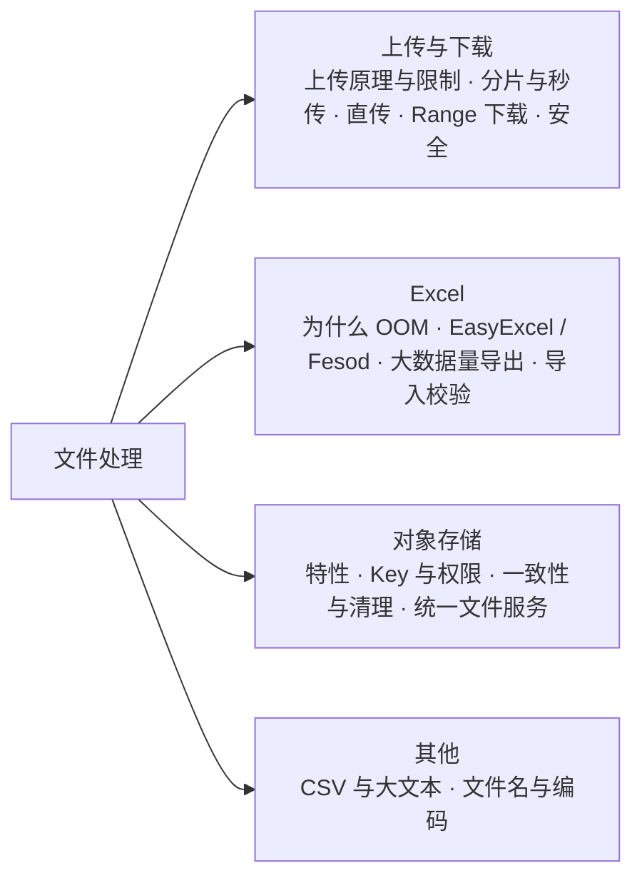

## 题目索引

| 编号 | 题目 | 难度 | 层级 |
| --- | --- | --- | --- |
| 35-01 | Spring Boot 处理文件上传的过程是怎样的？有哪些默认限制？ | ★★ | 资深 |
| 35-02 | 大文件的分片上传、断点续传、秒传怎么设计？ | ★★★ | 资深 / 架构师 |
| 35-03 | 客户端直传对象存储怎么做？ | ★★★ | 资深 / 架构师 |
| 35-04 | 大文件下载怎么做？断点续传下载是怎么实现的？ | ★★ | 资深 |
| 35-05 | 文件上传有哪些安全风险？怎么防？ | ★★★ | 资深 / 架构师 |
| 35-06 | 为什么 Excel 导入导出容易 OOM？POI 有哪几种模式？ | ★★★ | 资深 |
| 35-07 | EasyExcel 的原理是什么？现在还能用吗？ | ★★ | 资深 |
| 35-08 | 几百万行数据的导出怎么设计？ | ★★★ | 架构师 |
| 35-09 | Excel 导入怎么做校验和错误反馈？什么是 CSV 注入？ | ★★★ | 资深 |
| 35-10 | 为什么文件要放对象存储？它和文件系统有什么区别？ | ★★ | 资深 |
| 35-11 | 对象的 Key 怎么设计？访问权限怎么控制？ | ★★ | 资深 / 架构师 |
| 35-12 | 文件记录和对象存储怎么保持一致？孤儿文件怎么清理？ | ★★★ | 架构师 |
| 35-13 | 怎么设计一个公司级的统一文件服务？ | ★★★ | 架构师 |
| 35-14 | CSV 和大文本文件怎么处理？ | ★★ | 资深 |
| 35-15 | 文件名和编码有哪些坑？ | ★★ | 资深 |

---

## 一、上传与下载

### 35-01 Spring Boot 处理文件上传的过程是怎样的？有哪些默认限制？

> ★★ ｜ 资深 ｜ 高频

**考察意图**：清楚一个上传请求从网关到 Controller 经过了哪几层，遇到"上传失败"时能判断是哪一层拦下的。

**30 秒版回答**

- 浏览器用 `multipart/form-data` 提交表单。请求体由多个 part 组成，part 之间用一个随机的分隔串（boundary）隔开；每个 part 有自己的头，例如 `Content-Disposition: form-data; name="file"; filename="a.xlsx"`，后面跟着文件内容。
- Spring Framework 6 起只保留基于 Servlet 标准的 `StandardServletMultipartResolver`，multipart 的解析由 Tomcat 完成（7.0.6 的 spring-web 中已经没有基于 Commons FileUpload 的实现，已核对）。
- 默认情况下，`DispatcherServlet` 在调用 Controller **之前**就把整个请求体读完并解析好（`spring.servlet.multipart.resolve-lazily` 默认为 false）。文件 part 超过 `file-size-threshold` 就写入临时目录的磁盘文件，Controller 拿到的 `MultipartFile` 指向这个临时文件，请求结束后删除。
- 默认限制（Spring Boot 4.0.4，已核对配置元数据）：

| 配置 | 默认值 | 作用 |
| --- | --- | --- |
| `spring.servlet.multipart.max-file-size` | 1MB | 单个文件的大小 |
| `spring.servlet.multipart.max-request-size` | 10MB | 整个 multipart 请求的大小 |
| `spring.servlet.multipart.file-size-threshold` | 0B | 超过这个大小就写磁盘，0 表示所有文件都写磁盘 |
| `server.tomcat.max-part-count` | 50 | 一个请求中 part 的数量，普通表单字段也算 |
| `server.tomcat.max-part-header-size` | 512B | 单个 part 头的大小 |
| `server.tomcat.max-swallow-size` | 2MB | 请求被拒绝后，Tomcat 最多再读取并丢弃多少请求体 |
| `server.tomcat.max-http-form-post-size` | 2MB | 普通表单（`application/x-www-form-urlencoded`）的大小 |

- 超过 Spring 的大小限制会抛出 `MaxUploadSizeExceededException`，可以在全局异常处理中转成友好的提示。

**深入剖析**

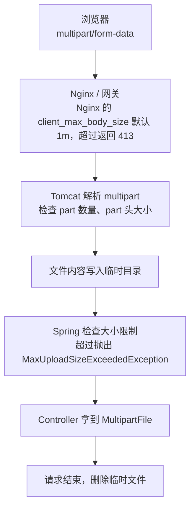

- **每一层都有自己的限制，生效的是最小的那个**。调大上传限制时，要把 Nginx、网关、Tomcat、Spring 一起检查。
- `MultipartFile` 的三种用法：
  - `getBytes()` 把整个文件读进堆内存，只适合小文件；
  - `getInputStream()` 流式读取，适合边读边转存到对象存储；
  - `transferTo(File)` 写到指定位置。

**追问链**

1. **超过限制时，前端为什么有时收到的是"连接被重置"，而不是错误提示？** 服务端决定拒绝请求时，客户端往往还在发送请求体。Tomcat 会继续读取并丢弃剩余的请求体，最多 `max-swallow-size`（默认 2MB），让客户端能把请求发完、读到错误响应；超过这个量，Tomcat 直接关闭连接，浏览器就会看到连接被重置。所以前端应在上传前检查文件大小，大文件根本不应该走这条路（35-03）。
2. **为什么要限制 part 的数量？** 每个 part 都要解析，文件 part 还要创建临时文件。攻击者可以构造一个包含大量小 part 的请求消耗服务器资源，CVE-2023-24998 就是这类问题。所以 Tomcat 增加了 `maxPartCount`，Boot 默认为 50。

**生产实践 / 踩坑**

- **临时目录被系统清理**：不配置时，上传的临时文件放在 Tomcat 的工作目录下，这个目录默认在系统临时目录（如 `/tmp`）中。Linux 会按规则定期清理 `/tmp` 中长时间未访问的文件和目录，服务运行一段时间后上传开始报错，常见的报错信息是 `The temporary upload location [...] is not valid`。解决办法是用 `spring.servlet.multipart.location` 指定一个专用目录。
- **上传会长时间占用一个 Tomcat 线程**：手机网络上传 100MB 的文件可能要几分钟，这期间这个线程什么都做不了，同时还要占用临时目录的磁盘空间。大文件应该让客户端直接上传到对象存储，应用服务器不中转文件内容，见 35-03。

**架构师加分点**

- 文件经过应用服务器中转，会同时消耗带宽、线程、磁盘三种资源，而且都和文件大小、用户网速成正比。架构上应该让**应用服务器只处理控制流**（鉴权、签名、记录元数据），**文件内容走数据流**（客户端和对象存储、CDN 直接交互）。

---

### 35-02 大文件的分片上传、断点续传、秒传怎么设计？

> ★★★ ｜ 资深 / 架构师 ｜ 高频

**考察意图**：大文件上传的完整方案，包括存储侧的约束和秒传的安全问题。

**30 秒版回答**

- **分片上传**：客户端把文件切成固定大小的分片，并发上传（通常 3~6 个），某个分片失败只重传这一片，全部完成后由服务端合并。
- **断点续传**：每个文件上传对应一个上传会话（uploadId），服务端知道哪些分片已经上传成功。网络中断、页面刷新后，客户端带着 uploadId 查询已完成的分片，只上传缺失的部分。
- **秒传**：客户端先计算文件的哈希值。如果服务端已经存在内容相同的文件，就不再上传，直接创建一条引用。
- **优先使用对象存储自带的分片上传**（S3 的 CreateMultipartUpload、UploadPart、CompleteMultipartUpload）：分片直接传到对象存储，由对象存储负责合并，业务服务只负责协调和签名。

**深入剖析**

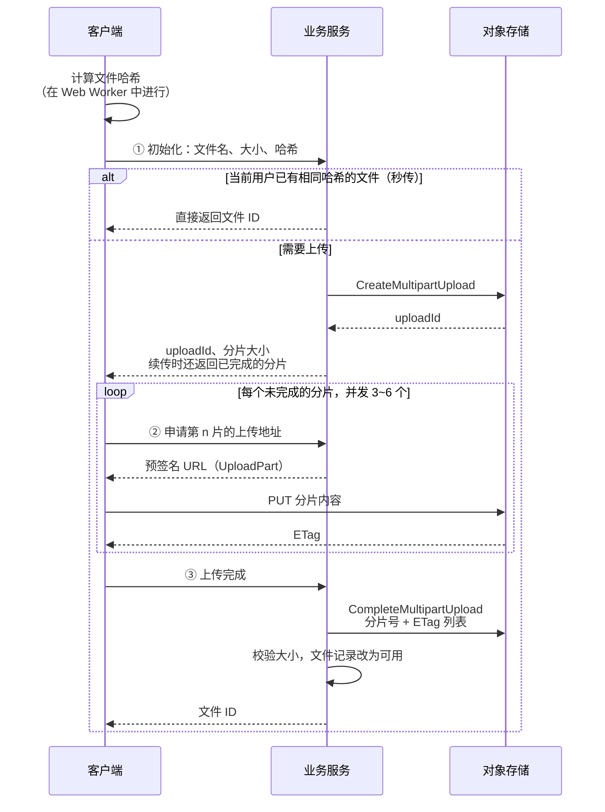

- 已上传的分片可以用 ListParts 接口向对象存储查询，业务服务不一定要自己记录。
- **分片大小要满足对象存储的约束**。S3 的限制（AWS 文档）：

| 项目 | 限制 |
| --- | --- |
| 单个对象最大 | 48.8 TiB |
| 分片数量 | 最多 10,000 个 |
| 分片大小 | 5 MiB ~ 5 GiB，最后一片没有下限 |
| 单次 PUT 上传 | 最大 5 GB |
| 建议使用分片上传 | 对象达到 100 MB |

  所以分片大小不能写死，要满足 `分片大小 ≥ 文件大小 ÷ 10000`。例如固定用 10 MiB 的分片，最大只能上传约 97.7 GiB 的文件。

**追问链**

1. **秒传有什么安全风险？** 如果秒传在**所有用户之间**去重，文件哈希就变成了"取件凭证"：任何人只要知道某个文件的哈希，不用持有文件就能把它"秒传"到自己的空间，再正常下载。另外，"是否秒传成功"本身也会泄露"系统里有没有人存过这个文件"。防护方法：
   - 只在同一用户或同一租户的范围内秒传；
   - 跨用户去重只在存储层内部做，不暴露给客户端；
   - 要求客户端证明自己持有文件，例如服务端随机指定几个字节区间，让客户端计算这些区间的哈希。
2. **前端计算大文件的哈希很慢，怎么办？** 在 Web Worker 中分块增量计算，不阻塞页面；或者先用抽样哈希（文件头、中、尾各取一段）做快速预判。但**抽样哈希只能用来预判，不能作为秒传的依据**：两个不同的文件抽样哈希相同，就会把别人的文件链接给当前用户。
3. **分片上传完成后，S3 返回的 ETag 能当作整个文件的 MD5 吗？** 不能。分片上传生成的对象，ETag 不是整个文件的 MD5，不能直接和客户端计算的哈希比对。需要校验整个文件时，使用对象存储提供的校验和功能，或者异步读取一遍重新计算。
4. **没有对象存储，分片存在应用服务器上呢？** 多实例部署时，分片必须放在共享存储上，否则不同分片会落在不同的机器上；合并时按顺序**流式追加**，不能读入内存；还要定期清理过期的分片。这些都是对象存储已经解决的问题，能用对象存储就不要自己实现。

**生产实践 / 踩坑**

- **未完成的分片上传会一直占用存储空间并产生费用**：用户上传到一半就放弃了，已上传的分片不会自动删除，而且在普通的对象列表中看不到。AWS 文档建议配置生命周期规则 `AbortIncompleteMultipartUpload`，自动清理超过指定天数的未完成上传。
- **每个分片的上传地址按需申请**：如果在初始化时一次签发所有分片的地址，有效期就要覆盖整个上传过程；上传慢的用户还没传完，地址就过期了。

---

### 35-03 客户端直传对象存储怎么做？

> ★★★ ｜ 资深 / 架构师 ｜ 高频

**考察意图**：能否在"文件不经过应用服务器"的前提下，仍然把权限控制留在业务侧。

**30 秒版回答**

- **为什么直传**：文件内容不经过应用服务器，不占用应用的带宽、线程和磁盘；上传能力随对象存储扩展。
- **怎么做**：业务服务给客户端签发一个**短时效、范围受限**的上传凭证，客户端用它直接上传到对象存储，完成后通知业务服务确认。凭证有两种：
  - **预签名 URL**：针对一个具体的对象 Key 和一种操作（如 PUT），简单，浏览器直接用；
  - **STS 临时凭证**：一组带权限策略的临时密钥，例如只允许写某个前缀，客户端用 SDK 上传，适合分片上传、批量上传。
- **关键点：权限判断仍然在业务服务**。谁能上传、能上传什么类型和多大的文件、对象 Key 是什么，都由业务服务决定；Key 必须由服务端生成，不能让客户端指定。

**深入剖析**

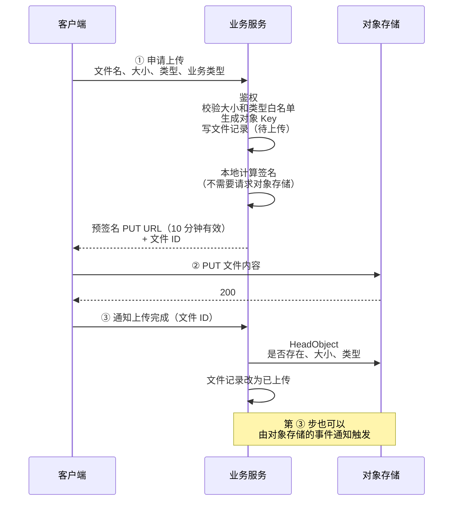

示意代码（AWS SDK for Java 2.x，本机没有这个依赖，**未编译**）：

```java
PutObjectRequest objectRequest = PutObjectRequest.builder()
        .bucket(bucket)
        .key(objectKey)            // Key 由服务端生成
        .contentType(contentType)  // 客户端上传时要带上相同的 Content-Type
        .build();
PutObjectPresignRequest presignRequest = PutObjectPresignRequest.builder()
        .signatureDuration(UPLOAD_URL_TTL)
        .putObjectRequest(objectRequest)
        .build();
String uploadUrl = s3Presigner.presignPutObject(presignRequest).url().toString();
```

- 浏览器直传需要在 bucket 上配置 CORS，允许业务域名发起 PUT 请求。
- **预签名 URL 的有效期**（AWS 文档）：用 IAM 用户的长期密钥签名，最长 7 天；用临时凭证签名，凭证过期 URL 就失效，即使 URL 上写的过期时间更晚。上传场景通常只需要几分钟到十几分钟。

**追问链**

1. **预签名 URL 泄露了怎么办？** 它相当于一张"不记名的通行证"，谁拿到都能用。签发之后没有办法单独作废某一个 URL，只能等它过期，或者让签名用的凭证失效（AWS 文档："a presigned URL expires when the credential you used to create it is revoked"）。所以有效期要短，一个 URL 只对应一个 Key 和一种操作。
2. **预签名 PUT 能限制文件大小吗？** 预签名 PUT 很难可靠地限制大小。需要限制时有两个办法：改用 POST 表单上传，在上传策略（policy）中设置 `content-length-range` 条件；或者在上传完成后由服务端检查（HeadObject 查看大小和类型），不符合就删除。
3. **客户端说上传完成了，但实际上没有上传，或者上传的不是声明的文件，怎么办？** 业务服务不能相信客户端的通知：要用 HeadObject 确认对象确实存在、大小符合；文件内容的检查（类型检测、病毒扫描）异步进行，检查通过前不对其他用户提供，见 35-05。
4. **预签名 URL 和 STS 临时凭证怎么选？** 单个文件、浏览器上传，用预签名 URL，范围最小；客户端需要用 SDK 做分片上传或批量上传，用 STS 临时凭证，但权限策略要限制到具体的前缀和操作，范围比预签名 URL 大，风险也更大。

---

### 35-04 大文件下载怎么做？断点续传下载是怎么实现的？

> ★★ ｜ 资深 ｜ 中频

**考察意图**：下载时不要把文件读进内存；了解 HTTP Range 机制。

**30 秒版回答**

- **不要把文件整个读进内存**（例如 `byte[]`），要流式输出。
- **最好的做法是应用不传输文件内容**：
  - 文件在对象存储中：业务服务鉴权后，返回 302 跳转到短时效的预签名 GET URL 或 CDN 地址；
  - 文件在本地磁盘、前面有 Nginx：应用鉴权后返回 `X-Accel-Redirect` 响应头，由 Nginx 读取文件发送给客户端，Nginx 可以利用 sendfile 零拷贝（见[《38 操作系统》](../08-计算机基础/38-操作系统.md)）。
- **断点续传下载**靠 HTTP 的 Range 机制：
  - 服务端在响应中声明 `Accept-Ranges: bytes`；
  - 客户端请求 `Range: bytes=1048576-`，表示从第 1MB 开始；
  - 服务端返回 `206 Partial Content` 和 `Content-Range: bytes 1048576-xxx/文件总大小`；
  - 请求的范围不合法时返回 `416`。
- **Spring MVC 已经内置了 Range 支持**：Controller 返回 `Resource`（或 `ResponseEntity<Resource>`）时，Spring 会设置 `Accept-Ranges: bytes`；请求带 Range 头时返回 206 和对应的片段；范围不合法时返回 416 和 `Content-Range: bytes */文件长度`（已核对 Spring 7.0.6 源码）。

**深入剖析**

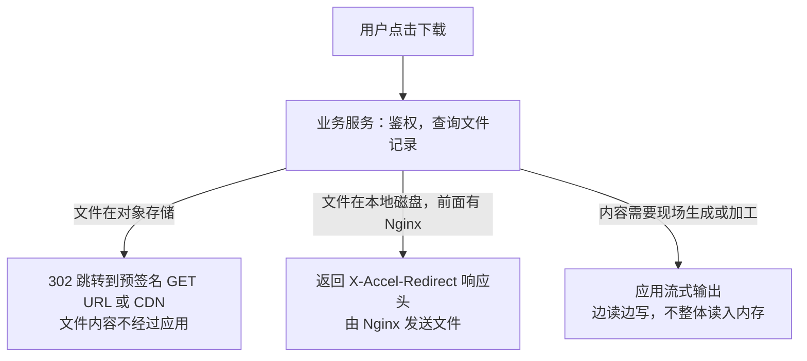

由应用自己输出文件时，返回 `Resource` 就能获得 Range 支持（示意代码，`fileService` 和 `StoredFile` 是业务代码，**未运行**）：

```java
@GetMapping("/files/{fileId}/content")
public ResponseEntity<Resource> download(@PathVariable long fileId) {
    // 内部完成鉴权：当前用户是否有权下载这个文件
    StoredFile file = fileService.getForDownload(fileId);
    ContentDisposition disposition = ContentDisposition.attachment()
            .filename(file.originalName(), StandardCharsets.UTF_8)
            .build();
    return ResponseEntity.ok()
            .contentType(MediaType.APPLICATION_OCTET_STREAM)
            .header(HttpHeaders.CONTENT_DISPOSITION, disposition.toString())
            .body(new FileSystemResource(file.localPath()));
}
```

**追问链**

1. **两次续传之间文件被修改了怎么办？** 客户端续传时带上 `If-Range` 头，值是上次拿到的 ETag 或 Last-Modified。文件没变，服务端返回 206 和请求的片段；文件变了，服务端返回 200 和完整的新文件，避免把新旧两个版本的片段拼在一起。
2. **多线程下载工具是怎么实现的？** 把文件按字节范围分成几段，同时发起多个 Range 请求，各自写入本地文件的对应位置。服务端要防止被这种方式占满带宽，可以限制单个用户的并发连接数和速率。
3. **下载链接为什么不能长期有效？** 链接可能被转发、被别人拿到。链接应该在用户点击下载时临时生成，有效期几分钟。

**生产实践 / 踩坑**

- **应用自己输出大文件会长时间占用线程**：下载速度取决于客户端的网速，一个慢速客户端可能占用一个 Tomcat 线程几十分钟。下载量大时应该交给对象存储、CDN 或 Nginx。
- **已经压缩过的格式（zip、xlsx、jpg、mp4）不要再开启 gzip 压缩**：几乎压不小，还浪费 CPU。
- 中文文件名的 `Content-Disposition` 编码见 35-15。

---

### 35-05 文件上传有哪些安全风险？怎么防？

> ★★★ ｜ 资深 / 架构师 ｜ 高频

**考察意图**：上传是最常见的攻击入口之一，能否系统地列出风险并给出对应的防护。

**30 秒版回答**

| 风险 | 例子 | 防护 |
| --- | --- | --- |
| 伪造文件类型 | 把 HTML 文件改名为 `.jpg` 上传 | 扩展名白名单 + 按文件内容检测类型；不相信客户端传的 Content-Type |
| 上传后被当作程序执行 | 把 `.jsp` 上传到 Web 目录下再访问 | 文件不放在 Web 目录中，放对象存储；存储时的文件名由服务端生成 |
| 路径穿越 | 文件名是 `../../etc/cron.d/x` | 不用用户提供的文件名拼接路径；原始文件名只存在数据库里 |
| 存储型 XSS | 上传 HTML 或 SVG（SVG 中可以写脚本），再让别人在业务域名下打开 | 用独立的域名提供用户上传的文件；下载时用 `Content-Disposition: attachment`；加 `X-Content-Type-Options: nosniff`；SVG 不进图片白名单 |
| 压缩炸弹 | 几 KB 的压缩包解压后有几十 GB | 解压时限制总大小、条目数量和压缩比；POI 的 `ZipSecureFile` 默认拒绝压缩比低于 1% 的条目 |
| Zip Slip | 压缩包中的条目名是 `../../x` | 解压前规范化路径，检查它仍在目标目录内（见下面的实测） |
| XXE | xlsx、docx 里的 XML 引用外部实体，读取服务器上的文件 | XML 解析器禁用 DTD 和外部实体；POI 的 `XMLHelper` 已默认设置（已核对 5.5.1 字节码） |
| 恶意图片 | 像素尺寸极大的图片，解码时耗尽内存 | 解码前先读取宽高并限制；对图片重新编码，同时去掉 EXIF 中的位置等隐私信息 |
| 病毒、木马 | 上传后供其他用户下载 | 异步病毒扫描，扫描通过之前不对其他用户提供 |
| 资源耗尽 | 大量上传大文件 | 限制大小、数量、频率，按用户设置配额 |

**深入剖析**

**① 按内容检测类型**。下面是用 tika-core 3.3.0 实测的结果：

| 输入 | 检测结果 | 说明 |
| --- | --- | --- |
| PNG 文件头 | `image/png` | 按魔数（文件开头的特征字节）识别 |
| HTML 内容，文件名是 `a.jpg` | `text/html` | 以内容为准，不会被扩展名骗过 |
| 包含 `<script>` 的 SVG | `image/svg+xml` | **类型是"图片"，但可以执行脚本**，所以图片白名单中不要放 SVG |
| 普通 zip 文件改名为 `evil.xlsx` | xlsx 的 MIME 类型 | xlsx 本身就是 zip，只引入 tika-core 时只能识别出 zip 魔数，再参考文件名 |

最后一行说明：**对 xlsx、docx 这类以 zip 为容器的格式，只看魔数不够**，最终要以"能被解析库按预期的结构打开"为准。

**② Zip Slip 防护**（本机实测）：

```java
Path target = targetDir.toAbsolutePath().normalize();
try (ZipInputStream zis = new ZipInputStream(in)) {
    ZipEntry entry;
    while ((entry = zis.getNextEntry()) != null) {
        Path dest = target.resolve(entry.getName()).normalize();
        // 规范化之后必须仍在目标目录之内，否则就是路径穿越
        if (!dest.startsWith(target)) {
            throw new BizException(ERROR_CODE_ZIP_SLIP, entry.getName());
        }
        // 解压：同时累计实际写出的字节数，超过上限就停止（防压缩炸弹）
    }
}
```

实测：压缩包中有 `normal.txt` 和 `../../escaped.txt` 两个条目，前者正常解压，后者被拒绝，规范化后的路径落在了目标目录的上两级。

- 要用 `Path.startsWith`，而不是字符串的 `startsWith`。`Path` 按路径层级比较，`/data/upload-evil` 不以 `/data/upload` 开头；字符串比较则会误判为在目录内。
- 防压缩炸弹时，要累计**实际读出的字节数**，不能相信条目中声明的大小，这个值可能是 -1，也可能是伪造的。

**追问链**

1. **为什么用户上传的文件要用独立的域名提供？** 如果用户上传的 HTML 或 SVG 在业务域名下打开，其中的脚本就能读取业务域名的 Cookie、调用业务接口。用独立的域名（最好是不同的注册域名），浏览器的同源策略会把它和业务域名隔离开，详见[《39 网络安全》](../08-计算机基础/39-网络安全.md)。
2. **病毒扫描为什么要异步？** 扫描大文件需要较长时间，同步扫描会让上传请求超时。做法是：上传后文件状态为"待检查"，扫描通过后改为"可用"，在此之前只有上传者自己能看到。

**架构师加分点**

- 上传安全是一条链，不是一个校验函数：**入口校验**（大小、类型、频率）→ **隔离存储**（对象存储、服务端生成的名字）→ **异步检查与加工**（类型检测、病毒扫描、图片重新编码）→ **隔离分发**（独立域名、attachment、nosniff）→ **审计**（谁在什么时候上传、下载了什么）。每一环都假设上一环可能被绕过。

---

## 二、Excel

### 35-06 为什么 Excel 导入导出容易 OOM？POI 有哪几种模式？

> ★★★ ｜ 资深 ｜ 高频

**考察意图**：从 xlsx 的文件结构出发解释内存问题，而不是只记住"用 EasyExcel"。

**30 秒版回答**

- **xlsx 是一个 ZIP 压缩包，里面是 XML 文件**：
  - `xl/worksheets/sheet1.xml` 存放每个单元格的位置和值；
  - `xl/sharedStrings.xml` 是"共享字符串表"，存放所有不重复的文本，文本单元格里只存这张表中的序号；
  - 还有样式、公式等其他文件。
  
  XML 本身冗长，压缩率又很高。本机实测，一个 12.7MB 的 xlsx（20 万行 × 10 列）解压后约 145MB，其中 `sheet1.xml` 约 92MB，`sharedStrings.xml` 约 53MB。
- **POI 有三种处理方式**：

| 模式 | 方式 | 优点 | 缺点 |
| --- | --- | --- | --- |
| UserModel（`XSSFWorkbook`） | 把整个文件解析成对象树，每个单元格都是对象 | API 简单，可以随机读写任意单元格 | 内存占用是文件大小的上百倍 |
| SXSSF（`SXSSFWorkbook`，只能写） | 内存中只保留最近的 N 行（默认 100），更早的行写入临时文件 | 写入时内存占用固定 | 已经写出的行不能再访问和修改 |
| 事件模式（`XSSFReader` + SAX，只能读） | 流式解析 XML，每读到一行回调一次 | 读取时内存占用小 | API 复杂，**共享字符串表仍可能撑爆内存** |

**深入剖析**

本机实测，20 万行 × 10 列的文本数据（POI 5.5.1，JDK 25，"存活对象"是 Full GC 之后仍在使用的堆内存）：

| 操作 | 堆上限 | 结果 |
| --- | --- | --- |
| XSSF 写 5 万行 | — | 文件 3.2MB，内存中的工作簿约 517MB，约为文件大小的 160 倍 |
| XSSF 写 20 万行 | 2GB | OOM |
| XSSF 写 20 万行 | 6GB | 成功，存活对象约 2047MB，文件 12.7MB，耗时 14.5 秒 |
| SXSSF 写 20 万行 | 64MB | 成功，存活对象约 7MB，文件 8.1MB |
| XSSF UserModel 读上面 12.7MB 的文件 | 1GB | OOM |
| 同上 | 4GB | 成功，存活对象约 2031MB |
| 事件模式读 SXSSF 生成的文件 | 32MB | 成功 |
| 事件模式读 XSSF 生成的文件，使用 `SharedStringsTable` | 512MB | **OOM** |
| 同上，改用 `ReadOnlySharedStringsTable` | 64MB | **OOM** |
| 同上 | 512MB | 成功，2.6 秒 |
| EasyExcel 4.0.3 读同一个 XSSF 生成的文件 | 64MB | 成功，2.9 秒（见 35-07） |

**为什么事件模式也会 OOM？** 因为两个文件存放文本的方式不同：

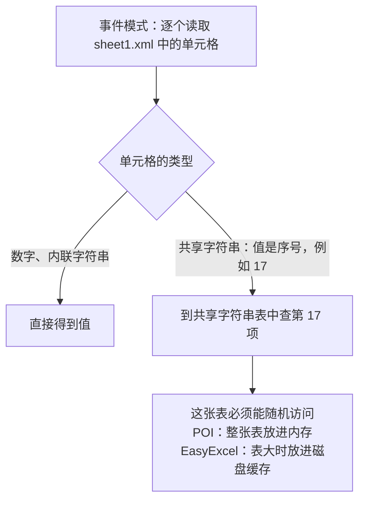

- XSSF 生成的文件把文本放在共享字符串表中，本例中 `sharedStrings.xml` 解压后约 53MB。事件模式虽然逐行读取 sheet，但查找文本需要随机访问这张表，POI 会把整张表加载到内存中。
- SXSSF 默认把文本作为"内联字符串"直接写在单元格里，没有共享字符串表，所以 32MB 的堆就能读完。
- **用户用 Excel 软件保存的文件，文本单元格通常都放在共享字符串表里**。所以导入功能的内存占用，要用"真实用户保存的大文件"测试，不能只用程序生成的文件测试。

**追问链**

1. **SXSSF 有哪些限制？**
   - 超出窗口的行已经写到临时文件，不能再读取或修改；
   - 临时文件放在系统临时目录的 `poifiles` 子目录下，可以用 `setCompressTempFiles(true)` 压缩；
   - 必须关闭工作簿，5.5.1 的 `close()` 内部会调用 `dispose()` 删除临时文件（已核对字节码），进程异常退出时临时文件会残留；
   - 自动调整列宽需要先调用 `trackAllColumnsForAutoSizing()` 跟踪每一列，有额外开销，大数据量时建议直接指定列宽。
2. **老的 xls 格式呢？** xls 是二进制格式（POI 的 HSSF），单个 sheet 最多 65,536 行、256 列；xlsx 最多 1,048,576 行、16,384 列（已核对 POI 的 `SpreadsheetVersion`）。大数据量只用 xlsx 或 CSV。
3. **为什么 UserModel 的内存放大这么多？** 每个单元格在内存中是多个对象（POI 的包装对象、底层 XML 对象、字符串），每个对象都有对象头和引用；而文件中的一个单元格只是一小段压缩后的 XML。实测放大倍数约 160 倍。

**生产实践 / 踩坑**

- **样式不要按单元格创建**：xlsx 中最多 64,000 种单元格样式（已核对 `SpreadsheetVersion`），每写一个单元格就 `createCellStyle()` 一次，数据量大时会超出上限而报错，同时浪费内存。样式要提前创建好并复用。
- 导入功能的内存问题往往出现在上线后：测试时用的是几百行的样例文件，用户上传的是几十 MB 的真实文件。要在上传入口限制文件大小，并用最大允许的真实文件做压力测试。

---

### 35-07 EasyExcel 的原理是什么？现在还能用吗？

> ★★ ｜ 资深 ｜ 高频

**考察意图**：知道 EasyExcel 解决了 POI 的什么问题，以及项目的现状。

**30 秒版回答**

- **读**：基于 SAX 流式解析，每读完一行就转换成一个对象（`Map` 或者带 `@ExcelProperty` 注解的类），回调 `ReadListener.invoke`。由监听器攒够一批再批量处理，全部读完后回调 `doAfterAllAnalysed`。
- **共享字符串表的处理**：EasyExcel 4.0.3 的 `SimpleReadCacheSelector`，共享字符串文件不超过 5MB 时放在内存的 Map 中，超过时放进 Ehcache（一部分在内存，其余在磁盘）。这正是 POI 事件模式会 OOM 的地方（35-06）。
- **写**：底层使用 `SXSSFWorkbook`（本机运行时打印出的工作簿类型就是它），分批调用 `write`，内存占用固定。
- **实测**（本机 JDK 25；EasyExcel 4.0.3 声明依赖的是 POI 5.2.5，本机只有 POI 5.5.1，是用 5.5.1 跑的）：
  - 读 35-06 中那个共享字符串表 53MB 的文件，64MB 堆，成功，2.9 秒；同样的文件，POI 事件模式需要 512MB；
  - 分批写 20 万行，每批 1000 行，64MB 堆，成功，3.1 秒。
- **现状**：
  - `alibaba/easyexcel` 仓库已归档（只读），README 中有进入维护模式的公告；
  - 后续发展在 **Apache Fesod（孵化中）**：Maven 坐标 `org.apache.fesod:fesod-sheet`，当前版本 2.1.0-incubating；API 风格和 EasyExcel 一致（`ReadListener`、`AnalysisContext`、`@ExcelProperty`），入口类从 `EasyExcel` 改为 `FesodSheet`，底层仍然基于 POI；
  - 社区分支 FastExcel 的 GitHub 仓库（`fast-excel/fastexcel`）现在会跳转到 `apache/fesod`。

**深入剖析**

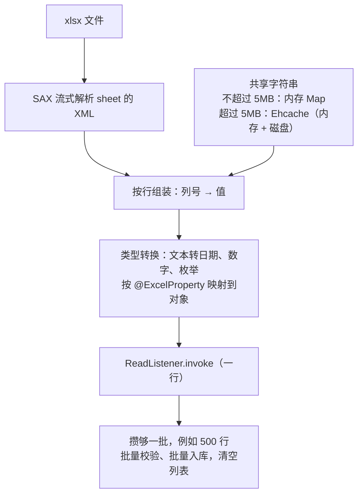

导入监听器示例（已在本机用 EasyExcel 4.0.3 编译并运行：导入 1203 行数据，分 3 批处理，最后一行的行号是 1203）：

```java
/**
 * 订单导入监听器：有状态，每次导入 new 一个，不能做成 Spring 单例 Bean。
 */
public class OrderImportListener implements ReadListener<OrderImportRow> {

    private static final Logger log = LoggerFactory.getLogger(OrderImportListener.class);
    private static final int BATCH_SIZE = 500;

    private final OrderImportService importService;
    private final long batchId;
    private final List<OrderImportRow> buffer = new ArrayList<>(BATCH_SIZE);

    public OrderImportListener(OrderImportService importService, long batchId) {
        this.importService = importService;
        this.batchId = batchId;
    }

    @Override
    public void invoke(OrderImportRow row, AnalysisContext context) {
        // 记下这一行在 Excel 中的行号（从 0 开始），校验失败时告诉用户是第几行
        row.setRowIndex(context.readRowHolder().getRowIndex());
        buffer.add(row);
        if (buffer.size() >= BATCH_SIZE) {
            flush();
        }
    }

    @Override
    public void doAfterAllAnalysed(AnalysisContext context) {
        // 最后一批不足 BATCH_SIZE 的数据
        flush();
        log.info("order import parsed, batchId={}", batchId);
    }

    private void flush() {
        if (buffer.isEmpty()) {
            return;
        }
        // 一批数据一起校验、一起入库：批量查库代替逐行查库
        importService.validateAndSave(batchId, buffer);
        buffer.clear();
    }
}
```

调用方式：`EasyExcel.read(inputStream, OrderImportRow.class, new OrderImportListener(importService, batchId)).sheet().doRead();`

**追问链**

1. **监听器为什么不能是 Spring 单例？** 监听器内部有状态（缓冲列表、批次号），两个导入同时进行时会互相干扰。需要的依赖通过构造方法传进去，每次导入 new 一个新的监听器。
2. **某一行的数据类型转换失败会怎样？** `ReadListener.onException` 的默认实现是把异常抛出去，整个读取停止。转换失败时抛出的 `ExcelDataConvertException` 带有行号和列号（`getRowIndex()`、`getColumnIndex()`）。如果希望"收集所有错误，最后统一反馈"，就重写 `onException`，记录错误后不再抛出；更稳妥的做法是实体类的字段先全部用 `String` 接收，在自己的校验逻辑中转换类型，见 35-09。
3. **现有项目还在用 EasyExcel，要不要马上迁移？** 已有功能可以继续运行，但仓库已归档，以后的安全修复和 POI 版本升级不会再有。建议：新功能直接用 Fesod（要接受它还在孵化阶段）或 POI；存量代码排期迁移，迁移要改依赖和入口类，以 Fesod 的文档为准。

**生产实践 / 踩坑**

- **不要在监听器里把所有行都放进一个 List**，读完再处理。这样流式读取就没有意义了，内存占用和 UserModel 差不多。
- **长数字精度**：Excel 中的数字是双精度浮点数，只能精确到 15 位有效数字。19 位的订单号如果按数字写入，打开后末尾几位会变成 0。导出时，订单号、身份证号这类"看起来像数字的编号"一律写成文本。
- **日期**：Excel 中的日期在内部是数字，只是单元格格式显示为日期。用户如果把日期列设成了文本格式，读出来的就是字符串，校验逻辑要兼容常见的写法，并给出明确的错误提示。

---

### 35-08 几百万行数据的导出怎么设计？

> ★★★ ｜ 架构师 ｜ 高频

**考察意图**：大数据量导出是一个"任务"，而不是一个"接口"。

**30 秒版回答**

- **先 count，数据少的同步导出，数据多的转成异步任务**。几百万行数据的导出不能放在一次 HTTP 请求中完成：会超时，会占用线程和内存，用户刷新页面还会重复导出。
- **异步任务的流程**：提交任务 → 写导出任务表 → 后台按顺序执行 → 分批查询、分批写文件 → 上传到对象存储 → 任务状态改为完成并通知用户 → 用户下载时生成短时效的链接 → 文件过期后自动删除。
- **保护数据库**：查从库；用 `id > 上次的最大 id` 游标分页或流式查询（见[《06 MyBatis》](../02-框架与容器/06-MyBatis.md)），不用 `LIMIT offset`（见[《15 MySQL》](../04-数据存储/15-MySQL.md)）；限制全局和单个用户同时执行的导出任务数。
- **格式的限制**：xlsx 的单个 sheet 最多 1,048,576 行，超过就换新的 sheet 或拆成多个文件；纯数据可以导出为 CSV，写得更快、文件更小，但要注意 Excel 打开 CSV 时同样最多只能显示 1,048,576 行。

**深入剖析**

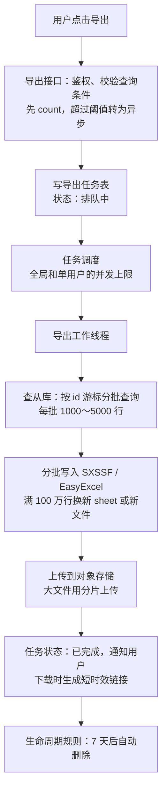

- **数据权限**：导出的数据范围必须和用户在页面上能看到的一致。任务执行时用提交任务的用户的身份和数据权限查询，下载时再校验一次身份。导出是数据泄露的主要通道之一，要记录审计日志，手机号、身份证号等敏感字段按权限脱敏。
- **任务表的关键字段**：任务 ID、提交人、查询条件、状态、进度（已导出行数 / 总行数）、文件 Key、失败原因、开始和结束时间。

**追问链**

1. **导出过程中数据还在变化，结果一致吗？** 分批查询不是快照，不同批次读到的可能是不同时刻的数据。多数业务可以接受，但要有明确的边界：任务开始时记下当前的最大 id 或时间，查询条件加上 `id <= 开始时的最大 id`，避免导出过程中新插入的数据进进出出。如果必须是严格的快照，可以在一个长事务中用可重复读隔离级别查询（会长时间占用 MVCC 快照，影响 undo 日志清理，见[《15 MySQL》](../04-数据存储/15-MySQL.md)），或者从数据仓库、离线快照中导出。
2. **导出服务在执行过程中挂了，任务怎么办？** 正在执行的任务要定期更新心跳时间。调度器发现心跳超时的任务，就把它重新放回队列；输出文件的 Key 由任务 ID 决定，重新执行会覆盖之前的半成品，不会产生多个文件。
3. **同一个用户连续点了 5 次导出怎么办？** 提交任务时按"用户 + 查询条件的摘要"去重：已有排队中或执行中的相同任务，就直接返回这个任务。
4. **除了查出来的数据，还有什么占内存？** 每一批的对象列表、SXSSF 的窗口、样式。样式要复用（35-06）；每批处理完，列表要释放引用。

**架构师加分点**

- 把导出做成一个**通用的任务平台**：业务方只需要实现"按游标查询一批数据"和"表头定义"两个接口，任务调度、进度、文件上传、通知、过期清理、审计由平台统一完成。这样新增一个导出功能只需要写查询，不会每个团队各自实现一遍。

---

### 35-09 Excel 导入怎么做校验和错误反馈？什么是 CSV 注入？

> ★★★ ｜ 资深 ｜ 高频

**考察意图**：导入功能的用户体验和数据质量；导出时的一个安全问题。

**30 秒版回答**

- **分层校验**，从便宜到昂贵：
  1. **文件级**：类型、大小、行数上限，表头是否和模板一致（防止用户用了旧模板或者把列的顺序弄错）；
  2. **行级格式**：必填、长度、格式（手机号、日期）、取值范围、枚举值；
  3. **文件内**：重复的行（例如同一个订单号出现两次）；
  4. **业务级**：数据是否存在、当前用户有没有权限、状态是否允许。**按批查询数据库**，不要每一行查一次。
- **错误反馈**：不在第一个错误处停止，而是收集所有错误，每个错误都包含行号、列名、原因；生成一份"错误报告"（在原文件后面加一列错误原因），供用户下载修改后重新导入。
- **成功的策略要明确告诉用户**：
  - 全部正确才导入：先全部校验（可以先写入临时表），没有错误再一次性提交；
  - 部分导入：正确的行导入，错误的行写进错误报告。
- **大文件异步导入**，显示进度。用"导入批次号"保证幂等：同一个文件被重复提交时，能识别出来。
- **CSV 注入**（也叫公式注入）：导出的 CSV 中，某个单元格的值是用户输入的 `=HYPERLINK(...)` 这样的内容，用 Excel 打开时会被当作公式执行，可能把数据发送到外部地址。

**深入剖析**

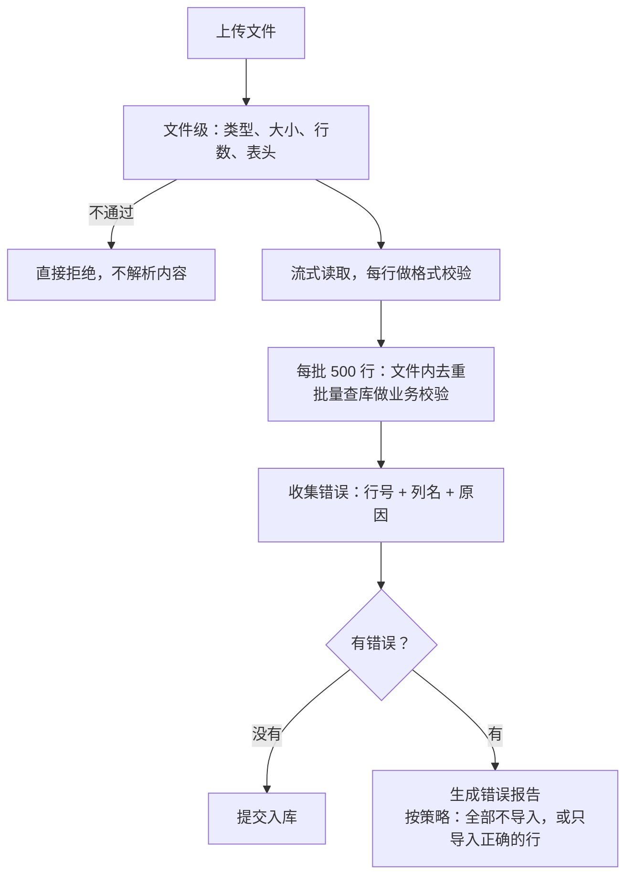

**CSV 注入的防护**（OWASP）：

- 危险的开头字符：`=`、`+`、`-`、`@`、制表符（0x09）、回车（0x0D）、换行（0x0A），以及全角的 `＝`、`＋`、`－`、`＠`；
- 通用的处理方式：每个字段用双引号包起来；字段前面加一个单引号；字段中的双引号写成两个双引号；
- OWASP 同时提醒，这些方法在 Excel 中"保存后重新打开"时不可靠；更能抵抗 Excel 的做法是，对以 `=`、`+`、`-`、`@` 开头的字段，在引号内的开头加一个制表符，但这会影响后续程序的读取。

**CSV 库不会替你做这件事**：本机用 Commons CSV 1.14.1 输出 `=1+1`，结果原样写出，没有任何处理（含逗号和引号的字段则按 RFC 4180 正确加了引号）。

**追问链**

1. **用 POI / EasyExcel 导出 xlsx，也有公式注入的问题吗？** 字符串按文本单元格写入时，打开文件不会被当作公式计算，风险主要在 CSV。但如果代码中对用户输入调用了 `setCellFormula`，就会有问题。
2. **以 `-` 开头的负数也要处理吗？** 只处理来自用户输入的文本字段。数字字段（金额、数量）本来就是数字，加前缀反而会破坏数据。
3. **实体类的字段为什么建议先全部用 String 接收？** 如果直接用 `Integer`、`LocalDate` 接收，格式不对时在类型转换阶段就会抛出异常，用户只能看到一个笼统的错误。先用 String 接收，再在自己的校验逻辑中转换，就能给出"第 15 行'下单日期'格式不正确，应为 2026-01-31"这样具体的提示。

**生产实践 / 踩坑**

- **模板要带版本**：模板的列发生变化后，用户手里的旧模板还会继续用。在模板中放一个隐藏的版本号或者严格校验表头，避免列的含义错位而导入错误的数据。
- **导入是批量写操作**，要考虑对数据库的影响：分批提交、控制速度，不要一个大事务导入几十万行。

---

## 三、对象存储

### 35-10 为什么文件要放对象存储？它和文件系统有什么区别？

> ★★ ｜ 资深 ｜ 中频

**考察意图**：理解对象存储的模型和边界，知道什么场景适合、什么场景不适合。

**30 秒版回答**

- **本地磁盘的问题**：多实例之间不共享；容器重建后数据丢失（见[《41 容器与云计算》](../09-云原生/41-容器与云计算.md)）；容量、备份、迁移都要自己处理。NAS 解决了共享的问题，但容量、性能和可用性仍然受限于那一套存储设备。
- **对象存储的模型**：
  - **扁平的命名空间**：bucket（存储桶）+ key（对象名）。key 中的 `/` 只是名字的一部分，所谓的"目录"只是按前缀列出对象的一种视图；
  - **通过 HTTP API 访问**：PUT、GET、DELETE、HEAD、LIST；
  - **整体读写**：对象不能原地修改，也不能追加，修改就是用新的内容整体覆盖；
  - 每个对象可以带元数据和标签；容量几乎没有上限；支持生命周期、版本控制、事件通知。
- **S3 的几个关键特性**（AWS 文档）：
  - 设计的数据持久性为 99.999999999%（11 个 9）；
  - **强一致**：PUT（新建或覆盖）和 DELETE 成功之后，后续的读取和列出都能看到最新的结果；
  - 单个对象最大 48.8 TiB，单次 PUT 最大 5 GB，更大的用分片上传（35-02）。

| | 本地磁盘 | NAS | 对象存储 |
| --- | --- | --- | --- |
| 多实例共享 | 不能 | 能 | 能 |
| 访问方式 | 文件系统（POSIX） | 网络文件系统 | HTTP API |
| 修改文件的一部分 | 能 | 能 | 不能，只能整体覆盖 |
| 容量 | 单机磁盘 | 存储设备的容量 | 几乎没有上限 |
| 浏览器、CDN 直接访问 | 不能 | 不能 | 能（配合签名 URL） |
| 适合 | 临时文件、缓存 | 需要文件系统语义的共享文件 | 上传文件、图片、视频、导出文件、备份、日志归档 |

**追问链**

1. **在对象存储中"重命名一个目录"为什么很慢？** 因为没有真正的目录。重命名目录等于把这个前缀下的每一个对象复制到新的 key，再删除旧的对象。对象越多越慢，而且这个过程不是原子的。所以 key 的设计要尽量避免日后改名（35-11）。
2. **两个请求同时写同一个 key 会怎样？** AWS 文档的说法：S3 不提供并发写的对象锁，两个 PUT 同时写同一个 key，时间戳较晚的那个生效；更新是按 key 进行的，不能跨多个 key 做原子更新。需要的话，要在应用层自己实现锁。
3. **什么场景不适合用对象存储？** 需要频繁修改一部分内容的文件；大量小数据的低延迟读写（应该用数据库、缓存）；依赖文件系统语义（追加写、文件锁、目录原子重命名）的程序。

---

### 35-11 对象的 Key 怎么设计？访问权限怎么控制？

> ★★ ｜ 资深 / 架构师 ｜ 中频

**考察意图**：key 的设计影响安全、性能和日后的管理；权限控制的默认姿势是"私有 + 签名"。

**30 秒版回答**

**Key 的设计**：

- **由服务端生成，不使用用户提供的文件名**：例如 `{环境}/{业务类型}/{yyyy}/{MM}/{dd}/{随机 ID}.{扩展名}`。原始文件名存在数据库中，下载时通过 `Content-Disposition` 还原（35-15）。
- **不包含敏感信息**：key 会出现在 URL、访问日志、CDN 日志中，不要把手机号、身份证号、客户名称放进 key。
- **按前缀划分**：环境、业务、租户用前缀隔离，生命周期规则、权限策略都可以按前缀配置。
- **性能**：AWS 文档写明，每个前缀每秒可以支持至少 3,500 次 PUT/COPY/POST/DELETE 和 5,500 次 GET/HEAD 请求，前缀的数量没有限制，可以通过分散到多个前缀、并行请求来提高总吞吐量。
- **数据库中存 key，不存完整的 URL**：域名、CDN、bucket 都可能更换，存完整 URL 会导致日后大量的数据迁移。

**访问权限**：

- **bucket 默认私有**。AWS 文档：bucket 级别的 Block Public Access（阻止公开访问）设置默认开启，建议保持开启。
- **私有文件**（合同、发票、导出文件）：业务服务鉴权后签发短时效的预签名 GET URL，或者 CDN 的签名 URL。
- **公开文件**（商品图片、头像）：放在单独的 bucket 或前缀中，通过 CDN 访问，可以长期缓存。
- **应用使用的凭证遵循最小权限**：只允许访问指定的 bucket 和前缀、指定的操作；不要把长期有效的密钥写在代码或配置文件中，优先使用云平台的角色和临时凭证，见[《39 网络安全》](../08-计算机基础/39-网络安全.md)[《41 容器与云计算》](../09-云原生/41-容器与云计算.md)。

**深入剖析**

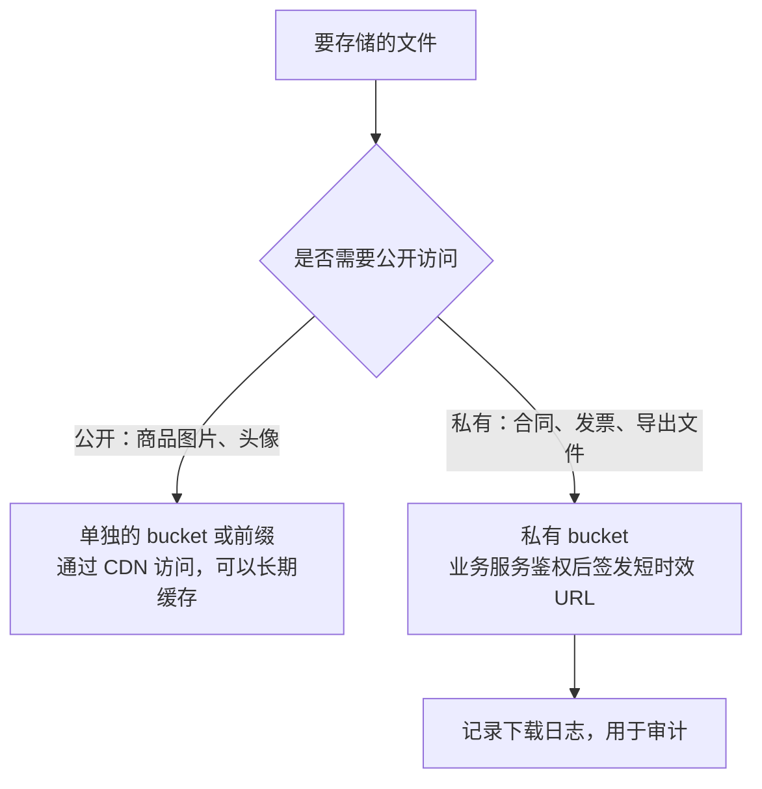

**追问链**

1. **为什么不把 key 设计成"用户 ID / 原始文件名"？** 用户的原始文件名可能包含 `../`、特殊字符，或者和其他文件重名互相覆盖；用户 ID 出现在 URL 中，别人可以据此猜测其他用户文件的地址；用户改名或者文件转移给其他用户时，key 也要跟着变。
2. **防盗链怎么做？** 检查 Referer 很容易被绕过，只能挡住最简单的盗用；可靠的方式是签名 URL，带有过期时间，地址被转发后很快失效。

---

### 35-12 文件记录和对象存储怎么保持一致？孤儿文件怎么清理？

> ★★★ ｜ 架构师 ｜ 中频

**考察意图**：数据库和对象存储无法放在同一个事务中，能否用状态和补偿来解决。

**30 秒版回答**

- **问题**：数据库和对象存储之间没有分布式事务，会出现四种不一致：
  1. 文件上传了，但业务最终没有使用（用户放弃了表单）——**孤儿对象**，一直占用存储、产生费用；
  2. 文件记录有了，但对象上传失败——**悬空记录**；
  3. 业务数据删除了，但对象还在；
  4. 对象被提前删除了，但业务还在引用。
- **做法：给文件一个状态机，再用定时任务补偿**：
  - 签发上传地址前先写文件记录，状态是"待上传"；
  - 上传确认后改为"已上传"；业务保存时绑定文件 ID，改为"已引用"；
  - 清理任务定期删除"待上传""已上传"状态超过 24 小时的文件（对象和记录）；
  - 删除时先软删除，改为"待删除"，过了保留期再异步删除对象，最后把记录改为"已删除"。
- **用对象存储的生命周期规则兜底**：临时文件用 `tmp/` 前缀或者对象标签标记，配置规则自动过期；配置 `AbortIncompleteMultipartUpload` 清理未完成的分片上传。

**深入剖析**

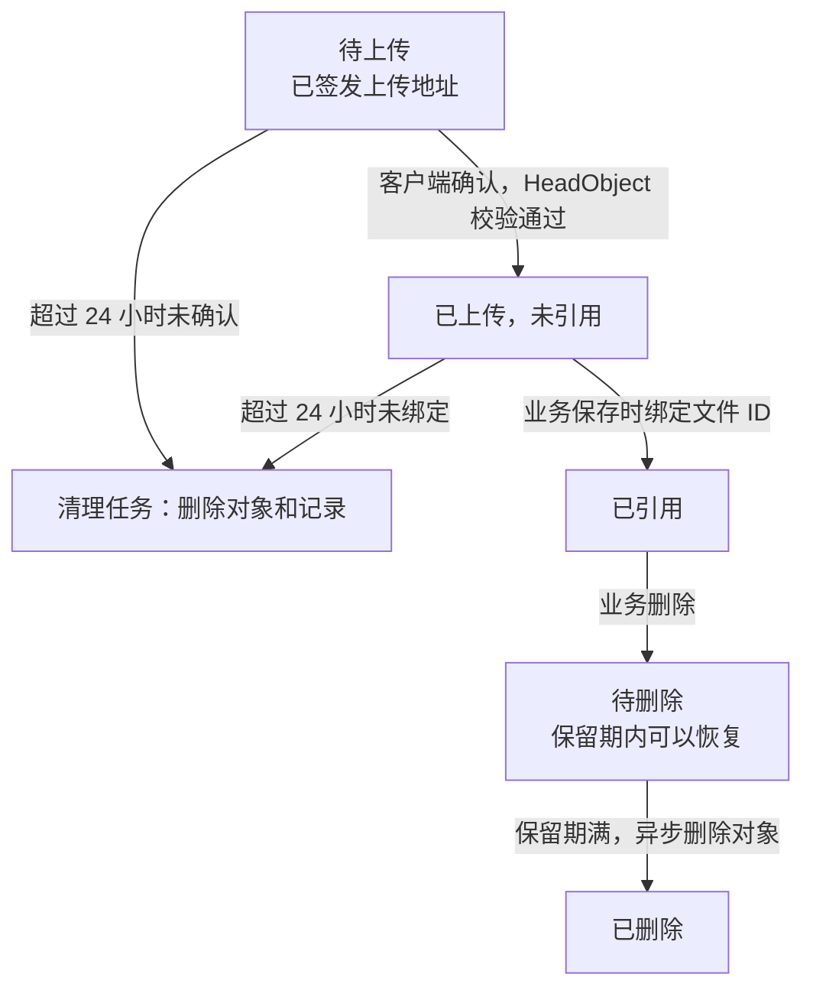

- **业务绑定和文件状态的一致性**：文件记录和业务数据在同一个数据库时，绑定可以和业务数据在同一个事务中完成。文件服务独立部署时，绑定通过接口或消息完成，是最终一致的；清理任务的超时时间要足够长，不能在业务还没来得及绑定时就把文件删掉。
- **删除操作要可重试**：删除对象成功、更新记录失败时，下次重试会再删除一次。S3 删除一个不存在的 key 不会报错，所以重复删除是安全的。
- **定期对账**：用对象存储提供的清单功能（S3 Inventory）列出所有对象，和数据库中的记录比对，发现漏网的孤儿对象和悬空记录。

**追问链**

1. **秒传或者去重之后，多条记录指向同一个对象，怎么删除？** 记录引用计数，或者在删除时查询"还有没有其他记录引用这个对象"，没有了才删除对象。这也是 35-02 建议秒传只在同一用户范围内进行的另一个原因：跨用户共享对象，删除和权限都会变复杂。
2. **临时文件用 `tmp/` 前缀，转正时要复制吗？** 复制大文件有成本。可以改用对象标签：上传时打上"临时"标签，生命周期规则按标签自动过期；绑定时去掉标签。
3. **为什么删除要先软删除，过一段时间再真正删除？** 误删除时可以恢复；业务数据的回滚、审计也可能需要。开启对象存储的版本控制是另一层保护，但旧版本同样占用存储，要配合生命周期规则清理。

---

### 35-13 怎么设计一个公司级的统一文件服务？

> ★★★ ｜ 架构师 ｜ 中频

**考察意图**：把前面的知识组合成一个平台，关键是职责划分。

**30 秒版回答**

- **为什么要统一**：每个团队各自实现上传、签名、清理，安全措施参差不齐；对象存储的密钥分散在各个服务中；没有统一的审计、配额和成本统计。
- **文件服务负责**：
  - 签发上传和下载凭证（直传、分片上传、同租户内的秒传）；
  - 文件元数据和状态（35-12 的状态机）；
  - 安全流水线：类型检测、病毒扫描、图片重新编码；
  - 异步加工：缩略图、转码；
  - 生命周期、孤儿清理、对账；
  - 按业务线的配额、用量统计、审计日志。
- **文件服务不负责**：判断"这个用户能不能看这个文件"。这是业务规则（例如"只有订单的买家和卖家能看发票"），只有业务服务知道。
- **文件内容不经过文件服务**：客户端直接和对象存储、CDN 交互，文件服务只处理控制流。
- **业务数据中只存文件 ID**。

**深入剖析**

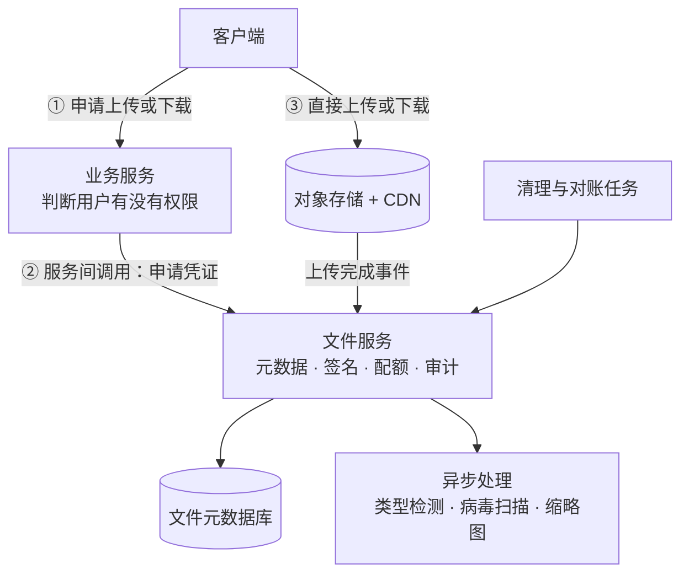

- **核心接口**：

| 接口 | 作用 |
| --- | --- |
| 申请上传 | 入参：业务类型、文件名、大小、类型；返回文件 ID 和上传地址（或分片上传信息） |
| 上传完成 | 校验对象，状态改为已上传，触发异步检查 |
| 绑定 / 解绑 | 业务保存或删除数据时调用，改变文件的引用状态 |
| 申请下载地址 | 业务服务鉴权之后调用，返回短时效的 URL |
| 查询元数据 | 文件名、大小、类型、状态、检查结果 |

**追问链**

1. **下载权限到底谁来判断？** 推荐由业务服务判断：业务服务确认用户有权限后，再调用文件服务获取下载地址；文件服务只校验"调用方服务是否有权访问这个业务类型的文件"。如果反过来让文件服务回调业务服务询问权限，文件服务就依赖了所有业务服务，耦合方向错了。
2. **要不要把各家云厂商的对象存储都抽象一层？** 多数云厂商和自建的对象存储都提供 S3 兼容的接口，统一按 S3 协议对接即可。不要为了"以后可能换厂商"去抽象每一家的特有功能，这是过度设计；真的需要某个厂商的特有能力时，再单独封装。
3. **bucket 怎么划分？** 按环境和数据的性质划分（公开和私有分开、不同的合规要求分开），而不是每个业务一个 bucket。bucket 的数量通常有配额限制，业务之间用前缀和权限策略隔离即可。

**架构师加分点**

- 统一文件服务的价值不在于"代码复用"，而在于**把安全和合规集中到一处**：所有文件都经过同一条安全流水线，所有下载都有审计日志，所有密钥都只在一个服务中。这类能力分散在各个团队，很难保证每一处都做对。

---

## 四、其他

### 35-14 CSV 和大文本文件怎么处理？

> ★★ ｜ 资深 ｜ 中频

**考察意图**：CSV 看起来简单，实际有不少格式细节；大文件要流式处理。

**30 秒版回答**

- **CSV 的格式规则（RFC 4180）**：
  - 字段中包含逗号、双引号或换行时，整个字段要用双引号包起来；
  - 字段中的双引号写成两个双引号；
  - 所以**按行读取再用 `split(",")` 拆分是错误的**：一个字段内部可能就有换行和逗号。
- **用成熟的库解析**（Commons CSV、Jackson CSV 等），并且**逐条迭代**，不要一次把所有记录读进内存。
- **Excel 打开 UTF-8 编码的 CSV 中文乱码**：常见的解决办法是在文件开头写入 BOM（`EF BB BF`）。但带 BOM 的文件被程序读取时，第一列的列名前面会多一个不可见的字符，读取时要去掉 BOM。
- **大文本文件**（几 GB 的日志、数据文件）：用 `BufferedReader` 或 `Files.lines` 逐行流式处理，分批提交结果；不要用 `Files.readAllLines`、`Files.readString` 一次读入。
- **字符编码要显式指定**：JDK 18 起默认字符集是 UTF-8（JEP 400），但用户上传的文件可能是 GBK 编码。`Files.newBufferedReader` 遇到不符合编码的字节会抛出 `MalformedInputException`，不会悄悄产生乱码。

**深入剖析**

本机用 Commons CSV 1.14.1 实测：

| 实验 | 结果 |
| --- | --- |
| 两条记录，其中一个字段包含逗号、双引号和换行，按换行拆分 | 得到 4 行（表头 + 3 段），数据被拆碎了 |
| 同样的内容用 Commons CSV 解析 | 正确得到 2 条记录，字段内容完整 |
| 写入 BOM 后，不做处理直接解析 | 第一个列名的长度是 4（"订单号"前面多了一个 ``），按"订单号"取不到这一列 |
| 用 commons-io 的 `BOMInputStream` 去掉 BOM 后解析 | 按"订单号"正常取值 |

流式解析的写法（本机已运行）：

```java
try (InputStream in = Files.newInputStream(path);
     Reader reader = new InputStreamReader(BOMInputStream.builder().setInputStream(in).get(), StandardCharsets.UTF_8);
     CSVParser parser = CSVFormat.RFC4180.builder().setHeader().setSkipHeaderRecord(true).get().parse(reader)) {
    for (CSVRecord record : parser) {   // 逐条迭代，不会一次读入全部记录
        String orderNo = record.get("订单号");
        // 攒够一批再处理
    }
}
```

**追问链**

1. **几 GB 的文件怎么并行处理？** 按字节偏移把文件分成几段，每段的起点向后移动到下一个换行符，保证每段都从完整的一行开始，各线程分别处理。但这只适用于"一行一条记录"的文件，字段中可能包含换行的 CSV 不能这样切分。
2. **`Files.lines` 要注意什么？** 它返回的 Stream 背后打开了一个文件，必须在 try-with-resources 中使用，否则文件句柄会泄漏（见[《33 线上问题排查》](33-线上问题排查.md)）。

**生产实践 / 踩坑**

- **导出给人用 Excel 打开的 CSV，加 BOM；导出给程序读取的 CSV，不加 BOM**，并在接口文档中写清楚编码。
- 导出 CSV 时，对来自用户输入的文本字段做公式注入的处理，见 35-09。

---

### 35-15 文件名和编码有哪些坑？

> ★★ ｜ 资深 ｜ 中频

**考察意图**：中文文件名在下载、压缩包中的编码问题，都是线上的常见问题。

**30 秒版回答**

- **下载的中文文件名**：`Content-Disposition` 的 `filename` 参数只能可靠地表示 ASCII 字符，非 ASCII 的文件名要用 `filename*=UTF-8''<百分号编码>`（RFC 6266、RFC 8187），浏览器会优先使用 `filename*`。不要手工拼接，用框架提供的构造方法。
- **压缩包中的中文文件名**：ZIP 格式用一个标志位表示"文件名是 UTF-8 编码"。Java 生成的压缩包默认使用 UTF-8 并设置这个标志位；一些老的中文 Windows 工具生成的压缩包用 GBK 编码，而且没有设置标志位，Java 用默认方式读取时会出错。
- **存储时的文件名**：一律由服务端生成，原始文件名只存在数据库中（35-11）。
- **给用户下载的文件名要清理**：去掉 Windows 不允许的字符 `\ / : * ? " < > |` 和控制字符，并限制长度。Linux 常见文件系统（如 ext4）的文件名最长 255 字节，一个汉字的 UTF-8 编码占 3 个字节，所以中文文件名大约 85 个字就到上限了。

**深入剖析**

**① 下载文件名**。本机用 Spring 7.0.6 实测：

```java
ContentDisposition.attachment().filename("2026年11月 订单.xlsx", StandardCharsets.UTF_8).build()
```

生成的响应头是：

```text
attachment; filename="=?UTF-8?Q?2026=E5=B9=B411=E6=9C=88_=E8=AE=A2=E5=8D=95.xlsx?="; filename*=UTF-8''2026%E5%B9%B411%E6%9C%88%20%E8%AE%A2%E5%8D%95.xlsx
```

- 同时输出了两个参数：`filename*` 给支持 RFC 8187 的浏览器，`filename` 是兼容写法；
- 空格被编码为 `%20`。如果手工用 `URLEncoder.encode` 拼接，空格会变成 `+`（`URLEncoder` 是按表单格式编码的），用户下载的文件名中就会出现加号。

**② 压缩包的文件名编码**。本机用 JDK 25 实测：

| 实验 | 结果 |
| --- | --- |
| `new ZipOutputStream(out)` 写入"订单明细.csv" | UTF-8 标志位为 1 |
| `new ZipOutputStream(out, GBK)` 写入同样的文件名（模拟老的中文 Windows 工具） | UTF-8 标志位为 0 |
| 用默认的 `new ZipInputStream(in)` 读取 GBK 压缩包 | 抛出 `ZipException: invalid LOC header (bad entry name)` |
| 用 `new ZipInputStream(in, GBK)` 读取 GBK 压缩包 | 正确读出"订单明细.csv" |
| 用 `new ZipInputStream(in, GBK)` 读取 UTF-8 压缩包 | 仍然正确：标志位为 1 时使用 UTF-8，构造方法中的字符集只对没有标志位的条目生效 |

所以**处理用户上传的压缩包时，可以统一用 GBK 作为备用字符集**：带 UTF-8 标志位的条目不受影响，没有标志位的条目按 GBK 解码。这适用于用户主要使用中文 Windows 的场景，其他语言环境要换成对应的字符集。

**追问链**

1. **文件名中包含换行符或引号会怎样？** 手工拼接响应头时，换行符可能导致响应头注入，引号会让 `filename="..."` 的格式错乱。这也是要用框架的构造方法、并且先清理文件名的原因。
2. **同一个文件名，不同来源上传的看起来一样，比较时却不相等？** Unicode 中同一个字符可能有不同的编码序列，例如带重音的字母可以是一个字符，也可以是"字母 + 重音符号"两个字符。按文件名比较或去重之前，先用 `java.text.Normalizer` 统一成 NFC 形式。

**生产实践 / 踩坑**

- 导出压缩包给用户时，压缩包内的文件名同样要清理 Windows 不允许的字符，否则用户在 Windows 上解压会失败。
- 文件名中的扩展名不能作为类型判断的依据（35-05），只用于给用户展示和下载时的默认文件名。
