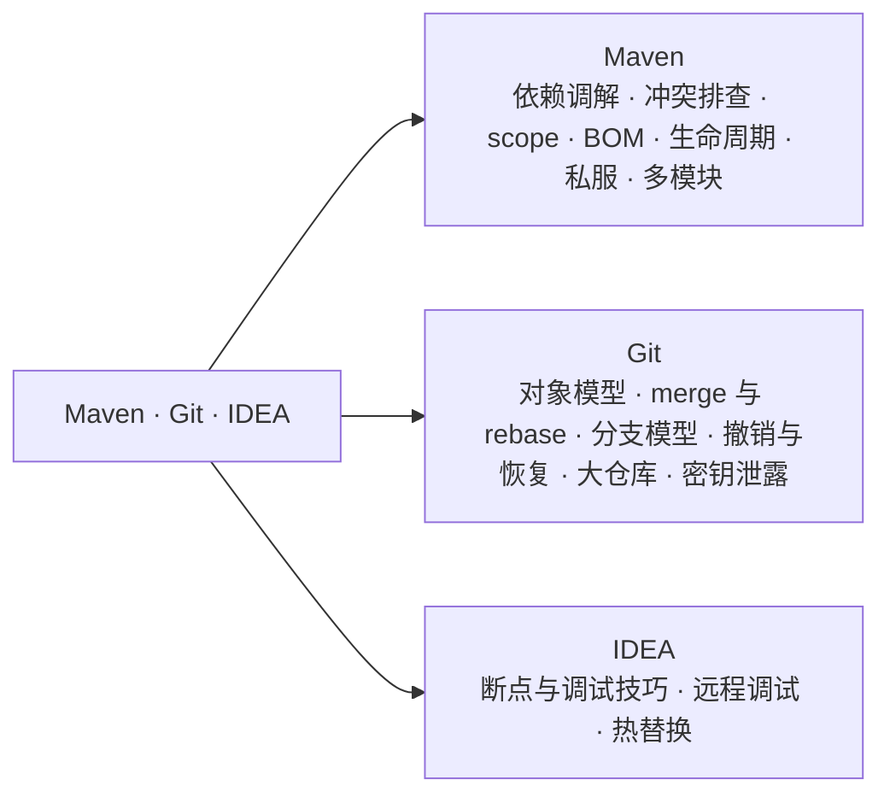
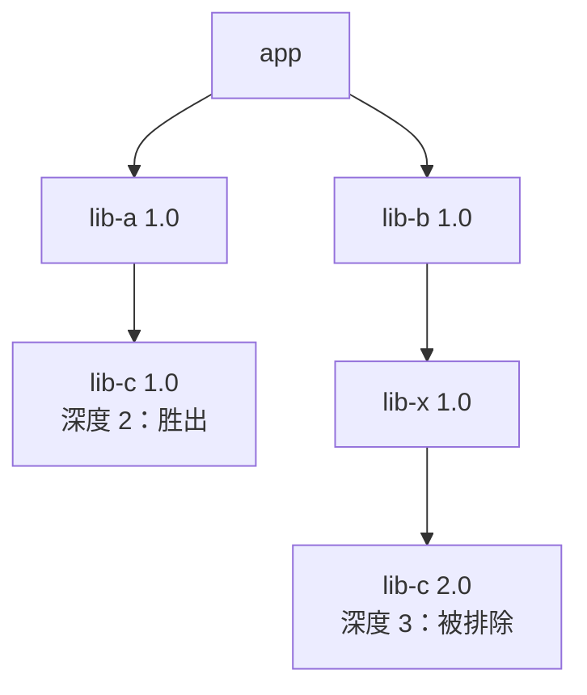
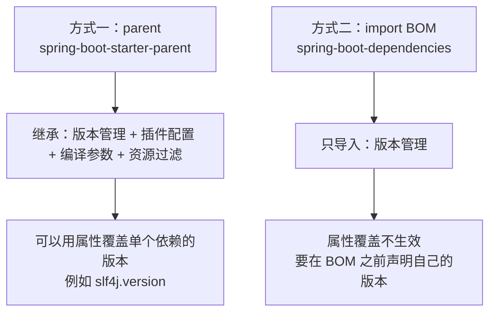
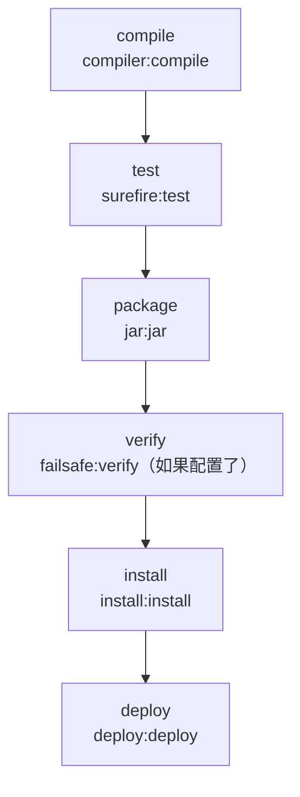
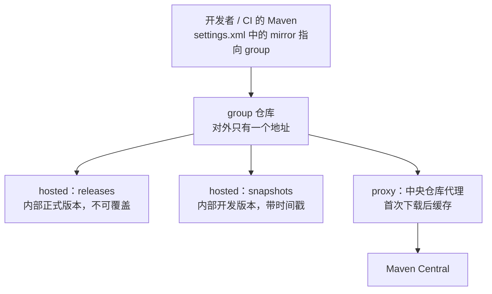
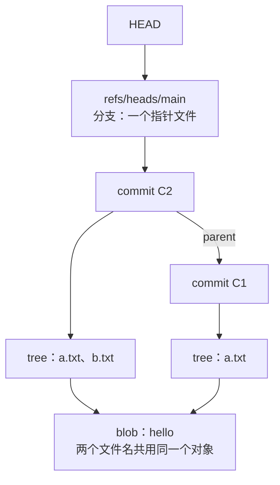
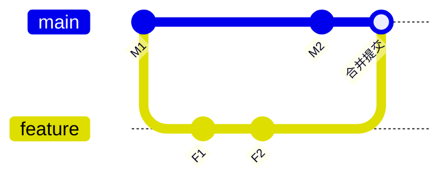
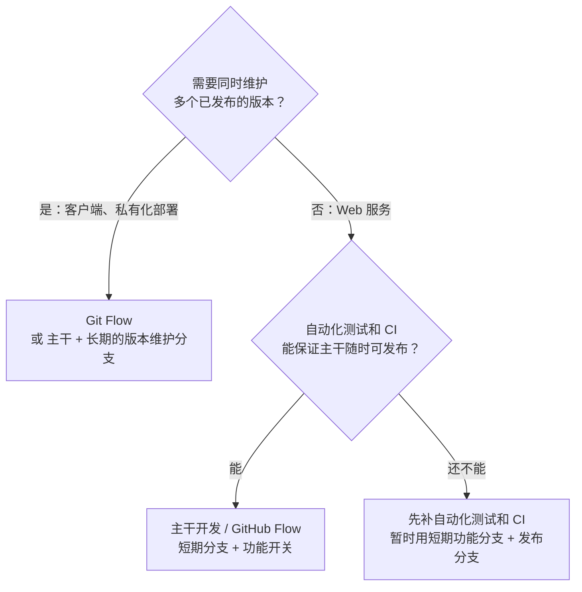
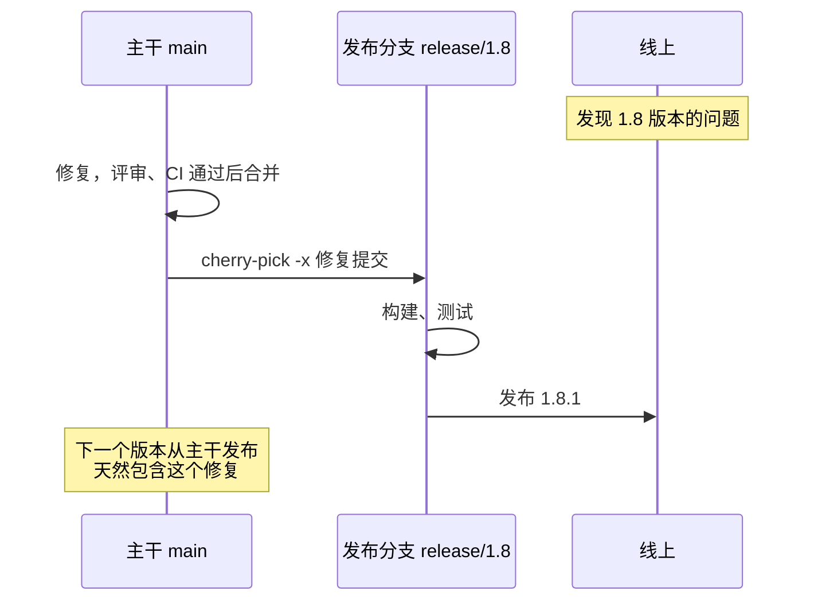
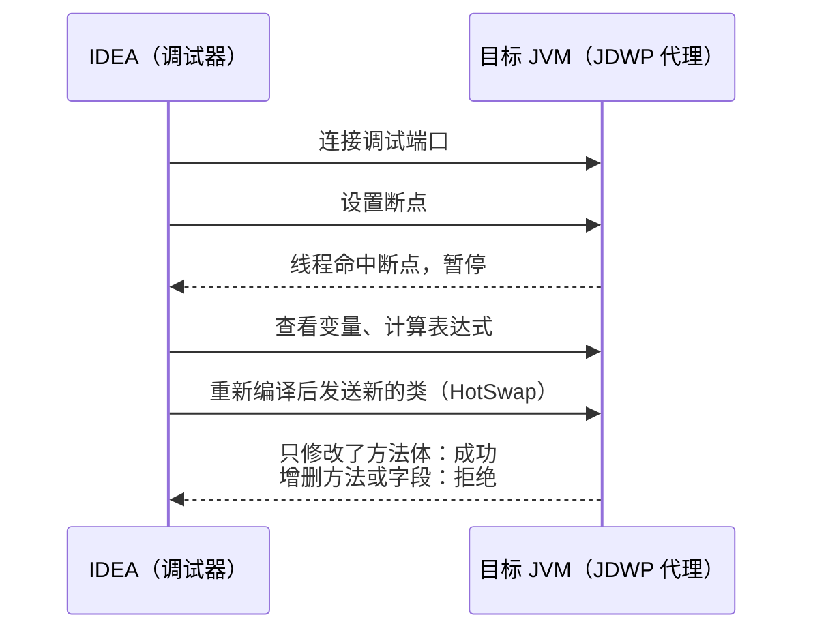

# 36 · Maven · Git · IDEA

> 适用岗位：Java 资深开发（重点：依赖冲突的排查、scope 与 BOM、Git 的撤销与恢复、调试技巧）、Java 架构师（重点：多模块与私服、版本发布、分支模型、仓库治理与密钥泄露的处理）
> 版本基线：Maven 3.10.0（2026-09-27 发布的最新正式版）/ Maven 4.0.0-rc-7（尚未正式发布）、Git 2.54.0、IntelliJ IDEA 2026.3、JDK 25、Spring Boot 4.x
> 事实核对：
> - Maven 依赖调解、`dependencyManagement`、同一个类在两个 jar 中的加载顺序、`NoSuchMethodError` 的成因，都在本机用 Maven 3.8.8 离线构建实际验证过（调解规则在 3.x 中没有变化，3.10 的变化另行标注）；
> - Maven 的规则来自 [依赖机制官方文档](https://maven.apache.org/guides/introduction/introduction-to-dependency-mechanism.html)、[Maven 3.10.0 发布说明](https://maven.apache.org/docs/3.10.0/release-notes.html)、[What's new in Maven 4](https://maven.apache.org/whatsnewinmaven4.html)、[版本历史](https://maven.apache.org/docs/history.html)；BOM 与属性覆盖来自 [Spring Boot Maven 插件文档](https://docs.spring.io/spring-boot/maven-plugin/using.html)；
> - Git 的对象模型、merge 与 rebase、reset、reflog、revert、cherry-pick 都在本机 Git 2.54.0 上实际运行过，配置默认值摘自本机的 Git 手册；
> - 密钥泄露的处理来自 [GitHub 文档](https://docs.github.com/en/authentication/keeping-your-account-and-data-secure/removing-sensitive-data-from-a-repository)，Git Flow 作者的反思来自 [原文](https://nvie.com/posts/a-successful-git-branching-model/)；
> - IDEA 的调试功能来自 JetBrains 文档（[断点](https://www.jetbrains.com/help/idea/using-breakpoints.html)、[改变执行流程](https://www.jetbrains.com/help/idea/altering-the-program-s-execution-flow.html)）；远程调试的端口绑定、热替换的限制在本机 JDK 25 上实际验证过
> 相关分类：[《01 Java 基础》](../01-Java核心/01-Java基础.md)（类加载）、[《04 JVM》](../01-Java核心/04-JVM.md)、[《05 Spring》](../02-框架与容器/05-Spring.md)（Spring Boot）、[《33 线上问题排查》](33-线上问题排查.md)、[《39 网络安全》](../08-计算机基础/39-网络安全.md)（密钥管理）、[《41 容器与云计算》](../09-云原生/41-容器与云计算.md)（CI/CD）

## 知识地图



## 题目索引

| 编号 | 题目 | 难度 | 层级 |
| --- | --- | --- | --- |
| 36-01 | Maven 的依赖是怎么解析的？版本冲突时选哪个？ | ★★ | 资深 |
| 36-02 | 依赖冲突导致 `NoSuchMethodError`，怎么排查和解决？ | ★★★ | 资深 |
| 36-03 | 依赖范围（scope）有哪些？`optional` 和 `provided` 有什么区别？ | ★★ | 资深 |
| 36-04 | `dependencyManagement`、BOM、parent 是什么关系？ | ★★ | 资深 |
| 36-05 | Maven 的生命周期、阶段和插件是什么关系？ | ★★ | 资深 |
| 36-06 | SNAPSHOT 和 RELEASE 有什么区别？私服怎么用？ | ★★ | 资深 / 架构师 |
| 36-07 | 多模块项目怎么组织？构建怎么提速？Maven 3.10 和 4 有什么变化？ | ★★ | 架构师 |
| 36-08 | Git 是怎么存储数据的？分支到底是什么？ | ★★ | 资深 |
| 36-09 | merge 和 rebase 有什么区别？什么时候不能 rebase？ | ★★ | 资深 |
| 36-10 | 团队的分支模型怎么选？ | ★★★ | 架构师 |
| 36-11 | 提交错了怎么撤销？`reset`、`revert`、`restore` 怎么选？丢失的提交怎么找回？ | ★★ | 资深 |
| 36-12 | 线上紧急修复怎么做？cherry-pick 要注意什么？ | ★★ | 资深 |
| 36-13 | Git 仓库太大、太慢怎么办？ | ★★ | 架构师 |
| 36-14 | 密钥被提交到了仓库怎么办？提交规范怎么定？ | ★★ | 资深 / 架构师 |
| 36-15 | IDEA 有哪些高效的调试技巧？ | ★★ | 资深 |
| 36-16 | 远程调试怎么做？热替换能改什么？ | ★★ | 资深 |

---

## 一、Maven

### 36-01 Maven 的依赖是怎么解析的？版本冲突时选哪个？

> ★★ ｜ 资深 ｜ 高频

**考察意图**：理解传递依赖和"依赖调解"（dependency mediation）规则，这是排查依赖冲突的基础。

**30 秒版回答**

- **传递依赖**：项目依赖 A，A 依赖 C，那么 C 也会进入项目的 classpath，不需要手动声明。
- **同一个依赖出现多个版本时**，Maven 只会选一个，规则是（官方文档原文）：
  1. **最近者优先**（nearest definition）：在依赖树中离当前项目最近的那个版本胜出；
  2. **深度相同时，先声明者优先**："if two dependency versions are at the same depth in the dependency tree, the first declaration wins"。
- **`dependencyManagement` 的优先级高于调解规则**：在 `dependencyManagement` 中指定的版本，会覆盖传递依赖中的版本。
- **注意：Maven 不会选"最高版本"**。这和 Gradle 的默认行为（选最高版本）不同，是很多冲突问题的根源。

**深入剖析**

本机实测的依赖关系：`app` 依赖 `lib-a` 和 `lib-b`；`lib-a` 依赖 `lib-c:1.0`；`lib-b` 依赖 `lib-x`，`lib-x` 依赖 `lib-c:2.0`。



`mvn dependency:tree -Dverbose` 的输出（verbose 模式会显示被排除的版本及原因）：

```text
com.example.mvndemo:app:jar:1.0
+- com.example.mvndemo:lib-a:jar:1.0:compile
|  \- com.example.mvndemo:lib-c:jar:1.0:compile
\- com.example.mvndemo:lib-b:jar:1.0:compile
   \- com.example.mvndemo:lib-x:jar:1.0:compile
      \- (com.example.mvndemo:lib-c:jar:2.0:compile - omitted for conflict with 1.0)
```

另外三个实验：

| 实验 | 结果 |
| --- | --- |
| 在 `app` 的 `dependencyManagement` 中指定 `lib-c:2.0` | 依赖树中显示 `lib-c:jar:2.0:compile (version managed from 1.0)`，整棵树统一为 2.0 |
| `lib-y`（依赖 `lib-c:2.0`）和 `lib-a`（依赖 `lib-c:1.0`）深度相同，先声明 `lib-y` | 选 2.0，1.0 显示 `omitted for conflict with 2.0` |
| 同上，先声明 `lib-a` | 选 1.0 |

**追问链**

1. **"深度相同时先声明者优先"会带来什么问题？** 调整 `pom.xml` 中依赖的声明顺序，可能悄悄改变某个传递依赖的版本。所以重要的依赖版本不要依赖调解规则，要在 `dependencyManagement` 中显式指定。
2. **`dependency:tree` 没有显示被排除的版本？** 需要加 `-Dverbose`。不加时只显示最终选中的版本，看不出发生过冲突。

---

### 36-02 依赖冲突导致 `NoSuchMethodError`，怎么排查和解决？

> ★★★ ｜ 资深 ｜ 高频

**考察意图**：依赖冲突的典型症状、根因和处理手段。

**30 秒版回答**

- **典型症状**：编译通过，运行时报 `NoSuchMethodError`、`NoClassDefFoundError`、`ClassNotFoundException`、`AbstractMethodError`，或者行为和预期不一致。
- **根因有两类**：
  1. **同一个依赖的不同版本**：调解规则选中了旧版本，而某个库是基于新版本编译的，调用了旧版本中不存在的方法；
  2. **不同的依赖中有同一个类**：例如同一个库换了 groupId 或 artifactId（如 `javax` 和 `jakarta` 的过渡期、库被打包进另一个 jar），两个 jar 都在 classpath 上，**先出现在 classpath 上的那个类被加载**。
- **排查**：
  - `mvn dependency:tree -Dverbose -Dincludes=groupId:artifactId` 看某个依赖的所有来源和最终版本；
  - 运行时加 `-Xlog:class+load`（JDK 9+），看出问题的类是从哪个 jar 加载的；
  - IDEA 的 Maven 依赖分析工具（Dependency Analyzer）可以列出所有冲突。
- **解决**：
  1. 在 `dependencyManagement` 中统一版本（首选）；
  2. 用 `<exclusions>` 排除不需要的传递依赖；
  3. 用 maven-enforcer-plugin 的 `dependencyConvergence` 规则，让构建在出现版本不一致时直接失败，防止问题再次出现。

**深入剖析**

本机实测（接 36-01 的例子）：`lib-x` 是基于 `lib-c:2.0` 编译的，调用了 2.0 才有的方法 `Codec.v2()`；但调解规则选中了 `lib-c:1.0`。

```text
A -> c-1.0 v1
Exception in thread "main" java.lang.NoSuchMethodError: 'java.lang.String demo.c.Codec.v2()'
	at demo.x.X.call(X.java:2)
	at demo.b.B.call(B.java:2)
```

在 `dependencyManagement` 中指定 `lib-c:2.0` 之后，两个调用都正常。

**同一个类出现在两个 jar 中**：把 `lib-c-1.0.jar` 和 `lib-c-2.0.jar` 同时放在 classpath 上，用 `-Xlog:class+load` 观察：

| classpath 顺序 | 加载来源 | 结果 |
| --- | --- | --- |
| 1.0 在前 | `demo.c.Codec source: file:.../lib-c-1.0.jar` | `NoSuchMethodError` |
| 2.0 在前 | `demo.c.Codec source: file:.../lib-c-2.0.jar` | 正常 |

所以这类问题可能"在我的机器上正常、在服务器上报错"：classpath 的顺序变了，结果就变了。

**追问链**

1. **升级 Maven 会改变 classpath 的顺序吗？** 会。Maven 3.10.0 的发布说明中写明，classpath 的排序从深度优先改为广度优先，需要旧行为时用 `-Daether.system.dependencyVisitor=preOrder`。如果项目依赖"同一个类在两个 jar 中，碰巧加载对了"，升级后可能出问题。根本的解决办法是消除重复的类，而不是依赖顺序。
2. **Spring Boot 打成的可执行 jar 中，classpath 顺序由什么决定？** 由 `BOOT-INF/classpath.idx` 文件中记录的顺序决定，它是构建时按依赖顺序生成的。和上面一样，不要依赖这个顺序。
3. **怎么找出所有"同一个类在多个 jar 中"的情况？** 可以用 maven-enforcer-plugin 的扩展规则（如 extra-enforcer-rules 中的 `banDuplicateClasses`），或者在启动时打印加载来源进行比对。
4. **排除了某个传递依赖，会不会导致运行时找不到类？** 会。排除之前要确认这个依赖确实不需要，或者已经由其他依赖以合适的版本提供了。

**生产实践 / 踩坑**

- **框架的版本要整体升级**：Spring、Jackson、Netty 这类由很多模块组成的框架，各个模块的版本必须一致。用它们提供的 BOM（36-04）统一管理，不要单独升级其中一个模块。
- **出问题的类在哪个 jar 里**：线上可以用 Arthas 的 `sc -d 类名` 查看类是从哪个 jar 加载的，见[《33 线上问题排查》](33-线上问题排查.md)。

**架构师加分点**

- 依赖治理要前置到构建阶段：公司级的 parent POM 中统一管理常用依赖的版本，开启 `dependencyConvergence` 等规则，让问题在 CI 中暴露，而不是在线上。

---

### 36-03 依赖范围（scope）有哪些？`optional` 和 `provided` 有什么区别？

> ★★ ｜ 资深 ｜ 中频

**考察意图**：scope 决定了依赖出现在哪些 classpath 上，以及是否传递。

**30 秒版回答**

| scope | 含义（官方文档） | 是否传递 |
| --- | --- | --- |
| `compile` | 默认值，所有 classpath 中都有 | 传递 |
| `provided` | 编译时需要，运行时由 JDK 或容器提供，例如 Servlet API | 不传递 |
| `runtime` | 编译时不需要，运行时需要，例如 JDBC 驱动 | 传递 |
| `test` | 只在测试编译和测试执行时使用 | 不传递 |
| `system` | 从本地文件系统的指定路径获取 jar，不从仓库下载 | 官方明确不推荐 |
| `import` | 只能用在 `dependencyManagement` 中、类型为 `pom` 的依赖上，把对方的 `dependencyManagement` 导入进来 | 不涉及 |

**传递时 scope 的变化**（行：项目对 A 的 scope；列：A 对 B 的 scope；"—"表示不传递）：

| | compile | provided | runtime | test |
| --- | --- | --- | --- | --- |
| **compile** | compile | — | runtime | — |
| **provided** | provided | — | provided | — |
| **runtime** | runtime | — | runtime | — |
| **test** | test | — | test | — |

**`optional` 和 `provided` 的区别**：

- **`optional`**：表示"这个依赖是我的可选功能才需要的"。官方文档的比喻是"默认被排除"：依赖我的项目不会自动获得它，需要的话自己声明。例如一个库同时支持多种 JSON 实现，每种实现都标记为 optional。
- **`provided`**：表示"运行环境会提供"。它在运行时的 classpath 中也不会出现（打包时不包含）。
- 两者都不传递，但语义不同：optional 是"你可能不需要"，provided 是"环境会给你"。

**追问链**

1. **为什么不推荐 `system` scope？** 依赖只从指定的文件路径获取，构建和某台机器绑定。官方建议把这类 jar 发布到私有仓库中。Maven 3.10 还会拒绝从仓库获取的 POM 中声明的 `system` 依赖（发布说明中的安全加固）。
2. **Lombok 应该用什么 scope？** Lombok 只在编译期生成代码，运行时不需要，常用 `provided`，或者在 Spring Boot 项目中配置为 `optional` 并在打包时排除。
3. **测试代码能用 `provided` 的依赖吗？** 能。provided 的依赖在编译和测试的 classpath 中都有，只是不打包、不传递。

---

### 36-04 `dependencyManagement`、BOM、parent 是什么关系？

> ★★ ｜ 资深 ｜ 高频

**考察意图**：版本统一管理的几种手段，以及使用 Spring Boot 时的一个常见坑。

**30 秒版回答**

- **`dependencyManagement`**：只声明版本（和 scope、exclusions 等），**不会引入依赖**。子模块或当前项目声明依赖时可以省略版本，由这里统一决定；它还会覆盖传递依赖的版本（36-01）。
- **BOM**（Bill of Materials，物料清单）：一个只包含 `dependencyManagement` 的 POM。其他项目在自己的 `dependencyManagement` 中用 `<type>pom</type><scope>import</scope>` 导入，就获得了它的全部版本定义。例如 `spring-boot-dependencies`、`jackson-bom`、`netty-bom`。
- **parent**：继承父 POM 的全部内容，包括属性、`dependencyManagement`、插件配置。一个项目只能有一个 parent。
- **区别**：parent 是"继承一切"，只能有一个；BOM 是"只导入版本"，可以导入多个。

**深入剖析**



**用 BOM 时覆盖版本的坑**（Spring Boot 官方文档）：

- 继承 `spring-boot-starter-parent` 时，可以通过覆盖属性修改某个依赖的版本，例如 `<slf4j.version>`。
- 用 import 的方式导入 `spring-boot-dependencies` 时，**属性覆盖不生效**。原因是 BOM 中的版本在导入时已经解析完成，当前项目的属性影响不到它。要覆盖版本，需要在 `dependencyManagement` 中、**在导入 BOM 的条目之前**声明自己的版本：

```xml
<dependencyManagement>
    <dependencies>
        <!-- 要覆盖的版本，必须写在 spring-boot-dependencies 之前 -->
        <dependency>
            <groupId>org.slf4j</groupId>
            <artifactId>slf4j-api</artifactId>
            <version>${slf4j.override.version}</version>
        </dependency>
        <dependency>
            <groupId>org.springframework.boot</groupId>
            <artifactId>spring-boot-dependencies</artifactId>
            <version>${spring-boot.version}</version>
            <type>pom</type>
            <scope>import</scope>
        </dependency>
    </dependencies>
</dependencyManagement>
```

**追问链**

1. **导入了两个 BOM，它们对同一个依赖的版本定义不同，用哪个？** 先导入的生效。所以导入的顺序很重要，想要优先的放在前面。
2. **公司有自己的 parent，又想用 Spring Boot 的版本管理，怎么办？** 公司的 parent 中导入 Spring Boot 的 BOM，而不是继承 `spring-boot-starter-parent`；需要的插件配置（如 `spring-boot-maven-plugin` 的 repackage）自己补上。
3. **Maven 4 对 BOM 有什么改进？** Maven 4 新增了专门的 `bom` 打包类型（需要 4.1.0 版本的 POM 模型），把"父 POM"和"管理依赖版本的 BOM"区分开来。

---

### 36-05 Maven 的生命周期、阶段和插件是什么关系？

> ★★ ｜ 资深 ｜ 中频

**考察意图**：理解 `mvn package` 背后发生了什么。

**30 秒版回答**

- **生命周期**：Maven 有三套相互独立的生命周期：`clean`（清理）、`default`（构建）、`site`（生成站点文档）。
- **阶段（phase）**：每个生命周期由有序的阶段组成。`default` 生命周期中常用的阶段：`validate` → `compile` → `test` → `package` → `verify` → `install` → `deploy`。**执行某个阶段时，它之前的所有阶段都会执行**，例如 `mvn install` 会依次执行编译、测试、打包。
- **插件目标（goal）**：阶段本身不做事，真正干活的是绑定到阶段上的插件目标。例如 `compile` 阶段绑定了 `maven-compiler-plugin:compile`，`package` 阶段（jar 打包）绑定了 `maven-jar-plugin:jar`。
- **也可以直接执行插件目标**，例如 `mvn dependency:tree`，这时不会执行生命周期中的阶段。

**深入剖析**



（图中省略了 `validate`、`process-resources`、`test-compile` 等中间阶段。）

**追问链**

1. **`-DskipTests` 和 `-Dmaven.test.skip=true` 有什么区别？** `-DskipTests` 编译测试代码但不运行；`-Dmaven.test.skip=true` 连测试代码都不编译。后者在其他模块依赖本模块的测试 jar 时会出问题。
2. **怎么在某个阶段执行自定义的操作？** 在插件的 `<executions>` 中把目标绑定到指定的阶段，例如在 `generate-sources` 阶段生成代码。
3. **Maven 4 对生命周期有什么改变？**（What's new in Maven 4，4.0.0 尚未正式发布）
   - 每个阶段都有对应的 `before:` 和 `after:` 阶段，例如 `before:integration-test`，可以用 `[100]` 这样的数字控制顺序；
   - 原来的 `pre-*`、`post-*` 阶段被弃用，只作为别名保留；
   - 行为变化：执行某个阶段时，总会执行它的 `before:` 和 `after:` 阶段，例如绑定在 `post-clean` 上的插件，在 `mvn clean` 时也会执行。

**生产实践 / 踩坑**

- **所有插件都要写明版本**：不写版本时，使用的是 Maven 内置的默认版本，升级 Maven 后插件版本可能随之变化，构建结果也可能变化。Maven 3.10 从超级 POM 中移除了插件管理，Maven 4 的文档也明确建议"总是为所有插件指定固定的版本"。

---

### 36-06 SNAPSHOT 和 RELEASE 有什么区别？私服怎么用？

> ★★ ｜ 资深 / 架构师 ｜ 中频

**考察意图**：版本发布的基本规则和仓库的组织方式。

**30 秒版回答**

- **RELEASE 版本**（如 `1.2.0`）：**发布后不可变**。同一个版本号的内容永远不变，Maven 下载过一次就不会再检查更新。
- **SNAPSHOT 版本**（如 `1.2.0-SNAPSHOT`）：开发中的版本，**可以反复发布**。私服中每次发布都会生成一个带时间戳的具体版本（如 `1.2.0-20261110.083015-3`），Maven 按更新策略（默认每天一次）检查是否有更新，`-U` 强制检查。
- **规则**：发布正式版本时，不能依赖任何 SNAPSHOT；否则今天和明天构建出来的结果可能不一样。
- **私服**（如 Nexus、Artifactory）的仓库类型：
  - **proxy**：代理中央仓库等外部仓库，并缓存下载过的构件；
  - **hosted**：存放公司内部发布的构件，通常分为 releases 和 snapshots 两个；
  - **group**：把多个仓库合并成一个地址，开发者只需要配置这一个。

**深入剖析**



**追问链**

1. **私服上的 releases 仓库为什么要禁止重复发布？** 一个版本号对应的内容一旦变化，已经下载过的机器不会更新，不同的机器上同一个版本号的内容就不一样了，问题极难排查。版本号写错了就发布一个新的版本号。
2. **CI 中怎么管理版本号？** Maven 3.5 起支持在版本号中使用 `${revision}` 这类变量（CI 友好的版本号），由 CI 通过 `-Drevision=1.2.3` 传入；发布到仓库时需要配合 flatten-maven-plugin 把变量替换成具体的值。Maven 4 内置了这个能力，不再需要额外的插件，而且可以使用任意变量。
3. **私服的账号密码怎么管理？** 写在 `settings.xml` 的 `<servers>` 中，不要写在项目的 `pom.xml` 中；CI 中用环境变量或密钥管理服务注入。Maven 3.10 加强了凭证的作用范围：一个 server 条目的凭证不再泄露给 id 前缀相同的其他仓库。

---

### 36-07 多模块项目怎么组织？构建怎么提速？Maven 3.10 和 4 有什么变化？

> ★★ ｜ 架构师 ｜ 中频

**考察意图**：大型项目的构建组织与效率，以及对工具演进的了解。

**30 秒版回答**

- **多模块的组织**：
  - 根 POM 负责聚合模块（`<modules>`）和统一的版本、插件管理；
  - 模块之间的依赖关系决定构建顺序，Maven 的 Reactor 会自动排序；
  - 模块按职责划分（如 api、domain、infrastructure、app），**依赖方向单向**，不能循环依赖。
- **构建提速**：
  - 只构建需要的模块：`-pl 模块 -am`（同时构建它依赖的模块），`-amd`（同时构建依赖它的模块）；
  - 并行构建：`-T 1C`（每个 CPU 核一个线程）；
  - 使用 Maven Daemon（mvnd），复用常驻的 JVM 进程；
  - CI 中缓存本地仓库；
  - 不在每次构建中执行耗时但不必要的插件（如生成文档、代码检查只在需要的流水线中执行）。
- **Maven 3.10.0**（2026-09-27，最新正式版）：
  - 仍然只需要 Java 8 运行；使用和 Maven 4 相同的 Resolver 2.x；
  - **校验更严格**：许多原来只是警告的问题（如重复声明的依赖、重复的插件）现在会导致构建失败；
  - classpath 排序改为广度优先（36-02）；
  - 默认开启可重现构建；`project.build.sourceEncoding` 默认为 UTF-8。
- **Maven 4**（4.0.0-rc-7，尚未正式发布）：
  - 运行需要 Java 17（编译目标仍可以是更低的版本）；
  - 区分构建 POM 和消费者 POM：发布到仓库的是精简后的消费者 POM；
  - POM 模型版本 4.1.0，`<modules>` 改名为 `<subprojects>`；
  - 子项目的 `<parent>` 可以省略版本等信息；新增 `bom` 打包类型；生命周期增加 `before:`、`after:` 阶段。

**追问链**

1. **升级到 Maven 3.10 要注意什么？** 先在 CI 中试跑：构建可能因为更严格的校验而失败（发布说明给出的临时绕过方式是 `-Dmaven.resolver.validation=off`，但应该修复问题本身）；依赖同一个类在多个 jar 中的项目，要检查 classpath 顺序变化的影响。
2. **模块拆得越细越好吗？** 不是。每个模块都有构建、发布、版本管理的成本。模块的划分应该反映真实的依赖边界和发布单元，而不是代码的目录结构。

---

## 二、Git

### 36-08 Git 是怎么存储数据的？分支到底是什么？

> ★★ ｜ 资深 ｜ 中频

**考察意图**：理解 Git 的对象模型，才能真正理解分支、合并和撤销。

**30 秒版回答**

- **Git 存储的是快照，不是差异**。每次提交保存的是整个项目在那一刻的状态，没有变化的文件直接复用之前的对象。
- **三种核心对象**，都以内容的哈希值作为名字：
  - **blob**：文件的内容（不含文件名）；
  - **tree**：一个目录，记录"文件名 → blob"和"子目录名 → tree"；
  - **commit**：指向一个根 tree，记录父提交、作者、提交者、提交信息。
- **分支只是一个指针**：一个文件，里面写着某个提交的哈希值。创建分支只是写一个文件，所以很快。
- **HEAD** 指向当前所在的分支（或者直接指向某个提交，即"分离 HEAD"状态）。

**深入剖析**

本机实测（Git 2.54.0，对象格式 SHA-1，引用存储格式 files）：

```text
$ cat .git/HEAD
ref: refs/heads/main
$ cat .git/refs/heads/main          # 分支就是一个 41 字节的文件：40 位哈希 + 换行
8eda46ac72accd6ea8b3ce6a976bbd71a794394f
$ git cat-file -p HEAD              # commit 对象
tree 2e81171448eb9f2ee3821e3d447aa6b2fe3ddba1
author demo <demo@example.com> 1794276000 +0800
committer demo <demo@example.com> 1794276000 +0800

C1: add a.txt
$ git cat-file -p 'HEAD^{tree}'     # tree 对象
100644 blob ce013625030ba8dba906f756967f9e9ca394464a	a.txt
```

再添加一个内容相同的 `b.txt` 并提交，新的 tree 中两个文件指向**同一个 blob**：

```text
100644 blob ce013625030ba8dba906f756967f9e9ca394464a	a.txt
100644 blob ce013625030ba8dba906f756967f9e9ca394464a	b.txt
```



**追问链**

1. **提交的哈希值由什么决定？** 由 commit 对象的完整内容决定：tree、父提交、作者和提交者（含时间）、提交信息。任何一项变化，哈希值都会变化。所以 rebase、修改提交信息之后，提交的哈希值全变了（36-09）。
2. **大量小改动会让仓库膨胀吗？** 每次修改都会产生新的 blob，但 Git 打包（pack）时会对相似的对象做增量压缩，所以磁盘占用不会按"每次一个完整副本"增长。真正让仓库膨胀的是大的二进制文件（36-13）。
3. **Git 会从 SHA-1 换成 SHA-256 吗？** Git 已经支持 SHA-256 格式的仓库（`git init --object-format=sha256`），本机 2.54.0 新建的仓库默认仍是 SHA-1。

---

### 36-09 merge 和 rebase 有什么区别？什么时候不能 rebase？

> ★★ ｜ 资深 ｜ 高频

**考察意图**：两种整合方式对历史的影响，以及 rebase 的使用边界。

**30 秒版回答**

- **merge**：创建一个合并提交，它有两个父提交。原有的提交不变，历史如实记录"分叉后又合并"。
- **rebase**：把当前分支的提交，逐个在目标分支的最新提交之上**重新应用一遍**，生成新的提交（哈希值都变了），历史变成一条直线。
- **黄金法则：不要 rebase 已经推送到公共分支、别人可能基于它工作的提交**。rebase 改写了历史，别人本地的旧提交和远程的新提交对不上，再次合并时会出现重复的提交和冲突。
- **常见用法**：
  - 自己的功能分支在推送前，rebase 到最新的主干上，整理提交；
  - 合并到主干时，团队统一选择"合并提交"、"压缩合并"（squash）或"变基合并"中的一种。

**深入剖析**

本机实测：`main` 上有 M1、M2，`feature` 从 M1 分出，有 F1、F2。



```text
# merge：保留分叉，多一个合并提交
*   280c816 Merge branch 'feature-merge' into merged
|\
| * 6bcd66f F2
| * 484fbf5 F1
* | ad86141 M2
|/
* 958eee5 M1

# rebase 到 main 之后：一条直线，F1、F2 的哈希值变了（484fbf5 → 075a37a，6bcd66f → 8ce1fbb）
* 8ce1fbb F2
* 075a37a F1
* ad86141 M2
* 958eee5 M1
```

rebase 之后，`main` 可以用 `git merge --ff-only` 快进合并，不产生合并提交。

**追问链**

1. **rebase 过程中遇到冲突怎么办？** rebase 是逐个提交重新应用的，每个提交都可能遇到冲突。解决后 `git add`，再 `git rebase --continue`；想放弃就 `git rebase --abort`，回到开始之前的状态。
2. **squash 合并有什么优缺点？** 把功能分支的所有提交压缩成一个，主干的历史很干净，一个提交对应一个功能，回滚也方便；缺点是丢失了分支内部的细节，功能分支本身不再"被合并"，删除前要确认。
3. **`git pull` 默认是 merge 还是 rebase？** 由 `pull.rebase` 等配置决定。团队应该统一配置，避免本地出现大量无意义的合并提交。

---

### 36-10 团队的分支模型怎么选？

> ★★★ ｜ 架构师 ｜ 高频

**考察意图**：分支模型要和发布方式匹配，而不是照搬某一种。

**30 秒版回答**

| 模型 | 做法 | 适用 |
| --- | --- | --- |
| **Git Flow** | 长期存在的 `main` 和 `develop`，加上 feature、release、hotfix 分支 | 有明确版本号、需要同时维护多个已发布版本的软件（如客户端、私有化部署的产品） |
| **GitHub Flow** | 只有一个 `main`，所有修改都通过短期的功能分支和合并请求进入 `main`，`main` 随时可部署 | 持续部署的 Web 服务 |
| **主干开发**（Trunk-Based Development） | 所有人频繁（至少每天）把小的改动合入主干；未完成的功能用功能开关（feature flag）隐藏；需要时从主干拉出发布分支 | 持续集成、持续交付成熟的团队 |

- **Git Flow 的作者本人的反思**（2020 年 3 月 5 日在原文顶部加的说明）：Web 应用通常是持续交付的，不需要同时支持多个线上版本，这样的团队应该采用更简单的工作流，而不是硬套 git-flow；如果软件有明确的版本号，或者需要支持多个线上版本，git-flow 仍然合适。
- **选择的依据**：发布频率、是否需要同时维护多个版本、CI 和自动化测试是否可靠、团队规模。

**深入剖析**



**追问链**

1. **长期存在的功能分支有什么问题？** 分支存在的时间越长，和主干的差异越大，合并时冲突越多，"合并地狱"的风险越高；而且这部分代码长期没有经过集成测试。所以分支要短，最好一两天就合并。
2. **主干开发时，没做完的功能怎么办？** 用功能开关：代码合入主干，但开关默认关闭，线上不生效。功能完成并验证后再打开，之后删除开关和旧代码。开关本身也要管理，不能无限累积。
3. **怎么保护主干？** 主干禁止直接推送；合并必须经过代码评审和 CI 检查（编译、测试、静态检查）；重要的仓库要求提交签名。

**架构师加分点**

- 分支模型是交付流程的一部分，不是独立的规范。从 Git Flow 转向主干开发，前提是自动化测试、CI、功能开关、灰度发布这些能力都已经具备；否则只换分支模型，会让主干变得不稳定。

---

### 36-11 提交错了怎么撤销？`reset`、`revert`、`restore` 怎么选？丢失的提交怎么找回？

> ★★ ｜ 资深 ｜ 高频

**考察意图**：区分"改写历史"和"追加新的提交"，以及 reflog 这个最后的安全网。

**30 秒版回答**

- **三个区域**：工作区（磁盘上的文件）、暂存区（index，下一次提交的内容）、HEAD（当前的提交）。
- **`git restore`**：恢复**文件**。`git restore 文件` 丢弃工作区的修改；`git restore --staged 文件` 把文件移出暂存区。
- **`git reset`**：移动**当前分支的指针**，三种模式影响的范围不同（下面有实测）。会改写历史，**只用于还没推送的提交**。
- **`git revert`**：生成一个新的提交，内容是某个提交的反向修改。**不改写历史**，用于已经推送到公共分支的提交。
- **找回丢失的提交**：`git reflog` 记录了 HEAD 和分支指针的每一次移动，即使提交已经不在任何分支上，也能通过它找回。

**深入剖析**

本机实测：在 F2 上执行 `git reset --<模式> HEAD~1`（回到 F1，F2 中给 `f.txt` 追加了一行 `f2`）：

| 模式 | HEAD | 暂存区 | 工作区 | `git status` |
| --- | --- | --- | --- | --- |
| `--soft` | 回到 F1 | 保留 F2 的修改 | 保留 F2 的修改 | `M  f.txt`（已暂存） |
| `--mixed`（默认） | 回到 F1 | 恢复为 F1 | 保留 F2 的修改 | ` M f.txt`（未暂存） |
| `--hard` | 回到 F1 | 恢复为 F1 | 恢复为 F1，**修改丢失** | 干净 |


**用 reflog 找回**（本机实测）：在 F2 上执行 `git reset --hard HEAD~2`，HEAD 回到 M2，F1、F2 不在任何分支上了：

```text
$ git reflog -4
HEAD@{0} reset: moving to HEAD~2
HEAD@{1} checkout: moving from r-mixed to lost
...
$ git reset --hard 'HEAD@{1}'      # 回到 reset 之前的位置
recovered: F2
```

**reflog 也不是永久的**（本机 Git 手册中的默认值）：

| 配置 | 默认值 | 含义 |
| --- | --- | --- |
| `gc.reflogExpire` | 90 天 | reflog 条目的保留时间 |
| `gc.reflogExpireUnreachable` | 30 天 | 指向"已经不可达的提交"的 reflog 条目的保留时间 |
| `gc.pruneExpire` | 2 周 | `git gc` 清理不可达的松散对象的宽限期 |

**reflog 只在本地**，不会推送到远程；`git reset --hard` 丢弃的**未提交的修改**不会被 reflog 记录，找不回来。

**追问链**

1. **revert 一个合并提交要注意什么？** 必须用 `-m` 指定保留哪个父提交作为主线，否则报错（本机实测：`error: commit 280c816... is a merge but no -m option was given.`）。通常用 `-m 1`，即保留合并之前主干的状态。另外，revert 了合并提交之后，如果之后想再次合并同一个分支，Git 会认为那些提交已经合并过了，需要先 revert 这次 revert。
2. **已经推送的提交，一定不能用 reset 吗？** 只有自己一个人使用的分支，可以 reset 之后 `git push --force-with-lease`。它比 `--force` 安全：如果远程分支在你上次获取之后被别人更新过，推送会被拒绝。公共分支一律用 revert。
3. **`git checkout` 为什么被拆成了 `switch` 和 `restore`？** `checkout` 同时承担"切换分支"和"恢复文件"两种职责，容易误用（例如想切换分支却覆盖了文件）。`switch` 只切换分支，`restore` 只恢复文件。

---

### 36-12 线上紧急修复怎么做？cherry-pick 要注意什么？

> ★★ ｜ 资深 ｜ 中频

**考察意图**：在多个分支之间同步修复的流程。

**30 秒版回答**

- **流程**（以"主干开发 + 发布分支"为例）：
  1. 在主干上修复并合并（经过评审和 CI）；
  2. 用 `git cherry-pick -x <提交>` 把修复带到当前线上版本的发布分支；
  3. 在发布分支上构建、测试、发布。
- **为什么先修主干**：如果只修了发布分支，下一个版本从主干发布时，问题会再次出现。
- **`-x` 的作用**：在提交信息末尾自动加上 `(cherry picked from commit <原提交>)`，便于追溯。本机实测输出：

```text
F1
(cherry picked from commit 484fbf591f9a0b121500ac990d2be2c23262fc16)
```

**深入剖析**



**追问链**

1. **cherry-pick 会产生什么问题？** cherry-pick 生成的是内容相同、哈希值不同的新提交。之后如果两个分支合并，Git 通常能识别出相同的修改，但如果两边在附近又有其他改动，就可能出现冲突。所以发布分支应该只接受修复，不做其他开发。
2. **同样的冲突反复出现怎么办？** 开启 `rerere.enabled`（reuse recorded resolution），Git 会记录你对某个冲突的解决方式，下次遇到相同的冲突时自动应用。
3. **紧急情况下能不能直接在发布分支上修，之后再同步到主干？** 可以，但一定要有机制保证同步：例如修复的合并请求必须同时关联主干的合并请求，或者由 CI 检查发布分支上的提交是否都已在主干上。

---

### 36-13 Git 仓库太大、太慢怎么办？

> ★★ ｜ 架构师 ｜ 低频

**考察意图**：大仓库、单体仓库（monorepo）的常见优化手段。

**30 秒版回答**

- **找到原因**：通常是大的二进制文件（安装包、图片、模型文件、jar）进入了历史，或者文件数量非常多。
- **只获取需要的部分**（本机 Git 手册中的说明）：
  - **浅克隆** `git clone --depth=1`：只获取最近的提交历史，适合 CI 中只需要构建最新代码的场景；
  - **部分克隆** `git clone --filter=blob:none`：先不下载文件内容（blob），需要时再按需获取；`--filter=blob:limit=<大小>` 只排除大文件；
  - **稀疏检出** `git sparse-checkout`：工作区中只检出需要的目录，配合 `git clone --sparse` 使用。
- **后台维护**：`git maintenance` 定期执行预取、提交图（commit-graph）更新、打包等任务；Git 自带的 `scalar` 工具可以一次性为大仓库配置好这些优化。
- **大的二进制文件不要直接放进 Git**：用 Git LFS 或者制品库、对象存储管理。

**追问链**

1. **大文件已经进入了历史，删掉文件为什么仓库还是很大？** 删除只影响之后的提交，历史中的对象还在。要真正移除，需要改写历史（36-14 中的 git-filter-repo），并且所有人都要重新克隆。这个代价很大，所以要在入口处拦截：在仓库托管平台上限制单个文件的大小，或者用提交前的钩子检查。
2. **浅克隆有什么限制？** 历史不完整，依赖完整历史的操作（如查看很久以前的提交、计算某些版本号）会受限，需要时可以用 `git fetch --unshallow` 补全。

---

### 36-14 密钥被提交到了仓库怎么办？提交规范怎么定？

> ★★ ｜ 资深 / 架构师 ｜ 中频

**考察意图**：处理密钥泄露的正确顺序，以及团队的提交规范。

**30 秒版回答**

**密钥泄露的处理顺序**（GitHub 文档）：

1. **第一步：立即作废或更换密钥**（revoke / rotate）。这是最重要的一步：密钥作废之后就不能再被使用，GitHub 文档甚至指出，做到这一步可能就足够了，后续改写历史的工作未必值得。
2. **评估影响**：检查密钥在泄露期间是否被使用过（访问日志、云平台的审计日志）。
3. **需要的话再清理历史**：用 git-filter-repo 改写历史（GitHub 文档给出的命令形式是 `git-filter-repo --sensitive-data-removal --invert-paths --path <文件>`，或者用 `--replace-text` 替换文本）。Git 自己的手册也建议用 git-filter-repo 代替 `git filter-branch`。
4. **改写历史的局限**（GitHub 文档）：
   - 已经存在的分叉（fork）中，引入密钥的提交仍然可以访问；
   - 无法从别人已经克隆的仓库中删除；
   - 通过哈希值访问的缓存页面、引用这些提交的合并请求仍然可能包含它们，需要联系平台支持处理。
5. **防止再次发生**：开启推送保护（push protection）和密钥扫描，在推送时就拦截包含密钥的提交；密钥放在配置中心或密钥管理服务中，不写在代码里，见[《39 网络安全》](../08-计算机基础/39-网络安全.md)。

**提交规范**：

- 一个提交只做一件事，能够独立编译和测试通过，便于评审、回滚和 cherry-pick；
- 提交信息说明"为什么改"，而不只是"改了什么"；
- 可以采用约定式提交（Conventional Commits）的格式，如 `fix(order): 修复超时订单重复取消`，便于自动生成变更日志；
- 提交前用钩子做格式检查和密钥扫描；重要的仓库要求提交签名。

**追问链**

1. **为什么"先作废密钥"比"先删除历史"重要？** 密钥一旦推送到远程，就要假设它已经被别人获取了：可能已经被克隆、被缓存、被自动化工具扫描到。删除历史只能减少以后的暴露，不能撤回已经发生的泄露；只有让密钥失效，才能真正消除风险。
2. **私有仓库也要这样处理吗？** 要。能访问私有仓库的人很多（员工、外包、CI 系统、第三方集成），仓库也可能被误设为公开。

**生产实践 / 踩坑**

- `.gitignore` 只对还没有被跟踪的文件生效。已经提交过的配置文件，加入 `.gitignore` 之后仍然在历史中，仍然会被跟踪，需要 `git rm --cached` 并按上面的流程处理已经泄露的内容。

---

## 三、IDEA

### 36-15 IDEA 有哪些高效的调试技巧？

> ★★ ｜ 资深 ｜ 高频

**考察意图**：不只会"打断点、单步执行"，能用合适的断点快速定位问题。

**30 秒版回答**

- **四种断点**（JetBrains 文档，IntelliJ IDEA 2026.3）：
  - **行断点**：执行到某一行时暂停；
  - **方法断点**：进入或退出某个方法时暂停，适合在接口上打断点，不管哪个实现类被调用都能停下；
  - **字段监视点**：某个字段被读取或修改时暂停，适合查"这个值是被谁改掉的"；
  - **异常断点**：抛出某种异常时暂停，适合查"异常被吞掉了""不知道从哪里抛出来的"。
- **断点的选项**：
  - **条件**：只在条件成立时暂停，例如 `orderId == 10086`；
  - **不暂停 + 记录日志（Evaluate and log）**：命中时输出表达式的值或调用栈，不暂停程序，相当于临时加了一行日志；
  - **命中次数（Pass count）**：每命中 N 次才生效一次；
  - **命中一次后删除**、**直到另一个断点命中后才启用**：后者适合"只关心某个流程中的这次调用"。
- **暂停策略**：**All** 暂停所有线程，**Thread** 只暂停命中断点的线程。调试多线程问题时用 Thread，其他线程可以继续运行。
- **改变执行流程**：
  - **Evaluate Expression**：在当前上下文中执行任意表达式，查看或修改变量的值；
  - **Reset Frame**（以前叫 Drop Frame）：回到当前方法的开头重新执行；
  - **Force Return**：让当前方法立即返回指定的值；
  - **Throw Exception**：让当前方法抛出指定的异常，用来测试异常处理的分支。

**深入剖析**

| 想解决的问题 | 推荐的断点 |
| --- | --- |
| 循环中第 5000 次才出问题 | 行断点 + 条件（如 `i == 4999`）或命中次数 |
| 某个字段的值被意外修改 | 字段监视点，只监视修改 |
| 日志里没有异常，但结果不对，怀疑异常被吞了 | 异常断点，只勾选"被捕获的异常" |
| 不能暂停（会导致超时、心跳中断），但想看某个值 | 不暂停的断点 + Evaluate and log |
| 一个公共方法被调用很多次，只关心某个请求中的那次 | "直到另一个断点命中后才启用"，前一个断点设在请求入口 |

**追问链**

1. **Reset Frame 能撤销已经执行的操作吗？** 不能。JetBrains 文档的说法是：它只重置局部变量，不会撤销对应用的全局状态所做的修改。已经修改的静态变量、对象字段、写入的数据库、发出的请求都不会撤销。
2. **方法断点为什么曾经被认为会拖慢调试？** 真正的方法断点需要 JVM 在每次方法进入和退出时检查，开销很大。IDEA 默认开启"Emulated"选项，用方法第一行和最后一行的行断点来模拟，避免了这个开销；只有调试远程代码、本地方法或者没有行号信息的类时才需要关闭这个选项。
3. **调试时看到的变量值和日志中的不一样？** 可能是 IDEA 显示变量时调用了对象的 `toString()`，而 `toString()` 有副作用（例如触发了懒加载）。可以在设置中关闭调试器对 `toString()` 的调用。

---

### 36-16 远程调试怎么做？热替换能改什么？

> ★★ ｜ 资深 ｜ 中频

**考察意图**：远程调试的原理、风险，以及热替换的边界。

**30 秒版回答**

- **原理**：JVM 通过 JDWP（Java Debug Wire Protocol，Java 调试线协议）对外提供调试能力。目标 JVM 启动时加上调试代理，IDEA 作为客户端连接上去。
- **启动参数**：

```text
-agentlib:jdwp=transport=dt_socket,server=y,suspend=n,address=5005
```

  - `server=y`：目标 JVM 监听端口，等待调试器连接；
  - `suspend=n`：不等调试器连接就正常启动；设为 `y` 时，启动后先暂停，等调试器连接后才继续（适合调试启动过程）；
  - `address`：**JDK 9 起，只写端口时只监听本机地址**。本机 JDK 25 实测：`address=15005` 监听的是 `127.0.0.1:15005`，`address=*:15006` 监听的是 `*:15006`（所有网卡）。
- **热替换（HotSwap）**：调试过程中修改代码并重新编译，把新的类加载到正在运行的 JVM 中，不用重启。**标准 JVM 只支持修改方法体**。

**深入剖析**

**热替换的边界**，本机 JDK 25 用 `Instrumentation.redefineClasses` 实测：

| 修改 | 结果 |
| --- | --- |
| 只修改方法体 | 成功，再次调用时返回新的结果 |
| 增加一个方法 | 失败：`UnsupportedOperationException: class redefinition failed: attempted to add a method` |
| 增加一个字段 | 失败：`UnsupportedOperationException: class redefinition failed: attempted to change the schema (add/remove fields)` |

JetBrains 文档对 HotSwap 限制的说明一致：只支持修改方法体；不支持修改方法签名和返回类型；不支持增加或删除方法、字段、内部类；**如果被修改的方法已经在调用栈中，要等程序退出这个方法后，新代码才生效**。JDK 的 `redefineClasses` 文档也说明：已经在执行的旧方法继续执行旧的字节码，新的调用才使用新的定义；静态变量的值保持不变。



**追问链**

1. **生产环境能开远程调试吗？** 原则上不能。
   - **安全**：JDWP 没有认证，任何能连上端口的人都可以在 JVM 中执行任意代码。端口绝不能暴露在公网或者开放给所有网卡；
   - **稳定性**：断点的暂停策略默认是暂停所有线程，一个断点就可能让整个服务停止响应，触发超时、健康检查失败、被摘除流量。
   
   线上排查优先用日志、监控和 Arthas 这类不暂停程序的工具（见[《33 线上问题排查》](33-线上问题排查.md)）。确实需要远程调试时，只在测试环境或者隔离的单个实例上进行，端口只监听本机，通过 SSH 隧道连接，用完立即关闭。
2. **怎么调试运行在容器里的应用？** 启动参数加上调试代理并监听容器内的端口，再用 `kubectl port-forward` 把端口转发到本机，IDEA 连接本机的端口。端口不要通过 Service 暴露。
3. **想要支持增删方法的热替换怎么办？** 需要使用增强的类重定义能力的 JVM（如部分 JetBrains Runtime 版本提供的增强热替换）或者 JRebel 这类工具；本题的实测只针对标准 JDK 25。

**生产实践 / 踩坑**

- **调试时请求超时**：在断点上停留的时间，对调用方来说就是接口的响应时间。调试涉及多个服务的调用链时，要相应地调大调用方的超时时间，或者使用不暂停的断点。
- **代码和运行的版本不一致**：远程调试时，本地代码必须和远程运行的版本一致，否则断点打在错误的行上、变量对不上。先确认远程的版本号或提交哈希。
