# 37 · 计算机网络

> 适用岗位：Java 资深开发（重点：TCP 握手挥手与连接状态、超时与保活、HTTP 各版本、HTTPS、DNS 缓存、排查网络问题）、Java 架构师（重点：连接与端口容量、负载均衡选型、HTTP/2 与 HTTP/3 的取舍、链路上各种超时的配合）
> 版本基线：Linux 内核主线（参数以官方文档为准）、JDK 25（HTTP/3 客户端见 JDK 26）、Spring Boot 4.0.4 / Tomcat 11、Netty 4.2.10；协议以 RFC 为准（TCP RFC 9293、HTTP/2 RFC 9113、HTTP/3 RFC 9114、QUIC RFC 9000、TLS 1.3 RFC 8446、HTTP 缓存 RFC 9111）
> 事实核对：
> - Linux 的 TCP 参数默认值来自 [ip-sysctl 文档](https://docs.kernel.org/networking/ip-sysctl.html) 和 [listen(2)](https://man7.org/linux/man-pages/man2/listen.2.html)；TIME_WAIT、延迟确认、初始 RTO、初始拥塞窗口等常量来自内核源码 [include/net/tcp.h](https://github.com/torvalds/linux/blob/master/include/net/tcp.h)；
> - "谁先关闭谁进入 TIME_WAIT"、HTTP/1.1 连接复用，在本机 JDK 25 上实际运行过；
> - JDK 的默认值（`ServerSocket` 的 backlog、DNS 缓存、HttpClient 的连接保活时间）已核对 JDK 25 的 `src.zip` 和 `java.security`；Netty 默认开启 `TCP_NODELAY` 已核对 4.2.10 字节码；Spring Boot 的 Tomcat 默认值已核对 4.0.4 配置元数据；
> - HTTP/3 客户端来自 [JEP 517](https://openjdk.org/jeps/517)；TLS 1.3 来自 [RFC 8446](https://www.rfc-editor.org/rfc/rfc8446.html)；HTTP/2 服务器推送的移除来自 [Chrome 博客](https://developer.chrome.com/blog/removing-push)；CORS 预检缓存来自 [MDN](https://developer.mozilla.org/en-US/docs/Web/HTTP/Reference/Headers/Access-Control-Max-Age)；负载均衡空闲超时来自 [AWS ALB 文档](https://docs.aws.amazon.com/elasticloadbalancing/latest/application/edit-load-balancer-attributes.html)
> 相关分类：[《07 Tomcat》](../02-框架与容器/07-Tomcat.md)、[《08 Netty》](../02-框架与容器/08-Netty.md)（粘包拆包、零拷贝）、[《24 高并发》](../06-三高与架构/24-高并发.md)、[《26 高可用》](../06-三高与架构/26-高可用.md)（超时与重试）、[《33 线上问题排查》](../07-工程实践与稳定性/33-线上问题排查.md)（CLOSE_WAIT 实测）、[《38 操作系统》](38-操作系统.md)（IO 模型）、[《39 网络安全》](39-网络安全.md)（证书与加密）、[《41 容器与云计算》](../09-云原生/41-容器与云计算.md)

## 知识地图

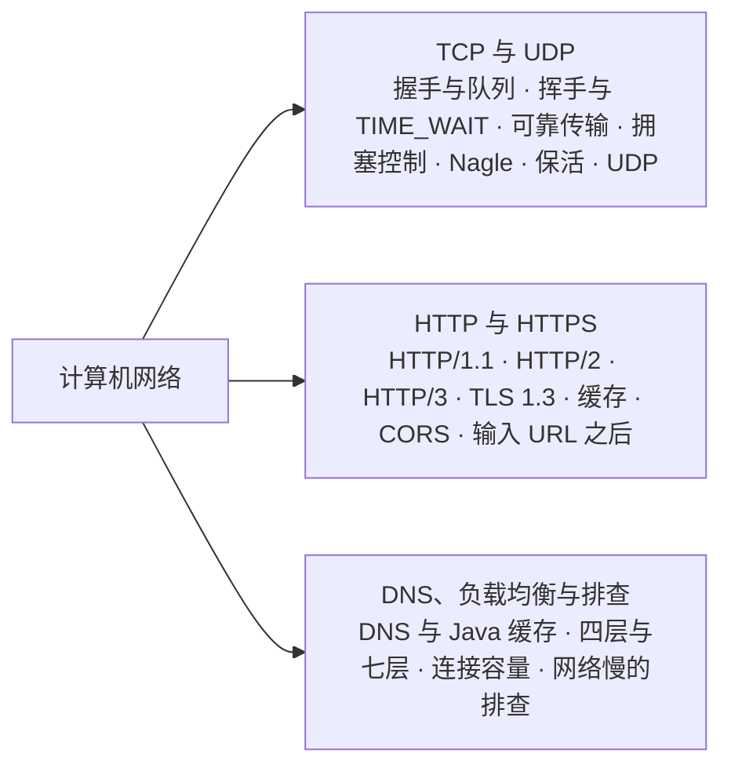

## 题目索引

| 编号 | 题目 | 难度 | 层级 |
| --- | --- | --- | --- |
| 37-01 | TCP 握手为什么是三次？握手时服务端的两个队列是什么？ | ★★★ | 资深 |
| 37-02 | 四次挥手的过程是怎样的？TIME_WAIT 和 CLOSE_WAIT 太多分别说明什么？ | ★★★ | 资深 |
| 37-03 | TCP 怎么保证可靠传输？滑动窗口和流量控制是什么？ | ★★ | 资深 |
| 37-04 | TCP 的拥塞控制是怎么工作的？ | ★★★ | 资深 / 架构师 |
| 37-05 | Nagle 算法和延迟确认会带来什么问题？粘包拆包怎么处理？ | ★★ | 资深 |
| 37-06 | TCP Keepalive、HTTP Keep-Alive、应用层心跳有什么区别？ | ★★★ | 资深 / 架构师 |
| 37-07 | UDP 适合什么场景？QUIC 为什么基于 UDP？ | ★★ | 资深 |
| 37-08 | HTTP/1.1 的持久连接是什么？队头阻塞是什么？ | ★★ | 资深 |
| 37-09 | HTTP/2 做了哪些改进？还有什么问题？ | ★★★ | 资深 |
| 37-10 | HTTP/3 和 QUIC 解决了什么问题？Java 中怎么用？ | ★★★ | 资深 / 架构师 |
| 37-11 | HTTPS 的握手过程是怎样的？TLS 1.3 改进了什么？ | ★★★ | 资深 |
| 37-12 | HTTP 缓存是怎么工作的？ | ★★ | 资深 |
| 37-13 | 跨域是什么？CORS 是怎么工作的？ | ★★ | 资深 |
| 37-14 | 从浏览器输入 URL 到页面显示，经历了什么？ | ★★ | 资深 |
| 37-15 | DNS 解析的过程是怎样的？Java 的 DNS 缓存有什么坑？ | ★★ | 资深 |
| 37-16 | 四层和七层负载均衡有什么区别？怎么拿到客户端的真实 IP？ | ★★★ | 架构师 |
| 37-17 | 一台服务器能支撑多少个 TCP 连接？受哪些限制？ | ★★★ | 资深 / 架构师 |
| 37-18 | 接口偶尔变慢，怎么判断是不是网络的问题？ | ★★ | 资深 |

---

## 一、TCP 与 UDP

### 37-01 TCP 握手为什么是三次？握手时服务端的两个队列是什么？

> ★★★ ｜ 资深 ｜ 高频

**考察意图**：不只背过程，要理解三次握手的目的，以及握手和应用的 `accept` 之间的关系。

**30 秒版回答**

- **过程**：客户端发 SYN（带上自己的初始序号）→ 服务端回 SYN+ACK（带上自己的初始序号，并确认客户端的序号）→ 客户端回 ACK。
- **为什么是三次**：
  1. **双方都要确认对方收到了自己的初始序号**。序号是可靠传输的基础，两个方向各需要"发送 + 确认"，第二次握手把服务端的 SYN 和对客户端的 ACK 合并成了一个报文，所以是三次；
  2. **防止历史上的重复连接请求造成混乱**：网络中滞留的旧 SYN 到达服务端时，服务端回复 SYN+ACK，客户端发现它不是自己当前期望的连接，就回复 RST 拒绝，不会建立错误的连接。TCP 规范把这一点称为三次握手的主要原因。
- **服务端的两个队列**（Linux）：
  - **半连接队列**（SYN 队列）：收到 SYN、还没收到第三次握手 ACK 的连接，上限与 `tcp_max_syn_backlog` 有关；
  - **全连接队列**（accept 队列）：三次握手已完成、等待应用调用 `accept()` 取走的连接，上限是 `min(listen 的 backlog 参数, net.core.somaxconn)`。`somaxconn` 从 Linux 5.4 起默认 4096，之前是 128（listen(2) 手册）。

**深入剖析**

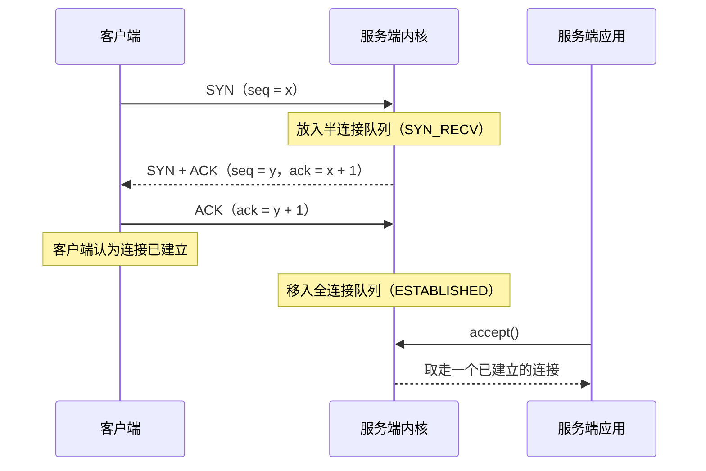

**backlog 在各层的默认值**：

| 位置 | 默认值 | 来源 |
| --- | --- | --- |
| Java `new ServerSocket(port)` | 50 | JDK 25 `ServerSocket` 源码 |
| Spring Boot 内嵌 Tomcat `server.tomcat.accept-count` | 100 | Boot 4.0.4 配置元数据 |
| Linux `net.core.somaxconn`（上限） | 4096（5.4 之前是 128） | listen(2) 手册 |

实际生效的全连接队列长度取两者中较小的值。

**追问链**

1. **全连接队列满了会怎样？** Linux 的 `tcp_abort_on_overflow` 默认关闭：队列满时，服务端丢弃客户端第三次握手的 ACK，而不是回复 RST。客户端此时已经认为连接建立成功并开始发送请求，服务端会重传 SYN+ACK，等队列有空位时连接才真正建立。表现是：**连接看起来建立成功了，但请求迟迟没有响应**，直到超时。可以用 `ss -lnt` 查看监听端口当前的队列长度和上限，用 `netstat -s` 中"listen queue overflow"相关的计数确认是否发生过溢出。
2. **SYN Flood 攻击是什么？怎么防？** 攻击者发送大量 SYN 却不完成握手，占满半连接队列。Linux 的 `tcp_syncookies` 默认为 1：半连接队列溢出时，服务端不再保存连接状态，而是把信息编码进 SYN+ACK 的序号（SYN Cookie），收到合法的 ACK 后再还原。内核文档特别强调，这只是一个后备手段，不能用来扛正常的高并发连接。
3. **握手阶段丢包会等多久？** 内核文档：主动连接的 SYN 默认重传 6 次（`tcp_syn_retries`），最终超时约 131 秒；服务端的 SYN+ACK 默认重传 5 次（`tcp_synack_retries`），约 63 秒。初始重传超时是 1 秒（内核常量 `TCP_TIMEOUT_INIT`，依据 RFC 6298）。所以 **Java 建立连接时一定要设置连接超时**，否则对方没有响应时，可能卡两分钟。

---

### 37-02 四次挥手的过程是怎样的？TIME_WAIT 和 CLOSE_WAIT 太多分别说明什么？

> ★★★ ｜ 资深 ｜ 高频

**考察意图**：TCP 状态机，以及线上两种最常见的连接状态问题。

**30 秒版回答**

- **过程**：主动关闭方发 FIN → 被动方回 ACK（此时被动方进入 CLOSE_WAIT，还可以继续发送数据）→ 被动方的应用调用 `close()`，发 FIN → 主动方回 ACK，进入 **TIME_WAIT**，等待一段时间后关闭。
- **为什么是四次**：TCP 是全双工的，两个方向要分别关闭。被动方收到 FIN 时，自己可能还有数据要发，所以 ACK 和自己的 FIN 通常分开发送。
- **TIME_WAIT 出现在主动关闭的一方**（本机实测：哪一方先调用 `close()`，哪一方的连接进入 TIME_WAIT），作用是：
  1. 如果最后一个 ACK 丢失，对方会重发 FIN，TIME_WAIT 的一方还能再次回复 ACK；
  2. 让这个连接在网络中残留的旧报文过期，避免被之后使用相同四元组的新连接误收。
- **时长**：Linux 中 TIME_WAIT 固定约 60 秒（内核常量 `TCP_TIMEWAIT_LEN`），**不能通过 sysctl 修改**；`tcp_fin_timeout` 控制的是孤儿连接在 FIN_WAIT_2 的停留时间，不是 TIME_WAIT。macOS 的 MSL 是 15 秒（`net.inet.tcp.msl`），TIME_WAIT 是 2 × MSL。
- **大量 TIME_WAIT**：说明本机主动关闭了大量连接，通常是**短连接**（每次请求新建连接、用完关闭）。
- **大量 CLOSE_WAIT**：说明对方已经关闭，但**本机的应用没有调用 `close()`**，几乎都是程序的 bug（连接没有关闭、连接泄漏），见[《33 线上问题排查》](../07-工程实践与稳定性/33-线上问题排查.md)33-11 的实测。

**深入剖析**

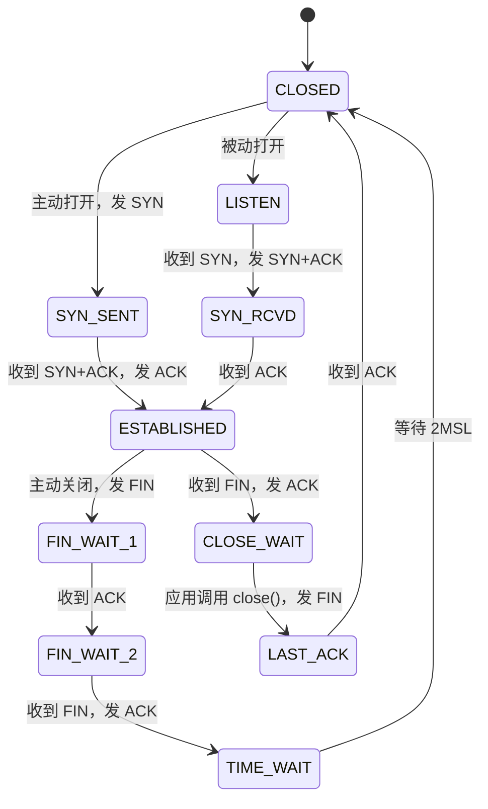

（图中省略了同时打开、同时关闭等少见的转换。）

本机实测（macOS，JDK 25）：

```text
== 客户端先关闭
tcp4  0  0  127.0.0.1.57392   127.0.0.1.18081   TIME_WAIT    ← 客户端一侧
== 服务端先关闭
tcp4  0  0  127.0.0.1.18082   127.0.0.1.57395   TIME_WAIT    ← 服务端一侧
```

**追问链**

1. **客户端大量 TIME_WAIT 有什么危害？** 连接由四元组（源 IP、源端口、目标 IP、目标端口）标识。客户端访问同一个目标 IP 和端口时，只有源端口可以变化，Linux 默认的本地端口范围是 32768～60999（`ip_local_port_range`），约 2.8 万个。每个连接关闭后要在 TIME_WAIT 中停留 60 秒，如果每秒新建的短连接超过几百个，端口就可能耗尽，新连接报 "Cannot assign requested address"。
2. **怎么解决？** 根本办法是**复用连接**：HTTP 客户端用连接池并开启持久连接，数据库、Redis 用连接池。内核参数 `tcp_tw_reuse` 允许在协议安全的前提下，把 TIME_WAIT 的连接复用于新的主动连接，默认值是 2（只对回环地址生效），全局开启需要谨慎（内核文档："It should not be changed without advice/request of technical experts"）。曾经常被推荐的 `tcp_tw_recycle` 在 NAT 环境下会导致连接失败，已经从 Linux 4.12 中移除。
3. **服务端主动关闭连接，会导致服务端大量 TIME_WAIT 吗？** 会。例如服务端对 HTTP/1.0 请求或 `Connection: close` 的请求主动关闭连接。服务端的 TIME_WAIT 不占用监听端口以外的本地端口，危害比客户端小，但会占用内存，数量受 `tcp_max_tw_buckets` 限制。

---

### 37-03 TCP 怎么保证可靠传输？滑动窗口和流量控制是什么？

> ★★ ｜ 资深 ｜ 中频

**考察意图**：可靠传输的几个机制，以及流量控制和拥塞控制的区别。

**30 秒版回答**

- **可靠传输的机制**：
  - **序号和确认**：每个字节都有序号，接收方用 ACK 告诉发送方"下一个期望收到的序号"；
  - **超时重传**：发送后在重传超时（RTO）内没有收到确认就重传。RTO 根据测量到的往返时间（RTT）动态计算，Linux 的下限是 200 毫秒（内核常量 `TCP_RTO_MIN`）；
  - **快速重传**：连续收到 3 个重复的 ACK，不等超时立即重传；
  - **选择确认（SACK）**：接收方告诉发送方自己收到了哪些不连续的数据块，发送方只重传缺失的部分，Linux 默认开启；
  - **校验和**：发现损坏的报文并丢弃。
- **滑动窗口**：发送方可以连续发送多个报文而不必等待每个确认，"已发送未确认 + 可以发送"的范围就是窗口，收到确认后窗口向前滑动。
- **流量控制**：接收方在每个 ACK 中通告自己剩余的接收缓冲区大小（接收窗口 rwnd），发送方发送的未确认数据不能超过它，**防止发送方把接收方淹没**。接收方的应用不读取数据时，窗口会变成 0，发送方暂停发送，并定期发送探测报文。
- **流量控制 vs 拥塞控制**：流量控制保护的是**接收方**，拥塞控制保护的是**网络**（37-04）。实际的发送量受两者中较小的那个限制。

**深入剖析**


- 发送窗口的大小 = min(接收方通告的窗口, 拥塞窗口)。
- 原始 TCP 头中的窗口字段只有 16 位，最大 64KB；窗口缩放选项（Linux 默认开启）让窗口可以达到 GB 级别，高带宽、高延迟的链路依赖它跑满带宽。

**追问链**

1. **接收窗口为 0 意味着什么？** 接收方的应用读得太慢，缓冲区满了。服务端看到很多连接的发送队列堆积（`ss` 中的 Send-Q 很大），往往说明是**对方**读得慢，而不是网络慢。
2. **单个 TCP 连接的吞吐量上限由什么决定？** 大致是 窗口大小 ÷ RTT。跨地域的链路 RTT 大，即使带宽充足，单个连接也可能跑不满，这时要调大缓冲区，或者使用多个连接并行传输。

---

### 37-04 TCP 的拥塞控制是怎么工作的？

> ★★★ ｜ 资深 / 架构师 ｜ 中频

**考察意图**：慢启动、拥塞避免、快速恢复的含义，以及它们对长连接和大文件传输的实际影响。

**30 秒版回答**

- **目的**：网络的容量未知，发送方要一边试探、一边调整发送速度，避免把网络压垮。发送方维护一个**拥塞窗口**（cwnd），未确认的数据不能超过它。
- **几个阶段**（以经典的 Reno 为例）：
  1. **慢启动**：连接开始时，cwnd 从初始值开始，每收到一个 ACK 就增加，每个 RTT 大约翻倍。初始窗口是 10 个报文段（RFC 6928，Linux 内核常量 `TCP_INIT_CWND = 10`）；
  2. **拥塞避免**：cwnd 达到慢启动阈值（ssthresh）后，改为每个 RTT 只增加一个报文段，线性增长；
  3. **快速重传和快速恢复**：收到 3 个重复 ACK，说明有个别报文丢了但网络还通，把 cwnd 和 ssthresh 降低（Reno 降为一半），继续传输；
  4. **超时**：说明网络可能严重拥塞，cwnd 降到很小，重新慢启动。
- **Linux 的默认算法**由内核编译配置决定（内核文档），常见发行版是 **CUBIC**：用三次函数调整窗口，丢包后窗口降为原来的 0.7 倍左右，在高带宽、高延迟的网络中恢复更快。**BBR** 则不以丢包作为拥塞信号，而是测量带宽和最小 RTT 来决定发送速度，在有随机丢包的链路上表现更好。

**深入剖析**

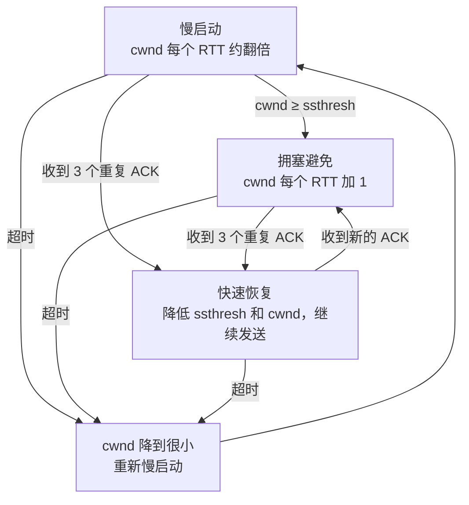

**追问链**

1. **为什么长连接空闲一段时间后，第一次大的传输会变慢？** Linux 的 `tcp_slow_start_after_idle` 默认开启：连接空闲超过一个 RTO 后，拥塞窗口会被重置，重新慢启动。对于"空闲一会儿再突发传输大量数据"的长连接（如 RPC 连接池中的连接），这会增加延迟；可以评估后关闭它。
2. **为什么小请求也需要关心慢启动？** 新连接的初始窗口只有 10 个报文段（约 14KB）。一个几十 KB 的响应，在新连接上需要多个 RTT 才能发完，在已经"热身"过的连接上一个 RTT 就够了。这是复用连接、预先建立连接的另一个理由。

---

### 37-05 Nagle 算法和延迟确认会带来什么问题？粘包拆包怎么处理？

> ★★ ｜ 资深 ｜ 中频

**考察意图**：两个优化叠加导致延迟的经典问题；理解 TCP 是字节流。

**30 秒版回答**

- **Nagle 算法**（RFC 896）：如果还有已发送未确认的数据，新的小数据先缓存起来，等收到确认或者攒满一个报文段再发送。目的是减少大量小报文。
- **延迟确认**：接收方收到数据后不立即回 ACK，而是等一小段时间，看能否和要发送的数据一起发出去。Linux 的延迟时间在 40 毫秒到 200 毫秒之间（内核常量 `TCP_DELACK_MIN = HZ/25`、`TCP_DELACK_MAX = HZ/5`）。
- **两者叠加的问题**："写-写-读"模式，例如客户端把请求头和请求体分两次写：
  1. 第一次写立即发出；
  2. 第二次写的数据很小，因为第一次的数据还没被确认，被 Nagle 缓存起来；
  3. 服务端收到请求头，但请求不完整，没有数据要回复，于是延迟确认；
  4. 双方互相等待，直到服务端的延迟确认超时（至少 40 毫秒）才继续。
- **解决**：合并写（一次写出完整的请求），或者设置 `TCP_NODELAY` 关闭 Nagle。对延迟敏感的 RPC 框架通常默认关闭 Nagle：Netty 在非 Android 平台上默认开启 `TCP_NODELAY`（已核对 4.2.10 字节码）。
- **粘包拆包**：TCP 是**字节流**，没有消息边界。发送方写了两条消息，接收方可能一次读到两条（"粘包"），也可能一条消息分两次读到（"拆包"）。应用层必须自己定义消息边界：
  - 固定长度；
  - 分隔符（如换行）；
  - **长度字段 + 内容**（最常用，Netty 的 `LengthFieldBasedFrameDecoder`），见[《08 Netty》](../02-框架与容器/08-Netty.md)。

**追问链**

1. **UDP 有粘包问题吗？** 没有。UDP 是面向报文的，一次发送就是一个完整的数据报，接收方一次读到一个完整的数据报（或者丢失）。
2. **关闭 Nagle 之后，会不会产生大量小报文？** 会，如果应用频繁地写很小的数据。所以关闭 Nagle 的同时，应用要自己做好缓冲，尽量一次写出一条完整的消息。

---

### 37-06 TCP Keepalive、HTTP Keep-Alive、应用层心跳有什么区别？

> ★★★ ｜ 资深 / 架构师 ｜ 高频

**考察意图**：三个名字相近、作用完全不同的机制，以及空闲连接被中间设备断开的经典问题。

**30 秒版回答**

| | TCP Keepalive | HTTP Keep-Alive（持久连接） | 应用层心跳 |
| --- | --- | --- | --- |
| 作用 | 探测**对端主机**是否还在 | **复用** TCP 连接发送多个 HTTP 请求 | 探测**对端应用**是否正常，并维持连接活跃 |
| 层次 | 传输层，由内核实现 | 应用层协议的约定 | 应用自己实现 |
| 默认 | 每个连接默认关闭，需要 `SO_KEEPALIVE` 开启 | HTTP/1.1 默认开启 | 由框架或应用决定 |
| Linux 默认参数 | 空闲 7200 秒后开始探测，每 75 秒一次，共 9 次，约 2 小时 11 分钟才判定断开 | — | — |

- **TCP Keepalive 的默认参数太长**，用于发现死连接基本来不及。Java 中可以用 `Socket.setKeepAlive(true)` 开启，并通过 `jdk.net.ExtendedSocketOptions` 的 `TCP_KEEPIDLE`、`TCP_KEEPINTERVAL`、`TCP_KEEPCOUNT` 为单个连接设置更短的参数。
- **应用层心跳**能发现"主机还在，但应用已经卡死"的情况，这是 TCP Keepalive 发现不了的。RPC 框架、消息队列客户端、WebSocket 通常都有自己的心跳。

**深入剖析：空闲连接被中间设备悄悄断开**

客户端和服务端之间往往有 NAT 网关、防火墙、负载均衡，它们都会清理空闲的连接，而且**不一定通知两端**。例如 AWS 应用负载均衡（ALB）的空闲超时默认是 60 秒。

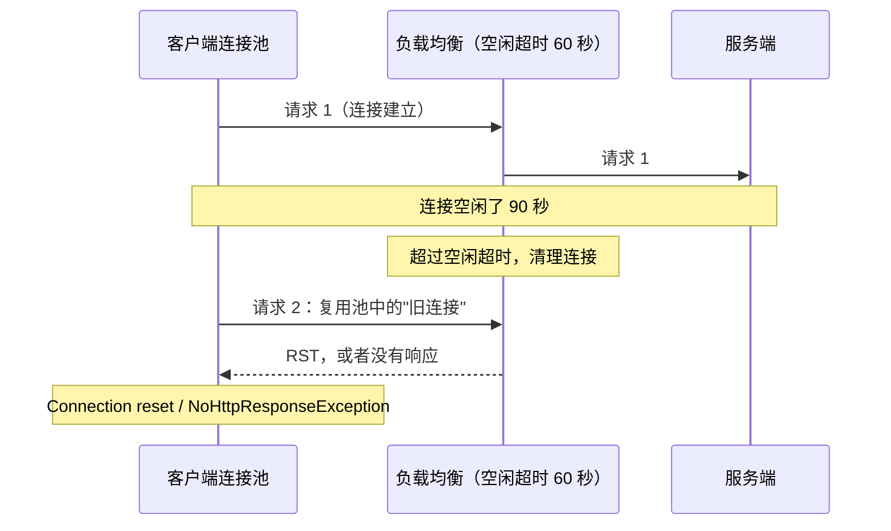

**原则：链路上越靠近客户端的一方，空闲超时要越短**：

- **客户端连接池**的空闲超时 < 中间设备的空闲超时 < 服务端的空闲超时；
- AWS ALB 文档也建议：**后端应用的空闲超时要大于负载均衡的空闲超时**，否则应用先关闭连接时，负载均衡可能正好把请求发到这个正在关闭的连接上，返回 502；
- JDK `HttpClient` 的空闲连接保活时间默认 30 秒（`jdk.httpclient.keepalive.timeout`，已核对 JDK 25 文档）。

**追问链**

1. **只能靠调超时吗？** 还可以：从连接池取出连接时校验（有成本），或者对幂等请求在遇到连接重置时自动重试一次。很多 HTTP 客户端提供"空闲一段时间后取出时校验"的选项。
2. **长连接（如 WebSocket、gRPC 流）怎么防止被中间设备断开？** 应用层心跳的间隔要小于链路上最短的空闲超时，例如 30 秒发送一次。

**架构师加分点**

- 线上偶发的 "Connection reset"、502，很多都是链路上各层的超时没有对齐造成的。设计时把**每一跳的连接超时、读超时、空闲超时**列成一张表，按"客户端 < 中间层 < 服务端"的原则配置，比出了问题再逐个排查高效得多。

---

### 37-07 UDP 适合什么场景？QUIC 为什么基于 UDP？

> ★★ ｜ 资深 ｜ 中频

**考察意图**：UDP 的特点，以及"在 UDP 之上重新实现可靠传输"的原因。

**30 秒版回答**

- **UDP 的特点**：无连接，没有确认、重传、排序、流量控制和拥塞控制；保留消息边界；头部只有 8 个字节。
- **适合的场景**：
  - 请求很小、一次往返就能完成，丢了重发即可：DNS 查询；
  - 宁可丢弃也不要等待：音视频通话、直播、游戏的实时状态（旧数据重传过来已经没有意义）；
  - 需要自己定制传输行为：QUIC、部分自研的传输协议；
  - 广播、组播。
- **QUIC 为什么基于 UDP**：
  - TCP 实现在操作系统内核中，升级要等所有操作系统更新，周期以年计；
  - 网络中大量的中间设备（防火墙、NAT、负载均衡）"认识" TCP 的格式，会拦截或修改不认识的 TCP 行为，新的 TCP 扩展很难部署（这种现象被称为协议"僵化"）；
  - 在 UDP 之上实现，可靠传输、拥塞控制、加密都放在用户态，可以随应用更新，而且 QUIC 的大部分头部是加密的，中间设备无法干预。

**追问链**

1. **UDP 会受到拥塞控制的约束吗？** UDP 本身没有。使用 UDP 的应用要自己控制发送速度，否则可能挤占网络、导致大量丢包。QUIC 实现了自己的拥塞控制。
2. **有的网络环境会屏蔽 UDP 怎么办？** 一些企业网络会限制 UDP。所以使用 HTTP/3 的客户端都要能够回退到基于 TCP 的 HTTP/2 或 HTTP/1.1（37-10）。

---

## 二、HTTP 与 HTTPS

### 37-08 HTTP/1.1 的持久连接是什么？队头阻塞是什么？

> ★★ ｜ 资深 ｜ 中频

**考察意图**：HTTP/1.1 的连接模型，以及它的根本局限。

**30 秒版回答**

- **持久连接**：HTTP/1.1 默认复用 TCP 连接，一个连接上可以依次发送多个请求，省去每次建立连接（TCP 握手、TLS 握手）的开销。任何一方都可以用 `Connection: close` 表示发完这个响应就关闭连接。
- **本机实测**（JDK 25 的 `HttpClient`，强制使用 HTTP/1.1，连续 5 个请求，服务端记录客户端的端口）：

| 服务端的响应 | 客户端端口 | 结论 |
| --- | --- | --- |
| 正常响应 | 5 次都是 57409 | 复用了同一个 TCP 连接 |
| 带 `Connection: close` | 57409、57410、57411、57412、57413 | 每次都新建连接（第一次复用了上一组留下的连接） |

- **队头阻塞**：在一个 HTTP/1.1 连接上，**必须等前一个响应返回，才能发送下一个请求**（管线化允许连续发送请求，但响应必须按顺序返回，而且实际上几乎没有被浏览器启用）。前面的请求慢，后面的全部被阻塞。
- **浏览器的应对**：对同一个域名同时建立多个连接（常见实现是最多 6 个左右），以及把资源分散到多个域名、合并小文件。这些都是 HTTP/1.1 时代的"补丁"，到了 HTTP/2 反而有害（37-09）。

**追问链**

1. **服务端怎么限制持久连接？** Tomcat 用空闲超时（keep-alive timeout）和单个连接上的最大请求数控制，Spring Boot 中 `server.tomcat.max-keep-alive-requests` 默认 100（已核对 Boot 4.0.4 配置元数据），达到后关闭连接，让客户端重新建立，这也有助于负载均衡在实例之间重新分配连接。

---

### 37-09 HTTP/2 做了哪些改进？还有什么问题？

> ★★★ ｜ 资深 ｜ 高频

**考察意图**：多路复用的原理，以及 TCP 层的队头阻塞。

**30 秒版回答**

- **二进制分帧**：HTTP 消息被拆成二进制的帧（HEADERS、DATA 等），每个帧都带着所属的**流**（stream）的编号。
- **多路复用**：一个 TCP 连接上可以同时进行多个流，不同流的帧可以交错发送，**一个慢响应不再阻塞其他响应**，解决了 HTTP 层的队头阻塞。所以一个域名通常只需要一个连接。
- **头部压缩（HPACK）**：用静态表、动态表和哈夫曼编码压缩请求头，重复的头（Cookie、User-Agent）几乎不再占用流量。
- **服务器推送**：协议中定义了，但实际效果不佳，**Chrome 从 106 版本起默认禁用**，推荐用 `103 Early Hints` 和预加载代替（Chrome 博客）。
- **还存在的问题：TCP 层的队头阻塞**。所有的流共用一个 TCP 连接，TCP 保证字节按顺序交付：只要丢了一个报文，后面所有已经到达的数据（不管属于哪个流）都要等它重传完才能交给应用。在丢包率高的网络中，HTTP/2 甚至可能比多个 HTTP/1.1 连接更慢。这是 HTTP/3 要解决的问题。

**深入剖析**

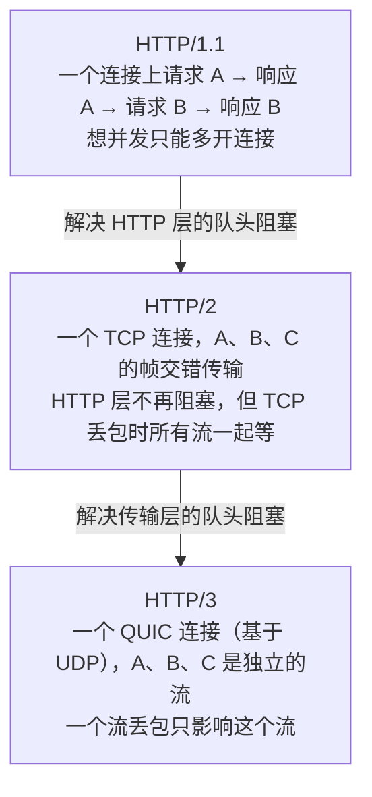

**追问链**

1. **HTTP/2 一定要用 HTTPS 吗？** 协议本身不要求，但浏览器只支持基于 TLS 的 HTTP/2（通过 TLS 的 ALPN 扩展协商）。服务之间可以使用明文的 HTTP/2（h2c），gRPC 在内网中常这样使用。
2. **JDK 的 HttpClient 默认用哪个版本？** 默认优先 HTTP/2，服务端不支持时自动降级为 HTTP/1.1（JEP 517 中的描述）。
3. **HTTP/2 的长连接对负载均衡有什么影响？** 一个客户端只建立一个连接，所有请求都走这个连接。如果负载均衡是四层的（按连接分配），这个客户端的所有请求都会落到同一个后端实例上，导致负载不均，见 37-16。

---

### 37-10 HTTP/3 和 QUIC 解决了什么问题？Java 中怎么用？

> ★★★ ｜ 资深 / 架构师 ｜ 中频

**考察意图**：QUIC 的几个关键设计，以及 Java 生态的支持情况。

**30 秒版回答**

- **HTTP/3 = HTTP 语义 + QUIC 传输**。QUIC 基于 UDP，在用户态实现了可靠传输、拥塞控制，并且内置 TLS 1.3。
- **解决的问题**：
  1. **传输层的队头阻塞**：QUIC 中每个流独立地保证顺序，一个流丢包只影响这个流；
  2. **建立连接更快**：QUIC 把传输握手和 TLS 握手合在一起，新连接 1 个 RTT 就可以发送请求（TCP + TLS 1.3 需要 2 个 RTT）；恢复之前的会话时，可以用 0-RTT 在第一个报文中就携带请求数据（有重放风险，见 37-11）；
  3. **连接迁移**：QUIC 用连接 ID 而不是四元组标识连接。手机从 Wi-Fi 切换到移动网络，IP 变了，连接仍然可以继续，不需要重新建立。
- **怎么发现服务端支持 HTTP/3**：通常先用 HTTP/2 或 HTTP/1.1 访问，服务端在响应头 `Alt-Svc` 中声明支持 HTTP/3，之后的请求再使用 HTTP/3。
- **Java 的支持**：JDK 26 的 JEP 517 为 `java.net.http.HttpClient` 增加了 HTTP/3 支持：
  - **需要显式开启**，默认版本仍然是 HTTP/2：`HttpClient.newBuilder().version(HttpClient.Version.HTTP_3)`，或者只对某个请求设置；
  - 服务端不支持时，默认会自动降级到 HTTP/2 或 HTTP/1.1；
  - 提供了几种发现方式（先尝试 HTTP/3 后回退、并行尝试、根据 `Alt-Svc` 发现、只用 HTTP/3）；
  - 不提供 QUIC 的 API，不提供服务端实现，旧的 `java.net.URL` 仍然只支持 HTTP/1.1。

**追问链**

1. **服务端应该在哪一层支持 HTTP/3？** 通常在边缘层（CDN、负载均衡、网关）终结 HTTP/3，到后端服务仍然使用 HTTP/1.1 或 HTTP/2。HTTP/3 的收益主要在"用户到边缘"这段丢包多、网络会切换的链路上；数据中心内部网络稳定，收益很小。
2. **为什么不是所有地方都用 HTTP/3？** UDP 可能被网络限制；QUIC 在用户态处理加密和传输，CPU 开销通常比内核中的 TCP 更高；排查工具和运维经验也不如 TCP 成熟。

---

### 37-11 HTTPS 的握手过程是怎样的？TLS 1.3 改进了什么？

> ★★★ ｜ 资深 ｜ 高频

**考察意图**：TLS 握手做了哪几件事，TLS 1.3 的关键变化（证书和加密算法的细节见[《39 网络安全》](39-网络安全.md)）。

**30 秒版回答**

- **握手要完成三件事**：
  1. **协商**：协议版本、加密套件；
  2. **身份认证**：服务端出示证书，客户端验证证书链能追溯到受信任的根证书、证书中的域名和访问的域名一致、证书在有效期内且没有被吊销；
  3. **密钥交换**：双方用（椭圆曲线）Diffie-Hellman 算法协商出会话密钥，之后用对称加密传输数据。
- **TLS 1.3 的改进**（RFC 8446）：
  - **握手只需 1 个 RTT**：客户端在第一个报文（ClientHello）中就带上自己的密钥交换参数（key_share），服务端一次回复就能完成密钥协商，并且从这时起后续的握手消息（包括证书）都是加密的。TLS 1.2 的完整握手需要 2 个 RTT；
  - **移除了静态 RSA 和静态 DH 的密钥交换**，只保留（EC）DHE 和 PSK 等方式，所以**一定具有前向保密**：即使服务器的私钥以后泄露，也无法解密之前录下的流量；
  - **0-RTT**：恢复之前的会话时，客户端可以在第一个报文中直接发送应用数据。但 RFC 8446 明确指出，0-RTT 数据**没有前向保密**，并且**不能保证不被重放**。所以 0-RTT 只能用于幂等的请求（如 GET）。

**深入剖析**

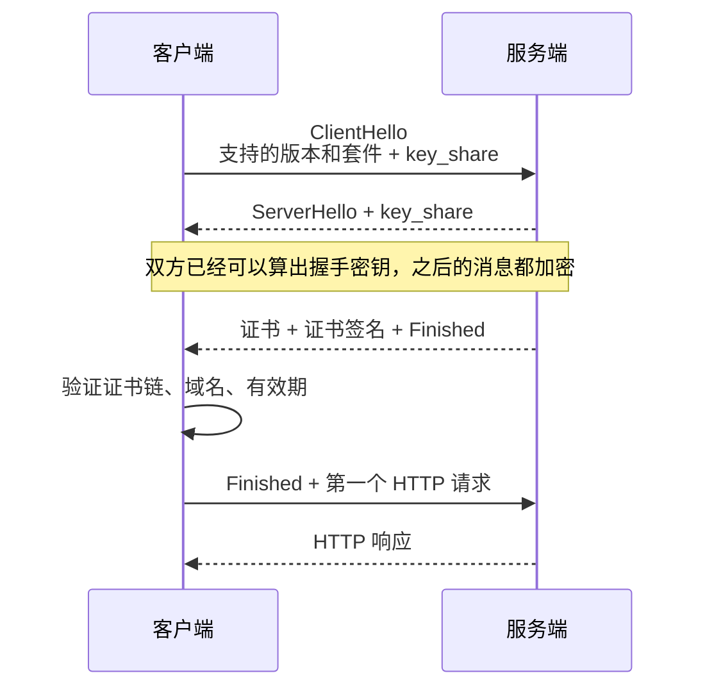

**追问链**

1. **为什么还需要 SNI？** 一个 IP 上可能部署了多个域名的 HTTPS 服务，服务端需要在握手的第一步就知道客户端要访问哪个域名，才能返回对应的证书。SNI 就是 ClientHello 中携带的目标域名。
2. **服务之间的调用要用 HTTPS 吗？** 零信任的架构下，服务之间也应该加密，并且双方都验证对方的证书（双向 TLS，mTLS）。服务网格可以在不修改应用的前提下实现 mTLS，见[《41 容器与云计算》](../09-云原生/41-容器与云计算.md)。
3. **HTTPS 的性能开销主要在哪里？** 主要在握手（多一个 RTT、非对称运算），数据传输阶段的对称加密开销很小（现代 CPU 有 AES 指令）。所以要复用连接、使用会话恢复，减少完整握手的次数。

---

### 37-12 HTTP 缓存是怎么工作的？

> ★★ ｜ 资深 ｜ 中频

**考察意图**：强缓存与协商缓存，以及静态资源的缓存策略。

**30 秒版回答**

- **强缓存**：在有效期内直接使用本地缓存，**不发请求**。由 `Cache-Control: max-age=秒数` 控制（`Expires` 是旧的写法，优先级更低）。
- **协商缓存**：缓存过期（或者要求每次都验证）时，带上验证信息去问服务端"内容变了吗"：
  - `If-None-Match: <ETag>`，服务端比较 ETag；
  - `If-Modified-Since: <时间>`，服务端比较最后修改时间；
  - 没变就返回 **304 Not Modified**，不带响应体；变了返回 200 和新内容。
- **几个容易混淆的指令**：
  - `no-cache`：**可以缓存**，但每次使用前必须向服务端验证；
  - `no-store`：**不允许缓存**，用于敏感数据；
  - `private`：只允许浏览器缓存，不允许 CDN 等共享缓存缓存；`public` 相反；
  - `s-maxage`：只对共享缓存（CDN）生效的有效期。

**深入剖析**

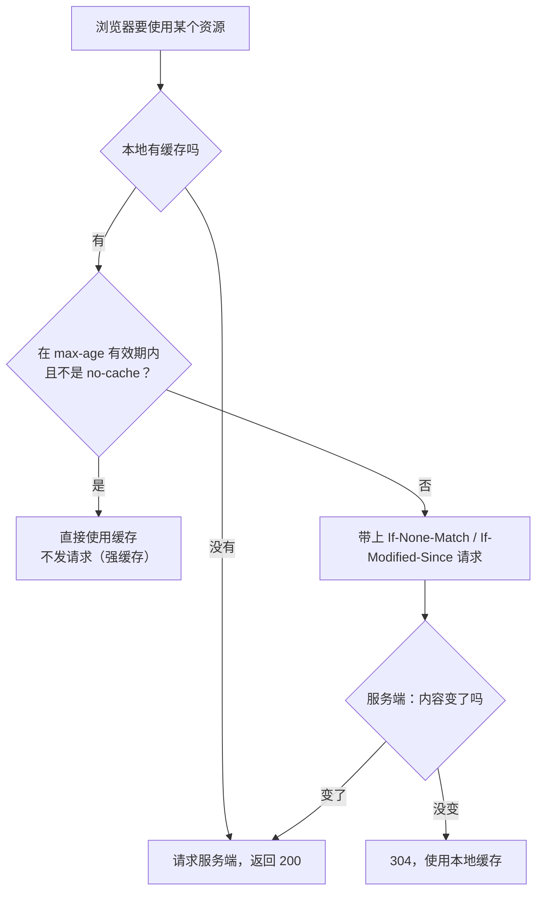

**生产实践 / 踩坑**

- **静态资源的最佳实践**：文件名带上内容的哈希值（如 `app.3f9a2c.js`），设置很长的 `max-age`（如一年）和 `immutable`；HTML 入口文件设置 `no-cache`。内容变了文件名就变了，旧缓存自然失效，不存在"用户拿到旧版本"的问题。
- **接口响应默认不要被缓存**：特别是包含用户数据的响应，要设置 `no-store` 或 `private`，防止被 CDN 或代理缓存后返回给其他用户。

---

### 37-13 跨域是什么？CORS 是怎么工作的？

> ★★ ｜ 资深 ｜ 高频

**考察意图**：同源策略、预检请求，以及几个常见的配置错误。

**30 秒版回答**

- **同源**：协议、域名、端口三者都相同。浏览器的同源策略限制网页中的脚本读取其他源的响应。
- **CORS**（跨源资源共享）：服务端通过响应头声明"允许哪些源访问"，浏览器据此决定是否把响应交给脚本：
  - `Access-Control-Allow-Origin`：允许的源；
  - `Access-Control-Allow-Methods`、`Access-Control-Allow-Headers`：允许的方法和请求头；
  - `Access-Control-Allow-Credentials: true`：允许携带 Cookie；
  - `Access-Control-Max-Age`：预检结果的缓存时间。
- **简单请求和预检请求**：使用非简单的方法（如 PUT、DELETE）、自定义请求头，或者 `Content-Type: application/json` 时，浏览器会先发一个 **OPTIONS 预检请求**，服务端允许后才发送真正的请求。
- **CORS 是浏览器的限制**，服务端之间的调用、命令行工具都不受影响。它也**不是**防御 CSRF 的手段（详见[《39 网络安全》](39-网络安全.md)）。

**深入剖析**

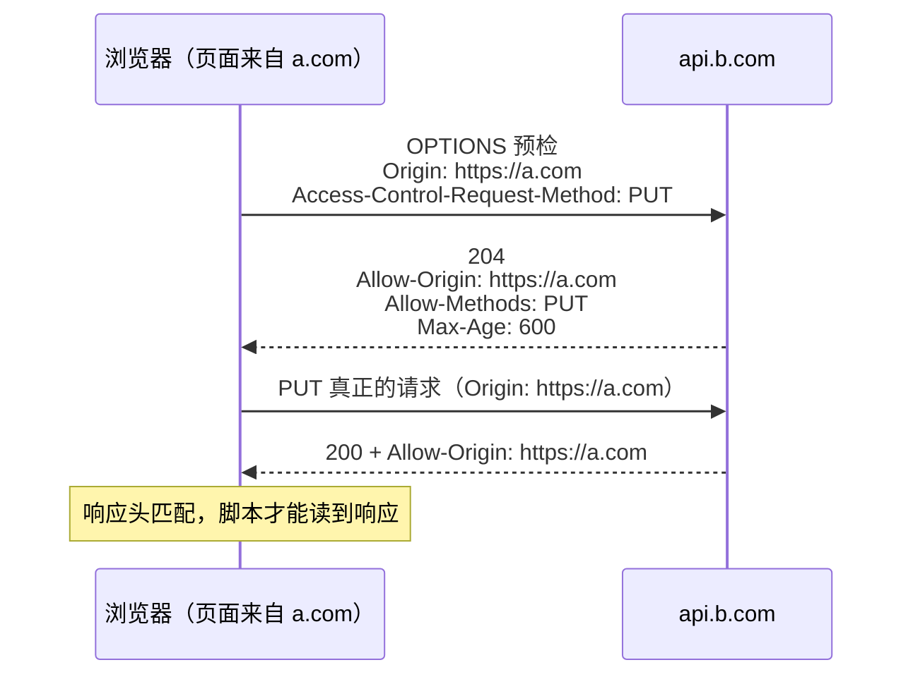

**追问链**

1. **允许携带 Cookie 时，`Allow-Origin` 能写 `*` 吗？** 不能。携带凭证时，必须返回具体的源（通常是把请求中的 Origin 和白名单比对后原样返回），同时响应 `Vary: Origin`，防止缓存把给 A 源的响应返回给 B 源。
2. **预检请求太多怎么办？** 设置 `Access-Control-Max-Age` 让浏览器缓存预检结果。各浏览器有上限：Chromium 从 76 版起最多 2 小时，Firefox 最多 24 小时；不设置时默认只有 5 秒（MDN）。另一个办法是通过网关让前端和接口同源，从根本上避免跨域。

**生产实践 / 踩坑**

- **网关和应用都配置了 CORS**：响应中会出现两个 `Access-Control-Allow-Origin` 头，浏览器直接拒绝（报错信息类似"contains multiple values"）。CORS 只在一处配置，通常是网关。
- **白名单匹配写得太宽松**：例如用"以 `a.com` 结尾"判断，`evila.com` 也会被放行。要按完整的源精确匹配。

---

### 37-14 从浏览器输入 URL 到页面显示，经历了什么？

> ★★ ｜ 资深 ｜ 高频

**考察意图**：把网络各层的知识串起来，并且能说出每一步的耗时和优化点。

**30 秒版回答**

1. **解析 URL**；如果域名在 HSTS 列表中，直接使用 HTTPS；
2. **DNS 解析**：浏览器缓存 → 操作系统缓存 → 递归解析器（37-15）；
3. **建立连接**：TCP 握手（1 个 RTT）+ TLS 握手（TLS 1.3 是 1 个 RTT）；如果是 HTTP/3，QUIC 一次完成；
4. **发送 HTTP 请求**，经过 CDN、负载均衡、网关，到达应用服务器；
5. **服务端处理**：应用逻辑、缓存、数据库，生成响应；
6. **返回响应**，浏览器根据缓存头决定如何缓存；
7. **渲染**：解析 HTML 生成 DOM，解析 CSS，执行 JavaScript，布局、绘制；过程中发现的图片、脚本、样式等资源，重复上面的过程获取。

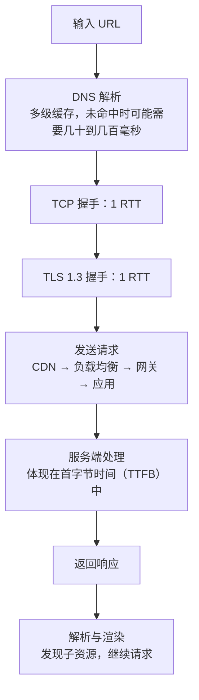

**架构师加分点**

- 说出每一步的优化手段：DNS 预解析、连接预建立（`preconnect`）、连接复用、CDN 让用户就近访问、HTTP/2 和 HTTP/3、合理的缓存策略、减少关键路径上的阻塞资源。真正的优化要基于实际测量（浏览器的性能面板、真实用户的监控数据），而不是逐条套用。

---

## 三、DNS、负载均衡与排查

### 37-15 DNS 解析的过程是怎样的？Java 的 DNS 缓存有什么坑？

> ★★ ｜ 资深 ｜ 中频

**考察意图**：DNS 的层级结构与缓存，以及 JVM 中 DNS 缓存对故障切换的影响。

**30 秒版回答**

- **解析过程**：
  1. 应用（JVM 有自己的缓存）→ 操作系统（`/etc/hosts`、本地缓存）→ 配置的**递归解析器**（运营商、公司内部或公共 DNS）；
  2. 递归解析器没有缓存时，依次询问**根域名服务器**（得到 `.com` 的服务器地址）→ **顶级域服务器**（得到 `example.com` 的权威服务器地址）→ **权威服务器**（得到最终的记录）；
  3. 每一级的结果都按 TTL 缓存。
- **常见记录**：A（IPv4 地址）、AAAA（IPv6 地址）、CNAME（别名）、NS（权威服务器）、MX（邮件）、TXT（文本，常用于域名所有权验证）、SRV（服务的地址和端口）。
- **Java 的 DNS 缓存**（JDK 25 的 `java.security`）：
  - 解析成功的结果默认缓存 **30 秒**（`networkaddress.cache.ttl`）；
  - 解析失败的结果默认缓存 **10 秒**（`networkaddress.cache.negative.ttl`）；
  - 还有一个"过期后继续使用"的策略 `networkaddress.cache.stale.ttl`，默认 0，即不使用过期的结果。
  - JVM 的缓存**不看 DNS 记录本身的 TTL**，只按上面的配置。

**深入剖析**

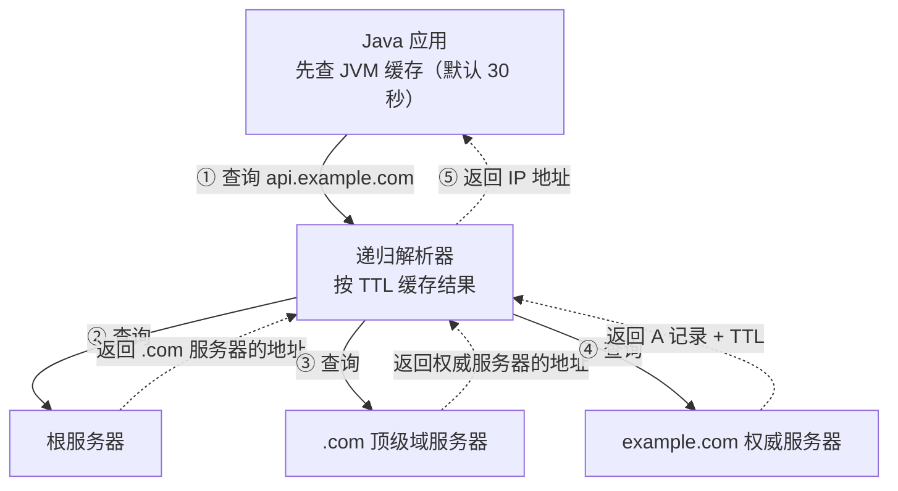

**追问链**

1. **用 DNS 做故障切换，为什么切换后还有流量打到旧地址？** 每一层都有缓存：递归解析器按 TTL 缓存，JVM 按自己的配置缓存，**更重要的是已经建立的长连接和连接池不会因为 DNS 变化而重建**。所以切换前要提前调小 TTL，客户端的连接池要设置连接的最大存活时间，让连接定期重建。
2. **`java.security` 中的注释为什么说修改 TTL 有安全风险？** 注释原文提醒，把缓存时间设成非默认值可能带来严重的安全影响，除非确定不会受到 DNS 欺骗攻击。缓存时间越长，被投毒的结果影响越久；越短，解析请求越多。
3. **DNS 解析慢会表现在哪里？** 表现为建立连接前的等待时间变长（37-18 中 curl 的 `time_namelookup`）。在 Kubernetes 中，Pod 的 DNS 配置（如 `ndots`）可能让一个域名被尝试解析多次，见[《41 容器与云计算》](../09-云原生/41-容器与云计算.md)。

---

### 37-16 四层和七层负载均衡有什么区别？怎么拿到客户端的真实 IP？

> ★★★ ｜ 架构师 ｜ 高频

**考察意图**：负载均衡的分层、算法、健康检查，以及长连接、真实 IP 这些落地问题。

**30 秒版回答**

| | 四层负载均衡 | 七层负载均衡 |
| --- | --- | --- |
| 依据 | IP 和端口（TCP / UDP） | HTTP 的内容：域名、路径、请求头、Cookie |
| 典型产品 | LVS、云厂商的网络负载均衡（如 AWS NLB） | Nginx、Envoy、云厂商的应用负载均衡（如 AWS ALB）、API 网关 |
| 能力 | 转发连接，性能高，对协议无感知 | 按内容路由、TLS 终结、改写请求、重试、限流 |
| 分配粒度 | **按连接** | **按请求** |
| 开销 | 小 | 要解析 HTTP，开销更大 |

- **常见算法**：轮询、加权轮询、最少连接、一致性哈希（同一个用户或同一个 key 落到同一个实例）、随机两次选择较优者（P2C）。
- **健康检查**：主动检查（定期请求健康检查接口）+ 被动检查（根据真实请求的失败率摘除实例）。健康检查接口要反映实例是否真的能处理请求，但不能因为某个非关键的依赖故障就把所有实例都摘掉。

**深入剖析：两个落地问题**

**① 长连接和负载不均**：四层负载均衡按连接分配，HTTP/2、gRPC 的客户端只建立少量长连接，所有请求都在这几个连接上，**新扩容的实例几乎收不到流量**。解决办法：使用七层负载均衡（按请求分配）、客户端负载均衡（客户端直接连接多个实例），或者让连接定期重建（服务端限制连接的存活时间或请求数）。

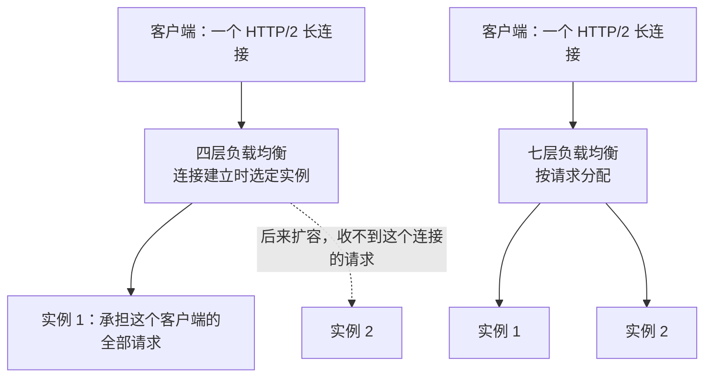

**② 获取客户端的真实 IP**：

- 七层代理在 `X-Forwarded-For` 头中追加它看到的来源 IP，形成"客户端, 代理 1, 代理 2"的列表；
- **这个头可以被客户端伪造**。正确的做法是从右往左，跳过自己信任的代理的地址，第一个不受信任的地址才是真实的客户端 IP，不能简单地取第一个；
- Spring Boot 通过 `server.forward-headers-strategy` 处理这些头，同时要配置信任的代理范围；
- 四层负载均衡不修改 HTTP 头，可以使用 **PROXY 协议**，在连接开始时把客户端的地址传给后端（后端也要开启对应的支持）。

**追问链**

1. **会话保持（粘性会话）有什么问题？** 同一个用户的请求固定落在一个实例上，实例下线时会话丢失，负载也可能不均。更好的做法是让服务无状态，会话存在 Redis 等共享存储中。
2. **为什么七层负载均衡的重试要小心？** 非幂等的请求（如下单）在超时后被重试，可能执行两次。只对幂等的请求重试，或者配合幂等键，见[《26 高可用》](../06-三高与架构/26-高可用.md)。

---

### 37-17 一台服务器能支撑多少个 TCP 连接？受哪些限制？

> ★★★ ｜ 资深 / 架构师 ｜ 中频

**考察意图**：纠正"最多 65535 个连接"的误解，搞清楚真正的限制。

**30 秒版回答**

- **TCP 连接由四元组标识**：源 IP、源端口、目标 IP、目标端口。
- **服务端**：监听一个端口，就可以接受来自不同客户端 IP 和端口的连接，四元组各不相同，**理论上限远超 65535**。真正的限制是：
  - **文件描述符**：每个连接占一个，受进程的 `ulimit -n` 和系统的上限约束；
  - **内存**：每个连接都有内核的收发缓冲区和应用层的对象；
  - **应用的处理模型**：一个连接一个线程的模型，连接数受线程数限制；NIO / 虚拟线程才能支撑大量的连接（见[《38 操作系统》](38-操作系统.md)的 IO 模型）。
- **客户端**：访问**同一个目标 IP 和端口**时，只有源端口可变，受本地端口范围限制，Linux 默认 32768～60999，约 2.8 万个（37-02 的 TIME_WAIT 会占用端口）。访问不同的目标时，端口可以重复使用。
- **Spring Boot 内嵌 Tomcat 的默认值**（已核对 Boot 4.0.4 配置元数据）：

| 配置 | 默认值 | 含义 |
| --- | --- | --- |
| `server.tomcat.max-connections` | 8192 | 同时接受和处理的连接数上限，超过后新连接留在内核的全连接队列中 |
| `server.tomcat.accept-count` | 100 | 全连接队列长度（listen 的 backlog），再满就会出现 37-01 中的现象 |
| `server.tomcat.threads.max` | 200 | 工作线程数，开启虚拟线程后不生效 |

**深入剖析**

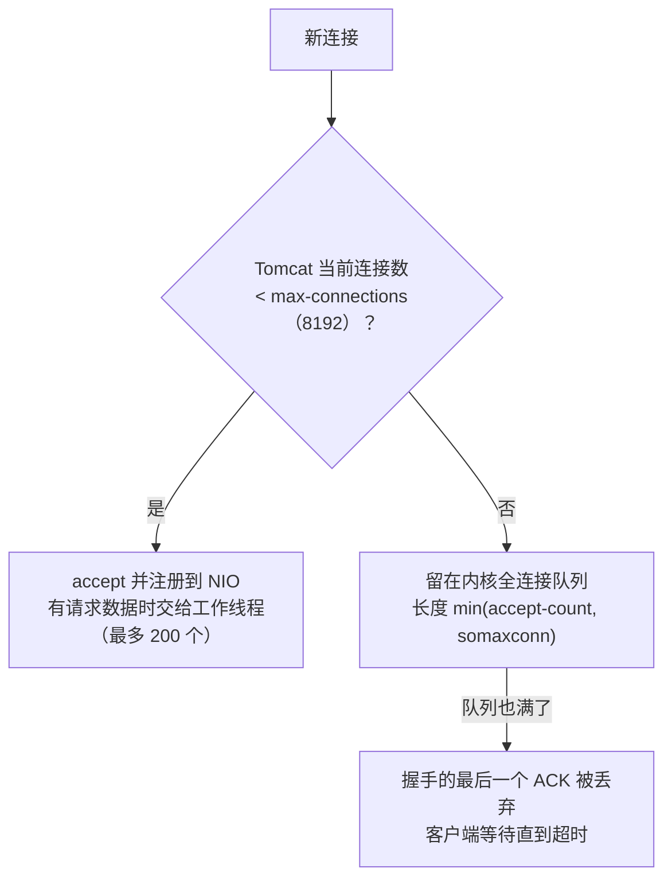

**追问链**

1. **连接数多，就一定需要很多线程吗？** 不需要。大部分连接在大部分时间里是空闲的（例如长连接、等待下一个请求）。NIO 用少量线程监听大量连接，只有真正有请求时才占用工作线程。所以 Tomcat 的最大连接数（8192）远大于工作线程数（200）。
2. **百万连接的服务（如推送网关）要注意什么？** 调大文件描述符的上限；调小每个连接的缓冲区和应用层对象的内存占用；使用 Netty 这类事件驱动的框架；心跳的间隔和超时要考虑到"所有连接同时心跳"的瞬时压力；部署多个实例，并做好连接的均衡和迁移。

---

### 37-18 接口偶尔变慢，怎么判断是不是网络的问题？

> ★★ ｜ 资深 ｜ 中频

**考察意图**：把耗时拆开，用数据判断，而不是一句"网络抖动"带过。

**30 秒版回答**

- **先把一次请求的时间拆开**：用 `curl -w` 输出各个阶段的时间点：

```bash
curl -s -o /dev/null -w 'dns=%{time_namelookup} tcp=%{time_connect} tls=%{time_appconnect} ttfb=%{time_starttransfer} total=%{time_total} ip=%{remote_ip}\n' https://example.com/
```

  - DNS 慢：`time_namelookup` 大；
  - 建立连接慢：`time_connect - time_namelookup` 大，可能有丢包（SYN 重传）；
  - TLS 慢：`time_appconnect - time_connect` 大；
  - **首字节时间（TTFB）减去前面的时间，主要是服务端的处理时间**。如果这部分占了大头，问题在服务端，不在网络。
- **看连接的状态**：`ss -ti` 可以看到每个连接的 RTT、重传次数、拥塞窗口；`netstat -s` 中的重传计数持续增长，说明有丢包。
- **看路径**：`mtr` 持续探测到目标的每一跳的丢包率和延迟。
- **看报文**：`tcpdump` 抓包，确认是否有重传、零窗口、RST。
- **结合应用的数据**：应用的链路追踪中，客户端记录的耗时和服务端记录的耗时之差，就是网络和排队的时间（见[《32 日志与可观测性》](../07-工程实践与稳定性/32-日志与可观测性.md)）。

**深入剖析：两个典型的"特征值"**

- **耗时刚好多了 1 秒左右**：很可能是握手时的 SYN 丢了。Linux 的初始重传超时是 1 秒（内核常量 `TCP_TIMEOUT_INIT`），第一次重传就要等 1 秒，第二次再等 2 秒。耗时呈现"1 秒、3 秒"这样的台阶，几乎就是丢包重传。
- **耗时刚好多了 40 毫秒左右**：可能是 Nagle 算法和延迟确认叠加（37-05）。

**生产实践 / 踩坑**

- **先确认测量的到底是什么**。本机用 `curl -w` 访问一个外部网站，`remote_ip` 显示的是 `127.0.0.1`，TCP 连接只用了 0.3 毫秒，TLS 却用了 1.1 秒：本机开着代理，curl 实际连接的是本地代理，代理背后真正建立连接的时间被算进了 TLS 阶段。所以拆分耗时之前，先确认连接的对端是谁；容器、Sidecar、网关都可能改变这个对端。
- **区分"网络慢"和"对方读得慢"**：发送队列堆积、接收窗口为 0，往往是对方的应用处理不过来（37-03），换网络也解决不了。
