# 38 · 操作系统

> 适用岗位：Java 资深开发（重点：Java 线程和内核线程的对应关系、上下文切换、虚拟内存和 RSS、Page Cache 和刷盘、IO 模型和 epoll、零拷贝、信号和优雅停机）、Java 架构师（重点：内存规划和 OOM Killer、大页、调度和 CPU 限额、IO 模型选型、持久化时 fsync 的取舍）
> 版本基线：Linux 内核主线（以 docs.kernel.org 和 man-pages 为准，普通进程的调度以 6.6 开始引入的 EEVDF 为准）、JDK 25（HotSpot 和 NIO 的实现以 openjdk/jdk 主线源码为准）、Netty 4.2.10、Spring Boot 4.0.4
> 事实核对：
> - 系统调用和 `/proc` 字段的说明来自 man7 手册：[epoll(7)](https://man7.org/linux/man-pages/man7/epoll.7.html)、[select(2)](https://man7.org/linux/man-pages/man2/select.2.html)、[sendfile(2)](https://man7.org/linux/man-pages/man2/sendfile.2.html)、[splice(2)](https://man7.org/linux/man-pages/man2/splice.2.html)、[mmap(2)](https://man7.org/linux/man-pages/man2/mmap.2.html)、[fsync(2)](https://man7.org/linux/man-pages/man2/fsync.2.html)、[signal(7)](https://man7.org/linux/man-pages/man7/signal.7.html)、[pthreads(7)](https://man7.org/linux/man-pages/man7/pthreads.7.html)、[pipe(7)](https://man7.org/linux/man-pages/man7/pipe.7.html)、[io_uring(7)](https://man7.org/linux/man-pages/man7/io_uring.7.html)、[proc_pid_stat(5)](https://man7.org/linux/man-pages/man5/proc_pid_stat.5.html)、[proc_pid_status(5)](https://man7.org/linux/man-pages/man5/proc_pid_status.5.html)、[proc_meminfo(5)](https://man7.org/linux/man-pages/man5/proc_meminfo.5.html)、[proc_pid_oom_score_adj(5)](https://man7.org/linux/man-pages/man5/proc_pid_oom_score_adj.5.html)、[proc_stat(5)](https://man7.org/linux/man-pages/man5/proc_stat.5.html)、[epoll_ctl(2)](https://man7.org/linux/man-pages/man2/epoll_ctl.2.html)；
> - 内核文档：[EEVDF 调度器](https://docs.kernel.org/scheduler/sched-eevdf.html)、[透明大页](https://docs.kernel.org/admin-guide/mm/transhuge.html)、[/proc/sys/vm 参数](https://docs.kernel.org/admin-guide/sysctl/vm.html)；脏页回写的默认值来自 [mm/page-writeback.c](https://github.com/torvalds/linux/blob/master/mm/page-writeback.c)，epoll 的数据结构来自 [fs/eventpoll.c](https://github.com/torvalds/linux/blob/master/fs/eventpoll.c)，nice 值的权重来自 [kernel/sched/core.c](https://github.com/torvalds/linux/blob/master/kernel/sched/core.c)；io_uring 的引入版本来自 [Kernel Newbies 的 Linux 5.1 说明](https://kernelnewbies.org/Linux_5.1)；
> - JDK 的实现已核对 openjdk/jdk 主线源码：Linux 上的 Selector 是 `EPollSelectorImpl`，源码中没有使用 `EPOLLET`；`FileChannel.transferTo` 在 Linux 上调用 `sendfile`；`FileChannel.force` 在 Linux 上调用 `fdatasync` / `fsync`，在 macOS 上调用 `fcntl(F_FULLFSYNC)`；Linux x86 的默认线程栈是 1024 KB；`MaxFDLimit` 把文件描述符的软限制提到硬限制；
> - Netty 4.2 的 epoll 传输固定使用水平触发：已核对 [Netty 4.2 的废弃 API 列表](https://netty.io/4.2/api/deprecated-list.html) 和 4.2.10 的字节码；Kubernetes 的终止流程来自 [Pod 生命周期文档](https://kubernetes.io/docs/concepts/workloads/pods/pod-lifecycle/)；Kafka 的刷盘配置来自 [Topic 配置文档](https://kafka.apache.org/44/configuration/topic-configs/)；io_uring 的限制来自 [Docker seccomp 文档](https://docs.docker.com/engine/security/seccomp/) 和内核的 [/proc/sys/kernel 参数文档](https://docs.kernel.org/admin-guide/sysctl/kernel.html)；
> - 本机实测（macOS 27.2、Apple Silicon、APFS 固态盘、JDK 25）：kill -15 / -9 / -3 对 JVM 的影响、僵尸进程和孤儿进程、阻塞在 IO 上的线程的 Java 状态、子进程输出不读取导致卡住、逐字节写文件的系统调用开销、`-Xms` 和 `AlwaysPreTouch` 对 RSS 和缺页次数的影响、`force` 的耗时、JVM 提升文件描述符上限
> 相关分类：[《03 Java 并发》](../01-Java核心/03-Java并发.md)（虚拟线程）、[《04 JVM》](../01-Java核心/04-JVM.md)（容器中的内存）、[《08 Netty》](../02-框架与容器/08-Netty.md)（Reactor 和零拷贝）、[《25 高性能》](../06-三高与架构/25-高性能.md)（零拷贝在中间件中的应用）、[《33 线上问题排查》](../07-工程实践与稳定性/33-线上问题排查.md)（Load、堆外内存、文件描述符）、[《37 计算机网络》](37-计算机网络.md)、[《41 容器与云计算》](../09-云原生/41-容器与云计算.md)

## 知识地图

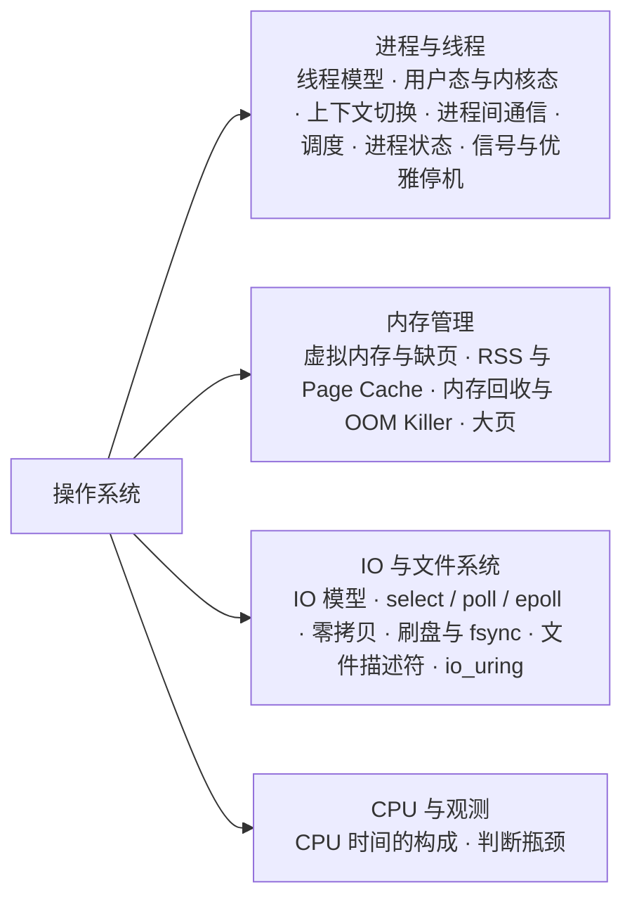

## 题目索引

| 编号 | 题目 | 难度 | 层级 |
| --- | --- | --- | --- |
| 38-01 | 进程和线程有什么区别？Java 线程和操作系统的线程是什么关系？ | ★★ | 资深 |
| 38-02 | 用户态和内核态是什么？系统调用的开销在哪里？ | ★★ | 资深 |
| 38-03 | 上下文切换是什么？怎么判断切换是不是太多了？ | ★★★ | 资深 |
| 38-04 | 进程间通信有哪些方式？ | ★★ | 资深 |
| 38-05 | Linux 是怎么调度进程的？CFS 和 EEVDF 是什么？ | ★★★ | 资深 / 架构师 |
| 38-06 | 进程有哪些状态？僵尸进程和孤儿进程是怎么产生的？ | ★★ | 资深 |
| 38-07 | kill -15 和 kill -9 有什么区别？Java 应用怎么优雅停机？ | ★★★ | 资深 |
| 38-08 | 虚拟内存是什么？页表、TLB 和缺页中断是怎么回事？ | ★★★ | 资深 |
| 38-09 | RSS、VSZ、Page Cache 怎么理解？free 命令中的 available 是什么？ | ★★ | 资深 |
| 38-10 | 内存不够时 Linux 会怎么做？OOM Killer 怎么选择进程？ | ★★★ | 资深 / 架构师 |
| 38-11 | 大页和透明大页是什么？Java 应用要不要开？ | ★★ | 架构师 |
| 38-12 | 操作系统层面有哪几种 IO 模型？同步、异步、阻塞、非阻塞怎么区分？ | ★★★ | 资深 |
| 38-13 | select、poll、epoll 有什么区别？水平触发和边缘触发怎么选？ | ★★★ | 资深 |
| 38-14 | 零拷贝在操作系统层面是怎么实现的？ | ★★★ | 资深 |
| 38-15 | write 返回成功，数据就写到磁盘上了吗？ | ★★★ | 资深 / 架构师 |
| 38-16 | 文件描述符是什么？Java 进程能打开多少个文件？ | ★★ | 资深 |
| 38-17 | io_uring 是什么？和 epoll 有什么不同？ | ★★ | 架构师 |
| 38-18 | CPU 使用率中的 us、sy、wa、si、st 分别是什么？怎么用来判断瓶颈？ | ★★ | 资深 |

---

## 一、进程与线程

### 38-01 进程和线程有什么区别？Java 线程和操作系统的线程是什么关系？

> ★★ ｜ 资深 ｜ 高频

**考察意图**：不只背"进程是资源分配的单位，线程是调度的单位"，要能落到 Linux 和 JVM 的实现上。

**30 秒版回答**

- **进程**拥有独立的资源：虚拟地址空间、打开的文件、信号处理方式等。**线程**是 CPU 调度的单位，同一个进程中的线程共享地址空间和打开的文件，各自只有自己的栈、寄存器和程序计数器。
- **Linux 内核不严格区分进程和线程**，两者在内核中都是一个可调度的任务（task）。创建线程时，新的任务和原来的任务共享地址空间、文件等资源；同一个线程组中的所有线程共享同一个 PID（`pthreads(7)`）。
- **Java 的平台线程（`new Thread()`）和内核线程是 1:1 的关系**：每个 Java 线程背后是一个 pthread，由内核调度。`pthreads(7)` 说明 Linux 的线程库是 1:1 实现，每个线程对应一个内核调度实体。
- **虚拟线程（JDK 21 起）是 M:N 的关系**：大量虚拟线程由 JVM 调度到少量的载体线程上执行，虚拟线程阻塞时从载体线程上卸载，内核看不到这次切换（原理见[《03 Java 并发》](../01-Java核心/03-Java并发.md)03-22）。
- 每个平台线程都有自己的线程栈：Linux x86 上默认 1024 KB（`-Xss`，HotSpot 源码中的 `ThreadStackSize`），本机 macOS（Apple Silicon）上的 JDK 25 默认是 2048 KB。

**深入剖析**

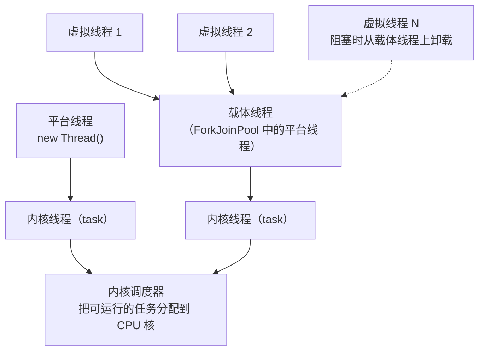

**追问链**

1. **jstack 中显示 RUNNABLE 的线程，一定在占用 CPU 吗？** 不一定。Java 的线程状态和内核中的线程状态不是一回事。本机 JDK 25 实测：一个阻塞在 `ServerSocket.accept()` 上的线程，`Thread.getState()` 返回的是 `RUNNABLE`；而 `Thread.sleep` 和 `Object.wait(timeout)` 返回的是 `TIMED_WAITING`。阻塞在网络 IO 上的线程，在内核中是睡眠状态，不占用 CPU。所以找占用 CPU 的线程要用 `top -H -p <pid>` 看内核的统计，再到线程转储中找对应的线程（见[《33 线上问题排查》](../07-工程实践与稳定性/33-线上问题排查.md)33-03）。
2. **一个 Java 进程最多能创建多少个线程？** 受多个因素限制：每个线程栈占用的内存（虚拟内存先预留，实际用到才分配物理内存）、`ulimit -u`（在 Linux 上按线程计数）、内核的 `threads-max` 和 `pid_max`、容器的 `pids.max`。超出时 JVM 抛出 `OutOfMemoryError`，信息是 `unable to create native thread: possibly out of memory or process/resource limits reached`（已核对 JDK 25 的 libjvm），这个错误和堆的大小无关。
3. **协程和虚拟线程是一回事吗？** 思路一样，都是在用户态调度、大量轻量级的执行单元复用少量内核线程。区别在于 Java 的虚拟线程实现了 `Thread` 的 API，原来的阻塞式代码不用改；Kotlin 的协程、Go 的 goroutine 有各自的语法和调度器。

**生产实践 / 踩坑**

- **线程不是越多越好**。每个平台线程都要占用栈内存、增加调度和上下文切换的开销（38-03）。计算密集型的线程池大小接近 CPU 核数即可；大量等待 IO 的场景，优先考虑虚拟线程或异步 IO，而不是把线程池调到几千。

---

### 38-02 用户态和内核态是什么？系统调用的开销在哪里？

> ★★ ｜ 资深 ｜ 中频

**考察意图**：理解为什么"减少系统调用"是很多优化的出发点。

**30 秒版回答**

- **CPU 有不同的特权级别**。应用程序运行在用户态，不能直接访问硬件和内核的内存；需要读写文件、收发网络数据、申请内存、创建线程时，必须通过**系统调用**请求内核来完成，此时 CPU 切换到内核态执行内核代码，完成后再返回用户态。
- **系统调用的开销**：
  - 进入和退出内核态要保存和恢复寄存器、切换栈，为了防御 CPU 漏洞而加入的安全措施会让这个过程变得更重；
  - 内核代码会挤占 CPU 缓存和 TLB，返回后用户代码的缓存命中率下降；
  - 很多系统调用还伴随着数据拷贝，例如 `read` 要把数据从内核的缓冲区拷贝到用户的缓冲区。
- **系统调用不等于上下文切换**。一次不阻塞的系统调用，只是同一个线程从用户态进入内核态再返回；只有系统调用阻塞了（例如数据还没到），内核才会切换到别的线程，这时才发生上下文切换（38-03）。

**深入剖析**

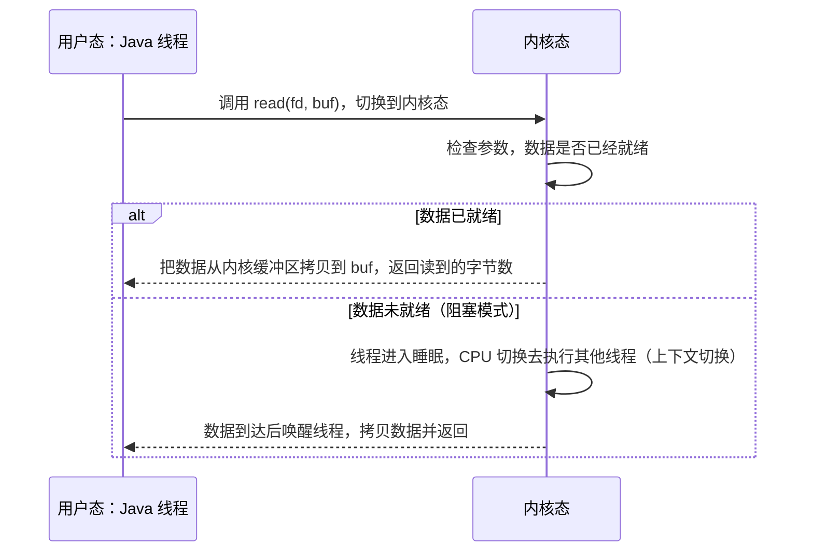

**本机实测**（JDK 25）：往文件中写 100 万个字节，

| 写法 | 耗时 |
| --- | --- |
| `FileOutputStream.write(int)`，每个字节一次 `write` 系统调用 | 约 2100 毫秒 |
| 外面包一层 `BufferedOutputStream`，默认缓冲区 8 KB，攒满了才调用一次 `write` | 2～11 毫秒 |

两者相差两个数量级，差距几乎全部来自系统调用的次数。

**追问链**

1. **怎么看一个进程做了哪些系统调用？** `strace -c -f -p <pid>` 统计每种系统调用的次数和耗时。`strace` 基于 ptrace，会让目标进程明显变慢，线上要慎用、只用几秒；开销更小的方式是 `perf trace` 或基于 eBPF 的工具。
2. **Java 中有哪些设计是为了减少系统调用？** 缓冲流（`BufferedInputStream` / `BufferedOutputStream`）、NIO 的 `ByteBuffer` 批量读写、日志框架的异步和批量刷盘、数据库驱动和 Kafka 生产者的批量发送；mmap 映射文件后，读写文件就是读写内存，不需要每次都调用 `read` / `write`（38-14）。

---

### 38-03 上下文切换是什么？怎么判断切换是不是太多了？

> ★★★ ｜ 资深 ｜ 高频

**考察意图**：能区分两类切换，并用工具判断问题出在哪里。

**30 秒版回答**

- **上下文切换**：CPU 从执行一个线程改为执行另一个线程，要保存当前线程的寄存器、程序计数器、栈指针，再恢复另一个线程的；如果两个线程属于不同的进程，还要切换地址空间（页表）。
- **开销分两部分**：直接开销是保存和恢复现场、执行调度器的代码；间接开销是 CPU 缓存和 TLB 中的内容对新线程没用，新线程刚开始运行时要重新加载数据。间接开销往往比直接开销更大。
- **两类切换**（`/proc/<pid>/status` 中的两个计数器）：
  - **自愿切换**（`voluntary_ctxt_switches`）：线程自己放弃 CPU，例如等锁、等 IO、`sleep`；
  - **非自愿切换**（`nonvoluntary_ctxt_switches`）：线程还想运行，但时间片用完了或者被抢占了。
- **观测工具**：`vmstat 1` 的 `cs` 列是整个系统每秒的切换次数；`pidstat -w -t -p <pid> 1` 按线程显示每秒的自愿切换（`cswch/s`）和非自愿切换（`nvcswch/s`）。

**深入剖析**

切换次数本身没有绝对的好坏标准，要和**平时的基线**比较，再看是哪一类增加了：

| 现象 | 可能的原因 | 方向 |
| --- | --- | --- |
| 自愿切换多 | 锁竞争激烈（线程拿不到锁就挂起）、频繁的小 IO、线程间频繁交接任务（任务拆得太细） | 减少锁的粒度和持有时间、批量 IO、合并任务 |
| 非自愿切换多 | 可运行的线程数远超 CPU 核数：线程池太大、CPU 不够，或者容器的 CPU 限额太小 | 减少计算线程的数量、扩容、检查 CPU 限额 |
| `vmstat` 中 `r` 列（可运行的任务数）长期远大于核数 | CPU 饱和 | 先找出消耗 CPU 的线程（[《33 线上问题排查》](../07-工程实践与稳定性/33-线上问题排查.md)33-03） |

**追问链**

1. **为什么线程池调大了，吞吐量反而下降？** 计算型任务的线程数超过核数之后，多出来的线程不会带来更多的计算能力，只会增加非自愿切换和缓存失效；锁竞争也随线程数增加而加剧，自愿切换随之增加。
2. **虚拟线程之间的切换算上下文切换吗？** 不算内核的上下文切换。虚拟线程阻塞时，JVM 把它的栈帧保存到堆上，载体线程接着执行另一个虚拟线程，内核看到的始终是同一个载体线程在运行。所以虚拟线程适合大量等待 IO 的场景；但它不会让计算更快，计算密集型任务仍然受限于核数。
3. **自旋锁为什么能减少上下文切换？** 锁很快就会被释放时，线程原地循环等待（自旋），比挂起再唤醒的代价小；但锁持有的时间长时，自旋白白消耗 CPU。JVM 的 `synchronized` 和 AQS 都会在挂起前做有限的自旋或重试（见[《03 Java 并发》](../01-Java核心/03-Java并发.md)）。

---

### 38-04 进程间通信有哪些方式？

> ★★ ｜ 资深 ｜ 中频

**考察意图**：知道各种方式的特点和适用场景，以及 Java 中实际会碰到的那几种。

**30 秒版回答**

| 方式 | 特点 | 典型场景 |
| --- | --- | --- |
| 管道（pipe） | 单向的字节流，常用于父子进程之间；有容量限制，满了写入方就阻塞 | Shell 中的 `a \| b`；Java 启动子进程时的标准输入输出 |
| 命名管道（FIFO） | 有文件名，不相关的进程也能使用 | 简单的本机进程协作 |
| 信号（signal） | 只能传递"发生了某个事件"，不能携带数据 | 通知进程退出、重新加载配置、打印线程转储（38-07） |
| 共享内存 | 多个进程映射同一块物理内存，不需要拷贝，**速度最快**；需要自己处理同步 | 高性能的本机数据交换 |
| 内存映射文件（mmap） | 多个进程用 `MAP_SHARED` 映射同一个文件，修改对其他进程可见，并写回文件 | 基于文件的本机队列、多进程共享只读数据 |
| 信号量、消息队列 | 内核提供的同步和消息机制 | 传统的 System V / POSIX 程序 |
| Unix 域套接字 | 用 Socket 的接口在本机通信，不经过网络协议栈；JDK 16 起 `SocketChannel` 支持 | 本机的守护进程（如 Docker 的 `docker.sock`）、Sidecar 和应用之间 |
| TCP / UDP 套接字 | 可以跨机器 | 绝大多数的服务间调用 |

**深入剖析：Java 启动子进程时的管道陷阱**

`ProcessBuilder` 默认通过管道连接子进程的标准输出。管道有容量（Linux 默认 16 页，在 4 KB 的页上是 64 KB，`pipe(7)`），**父进程不读取，管道写满之后子进程就阻塞在写操作上**，父进程的 `waitFor()` 就永远等不到结果。

本机 JDK 25 实测：子进程向标准输出写 200 KB，父进程不读取，`waitFor(3, SECONDS)` 返回 `false`（子进程卡住）；改成 `redirectOutput(ProcessBuilder.Redirect.DISCARD)` 后，立刻返回 `true`。正确的做法是：用单独的线程持续读取输出，或者重定向到文件或 `DISCARD`；标准错误也一样，可以用 `redirectErrorStream(true)` 合并到标准输出。

**追问链**

1. **共享内存最快，为什么业务系统很少直接用？** 速度快是因为没有拷贝，但同步要自己做（锁、内存屏障），一个进程写坏了数据会影响所有进程，也只能在同一台机器上使用。业务系统更看重隔离和可以跨机器部署，所以绝大多数通信用的是 Socket；只有对延迟要求极高的本机场景，才会用基于内存映射文件的方案。

---

### 38-05 Linux 是怎么调度进程的？CFS 和 EEVDF 是什么？

> ★★★ ｜ 资深 / 架构师 ｜ 低频

**考察意图**：了解调度器的基本思想，以及它和 Java 应用的延迟、容器 CPU 限额之间的关系。

**30 秒版回答**

- Linux 按**调度类**分层：实时任务（`SCHED_FIFO`、`SCHED_RR`）优先于普通任务；普通任务（包括绝大多数 Java 进程）由公平调度器调度。
- **CFS（完全公平调度器）**：给每个任务记录"虚拟运行时间"，总是挑虚拟运行时间最少的任务运行；`nice` 值决定权重，权重高的任务虚拟时间增长得慢，从而分到更多的 CPU。内核源码（`kernel/sched/core.c` 中 `sched_prio_to_weight` 的注释）说明，nice 值每调高 1，CPU 时间大约减少 10%，相邻两级的权重相差 1.25 倍。
- **EEVDF（最早合格虚拟截止时间优先）**：内核文档说明，Linux 从 **6.6** 开始从 CFS 过渡到 EEVDF。它的目标和 CFS 一样，都是让优先级相同的任务平分 CPU，但挑选方式不同：
  - 根据虚拟运行时间计算每个任务的 **lag**：lag 为正，说明这个任务少分到了 CPU；为负，说明多用了；
  - 只有 lag 大于等于 0 的任务才"合格"，在合格的任务中挑**虚拟截止时间最早**的运行；
  - 时间片越短的任务，截止时间越早，所以对延迟敏感的任务能更快得到响应；任务可以通过 `sched_setattr()` 申请特定的时间片长度。

**深入剖析**

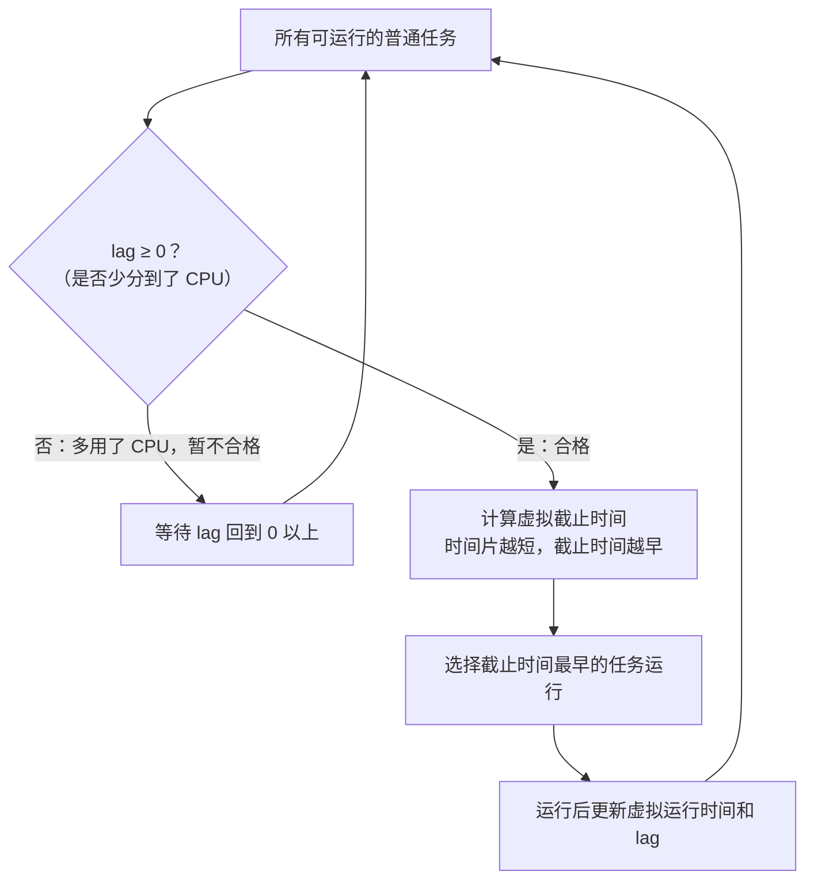

**追问链**

1. **调度器和 Java 应用有什么关系？** 大多数情况下不需要关心调度算法本身，需要关心的是**和调度相关的配置**：
   - **容器的 CPU 上限**：内核按周期给容器分配 CPU 配额，一个周期内用完就要等下一个周期，表现为平均 CPU 使用率不高、请求延迟却出现毛刺（见[《33 线上问题排查》](../07-工程实践与稳定性/33-线上问题排查.md)33-06、[《41 容器与云计算》](../09-云原生/41-容器与云计算.md)）；
   - **JVM 看到的 CPU 数**：GC 线程数、`ForkJoinPool` 的并行度、很多框架的默认线程数都取决于 `Runtime.availableProcessors()`，在容器中它会参考 CPU 限额（见[《04 JVM》](../01-Java核心/04-JVM.md)04-12）；
   - **CPU 绑定**：`taskset` 或者 cgroup 的 `cpuset` 可以把进程固定在某些核上，减少缓存失效和跨 NUMA 节点访问内存，常用于对延迟要求极高的场景。
2. **把 Java 进程的 nice 值调高（优先级调低），能解决延迟问题吗？** nice 只影响**多个任务争抢 CPU 时**各自分到的比例。如果延迟来自 CPU 限额、GC、锁或者 IO，调整 nice 没有作用。
3. **为什么不能随便把业务进程设成实时调度？** 实时任务优先于所有普通任务，一个忙循环的实时任务可能让同一个核上的普通任务（包括 SSH、监控代理）长时间得不到运行。

---

### 38-06 进程有哪些状态？僵尸进程和孤儿进程是怎么产生的？

> ★★ ｜ 资深 ｜ 中频

**考察意图**：看懂 `ps` 和 `top` 中的状态，知道僵尸进程为什么杀不掉。

**30 秒版回答**

- **`ps` 中的状态字母**（`proc_pid_stat(5)`）：
  - **R**：正在运行或在运行队列中等待；
  - **S**：可中断的睡眠，等待某个事件，可以被信号唤醒；
  - **D**：不可中断的睡眠，通常在等磁盘 IO，**不响应信号**，`kill -9` 也要等它返回后才生效；
  - **T**：被信号暂停（如 `SIGSTOP`）；**t**：被调试器暂停；
  - **Z**：僵尸进程；**I**：空闲的内核线程（Linux 4.14 起）。
- **僵尸进程**：子进程已经退出，但父进程还没有调用 `wait` 读取它的退出状态。内核保留着它的 PID 和退出状态，等父进程来取。它已经死了，所以 `kill -9` 对它没有作用。
- **孤儿进程**：父进程先退出了，子进程还在运行，它会被过继给 1 号进程（或者被指定为"收养者"的进程），由新的父进程负责回收。孤儿进程本身不是问题。

**深入剖析**

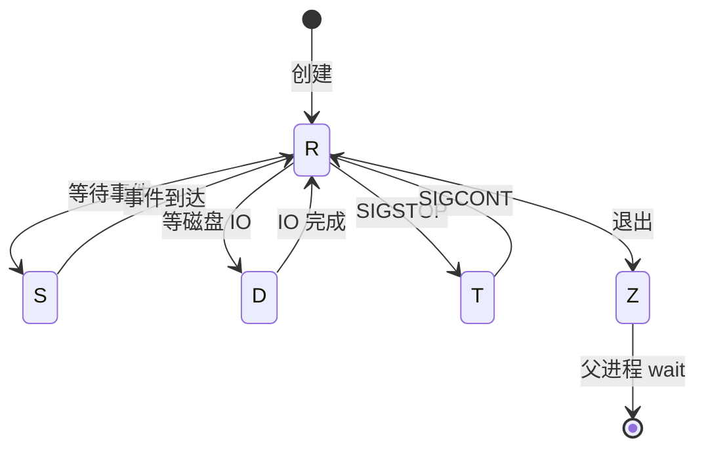

**本机实测**（macOS）：

```text
# sh -c 'sleep 0.3 & exec sleep 3'：子进程 sleep 0.3 先退出，父进程被替换成 sleep 3，从不调用 wait
  PID  PPID STAT COMM
94241 94240 SN   sleep
94243 94241 ZN   <defunct>      ← 僵尸进程，父进程是 94241

# sh -c 'sleep 5 & echo $!'：父进程 sh 立即退出
  PID  PPID STAT COMM
94248     1 S    sleep          ← 孤儿进程，被 1 号进程收养
```

**追问链**

1. **僵尸进程有什么危害？怎么清理？** 它不占用内存和 CPU，但占着 PID。数量多了会耗尽 PID，导致无法创建新的进程和线程。清理的办法是让父进程回收它：修复父进程的代码，或者结束父进程，让僵尸进程被 1 号进程收养后统一回收。
2. **为什么容器里容易出现僵尸进程？** 容器中的 1 号进程往往就是业务进程本身（例如 Java），它不会回收别人的子进程。如果应用启动了一些子进程，而这些子进程又派生了孙进程，孙进程变成孤儿后被过继给 1 号进程，就没人回收了。解决办法是用一个精简的 init 进程作为 1 号进程（例如 `docker run --init` 使用的 tini），由它负责回收和转发信号。
3. **D 状态的进程多了会怎样？** 它们不占用 CPU，但会计入 Load，所以会出现"Load 很高、CPU 使用率却不高"的现象（见[《33 线上问题排查》](../07-工程实践与稳定性/33-线上问题排查.md)33-06）；常见的原因是磁盘慢或者网络存储（NFS）没有响应。

---

### 38-07 kill -15 和 kill -9 有什么区别？Java 应用怎么优雅停机？

> ★★★ ｜ 资深 ｜ 高频

**考察意图**：理解信号的语义、JVM 的处理方式，以及容器中的优雅停机链路。

**30 秒版回答**

- **信号**是内核通知进程"发生了某个事件"的机制。进程可以为大多数信号注册处理函数，**`SIGKILL`（9）和 `SIGSTOP` 不能被捕获、阻塞或忽略**（`signal(7)`）。
- **`kill -15`（SIGTERM，`kill` 命令的默认信号）**：请求进程退出。JVM 收到后执行关闭流程，运行所有通过 `Runtime.addShutdownHook` 注册的钩子（Spring 的优雅停机就是挂在这里的），然后退出。
- **`kill -9`（SIGKILL）**：内核直接结束进程，JVM 没有任何机会执行代码：关闭钩子不运行，缓冲区中的日志没有写出，正在处理的请求直接中断。
- **`kill -3`（SIGQUIT）**：JVM 把所有线程的调用栈打印到标准输出，**进程不退出**，可以用来在线上抓线程转储。

**本机实测**（JDK 25，程序注册了一个关闭钩子，然后 sleep）：

| 信号 | 关闭钩子是否运行 | 进程是否退出 | 退出码 |
| --- | --- | --- | --- |
| `kill -15` | 运行，输出 `shutdown hook ran` | 退出 | 143（128 + 15） |
| `kill -9` | 没有运行 | 退出 | 137（128 + 9） |
| `kill -3` | 不触发 | **不退出**，标准输出中出现 `Full thread dump ...` | — |

容器中看到退出码 **137**，就说明进程是被 SIGKILL 杀掉的：可能是超出内存限制被内核杀掉（38-10），也可能是优雅停机超时后被强制结束。

**深入剖析：Kubernetes 中的优雅停机链路**

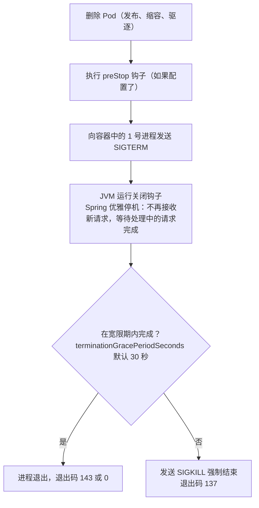

- Kubernetes 文档说明：先执行 preStop 钩子，再向**每个容器中的 1 号进程**发送 TERM 信号；默认宽限期 30 秒，**preStop 的耗时也算在宽限期内**；宽限期结束后仍在运行的进程会收到 SIGKILL。
- Spring Boot 4.0.4 中 `server.shutdown` 的默认值是 `graceful`，每个关闭阶段的超时 `spring.lifecycle.timeout-per-shutdown-phase` 默认 30 秒（已核对配置元数据）。preStop 等待的时间 + Spring 的关闭时间要小于宽限期，否则优雅停机做到一半就被强制结束。

**追问链**

1. **为什么容器里的 Java 应用收不到 SIGTERM？** 最常见的原因是启动命令写成了 `sh -c "java -jar app.jar"`，或者用一个 Shell 脚本启动 Java。这时 1 号进程是 Shell，SIGTERM 发给了 Shell，**Shell 默认不会把信号转发给子进程**，Java 进程直到宽限期结束被 SIGKILL 杀掉都不知道要停机。解决办法：脚本的最后一行用 `exec java ...`，让 Java 进程替换 Shell 成为 1 号进程；或者使用能转发信号的 init 进程（38-06）。
2. **关闭钩子里要注意什么？** 要快：所有钩子都在宽限期内完成；不要在钩子里调用 `System.exit`，会导致关闭流程互相等待而卡住；多个钩子是**并发执行**的，没有先后顺序，有依赖关系的清理逻辑要放在同一个钩子里，或者交给 Spring 的生命周期管理。
3. **为什么停机前要先从注册中心或负载均衡上摘除实例？** 收到 SIGTERM 时，调用方可能还没感知到这个实例要下线，仍然会发来请求。常见做法是在 preStop 中先摘除实例并等待几秒，让调用方的路由表更新，再开始关闭（见[《12 SpringCloud》](../03-分布式与微服务/12-SpringCloud.md)12-05、[《41 容器与云计算》](../09-云原生/41-容器与云计算.md)）。

**生产实践 / 踩坑**

- **不要把 `kill -9` 当成常规的停止方式**。运维脚本中先发 SIGTERM，等待一段时间，超时后再发 SIGKILL，并且把"超时被强制结束"记录下来，作为需要排查的异常。

---

## 二、内存管理

### 38-08 虚拟内存是什么？页表、TLB 和缺页中断是怎么回事？

> ★★★ ｜ 资深 ｜ 高频

**考察意图**：理解"申请内存"和"占用物理内存"是两回事，这是看懂 Java 进程内存的基础。

**30 秒版回答**

- **虚拟内存**：每个进程看到的是自己独立的一段地址空间，进程使用的都是虚拟地址。CPU 中的内存管理单元（MMU）通过**页表**把虚拟页映射到物理页。页是映射的最小单位，x86 上通常是 4 KB；本机 macOS（Apple Silicon）实测是 16 KB（`pagesize` 输出 16384）。
- **虚拟内存带来的好处**：
  - **隔离**：进程之间互相看不到对方的内存；
  - **按需分配**：申请内存时只是预留了一段虚拟地址，**第一次访问某一页时才真正分配物理页**；
  - **共享**：多个进程可以映射同一份物理页，例如同一个动态库、同一个文件；
  - **换出**：不常用的页可以写到磁盘上，腾出物理内存。
- **TLB**：页表存放在内存中，如果每次访问内存都先查页表，速度会慢很多。CPU 用 TLB 缓存最近用过的映射关系；TLB 没有命中时，要逐级查找多级页表。
- **缺页中断**：访问的虚拟页还没有映射到物理页时，CPU 触发缺页异常，交给内核处理（`proc_pid_stat(5)` 分别统计两类）：
  - **次要缺页（minor fault）**：不需要读磁盘，例如第一次访问新申请的内存，内核分配一个物理页即可；或者文件内容已经在 Page Cache 中，建立映射即可；
  - **主要缺页（major fault）**：需要从磁盘读取，例如文件内容不在内存中，或者这一页之前被换出到了 swap。主要缺页要慢得多。

**深入剖析**

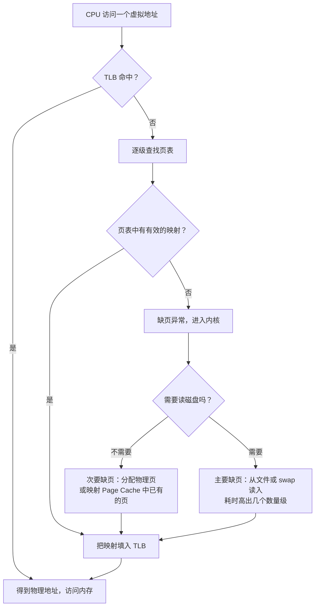

**本机实测**（JDK 25，G1，一个启动后打印自身内存就退出的程序，用 `/usr/bin/time -l` 统计）：

| 启动参数 | RSS（物理内存） | 次要缺页次数 | 总耗时 |
| --- | --- | --- | --- |
| `-Xms2g -Xmx2g` | 46 MB | 4544 | 0.09 秒 |
| `-Xms2g -Xmx2g -XX:+AlwaysPreTouch` | 2136 MB | 138559 | 0.19 秒 |

- 只设置 `-Xms2g`，JVM 预留并提交了 2 GB 的堆，但没有访问的页并不占用物理内存，所以 RSS 只有 46 MB；
- 加上 `AlwaysPreTouch` 后，JVM 在启动时把堆的每一页都访问一遍，RSS 立即达到 2 GB 以上。多出来的约 13.4 万次缺页，和 2 GB ÷ 16 KB = 131072 页基本吻合，正好说明**每个页第一次被访问时都会发生一次缺页**。

**追问链**

1. **`AlwaysPreTouch` 什么时候值得开？** 它把"第一次访问内存时的缺页开销"从运行期挪到了启动期。对延迟敏感、堆又很大的服务，可以避免刚启动时 GC 和分配内存时因为缺页而变慢；代价是启动变慢，并且在容器中一启动就占满堆的物理内存。
2. **为什么说进程的内存大小要看 RSS，不能看申请了多少？** 申请（甚至提交）的只是虚拟内存，真正占用物理内存的是被访问过的页。反过来，`-Xms` 设得和 `-Xmx` 一样，也不代表启动时就占用了这么多物理内存。
3. **为什么切换进程比切换同一个进程中的线程开销大？** 进程切换要切换页表，原来 TLB 中缓存的映射关系对新进程无效（硬件支持按地址空间标记 TLB 项时可以减轻这个问题），新进程刚开始运行时 TLB 未命中会增多；同一个进程中的线程共享页表，没有这部分开销。

---

### 38-09 RSS、VSZ、Page Cache 怎么理解？free 命令中的 available 是什么？

> ★★ ｜ 资深 ｜ 中频

**考察意图**：看懂 `ps`、`top`、`free` 中的内存指标，不再误判"内存快用完了"。

**30 秒版回答**

- **VSZ（虚拟内存大小）**：进程地址空间的总大小，包括预留了但从未使用的部分，**几乎不能说明实际占用**。本机实测：一个只打印一行信息的 Java 程序，VSZ 约 470 GB，RSS 只有 46 MB。
- **RSS（常驻内存）**：实际驻留在物理内存中的页。`proc_pid_status(5)` 说明它是三部分之和：
  - **RssAnon**：匿名内存，Java 的堆、线程栈、堆外内存都在这里；
  - **RssFile**：映射的文件，例如 jar 包、动态库、用 mmap 映射的数据文件；这部分可以和其他进程共享，内存紧张时也可以被回收；
  - **RssShmem**：共享内存。
- **Page Cache**：内核用空闲内存缓存文件的内容（`/proc/meminfo` 中的 `Cached`），读写文件时先访问 Page Cache。没有被修改过的缓存页（干净页）可以随时丢弃；被修改过还没写回磁盘的页（脏页）要先写回才能回收。
- **`free` 中的 `available`**（对应 `/proc/meminfo` 的 `MemAvailable`，Linux 3.14 起）：估算"在不发生换出的前提下，还能给新程序使用多少内存"。它包括空闲内存和可以回收的那部分缓存。**判断内存是否紧张要看 `available`，不要看 `free`**：`free` 很小通常只是因为内存都被 Page Cache 利用起来了。

**深入剖析**

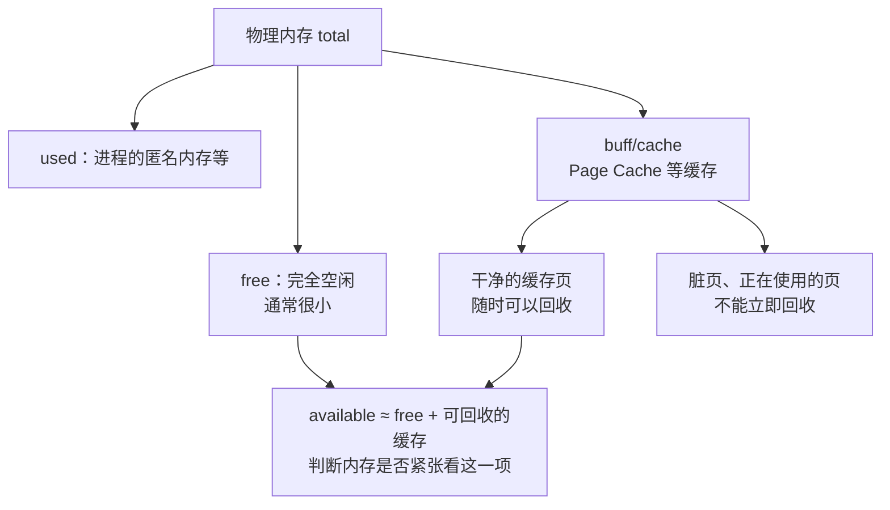

**追问链**

1. **Java 进程的 RSS 为什么远大于 `-Xmx`？** RSS 中除了堆，还有元空间、线程栈、代码缓存、GC 的数据结构、直接内存、`malloc` 的内存池等，见[《04 JVM》](../01-Java核心/04-JVM.md)04-03 和[《33 线上问题排查》](../07-工程实践与稳定性/33-线上问题排查.md)33-08。
2. **几个进程的 RSS 加起来，为什么比系统实际使用的内存还多？** 共享的页（同一个动态库、同一个映射文件）在每个进程的 RSS 中都算了一次。想按比例分摊共享页，可以看 `/proc/<pid>/smaps_rollup` 中的 `Pss`。
3. **`echo 3 > /proc/sys/vm/drop_caches` 能释放内存吗？** 能释放干净的 Page Cache 和可回收的内核对象，但内核文档说明：这些缓存在内存不够时本来就会被自动回收，丢弃之后重新加载它们要花大量的 IO 和 CPU，**不建议在测试和调试之外使用**。它也不会释放脏页和进程的匿名内存，解决不了真正的内存不足。
4. **容器的内存用量为什么比进程的 RSS 大？** 容器（cgroup）的内存统计中，还包括这个容器读写文件产生的 Page Cache。大量写日志的容器，内存用量会持续上涨，其中可以回收的部分在内存紧张时会被回收，见[《41 容器与云计算》](../09-云原生/41-容器与云计算.md)。

---

### 38-10 内存不够时 Linux 会怎么做？OOM Killer 怎么选择进程？

> ★★★ ｜ 资深 / 架构师 ｜ 高频

**考察意图**：区分 JVM 的 OutOfMemoryError 和操作系统杀进程，理解内存回收的过程。

**30 秒版回答**

- **申请内存时通常不会失败**：`vm.overcommit_memory` 默认是 0，内核只拒绝明显超出"物理内存 + swap"的请求，其他请求先答应下来，真正访问时才分配物理页（38-08）。
- **物理内存不足时，内核按顺序尝试回收**：
  1. 后台回收线程（kswapd）在空闲内存低于水位线时开始回收；
  2. 回收不过来时，申请内存的线程自己同步回收（直接回收），这时**申请内存的操作会变慢**，应用表现为延迟抖动；
  3. 回收的对象：干净的 Page Cache 直接丢弃；脏页先写回磁盘再丢弃；匿名内存只能换出到 swap（`vm.swappiness` 默认 60，取值 0～200，决定回收时更倾向于换出匿名页还是丢弃文件缓存）。
- **还是不够时，OOM Killer 选择一个进程用 SIGKILL 杀掉**：
  - 每个进程有一个 0～1000 的分数，大致等于它占用的内存占"允许使用的内存"的比例，例如用了全部允许内存的进程是 1000 分，用了一半的是 500 分；
  - 再加上 `oom_score_adj`（-1000～1000）作为调整，**-1000 表示永远不杀这个进程**（`proc_pid_oom_score_adj(5)`）；
  - 分数最高的进程被杀掉。占内存最多的进程（往往是 Java 进程）最容易被选中。
- **容器**：容器超出自己的内存上限时，在这个容器（cgroup）内部触发 OOM，杀掉容器中的进程，Kubernetes 中显示为 `OOMKilled`，退出码 137（38-07）。

**深入剖析**

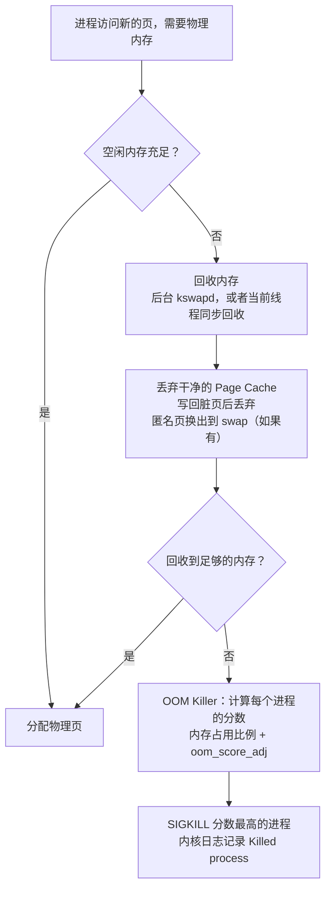

**JVM 抛出 OOM 和进程被杀，是两件完全不同的事**：

| | JVM 的 `OutOfMemoryError` | 操作系统杀掉进程 |
| --- | --- | --- |
| 触发者 | JVM：堆、元空间、直接内存等达到了 JVM 自己的上限 | 内核：整机或容器的物理内存不够 |
| 现象 | 应用日志中有异常；配置了 `-XX:+HeapDumpOnOutOfMemoryError` 时会生成堆转储 | **日志突然中断**，没有异常，没有堆转储；退出码 137 |
| 去哪里查 | 应用日志、堆转储 | `dmesg -T` 或 `journalctl -k` 中的 `Killed process`；Kubernetes 中 Pod 的 `Last State: OOMKilled` |
| 方向 | 分析堆转储，找内存泄漏或调整 JVM 参数 | 让 JVM 的总内存（堆 + 堆外）低于容器上限，并留出余量 |

**追问链**

1. **Java 服务要不要开 swap？** 通常不希望 Java 的堆被换出。GC 需要扫描堆，被换出的页要通过主要缺页从磁盘读回来，GC 停顿会成倍变长，表现为服务长时间没有响应，比直接被杀掉更难排查。所以 Java 服务的机器一般不开 swap 或者调低 `swappiness`，同时把内存规划好，不依赖 swap 兜底。
2. **能不能把 Java 进程的 `oom_score_adj` 设成 -1000，避免它被杀？** 可以，但内存还是不够，OOM Killer 就会去杀别的进程，可能是 SSH、监控代理，甚至导致整机不可用。`oom_score_adj` 只适合保护少数关键的系统进程；业务进程要靠容量规划。
3. **`overcommit_memory` 设成 2（不允许超额申请）可以吗？** 内核会按"swap + 一定比例的物理内存"严格计算可以申请的总量。Java 等预留大量虚拟内存的程序可能在启动或创建线程时就失败，需要充分测试，一般不推荐。

**架构师加分点**

- 容器中 Java 应用的内存规划：**容器上限 = 堆 + 元空间 + 线程栈 × 线程数 + 直接内存 + 代码缓存 + 其他本地内存 + 余量**。用 `MaxRAMPercentage` 给堆留出比例，用 NMT（`-XX:NativeMemoryTracking=summary`）实测堆外的部分，比凭经验拍一个 `-Xmx` 可靠得多（见[《04 JVM》](../01-Java核心/04-JVM.md)04-12）。

---

### 38-11 大页和透明大页是什么？Java 应用要不要开？

> ★★ ｜ 架构师 ｜ 低频

**考察意图**：理解大页的收益来自哪里，以及透明大页可能带来的延迟问题。

**30 秒版回答**

- **为什么需要大页**：用 4 KB 的页，一个 32 GB 的堆有八百多万个页，TLB 只能缓存其中很少的一部分，访问内存时 TLB 未命中会很频繁。用 2 MB 的大页（x86 上的常见大小），一个 TLB 项就能覆盖 2 MB，TLB 未命中大大减少。
- 内核文档说明，大页的收益主要来自两点：首次访问时缺页次数减少（每 2 MB 只缺页一次），但这一点只影响首次访问；更重要的是**后续的每次内存访问 TLB 未命中更少，未命中时查找页表也更快**。
- **两种用法**：
  - **静态大页（hugetlbfs）**：提前通过 `vm.nr_hugepages` 预留，这部分内存不能被其他程序使用，也不会被换出；JVM 用 `-XX:+UseLargePages` 使用；
  - **透明大页（THP）**：内核自动把匿名内存映射成大页，不需要预留。内核文档说明，**THP 目前只用于匿名内存和 tmpfs / shmem**，Java 的堆是匿名内存，可以用上。
- **透明大页的三种模式**（`/sys/kernel/mm/transparent_hugepage/enabled`）：
  - `always`：所有匿名内存都尽量使用大页；
  - `madvise`：只有程序通过 `madvise(MADV_HUGEPAGE)` 声明的区域才使用；
  - `never`：不使用。

**深入剖析：透明大页为什么可能带来延迟抖动**

| 来源 | 说明 |
| --- | --- |
| 分配时的整理 | `defrag` 设为 `always` 时，内核文档说明：申请大页失败的程序会**停下来**，直接回收和整理内存，直到能分配出大页 |
| 后台合并 | `khugepaged` 在后台扫描内存，把连续的小页合并成大页，要消耗 CPU |
| 内存膨胀 | 以 2 MB 为单位分配，程序只用了其中一小部分时也可能占用整个大页，RSS 变大 |

**推荐做法**：系统的 THP 设为 `madvise`，`defrag` 不用 `always`；需要大页的 Java 服务加上 `-XX:+UseTransparentHugePages`，由 JVM 对堆调用 `madvise`，其他进程不受影响。是否真的有收益，要在实际负载下对比延迟和吞吐，堆较大、内存访问分散的服务收益更明显。

**追问链**

1. **怎么确认大页有没有生效？** `cat /sys/kernel/mm/transparent_hugepage/enabled` 中带方括号的就是当前的模式；`/proc/meminfo` 中的 `AnonHugePages` 是当前使用透明大页的匿名内存总量；也可以看进程的 `/proc/<pid>/smaps` 中各个区域的 `AnonHugePages`。
2. **有些数据库和中间件的文档建议关闭透明大页，为什么？** 原因主要是上面表格中的延迟抖动和内存膨胀：对于内存访问模式比较稀疏、对延迟很敏感的程序，大页的收益抵不上这些代价。所以是否开启要看具体的软件和实测数据，不能一概而论。

---

## 三、IO 与文件系统

### 38-12 操作系统层面有哪几种 IO 模型？同步、异步、阻塞、非阻塞怎么区分？

> ★★★ ｜ 资深 ｜ 高频

**考察意图**：把"阻塞 / 非阻塞"和"同步 / 异步"这两组经常被混用的概念讲清楚。

**30 秒版回答**

- **一次读操作分两个阶段**：① 等待数据就绪，即数据从网卡或磁盘到达内核的缓冲区；② 把数据从内核缓冲区拷贝到用户的缓冲区。
- **五种 IO 模型**（《UNIX 网络编程》中的经典分类）：

| 模型 | 阶段 ①：等待数据 | 阶段 ②：拷贝数据 | 对应的 Java 用法 |
| --- | --- | --- | --- |
| 阻塞 IO | 线程阻塞 | 线程阻塞 | BIO：`InputStream.read` |
| 非阻塞 IO | 立即返回"没有数据"，应用要反复询问 | 线程阻塞 | 非阻塞的 `SocketChannel` 单独使用（很少这样用） |
| IO 多路复用 | 阻塞在 `select` / `poll` / `epoll_wait` 上，**一个线程同时等待很多连接** | 线程阻塞 | NIO 的 `Selector`、Netty |
| 信号驱动 IO | 数据就绪时内核发送信号通知 | 线程阻塞 | 基本不用 |
| 异步 IO | 不阻塞 | 不阻塞，**内核完成拷贝后再通知应用** | Linux 上的 io_uring（38-17） |

- **阻塞和非阻塞**看的是阶段 ①：数据没有就绪时，调用是一直等待还是立即返回。
- **同步和异步**看的是整个操作：应用线程是否要亲自等到数据拷贝完成。前四种模型在阶段 ② 中线程都要等待拷贝完成，所以**都是同步 IO**；只有最后一种是异步 IO。

**深入剖析：IO 多路复用的一次读取**

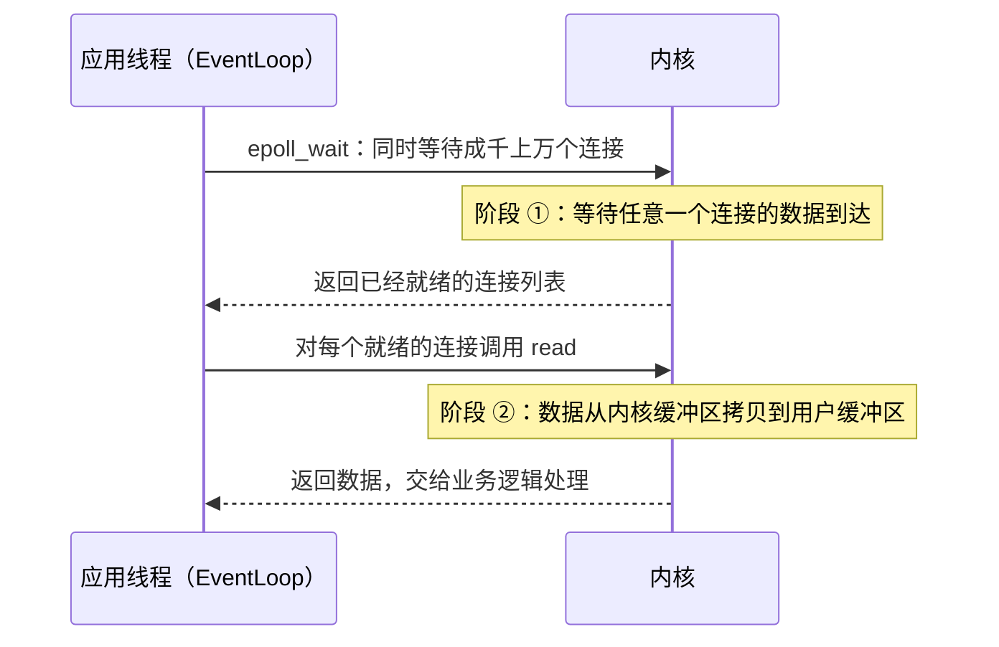

**追问链**

1. **Java 的 AIO（`AsynchronousSocketChannel`）是真正的异步 IO 吗？** 从 API 上看是异步的，但 Linux 上 JDK 的实现仍然基于 epoll，由 JDK 内部的线程等待就绪、完成读写后再回调，本质上是用多路复用模拟的，没有明显的性能优势（见[《08 Netty》](../02-框架与容器/08-Netty.md)08-01）。
2. **虚拟线程属于哪种模型？** 代码写法是阻塞 IO，底层是 IO 多路复用。JDK 25 源码中，虚拟线程读写 Socket 时，`NioSocketImpl` 会把 Socket 设为非阻塞；数据没有就绪时调用 `Poller.poll` 把虚拟线程挂起，由 Poller 线程在 fd 就绪后唤醒它（Linux 上基于 epoll，macOS 上基于 kqueue）。所以写的是同步阻塞的代码，载体线程却不会阻塞。读写普通文件时没有这种机制，虚拟线程会暂时占住载体线程，JVM 会临时增加载体线程作为补偿（见[《03 Java 并发》](../01-Java核心/03-Java并发.md)03-22）。
3. **为什么网络服务大多用 IO 多路复用，而不是一个连接一个线程？** 大多数连接在大部分时间里没有数据，一个连接一个线程会让大量线程处于等待状态，占用内存，还增加调度的开销（38-03）。多路复用让少量线程只处理已经就绪的连接。

---

### 38-13 select、poll、epoll 有什么区别？水平触发和边缘触发怎么选？

> ★★★ ｜ 资深 ｜ 高频

**考察意图**：说清楚 epoll 快在哪里，以及 Java 和 Netty 实际使用的触发方式。

**30 秒版回答**

| | select | poll | epoll |
| --- | --- | --- | --- |
| 数量上限 | 只能监视编号小于 `FD_SETSIZE`（1024）的 fd | 没有固定上限 | 没有固定上限 |
| 每次调用传入什么 | 整个 fd 集合，从用户态拷贝到内核；返回时**集合被原地修改**，下次调用前要重新设置 | 整个 `pollfd` 数组 | 什么都不用传：fd 通过 `epoll_ctl` 注册一次，之后一直有效 |
| 内核怎么找出就绪的 fd | 遍历所有被监视的 fd | 遍历所有被监视的 fd | 数据到达时通过回调放入就绪列表，`epoll_wait` 只返回就绪的 fd |
| 开销和什么成正比 | 监视的 fd 总数 | 监视的 fd 总数 | 就绪的 fd 数量 |

- `select(2)` 手册直接写明：1024 的上限对现代应用来说低得不合理，**新的程序应该使用 poll 或 epoll**。
- epoll 的手册说明，一个 epoll 实例中有两个列表：**兴趣列表**（注册了要监视的 fd）和**就绪列表**（由内核根据 IO 活动动态填充）；它可以很好地支持大量的 fd，每注册一个 fd，在 64 位内核上大约占用 160 字节的内核内存。

**深入剖析**

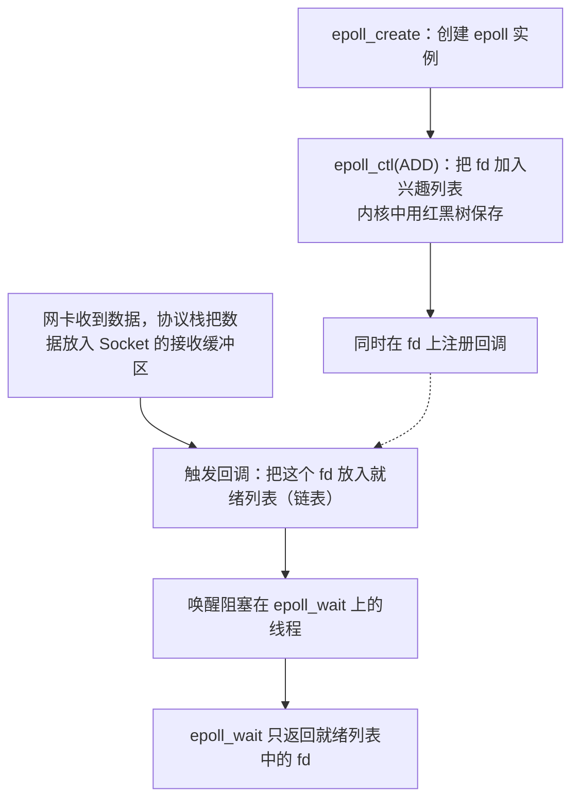

（兴趣列表是红黑树、就绪列表是链表，来自内核源码 `fs/eventpoll.c` 中 `struct eventpoll` 的 `rbr` 和 `rdllist` 字段。）

**水平触发和边缘触发**（`epoll(7)` 中的例子：管道中写入了 2 KB 数据，读取方只读了 1 KB）：

- **水平触发（LT，默认）**：只要缓冲区里还有没读完的数据，下次 `epoll_wait` 还会返回这个 fd。手册的说法是，此时 epoll 就是一个更快的 poll，语义相同。
- **边缘触发（ET）**：只在状态**发生变化**（有新数据到达）时通知一次。上面的例子中，剩下的 1 KB 不会再触发通知，`epoll_wait` 可能一直阻塞。所以手册要求：使用边缘触发时，fd 必须是非阻塞的，并且要一直读（或写）到返回 `EAGAIN` 为止。

**Java 和 Netty 实际使用的是哪种？**

| 实现 | 触发方式 | 依据 |
| --- | --- | --- |
| JDK NIO 的 `Selector`（Linux 上是 `EPollSelectorImpl`） | 水平触发 | JDK 源码中注册 fd 时没有使用 `EPOLLET`；每次 `epoll_wait` 最多取回 1024 个事件 |
| Netty 4.1 的 epoll 原生传输 | 默认边缘触发，可以改成水平触发 | 4.1 的 `EpollChannelConfig` |
| **Netty 4.2 的 epoll 原生传输** | **固定为水平触发** | 4.2 的 API 文档把 `EpollMode` 标记为废弃，注明 "Netty always uses level-triggered mode"；4.2.10 字节码中 `setEpollMode` 是空操作 |

**追问链**

1. **epoll 一定比 select 快吗？** 不一定。epoll 的优势在于**连接很多、同时活跃的很少**的场景。连接数很少、几乎都活跃时，差别不大；而且 epoll 每次修改监视的事件都要调用一次 `epoll_ctl`，频繁修改时也有开销。
2. **边缘触发的通知更少，为什么 Netty 4.2 反而统一用水平触发？** 边缘触发要求每次都把数据读完，和"每次最多读多少条消息""暂停自动读取"这类流量控制功能配合起来很容易出错。4.1 的文档就提示过，依赖 `autoRead` 等功能的应用应该改用水平触发。4.2 统一为水平触发，降低了出错的可能。
3. **能用 epoll 监视普通文件吗？** 不能。`epoll_ctl(2)` 说明，对普通文件或目录调用会返回 `EPERM`。普通文件的读写总是被认为"已就绪"，真正的耗时在磁盘 IO 上，多路复用帮不上忙；想要异步读写文件，要用 io_uring（38-17）或者线程池。
4. **macOS 上是什么？** BSD 系统使用 kqueue。本机 JDK 25 实测，`Selector.open()` 返回的是 `sun.nio.ch.KQueueSelectorImpl`。

---

### 38-14 零拷贝在操作系统层面是怎么实现的？

> ★★★ ｜ 资深 ｜ 高频

**考察意图**：能逐步说清楚每种方式的拷贝和切换，并知道零拷贝的前提和限制。中间件中的应用见[《25 高性能》](../06-三高与架构/25-高性能.md)25-12。

**30 秒版回答**

以"把一个文件发送到网络上"为例，下面是常见的分析模型（具体的拷贝次数还和网卡、驱动是否支持相关特性有关）：

| 方式 | 系统调用 | 用户态与内核态的切换 | CPU 拷贝 | DMA 拷贝 | 能否在用户态修改数据 |
| --- | --- | --- | --- | --- | --- |
| `read` + `write` | 2 次 | 4 次 | 2 次 | 2 次 | 能 |
| `mmap` + `write` | 2 次 | 4 次 | 1 次 | 2 次 | 能（直接修改映射的内存） |
| `sendfile` | 1 次 | 2 次 | 1 次；网卡支持分散 / 聚集 DMA 时为 0 | 2 次 | **不能** |

- **"零拷贝"指的是数据不在内核和用户空间之间来回拷贝**，而不是完全没有拷贝：从磁盘读入、发送到网卡这两次 DMA 拷贝始终存在。
- `sendfile(2)` 手册说明，拷贝在内核中完成，所以比 `read` 加 `write` 更高效；输入的 fd 必须是支持 mmap 类操作的文件（不能是 Socket）；单次调用最多传输 0x7ffff000（2,147,479,552）字节。
- `splice(2)` 在两个 fd 之间移动数据，不在内核和用户空间之间拷贝，但**其中一个 fd 必须是管道**。

**深入剖析**

传统的 `read` + `write`：数据进入用户空间又出来，共 4 次拷贝。

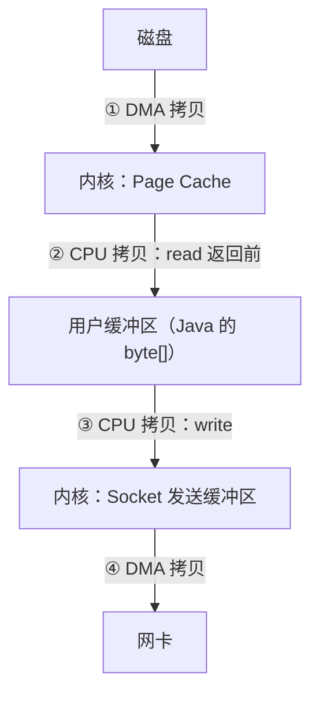

`sendfile`：数据始终在内核中，应用只发起一次调用。

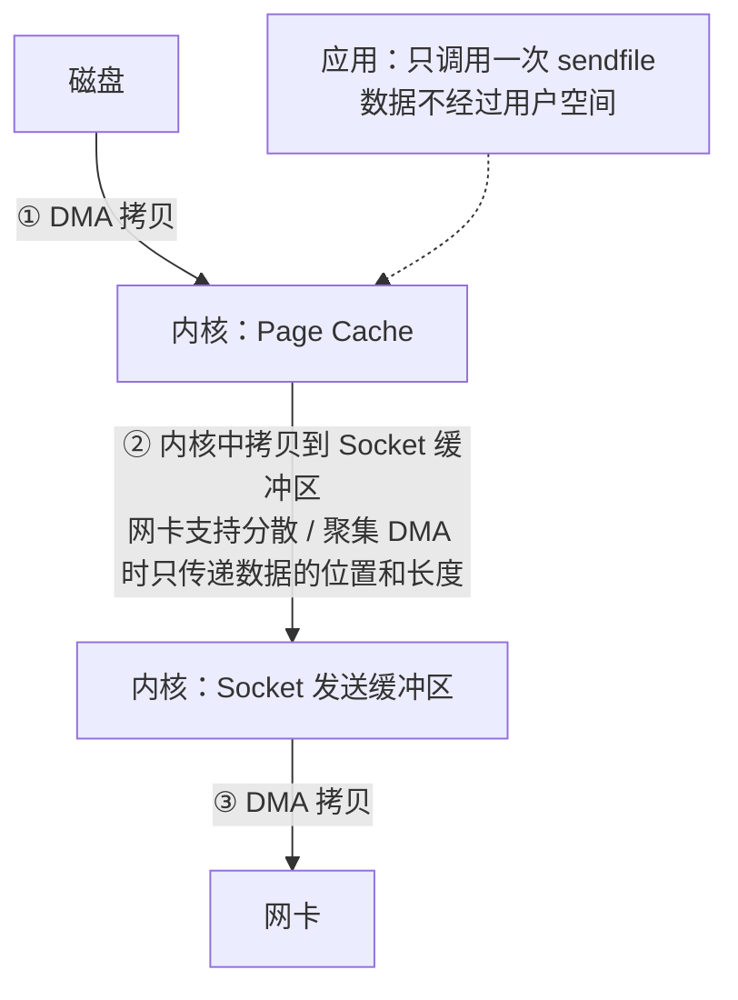

**Java 中的对应关系**（已核对 openjdk/jdk 主线的 Linux 实现）：

| Java API | Linux 系统调用 | 说明 |
| --- | --- | --- |
| `FileChannel.transferTo`（文件到 Socket） | `sendfile` | Kafka 把消息发送给消费者、Netty 的 `FileRegion` 都用它 |
| `FileChannel.transferFrom`（文件到文件） | `copy_file_range` | 文件之间的拷贝在内核中完成 |
| `FileChannel.map` → `MappedByteBuffer` | `mmap` | RocketMQ 的 CommitLog；单个映射最大 `Integer.MAX_VALUE` 字节 |

**追问链**

1. **开启 TLS 后，零拷贝还有效吗？** 一般无效。`sendfile` 要求数据不经过用户空间，而 TLS 要在发送前加密数据，加密通常在用户空间完成（例如 JDK 的 SSLEngine），数据必须读到用户空间。Kafka 开启 TLS 后就失去了零拷贝（见[《21 Kafka》](../05-消息队列/21-Kafka.md)21-14）。内核 TLS（kTLS）可以把加密放到内核中，让 sendfile 继续可用，但需要内核、网卡和应用都支持。
2. **mmap 比 read 好吗？** 各有适用的场景。mmap 适合反复随机访问的大文件，省去了每次读写的系统调用和到用户空间的拷贝；代价是：
   - 第一次访问每个页都会缺页（38-08）；
   - 建立和解除映射要修改页表；
   - `mmap(2)` 手册说明，访问超出文件末尾的映射区域会收到 `SIGBUS`，文件被其他进程截断时 JVM 可能直接崩溃；
   - `MappedByteBuffer` 不能主动解除映射，要等 GC 回收。JDK 22 起可以通过 FFM API，用 `FileChannel.map(mode, offset, size, arena)` 得到 `MemorySegment`，在关闭 `Arena` 时确定性地解除映射。
3. **Netty 的"零拷贝"和操作系统的零拷贝是一回事吗？** 不完全是。Netty 的 `FileRegion` 底层调用 `transferTo`，属于操作系统层面的零拷贝；而 `CompositeByteBuf`、`slice` 是在用户空间中避免合并和复制缓冲区，属于应用层的优化（见[《08 Netty》](../02-框架与容器/08-Netty.md)08-09）。

---

### 38-15 write 返回成功，数据就写到磁盘上了吗？

> ★★★ ｜ 资深 / 架构师 ｜ 中频

**考察意图**：理解 Page Cache 的写回机制，以及持久性和性能之间的取舍。

**30 秒版回答**

- **没有**。`write` 把数据拷贝到 Page Cache，把对应的页标记为脏页就返回了，由内核在之后写回磁盘。
- **内核什么时候写回脏页**（默认值来自内核源码 `mm/page-writeback.c`）：
  - 脏数据存在超过 **30 秒**（`vm.dirty_expire_centisecs` = 3000），下次写回线程醒来时会写回；写回线程每 **5 秒**醒来一次（`vm.dirty_writeback_centisecs` = 500）；
  - 脏页达到可用内存的 **10%**（`vm.dirty_background_ratio`），后台写回线程开始写回；
  - 脏页达到 **20%**（`vm.dirty_ratio`），**正在写入的进程自己要参与写回**，`write` 调用会因此变慢。
- **会不会丢数据，要看是什么崩溃了**：
  - **进程崩溃**（包括被 `kill -9`）：已经 `write` 成功的数据在内核的 Page Cache 中，**不会丢失**；
  - **操作系统崩溃或者断电**：还没有写回的脏页会丢失。
- **要保证数据真正落盘，要调用 `fsync`**：
  - `fsync`：把文件的数据和元数据都写到存储设备；
  - `fdatasync`：不刷新读取数据时用不到的元数据（例如修改时间），但文件大小变化这类必要的元数据仍会刷新，因此磁盘操作更少；
  - `fsync(2)` 手册特别指出：对文件调用 fsync **不保证包含这个文件的目录项也已经写到磁盘**，新建或重命名文件后，还要对所在的目录调用一次 fsync。

**深入剖析**

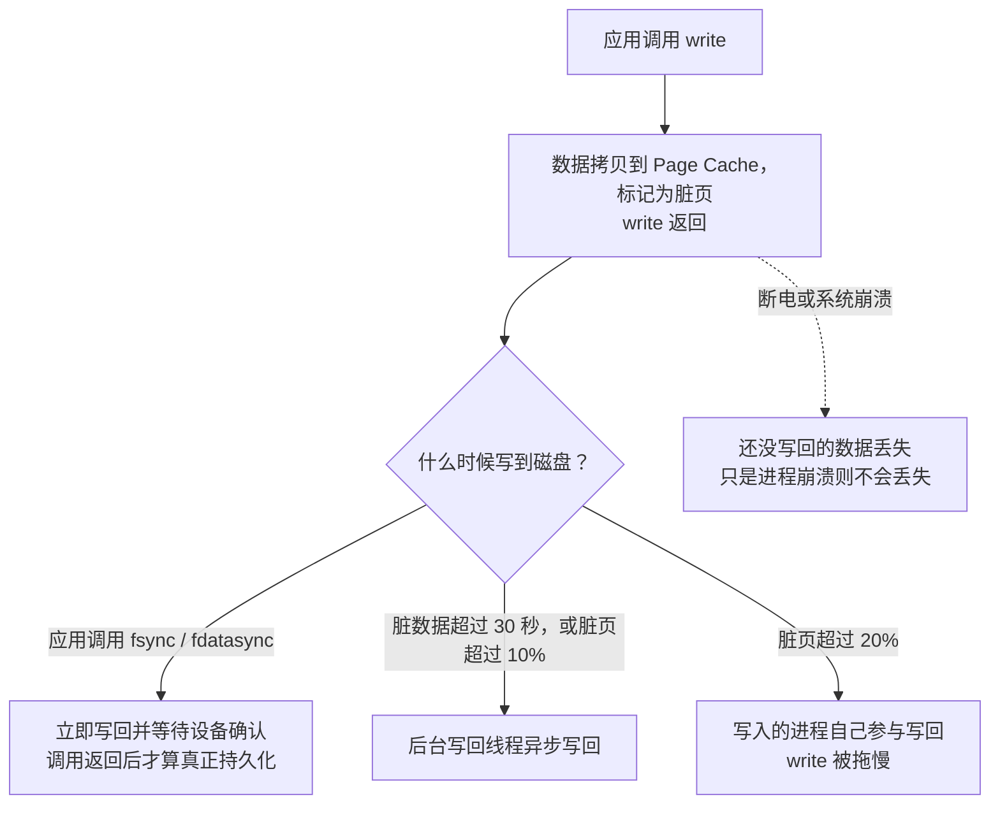

**Java 中的对应关系**（已核对 openjdk/jdk 主线源码）：

| Java API | Linux | macOS |
| --- | --- | --- |
| `FileChannel.force(true)` | `fsync` | `fcntl(F_FULLFSYNC)`，失败时回退到 `fsync` |
| `FileChannel.force(false)` | `fdatasync` | 同上（BSD 系统上 `fdatasync` 被定义为 `fsync`） |
| `FileOutputStream.getFD().sync()` | `fsync` | — |
| 打开文件时使用 `StandardOpenOption.DSYNC` / `SYNC` | 每次写入都同步落盘 | — |

**本机实测**（macOS、APFS、固态盘、JDK 25）：写入 2000 条 100 字节的记录，

| 方式 | 总耗时 | 平均每次写入 |
| --- | --- | --- |
| 只调用 `write` | 6～11 毫秒 | 3～5 微秒 |
| 每次 `write` 后调用 `force(false)` | 约 7.7～8.1 秒 | 约 4 毫秒 |
| 每次 `write` 后调用 `force(true)` | 约 7.6～8.4 秒 | 约 4 毫秒 |

每次都刷盘，单次写入慢了大约一千倍。macOS 上 JDK 用的是 `F_FULLFSYNC`，会要求磁盘把自己的写缓存也刷到存储介质上，所以 `force(false)` 和 `force(true)` 差不多。Linux 上的具体数字取决于磁盘以及磁盘缓存是否有掉电保护，但"每次都刷盘非常贵"这个结论是一样的。

**追问链**

1. **既然 fsync 这么贵，数据库和消息队列是怎么取舍的？** 核心思路是**合并刷盘**：攒一批写入再调用一次 fsync（组提交），把一次 fsync 的成本分摊到很多次写入上。在此之上提供不同级别的选择：
   - MySQL 的 `innodb_flush_log_at_trx_commit`：1 表示每次提交都刷盘，最安全；2 表示每次提交写到操作系统、每秒刷一次盘，只有在操作系统崩溃时才可能丢失大约 1 秒的数据（见[《15 MySQL》](../04-数据存储/15-MySQL.md)）；
   - Kafka 默认不主动 fsync：`flush.messages` 和 `flush.ms` 的默认值都是 Long 的最大值，官方文档建议不要设置它们，**用多副本保证可靠性**，由操作系统在后台刷盘，这样效率更高。数据写到了多台机器的 Page Cache 中，所有机器同时断电的概率很低；
   - RocketMQ 可以配置同步刷盘或异步刷盘（见[《22 RocketMQ》](../05-消息队列/22-RocketMQ.md)）。
2. **为什么写日志偶尔会让接口变慢？** 脏页超过 `dirty_ratio` 时，写入的线程要自己参与写回；磁盘很忙时，同步写日志的业务线程就会被拖慢。解决办法是使用异步日志，并把日志放在单独的磁盘上（见[《25 高性能》](../06-三高与架构/25-高性能.md)25-13）。
3. **"先写临时文件，再重命名"为什么能做到原子替换？还要注意什么？** 重命名在同一个文件系统内是原子操作，读取方要么看到旧文件，要么看到新文件。要保证断电后也正确，步骤是：写临时文件 → 对临时文件 fsync → 重命名 → **对所在的目录 fsync**，最后一步经常被遗漏。

---

### 38-16 文件描述符是什么？Java 进程能打开多少个文件？

> ★★ ｜ 资深 ｜ 中频

**考察意图**：理解文件描述符背后的内核结构，以及 Java 进程上限是怎么确定的。

**30 秒版回答**

- **文件描述符（fd）**是进程打开一个文件后得到的一个整数，是进程的文件描述符表中的下标。0、1、2 分别是标准输入、标准输出、标准错误。
- **Linux 中一切皆文件**：普通文件、Socket、管道、epoll 实例都占用文件描述符。所以一个网络服务"打开的文件"数，主要是 Socket 连接数。
- **三层结构**：进程的 fd 表 → 系统级的"打开文件"（记录读写位置、打开方式）→ inode（文件本身）。`fork` 出来的子进程和父进程共享同一个"打开文件"，因此也共享读写位置。
- **上限**：
  - 每个进程的上限 `RLIMIT_NOFILE`，分为软限制（`ulimit -n`）和硬限制（`ulimit -Hn`），进程可以自己把软限制提高到硬限制；
  - 整个系统的上限 `fs.file-max`。
- **JVM 会自动把软限制提高到硬限制**：HotSpot 的 `-XX:+MaxFDLimit` 默认开启，Linux 上启动时调用 `setrlimit`，把软限制设为硬限制。本机实测：把 Shell 的软限制设为 256 后启动 JDK 25，JVM 内部看到的上限是 1048576；加上 `-XX:-MaxFDLimit` 后是 256。**所以 Java 进程真正受限的是硬限制**，在容器或 systemd 中要设置的也是硬限制（例如 systemd 的 `LimitNOFILE`、Docker 的 `--ulimit nofile`）。

**深入剖析**

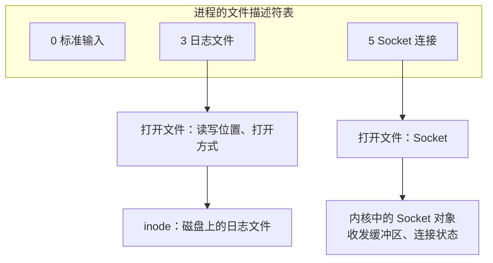

**常用命令**：

```bash
cat /proc/<pid>/limits | grep 'open files'   # 进程实际生效的软、硬限制
ls /proc/<pid>/fd | wc -l                      # 当前打开的数量
lsof -p <pid> | awk '{print $5}' | sort | uniq -c | sort -rn   # 按类型统计（REG 普通文件、IPv4 / IPv6 Socket 等）
```

**追问链**

1. **删除了一个正在被写的大日志文件，为什么磁盘空间没有释放？** 删除只是去掉了目录中的文件名，进程的 fd 还指向这个 inode，inode 和数据块要等最后一个 fd 关闭才会释放，见[《33 线上问题排查》](../07-工程实践与稳定性/33-线上问题排查.md)33-09。
2. **报 `Too many open files` 怎么查？** 先看是连接泄漏（Socket 没有关闭）、文件句柄泄漏，还是上限本身太低，见[《33 线上问题排查》](../07-工程实践与稳定性/33-线上问题排查.md)33-10。监控上，可以从 `UnixOperatingSystemMXBean` 读取 `getOpenFileDescriptorCount()` 和 `getMaxFileDescriptorCount()`，Micrometer 也会暴露 `process.files.open` 和 `process.files.max`，在快到上限前告警。

---

### 38-17 io_uring 是什么？和 epoll 有什么不同？

> ★★ ｜ 架构师 ｜ 低频

**考察意图**：了解 Linux 上新的异步 IO 接口，以及在 Java 中使用它的现状和限制。

**30 秒版回答**

- **io_uring** 是 Linux 5.1 引入的异步 IO 接口。名字来自用户空间和内核共享的两个**环形缓冲区**（`io_uring(7)`）：
  - **提交队列（SQ）**：应用把要做的 IO 操作（读、写、接收连接等）放到队尾；
  - **完成队列（CQ）**：内核完成操作后，把结果放到这里。
  - 两个队列通过 mmap 在用户空间和内核之间共享，提交和获取结果不需要拷贝。
- **和 epoll 的本质区别**：
  - epoll 是**就绪通知**：告诉应用"可以读了"，应用还要自己调用 `read`，拷贝数据时线程仍要等待，属于同步 IO（38-12）；
  - io_uring 是**完成通知**：应用提交"读这个 fd"的请求，内核完成读取并把数据放进应用的缓冲区之后才通知，是真正的异步 IO；
  - 一次系统调用可以提交和收割**一批**操作，系统调用的次数更少；
  - **普通文件也可以异步读写**，而 epoll 不支持普通文件（38-13）。

**深入剖析**

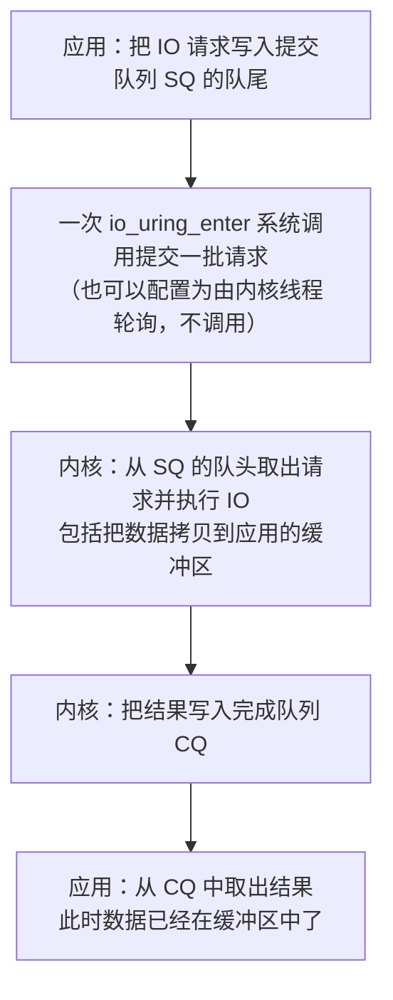

**在 Java 中使用**：

- Netty 4.2 提供了 io_uring 传输（`io.netty.channel.uring` 包），可以替换 epoll 传输；
- 收益和实际负载有关，要在目标内核版本上实测后再决定是否使用。

**追问链**

1. **为什么很多环境默认不让用 io_uring？** 出于安全考虑。io_uring 出现过多个可以用来逃逸容器的漏洞：
   - Docker 的文档说明，默认的 seccomp 配置拦截了 `io_uring_setup`、`io_uring_enter`、`io_uring_register` 这三个系统调用；
   - 内核提供了 `kernel.io_uring_disabled` 参数：设为 1 时只有特权进程或指定用户组的进程可以创建 io_uring 实例，设为 2 时所有进程都不能创建。
   
   所以在容器中使用 io_uring 传输前，要先确认运行环境是否允许，并且准备好在不支持时回退到 epoll。

---

## 四、CPU 与观测

### 38-18 CPU 使用率中的 us、sy、wa、si、st 分别是什么？怎么用来判断瓶颈？

> ★★ ｜ 资深 ｜ 中频

**考察意图**：看懂 `top` 和 `vmstat` 中的 CPU 时间分类，并据此确定排查方向。Load 的含义见[《33 线上问题排查》](../07-工程实践与稳定性/33-线上问题排查.md)33-06。

**30 秒版回答**（各字段的含义来自 `proc_stat(5)`）

| 字段 | 含义 | 偏高时的常见原因 |
| --- | --- | --- |
| `us` | 用户态时间 | 业务代码在计算，或者 GC 线程在工作 |
| `sy` | 内核态时间 | 系统调用太频繁、上下文切换多、锁竞争（`futex`）、大量缺页 |
| `ni` | 调低了优先级（nice）的进程在用户态的时间 | 后台任务 |
| `id` | 空闲 | — |
| `wa` | **CPU 空闲时，有任务在等待 IO 完成**的时间 | 磁盘慢、IO 压力大 |
| `hi` / `si` | 处理硬中断 / 软中断的时间 | 网络包很多（收包主要在软中断中处理） |
| `st` | 被"偷走"的时间：虚拟机中，宿主机把 CPU 分给了其他虚拟机 | 宿主机超卖、邻居占用 CPU |

- **`wa` 本质上是空闲时间**。`proc_stat(5)` 明确说这个值**不可靠**：CPU 并不会等 IO，等 IO 的是任务；一个 CPU 因为任务等 IO 而空闲时，别的任务可以被调度过来执行；多核时也很难算清楚每个 CPU 的 iowait。所以 `wa` 高只说明"有任务在等 IO，并且 CPU 正好闲着"，**判断磁盘是否是瓶颈，要看 `iostat -x` 中的设备使用率和响应时间**。

**深入剖析**

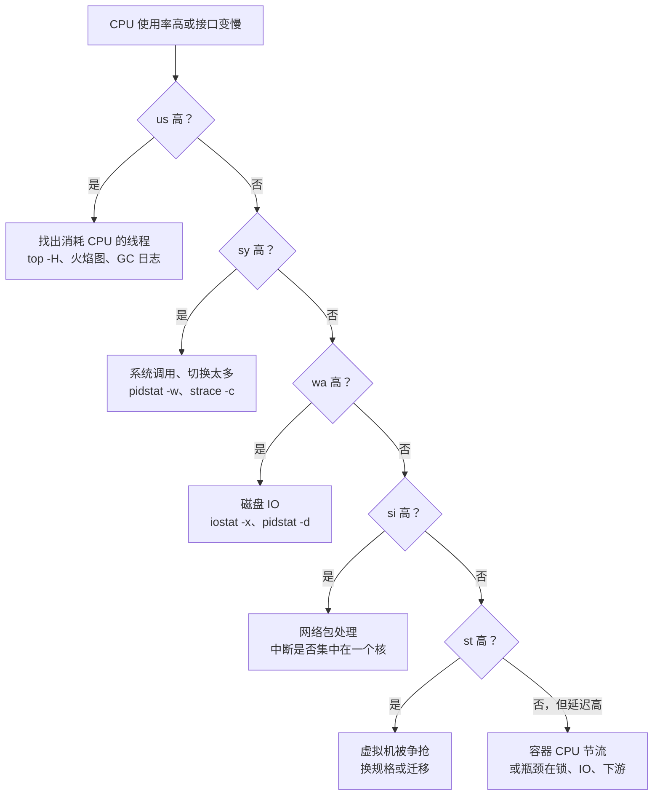

**常用命令**：

```bash
vmstat 1                 # r：可运行的任务数；cs：每秒上下文切换次数；us / sy / wa / st
mpstat -P ALL 1          # 每个核分别统计，看是不是只有个别核很忙（例如中断集中在一个核上）
pidstat -u -t -p <pid> 1 # 进程中每个线程的 CPU 使用率，区分用户态和内核态
```

**追问链**

1. **整体 CPU 使用率只有 30%，为什么服务已经处理不过来了？** 常见的原因：
   - 某个核被打满，而业务恰好依赖单线程（例如单个 EventLoop 线程、全局锁），其他核空着帮不上忙，用 `mpstat -P ALL` 能看出来；
   - 容器的 CPU 限额导致节流；
   - 瓶颈不在 CPU，在锁、IO 或下游服务。
2. **Java 应用的 `sy` 很高，可能是什么原因？** 常见的有：大量线程在同一把锁上竞争，挂起和唤醒都要系统调用（`futex`）；频繁的小 IO（38-02 中逐字节写文件的例子）；使用了大量的 `Thread.sleep` 或者很短的超时等待；堆内存刚开始使用时大量缺页（38-08）。
