# 39 · 网络安全

> 适用岗位：Java 资深开发（重点：XSS、CSRF、SSRF、注入、越权的原理和防护，密码存储，JWT 的正确用法，Java 加密 API 的坑）、Java 架构师（重点：认证授权体系、OAuth 2.0 与 OIDC、敏感数据与密钥管理、证书自动化、后量子密码迁移、把安全融入研发流程）
> 版本基线：OWASP Top 10:2025、OWASP API Security Top 10 2023、JDK 25（TLS 混合密钥交换见 JDK 27）、Spring Security 7.0.4（Spring Boot 4.0.4 自带的版本）、Nimbus JOSE + JWT 9.37.4；协议以 RFC 为准（OAuth 2.0 [RFC 6749](https://www.rfc-editor.org/rfc/rfc6749.html)、PKCE [RFC 7636](https://www.rfc-editor.org/rfc/rfc7636.html)、OAuth 2.0 安全最佳实践 [RFC 9700](https://www.rfc-editor.org/rfc/rfc9700.html)、JWT 最佳实践 [RFC 8725](https://www.rfc-editor.org/rfc/rfc8725.html)）
> 事实核对：
> - 风险分类来自 [OWASP Top 10:2025](https://top10.owasp.org/2025/) 及其[介绍页](https://top10.owasp.org/2025/0x00_2025-Introduction/)、[OWASP API Security Top 10 2023](https://api-security.owasp.org/editions/2023/en/0x11-t10)；防护建议来自 OWASP 的 [XSS 防护](https://cheatsheetseries.owasp.org/cheatsheets/Cross_Site_Scripting_Prevention_Cheat_Sheet.html)、[密码存储](https://cheatsheetseries.owasp.org/cheatsheets/Password_Storage_Cheat_Sheet.html) 速查表；
> - Cookie 的 SameSite、HttpOnly、`__Host-` 前缀来自 [MDN](https://developer.mozilla.org/en-US/docs/Web/HTTP/Reference/Headers/Set-Cookie)；云上的元数据服务来自 [AWS IMDS 文档](https://docs.aws.amazon.com/AWSEC2/latest/UserGuide/configuring-instance-metadata-service.html)；
> - Spring Security 的过滤器链来自[架构文档](https://docs.spring.io/spring-security/reference/servlet/architecture.html)，默认安全响应头来自[响应头文档](https://docs.spring.io/spring-security/reference/features/exploits/headers.html)，7.0 的变化来自 [What's New in 7.0](https://docs.spring.io/spring-security/reference/7.0/whats-new.html)；
> - 证书有效期的缩短来自 [CA/B 论坛 SC-081v3 投票](https://cabforum.org/2025/04/11/ballot-sc081v3-introduce-schedule-of-reducing-validity-and-data-reuse-periods/) 和 [DigiCert 的时间表](https://knowledge.digicert.com/alerts/public-tls-certificates-199-day-validity)；Let's Encrypt 停止 OCSP 来自[官方公告](https://letsencrypt.org/2025/08/06/ocsp-service-has-reached-end-of-life)；后量子密码来自 [JEP 496](https://openjdk.org/jeps/496)、[JEP 497](https://openjdk.org/jeps/497)、[JEP 510](https://openjdk.org/jeps/510)、[JEP 527](https://openjdk.org/jeps/527)；
> - 本机实测（JDK 25、Spring Security Crypto 7.0.4、Nimbus JOSE + JWT 9.37.4）：`Cipher.getInstance("AES")` 的默认模式、GCM 重复使用 IV、ML-KEM / ML-DSA / HKDF、默认密钥库类型、各种 IP 写法的解析结果、HTTP 客户端的重定向默认值、`DelegatingPasswordEncoder` 的输出和 bcrypt 的耗时、超过 72 字节的密码、JWT 的 `alg: none` 和过短的 HMAC 密钥、AES-GCM 工具类的篡改检测；Spring Boot 4.0.4 的 Actuator 默认暴露范围已核对配置元数据
> 相关分类：[《01 Java 基础》](../01-Java核心/01-Java基础.md)01-19（反序列化漏洞）、[《06 MyBatis》](../02-框架与容器/06-MyBatis.md)（SQL 注入）、[《11 微服务》](../03-分布式与微服务/11-微服务.md)11-10（微服务的认证与授权）、[《13 配置中心》](../03-分布式与微服务/13-配置中心.md)（密钥的存放）、[《29 场景题》](../06-三高与架构/29-场景题.md)29-15（开放平台的签名与防重放）、[《32 日志与可观测性》](../07-工程实践与稳定性/32-日志与可观测性.md)（Log4Shell、日志脱敏）、[《35 文件处理》](../07-工程实践与稳定性/35-文件处理.md)（上传文件的安全）、[《36 Maven·Git·IDEA》](../07-工程实践与稳定性/36-Maven·Git·IDEA.md)（依赖管理、密钥泄露的处理）、[《37 计算机网络》](37-计算机网络.md)（TLS 握手、CORS）、[《41 容器与云计算》](../09-云原生/41-容器与云计算.md)

## 知识地图

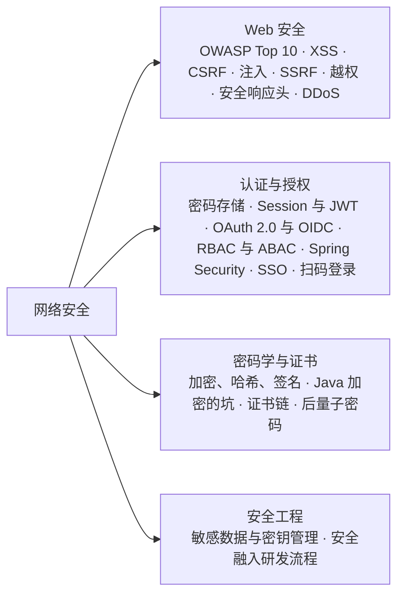

## 题目索引

| 编号 | 题目 | 难度 | 层级 |
| --- | --- | --- | --- |
| 39-01 | OWASP Top 10 2025 版有哪些？和 2021 版相比有什么变化？ | ★★ | 资深 |
| 39-02 | XSS 有哪几种？怎么防？ | ★★★ | 资深 |
| 39-03 | CSRF 是怎么发生的？SameSite 和 CORS 能防住它吗？ | ★★★ | 资深 |
| 39-04 | 除了 SQL 注入，还有哪些注入？根本的防法是什么？ | ★★ | 资深 |
| 39-05 | SSRF 是什么？为什么在云上特别危险？怎么防？ | ★★★ | 资深 / 架构师 |
| 39-06 | 越权漏洞是怎么产生的？怎么系统性地防范？ | ★★★ | 资深 / 架构师 |
| 39-07 | 常见的安全响应头有哪些？分别防什么？ | ★★ | 资深 |
| 39-19 | DDoS 和 CC 攻击是什么？应用层面能做什么？ | ★★ | 资深 / 架构师 |
| 39-08 | 用户的密码应该怎么存储？ | ★★★ | 资深 |
| 39-09 | Session 和 JWT 怎么选？JWT 有哪些安全上的坑？ | ★★★ | 资深 |
| 39-10 | OAuth 2.0 的授权码模式是怎么工作的？PKCE 和 OIDC 解决了什么问题？ | ★★★ | 资深 / 架构师 |
| 39-11 | RBAC 和 ABAC 怎么选？数据权限怎么设计？ | ★★ | 架构师 |
| 39-12 | Spring Security 是怎么处理一个请求的？7.0 有哪些变化？ | ★★ | 资深 |
| 39-20 | 单点登录（SSO）是怎么实现的？单点登出怎么做？ | ★★★ | 资深 / 架构师 |
| 39-21 | 扫码登录是怎么实现的？有哪些安全风险？ | ★★ | 资深 |
| 39-13 | 对称加密、非对称加密、哈希、MAC、数字签名分别解决什么问题？ | ★★★ | 资深 |
| 39-14 | 在 Java 中使用加密算法有哪些常见的坑？ | ★★★ | 资深 |
| 39-15 | 数字证书和证书链是怎么验证的？证书的有效期为什么越来越短？ | ★★★ | 资深 |
| 39-16 | 量子计算对现有的加密有什么威胁？JDK 做了哪些准备？ | ★★ | 架构师 |
| 39-17 | 敏感数据怎么保护？加密用的密钥怎么管理？ | ★★★ | 架构师 |
| 39-18 | 怎样把安全融入研发流程？ | ★★ | 架构师 |

---

## 一、Web 安全

### 39-01 OWASP Top 10 2025 版有哪些？和 2021 版相比有什么变化？

> ★★ ｜ 资深 ｜ 中频

**考察意图**：了解业界对 Web 应用风险的最新归纳，并能对应到 Java 后端的实际问题上。

**30 秒版回答**

| 编号 | 名称 | 和 2021 版相比 |
| --- | --- | --- |
| A01 | 访问控制失效（Broken Access Control） | 仍排第一；**SSRF 并入了这一类** |
| A02 | 安全配置错误（Security Misconfiguration） | 从第 5 升到第 2 |
| A03 | 软件供应链失效（Software Supply Chain Failures） | 由 2021 版的"使用含有已知漏洞的组件"扩展而来 |
| A04 | 加密机制失效（Cryptographic Failures） | 从第 2 降到第 4 |
| A05 | 注入（Injection） | 从第 3 降到第 5 |
| A06 | 不安全的设计（Insecure Design） | 从第 4 降到第 6 |
| A07 | 认证失效（Authentication Failures） | 位置不变，改了名字 |
| A08 | 软件或数据完整性失效（Software or Data Integrity Failures） | 位置不变 |
| A09 | 安全日志与告警失效（Security Logging and Alerting Failures） | 位置不变，"监控"改为"告警" |
| A10 | 异常情况处理不当（Mishandling of Exceptional Conditions） | **2025 版新增** |

**深入剖析：对应到 Java 后端最常见的问题**

| 类别 | 典型问题 | 本分类中的题目 |
| --- | --- | --- |
| A01 访问控制失效 | 只校验登录、不校验数据归属；服务端替用户访问任意 URL | 39-06、39-05 |
| A02 安全配置错误 | 管理端点对外暴露、默认账号密码、错误页面输出调用栈、CORS 允许任意来源 | 39-07 |
| A03 软件供应链失效 | 依赖中的漏洞（如 Log4Shell）、被篡改的依赖或构建流程 | 39-18 |
| A04 加密机制失效 | 明文传输、弱算法、用 ECB 模式、密钥写在代码中 | 39-13、39-14、39-17 |
| A05 注入 | SQL、命令、表达式注入；XSS 也归在这一类 | 39-02、39-04 |
| A07 认证失效 | 密码存储不当、没有防暴力破解、JWT 校验不完整 | 39-08、39-09 |
| A10 异常情况处理不当 | 校验逻辑抛异常时"默认放行"、吞掉异常后继续执行 | 39-18 |

**追问链**

1. **新增的"异常情况处理不当"指什么？举个例子。** 指程序在出错、超时、资源耗尽这些异常情况下进入了不安全的状态。最典型的是"失败时放行"：权限校验时调用权限服务超时，`catch` 块中返回了 `true`；风控服务不可用时直接放行交易。正确的做法是**失败时拒绝**（fail closed），对确实需要降级放行的场景，要显式地设计降级策略，并记录和告警。
2. **对外提供的 API 还要关注什么？** OWASP 单独维护了 API 安全 Top 10（2023 版），排第一的是**对象级授权失效**（BOLA，即 39-06 的水平越权）；还有属性级授权失效（返回了不该返回的字段，或者允许修改不该修改的字段）、资源消耗不受限制（没有限流和分页上限）、敏感业务流程不受限制（如抢购、注册被脚本批量调用）、SSRF 等。
3. **Spring Boot 中最常见的配置错误是什么？** Actuator 端点暴露过多。Spring Boot 4.0.4 默认只通过 HTTP 暴露 `health`（已核对配置元数据），问题往往出在为了排查方便配置了 `management.endpoints.web.exposure.include=*`：`env`、`heapdump` 这些端点会泄露配置和内存中的密钥。管理端点应该放在单独的端口上，只允许内网访问，并且要求认证。

---

### 39-02 XSS 有哪几种？怎么防？

> ★★★ ｜ 资深 ｜ 高频

**考察意图**：理解 XSS 的本质是"数据被浏览器当成代码执行"，以及为什么输出编码才是核心防线。

**30 秒版回答**

- **XSS（跨站脚本）**：攻击者让自己的脚本在其他用户的浏览器中、以目标网站的身份执行。
- **三种类型**：
  - **存储型**：恶意脚本被保存到服务端（评论、昵称、商品描述），所有查看这条数据的用户都会执行；
  - **反射型**：恶意脚本放在 URL 参数中，服务端把参数原样输出到页面，用户点击了构造好的链接就会执行；
  - **DOM 型**：前端 JavaScript 把 URL、`postMessage` 等不可信的数据直接写进 DOM（如 `innerHTML`），整个过程可能不经过服务端。
- **危害**：脚本以用户的身份运行在目标网站上，可以读取页面上的数据、以用户的身份调用接口、伪造登录框钓鱼。如果 Cookie 没有设置 `HttpOnly`，还能直接偷走会话。
- **防御**（OWASP XSS 防护速查表）：
  1. **按输出的位置做编码**：浏览器解析 HTML 正文、HTML 属性、JavaScript、URL、CSS 的规则不同，编码方式也要不同。模板引擎和前端框架默认会做 HTML 编码（如 Thymeleaf 的 `th:text`、Vue 的插值），风险集中在**绕过默认编码**的地方：`th:utext`、`v-html`、React 的 `dangerouslySetInnerHTML`、手工拼接 HTML；
  2. **用户可以提交 HTML（富文本）时，用白名单做净化**：OWASP 推荐前端使用 DOMPurify；Java 后端可以使用 OWASP Java HTML Sanitizer 这类白名单库，只允许指定的标签和属性；
  3. **URL 要校验协议**：输出到 `href`、`src` 中的地址只允许 `http` / `https`，编码挡不住 `javascript:` 这种地址；
  4. **纵深防御**：Cookie 设置 `HttpOnly`；配置 CSP（39-07）。OWASP 明确说 CSP 是额外的一层，**不能作为主要的防线**。

**深入剖析：存储型 XSS 的过程**

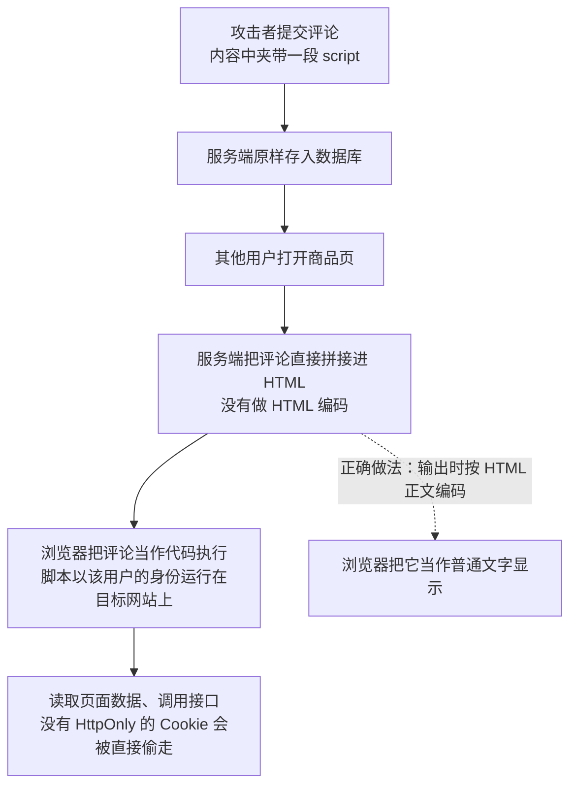

**追问链**

1. **在入口处把 `<script>` 过滤掉，能防住 XSS 吗？** 防不住。XSS 有大量不需要 `script` 标签的写法（事件属性、`javascript:` 地址、各种编码变形）；而且同一份数据可能输出到 HTML、JavaScript、URL 等不同的位置，入口处根本不知道它将来会输出到哪里。入口处的校验（类型、长度、格式）只是辅助，**核心是输出时按位置编码**。
2. **纯 JSON 接口会有 XSS 吗？** 接口本身不渲染页面，风险主要在前端如何使用数据。但如果接口的 `Content-Type` 没有设对，或者浏览器把响应当成 HTML 处理，攻击者直接打开接口地址就可能触发。要保证 JSON 接口返回 `application/json`，并加上 `X-Content-Type-Options: nosniff`（39-07）。
3. **用户上传的 HTML、SVG 文件为什么危险？** 它们在浏览器中打开时可以执行脚本。如果和业务在同一个域名下，就等于一次存储型 XSS。用户上传的文件应该用**单独的域名**提供，并设置下载头（见[《35 文件处理》](../07-工程实践与稳定性/35-文件处理.md)）。

---

### 39-03 CSRF 是怎么发生的？SameSite 和 CORS 能防住它吗？

> ★★★ ｜ 资深 ｜ 高频

**考察意图**：理解 CSRF 利用的是"浏览器会自动带上 Cookie"，并能分清几种防御手段的作用范围。

**30 秒版回答**

- **CSRF（跨站请求伪造）**：用户登录了目标网站后，又打开了攻击者的页面，这个页面悄悄向目标网站发起请求（例如自动提交一个转账表单）。**浏览器会自动带上目标网站的 Cookie**，目标网站误以为是用户本人的操作。
- **成立的条件**：
  - 网站用 Cookie 识别用户；
  - 请求中所有的参数都能被攻击者预先构造出来；
  - 服务端没有校验请求是否来自自己的页面。
- **防御手段**：
  1. **CSRF Token**：服务端生成一个攻击者拿不到的随机值，页面提交时必须带上，服务端校验。Spring Security **默认开启** CSRF 防护，对 POST、PUT、DELETE 等会修改数据的请求校验 Token；
  2. **SameSite Cookie**（MDN）：`Strict` 只在同站请求中发送；`Lax` 在跨站请求中，只有顶层导航并且是安全方法（如 GET）时才发送，**跨站的 POST 不会带上 Cookie**；`None` 表示总是发送，必须同时设置 `Secure`；
  3. **校验来源**：检查 `Origin` 或 `Referer` 请求头是否是自己的域名；
  4. **不用 Cookie 传递凭证**：令牌放在 `Authorization` 请求头中，浏览器不会自动添加，CSRF 就无从谈起（但令牌存放在哪里又带来了 XSS 的问题，见 39-09）。
- **修改数据的操作不能用 GET**：GET 请求可以通过一个图片标签触发，而且 `Lax` 也允许跨站的顶层 GET 导航带上 Cookie。

**深入剖析**

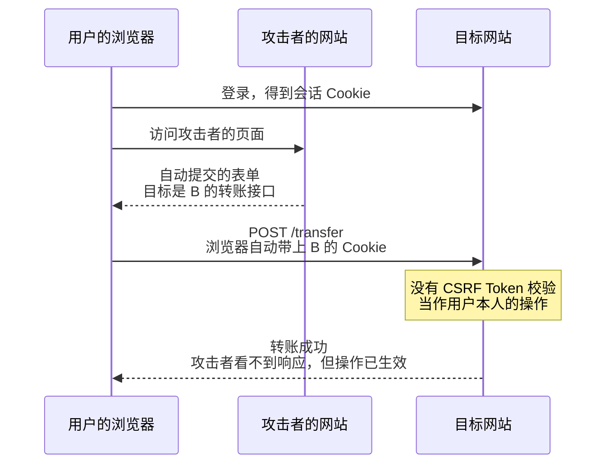

**为什么 SameSite 不能完全替代 CSRF Token？**

- MDN 说明，只有部分浏览器在没有设置 SameSite 时默认按 `Lax` 处理；而且这种默认的 `Lax` 是更宽松的版本：**Cookie 设置后两分钟内，跨站的 POST 请求仍然会带上它**；
- SameSite 按"站点"判断，同一个注册域名下的子域名属于同一个站点。如果某个子域名可以被攻击者控制（例如提供用户内容的子域名、被接管的子域名），SameSite 就防不住来自它的请求；
- 所以 SameSite 适合作为纵深防御，关键操作仍然要有 CSRF Token 或来源校验。

**为什么 CORS 防不住 CSRF？**

- CORS 控制的是**跨域的脚本能不能读取响应**，而不是请求能不能发出去。表单提交、表单类型的"简单请求"不会触发预检，请求照样发到服务端并执行，攻击者只是看不到响应而已。对 CSRF 来说，操作生效就够了（见[《37 计算机网络》](37-计算机网络.md)37-13）。

**追问链**

1. **前后端分离的项目，用 Cookie 维持会话，CSRF 怎么做？** 常见做法是服务端把 CSRF Token 放在一个 JavaScript 可以读取的 Cookie 中，前端读出来放进请求头，服务端比较两者（攻击者的页面读不到目标网站的 Cookie）。Spring Security 7.0 为这种场景提供了 `csrf.spa()` 配置。
2. **Cookie 还有哪些安全属性？** `HttpOnly`：JavaScript 读不到，减轻 XSS 的危害（但脚本发出的请求仍然会带上它）；`Secure`：只通过 HTTPS 发送；`__Host-` 前缀：要求设置 `Secure`、不能设置 `Domain`、`Path` 必须是 `/`，保证 Cookie 只发给设置它的那个主机，不会被子域名覆盖。

---

### 39-04 除了 SQL 注入，还有哪些注入？根本的防法是什么？

> ★★ ｜ 资深 ｜ 中频

**考察意图**：抓住注入的共同本质，而不是逐个背漏洞名称。SQL 注入的 MyBatis 细节见[《06 MyBatis》](../02-框架与容器/06-MyBatis.md)。

**30 秒版回答**

- **所有注入的本质都一样**：把不可信的数据拼接进了会被解释执行的"代码"中（SQL、Shell 命令、表达式、模板、查询语句），数据中的特殊字符改变了代码原本的结构。
- **根本的防法是把数据和代码分开**：使用参数化的接口，让数据只能作为值，永远不会被当作代码解析。做不到参数化的地方（例如排序字段、表名），用**白名单**把用户的输入映射到预先定义好的值。

| 类型 | 危险的写法 | 正确的写法 |
| --- | --- | --- |
| SQL 注入 | 拼接 SQL；MyBatis 的 `${}` | `PreparedStatement`、MyBatis 的 `#{}`；排序字段用白名单 |
| 命令注入 | `Runtime.exec("sh -c 'convert " + fileName + "'")` | `ProcessBuilder` 传入参数列表，**不经过 Shell**；参数前加 `--`，防止以 `-` 开头的输入被当成选项 |
| 表达式注入 | 用户输入交给 SpEL 的 `StandardEvaluationContext`、OGNL、MVEL 求值 | 不对用户输入求值；确实需要时使用 SpEL 的 `SimpleEvaluationContext`，只开放必要的能力 |
| 模板注入 | 允许用户编写 FreeMarker、Velocity 模板 | 用户只能提供数据，不能提供模板；必要时使用沙箱配置 |
| NoSQL 注入 | 把请求体直接绑定成 `Map` 作为 MongoDB 的查询条件，攻击者传入 `{"$ne": null}` | 绑定到明确类型的对象，再构造查询 |
| LDAP / XPath 注入 | 拼接过滤条件 | 使用框架提供的转义或参数化方法 |
| 日志注入 | 把带换行符的用户输入直接写进日志，伪造日志行 | 日志框架对换行符做转义，或使用结构化日志 |
| JNDI 查找 | 旧版 Log4j 2 会解析日志内容中的 `${jndi:...}` | 升级依赖，见[《32 日志与可观测性》](../07-工程实践与稳定性/32-日志与可观测性.md)中的 Log4Shell |

**追问链**

1. **为什么黑名单过滤（过滤 `'`、`;`、`select`）不可靠？** 攻击者可以用编码、大小写、注释、不同数据库的方言等方式绕过；黑名单也会误伤正常的输入（例如名字里本来就有单引号）。黑名单永远在追赶新的绕过方法，而参数化从机制上消除了问题。
2. **命令注入为什么强调"不经过 Shell"？** `sh -c` 会解释 `;`、`|`、`$()`、反引号等特殊字符，用户的输入就能拼出新的命令。`ProcessBuilder` 传入参数列表时，每个参数原样交给目标程序，不会再被 Shell 解释。

---

### 39-05 SSRF 是什么？为什么在云上特别危险？怎么防？

> ★★★ ｜ 资深 / 架构师 ｜ 高频

**考察意图**：理解 SSRF 的危害，知道"校验一下 URL"为什么经常被绕过，以及纵深防御怎么做。

**30 秒版回答**

- **SSRF（服务端请求伪造）**：服务端根据用户提供的地址发起请求，攻击者借服务端之手访问它本来访问不到的地方：内网服务、管理后台、云平台的元数据服务。OWASP Top 10 2025 把它并入了"访问控制失效"。
- **常见的入口**：按 URL 导入图片或文件、Webhook 回调地址、链接预览、HTML 转 PDF、XML 外部实体，甚至 JWT 头中的 `jku` / `x5u`（RFC 8725 提醒这两个地址可能导致 SSRF）。
- **在云上特别危险的原因**：云主机可以通过一个固定的链路本地地址 `169.254.169.254` 访问**元数据服务**，其中包括实例角色的**临时访问凭证**。如果元数据服务只要一个简单的 GET 请求就返回数据（AWS 的 IMDSv1），一次 SSRF 就能拿到云平台的凭证。
- **AWS IMDSv2 的防护**（AWS 文档）：
  - 必须先用 **PUT** 请求获取会话令牌，之后的 GET 请求要带上令牌，大多数只能发 GET 的 SSRF 就失效了；
  - 带有 `X-Forwarded-For` 头的 PUT 请求会被拒绝，挡住经过反向代理转发的请求；
  - PUT 响应的跳数限制默认是 1，令牌出不了这台主机（主机上运行的容器有时需要调大这个值）。

**深入剖析：为什么"校验一下 URL"经常被绕过**

本机 JDK 25 实测，`InetAddress.getByName` 对不同写法的解析结果：

| 写法 | JDK 25 的解析结果 | 说明 |
| --- | --- | --- |
| `2130706433` | `127.0.0.1` | 一个十进制整数也是合法的 IPv4 地址 |
| `127.1` | `127.0.0.1` | 省略写法 |
| `[::ffff:127.0.0.1]` | `127.0.0.1` | IPv4 映射的 IPv6 地址 |
| `0177.0.0.1` | `177.0.0.1` | **JDK 当作十进制**；而 C 库的 `inet_aton`（本机用 Python 验证）当作八进制，结果是 `127.0.0.1` |
| `0x7f.0.0.1` | 解析失败 | C 库的 `inet_aton` 能解析成 `127.0.0.1` |
| `http://trusted.example.com@127.0.0.1:8080/` | 主机是 `127.0.0.1` | `@` 前面只是用户信息，看起来像可信的域名 |

可见，**校验用的解析器和真正发请求的组件只要有一点不一致，校验就会被绕过**。此外还有两种常见的绕过：

- **重定向**：校验的是第一个地址，服务端跟随重定向访问了内网。本机实测：JDK 的 `HttpClient` 默认**不跟随**重定向（`NEVER`），而 `HttpURLConnection` 默认**跟随**（`getFollowRedirects()` 返回 `true`）；
- **DNS 重绑定**：校验时域名解析到公网地址，真正发请求时再解析一次，攻击者控制的 DNS 这次返回了内网地址。

**正确的做法**

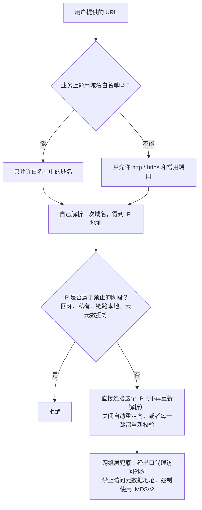

**追问链**

1. **用 `InetAddress` 的 `isSiteLocalAddress()` 等方法判断内网地址就够了吗？** 不够。本机 JDK 25 实测：IPv6 的唯一本地地址 `fd00::1`、运营商级 NAT 地址段中的 `100.64.0.1`，`isSiteLocalAddress()` 都返回 `false`（前者只认已经废弃的 `fec0::/10`）。要维护一份明确的禁止网段列表（IPv4 和 IPv6 都要有），再加上回环、链路本地、任意地址（`0.0.0.0`）等判断。
2. **校验通过了，为什么还要在网络层兜底？** 应用层的校验很容易有遗漏（新的入口、新的绕过写法）。让负责抓取外部资源的服务通过出口代理访问外网、在网络策略中禁止访问元数据地址和内网网段，即使应用层出了漏洞，影响也有限。
3. **出错时返回什么？** 不要把目标地址的响应内容或详细的错误信息返回给用户，否则攻击者可以借此探测内网的端口和服务。

---

### 39-06 越权漏洞是怎么产生的？怎么系统性地防范？

> ★★★ ｜ 资深 / 架构师 ｜ 高频

**考察意图**：越权是 OWASP Top 10 和 API 安全 Top 10 中排第一的风险，看候选人能不能从架构上解决，而不是逐个接口打补丁。

**30 秒版回答**

- **三类越权**：
  - **水平越权**：同样的角色，访问了别人的数据。例如把 `/orders/1001` 改成 `/orders/1002`，看到了别人的订单（API 安全 Top 10 中排第一的"对象级授权失效"）；
  - **垂直越权**：普通用户调用了管理员的接口。例如前端隐藏了按钮，但接口本身没有校验角色；
  - **属性级越权**：修改了不该修改的字段（提交 `{"role": "admin"}` 被直接绑定到实体上），或者接口返回了不该返回的字段（密码哈希、手机号）。
- **常见的根因**：只校验了"是否登录"，没有校验"这条数据是不是你的"；相信了请求中传来的 `userId`；以为"前端没有入口就安全"；导出、批量查询、搜索这类接口被遗漏。
- **系统性的防法**：
  1. **默认拒绝**：没有明确配置权限的接口一律不允许访问；
  2. **当前用户只从安全上下文中取**，永远不从请求参数中取；
  3. **每次按 ID 访问数据都校验归属**：查询条件中带上归属（`where id = ? and buyer_id = ?`），或者加载后由领域对象自己判断；
  4. **输入和输出都用专门的 DTO**：只绑定允许修改的字段，只返回允许返回的字段，不把实体直接暴露出去；
  5. **用自动化测试覆盖**：用户 A 去访问用户 B 的每一个资源，断言都被拒绝。

**深入剖析：一次请求要经过的几层检查**

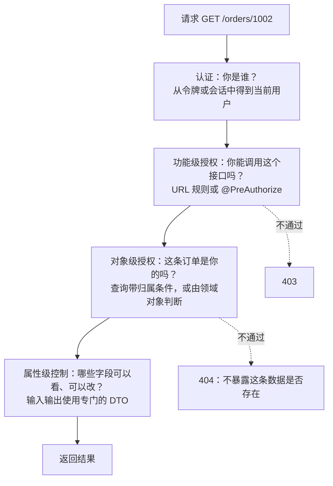

**把归属判断放进领域对象**（示意代码，未编译）：

```java
/**
 * 订单。是否属于某个买家由订单自己判断，应用层不需要了解判断的细节。
 */
public class Order {

    private final Long id;
    private final Long buyerId;

    // 构造方法、其他字段和行为省略

    /**
     * 校验订单是否属于指定的买家。不属于时按"订单不存在"处理，避免泄露别人的订单是否存在。
     */
    public void assertOwnedBy(Long userId) {
        if (!buyerId.equals(userId)) {
            throw new OrderNotFoundException(id);
        }
    }
}

@Service
@RequiredArgsConstructor
public class OrderQueryService {

    private final OrderRepository orderRepository;
    private final CurrentUser currentUser;

    /**
     * 查询订单详情。当前用户只从安全上下文中获取，不接受调用方传入。
     */
    public OrderDetailDTO getOrder(Long orderId) {
        Order order = orderRepository.findById(orderId)
                .orElseThrow(() -> new OrderNotFoundException(orderId));
        order.assertOwnedBy(currentUser.id());
        return OrderDetailDTO.from(order);
    }
}
```

**追问链**

1. **把自增 ID 换成 UUID，能解决水平越权吗？** 不能。UUID 只是让 ID 难以猜测，但 ID 可能通过分享链接、日志、其他接口的返回值泄露出去；越权的根因是没有校验归属，换 ID 只是增加了利用的难度。
2. **为什么对象级的越权常常返回 404 而不是 403？** 返回 403 等于告诉攻击者"这条数据存在，只是你没有权限"，可以被用来枚举数据。对普通用户来说，看不到别人的数据和数据不存在没有区别。
3. **数据权限能不能统一做，而不是在每个查询中手写？** 可以在数据访问层统一追加过滤条件（例如 MyBatis 拦截器按当前用户的数据范围改写 SQL），见 39-11。但要注意统一机制覆盖不到的地方：搜索引擎中的数据、缓存、导出文件、报表。

---

### 39-07 常见的安全响应头有哪些？分别防什么？

> ★★ ｜ 资深 ｜ 中频

**考察意图**：知道这些响应头的作用，以及 Spring Security 默认已经做了什么。

**30 秒版回答**

| 响应头 | 作用 | Spring Security 默认值 |
| --- | --- | --- |
| `Strict-Transport-Security`（HSTS） | 告诉浏览器在一段时间内只用 HTTPS 访问这个网站，防止被降级到 HTTP | `max-age=31536000 ; includeSubDomains`，**只在 HTTPS 响应中添加** |
| `X-Content-Type-Options: nosniff` | 禁止浏览器猜测内容类型，避免把文本或 JSON 当成脚本、HTML 执行 | 默认添加 |
| `X-Frame-Options` | 禁止页面被其他网站嵌入 iframe，防止点击劫持 | `DENY` |
| `Cache-Control` 等 | 禁止缓存，避免敏感页面被共享设备上的其他人看到 | `no-cache, no-store, max-age=0, must-revalidate`，以及 `Pragma`、`Expires` |
| `X-XSS-Protection` | 旧版浏览器的 XSS 过滤器开关 | **设为 `0`，即关闭** |
| `Content-Security-Policy`（CSP） | 限制页面可以加载、执行哪些来源的脚本和资源，是 XSS 的纵深防御 | **默认不添加**，需要应用自己配置 |
| `Referrer-Policy` | 控制跳转时 `Referer` 中带多少信息，避免 URL 中的敏感参数泄露给第三方 | 默认不添加，可以通过 `headers` 配置 |

**追问链**

1. **为什么 Spring Security 要把 `X-XSS-Protection` 设成 0？** 这个过滤器是旧版浏览器的功能，现代浏览器已经不再支持；而且它的拦截逻辑本身可以被攻击者利用。真正的 XSS 防护靠输出编码和 CSP（39-02）。
2. **CSP 怎么上线才不会把页面搞坏？** 先用 `Content-Security-Policy-Report-Only` 只上报、不拦截，收集一段时间的违规报告，调整策略后再正式启用。现代的做法是给每个页面生成随机的 nonce，只允许带有这个 nonce 的脚本执行，比维护一长串允许的域名更可靠。CSP 中的 `frame-ancestors` 可以替代 `X-Frame-Options`，控制得更细。
3. **只提供 JSON 的 API 服务，还需要这些头吗？** `nosniff`、`Cache-Control`、HSTS 仍然有意义；CSP、`X-Frame-Options` 对纯 JSON 响应作用不大，但加上也没有坏处。

---

### 39-19 DDoS 和 CC 攻击是什么？应用层面能做什么？

> ★★ ｜ 资深 / 架构师 ｜ 中频

**考察意图**：大流量攻击主要靠云厂商和运营商来挡，但面试官想知道你是否清楚各类攻击打的是哪一层、哪些必须交给基础设施、哪些是应用自己必须做好的。

**30 秒版回答**

- DDoS 是用大量来源同时发起请求，耗尽目标的某种资源，让正常用户无法访问。按消耗的资源分三类：

| 类型 | 消耗什么 | 典型手法 | 主要靠谁防 |
| --- | --- | --- | --- |
| 流量型 | 带宽 | UDP 洪水；利用开放的 DNS、NTP 等服务做反射放大 | 运营商和云厂商的流量清洗、高防 IP |
| 协议型 | 连接表、半连接队列 | SYN 洪水；建立连接后极慢地发送数据，长期占住连接 | 内核参数、四层负载均衡、高防 |
| 应用层（CC） | CPU、数据库、线程池 | 大量看起来正常的 HTTP 请求，专打开销大的接口 | WAF、网关限流、**应用自身的设计** |

- 防护是分层的：**流量清洗 → CDN / WAF → 网关限流 → 应用自保**。越靠外层挡掉得越多，成本越低。
- 应用层面能做、也必须做的四件事：
  1. **隐藏源站**：源站只接受来自 CDN 或高防回源地址段的请求；
  2. **找出并保护开销大的接口**：登录、短信验证码、搜索、导出、报表；
  3. **多维度限流**：按 IP、账号、设备、接口分别限制，而不是只有一个全局阈值；
  4. **准备好降级预案**：被攻击时主动关掉非核心功能，保住核心链路。

**深入剖析**

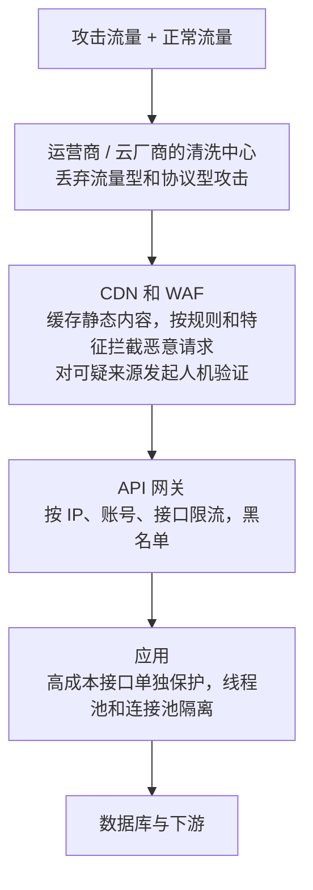

**CC 攻击为什么难防**：每一个请求单独看都是合法的，区别只在于数量和意图。攻击者追求的是**成本不对称**：他发一个请求的成本接近于零，而服务端处理这个请求要查好几次数据库。所以防护的核心思路是把成本的天平扳回来：

- **让请求在更外层、更便宜的地方被处理掉**：能缓存的页面和接口放到 CDN；未登录用户的列表页、详情页尽量静态化；
- **提高攻击者的单次成本**：对可疑来源要求完成人机验证；高成本操作要求先登录；
- **降低自己的单次成本**：高成本接口加缓存、加分页上限、加查询条件的限制（不允许无条件的模糊搜索）。

**高成本接口清单**。排查自己的系统时，重点看这几类：

| 接口 | 为什么成本高 | 保护手段 |
| --- | --- | --- |
| 登录 | 密码哈希故意设计得很慢，见 39-08 | 按账号和 IP 限制失败次数，失败多次后要求验证码 |
| 发送短信、邮件 | 每条都要花钱，还会骚扰他人 | 图形验证码前置；同一号码、同一 IP、同一设备分别限频；总量熔断 |
| 搜索、列表 | 深分页、模糊匹配、多条件组合 | 限制页码深度和每页条数，禁止空条件查询，结果缓存 |
| 导出、报表 | 大量读取和计算 | 改成异步任务，限制每个用户的并发数 |
| 文件上传 | 占带宽和磁盘 | 限制大小和频率，直传对象存储，见[《35 文件处理》](../07-工程实践与稳定性/35-文件处理.md) |

**追问链**

1. **SYN 洪水是怎么回事？**
   攻击者发送大量 SYN 却不完成握手，把服务端的半连接队列占满，正常的连接请求进不来。Linux 的应对是 SYN Cookie：不为半连接保存状态，而是把必要的信息编码进返回的序号里，等客户端真正发回 ACK 时再校验并建立连接。详见[《37 计算机网络》](37-计算机网络.md)37-01。
2. **限流按 IP 做就够了吗？**
   不够。一方面，攻击流量来自大量被控制的设备，每个 IP 的请求量都不高；另一方面，大量正常用户可能共用一个出口 IP（公司、学校、运营商的 NAT），按 IP 限得太严会误伤。实际做法是多个维度叠加：IP、账号、设备指纹、接口，再加上全局的总量保护。限流算法见[《26 高可用》](../06-三高与架构/26-高可用.md)26-03。
3. **靠自动扩容能扛住攻击吗？**
   不能作为主要手段。扩容解决的是"正常流量的增长"；面对攻击，扩容等于攻击者花很少的钱就让你付出很高的资源费用，而且数据库等有状态的组件没法快速扩容。自动扩容要设上限，并且配合限流使用。
4. **有没有"自己打自己"的情况？**
   有，而且比外部攻击更常见：客户端不带退避的自动重试、App 新版本的 bug 导致循环请求、缓存集中失效后所有请求同时回源、定时任务在整点同时触发。它们的表现和 CC 攻击完全一样。所以限流、熔断、重试退避这些自我保护机制，不管有没有外部攻击都必须具备，见[《26 高可用》](../06-三高与架构/26-高可用.md)26-07。

**生产实践 / 踩坑**

- **源站地址泄露**：接入了高防，但源站仍然可以被公网直接访问，攻击者通过历史 DNS 记录或其他子域名找到真实地址后绕过防护。接入高防或 CDN 之后，要更换源站地址，并在安全组上只放行回源地址段。
- **短信接口被刷**：攻击者用你的注册页面给大量手机号发验证码，既产生费用，又让你的短信通道被运营商投诉。发送短信前必须有人机验证，并对单个号码的每日次数、全站的每分钟总量设置上限。
- **限流之后直接返回 500 或者让请求排队**：被限流的请求应该立即返回 429，并且处理路径要尽量短，不能再去查数据库或写大量日志，否则限流本身就成了新的瓶颈。
- **没有演练过降级开关**：真正被攻击时才发现开关不生效，或者没人知道该关哪些功能。降级预案要写成清单并定期演练，见[《26 高可用》](../06-三高与架构/26-高可用.md)26-05。

---

## 二、认证与授权

### 39-08 用户的密码应该怎么存储？

> ★★★ ｜ 资深 ｜ 高频

**考察意图**：理解为什么要用"慢"的哈希算法，以及怎样平滑地升级算法。

**30 秒版回答**

- **不能明文存储，也不能可逆加密**：数据库一旦泄露，所有密码直接暴露。
- **不能用快速哈希**（MD5、SHA-1，甚至加了盐的 SHA-256）：这些算法本来就是为了快而设计的，攻击者拿到哈希后可以用 GPU 每秒尝试海量的候选密码。
- **要用专门的密码哈希算法**：自带随机盐（相同的密码每次得到不同的结果），并且**故意设计得很慢**，计算成本可以调整。OWASP 密码存储速查表的建议：

| 算法 | OWASP 建议的最低参数 |
| --- | --- |
| **Argon2id**（首选） | 内存 19 MiB、迭代 2 次、并行度 1 |
| scrypt | CPU / 内存成本 2^17、块大小 8、并行度 1 |
| bcrypt | 成本因子至少 10，**输入最多 72 字节** |
| PBKDF2（需要符合 FIPS 时使用） | PBKDF2-HMAC-SHA256 迭代 600,000 次；HMAC-SHA512 迭代 220,000 次 |

**深入剖析：Spring Security 7.0.4 的实测**

```text
createDelegatingPasswordEncoder() 两次对 "Passw0rd!" 编码：
{bcrypt}$2a$10$pXsHDBj5JGYS8WebwOH3AOXyxCnZ22etOwImOjnfcDmdeb7YUnpYK
{bcrypt}$2a$10$JCrP/Z/SokPRw0bxEeTE0.BlUQsGo708paT1dysrplkH2rdCXGWTa
两次结果不同（盐是随机的，保存在结果中），matches() 都返回 true
```

| 实验 | 结果 |
| --- | --- |
| 默认算法 | bcrypt，成本因子 10（`$2a$10$`），结果前面带上 `{bcrypt}` 标识 |
| 本机单次编码耗时 | 成本 10 约 74 毫秒；成本 12 约 301 毫秒（成本每加 1，耗时翻倍） |
| 编码 73 字节的密码 | `IllegalArgumentException: password cannot be more than 72 bytes` |
| 校验一个没有 `{id}` 前缀的哈希 | 抛出异常，提示每个密码都必须带有编码前缀，或者配置一个默认的编码器 |

- **`{id}` 前缀让算法可以平滑升级**：新密码用新算法，旧密码仍然按旧算法校验；用户登录成功时（此时拿到了明文密码），检查哈希是否需要升级（`upgradeEncoding`），需要的话用新算法重新计算并保存。
- Spring Security 7.0 新增了基于 Password4j 的一组编码器，包括 Argon2、bcrypt、scrypt、PBKDF2 等。

**追问链**

1. **bcrypt 这么慢，会不会被人用来攻击登录接口？** 会。每次校验密码都要消耗几十到几百毫秒的 CPU，大量的登录请求可以把服务器拖垮。所以登录接口必须有限流、失败次数限制（按账号和按 IP），必要时加验证码。成本因子的选择，OWASP 的说法是"在校验服务器的性能允许的范围内尽量大，最小为 10"。
2. **盐和胡椒（pepper）有什么区别？** 盐是每个密码随机生成的，和哈希一起保存，作用是让相同的密码得到不同的结果，使预先计算的彩虹表失效。胡椒是所有密码共用的一个密钥，**不和数据库保存在一起**（放在密钥管理服务中），数据库单独泄露时攻击者无法离线破解。OWASP 认为它可以作为纵深防御，但单独使用并不能带来额外的安全性。
3. **除了存储，登录环节还要注意什么？**
   - 登录失败的提示不要区分"用户不存在"和"密码错误"，避免被用来探测哪些账号存在；
   - 支持多因素认证（Spring Security 7.0 增加了多因素认证的支持）；
   - 检查用户设置的密码是否出现在已泄露的密码库中。

---

### 39-09 Session 和 JWT 怎么选？JWT 有哪些安全上的坑？

> ★★★ ｜ 资深 ｜ 高频

**考察意图**：不迷信"无状态"，知道 JWT 的代价和正确的校验方法。微服务中的令牌传递见[《11 微服务》](../03-分布式与微服务/11-微服务.md)11-10。

**30 秒版回答**

| | 服务端 Session | JWT |
| --- | --- | --- |
| 状态保存在哪里 | 服务端（集群时放在 Redis 等共享存储中） | 令牌自身包含用户信息和签名，服务端只需要验签 |
| 撤销 | 删除 Session 即可，**立即生效** | 签发后在有效期内一直有效，**难以撤销** |
| 每次请求的开销 | 查一次共享存储 | 验签（本地计算） |
| 适合的场景 | 浏览器访问的 Web 应用 | 服务之间传递身份、多个资源服务器共同信任一个签发方 |

- **JWT 的结构**：`头部.载荷.签名`，前两部分只是 Base64URL 编码，**任何人都能解码**。本机实测，签发的令牌第二段解码后就是 `{"exp":...,"sub":"u1001","role":"user"}`。所以载荷中不能放敏感信息。

**深入剖析：JWT 的校验要做全**（RFC 8725）

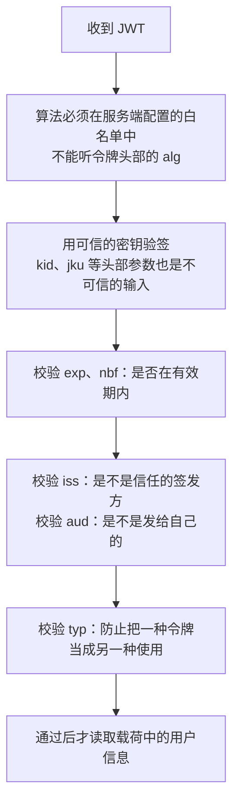

**本机实测**（Nimbus JOSE + JWT 9.37.4）：

| 实验 | 结果 |
| --- | --- |
| 攻击者把头部改成 `{"alg":"none"}`、把 `role` 改成 `admin`、去掉签名 | `JWTParser.parse` 能解析成 `PlainJWT`，读出 `role=admin`，**但这只是解析，没有验签**；`SignedJWT.parse` 直接拒绝：`Invalid JWS header: Not a JWS header` |
| 用 `"my-secret"` 作为 HS256 的密钥 | `KeyLengthException: The secret length must be at least 256 bits` |

- 第一个实验说明：**"能解析"不等于"可信"**。如果代码先解析、读出用户信息、忘了验签（或者按令牌声明的算法验签），攻击者就可以伪造任意身份。
- 第二个实验对应 RFC 8725 的要求：人能记住的密码**不能**直接用作 HS256 这类算法的密钥，密钥要有足够的随机性（HS256 至少 256 位）。

**追问链**

1. **什么是算法混淆攻击？** 服务端本来用 RS256（私钥签名、公钥验签），但验签代码按令牌头部的 `alg` 选择算法。攻击者把 `alg` 改成 HS256，用**公开的公钥**作为 HMAC 密钥签名，存在漏洞的实现就会用同一个公钥按 HMAC 验签并通过。防法就是 RFC 8725 的第一条：服务端指定允许的算法，不接受令牌自己声明的算法。
2. **浏览器端的令牌放在哪里？** 放在 `localStorage` 中，任何一次 XSS 都能把它读走；放在 `HttpOnly` 的 Cookie 中，脚本读不到，但又要处理 CSRF（39-03）。浏览器应用比较稳妥的做法是 **BFF（为前端服务的后端）**：令牌只保存在服务端，浏览器和 BFF 之间用 `HttpOnly`、`Secure`、`SameSite` 的会话 Cookie。
3. **JWT 被盗了怎么办？** 有效期要短（例如 15 分钟），配合刷新令牌；刷新令牌每次使用后更换（轮换），发现旧的刷新令牌被再次使用时，判定为泄露，撤销整个令牌链；必要时维护一份撤销名单（见[《11 微服务》](../03-分布式与微服务/11-微服务.md)11-10）。

---

### 39-10 OAuth 2.0 的授权码模式是怎么工作的？PKCE 和 OIDC 解决了什么问题？

> ★★★ ｜ 资深 / 架构师 ｜ 高频

**考察意图**：能完整画出授权码流程，知道 RFC 9700 对各种授权模式的最新要求，分清"授权"和"认证"。

**30 秒版回答**

- **OAuth 2.0 解决的是授权问题**：用户允许第三方应用（客户端）在一定范围内访问自己在资源服务器上的数据，而**不需要把密码交给第三方应用**。
- **四个角色**：资源所有者（用户）、客户端（第三方应用）、授权服务器（签发令牌）、资源服务器（提供 API）。
- **授权码模式 + PKCE**（RFC 6749、RFC 7636）：
  1. 客户端生成一个随机的 `code_verifier`，计算 `code_challenge = BASE64URL(SHA256(code_verifier))`；
  2. 浏览器被重定向到授权服务器，带上 `code_challenge`；用户登录并同意授权；
  3. 授权服务器把浏览器重定向回客户端，带上一次性的**授权码**；
  4. 客户端用授权码 **加上 `code_verifier`** 去换令牌，授权服务器验证两者是否匹配；
  5. 客户端拿到访问令牌，调用资源服务器。
- **PKCE 的作用**：授权码在浏览器的重定向中传递，可能被截获或注入。没有 `code_verifier`，拿到授权码也换不到令牌。
- **RFC 9700（OAuth 2.0 安全最佳实践，2025 年 1 月）的要求**：
  - 客户端**不应该**再使用隐式模式（response type `token`）；
  - 资源所有者密码模式**不得**使用（Spring Security 7.0 已经删除了对密码模式的支持）；
  - 公开客户端（没有能力保密的客户端，如单页应用、手机 App）**必须**使用 PKCE，授权服务器**必须**支持 PKCE；
  - 授权服务器**必须**对回调地址做精确的字符串匹配；
  - 公开客户端的刷新令牌必须与发送方绑定，或者每次使用后轮换。

**深入剖析**

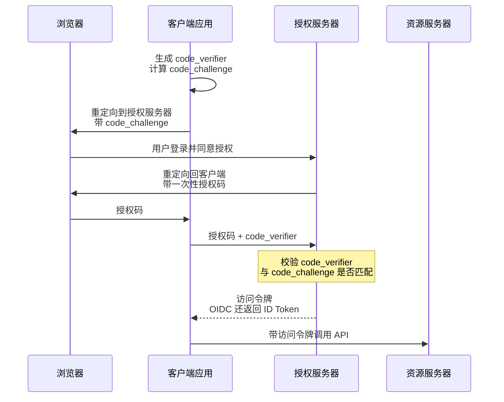

**OIDC 多了什么？**

- OAuth 2.0 只回答"客户端能访问什么"，**没有标准地回答"用户是谁"**。很多系统直接用访问令牌当作登录凭证，这是误用：访问令牌是给资源服务器看的，客户端不应该解析它来确定用户身份。
- OIDC（OpenID Connect）在 OAuth 2.0 之上增加了身份层：授权服务器额外返回一个 **ID Token**（JWT 格式），明确告诉客户端是哪个用户、在什么时间、以什么方式登录的。"用企业账号登录"这类单点登录场景用的就是 OIDC。

**追问链**

1. **服务之间调用用哪种模式？** 没有用户参与时，用**客户端凭证模式**：服务用自己的身份（客户端 ID 和密钥，或者证书）向授权服务器申请令牌。更好的做法是用 mTLS 或私钥签名的断言代替共享的客户端密钥。
2. **`state` 参数是做什么的？** 把发起授权请求的浏览器会话和回调绑定起来，防止攻击者把自己的授权码塞给受害者（登录 CSRF）。使用 PKCE 时也能起到类似的作用，但很多实现仍然同时使用两者。
3. **自己搭建授权服务器用什么？** Spring Security 7.0 把 Spring Authorization Server 合并了进来，并且默认启用 PKCE；也可以使用 Keycloak 这类独立的产品。

---

### 39-11 RBAC 和 ABAC 怎么选？数据权限怎么设计？

> ★★ ｜ 架构师 ｜ 中频

**考察意图**：权限模型的选型，以及最容易出问题的数据权限怎么落地。

**30 秒版回答**

| 模型 | 思路 | 优点 | 问题 |
| --- | --- | --- | --- |
| **RBAC**（基于角色） | 用户 → 角色 → 权限 | 简单直观，容易审计"谁有什么权限" | 条件一多，角色数量就会爆炸（"华东区的财务经理""只读的华东区财务经理"……） |
| **ABAC**（基于属性） | 根据用户、资源、操作、环境的属性计算是否允许，例如"用户的部门等于单据的部门，并且在工作时间" | 灵活，能表达复杂的条件 | 规则分散时难以审计，需要策略引擎（如 OPA、Cedar） |
| **ReBAC**（基于关系） | 根据用户和资源之间的关系判断，例如"文档的所有者、所在文件夹的编辑者" | 适合协作和分享类的产品 | 需要专门的关系存储和查询（如 OpenFGA、SpiceDB） |

- **实践中常见的组合**：**功能权限用 RBAC**（能不能进入某个菜单、调用某个接口），**数据权限用属性条件**（能看哪些数据：本人、本部门、本部门及下级、全部）。

**深入剖析：数据权限的落地**

- **统一在数据访问层追加条件**：根据当前用户的数据范围，在查询中自动加上 `dept_id in (...)` 之类的条件，例如通过 MyBatis 拦截器改写 SQL（见[《06 MyBatis》](../02-框架与容器/06-MyBatis.md)），避免每个开发者在每个查询里手写；
- **覆盖统一机制管不到的地方**：
  - 搜索引擎（Elasticsearch）中的数据，查询时也要带上权限条件；
  - 缓存：按用户或按数据范围区分缓存的 key，不能把 A 能看到的结果缓存后返回给 B；
  - 导出文件、报表、异步任务：执行时用的是发起人的权限，而不是系统账号的权限；
- **字段级**：同一条数据，不同的角色看到的字段不同（例如客服只能看到脱敏后的手机号），在组装返回值时处理；
- **权限变更要及时生效**：用户调岗后，缓存中的权限和数据范围要失效。

**追问链**

1. **权限校验放在网关还是业务服务？** 网关适合做粗粒度的检查（是否登录、能否访问某个服务或路径）；**对象级和数据级的权限只能在业务服务中做**，因为只有业务服务知道"这条订单属于谁"。两者是互补的，不能只依赖网关。
2. **怎么证明权限系统是对的？** 权限的配置和变更要有审计日志；定期复核高权限账号；关键接口有"用 A 的身份访问 B 的数据"的自动化测试（39-06）。

---

### 39-12 Spring Security 是怎么处理一个请求的？7.0 有哪些变化？

> ★★ ｜ 资深 ｜ 中频

**考察意图**：了解过滤器链的结构，出问题时知道从哪里查。

**30 秒版回答**（Spring Security 架构文档）

- **`DelegatingFilterProxy`**：注册到 Servlet 容器中的普通过滤器，把工作委托给 Spring 容器中的 Bean，连接了 Servlet 容器的生命周期和 Spring 的 `ApplicationContext`；
- **`FilterChainProxy`**：Spring Security 的入口，根据请求选择一条 `SecurityFilterChain`。可以配置多条链，**只有第一条匹配的链会被执行**；
- **一条链中的过滤器按固定的顺序执行**：先是 `CsrfFilter`，然后是各种认证过滤器（表单登录、HTTP Basic、Bearer Token 等），之后是 `ExceptionTranslationFilter`，最后由 `AuthorizationFilter` 做授权；
- **`ExceptionTranslationFilter`** 把后面抛出的异常转换成 HTTP 响应：未认证或 `AuthenticationException` 时开始认证流程（跳转登录页或返回 401）；`AccessDeniedException` 时交给 `AccessDeniedHandler`（通常返回 403）；
- **认证的核心**：认证过滤器把凭证交给 `AuthenticationManager`（通常是 `ProviderManager`），由它依次询问各个 `AuthenticationProvider`；成功后把结果放入 `SecurityContextHolder`，默认保存在 `ThreadLocal` 中。

**深入剖析**

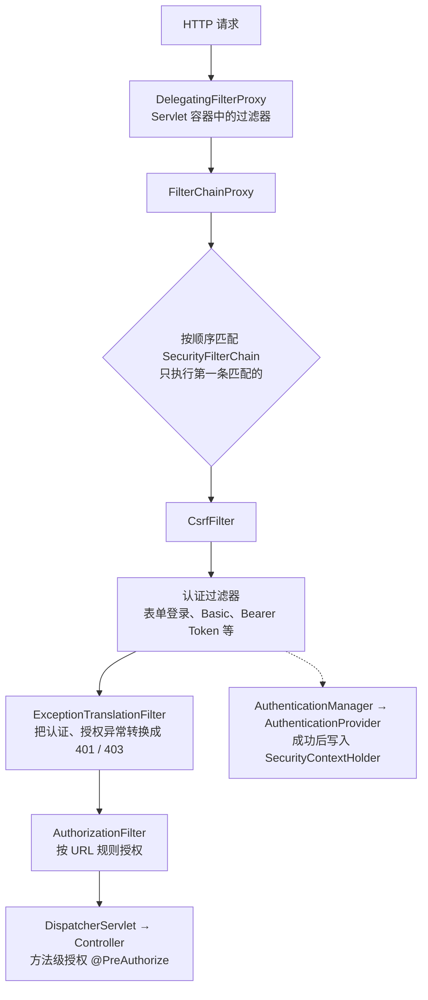

**Spring Security 7.0 的主要变化**（What's New in 7.0）：

| 类别 | 变化 |
| --- | --- |
| 删除的 API | `HttpSecurity` 中的 `and()`，统一使用 Lambda 风格的配置；`authorizeRequests` 改用 `authorizeHttpRequests`；`AntPathRequestMatcher`、`MvcRequestMatcher` 改用 `PathPatternRequestMatcher`；OAuth 2.0 的密码模式 |
| 模块调整 | Spring Authorization Server、Kerberos 扩展并入 Spring Security；`AccessDecisionManager` 等旧的访问控制 API 移到单独的 `spring-security-access` 模块 |
| 新功能 | 多因素认证；单页应用的 CSRF 配置 `csrf.spa()`；基于 Password4j 的密码编码器；授权服务器默认启用 PKCE |

**一个 API 服务的配置示例**（示意代码，未编译）：

```java
@Configuration
@EnableWebSecurity
@EnableMethodSecurity
public class ApiSecurityConfig {

    /**
     * API 使用 Bearer Token 认证，不依赖 Cookie，所以关闭 CSRF 防护和服务端会话。
     */
    @Bean
    SecurityFilterChain apiFilterChain(HttpSecurity http) throws Exception {
        http
            .securityMatcher("/api/**")
            .authorizeHttpRequests(auth -> auth
                .requestMatchers("/api/public/**").permitAll()
                .requestMatchers("/api/admin/**").hasRole("ADMIN")
                .anyRequest().authenticated())
            .oauth2ResourceServer(oauth2 -> oauth2.jwt(Customizer.withDefaults()))
            .sessionManagement(session -> session.sessionCreationPolicy(SessionCreationPolicy.STATELESS))
            .csrf(csrf -> csrf.disable());
        return http.build();
    }
}
```

**追问链**

1. **在异步线程或虚拟线程中，为什么拿不到当前用户？** `SecurityContextHolder` 默认把认证信息保存在 `ThreadLocal` 中，换了线程就没有了。可以用 Spring Security 提供的 `DelegatingSecurityContextExecutor` 等包装类传递上下文，或者在提交任务时显式地把需要的用户信息作为参数传进去（`ThreadLocal` 的传递问题见[《03 Java 并发》](../01-Java核心/03-Java并发.md)03-19）。
2. **为什么关闭 CSRF 防护在这个例子中是合理的？** CSRF 依赖浏览器自动携带 Cookie。这个 API 只接受 `Authorization` 头中的令牌，浏览器不会自动添加，所以不存在 CSRF 的问题（39-03）。如果同一个应用还有基于 Cookie 会话的页面，要为它们单独配置一条开启 CSRF 防护的过滤器链。
3. **401 和 403 怎么区分？** 401 表示"不知道你是谁"（没有登录或令牌无效），客户端应该重新认证；403 表示"知道你是谁，但你没有权限"，重新认证也没有用。

---

### 39-20 单点登录（SSO）是怎么实现的？单点登出怎么做？

> ★★★ ｜ 资深 / 架构师 ｜ 高频

**考察意图**：公司内部有多个系统时几乎一定会遇到。面试官想看你是否理解"跨域名时登录状态是怎么传递的"，而不是只会说"用 OAuth"。

**30 秒版回答**

- 目标：用户在一个地方登录一次，访问其他系统时不用再输密码。
- 核心是**两级会话**：
  - **全局会话**：由统一的认证中心持有，用认证中心自己域名下的 Cookie 标识；
  - **局部会话**：每个业务系统各自持有，用各自域名下的 Cookie 标识。
- 跨域名时，Cookie 不能共享，登录状态靠**浏览器重定向**加**一次性票据**传递：
  1. 用户访问系统 A，A 发现没有局部会话，重定向到认证中心；
  2. 认证中心发现没有全局会话，展示登录页；登录成功后建立全局会话；
  3. 认证中心签发一个**一次性的短时效票据**，带着它重定向回 A；
  4. A 的**后端**拿票据向认证中心换取用户身份，然后建立自己的局部会话；
  5. 用户再访问系统 B：B 同样重定向到认证中心，这次认证中心已有全局会话，**直接签发票据跳回**，用户感知不到。
- 协议选择：新系统用 **OIDC**（OAuth 2.0 授权码模式加身份层，见 39-10）；老的 Java 系统里常见 CAS；和企业身份系统对接时会遇到 SAML。它们的流程骨架都是上面这五步。
- 所有系统都在同一个父域名下时（`a.example.com`、`b.example.com`），可以用更简单的做法：把会话 Cookie 的作用域设为父域，各系统共享同一份会话存储。

**深入剖析**

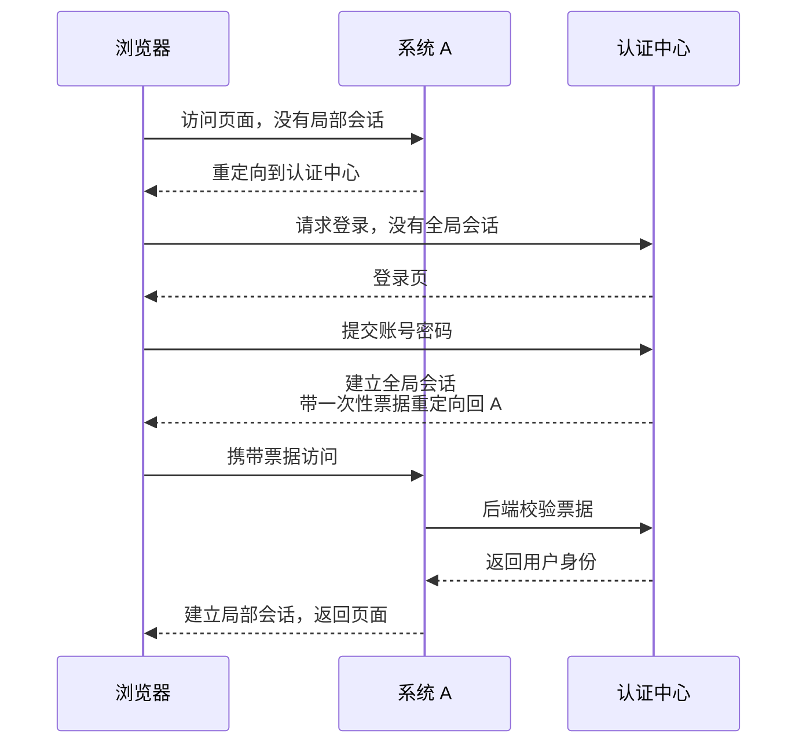

**为什么票据要由后端去换，而不是直接把用户信息放在重定向的 URL 里**：URL 会出现在浏览器历史、访问日志、Referer 头里，任何能看到它的人都可以冒用。票据只是一个随机串，一次有效、几十秒过期，而且换取身份时业务系统要向认证中心证明自己的身份，被截获了也用不了。

**单点登出**比登录难，因为认证中心要通知所有已经建立了局部会话的系统：

| 方式 | 做法 | 问题 |
| --- | --- | --- |
| 前端通道 | 登出页用隐藏的 iframe 或者连续重定向，依次访问每个系统的登出地址，由浏览器带上各自的 Cookie | 依赖浏览器；用户中途关掉页面就登不干净；浏览器对第三方 Cookie 的限制会让 iframe 方式失效 |
| 后端通道 | 认证中心在服务端逐个调用各系统的登出接口，告知哪个全局会话结束了 | 各系统要维护"全局会话标识 → 局部会话"的映射，局部会话必须是服务端可以删除的 |

后端通道更可靠，但有一个前提：**局部会话是有状态的**。如果业务系统用的是自包含的 JWT，签发出去就收不回来，只能靠缩短有效期，或者额外维护一份吊销列表，见 39-09。

**追问链**

1. **SSO 和 OAuth 2.0 是一回事吗？**
   不是。OAuth 2.0 解决的是**授权**：让第三方应用在用户同意的前提下访问用户在另一个系统里的资源。SSO 解决的是**认证**：确认当前用户是谁。OIDC 在 OAuth 2.0 的流程上增加了 ID Token，专门用来表达"是谁、什么时候、以什么方式登录的"，所以现在通常用 OIDC 来实现 SSO。
2. **这套流程有哪些必须做的安全措施？**
   - **重定向地址白名单**：认证中心只能把票据送回事先登记过的地址，并且要做精确匹配。否则攻击者构造一个登录链接，把票据送到自己的服务器；
   - **`state` 参数**：业务系统发起登录时生成一个随机值并和当前浏览器会话绑定，回调时校验，防止别人把自己的票据塞进受害者的浏览器；
   - 票据一次性、短时效、和发起登录的系统绑定；
   - 全程 HTTPS，Cookie 设置 `HttpOnly`、`Secure`、合适的 `SameSite`。
3. **`SameSite` 会不会让 SSO 的重定向带不上 Cookie？**
   默认的 `Lax` 不会。`Lax` 允许"顶级页面跳转的 GET 请求"携带 Cookie，SSO 的重定向正属于这种情况。受影响的是在 iframe 里或者通过后台请求访问认证中心的做法（比如静默续期），这时认证中心的 Cookie 属于第三方 Cookie，会被 `Lax` 拦住，也会被浏览器逐步收紧的第三方 Cookie 策略拦住。
4. **移动 App 怎么接入 SSO？**
   App 不应该自己画登录框收集密码再转交。标准做法是拉起系统浏览器（或系统提供的安全浏览器组件）打开认证中心的页面，登录后通过应用链接跳回 App，用授权码加 PKCE 换取令牌。这样同一台设备上的多个 App 可以共享系统浏览器里的全局会话。
5. **认证中心挂了会怎样？**
   已经建立了局部会话的用户不受影响，因为业务系统校验的是自己的会话；新的登录和会话过期后的重新登录都会失败。认证中心是全公司的单点，要按最高等级做高可用，同时局部会话的有效期不要设得太短，给认证中心的故障留出缓冲。

**生产实践 / 踩坑**

- **局部会话比全局会话活得长**：用户在认证中心已经登出或者账号已被禁用，但某个系统的局部会话还有几天才过期，仍然可以继续操作。离职、禁用这类场景必须有后端通道的登出，或者让局部会话定期向认证中心确认状态。
- **重定向地址用前缀匹配或通配符**：`https://app.example.com` 被 `https://app.example.com.evil.com` 绕过。登记的地址要完整、精确匹配。
- **每个系统各自实现一遍对接逻辑**：校验细节不一致，总有一个系统漏掉 `state` 或者没校验票据的归属。把对接逻辑收敛成统一的 SDK 或者放在网关上完成。

---

### 39-21 扫码登录是怎么实现的？有哪些安全风险？

> ★★ ｜ 资深 ｜ 中频

**考察意图**：这是一道把状态机、轮询方式和安全设计结合在一起的小型设计题。面试官关注两点：流程里每一步谁在证明谁的身份，以及"攻击者把自己的二维码发给别人扫"这种情况怎么防。

**30 秒版回答**

- 参与方有三个：**PC 浏览器**（未登录，想登录）、**手机 App**（已登录，有用户凭证）、**服务端**。本质是让已登录的手机替 PC 做一次授权。
- 流程：
  1. PC 请求服务端生成一个二维码标识，服务端创建一条状态为"待扫描"的记录，设置一两分钟的有效期；
  2. PC 把这个标识画成二维码，然后开始**轮询**它的状态；
  3. 手机扫码，带着**自己的登录凭证**和二维码标识请求服务端，状态变成"已扫描"，PC 上显示"请在手机上确认"；
  4. 手机上展示确认页，用户点击确认，状态变成"已确认"；
  5. PC 轮询到"已确认"，服务端**为 PC 签发一个新的登录凭证**，PC 完成登录。
- 三条安全底线：
  - 二维码标识是**足够长的随机数**，**一次有效**，**很快过期**；
  - 手机的凭证**绝不传给 PC**，PC 拿到的是单独签发的新凭证；
  - 最终的登录凭证**只能发给生成这个二维码的那个浏览器**，不能是"谁拿着二维码标识来问就给谁"。

**深入剖析**

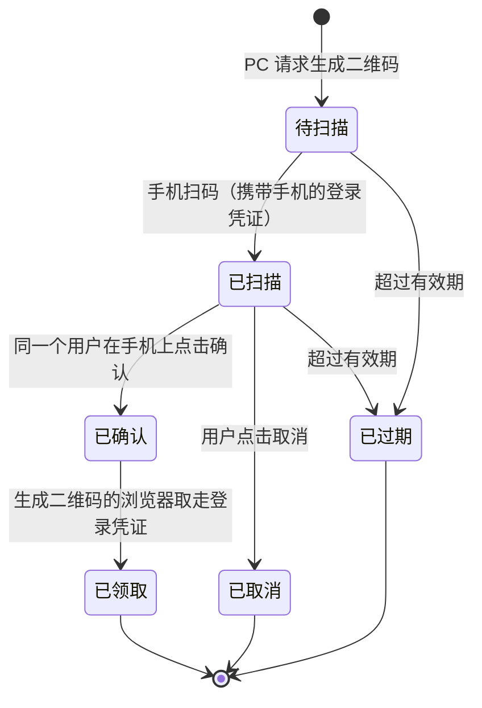

状态流转要满足两个要求：**只能从合法的前置状态流转**，以及**并发时只成功一次**。下面是一个用 CAS 实现的最小版本（本机 JDK 25 运行过）。生产中状态一般放在 Redis 里并设置过期时间，流转用 Lua 脚本保证原子性，思路相同：

```java
/** pcSecret 只返回给生成二维码的那个浏览器，取登录凭证时必须带上 */
record Ticket(Status status, String pcSecret, String userId, long expireAt) {
    Ticket with(Status next, String uid) { return new Ticket(next, pcSecret, uid, expireAt); }
}

/** 状态流转：只有当前状态等于 expected 且未过期时才成功 */
private boolean transit(String qrId, Status expected, Status next, String userId, long now) {
    AtomicReference<Ticket> ref = store.get(qrId);
    if (ref == null) { return false; }
    Ticket cur = ref.get();
    if (cur.status() != expected || now > cur.expireAt()) { return false; }
    return ref.compareAndSet(cur, cur.with(next, userId == null ? cur.userId() : userId));
}

/** 手机端：确认。必须和扫码的是同一个用户 */
boolean confirm(String qrId, String userId, long now) {
    AtomicReference<Ticket> ref = store.get(qrId);
    if (ref == null || !userId.equals(ref.get().userId())) { return false; }
    return transit(qrId, Status.SCANNED, Status.CONFIRMED, null, now);
}

/** PC 端：轮询并领取登录结果。只有带着正确 pcSecret 的浏览器能领，且只能领一次 */
String consume(String qrId, String pcSecret, long now) {
    AtomicReference<Ticket> ref = store.get(qrId);
    if (ref == null || !ref.get().pcSecret().equals(pcSecret)) { return null; }
    String userId = ref.get().userId();
    return transit(qrId, Status.CONFIRMED, Status.CONSUMED, null, now) ? userId : null;
}
```

```text
qrId 长度=32（192 位随机数）
还没扫码就确认          -> false
u1001 扫码               -> true
另一个用户 u2002 再扫    -> false
u2002 替 u1001 确认      -> false
确认前 PC 来领取         -> null
u1001 确认               -> true
别的浏览器拿 qrId 来领取 -> null
生成二维码的浏览器领取   -> u1001
重复领取                 -> null
过期后扫码               -> false
```

注意第 8 行：二维码是公开展示的，任何看到它的人都能得到二维码标识。如果领取登录凭证只凭这个标识，旁边拍一张照片就能抢在前面登录。所以生成二维码时要另外给 PC 一个**只有它自己知道的秘密**（通常直接用一个 `HttpOnly` 的 Cookie），领取时一并校验。

**追问链**

1. **最主要的安全风险是什么？**
   是**诱导扫码**：攻击者在自己的电脑上打开登录页，把二维码截图发给受害者（伪装成领红包、加群、投票），受害者用手机扫码并点了确认，结果是**攻击者的电脑登录了受害者的账号**。这个流程在技术上完全合法，所以只能从产品和风控上防：
   - 手机的确认页必须明确写出"你正在授权一台电脑登录你的账号"，并展示这台电脑的地点、设备和浏览器信息；
   - 必须有**显式的确认步骤**，不能扫完就登录；
   - 二维码短时效并定期自动刷新，降低截图被转发后仍然可用的概率；
   - 发起登录的 IP 和手机所在地相差很远时，增加一次额外验证或者直接拒绝。
2. **PC 怎么知道状态变了？用轮询还是长连接？**
   二维码页面的停留时间很短，状态变化只有两三次，用**短轮询**（每一两秒一次）或者**长轮询**就足够，实现简单，也不需要维护长连接。用户量很大、希望"扫码后立刻有反应"时可以用 SSE 或 WebSocket。几种方式的对比见[《37 计算机网络》](37-计算机网络.md)37-19。不管哪种方式，二维码过期后 PC 都要停止轮询。
3. **二维码里应该放什么？**
   一个带有二维码标识的 URL，指向自己的域名。这样用其他 App 扫到时会打开一个引导页，而自己的 App 识别到这个地址后走登录确认流程。二维码里**不能有任何用户信息或凭证**。App 侧要校验扫到的地址属于自己的域名，避免被引到仿冒页面。
4. **PC 拿到的登录凭证和手机的有什么不同？**
   应该是一个独立的会话：有自己的有效期，能在手机上的"登录设备管理"里看到并单独踢下线。敏感操作（改密码、支付）即使在扫码登录的会话里，也应该再做一次验证。

**生产实践 / 踩坑**

- **二维码标识用自增 ID 或者时间戳**：可以被枚举，攻击者批量轮询别人的二维码状态。必须用密码学安全的随机数生成器，长度不少于 128 位。
- **"已确认"之后可以反复领取**：凭证被多个浏览器拿到。领取必须是原子的"读取并改成已领取"。
- **确认接口没有校验是不是同一个用户**：A 扫码，B 调用确认接口，登录的是 A 还是 B 取决于实现细节。扫码和确认必须来自同一个账号，并且用户身份要取自手机的登录凭证，而不是请求参数。
- **不设过期或者过期时间太长**：页面开着不动，几个小时前的二维码仍然能用。有效期控制在一两分钟，过期后要求用户手动刷新。

---

## 三、密码学与证书

### 39-13 对称加密、非对称加密、哈希、MAC、数字签名分别解决什么问题？

> ★★★ ｜ 资深 ｜ 高频

**考察意图**：分清这几种工具各自提供什么保证，选对工具。

**30 秒版回答**

| 工具 | 解决的问题 | 密钥 | 常用算法 |
| --- | --- | --- | --- |
| **对称加密** | 机密性：别人看不懂。AEAD 模式（如 GCM）同时保证内容没有被篡改 | 双方共用一个密钥 | AES-GCM、ChaCha20-Poly1305 |
| **非对称加密 / 密钥交换** | 在不安全的信道上协商出共享密钥，或者用对方的公钥加密少量数据 | 公钥公开，私钥自己保存 | ECDHE（X25519）、RSA-OAEP |
| **哈希** | 完整性指纹：内容变了，哈希就变了。**没有密钥，任何人都能计算** | 无 | SHA-256、SHA-3 |
| **MAC** | 完整性 + 来源：只有持有密钥的人才能算出正确的值 | 双方共用一个密钥 | HMAC-SHA256 |
| **数字签名** | 完整性 + 来源 + **不可否认**：私钥签名，任何人都可以用公钥验证 | 私钥签名，公钥验证 | Ed25519、ECDSA、RSA-PSS、ML-DSA |

- **实际系统都是组合使用的**，以 TLS 为例：用密钥交换协商出会话密钥，用数字签名（证书）证明服务端的身份，用对称加密（AEAD）加密实际传输的数据（见[《37 计算机网络》](37-计算机网络.md)37-11）。
- **编码不是加密**：Base64、URL 编码不需要密钥，任何人都能还原。

**深入剖析：数字签名的过程**

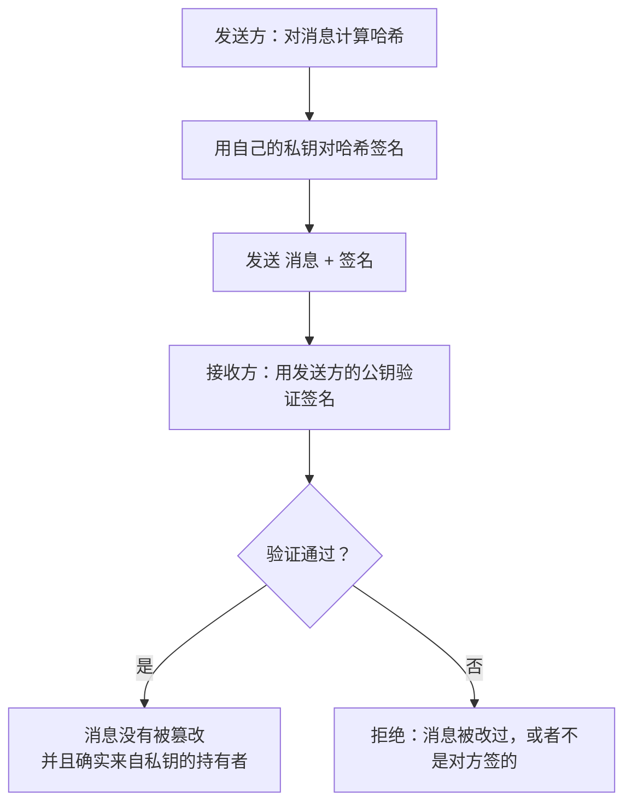

**追问链**

1. **加密和签名用的密钥方向有什么不同？** 加密：用**接收方的公钥**加密，只有接收方的私钥能解密；签名：用**发送方的私钥**签名，任何人都能用发送方的公钥验证。
2. **开放平台的接口签名为什么多用 HMAC，而不是 RSA？** HMAC 计算快、实现简单，但双方持有同一个密钥，平台无法向第三方证明"这个请求一定是对方发的"。需要不可否认，或者需要很多方都能验证（例如平台回调给商户、发放给多个资源服务器的 JWT）时，用非对称签名，验证方只需要公钥（见[《29 场景题》](../06-三高与架构/29-场景题.md)29-15）。
3. **哈希能用来"加密"密码吗？** 不能叫加密，哈希是单向的。而且通用的哈希算法太快，存储密码要用专门的慢哈希（39-08）。

---

### 39-14 在 Java 中使用加密算法有哪些常见的坑？

> ★★★ ｜ 资深 ｜ 中频

**考察意图**：Java 的加密 API 有不少不安全的默认值，看候选人是否真的踩过、查过。

**30 秒版回答**（本机 JDK 25 实测）

| 坑 | 实测或说明 | 正确做法 |
| --- | --- | --- |
| `Cipher.getInstance("AES")` | 默认是 **ECB 模式**：`getIV()` 返回 `null`；把两个相同的 16 字节明文块加密，**得到两个完全相同的密文块**，明文的规律直接暴露 | 写全转换名：`AES/GCM/NoPadding` |
| GCM 重复使用 IV | 同一个 `Cipher` 对象用相同的密钥和 IV 再次初始化加密时，JDK 抛出 `InvalidAlgorithmParameterException: Cannot reuse iv for GCM encryption`。但**跨对象、跨进程的重复，JDK 检测不到** | 每次加密都用 `SecureRandom` 生成新的 12 字节 IV，和密文保存在一起 |
| 用 `Random` 生成令牌、IV、密钥 | `Random` 的输出可以被预测 | 一律使用 `SecureRandom` |
| 用 `equals` / `Arrays.equals` 比较 MAC 或签名 | 一发现不同就提前返回，耗时会泄露"前面有几个字节是对的" | 使用 `MessageDigest.isEqual`，比较时间与内容无关 |
| 把密码字符串的字节直接当作密钥 | 随机性不够，长度也不对 | 密码要用 PBKDF2 等算法派生；从已有的密钥派生子密钥用 HKDF。JDK 25 正式提供了 KDF API（JEP 510），本机实测 `KDF.getInstance("HKDF-SHA256")` 可以直接派生出 256 位的 AES 密钥 |
| 密钥写在代码或配置文件中 | 跟着代码仓库、镜像、日志一起泄露 | 放在密钥管理服务中（39-17） |
| RSA 加密不用填充或者用 PKCS#1 v1.5 填充 | 存在已知的攻击 | 用 OAEP 填充，密钥至少 2048 位；能用混合加密就不要直接用 RSA 加密数据 |

**深入剖析：一个正确的 AES-GCM 工具类**（本机 JDK 25 已编译运行）

```java
/**
 * AES-GCM 加解密工具：每次加密生成随机 IV，输出格式为 IV + 密文（含认证标签）。
 */
public final class AesGcmCipher {

    private static final String TRANSFORMATION = "AES/GCM/NoPadding";
    /** GCM 推荐的 IV 长度：12 字节 */
    private static final int IV_LENGTH_BYTES = 12;
    /** 认证标签长度：128 位 */
    private static final int TAG_LENGTH_BITS = 128;
    private static final SecureRandom RANDOM = new SecureRandom();

    private final SecretKey key;

    public AesGcmCipher(SecretKey key) {
        this.key = key;
    }

    /**
     * 加密。aad 是参与认证但不加密的附加数据（例如记录 ID），解密时必须提供相同的值，
     * 用来防止把一条记录的密文挪到另一条记录上使用。
     */
    public byte[] encrypt(byte[] plaintext, byte[] aad) throws GeneralSecurityException {
        byte[] iv = new byte[IV_LENGTH_BYTES];
        RANDOM.nextBytes(iv);
        Cipher cipher = Cipher.getInstance(TRANSFORMATION);
        cipher.init(Cipher.ENCRYPT_MODE, key, new GCMParameterSpec(TAG_LENGTH_BITS, iv));
        cipher.updateAAD(aad);
        byte[] ciphertext = cipher.doFinal(plaintext);
        return ByteBuffer.allocate(IV_LENGTH_BYTES + ciphertext.length).put(iv).put(ciphertext).array();
    }

    /**
     * 解密。密文、IV 或 aad 被篡改时抛出 AEADBadTagException。
     */
    public byte[] decrypt(byte[] ivAndCiphertext, byte[] aad) throws GeneralSecurityException {
        ByteBuffer buffer = ByteBuffer.wrap(ivAndCiphertext);
        byte[] iv = new byte[IV_LENGTH_BYTES];
        buffer.get(iv);
        byte[] ciphertext = new byte[buffer.remaining()];
        buffer.get(ciphertext);
        Cipher cipher = Cipher.getInstance(TRANSFORMATION);
        cipher.init(Cipher.DECRYPT_MODE, key, new GCMParameterSpec(TAG_LENGTH_BITS, iv));
        cipher.updateAAD(aad);
        return cipher.doFinal(ciphertext);
    }
}
```

运行结果：加密 11 字节的手机号得到 39 字节（12 字节 IV + 11 字节密文 + 16 字节认证标签）；同一个手机号加密两次，结果不同；改动密文的最后一个字节，或者解密时传入别的记录 ID 作为 aad，都抛出 `AEADBadTagException: Tag mismatch`。

**追问链**

1. **GCM 的 IV 重复了会怎样？** 同一个密钥下重复使用 IV，攻击者可以得到两段明文的异或结果，还能伪造通过校验的密文，GCM 的安全性就完全失效了。所以 IV 要么随机生成（12 字节随机数，同一个密钥加密的次数要控制在安全范围内），要么用不会重复的计数器；数据量很大时定期轮换密钥。
2. **Java 的密钥库默认是什么格式？** 本机 JDK 25 中 `KeyStore.getDefaultType()` 返回 `pkcs12`。PKCS12 是通用的标准格式，其他语言和工具都能读取；旧的 JKS 格式是 Java 专有的。

---

### 39-15 数字证书和证书链是怎么验证的？证书的有效期为什么越来越短？

> ★★★ ｜ 资深 ｜ 中频

**考察意图**：理解证书信任链，知道常见的证书故障和行业的最新变化。TLS 握手见[《37 计算机网络》](37-计算机网络.md)37-11。

**30 秒版回答**

- **证书**把"一个公钥"和"一个身份（域名）"绑定在一起，由证书颁发机构（CA）签名。主要内容：主体、**SAN（证书适用的域名列表）**、公钥、签发者、有效期、用途限制等扩展字段。
- **证书链**：服务器证书由中间 CA 签发，中间 CA 的证书由根 CA 签发；**根证书预先内置在操作系统、浏览器或 JDK 的信任库中**（JDK 的在 `lib/security/cacerts`）。
- **客户端的验证步骤**：
  1. 从服务器证书开始，逐级验证签名，直到信任库中的某个根证书；
  2. 每张证书都在有效期内，中间证书确实被允许签发证书；
  3. **访问的域名在服务器证书的 SAN 中**（主机名校验）；
  4. 检查证书是否被吊销（CRL 或 OCSP）。

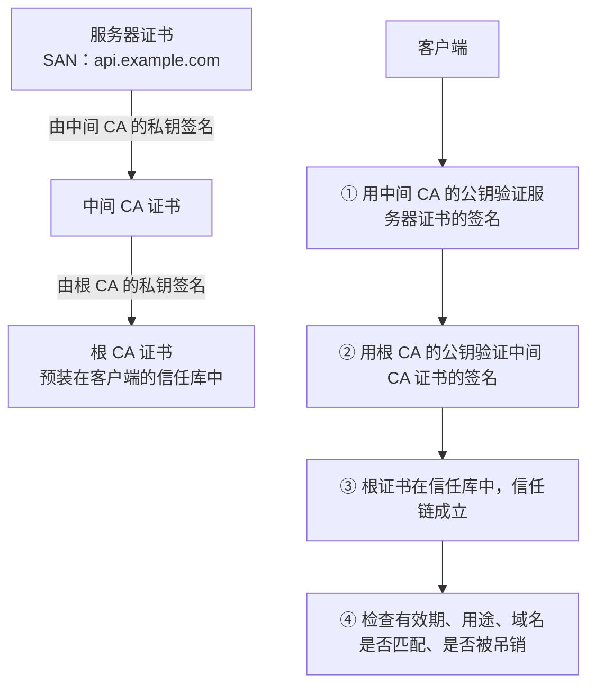

**证书的有效期为什么越来越短？**

- 有效期越长，私钥泄露、域名易主、证书错误签发之后的影响时间就越长，而吊销机制在实际中并不可靠。
- **CA/B 论坛 SC-081v3 投票**（2025 年 4 月通过，所有主流浏览器厂商都投了赞成票）：公开信任的 TLS 证书最长有效期从 398 天逐步缩短：2026 年 3 月 15 日起为 **200 天**，2027 年 3 月 15 日起为 **100 天**，2029 年 3 月 15 日起为 **47 天**。
- **吊销检查也在变化**：Let's Encrypt 在 2025 年 8 月 6 日关闭了 OCSP 服务，理由主要是隐私（OCSP 查询会让 CA 知道用户在访问哪个网站），之后只通过 CRL 发布吊销信息。
- **结论：证书必须自动化管理**：用 ACME 协议自动申请和续期（例如 Kubernetes 中的 cert-manager），监控证书的到期时间，手工更换证书的流程已经跟不上了。

**追问链**

1. **浏览器访问正常，Java 客户端却报证书链错误，常见原因是什么？** 服务端只配置了服务器证书，**没有发送中间证书**。浏览器往往能补上缺失的中间证书（有的会根据证书中的 AIA 地址自动下载，有的预置了常见的中间证书），而 JDK 默认不会下载：`com.sun.security.enableAIAcaIssuers` 默认关闭（已核对 JDK 25 源码中用 `Boolean.getBoolean` 读取）。正确的做法是在服务端配置完整的证书链。
2. **内部服务用的是私有 CA 签发的证书，能写一个"信任所有证书"的 `TrustManager` 吗？** 不能。信任所有证书、或者主机名校验总是返回 `true`，等于关闭了 TLS 的身份验证，任何中间人都能冒充服务端。正确的做法是把私有 CA 的根证书导入一个专用的信任库，让客户端使用这个信任库。
3. **证书固定（pinning）还推荐吗？** 在证书有效期越来越短、更换越来越频繁的情况下，把某张证书或公钥写死在客户端里，很容易在更换证书时造成大面积的故障。如果一定要用，固定到 CA 的公钥并准备备用的公钥，比固定到具体的服务器证书更稳妥。

---

### 39-16 量子计算对现有的加密有什么威胁？JDK 做了哪些准备？

> ★★ ｜ 架构师 ｜ 低频

**考察意图**：了解后量子密码迁移的紧迫性和 Java 平台的现状。

**30 秒版回答**

- **威胁**：足够大的量子计算机可以破解 RSA 和椭圆曲线密码（包括密钥交换和数字签名）。对称加密和哈希受到的影响小得多，使用 256 位的密钥即可。
- **为什么现在就要行动**：JEP 527 中的说法是，攻击者可以**现在截获并保存加密的流量，等将来有了量子计算机再解密**（harvest now, decrypt later）。所以需要长期保密的数据，密钥交换应该尽早换成抗量子的算法。签名的迁移相对没有那么急，因为伪造签名需要在签名还有效的时候完成；但根证书、固件和代码签名这类有效期很长的签名例外，也要尽早规划。
- **JDK 的进展**：

| 版本 | 内容 |
| --- | --- |
| JDK 24 | **ML-KEM**（JEP 496，抗量子的密钥封装机制）和 **ML-DSA**（JEP 497，抗量子的数字签名） |
| JDK 25 | **KDF API** 正式发布（JEP 510），用于派生密钥，例如 HKDF |
| JDK 27（尚未正式发布） | **TLS 1.3 的混合密钥交换**（JEP 527）：新增 `X25519MLKEM768` 等三种混合方案，并把 `X25519MLKEM768` 放在默认列表的第一位，使用 `javax.net.ssl` 的应用**不用改代码**就能受益 |

**深入剖析：混合密钥交换**

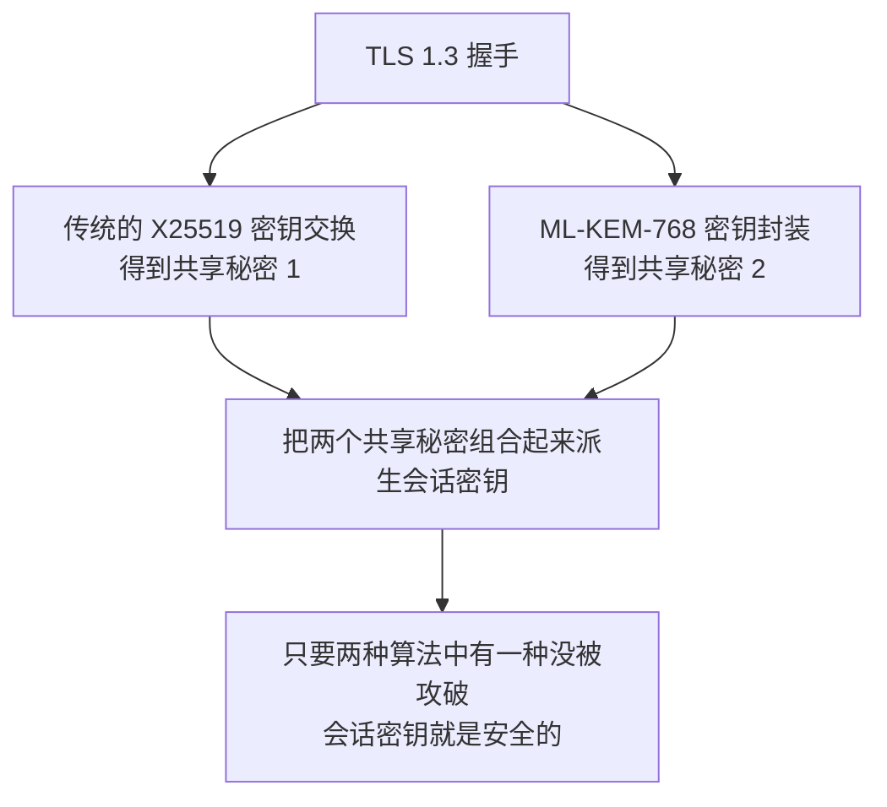

- 之所以用"混合"而不是直接换成 ML-KEM，是因为新算法经过的实战检验还不够多，和成熟的算法组合使用，即使新算法将来被发现有问题，安全性也不会低于现在。

**本机实测**（JDK 25）：`KeyPairGenerator.getInstance("ML-KEM")` 和 `"ML-DSA"` 都可以直接使用。默认参数下，编码后的公钥分别是 **1206 字节**和 **1974 字节**；作为对比，EC P-256 的公钥是 91 字节，RSA-2048 是 294 字节。后量子算法的密钥和签名明显更大，会增加握手的数据量和证书的大小。

**追问链**

1. **架构上现在能做什么准备？**
   - 盘点系统中用到 RSA、椭圆曲线的地方：TLS、JWT 签名、数据加密、代码签名；
   - **密码算法可配置**（密码敏捷性）：算法名、密钥长度不要写死在代码中，密文和签名中带上算法和密钥的版本号，便于将来更换；
   - 升级 JDK、TLS 库和网关，先在密钥交换上启用混合方案；
   - 优先保护需要长期保密的数据。

---

## 四、安全工程

### 39-17 敏感数据怎么保护？加密用的密钥怎么管理？

> ★★★ ｜ 架构师 ｜ 中频

**考察意图**：从数据的整个生命周期考虑保护措施，理解信封加密和密钥轮换。密钥、密码类配置的存放见[《13 配置中心》](../03-分布式与微服务/13-配置中心.md)。

**30 秒版回答**

- **先分级，再分别处理**：哪些是个人敏感信息（身份证号、手机号、银行卡号）、哪些是凭证（密码、密钥）、哪些是普通业务数据。**最好的保护是不收集、不保存**：用不到的字段不收集，过期的数据按规定删除。
- **传输中**：外部和内部的通信都使用 TLS（内部服务之间使用 mTLS，见[《11 微服务》](../03-分布式与微服务/11-微服务.md)11-11）。
- **存储时**：
  - 磁盘加密、数据库透明加密：防的是"硬盘或备份被拿走"，**防不住**有数据库权限的人和 SQL 注入；
  - **应用层的字段加密**：敏感字段在应用中加密后再写入数据库，数据库中只有密文，DBA、备份、SQL 注入都只能拿到密文。
- **使用时**：展示和日志中做脱敏（如手机号显示为 `138****8000`，见[《32 日志与可观测性》](../07-工程实践与稳定性/32-日志与可观测性.md)），访问敏感数据要有权限控制和审计日志。

**深入剖析：信封加密**

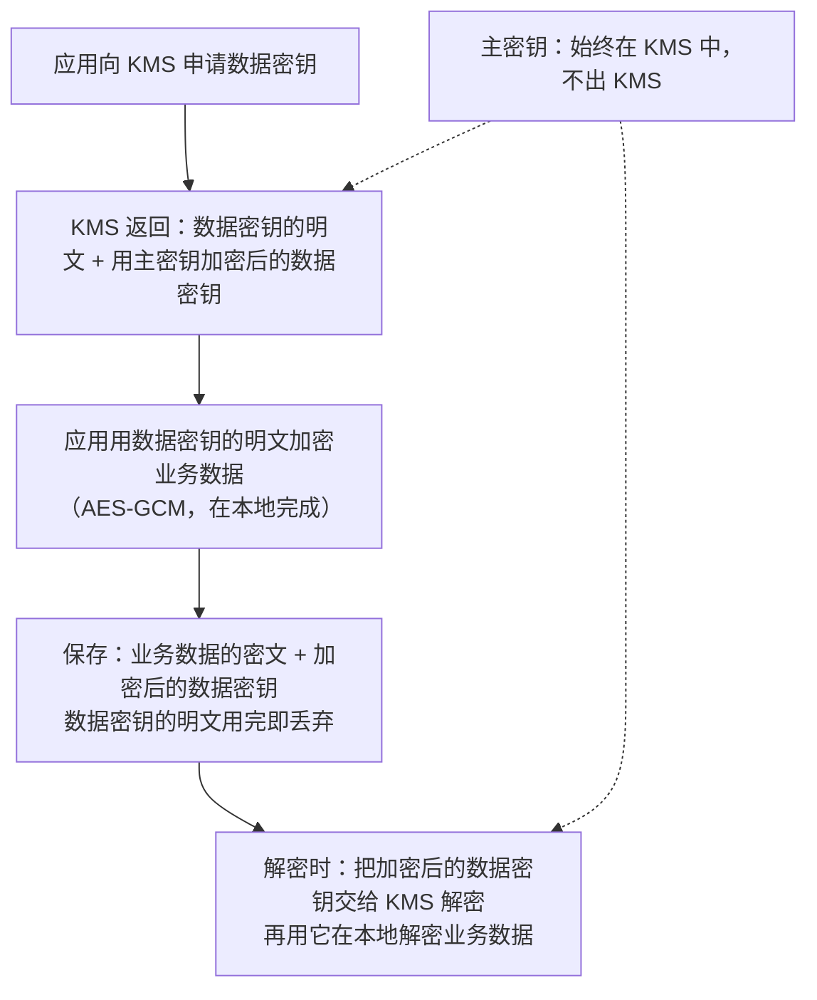

- **主密钥从不离开 KMS**，泄露的风险集中在一个高度受控的地方；大量数据在本地加解密，不用每次都调用 KMS；
- **轮换主密钥**时，只需要重新加密数据密钥，不用重新加密所有的业务数据；
- 密文中记录**密钥的版本**，轮换后新数据用新密钥，旧数据仍然能用旧版本的密钥解密，再逐步迁移。

**追问链**

1. **字段加密后，怎么按手机号查询？** 加密时每次的 IV 不同，密文无法直接比较。常见做法是额外保存一列**盲索引**：对规范化后的手机号计算 HMAC（使用另一个独立的密钥），查询时用同样的方法计算后按这一列等值查找。代价是只能做等值查询，做不了模糊查询和范围查询。
2. **应用的数据库密码、第三方的密钥放在哪里？** 不放在代码和镜像中；放在密钥管理服务（如 Vault、云厂商的 KMS / Secrets Manager）中，应用通过自己的身份（如 Kubernetes 的 ServiceAccount）获取；条件允许时使用动态生成、自动过期的凭证（见[《13 配置中心》](../03-分布式与微服务/13-配置中心.md)）。密钥泄露后的处理见[《36 Maven·Git·IDEA》](../07-工程实践与稳定性/36-Maven·Git·IDEA.md)36-14。

---

### 39-18 怎样把安全融入研发流程？

> ★★ ｜ 架构师 ｜ 中频

**考察意图**：安全不是上线前做一次渗透测试，而是贯穿设计、编码、构建、运行的每个环节。

**30 秒版回答**

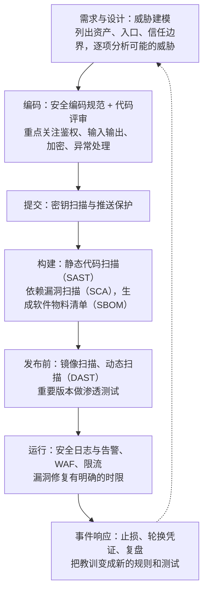

- **威胁建模**常用 STRIDE 的思路逐项检查：身份冒充、数据篡改、抵赖、信息泄露、拒绝服务、权限提升。
- **供应链**（OWASP 2025 的 A03）：依赖版本集中管理（见[《36 Maven·Git·IDEA》](../07-工程实践与稳定性/36-Maven·Git·IDEA.md)），持续扫描依赖中的已知漏洞，生成 SBOM，出现像 Log4Shell 这样的漏洞时能在几分钟内回答"哪些服务受影响"。
- **安全日志与告警**（A09）：登录失败、权限拒绝、敏感数据访问、配置变更要记录，并且**要有告警**，否则日志只能用来事后复盘。日志中不能记录密码、令牌等敏感信息。

**追问链**

1. **OWASP 2025 新增的"异常情况处理不当"，在代码评审时看什么？** 看出错时程序进入了什么状态：
   - 鉴权、风控、验签的代码在 `catch` 中是否返回了"通过"；
   - 吞掉异常后是否继续执行了后续的敏感操作；
   - 资源耗尽、超时、部分失败时，是否留下了不一致的状态（例如扣了款但没有记录）；
   - 返回给用户的错误信息中是否带有调用栈、SQL、内部地址。
   
   原则是**失败时拒绝**，并且记录和告警。
2. **安全扫描的结果太多，开发团队不想处理，怎么办？** 先按"是否可被利用"和影响分级：对外暴露的服务、实际调用到的漏洞代码优先处理；在流水线中只对新增的高危问题阻断构建，存量的问题设定修复期限逐步清理；把常见问题的修复方法沉淀成规范和公共组件（例如统一的 SSRF 校验组件、统一的鉴权注解），从源头减少同类问题。
