# 40 · 数据结构

> 适用岗位：Java 资深开发（重点：数组和链表的缓存差异、HashMap 的最坏情况、Java 集合的内存开销、伪共享、跳表的并发实现、B+ 树的页分裂）、Java 架构师（重点：布隆过滤器和基数估算的参数设计、B+ 树和 LSM 树的取舍、海量数据处理、按访问模式选择数据结构）
> 版本基线：JDK 25（集合和并发容器以 JDK 25 自带的源码为准）、Guava 33.7.2、MySQL 8.4、Redis（以 redis/redis 主线源码为准）、RocksDB 和 LMAX Disruptor（以官方 Wiki 和 GitHub 主线源码为准）
> 事实核对：
> - JDK 25 源码（`lib/src.zip`）：`HashMap` 的注释说明树化的桶在键可以比较大小时保证最坏 O(log n)；`ThreadLocal.ThreadLocalMap` 用线性探测（`nextIndex`），哈希增量为 `0x61c88647`；`IdentityHashMap` 是线性探测哈希表，键和值交替存放在同一个数组中；`ConcurrentSkipListMap` 用 CAS 维护链表和索引，约四分之一的节点有索引；`Striped64.Cell` 和 `ConcurrentHashMap.CounterCell` 标注了 `@Contended`；`DualPivotQuicksort` 递归过深时改用堆排序。
> - MySQL：[页合并阈值 MERGE_THRESHOLD](https://dev.mysql.com/doc/refman/8.4/en/index-page-merge-threshold.html)、[InnoDB 索引的物理结构](https://dev.mysql.com/doc/refman/8.4/en/innodb-physical-structure.html)、[排序建索引与 innodb_fill_factor](https://dev.mysql.com/doc/refman/8.4/en/sorted-index-builds.html)。
> - Redis：[HyperLogLog 文档](https://redis.io/docs/latest/develop/data-types/probabilistic/hyperloglogs/)；源码 [hyperloglog.c](https://github.com/redis/redis/blob/unstable/src/hyperloglog.c)（16384 个 6 位寄存器，低 14 位选寄存器）、[stream.h](https://github.com/redis/redis/blob/unstable/src/stream.h)（Stream 存放在基数树中）。
> - [RoaringBitmap](https://github.com/RoaringBitmap/RoaringBitmap)（`ArrayContainer.DEFAULT_MAX_SIZE = 4096`）、[RocksDB Compaction](https://github.com/facebook/rocksdb/wiki/Compaction)、[LMAX Disruptor 源码](https://github.com/LMAX-Exchange/disruptor)（`Sequence` 两侧的填充、`RingBuffer` 要求容量是 2 的幂）、[Rust BTreeMap 文档](https://doc.rust-lang.org/std/collections/struct.BTreeMap.html)、[JEP 180](https://openjdk.org/jeps/180)。
> - 本机实测（macOS 27.2、Apple M1 Max、缓存行 128 字节、JDK 25）：顺序访问和随机访问、二维数组按行和按列遍历、链表节点分散后的遍历耗时；哈希值相同的键对 HashMap 的影响；一百万个整数在不同集合中的内存占用（包括开启紧凑对象头）；Guava 布隆过滤器的实际误判率；伪共享；拓扑排序示例代码；Spring Boot 4.0.4 默认禁止循环依赖。
> 相关分类：[《02 集合类》](../01-Java核心/02-集合类.md)（HashMap、TreeMap、LRU、PriorityQueue）、[《03 Java 并发》](../01-Java核心/03-Java并发.md)（ConcurrentHashMap、LongAdder）、[《04 JVM》](../01-Java核心/04-JVM.md)（对象的内存布局）、[《15 MySQL》](../04-数据存储/15-MySQL.md)（B+ 树索引）、[《17 Redis》](../04-数据存储/17-Redis.md)（跳表、布隆过滤器、HyperLogLog 的用法）、[《18 本地缓存》](../04-数据存储/18-本地缓存.md)（W-TinyLFU）、[《19 Elasticsearch》](../04-数据存储/19-Elasticsearch.md)（倒排索引）、[《29 场景题》](../06-三高与架构/29-场景题.md)（GeoHash）、[《34 定时任务》](../07-工程实践与稳定性/34-定时任务.md)（时间轮）、[《42 编程题》](../10-编码与思维/42-编程题.md)

## 知识地图

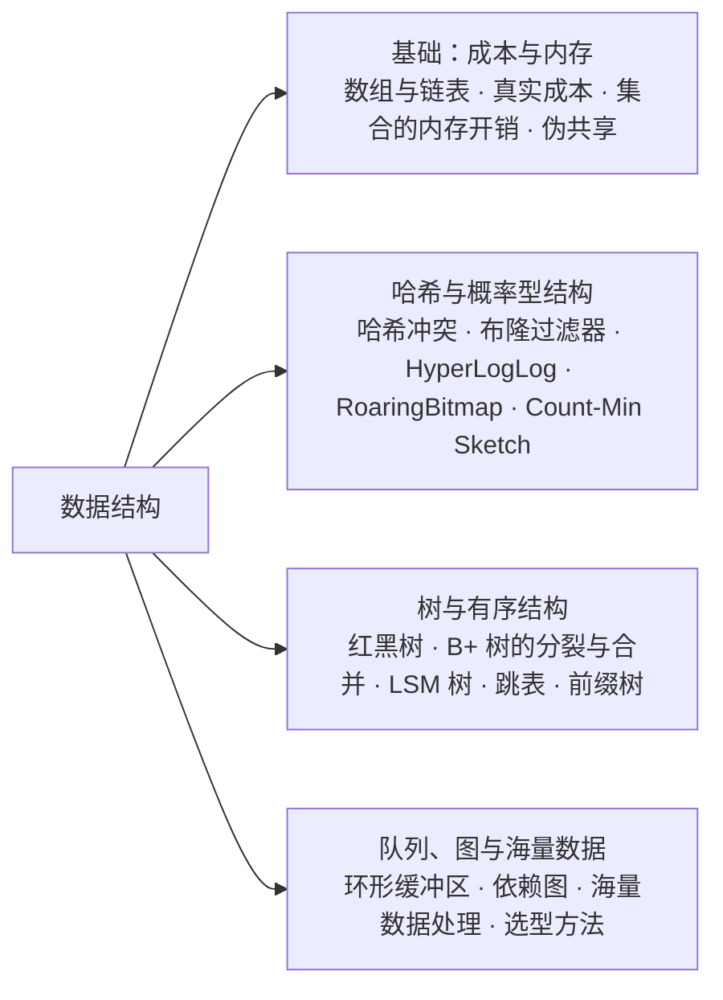

## 题目索引

| 编号 | 题目 | 难度 | 层级 |
| --- | --- | --- | --- |
| 40-01 | 数组和链表的根本区别是什么？为什么说缓存友好常常比时间复杂度更重要？ | ★★ | 资深 |
| 40-02 | 怎么评估一个操作的真实成本？均摊、最坏情况和常数因子分别意味着什么？ | ★★★ | 资深 |
| 40-03 | 一百万个整数放进不同的 Java 集合，各占多少内存？ | ★★ | 资深 |
| 40-04 | 伪共享是什么？怎么避免？ | ★★★ | 资深 |
| 40-05 | 哈希冲突有哪些解决方法？开放寻址和链地址法怎么选？ | ★★ | 资深 |
| 40-06 | 布隆过滤器的参数怎么算？需要删除元素怎么办？ | ★★★ | 资深 / 架构师 |
| 40-07 | HyperLogLog、RoaringBitmap、Count-Min Sketch 各是怎么工作的？ | ★★★ | 架构师 |
| 40-08 | 红黑树和 AVL 树有什么区别？内存中的有序结构一定要用二叉树吗？ | ★★ | 资深 |
| 40-09 | B+ 树的页分裂和页合并是怎么发生的？对主键设计有什么影响？ | ★★★ | 资深 |
| 40-10 | LSM 树是怎么工作的？和 B+ 树怎么选？ | ★★★ | 架构师 |
| 40-11 | 跳表为什么适合做并发的有序结构？ConcurrentSkipListMap 是怎么实现的？ | ★★★ | 资深 |
| 40-12 | 前缀树、基数树、AC 自动机分别解决什么问题？ | ★★ | 资深 |
| 40-13 | 环形缓冲区为什么快？Disruptor 做了哪些设计？ | ★★★ | 资深 |
| 40-14 | 图在后端工程中有哪些应用？怎么检测循环依赖？ | ★★ | 资深 |
| 40-15 | 数据量远大于内存时，怎么做 TopK、去重和排序？ | ★★★ | 资深 / 架构师 |
| 40-16 | 面对一个新需求，怎么选择合适的数据结构？ | ★★ | 架构师 |

---

## 一、基础：成本与内存

### 40-01 数组和链表的根本区别是什么？为什么说缓存友好常常比时间复杂度更重要？

> ★★ ｜ 资深 ｜ 高频

**考察意图**：不只背复杂度，而是知道数据在内存中怎么摆放、CPU 怎么读取。`ArrayList` 和 `LinkedList` 的选择见[《02 集合类》](../01-Java核心/02-集合类.md)02-03。

**30 秒版回答**

- **数组**：元素在内存中连续存放，按下标直接算出地址，访问是 O(1)；中间插入、删除要移动后面的元素，是 O(n)。
- **链表**：节点分散在内存各处，靠指针串起来；拿到节点后插入、删除是 O(1)，但找到这个位置要从头走，是 O(n)。
- **真正拉开差距的是 CPU 缓存**：CPU 从内存读数据是按**缓存行**整块读的（x86 通常是 64 字节，本机 Apple M1 Max 是 128 字节），而且硬件会发现顺序访问的规律并提前加载后面的数据。顺序访问数组时，一次内存读取可以服务后面几十个元素；链表每走一步都是一次指针跳转，节点地址不连续时，几乎每一步都要等内存。

**本机实测**（JDK 25，每项取 7 次中的最小值）

| 场景 | 耗时 |
| --- | --- |
| `int[1600 万]`，按顺序的下标求和 | 约 11 ms |
| 同一个数组，按随机打乱的下标求和 | 约 48 ms（**约 4.4 倍**） |
| `int[4096][4096]`，按行遍历 | 约 11 ms |
| 同一个二维数组，按列遍历 | 约 58 ms（**约 5.3 倍**） |
| 遍历 100 万个元素的 `ArrayList<Integer>` | 约 1.0 ms |
| 遍历 100 万个元素的 `LinkedList<Integer>` | 约 2.2 ms |
| 自定义链表，节点按链表顺序分配 | 约 1.9 ms |
| 自定义链表，节点按随机顺序分配 | 约 37.6 ms（**约 19 倍**） |

- 两种求和做的计算完全一样，下标数组本身也都是顺序读取的，差别只在于访问 `data[]` 的顺序。
- 刚建好的 `LinkedList` 只比 `ArrayList` 慢一倍左右，是因为节点是连续分配的，在堆中恰好也挨在一起。链表在长期使用中不断插入、删除后，节点会分散开，最后一行模拟的就是这种情况。

**深入剖析**

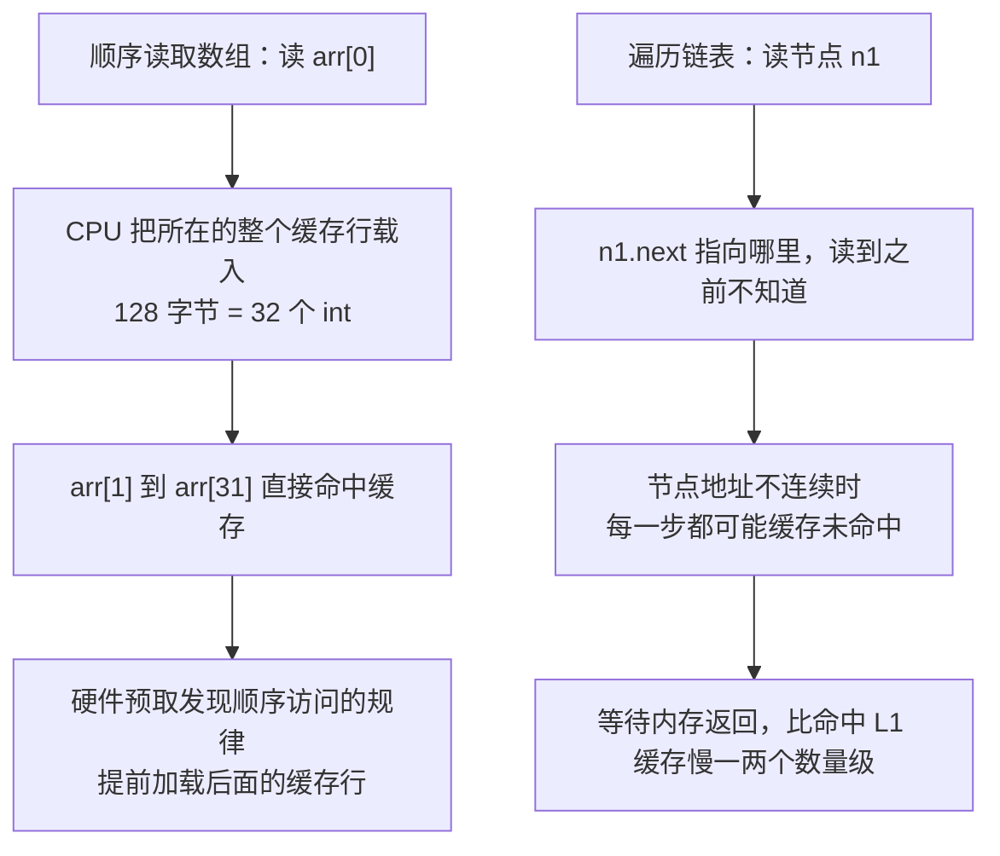

**追问链**

1. **为什么二维数组按列遍历慢？** Java 的二维数组是"数组的数组"，每一行是一个独立的 `int[]` 对象。按列遍历时，每访问一个元素就跳到另一行，载入的缓存行中只用到了一个元素。
2. **`LinkedList` 还有用武之地吗？** 很少。做队列和栈用 `ArrayDeque`（见 02-16）；需要 O(1) 删除任意节点的场景，通常是"哈希表 + 双向链表"（如 LRU，见 02-10），这时链表的价值在于已经通过哈希表拿到了节点，不需要遍历。
3. **怎样写出缓存友好的代码？**
   - 按内存的顺序访问数据；
   - 大量数值优先用基本类型数组：对象数组中存的只是引用，对象本身散落在堆的各处；
   - 把经常一起使用的数据放在一起，批量处理同一类数据。

---

### 40-02 怎么评估一个操作的真实成本？均摊、最坏情况和常数因子分别意味着什么？

> ★★★ ｜ 资深 ｜ 中频

**考察意图**：大 O 只描述增长趋势。资深工程师要能判断"平均很快"的操作会不会在某次、某种输入下变得很慢。

**30 秒版回答**

- **均摊和单次最坏**：`ArrayList.add` 均摊是 O(1)，但扩容的那一次要复制整个数组（见 02-02）；`HashMap` 扩容也一样。对延迟敏感的场景，要关心的是那一次最慢的操作，能预估大小时就预先设置容量。
- **最坏情况能不能被外部触发**：哈希表平均 O(1)、最坏 O(n)。如果键来自外部输入（如请求参数名、JSON 的字段名），攻击者可以构造大量哈希值相同的键，让服务端的哈希表退化，这叫**哈希洪水攻击**（Hash Flooding）。JDK 8 让 `HashMap` 在冲突严重时把链表转成红黑树（[JEP 180](https://openjdk.org/jeps/180)），就是为了应对这种情况。
- **常数因子**：内存访问模式、对象分配、分支预测都不体现在大 O 中，但在实际中可能差出几倍到几十倍（见 40-01）。

**深入剖析：红黑树也有保护不到的情况**

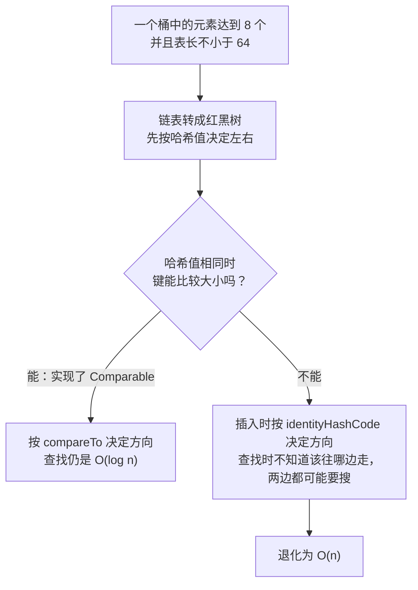

JDK 25 的 `HashMap` 源码注释写得很明确：只有在键的哈希值不同、**或者键可以比较大小**时，树化的桶才能保证最坏 O(log n)。

**本机实测**（JDK 25）

- `"Aa"` 和 `"BB"` 的哈希值相同，把它们组合成 16 对，得到 65536 个长度为 32、**哈希值全部相同**的字符串；
- 对照组是 65536 个长度相同、哈希值各不相同的字符串。

| 键的类型 | 数量 | put 总耗时 | get 总耗时 |
| --- | --- | --- | --- |
| 哈希值各不相同的 `String` | 65536 | 3~5 ms | 约 2 ms |
| 哈希值全部相同的 `String`（可比较大小） | 65536 | 约 11 ms | 约 12 ms |
| 哈希值全部相同、**不能比较大小**的自定义键 | 5000 | 50 ms | 45 ms |
| 同上 | 10000 | 231 ms | 202 ms |
| 同上 | 20000 | 1109 ms | 1074 ms |

- `String` 实现了 `Comparable`，所以即使哈希值全部相同，也只慢了几倍；
- 不能比较大小的键，数量翻一倍，耗时变成 4~5 倍，说明每次操作都是 O(n)，总体是 O(n²)。

**追问链**

1. **怎么防范哈希洪水？** 限制单个请求的参数个数、JSON 字段数和请求体大小；用作 Map 键的自定义类型，如果可能来自外部输入，应该实现 `Comparable`；不要把外部输入直接作为键放进无界的 Map。
2. **为什么扩容要按倍数增长，而不是每次固定加一些？** 按倍数增长时，n 次插入总共复制的元素数是 n 的常数倍，均摊到每次是 O(1)；如果每次只多分配固定的 10 个位置，总复制量是 O(n²)。
3. **快速排序最坏是 O(n²)，JDK 是怎么处理的？** 基本类型数组用双轴快速排序，JDK 25 源码中递归深度超过阈值时改用堆排序，保证最坏 O(n log n)；对象数组用 TimSort，本身就保证 O(n log n)，而且是稳定排序（见 02-20）。

---

### 40-03 一百万个整数放进不同的 Java 集合，各占多少内存？

> ★★ ｜ 资深 ｜ 中频

**考察意图**：能估算集合的内存开销，理解包装类和节点对象的代价。对象布局见[《04 JVM》](../01-Java核心/04-JVM.md)04-02。

**30 秒版回答**

- 每个 `Integer` 都是一个对象：对象头 12 字节 + `int` 4 字节 = 16 字节，是 `int` 本身的 4 倍。
- 集合还要额外保存引用和节点对象。哈希表、红黑树中每个元素都有一个节点，**一个 4 字节的整数在 `HashSet` 中实际要占五十多字节**。

**本机实测**（JDK 25，默认开启压缩指针，存 0~999999，Serial GC 下对比 GC 后的堆占用）

| 结构 | 每个元素占用（默认） | 每个元素占用（开启紧凑对象头） |
| --- | --- | --- |
| `int[]` | 4.0 字节 | 4.0 字节 |
| `ArrayList<Integer>` | 20.0 字节 | 20.0 字节 |
| `LinkedList<Integer>` | 40.0 字节 | 40.0 字节 |
| `HashSet<Integer>` | 56.4 字节 | 48.4 字节 |
| `TreeSet<Integer>` | 56.0 字节 | 48.0 字节 |
| `BitSet`（值都在 0~100 万之间） | 0.125 字节 | 0.125 字节 |

实测结果和按对象布局算出来的值完全一致：

- `ArrayList`：数组中的引用 4 字节 + `Integer` 16 字节；
- `LinkedList`：节点（对象头 12 + 三个引用 12 = 24 字节）+ `Integer` 16 字节；
- `HashSet`：内部是 `HashMap`，结构如下图。开启紧凑对象头（`-XX:+UseCompactObjectHeaders`）后，对象头从 12 字节变成 8 字节，节点从 32 字节变成 24 字节；而 `Integer` 对齐后仍是 16 字节，所以 `ArrayList` 和 `LinkedList` 没有变化；
- `TreeSet`：内部是 `TreeMap`，每个节点有键、值、左、右、父五个引用和一个颜色标记，对齐后 40 字节。

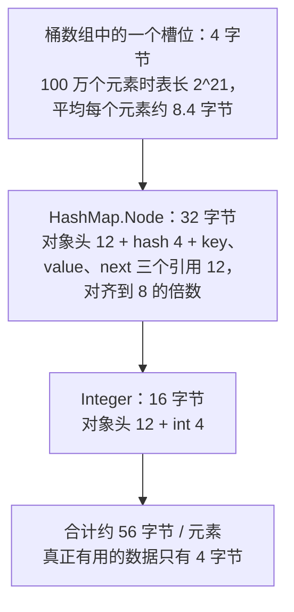

**追问链**

1. **要存大量的数值，怎么省内存？**
   - 能用基本类型数组就用数组；
   - 值的范围不大且比较密集时，用位图（`BitSet`），稀疏时用 RoaringBitmap（40-07）；
   - 需要哈希表时，可以使用专门的基本类型集合库（如 fastutil、Eclipse Collections 提供的 `int` 版本的 List、Set、Map，本机未实测）；
   - JDK 25 还没有值类型，`List<int>` 这样的写法目前不能用。
2. **紧凑对象头值得开吗？** 小对象越多，收益越大：本次实测中 `HashSet` 省了约 14%。JDK 25 中这个特性已经正式可用，但默认关闭，开启前要压测（见 04-02）。
3. **本地缓存怎么估算内存？** 条目数 ×（键的大小 + 值的大小 + 每个条目的结构开销）。缓存库的每个条目除了哈希表节点，通常还有淘汰、过期用的链表指针和时间戳，开销比 `HashMap` 更大；条目大小差别很大时，按权重限制总大小（见[《18 本地缓存》](../04-数据存储/18-本地缓存.md)）。

---

### 40-04 伪共享是什么？怎么避免？

> ★★★ ｜ 资深 ｜ 中频

**考察意图**：理解缓存一致性的粒度是缓存行，知道 `LongAdder`、Disruptor 中那些"奇怪的填充字段"是做什么的。缓存一致性协议见[《03 Java 并发》](../01-Java核心/03-Java并发.md)。

**30 秒版回答**

- CPU 缓存之间保持一致的单位是**缓存行**，而不是单个变量。
- 两个线程各自写**不同的变量**，但这两个变量恰好在**同一个缓存行**中：一个核心写入时，另一个核心中的这一行就失效了；另一个核心再写时，又要把这一行抢回来。两个变量在逻辑上毫无关系，却像共享变量一样互相拖慢，这就是**伪共享**。
- 解决办法是让高频写入的变量各自独占一个缓存行：在变量前后**填充**无用的字段，或者使用 JDK 内部的 `@Contended` 注解。

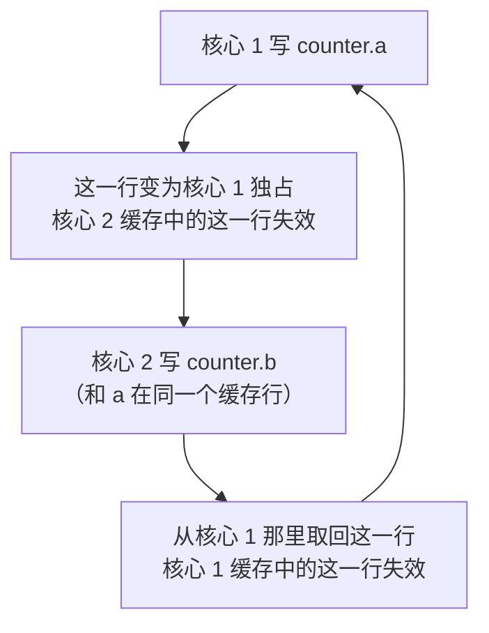

**本机实测**（JDK 25，两个线程各自对自己的 `volatile long` 自增 2 亿次，测 4 轮）

| 两个变量的位置 | 耗时 |
| --- | --- |
| 同一个对象中相邻的两个字段（同一个缓存行） | 5.2~5.8 秒 |
| 中间隔开 128 字节 | 约 1.22 秒（**快约 4.5 倍**） |

测试用的填充写法。JVM 会重新排列同一个类中字段的顺序，但子类的字段排在父类字段的后面（JDK 15 起，子类中较小的字段可能填进父类布局留下的空隙，这里的 `long` 字段填不进去），所以借助继承来控制布局，Disruptor 的 `Sequence` 也是这么做的：

```java
static class A { volatile long a; }
/** 在 a 和 b 之间插入 16 个 long，共 128 字节 */
static class Pad extends A { long p1, p2, p3, p4, p5, p6, p7, p8, p9, p10, p11, p12, p13, p14, p15, p16; }
static final class Padded extends Pad { volatile long b; }
```

**JDK 中的做法**

- `LongAdder` 的 `Striped64.Cell` 和 `ConcurrentHashMap` 计数用的 `CounterCell` 都标注了 `@jdk.internal.vm.annotation.Contended`（已核对 JDK 25 源码）。这些 Cell 放在一个数组中，不填充的话相邻的 Cell 会落在同一个缓存行中，分散热点的效果就没了。
- 本机 JDK 25 的默认值：`EnableContended=true`、`RestrictContended=true`、`ContendedPaddingWidth=128`。`RestrictContended=true` 表示这个注解**只对 JDK 内部的类生效**；业务代码要使用，需要加 `-XX:-RestrictContended`，编译时还要导出 `jdk.internal.vm.annotation` 包。

**追问链**

1. **业务代码需要关心伪共享吗？** 绝大多数不需要。只有多个线程**高频写**相邻数据时才有影响：计数器、队列的头尾指针、按线程分配的统计槽位。填充会浪费内存，应该先用 `LongAdder` 这类现成的组件（见 03-06），确认是瓶颈后再自己处理。
2. **Disruptor 填充了多少？** `Sequence` 在 `value` 的两侧各填充了 56 字节，按 64 字节缓存行设计；JDK 的 `ContendedPaddingWidth` 默认是 128 字节。在缓存行为 128 字节的处理器上（如本机），按 64 字节设计的填充不一定能完全隔开。

---

## 二、哈希与概率型结构

### 40-05 哈希冲突有哪些解决方法？开放寻址和链地址法怎么选？

> ★★ ｜ 资深 ｜ 中频

**考察意图**：知道 JDK 中两种冲突处理方法都在用，以及各自的代价。`HashMap` 的细节见[《02 集合类》](../01-Java核心/02-集合类.md)02-04 ~ 02-07。

**30 秒版回答**

| 方法 | 做法 | JDK 中的例子 |
| --- | --- | --- |
| **链地址法** | 每个桶挂一个链表，冲突多时转成红黑树 | `HashMap`、`ConcurrentHashMap` |
| **开放寻址：线性探测** | 冲突时依次往后找空位，所有数据都在一个数组中 | `ThreadLocal.ThreadLocalMap`、`IdentityHashMap` |
| 开放寻址的其他探测方式 | 二次探测、双重哈希、布谷鸟哈希等，用来减少元素扎堆 | — |

| 对比 | 链地址法 | 开放寻址 |
| --- | --- | --- |
| 内存 | 每个元素一个节点对象（`HashMap` 中 32 字节） | 没有节点对象，`IdentityHashMap` 把键和值交替放在同一个数组中 |
| 缓存友好性 | 要跟着指针跳转 | 在数组中连续探测，更友好 |
| 装载因子 | 可以较高（`HashMap` 默认 0.75） | 越满，探测的距离越长，必须保持较低 |
| 删除 | 直接从链表中摘掉 | **不能直接把槽位清空**，见下图 |

**深入剖析：开放寻址的删除问题**

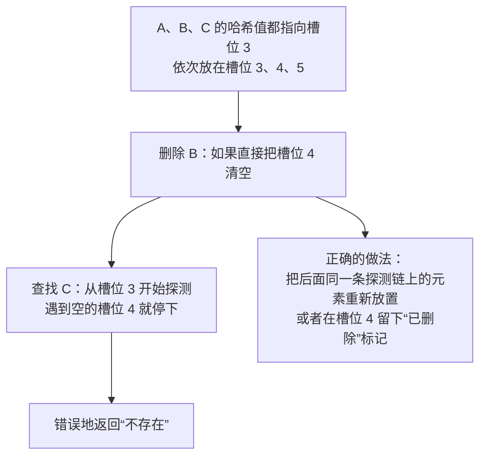

- `IdentityHashMap` 删除时用 Knuth 书中的算法 R 把后续元素挪回合适的位置；`ThreadLocalMap` 清理过期条目时（`expungeStaleEntry`）也会把后面的元素重新放置。

**追问链**

1. **`ThreadLocalMap` 为什么用开放寻址？** 一个线程中的 `ThreadLocal` 通常很少，用数组加线性探测最省内存。每创建一个 `ThreadLocal`，哈希值就增加 `0x61c88647`，源码注释说明这样生成的哈希值在长度为 2 的幂的表中分布得接近最均匀，冲突很少。
2. **`ThreadLocalMap` 中的过期条目什么时候清理？** 它的键是弱引用，`ThreadLocal` 对象被回收后键变成 `null`。在 `get`、`set`、`remove` 的探测过程中遇到这种条目会顺带清理，但不保证及时，值本身仍被强引用。所以在线程池中用完一定要调用 `remove`（见[《03 Java 并发》](../01-Java核心/03-Java并发.md)03-19）。

---

### 40-06 布隆过滤器的参数怎么算？需要删除元素怎么办？

> ★★★ ｜ 资深 / 架构师 ｜ 中频

**考察意图**：原理和防缓存穿透的用法见[《17 Redis》](../04-数据存储/17-Redis.md)17-16。这里考察的是能否定量地设计参数，知道它在什么情况下会失效。

**30 秒版回答**

- 给定预期的元素数量 n 和可接受的误判率 p：
  - 位数组的大小 m = −n · ln p / (ln 2)²；
  - 哈希函数的个数 k = (m / n) · ln 2。
- 例如 n = 100 万、p = 1%：m 约 958 万位（约 1.14 MB，**每个元素约 9.6 位**），k 约为 7。误判率每降低到原来的十分之一，每个元素大约多用 4.8 位。
- **实际放入的元素超过 n，误判率会快速上升**，所以 n 要留出余量，并监控实际数量。

**本机实测**（Guava 33.7.2，`BloomFilter.create(Funnels.longFunnel(), 1_000_000, 0.01)`，用另外 100 万个不存在的数测误判率）

| 实际放入的元素 | 实测误判率 | Guava 估算的误判率 | 有没有漏判 | 序列化后的大小 |
| --- | --- | --- | --- | --- |
| 100 万（等于预期） | 1.02% | 1.00% | 没有 | 1198142 字节 |
| 200 万（预期的 2 倍） | **15.79%** | 15.77% | 没有 | 1198142 字节 |

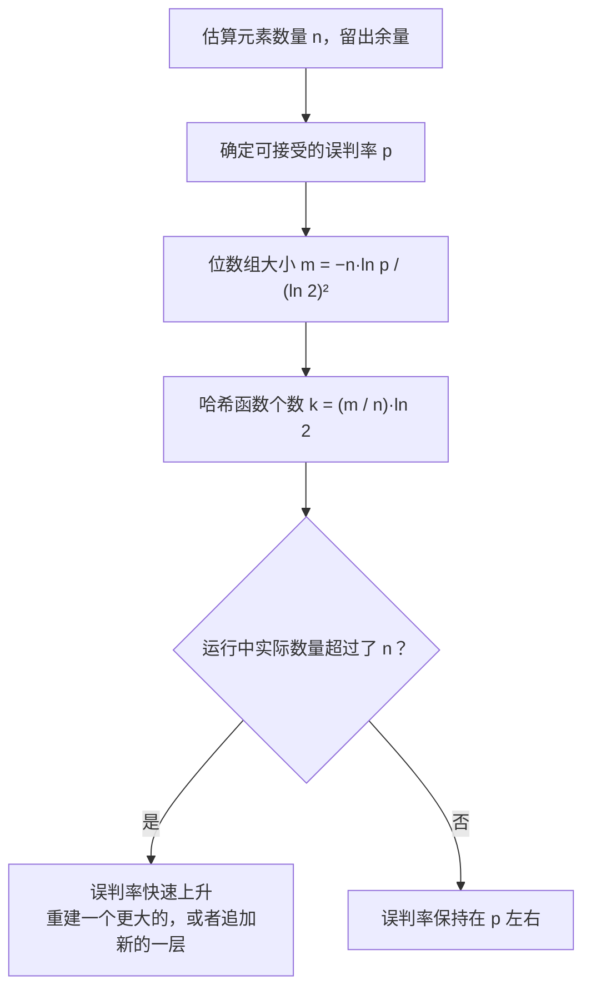

**需要删除元素怎么办？**

- 标准的布隆过滤器**不能删除**：一个位可能被多个元素共用，清掉它会让其他元素被漏判。
- 可选方案：
  - **计数布隆过滤器**：每个位置换成一个小计数器（如 4 位），删除时减一，内存是原来的几倍；
  - **布谷鸟过滤器**（Cuckoo Filter）：保存元素的指纹，支持删除，在误判率较低时空间效率不差于布隆过滤器；但只能删除确实加入过的元素，否则会误删别的元素的指纹；
  - **定期重建**：从数据库全量重建一个新的过滤器，然后整体替换。实际项目中最常用，也最简单可靠。

**追问链**

1. **用布隆过滤器防缓存穿透，新数据没有及时加入过滤器会怎样？** 布隆过滤器没有误判"不存在"的情况，前提是所有的数据都加入了。写入路径漏掉了更新过滤器，就会把真实存在的数据拦掉，这比穿透更严重。所以写入数据库的流程中必须同步更新过滤器，并且定期全量重建来纠正偏差。
2. **k 个哈希函数真的要算 k 次哈希吗？** 不用。常见的做法是只算一个较长的哈希值，拆成两个值 h1、h2，再用 h1 + i·h2 组合出 k 个位置。Guava 的策略名 `MURMUR128_MITZ_64` 指的就是用 128 位的 Murmur 哈希加上这种组合方法。

---

### 40-07 HyperLogLog、RoaringBitmap、Count-Min Sketch 各是怎么工作的？

> ★★★ ｜ 架构师 ｜ 低频

**考察意图**：Redis 中怎么选 Set、Bitmap、HyperLogLog 见[《17 Redis》](../04-数据存储/17-Redis.md)17-04。这里考察的是它们**为什么**能省这么多内存，以及误差从哪里来。

**30 秒版回答**

| 结构 | 回答的问题 | 误差 | 内存 | 能否合并 |
| --- | --- | --- | --- | --- |
| **HyperLogLog** | 有多少个**不同的**元素 | 标准误差约 0.81%（Redis） | 固定，最多 12 KB | 能：每个寄存器取最大值 |
| **RoaringBitmap** | 某个整数在不在集合中；集合的交并差 | 精确 | 随数据的分布自动选择表示方式 | 能：精确的交、并运算 |
| **Count-Min Sketch** | 某个元素**出现了多少次** | 只会多估，不会少估 | 固定 | 能：对应的计数器相加 |

**深入剖析：HyperLogLog**

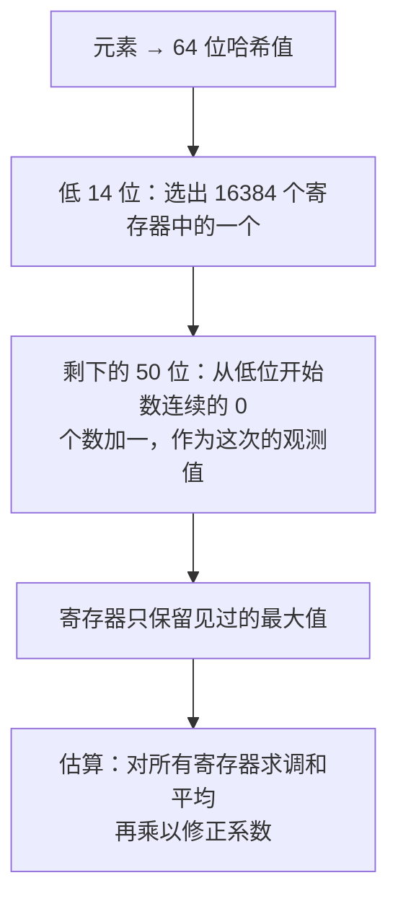

- **直觉**：抛硬币连续出现 k 次反面的概率是 1/2^k。如果见过的最长纪录是 k 次，大致说明抛了 2^k 次左右。只看一个纪录误差太大，所以分到 16384 个寄存器中分别记录，再求平均。
- **Redis 的实现**（已核对源码）：16384 个寄存器，每个 6 位，共 12288 字节；标准误差 1.04/√16384 ≈ 0.81%。元素少的时候使用**稀疏表示**（游程编码），只占很少的字节，数量多了才转成 12 KB 的密集表示。
- 它不保存元素本身，所以**不能列出元素，也不能删除**。

**RoaringBitmap：按密度选择表示方式**

- 把 32 位整数按高 16 位分桶，每个桶管 65536 个值。每个桶根据其中的元素多少，选择一种容器：
  - 元素**不超过 4096 个**：用有序的 `short` 数组，每个元素 2 字节；
  - 超过 4096 个：用 65536 位的位图，固定 8 KB；
  - 有大量连续区间时：用游程容器，只记录每段的起点和长度。
- 4096 这个分界点来自：4096 × 2 字节 = 8 KB，正好等于位图的大小（`ArrayContainer.DEFAULT_MAX_SIZE = 4096`，已核对源码）。
- Lucene、Elasticsearch、Spark、Druid 等都用它来存放和运算大量的文档 ID、用户 ID（见[《19 Elasticsearch》](../04-数据存储/19-Elasticsearch.md)19-01）。

**Count-Min Sketch**

- d 行、每行 w 个计数器。一个元素在每一行用不同的哈希函数选一个计数器加一；查询时取 d 个计数器中的**最小值**。
- 冲突只会让计数器偏大，所以结果只会多估。Caffeine 的 W-TinyLFU 就是用它近似统计每个键的访问频率的（见[《18 本地缓存》](../04-数据存储/18-本地缓存.md)18-04），也常用来找出现频率最高的元素。

**追问链**

1. **统计"最近 7 天的 UV"，用 HyperLogLog 怎么做？** 每天一个 HyperLogLog，查询时用 `PFMERGE` 合并 7 天的数据再计数。合并是对每个寄存器取最大值，结果和把 7 天的数据加到同一个 HyperLogLog 中完全一样，这是它比"每天存一个计数"强的地方：每天的 UV 不能直接相加，因为同一个用户会被重复计算。
2. **用户 ID 是 64 位的雪花 ID，还能用位图吗？** 普通位图的大小取决于最大值，雪花 ID 的值域太大，不能直接用。可以用 64 位版本的 Roaring（如 `Roaring64NavigableMap`），或者先把 ID 映射成连续的整数编号。

---

## 三、树与有序结构

### 40-08 红黑树和 AVL 树有什么区别？内存中的有序结构一定要用二叉树吗？

> ★★ ｜ 资深 ｜ 中频

**考察意图**：理解平衡的代价，并且能跳出"有序就用红黑树"的惯性。磁盘上为什么用 B+ 树见[《15 MySQL》](../04-数据存储/15-MySQL.md)15-01，`TreeMap` 的使用见[《02 集合类》](../01-Java核心/02-集合类.md)02-11。

**30 秒版回答**

| 对比 | AVL 树 | 红黑树 |
| --- | --- | --- |
| 平衡条件 | 任意节点左右子树的高度差不超过 1 | 红色节点不能相连；从任一节点到叶子的每条路径上黑色节点数相同。因此最长路径不超过最短路径的 2 倍 |
| 树高 | 约 1.44 log₂n | 不超过 2 log₂(n+1) |
| 查找 | 树更矮，略快 | 略慢 |
| 插入、删除 | 删除时可能要沿着路径一路旋转到根 | 插入最多旋转 2 次，删除最多旋转 3 次 |

- 红黑树用"稍微不那么平衡"换来了更少的调整，在增删频繁的场景中更划算，所以使用得更广泛：`TreeMap`、`HashMap` 和 `ConcurrentHashMap` 中树化的桶、Linux 调度器的运行队列、epoll 保存监听对象的集合（见[《38 操作系统》](38-操作系统.md)38-05、38-13）。

**内存中的有序结构不一定是二叉树**

- Rust 标准库的有序 Map（`BTreeMap`）用的就是**内存中的 B 树**。官方文档的解释是：平衡二叉树虽然比较次数最少，但每个元素都是单独分配的节点，每次插入都要分配内存，每次比较都可能缓存未命中；B 树把多个元素放在一个节点的连续数组中，分配次数和缓存未命中都少得多。
- 这和 40-01 是同一个道理：在现代 CPU 上，比较次数不是唯一的成本。Java 的 `TreeMap` 每个条目约 40 字节的节点（见 40-03），数据量大时可以考虑排序数组加二分查找（数据很少变化时）。

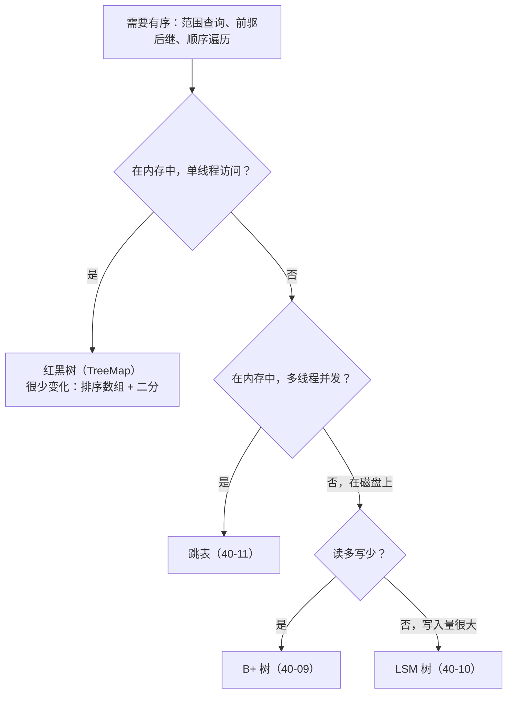

**追问链**

1. **红黑树的"红"和"黑"到底是什么意思？** 红黑树和 2-3-4 树（一种 B 树）是等价的：把红色节点和它的黑色父节点看成一个大节点，就得到一棵所有叶子都在同一层的 2-3-4 树。红黑树的旋转和变色，对应的就是 B 树中节点的分裂与合并。理解了这一点，红黑树和 B+ 树就是同一类思想。
2. **`HashMap` 树化为什么选红黑树而不是 AVL？** JDK 没有说明原因。常见的解释是：树化只是为了在冲突严重时避免退化，树中的元素通常不多，用调整更少的红黑树，并且可以和 `TreeMap` 共享同样的实现思路。

---

### 40-09 B+ 树的页分裂和页合并是怎么发生的？对主键设计有什么影响？

> ★★★ ｜ 资深 ｜ 中频

**考察意图**：从数据结构的变化解释"为什么用自增主键"，而不只是背结论。主键设计见[《15 MySQL》](../04-数据存储/15-MySQL.md)15-06。

**30 秒版回答**

- **页分裂**：要插入的叶子页满了，就申请一个新页，把一部分记录移过去，再在父节点中加一个指向新页的条目；父节点也满了就继续向上分裂，根节点分裂时树长高一层。
- **顺序插入和随机插入的差别**（MySQL 8.4 文档）：按顺序（递增或递减）插入时，页大约填到 **15/16**；随机插入时，页的填充率在 **1/2 到 15/16** 之间。
- **页合并**：删除或更新使一个页的数据量低于 `MERGE_THRESHOLD`（默认 **50%**，可设置为 1~50）时，InnoDB 会尝试把它和相邻的页合并。
- **对主键的影响**：自增主键总是插入在最右边，只有最右边的页会分裂，页填得满；UUID 这类随机主键会插入到任意位置，频繁在中间分裂，页只有一半到大半满，空间浪费，缓冲池能缓存的有效数据变少，随机 IO 增多。

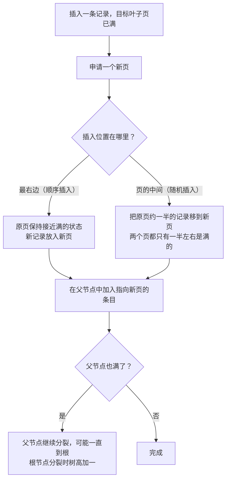

**追问链**

1. **合并阈值为什么可以调？** MySQL 文档提到：如果两个页都接近半满，合并后很快又可能分裂，频繁地"合并、分裂"会影响性能。删除和插入都很频繁的表，可以通过表或索引的 `COMMENT 'MERGE_THRESHOLD=40'` 调低阈值，减少这种来回。但阈值太低，空页会变多，数据文件变大。
2. **雪花 ID 和 UUIDv7 也会导致随机插入吗？** 雪花 ID 整体上随时间递增，多台机器同时生成时局部不是严格有序的，但都插入在索引的最右侧区域，影响很小（见[《09 分布式理论》](../03-分布式与微服务/09-分布式理论.md)09-16）。UUIDv7（RFC 9562 定义）把毫秒时间戳放在最高位，也是按时间大致有序的；而常用的 UUIDv4 是完全随机的。
3. **删除了大量数据，表文件为什么没有变小？** 删除的记录先被标记删除，后台清理后空间可以给新数据复用，但不会还给操作系统。要回收空间需要重建表（`OPTIMIZE TABLE` 或 `ALTER TABLE ... FORCE`），大表要在业务低峰进行（见 15-14）。
4. **`innodb_fill_factor` 是做什么的？** 它只在**排序建索引**（创建索引、重建表）时生效：例如设置为 80，就在每个页中预留 20% 的空间给以后的插入，避免重建完马上开始分裂。它只是一个提示值，实际预留的空间不一定精确。

---

### 40-10 LSM 树是怎么工作的？和 B+ 树怎么选？

> ★★★ ｜ 架构师 ｜ 中频

**考察意图**：理解"把随机写变成顺序写"的设计思路，以及它要付出的代价。

**30 秒版回答**

- **写**：先追加写 WAL（预写日志，防止宕机丢数据），再写入内存中的有序结构（MemTable，常用跳表）。MemTable 满了就变成只读，后台把它整体刷到磁盘，形成一个有序的文件（SSTable）。**文件写出后不再修改**。
- **读**：先查 MemTable，再从新到旧查磁盘上各层的文件。每个文件带有索引和布隆过滤器，可以快速跳过不包含这个键的文件。
- **更新和删除**：不修改旧数据，而是写入一个新版本或者删除标记（墓碑）；旧版本在后台**合并**（Compaction）时才被真正清除。
- 使用 LSM 树的有 RocksDB、LevelDB、HBase、Cassandra，TiDB 的存储层 TiKV 也基于 RocksDB。Elasticsearch 的段合并是类似的思路（见[《19 Elasticsearch》](../04-数据存储/19-Elasticsearch.md)19-05）。

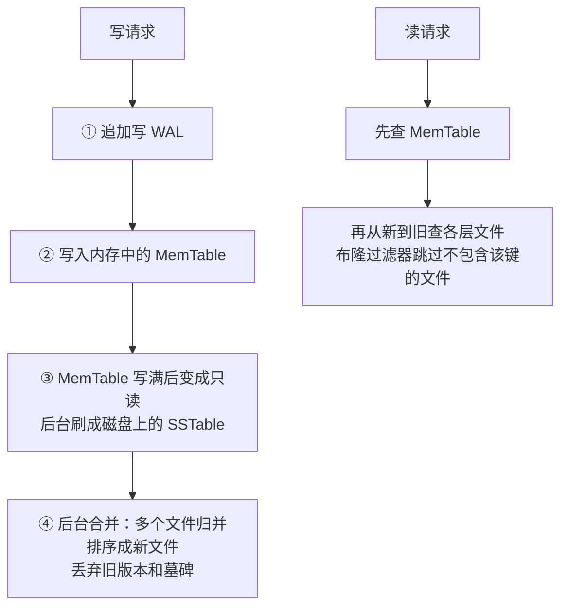

**深入剖析：三种放大**

| 放大 | 含义 | B+ 树 | LSM 树 |
| --- | --- | --- | --- |
| 写放大 | 写入 1 字节，磁盘上实际写了多少 | 改一行要写回整个页，还要写 redo log | 同一份数据在多次合并中被反复重写 |
| 读放大 | 一次查询要读几个地方 | 树高，通常 3~4 层 | 可能要查多层文件，靠布隆过滤器缓解 |
| 空间放大 | 实际占用的空间和有效数据之比 | 页中的空闲空间（40-09） | 合并之前，旧版本和墓碑一直占着空间 |

- **合并策略决定了放大的分布**（RocksDB Wiki）：
  - **Leveled**（RocksDB 的默认策略）：每层只保留一个有序的序列，空间放大小，代价是写放大大；
  - **Tiered**（RocksDB 中叫 Universal）：每层允许有多个序列，写放大小，代价是读放大和空间放大大。

**怎么选**

- **LSM 树**：写入量大、以追加为主，能接受读稍慢、读延迟有波动。例如日志、监控指标、时序数据、消息、海量的明细数据。
- **B+ 树**：读多写少，需要稳定的读延迟、大量的范围查询和事务。例如核心业务库。

**追问链**

1. **LSM 树在生产中最怕什么？** 合并跟不上写入：第 0 层的文件越堆越多，读越来越慢，最后存储引擎会主动限制甚至暂停写入（RocksDB 称为 write stall）。合并本身也大量占用磁盘 IO，会让请求的延迟出现毛刺。所以要监控合并的积压情况，并为合并预留 IO 能力。
2. **为什么 MemTable 常用跳表？** 它要求有序（刷盘时按顺序写出），又要支持大量并发插入；跳表实现简单，也容易做成无锁的并发版本（40-11）。

---

### 40-11 跳表为什么适合做并发的有序结构？ConcurrentSkipListMap 是怎么实现的？

> ★★★ ｜ 资深 ｜ 中频

**考察意图**：Redis 的 ZSet 为什么用跳表见[《17 Redis》](../04-数据存储/17-Redis.md)17-03。这里考察 JDK 中并发跳表的实现思路。

**30 秒版回答**

- 跳表是"有序链表 + 多层索引"：查找时从最高层开始向右走，下一个节点比目标大就下降一层，期望 O(log n)。每个节点有几层索引由随机数决定，**不需要旋转这类全局调整**。
- **为什么适合并发**：插入和删除只修改相邻的几个指针，每个指针可以单独用 CAS 更新。红黑树插入后的变色和旋转可能牵涉从插入点到根的多个节点，很难做成无锁的。
- JDK 中线程安全的有序 Map 只有 `ConcurrentSkipListMap`（和对应的 `ConcurrentSkipListSet`），没有并发版本的 `TreeMap`。

**深入剖析：JDK 25 的实现**（已核对源码）

- 底层是一个按键排序的单向链表，存放数据；索引层是单独的 `Index` 节点，指向底层的数据节点。
- **插入**：先在底层链表中用 CAS 插入数据节点；然后以 **1/4 的概率**为它建立索引。有索引的节点中，一半只有一层，四分之一有两层，依此类推，最多 62 层。源码注释说明，这样的索引比常见的跳表更稀疏，整体空间比 `TreeMap` 略小。
- **删除**分三步，都是 CAS：

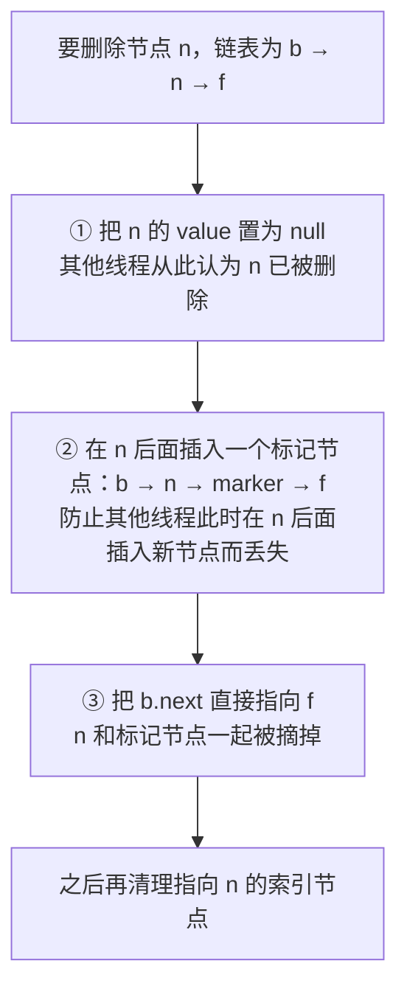

- 第 ② 步的原因：如果不加标记节点，另一个线程可能恰好在 n 后面插入了新节点 x（n → x），第 ③ 步把 b.next 指向 f 后，x 就随着 n 一起丢失了。
- 生成随机层数用的是 JDK 内部为每个线程维护的辅助随机种子，不会干扰用户代码使用的 `ThreadLocalRandom`。

**追问链**

1. **它的 `size()` 是 O(1) 的吗？** JDK 25 中元素个数用一个 `LongAdder` 计数，`size()` 不再遍历链表；但在并发修改的过程中，返回的只是一个近似值。迭代器是弱一致的：不会抛出 `ConcurrentModificationException`，可能看到也可能看不到迭代期间的修改。
2. **什么时候用它？** 多个线程同时读写、并且需要按顺序访问或范围查询，例如按时间排序的待处理任务、按价格排列的挂单、滑动时间窗口。单线程场景用 `TreeMap` 更快、更省内存。

---

### 40-12 前缀树、基数树、AC 自动机分别解决什么问题？

> ★★ ｜ 资深 ｜ 低频

**考察意图**：知道字符串相关的几种结构在工程中的位置，特别是敏感词过滤这类常见需求。

**30 秒版回答**

- **前缀树**（Trie）：按字符一层层分支，从根到某个节点的路径就是一个前缀。查找的时间只和键的长度有关，与键的总数无关；天然支持按前缀查找和**最长前缀匹配**。缺点是节点和指针多，占内存。
- **基数树**（Radix Tree，压缩前缀树）：把只有一个子节点的一串节点合并成一个，节点数大大减少。Redis 的 Stream 和消费者组就保存在基数树（rax）中（已核对 `stream.h`）：Stream 的消息 ID 以时间戳开头，共同前缀很多，压缩效果好。
- **AC 自动机**（Aho-Corasick）：在前缀树上加"失败指针"，可以在一段文本中**同时**查找成千上万个关键词，只扫描文本一遍，耗时与文本长度加上匹配的次数成正比。

| 场景 | 结构 |
| --- | --- |
| 搜索框的自动补全 | 前缀树，节点上缓存这个前缀下最热门的几个词 |
| IP 路由表、URL 路由 | 前缀树 / 基数树做最长前缀匹配（例如 Go 的 httprouter 就用基数树做 URL 路由） |
| 敏感词过滤、日志关键词告警 | AC 自动机 |
| 有大量共同前缀的键 | 基数树 |

**深入剖析：AC 自动机怎样一遍找出所有关键词**

以关键词 he、she、his、hers 为例：

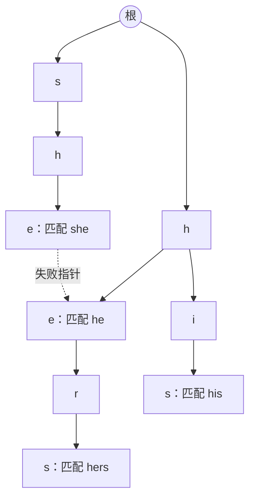

- 扫描文本 `shers`：沿 s → h → e 匹配到 she；she 的后缀 he 也是关键词，通过失败指针一起输出；下一个字符 r 在 she 分支上走不下去，沿失败指针跳到 he 的 e 节点，继续匹配 r、s，得到 hers。
- 整个过程只扫描了文本一遍，找到了 she、he、hers 三个关键词。

**追问链**

1. **敏感词库有几万个词，用 `contains` 或正则逐个匹配有什么问题？** 逐个 `contains` 要把文本扫描几万遍；把几万个词用 `|` 拼成一个正则，Java 的正则引擎基于回溯，性能难以预测。AC 自动机构建一次，之后每段文本只扫描一遍。实际使用时还要先做规范化：统一大小写和全角半角、去掉插入在中间的符号，否则很容易被绕过。
2. **前缀树太占内存怎么办？** 用基数树压缩单链；或者用双数组前缀树（Double-Array Trie）把节点放进两个整数数组；Lucene 用 FST（有限状态转换器）存储词典，它同时共享前缀和后缀，更省空间。

---

## 四、队列、图与海量数据

### 40-13 环形缓冲区为什么快？Disruptor 做了哪些设计？

> ★★★ ｜ 资深 ｜ 低频

**考察意图**：把缓存友好、伪共享、内存屏障这些知识串起来。Log4j2 的异步日志就基于 Disruptor（见[《32 日志与可观测性》](../07-工程实践与稳定性/32-日志与可观测性.md)）。

**30 秒版回答**

- **环形缓冲区**：一个固定大小的数组，读写各用一个**一直递增**的序号，用 `序号 & (容量 − 1)` 定位槽位（容量是 2 的幂时等价于取模）。数组连续、不需要分配节点，生产者和消费者各自推进自己的序号。
- 作为对比，`ArrayBlockingQueue` 也是环形数组，但所有操作都由**同一把锁**保护（JDK 25 源码中是一个 `ReentrantLock` 加 `notEmpty`、`notFull` 两个条件）；`LinkedBlockingQueue` 用了两把锁，但每个元素要分配一个节点。
- **Disruptor 的关键设计**（已核对 GitHub 主线源码）：
  1. **容量必须是 2 的幂**，构造时检查，不满足直接抛异常，用位运算定位槽位；
  2. **事件对象预先分配**：构造时用 `EventFactory` 把数组填满，之后生产者只修改对象的字段，不再创建对象，几乎不产生垃圾；
  3. **消除伪共享**：序号对象 `Sequence` 的 `value` 两侧各填充 56 字节，`RingBuffer` 的字段和数组两端也有填充（40-04）；
  4. **不用锁**：单生产者时，申请序号就是修改一个普通字段，连 CAS 都不需要；多生产者用 `getAndAdd` 原子地申请一段序号，再用一个"可用标记数组"记录每个槽位是否已经发布；
  5. **消费者批量处理**：一次处理到当前最新可用的序号，再更新自己的序号；等待新数据的方式由等待策略决定（`BlockingWaitStrategy`、`SleepingWaitStrategy`、`YieldingWaitStrategy`、`BusySpinWaitStrategy` 等），延迟越低，越耗 CPU。

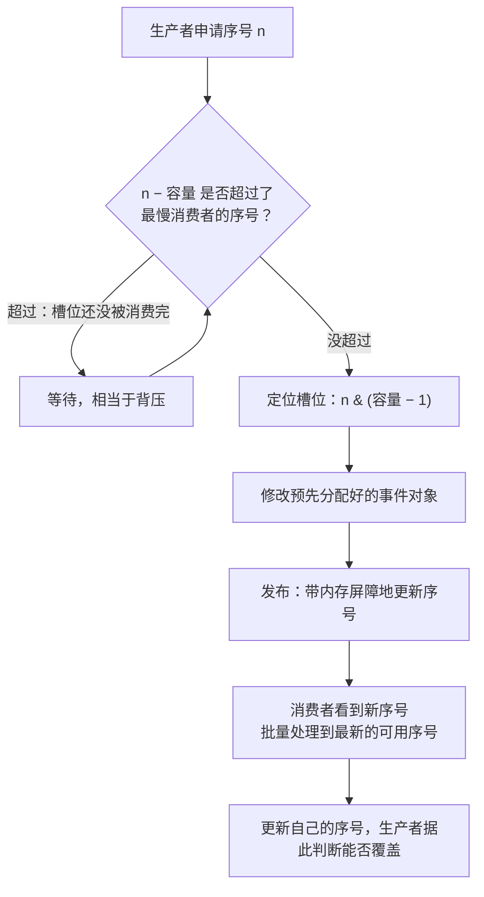

**追问链**

1. **序号一直递增，会不会溢出？** 序号是 `long`。即使每秒 10 亿个事件，也要两百多年才会用完，所以不需要处理回绕。
2. **生产者比消费者快怎么办？** 环满了生产者就等待，这是一种天然的背压。Log4j2 异步日志的队列满时可以配置是等待还是丢弃（见[《32 日志与可观测性》](../07-工程实践与稳定性/32-日志与可观测性.md)）。
3. **业务系统要直接用 Disruptor 吗？** 一般不需要。大多数系统的瓶颈在网络和数据库，而不在内存队列。它适合单机内对延迟和吞吐要求极高的流水线，例如交易撮合、行情处理、日志。

---

### 40-14 图在后端工程中有哪些应用？怎么检测循环依赖？

> ★★ ｜ 资深 ｜ 中频

**考察意图**：能从工程问题中识别出图结构，会写拓扑排序和环检测。

**30 秒版回答**

| 场景 | 图 | 用到的算法 |
| --- | --- | --- |
| Spring Bean 的创建顺序、循环依赖 | Bean 之间的依赖关系 | 依赖分析、环检测（见[《05 Spring》](../02-框架与容器/05-Spring.md)05-05） |
| Maven 多模块的构建顺序 | 模块之间的依赖关系 | 拓扑排序，有环时构建失败 |
| 工作流、批处理任务的编排（DAG） | 任务之间的先后关系 | 拓扑排序；没有依赖的任务并行执行 |
| 数据库死锁检测 | 等待图：事务 A 在等事务 B 持有的锁 | 在图上找环（见[《15 MySQL》](../04-数据存储/15-MySQL.md)15-13） |
| 微服务调用关系治理 | 服务之间的调用关系 | 找出循环调用、关键路径 |
| 组织架构、权限继承 | 层级或关系图 | 遍历、可达性判断（见[《39 网络安全》](39-网络安全.md)39-11） |

- Spring Boot 4.0.4 中 `spring.main.allow-circular-references` 默认为 `false`（已核对配置元数据）：Spring 框架本身能通过三级缓存处理部分循环依赖，但 Spring Boot 默认直接报错，要求从设计上消除循环。

**深入剖析：拓扑排序（Kahn 算法）**

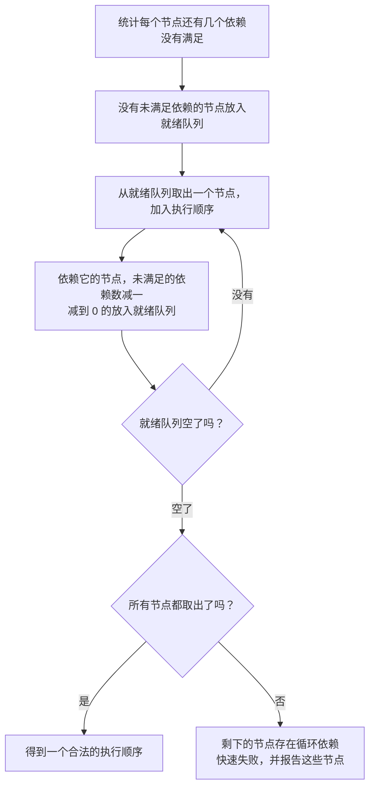

```java
/**
 * 依赖图：计算执行顺序（拓扑排序），存在循环依赖时快速失败。
 */
public final class DependencyGraph {

    /** 节点 -> 它依赖的节点集合 */
    private final Map<String, Set<String>> dependencies = new LinkedHashMap<>();

    /** 声明 node 依赖 dependsOn，即 dependsOn 必须先执行 */
    public void addDependency(String node, String dependsOn) {
        dependencies.computeIfAbsent(node, k -> new LinkedHashSet<>()).add(dependsOn);
        dependencies.computeIfAbsent(dependsOn, k -> new LinkedHashSet<>());
    }

    /**
     * Kahn 算法：反复取出"依赖已经全部满足"的节点。
     * 结束时还有节点没被取出，说明这些节点处在环上，或者依赖了环上的节点。
     */
    public List<String> executionOrder() {
        Map<String, Integer> pendingCount = new HashMap<>();
        Map<String, List<String>> dependents = new HashMap<>();
        dependencies.forEach((node, deps) -> {
            pendingCount.put(node, deps.size());
            deps.forEach(dep -> dependents.computeIfAbsent(dep, k -> new ArrayList<>()).add(node));
        });
        Deque<String> ready = new ArrayDeque<>();
        pendingCount.forEach((node, count) -> {
            if (count == 0) {
                ready.add(node);
            }
        });
        List<String> order = new ArrayList<>(dependencies.size());
        while (!ready.isEmpty()) {
            String node = ready.poll();
            order.add(node);
            for (String next : dependents.getOrDefault(node, List.of())) {
                if (pendingCount.merge(next, -1, Integer::sum) == 0) {
                    ready.add(next);
                }
            }
        }
        if (order.size() < dependencies.size()) {
            List<String> blocked = new ArrayList<>(dependencies.keySet());
            blocked.removeAll(order);
            throw new IllegalStateException("cyclic dependency detected, unresolved nodes=" + blocked);
        }
        return order;
    }
}
```

本机 JDK 25 已编译运行：order-service 依赖 user-service 和 stock-service，二者都依赖 config，输出 `order=[config, user-service, stock-service, order-service]`；再加上 config 依赖 order-service，抛出 `cyclic dependency detected, unresolved nodes=[order-service, user-service, stock-service, config]`。

**追问链**

1. **剩下的节点都在环上吗？** 不一定。剩下的既有环上的节点，也有依赖了环上节点的节点。要精确找出环，用深度优先搜索加三种颜色标记（未访问、访问中、已完成）：遇到一个"访问中"的节点，就说明找到了环，沿递归栈就能还原出环的路径。
2. **DAG 任务怎么最大化并行？** 每一轮把就绪队列中的所有任务并行执行，一层层推进。整体耗时由图中耗时最长的那条路径（关键路径）决定，优化要先优化关键路径上的任务。

---

### 40-15 数据量远大于内存时，怎么做 TopK、去重和排序？

> ★★★ ｜ 资深 / 架构师 ｜ 高频

**考察意图**：经典的海量数据题，考察分而治之的思路和对细节的把握。用堆求 TopK 的基础做法见[《02 集合类》](../01-Java核心/02-集合类.md)02-15。

**30 秒版回答**

- 核心思路是**分而治之**：把数据切成内存放得下的小块，分别处理，再合并结果。关键在于**按什么切**：
  - 需要把相同的元素放到一起（去重、计数、按频率求 TopK）：按哈希值分片，`hash(x) % k`，相同的元素一定落在同一片中；
  - 需要全局有序（排序）：每块在内存中排好序，再**多路归并**（外部排序）。
- 能接受误差时，用概率型结构一遍扫描完成：布隆过滤器判重、HyperLogLog 计数、Count-Min Sketch 加小顶堆找高频元素（40-06、40-07）。

**深入剖析：100 亿条访问日志，内存只有 1 GB，找出访问次数最多的 100 个 URL**

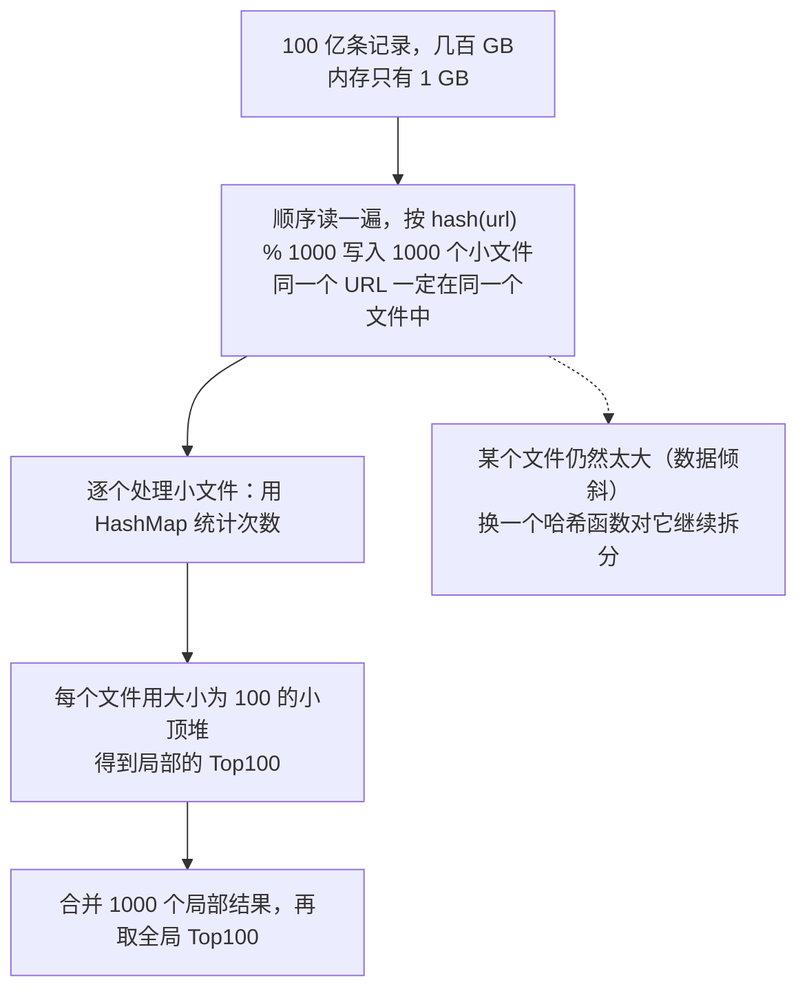

- **为什么找最大的 K 个要用小顶堆？** 堆顶是当前 K 个候选中最小的那个，新元素只需要和堆顶比较：比堆顶大就替换堆顶并调整。总复杂度 O(n log K)，内存只需要 K 个元素。
- **外部排序**：每次读入内存能放下的一块数据，排序后写成一个有序的小文件；然后用一个大小为 k 的最小堆做 k 路归并：每次输出堆顶，再从堆顶元素所在的文件补充下一个。
- **两个大文件求交集**：用同一个哈希函数分别分片，只需要比较编号相同的分片。
- **40 亿个整数中判断某个数是否存在**：用位图，2^32 位 = 512 MB，每个整数一位。

**追问链**

1. **实际工作中要自己写这些吗？** 很少。按键哈希分区、分区内聚合、再合并，就是 MapReduce 和 Spark 中 shuffle 的过程，生产中直接用 Spark、Flink、ClickHouse 这类工具。但理解这个思路，才能看懂数据倾斜、shuffle 太慢这类问题的原因。
2. **怎么求海量数据的中位数？** 数据流中实时维护：用两个堆，大顶堆存较小的一半，小顶堆存较大的一半，保持两边数量平衡。数据放不进内存时：第一遍按数值范围分桶，只统计每个桶的数量，确定中位数落在哪个桶；第二遍只把这个桶的数据读进内存排序。

---

### 40-16 面对一个新需求，怎么选择合适的数据结构？

> ★★ ｜ 架构师 ｜ 中频

**考察意图**：能从访问模式出发做选择，而不是只会用最熟悉的结构。

**30 秒版回答**：按顺序回答下面几个问题：

1. **主要的操作是什么**：按键精确查找、范围查询或排序、前缀匹配、判断是否存在、计数，还是按到达顺序或优先级取出？
2. **数据量和内存**：放得进内存吗？元素是基本类型还是对象（40-03）？
3. **并发**：有没有多线程读写？读多还是写多？
4. **精度**：能不能接受一定的误差？
5. **持久化**：数据在内存中还是磁盘上？读多还是写多（40-10）？

| 主要的访问方式 | 首选的结构 |
| --- | --- |
| 按键精确查找 | 哈希表；键是范围不大的整数时，用数组或位图 |
| 有序、范围查询 | 内存中用 `TreeMap` 或跳表；磁盘上用 B+ 树或 LSM 树（40-08） |
| 前缀或关键词匹配 | 前缀树、基数树、AC 自动机 |
| 按到达顺序或优先级取出 | 队列、环形缓冲区；按优先级用堆；按时间触发用时间轮 |
| 判断是否存在或计数，允许误差 | 布隆过滤器、HyperLogLog、Count-Min Sketch |
| 判断是否存在，必须精确 | `HashSet`、位图、RoaringBitmap |

**常见组件背后的数据结构**

| 组件 | 核心数据结构 |
| --- | --- |
| `HashMap` | 数组 + 链表 + 红黑树（02-04） |
| Redis 的 ZSet | 跳表 + 哈希表，元素少时用紧凑的 listpack（17-02、17-03） |
| MySQL InnoDB 索引 | B+ 树（15-01） |
| RocksDB、HBase | LSM 树（40-10） |
| Elasticsearch | 倒排索引、FST、RoaringBitmap（19-01） |
| Kafka 的日志 | 只追加写的分段文件 + 稀疏索引（见[《21 Kafka》](../05-消息队列/21-Kafka.md)） |
| Caffeine | 并发哈希表 + 访问顺序队列 + Count-Min Sketch（18-04） |
| Netty 的定时器、Kafka 的延迟操作 | 时间轮（34-06、34-07） |
| Log4j2 异步日志 | 环形缓冲区（Disruptor，40-13） |

**追问链**

1. **选数据结构时最常见的错误是什么？**
   - 只看平均复杂度，忽略了最坏情况（40-02）和内存（40-03）：例如用 `HashSet<Long>` 给上亿个 ID 去重，光节点就要几 GB；
   - 过早优化：大多数业务的数据量，用 `HashMap` 和 `ArrayList` 就足够了，先测量再优化；
   - 自己实现复杂的结构：并发跳表、布隆过滤器、Roaring 都有成熟的实现，自己写很容易出并发和边界问题。
2. **设计一个支持过期时间的 Map，需要哪些数据结构？** 组合使用：哈希表负责按键查找；另外需要一个能找出"哪些键已经过期"的结构，可以是按过期时间排序的堆、时间轮，或者像 Redis 那样访问时检查（惰性删除）加上定期随机抽样清理（见 17-06）。只用哈希表的话，要么遍历全部的键，要么过期的键一直占着内存。
