# 41 · 容器与云计算

> 适用岗位：Java 资深开发（重点：cgroup 对 CPU 和内存的限制、Java 镜像的构建、PID 1 与信号、探针和优雅终止、requests 和 limits、Service 与 DNS、Pod 故障排查）、Java 架构师（重点：Kubernetes 的架构和控制循环、HPA、高可用部署、Gateway API、Serverless、CI/CD 与 GitOps、有状态服务要不要上 Kubernetes）
> 版本基线：Kubernetes 1.37（当前最新的次版本，1.37.1 发布于 2026-09-15）、Linux cgroup v2、JDK 25、Spring Boot 4.0.4
> 事实核对：
> - Kubernetes 官方文档：[版本发布](https://kubernetes.io/releases/)、[特性门控](https://kubernetes.io/docs/reference/command-line-tools-reference/feature-gates/)、[Pod 生命周期](https://kubernetes.io/docs/concepts/workloads/pods/pod-lifecycle/)、[容器生命周期钩子](https://kubernetes.io/docs/concepts/containers/container-lifecycle-hooks/)、[Pod QoS](https://kubernetes.io/docs/concepts/workloads/pods/pod-qos/)、[节点压力驱逐](https://kubernetes.io/docs/concepts/scheduling-eviction/node-pressure-eviction/)、[Service 的虚拟 IP 与代理模式](https://kubernetes.io/docs/reference/networking/virtual-ips/)、[Pod 与 Service 的 DNS](https://kubernetes.io/docs/concepts/services-networking/dns-pod-service/)、[HPA](https://kubernetes.io/docs/tasks/run-application/horizontal-pod-autoscale/)、[Secret](https://kubernetes.io/docs/concepts/configuration/secret/)、[cgroup v2](https://kubernetes.io/docs/concepts/architecture/cgroups/)、[Ingress NGINX 退役公告](https://kubernetes.io/blog/2025/11/11/ingress-nginx-retirement/)。
> - Linux：内核文档 [cgroup-v2.rst](https://github.com/torvalds/linux/blob/master/Documentation/admin-guide/cgroup-v2.rst)（`cpu.max`、`cpu.stat`、`cpu.weight`、`memory.current`、`memory.high`、`memory.max`）、[pid_namespaces(7)](https://man7.org/linux/man-pages/man7/pid_namespaces.7.html)；OpenJDK 主线源码 `cgroupSubsystem_linux.cpp`（可用处理器数只看 CPU 配额和 CPU 亲和性，不看 CPU 权重）。
> - [Dockerfile 参考](https://docs.docker.com/reference/dockerfile/)（exec 形式与信号）、[Spring Boot 的 Dockerfile 示例](https://docs.spring.io/spring-boot/reference/packaging/container-images/dockerfiles.html)、[Spring Boot 的 Kubernetes 探针](https://docs.spring.io/spring-boot/reference/actuator/endpoints.html)、[Gateway API](https://gateway-api.sigs.k8s.io/docs/)、[AWS Lambda SnapStart](https://docs.aws.amazon.com/lambda/latest/dg/snapstart.html)。
> - 本地核对：Spring Boot 4.0.4 的配置元数据中 `management.endpoint.health.probes.enabled` 默认为 `true`，并通过环境变量 `KUBERNETES_SERVICE_HOST`、`KUBERNETES_SERVICE_PORT` 识别 Kubernetes 环境；本机（macOS 27.2）的 bash、dash、zsh 执行 `-c` 时，只有一条简单命令会直接 exec，命令中有 `;`、`&&` 时 shell 会保留。
> - **说明**：本机的 Docker 守护进程没有运行，也没有 Kubernetes 集群，本类没有做容器和集群的实测，相关结论来自上面的官方文档和源码。
> 相关分类：[《04 JVM》](../01-Java核心/04-JVM.md)（容器中的 JVM 内存和参数、启动优化）、[《11 微服务》](../03-分布式与微服务/11-微服务.md)（服务网格、发布策略）、[《12 SpringCloud》](../03-分布式与微服务/12-SpringCloud.md)（K8s 上的服务发现）、[《26 高可用》](../06-三高与架构/26-高可用.md)（优雅上下线、灰度）、[《33 线上问题排查》](../07-工程实践与稳定性/33-线上问题排查.md)、[《34 定时任务》](../07-工程实践与稳定性/34-定时任务.md)、[《36 Maven·Git·IDEA》](../07-工程实践与稳定性/36-Maven·Git·IDEA.md)、[《37 计算机网络》](../08-计算机基础/37-计算机网络.md)、[《38 操作系统》](../08-计算机基础/38-操作系统.md)、[《39 网络安全》](../08-计算机基础/39-网络安全.md)

## 知识地图

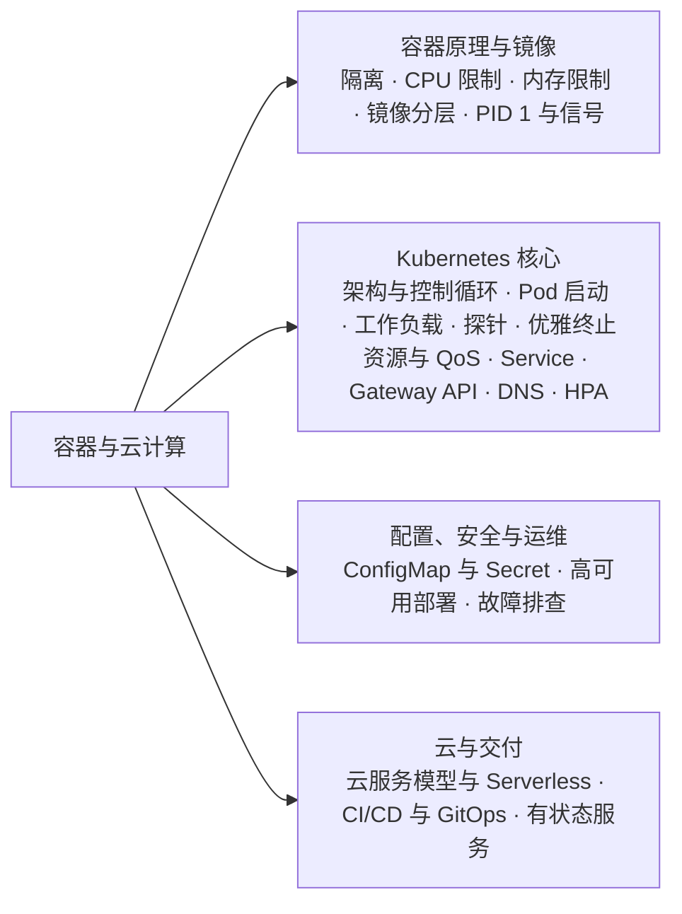

## 题目索引

| 编号 | 题目 | 难度 | 层级 |
| --- | --- | --- | --- |
| 41-01 | 容器和虚拟机有什么区别？容器的隔离是靠什么实现的？ | ★★ | 资深 |
| 41-02 | 容器的 CPU 是怎么限制的？为什么 CPU 使用率不高，请求却变慢了？ | ★★★ | 资深 |
| 41-03 | 容器的内存是怎么计算的？OOMKilled 和被驱逐有什么区别？ | ★★★ | 资深 |
| 41-04 | 镜像是怎么分层的？Java 应用的镜像应该怎么构建？ | ★★ | 资深 |
| 41-05 | 为什么 Java 进程在容器里收不到 SIGTERM？1 号进程有什么特殊之处？ | ★★ | 资深 |
| 41-06 | Kubernetes 由哪些组件组成？"声明式"和"控制循环"是什么意思？ | ★★ | 资深 |
| 41-07 | 一个 Pod 从提交到开始接收流量，经历了哪些步骤？ | ★★★ | 资深 |
| 41-08 | Deployment、StatefulSet、DaemonSet、Job、CronJob 分别用在什么场景？ | ★★ | 资深 |
| 41-09 | 存活、就绪、启动探针怎么配？配错了会怎样？ | ★★★ | 资深 |
| 41-10 | Pod 是怎么被终止的？preStop 和优雅停机怎么配合？ | ★★★ | 资深 |
| 41-11 | requests 和 limits 怎么设？QoS 等级有什么影响？ | ★★★ | 资深 / 架构师 |
| 41-12 | Service 是怎么把流量转发到 Pod 的？长连接为什么会负载不均？ | ★★★ | 资深 |
| 41-13 | Ingress 和 Gateway API 有什么区别？Ingress NGINX 退役后怎么办？ | ★★ | 架构师 |
| 41-14 | Pod 中的域名是怎么解析的？ndots 为什么会让解析变慢？ | ★★ | 资深 |
| 41-15 | HPA 是怎么决定扩缩容的？Java 应用用 HPA 有哪些坑？ | ★★★ | 架构师 |
| 41-16 | ConfigMap 和 Secret 怎么用？Secret 安全吗？Pod 怎样获得云资源的权限？ | ★★ | 资深 |
| 41-17 | 怎样保证 Kubernetes 上的服务高可用？ | ★★★ | 架构师 |
| 41-18 | Pod 起不来或者反复重启，怎么排查？ | ★★ | 资深 |
| 41-19 | IaaS、PaaS、SaaS、FaaS 怎么区分？Serverless 适合 Java 吗？ | ★★ | 架构师 |
| 41-20 | Java 服务的 CI/CD 流水线怎么设计？GitOps 是什么？ | ★★ | 架构师 |
| 41-21 | 数据库、消息队列这类有状态服务，要不要放进 Kubernetes？ | ★★ | 架构师 |

---

## 一、容器原理与镜像

### 41-01 容器和虚拟机有什么区别？容器的隔离是靠什么实现的？

> ★★ ｜ 资深 ｜ 高频

**考察意图**：知道容器不是"轻量虚拟机"，而是被内核特性包装起来的普通进程，以及由此带来的好处和风险。

**30 秒版回答**

- **虚拟机**：由虚拟化层模拟出一整套硬件，每个虚拟机运行自己的操作系统内核。隔离强，但启动慢，每个实例都要额外占用一个操作系统的内存。
- **容器**：本质上是宿主机上的一组普通进程，**和宿主机共享同一个内核**。内核用三样东西把它包装成一个看起来独立的环境：
  - **Namespace（命名空间）**：隔离"能看到什么"，共 8 种：PID、网络、挂载点、主机名、IPC、用户、cgroup、时间；
  - **cgroup（控制组）**：限制"能用多少"：CPU、内存、IO、进程数；
  - **根文件系统**：由镜像的只读层和容器的可写层通过 overlayfs 叠加而成。
- 所以容器启动快（只是启动一个进程）、开销小；但隔离的边界是共享的内核，内核漏洞可能导致容器逃逸。需要更强的隔离时（多租户、运行不可信的代码），可以用 gVisor（在用户态实现内核接口）或者 Kata Containers、Firecracker 这类轻量虚拟机。

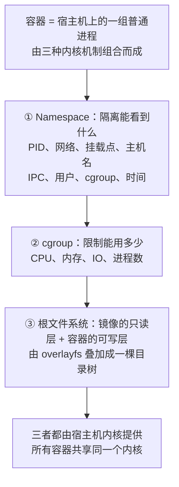

**追问链**

1. **在宿主机上能看到容器里的进程吗？** 能。`ps` 可以看到容器中的 java 进程，只是 PID 和容器里看到的不同（容器里的 1 号进程，在宿主机上是一个普通的 PID）。
2. **在容器里执行 `free`、`top`，看到的为什么是宿主机的内存和 CPU？** `/proc/meminfo`、`/proc/cpuinfo` 没有被命名空间隔离，这些工具显示的是宿主机的数据。容器的限制要从 cgroup 文件中读取，JVM 就是这么做的（见[《04 JVM》](../01-Java核心/04-JVM.md)04-12）。所以不要用这些工具判断容器的资源是否够用。
3. **容器重建后，写在容器里的文件为什么没了？** 它们写在容器的可写层中，容器删除时可写层也一起删除。需要保留的数据要写到卷中，或者写到对象存储这类外部存储中（见[《35 文件处理》](../07-工程实践与稳定性/35-文件处理.md)）。

---

### 41-02 容器的 CPU 是怎么限制的？为什么 CPU 使用率不高，请求却变慢了？

> ★★★ ｜ 资深 ｜ 高频

**考察意图**：理解 CPU 配额的工作方式，能解释"节流"导致的延迟毛刺，知道它对 JVM 的影响。

**30 秒版回答**

- Kubernetes 把 CPU 的 requests 和 limits 转换成 cgroup v2 中的两个设置：
  - **requests → `cpu.weight`（权重）**：只在 CPU 紧张时按权重比例分配，CPU 空闲时可以多用；
  - **limits → `cpu.max`（配额和周期）**：格式是"配额 周期"，单位微秒，默认周期是 100 毫秒。limit 为 2 核，就是每 100 毫秒最多使用 200 毫秒的 CPU 时间。
- **配额是容器内所有线程合起来算的**。8 个线程同时运行，25 毫秒就把 200 毫秒的配额用完了，这个周期剩下的 75 毫秒，容器中所有的线程都被暂停，这叫**节流**（throttling）。按分钟统计的平均 CPU 使用率可能不高，但请求的延迟会出现几十毫秒的毛刺。
- 怎么确认：看容器 cgroup 中的 `cpu.stat`，`nr_throttled`（被节流的周期数）和 `throttled_usec`（被节流的总时间）是否持续增长（见[《33 线上问题排查》](../07-工程实践与稳定性/33-线上问题排查.md)33-06）。

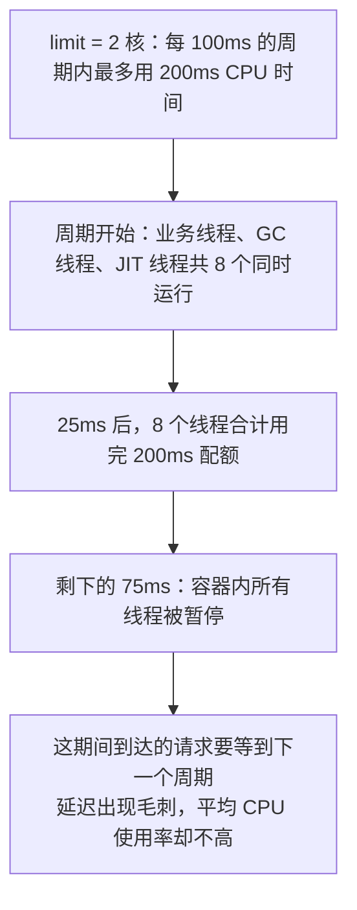

**对 JVM 的影响**

- JVM 根据 CPU 配额计算可用的处理器数：配额除以周期并向上取整，再和 CPU 亲和性限制取较小值。当前 OpenJDK 主线源码中，这个计算**不使用 CPU 权重**。可用处理器数决定了 GC 线程数、`ForkJoinPool` 公共池和虚拟线程调度器的并行度等（见 04-12）。
- **只设 requests、不设 limits 时**，cgroup 中没有配额，JVM 会认为整个节点的 CPU 都可以用（比如 64 核），从而创建大量的 GC 线程和并行线程。这种情况下应该用 `-XX:ActiveProcessorCount=N` 显式指定。
- 启动阶段的类加载、JIT 编译会让很多线程同时忙碌，最容易被节流，表现为启动变慢、探针超时。

**追问链**

1. **CPU 的 limit 要不要设？** 这个问题有争议，要看场景：
   - 不设 limit：可以利用节点空闲的 CPU，没有节流；requests 仍然保证了每个 Pod 的最低份额。适合对延迟敏感的在线服务，同时要显式设置 `ActiveProcessorCount`；
   - 设 limit：多租户集群为了公平和成本控制通常要求设置；需要 Guaranteed 等级（41-11）或者独占 CPU 核时，必须设置并且等于 requests。
2. **节流和 CPU 使用率高有什么区别？** CPU 使用率高是真的算不过来，扩容或者优化代码；节流是"配额太小，或者线程在短时间内太集中"，可以调大 limit、减少并行线程数，或者去掉 limit。

---

### 41-03 容器的内存是怎么计算的？OOMKilled 和被驱逐有什么区别？

> ★★★ ｜ 资深 ｜ 高频

**考察意图**：分清 cgroup 中各种内存的含义，能区分两种"被杀"的原因。JVM 进程自身的内存构成见[《04 JVM》](../01-Java核心/04-JVM.md)04-03。

**30 秒版回答**

- 内存的 limit 对应 cgroup v2 的 `memory.max`，是硬上限。`memory.current` 统计的是这个 cgroup 中**所有的内存**：进程的匿名内存（JVM 的堆和堆外内存）、**页缓存**（读写文件时缓存的数据），以及 socket 缓冲区等内核内存。
- 达到 `memory.max` 时，内核先尝试回收（主要是页缓存）；回收不了，就在这个 cgroup 中触发 OOM Killer 杀掉进程。Kubernetes 中显示为 `OOMKilled`，退出码 137（128 + 9，即被 SIGKILL 杀死）。
- **工作集**（working set）= 内存使用量 − 非活跃的文件页（`inactive_file`）。kubelet 用它判断节点的内存压力，常用的监控指标 `container_memory_working_set_bytes` 也是它。

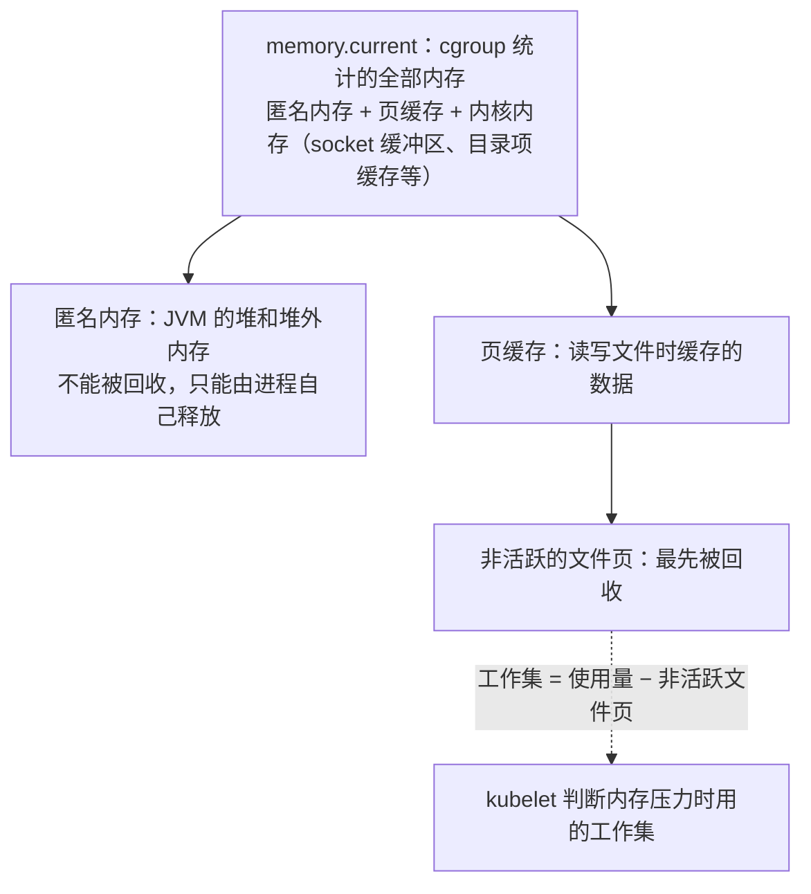

**两种"被杀"**

| 对比 | 容器被 OOMKilled | Pod 被节点压力驱逐 |
| --- | --- | --- |
| 触发条件 | 容器自己的用量达到 `memory.max` | 节点的可用内存低于阈值（Linux 默认 `memory.available<100Mi`） |
| 执行者 | 内核 | kubelet |
| 结果 | 容器在原地重启，Pod 还在，状态显示 `OOMKilled` | 整个 Pod 被终止（状态为 Failed），由控制器在其他节点上重建 |
| 先杀谁 | 这个容器中的进程 | 先驱逐 BestEffort，然后是用量超过 requests 的 Burstable，最后才是 Guaranteed（41-11） |

- 如果节点内存耗尽得太快，kubelet 来不及驱逐，就由节点上的内核 OOM Killer 按 `oom_score_adj` 选择进程：kubelet 为 Guaranteed 的容器设置 −997，为 BestEffort 的设置 1000，Burstable 介于两者之间。

**追问链**

1. **应用写了大量日志，容器的内存一直涨，会被杀吗？** 一般不会：页缓存可以回收，达到上限前内核会先回收它们。但有两种例外：
   - 写到内存型 `emptyDir`（tmpfs）中的文件也算容器的内存，而且**不能回收**，写多了就会 OOM；
   - 工作集的计算会把活跃的文件页算作已使用（Kubernetes 文档承认的已知问题），可能让监控显示的内存偏高。
2. **Java 应用的内存怎么配？** 堆占容器内存的 50%~75%，剩下的留给堆外（见 04-03、04-12）；内存的 requests 和 limits 设成一样，避免节点超卖时因为"超过了 requests"而优先被驱逐。
3. **`memory.high` 是什么？** 一个软上限：超过后进程会被节流并被强制回收内存，**不会**触发 OOM。Kubernetes 的 Memory QoS 特性开启后，会用它在 Burstable Pod 达到硬上限之前先进行节流。

---

### 41-04 镜像是怎么分层的？Java 应用的镜像应该怎么构建？

> ★★ ｜ 资深 ｜ 高频

**考察意图**：理解镜像分层和缓存的原理，能写出构建快、体积小、安全的 Java 镜像。

**30 秒版回答**

- 镜像由多个**只读层**组成，Dockerfile 中的 `COPY`、`RUN` 等指令各生成一层；运行时 overlayfs 把这些层和容器的可写层叠在一起。
- 层按内容寻址：内容相同的层在存储和拉取时只保留一份。某一层变了，**它和它上面的所有层**都要重新构建、重新推送、重新拉取。所以构建镜像的原则是：**变化少的放在下面，变化多的放在上面**。
- 把 Spring Boot 的 fat jar 整个复制进去只有一层，改一行代码，上百 MB 的依赖也要重新推送。Spring Boot 的分层 jar 会拆成四层：`dependencies`（第三方依赖）、`spring-boot-loader`、`snapshot-dependencies`、`application`（业务代码）。

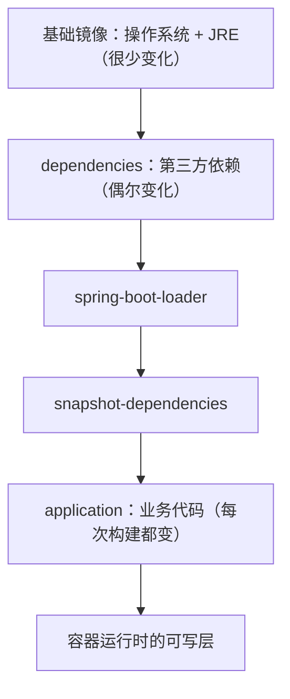

**深入剖析：Spring Boot 官方文档中的 Dockerfile**（JDK 25，分层 + AOT 缓存，本机未构建）

```dockerfile
# 构建阶段：把 fat jar 解压成分层的目录结构
FROM bellsoft/liberica-openjre-debian:25-cds AS builder
WORKDIR /builder
ARG JAR_FILE=target/*.jar
COPY ${JAR_FILE} application.jar
RUN java -Djarmode=tools -jar application.jar extract --layers --destination extracted

# 运行阶段：按变化频率从低到高逐层复制
FROM bellsoft/liberica-openjre-debian:25-cds
WORKDIR /application
COPY --from=builder /builder/extracted/dependencies/ ./
COPY --from=builder /builder/extracted/spring-boot-loader/ ./
COPY --from=builder /builder/extracted/snapshot-dependencies/ ./
COPY --from=builder /builder/extracted/application/ ./
# 训练运行：启动到 Spring 上下文刷新完成后退出，生成 AOT 缓存（见《04 JVM》04-19）
RUN java -XX:AOTCacheOutput=app.aot -Dspring.context.exit=onRefresh -jar application.jar
# exec 形式，java 直接作为 1 号进程（41-05）
ENTRYPOINT ["java", "-XX:AOTCache=app.aot", "-jar", "application.jar"]
```

**其他要点**

| 做法 | 原因 |
| --- | --- |
| 多阶段构建，运行镜像中只放 JRE | 体积小，攻击面小 |
| 谨慎选择 Alpine 作为基础镜像 | Alpine 使用 musl libc，要用专门为 musl 构建的 JDK，部分带本地库的依赖可能不兼容 |
| 用 `USER` 指令以非 root 用户运行 | 万一发生容器逃逸，影响更小 |
| 基础镜像固定版本，最好固定到摘要（digest） | `latest` 会悄悄变化，构建不可复现 |
| 镜像中不放任何密钥 | 能拉取镜像的人都能解开每一层查看 |
| 构建后扫描漏洞、生成 SBOM | 见[《39 网络安全》](../08-计算机基础/39-网络安全.md)39-18 |

不想写 Dockerfile 时，也可以用 Cloud Native Buildpacks（Spring Boot 的 `build-image` 插件目标）或者 Jib 直接生成分层的镜像。

**追问链**

1. **在后面的层中删除一个文件，镜像会变小吗？** 不会。前面的层中仍然有这个文件，后面的层只是用一个"删除标记"把它遮住。所以构建中产生的临时文件、下载的密钥，要在同一条 `RUN` 中清理，或者只在构建阶段使用，不复制到运行阶段。
2. **AOT 缓存放在镜像中有什么要求？** 运行时的 JDK 版本和类路径要和训练时一致，所以训练运行必须在最终的运行镜像中进行，就像上面的 Dockerfile 那样（见 04-19）。

---

### 41-05 为什么 Java 进程在容器里收不到 SIGTERM？1 号进程有什么特殊之处？

> ★★ ｜ 资深 ｜ 中频

**考察意图**：这是"发布时请求失败、优雅停机不生效"的常见原因。信号与停机的基础见[《38 操作系统》](../08-计算机基础/38-操作系统.md)38-07。

**30 秒版回答**

- Kubernetes 终止 Pod 时，由容器运行时向每个容器中的 **1 号进程**发送 SIGTERM（`docker stop` 也一样）。
- Dockerfile 用 **shell 形式**（`ENTRYPOINT java -jar app.jar`）时，实际执行的是 `/bin/sh -c "java -jar app.jar"`。Docker 文档的说法是：这种形式下可执行文件不是 1 号进程，收不到信号。宽限期结束后，java 被 SIGKILL 强制杀死，优雅停机的代码根本没有执行。
- 实际情况取决于镜像中的 shell：本机验证，bash、dash、zsh 在 `-c` 后面**只有一条简单命令**时会直接 exec，java 仍然是 1 号进程；但只要命令中有 `;`、`&&`、管道等，shell 就会留下来当 1 号进程。**不要依赖这种行为**。
- 正确的做法：
  - 用 **exec 形式**：`ENTRYPOINT ["java", "-jar", "app.jar"]`；
  - 必须用启动脚本时，最后一行写 `exec java ...`，让 java 替换掉 shell；
  - 或者使用 tini 这类小型 init 进程（`docker run --init`），由它转发信号。

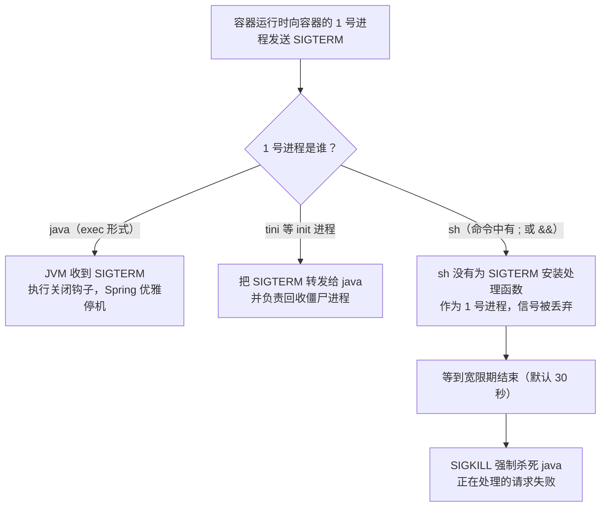

**1 号进程的两个特殊之处**

1. **没有安装处理函数的信号会被丢弃**：pid_namespaces(7) 规定，命名空间内的其他进程，以及上层命名空间中的进程，只能向 1 号进程发送它安装了处理函数的信号；只有从上层命名空间发来的 SIGKILL 和 SIGSTOP 会被强制送达。JVM 为 SIGTERM 安装了处理函数，所以 java 作为 1 号进程能正常停机；而一个没有写 `trap` 的 shell 脚本作为 1 号进程，会直接丢弃 SIGTERM。
2. **要负责回收孤儿进程**：父进程先退出的子进程会被交给 1 号进程，如果 1 号进程不回收，它们就会变成僵尸进程（见 38-06）。JVM 只回收自己通过 `ProcessBuilder` 创建的子进程。应用会创建很多子进程时，用 tini 作为 1 号进程更稳妥。

**追问链**

1. **启动脚本中需要先做一些准备工作，怎么写？** 准备工作做完后，最后一行用 `exec java ...` 启动，让 java 接替脚本成为 1 号进程。
2. **怎么验证 Pod 中的 1 号进程是谁？** `kubectl exec <pod> -- cat /proc/1/cmdline`，或者查看 `/proc/1/status` 中的 `Name`。

---

## 二、Kubernetes 核心

### 41-06 Kubernetes 由哪些组件组成？"声明式"和"控制循环"是什么意思？

> ★★ ｜ 资深 ｜ 高频

**考察意图**：理解 Kubernetes 的工作方式，后面所有的机制（自愈、扩缩容、滚动发布）都建立在它之上。

**30 秒版回答**

- **声明式**：用户提交的是"期望的状态"（比如"要 3 个副本，用这个镜像"），而不是"先做这个、再做那个"的命令。
- **控制循环**：每个控制器不停地比较"期望的状态"和"实际的状态"，发现不一致就采取行动让两者一致，然后继续观察。Pod 挂了自动补上、节点宕机后 Pod 在别处重建，都是控制循环的结果。
- 组件分为两部分：

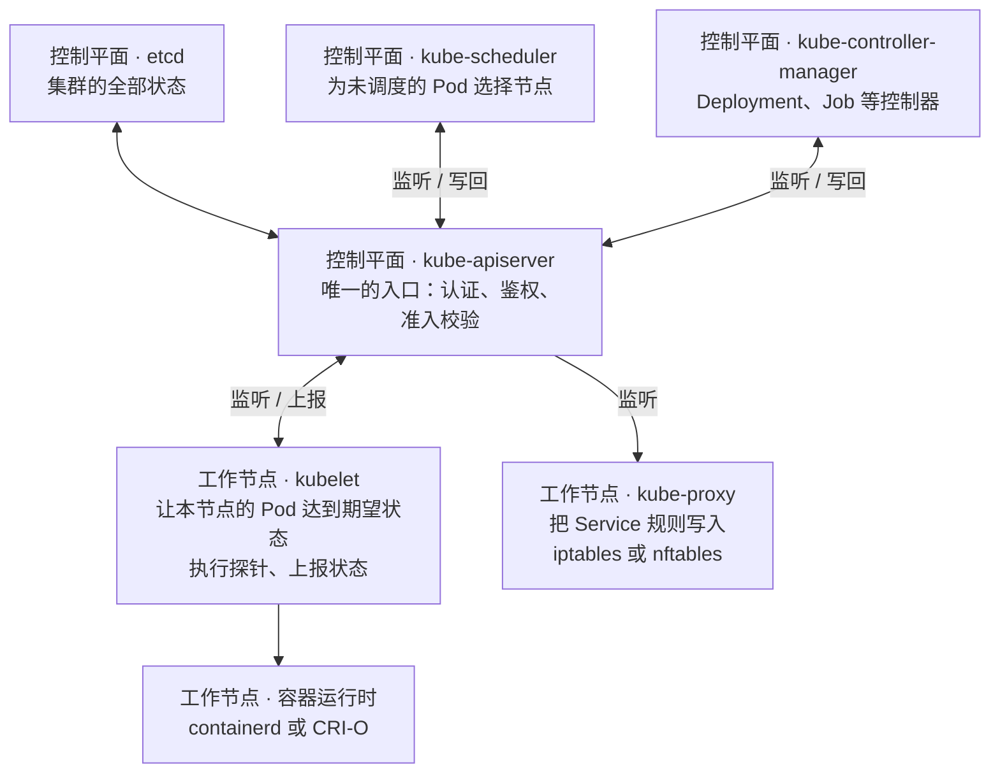

- **所有组件之间不直接通信，都通过 API Server 读写对象、监听变化**。每个组件只关心自己负责的那部分状态，这让系统很容易扩展：自定义的控制器（Operator）也是用同样的方式工作的。

**追问链**

1. **API Server 挂了，正在运行的 Pod 会受影响吗？** 已经运行的容器不受影响，kubelet 会继续维持它们；但这期间不能创建、修改资源，控制器不能工作，Pod 挂掉不会被重新调度。所以生产集群的控制平面要多副本部署，etcd 一般是 3 或 5 个节点（多数派，见[《09 分布式理论》](../03-分布式与微服务/09-分布式理论.md)09-05）。
2. **Docker 和 Kubernetes 是什么关系？** Kubernetes 通过 CRI 接口调用容器运行时。Kubernetes 1.24 移除了内置的 Docker 适配层（dockershim），现在常用的运行时是 containerd 和 CRI-O。用 Docker 构建的镜像符合 OCI 标准，仍然可以正常运行。

---

### 41-07 一个 Pod 从提交到开始接收流量，经历了哪些步骤？

> ★★★ ｜ 资深 ｜ 中频

**考察意图**：把各个组件的职责串起来，知道启动慢、启动失败时应该看哪个环节。

**30 秒版回答**

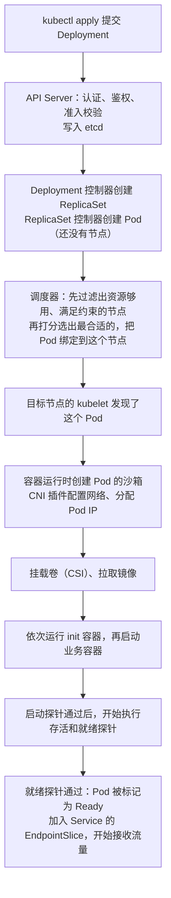

**追问链**

1. **Pod 一直是 Pending，是哪一步出了问题？** 通常是调度失败：资源不够（requests 太大）、节点选择器或亲和性条件不满足、节点有污点而 Pod 没有容忍、PVC 无法绑定。`kubectl describe pod` 的事件中会写明原因（41-18）。
2. **哪几步最容易拖慢启动？** 拉取镜像（镜像太大、仓库太远，见 41-04）、JVM 启动和预热（见[《04 JVM》](../01-Java核心/04-JVM.md)04-19）、探针的初始延迟和周期设置得太保守。

---

### 41-08 Deployment、StatefulSet、DaemonSet、Job、CronJob 分别用在什么场景？

> ★★ ｜ 资深 ｜ 高频

**考察意图**：能为不同的服务选择合适的工作负载类型，知道各自的关键配置。

**30 秒版回答**

| 类型 | 特点 | 典型场景 |
| --- | --- | --- |
| **Deployment** | 副本之间没有区别，可以随意替换；支持滚动更新和回滚 | 无状态的 Web 服务、微服务 |
| **StatefulSet** | 每个副本有固定的名字（`web-0`、`web-1`）、固定的网络标识和独立的存储；按顺序创建和删除 | 数据库、ZooKeeper、Kafka 等有状态服务（41-21） |
| **DaemonSet** | 每个（或选中的）节点上运行一个副本 | 日志采集、节点监控、网络插件 |
| **Job** | 运行到成功结束为止，失败时重试 | 数据迁移、一次性的批处理 |
| **CronJob** | 按 cron 表达式定时创建 Job | 定时任务（和分布式调度框架的对比见[《34 定时任务》](../07-工程实践与稳定性/34-定时任务.md)） |

**深入剖析：几个关键配置**

- **Deployment 的滚动更新**：`maxSurge`（最多比期望副本数多出几个）和 `maxUnavailable`（最多有几个不可用），默认都是 25%。新 Pod 就绪后才会继续替换下一批，所以**就绪探针决定了发布是否安全**（41-09）。
- **Job**：`backoffLimit`（失败重试的次数，默认 6）、`activeDeadlineSeconds`（总的运行时间上限）、`completions` 和 `parallelism`（一共要成功几次、同时运行几个）。
- **CronJob**：
  - `concurrencyPolicy`：上一次还没结束、下一次的时间到了怎么办。`Allow`（默认，同时运行）、`Forbid`（跳过这一次）、`Replace`（停掉上一次，运行这一次）；
  - `timeZone`：指定时区，否则按 kube-controller-manager 所在的时区；
  - `startingDeadlineSeconds`：错过调度时间多久之内还可以补跑；
  - `successfulJobsHistoryLimit`、`failedJobsHistoryLimit`：保留几个历史 Job（默认 3 个和 1 个）。
- Kubernetes 文档明确提醒：CronJob 大约每个调度时间创建一个 Job，但在某些情况下**可能创建两个，也可能一个都不创建**，所以任务必须是**幂等**的。

**追问链**

1. **CronJob 和 XXL-JOB 这类调度框架怎么选？** CronJob 每次启动一个新的 Pod，适合运行时间较长、资源需求大、和在线服务隔离的批处理；缺点是启动开销大（拉镜像、启动 JVM），不适合秒级、高频的任务，也没有分片、任务编排、执行日志查询这些功能（见 34-11）。
2. **StatefulSet 缩容后，数据还在吗？** 默认情况下，缩容删除 Pod 时，它的 PVC 和数据会保留，再扩容时同名的 Pod 会挂载回原来的数据。也可以配置 PVC 的保留策略，在删除或缩容时一并删除。

---

### 41-09 存活、就绪、启动探针怎么配？配错了会怎样？

> ★★★ ｜ 资深 ｜ 高频

**考察意图**：探针配错是生产中"服务被反复重启""发布时报错"的常见原因。优雅上下线的整体流程见[《26 高可用》](../06-三高与架构/26-高可用.md)26-13。

**30 秒版回答**

| 探针 | 回答的问题 | 失败时 |
| --- | --- | --- |
| **启动探针**（startupProbe） | 应用启动完成了吗？ | 超过允许的次数后重启容器；在它成功之前，**不执行**另外两种探针 |
| **存活探针**（livenessProbe） | 应用还活着吗？例如是否死锁 | **重启容器** |
| **就绪探针**（readinessProbe） | 现在能接收流量吗？ | 从 Service 中**摘除**，不重启 |

- 默认参数：每 10 秒检查一次（`periodSeconds`），超时 1 秒（`timeoutSeconds`），连续失败 3 次（`failureThreshold`）才算失败。
- **Spring Boot**：`/actuator/health/liveness` 和 `/actuator/health/readiness` 两个健康组默认开启（Spring Boot 4.0.4 的 `management.endpoint.health.probes.enabled` 默认为 `true`，已核对）。管理端口和业务端口分开时，可以设置 `management.endpoint.health.probes.add-additional-paths=true`，在业务端口上额外提供 `/livez` 和 `/readyz`，这样探针检查的是真正处理请求的那个端口。

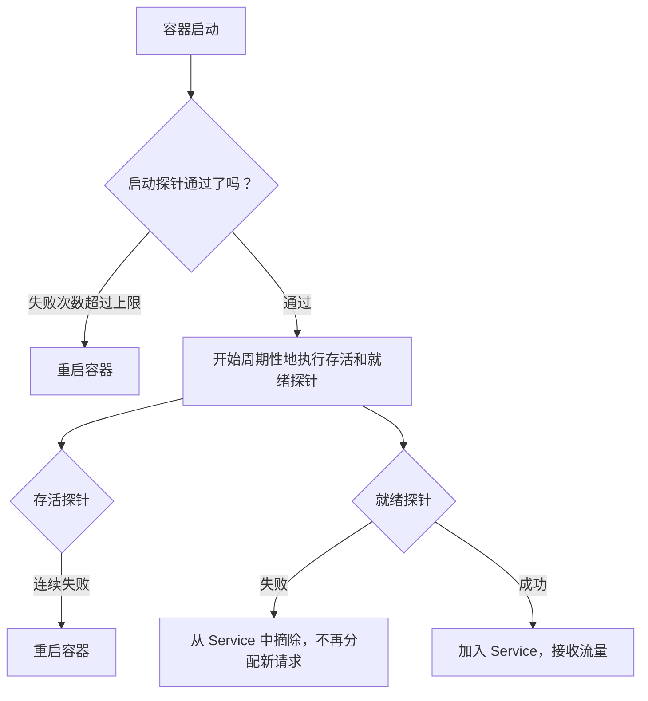

**常见的配置错误**

| 错误 | 后果 | 正确做法 |
| --- | --- | --- |
| 存活探针检查了数据库、Redis 等外部依赖 | 依赖一出问题，**所有实例被同时重启**，故障扩大，而重启根本解决不了依赖的问题 | 存活探针只检查进程自身。Spring Boot 文档明确说存活检查不应该依赖外部系统 |
| 启动慢的应用没有配启动探针，只给存活探针设了一个较长的初始延迟 | 延迟短了，还没启动完就被杀死，陷入重启循环；延迟长了，真正卡死时要很久才能发现 | 用启动探针给足启动时间（`failureThreshold × periodSeconds`），存活探针保持灵敏 |
| 就绪探针把所有依赖都检查一遍 | 一个非关键依赖出问题，所有实例同时被摘除，服务完全不可用 | 只检查这个实例自己必需的东西；所有实例共享的依赖要慎重，有降级方案的依赖不应该检查 |
| 超时只有默认的 1 秒，又赶上 Full GC 或 CPU 节流 | 探针偶发超时，实例被摘除甚至重启 | 适当放宽超时和失败次数，同时排查停顿的原因（41-02） |

**追问链**

1. **就绪探针要不要检查数据库？** Spring Boot 文档的态度是：要由开发者谨慎判断，所以它默认不在就绪检查中加入任何外部系统。如果某个依赖是所有实例共享的，它出问题时把所有实例都摘除，结果和服务挂掉一样，还不如返回明确的错误。
2. **应用怎么主动告诉 Kubernetes"我暂时不接流量了"？** Spring Boot 中可以发布 `AvailabilityChangeEvent`，把就绪状态改为 `REFUSING_TRAFFIC`。Spring Boot 的 Web 应用上下文在关闭时（`doClose`）也会自动发布这个状态（已核对 4.0.4 的字节码），所以停机期间就绪探针会失败。

---

### 41-10 Pod 是怎么被终止的？preStop 和优雅停机怎么配合？

> ★★★ ｜ 资深 ｜ 高频

**考察意图**：讲清楚 Kubernetes 终止 Pod 的时序，以及为什么需要 preStop。应用层面的优雅停机见[《26 高可用》](../06-三高与架构/26-高可用.md)26-13 和[《38 操作系统》](../08-计算机基础/38-操作系统.md)38-07。

**30 秒版回答**：删除 Pod 后，**两件事同时开始**：

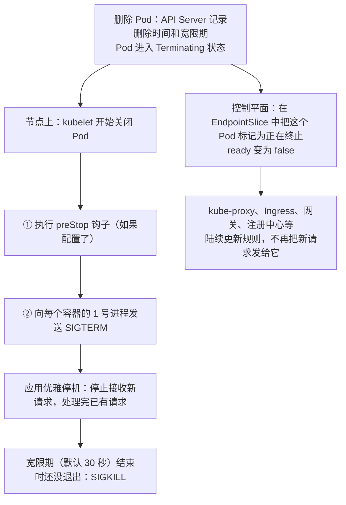

- 问题在于**右边一路是异步传播的**，需要一点时间才能到达所有的转发组件；如果左边一路先完成，应用已经停止接收请求，流量却还在进来，就会出现连接被拒绝的错误。
- **preStop 的作用就是"等一等"**：在发送 SIGTERM 之前先等几秒，让摘除流量的操作生效。Kubernetes 1.34 起，生命周期钩子原生的 `sleep` 动作正式可用，不需要在镜像中准备 `sleep` 命令。

```yaml
spec:
  terminationGracePeriodSeconds: 45   # 必须大于 preStop 的等待时间 + 应用停机时间
  containers:
    - name: app
      lifecycle:
        preStop:
          sleep:
            seconds: 10               # 先等 10 秒，让流量摘除生效
```

- **时间要算清楚**：宽限期从执行 preStop **之前**就开始计时，它覆盖了 preStop 和应用停机两部分。Kubernetes 文档中的例子：宽限期 60 秒，preStop 用了 55 秒，应用收到 SIGTERM 后需要 10 秒停机，结果应用在完成停机之前就被强制杀死了。
- 所以要满足：preStop 的等待时间 + Spring 优雅停机的超时（`spring.lifecycle.timeout-per-shutdown-phase`，默认 30 秒）< `terminationGracePeriodSeconds`。

**追问链**

1. **用了注册中心（Nacos 等）的服务，preStop 里还要做什么？** 注册中心不感知 Kubernetes 的终止过程，要在 preStop 中先调用接口把自己从注册中心注销，再等待调用方的服务列表刷新（见[《12 SpringCloud》](../03-分布式与微服务/12-SpringCloud.md)12-05）。
2. **日志采集、服务网格这类 Sidecar 容器，会不会比业务容器先退出？** Kubernetes 1.33 起，原生的 Sidecar 容器（`restartPolicy: Always` 的 init 容器）正式可用：它们在业务容器之前启动，在业务容器退出**之后**才终止，避免了业务容器还在处理请求、代理却已经退出的问题。

---

### 41-11 requests 和 limits 怎么设？QoS 等级有什么影响？

> ★★★ ｜ 资深 / 架构师 ｜ 高频

**考察意图**：理解调度、隔离、驱逐三件事分别看的是什么，能为 Java 服务给出合理的配置。

**30 秒版回答**

- **requests**：调度依据，表示"至少需要这么多"。调度器保证节点上所有 Pod 的 requests 之和不超过节点的可分配资源。
- **limits**：运行时的上限。CPU 超过会被节流（41-02），内存超过会被 OOMKilled（41-03）。
- **QoS 等级**由 requests 和 limits 的设置方式决定，影响节点资源紧张时谁先被牺牲：

| QoS 等级 | 条件 | 节点资源紧张时 |
| --- | --- | --- |
| **Guaranteed** | 每个容器的 CPU 和内存都设置了 requests 和 limits，并且两者相等 | 最后被驱逐；节点 OOM 时 `oom_score_adj` 为 −997，最不容易被杀 |
| **Burstable** | 不满足 Guaranteed，但至少设置了一项 requests 或 limits | 用量超过 requests 的会被优先驱逐 |
| **BestEffort** | 什么都没设置 | 最先被驱逐 |

**深入剖析：Java 服务的配置建议**

| 资源 | 建议 | 原因 |
| --- | --- | --- |
| 内存 | requests = limits | JVM 的堆一旦扩大很少归还给操作系统，内存用量基本稳定；设成相等可以避免因为"超过 requests"被优先驱逐 |
| 堆大小 | 用 `MaxRAMPercentage` 按容器内存的比例设置 | 调整容器规格时不需要改 JVM 参数（见 04-12） |
| CPU requests | 按压测得到的稳定负载设置 | 决定调度和 CPU 紧张时分到的份额 |
| CPU limits | 视场景决定：设置时不要太紧；不设置时要显式设置 `-XX:ActiveProcessorCount` | 避免节流和 JVM 误判 CPU 数量（41-02） |

**追问链**

1. **requests 设得很小，能多部署一些吗？** 能调度上去，但节点被"超卖"了：大家同时忙起来时，CPU 互相争抢，内存不够时超过 requests 的 Pod 被驱逐。requests 应该反映真实的稳定用量，不能当作"省钱"的手段。
2. **能不能在不重启的情况下调整 Pod 的资源？** Kubernetes 1.35 起，原地调整 Pod 资源（In-Place Pod Resize）正式可用。但对 Java 要注意：最大堆是 JVM 启动时按当时的内存限制算出来的，之后调大内存限制，堆不会跟着变大；线程池的大小一般也在启动时就确定了。所以对 Java 应用，调整内存仍然需要重启才能真正生效。
3. **Pod 级别的资源设置是什么？** Kubernetes 1.34 起为 Beta 并默认开启，可以对整个 Pod 设置 requests 和 limits，Pod 中的多个容器在这个总额内共享，适合有 Sidecar 的 Pod。

---

### 41-12 Service 是怎么把流量转发到 Pod 的？长连接为什么会负载不均？

> ★★★ ｜ 资深 ｜ 中频

**考察意图**：理解 Service 是四层的转发规则而不是一个代理进程，能解释 gRPC、HTTP/2 在 Kubernetes 中负载不均的原因。

**30 秒版回答**

- Pod 会随时被重建，IP 也会变，所以需要一个稳定的访问入口：**Service** 有一个固定的虚拟 IP（ClusterIP）和 DNS 名称，通过标签选择器找到后端的 Pod，后端列表保存在 **EndpointSlice** 中，其中标明了每个 Pod 是否就绪，只有就绪的 Pod 会被分配流量。
- ClusterIP 不对应任何真实的网卡，**由每个节点上的 kube-proxy 把规则写进内核**，在内核中把发往 ClusterIP 的连接改写到某个 Pod 的 IP：

| 模式 | 状态（Kubernetes 1.37） |
| --- | --- |
| `iptables` | 当前的默认模式，文档说明未来的版本会把默认值改为 `nftables` |
| `nftables` | 1.33 起正式可用，需要 5.13 及以上的内核，性能比另外两种都好 |
| `ipvs` | **1.35 起已废弃**，计划 1.40 起默认禁用、1.43 移除，官方建议换成 `nftables` |

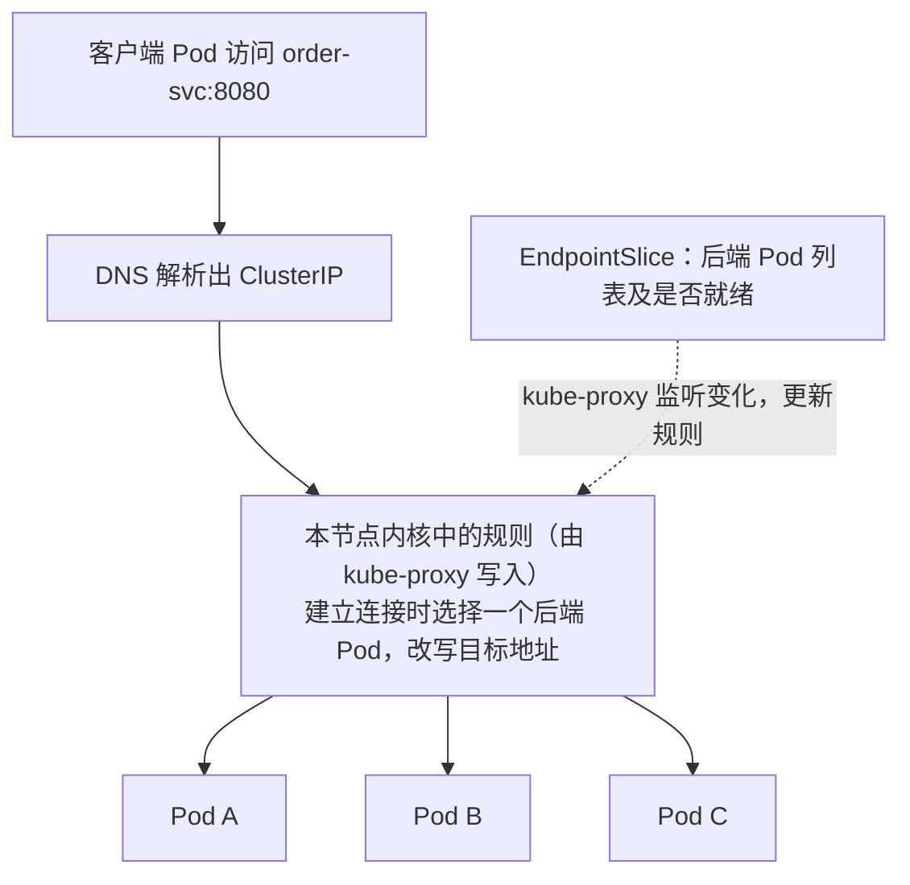

- 其他类型：`NodePort`（在每个节点上开放一个端口）、`LoadBalancer`（由云厂商创建外部负载均衡器）、Headless Service（`clusterIP: None`，DNS 直接返回所有 Pod 的 IP，StatefulSet 和客户端负载均衡会用到）。

**为什么长连接会负载不均？**

- kube-proxy 的规则工作在第四层，**只在建立连接时选择一次后端**。之后这个连接上的所有请求都发往同一个 Pod。
- HTTP/2 和 gRPC 会在一个长连接上复用大量的请求；连接池中的连接也会长期保持。结果是：扩容后新加入的 Pod 几乎没有流量，而早期的 Pod 负载很重。
- 解决办法：
  - 客户端负载均衡：通过 Headless Service 或注册中心拿到所有 Pod 的地址，由客户端按请求分配（Dubbo、gRPC 的客户端负载均衡）；
  - 使用七层代理或服务网格，按请求而不是按连接做负载均衡（见[《11 微服务》](../03-分布式与微服务/11-微服务.md)11-11）；
  - 让服务端定期关闭连接，迫使客户端重新建立连接（例如 gRPC 服务端的最大连接存活时间）。

**追问链**

1. **会话保持怎么做？** 设置 `sessionAffinity: ClientIP`，同一个客户端 IP 的连接会转到同一个 Pod，默认保持 10800 秒（3 小时）。但客户端经过 NAT 或网关时，大量用户共享同一个 IP，会造成新的不均衡。更好的做法是让服务无状态，把会话放到 Redis 中。
2. **为什么在 Pod 里 ping ClusterIP 通常不通？** 在 iptables、nftables 模式下，ClusterIP 只是内核规则中的一个目标地址，规则只针对 Service 定义的协议和端口做转发，没有任何网卡会响应 ICMP（ipvs 模式会把 ClusterIP 绑定到一个虚拟网卡上，所以能 ping 通）。测试连通性要用 `curl` 或 `nc` 访问 Service 的端口。

---

### 41-13 Ingress 和 Gateway API 有什么区别？Ingress NGINX 退役后怎么办？

> ★★ ｜ 架构师 ｜ 中频

**考察意图**：了解集群入口流量管理的现状和最近的重大变化。

**30 秒版回答**

- **Ingress**：定义"域名 + 路径 → Service"的七层路由规则，由 Ingress 控制器（如 Ingress NGINX）实现。问题是标准的字段很少，按请求头路由、按权重分流、超时、重写这些常用功能都要靠**各个控制器自己的注解**，换一个控制器就要重写配置。
- **Gateway API**：Kubernetes SIG Network 推出的新一代入口和服务网格 API，被定位为 Ingress 的继任者：
  - 资源按角色拆分：`GatewayClass`（基础设施提供方定义网关的类型）、`Gateway`（集群运维人员定义入口、监听的端口和证书）、`HTTPRoute` / `GRPCRoute`（应用开发者定义自己服务的路由规则）；
  - 按请求头匹配、按权重分流等能力是标准字段，不再依赖注解；
  - 其他命名空间中的路由可以挂到同一个共享的 Gateway 上，由运维人员通过策略控制。

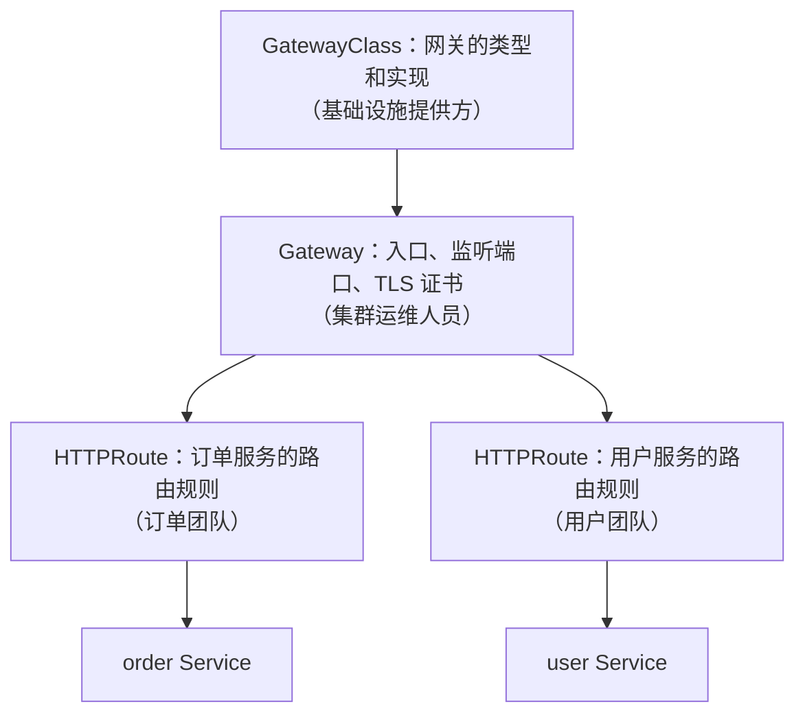

**Ingress NGINX 退役**

- Kubernetes 官方在 2025 年 11 月宣布：社区维护的 Ingress NGINX 项目只做尽力而为的维护到 **2026 年 3 月**，之后**不再发布新版本，不再修复缺陷，也不再修复安全漏洞**，仓库变为只读。
- 已有的部署不会被破坏，镜像和 Helm Chart 仍然可以获取，但继续使用就意味着出现安全漏洞时没有补丁。
- 官方建议**立即开始迁移**：迁移到 Gateway API，或者换成其他仍在维护的 Ingress 控制器。可以用 `kubectl get pods --all-namespaces --selector app.kubernetes.io/name=ingress-nginx` 检查集群中是否在使用它。

**追问链**

1. **迁移时要注意什么？** 不同控制器对同一个 Ingress 配置的处理细节可能不同（路径匹配、默认超时、请求头处理等），注解更不能直接通用。要先盘点所有用到的注解和依赖的默认行为，在测试环境对比验证，再按域名逐步切换流量。
2. **Gateway API 和服务网格有什么关系？** Gateway API 也用于服务网格（GAMMA 项目）：路由规则直接挂在 Service 上，用来描述服务之间东西向流量的路由，这样入口流量和服务间流量可以用同一套 API 描述。

---

### 41-14 Pod 中的域名是怎么解析的？ndots 为什么会让解析变慢？

> ★★ ｜ 资深 ｜ 中频

**考察意图**：能解释 Kubernetes 中"访问外部域名很慢""DNS 请求量很大"的原因。DNS 本身和 JVM 的 DNS 缓存见[《37 计算机网络》](../08-计算机基础/37-计算机网络.md)。

**30 秒版回答**

- kubelet 为每个 Pod 生成 `/etc/resolv.conf`，Kubernetes 文档中的例子：

```text
nameserver 10.32.0.10
search <namespace>.svc.cluster.local svc.cluster.local cluster.local
options ndots:5
```

- **`ndots:5` 的意思**：要解析的名字中，点的个数**少于 5 个**时，先依次加上 `search` 中的后缀去尝试，最后才把它当作完整的域名解析。
- 好处是在集群内写短名字就能访问：`order-svc` 会被补全为 `order-svc.<namespace>.svc.cluster.local`。
- 代价是：访问 `api.example.com`（只有 2 个点）时，会先依次尝试 `api.example.com.<namespace>.svc.cluster.local`、`api.example.com.svc.cluster.local`、`api.example.com.cluster.local`，全部失败后才查询真正的域名。如果 IPv4 和 IPv6 地址（A 和 AAAA 记录）都要查询，请求数还要翻倍。

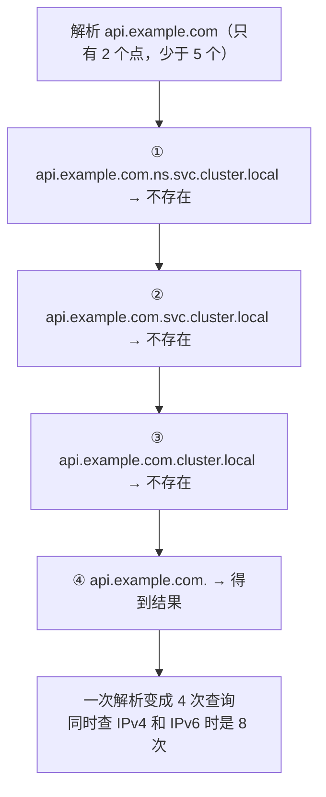

**优化方法**

| 方法 | 说明 |
| --- | --- |
| 访问外部域名时在末尾加一个点：`api.example.com.` | 表示这是完整的域名，直接查询，不再拼接后缀 |
| 在 Pod 的 `dnsConfig` 中把 `ndots` 调小（如 2） | 有 2 个及以上点的名字先按完整域名查询；集群内的短名字照样可以补全 |
| 部署 NodeLocal DNSCache | 每个节点上运行一个 DNS 缓存，减轻集群 DNS 服务的压力，降低延迟 |
| 应用内缓存解析结果 | JVM 默认缓存成功的结果 30 秒（见 37 中的 DNS 部分）；连接池复用连接也能减少解析次数 |

**追问链**

1. **在集群内访问其他命名空间的服务，怎么写名字？** `服务名.命名空间`，例如 `order-svc.prod`，会被补全为 `order-svc.prod.svc.cluster.local`。完整写法 `order-svc.prod.svc.cluster.local` 最明确，也最不容易出错。
2. **`dnsPolicy: Default` 是默认值吗？** 不是。Pod 的默认值是 `ClusterFirst`（使用集群的 DNS）。`Default` 的意思是继承节点的 DNS 配置，这时 Pod 解析不了集群内的 Service 名称，这个命名很容易让人误解。

---

### 41-15 HPA 是怎么决定扩缩容的？Java 应用用 HPA 有哪些坑？

> ★★★ ｜ 架构师 ｜ 中频

**考察意图**：理解 HPA 的算法和默认行为，知道 JVM 的特点会让它误判。

**30 秒版回答**

- **算法**：期望副本数 = ceil(当前副本数 × 当前指标值 / 目标值)。例如目标 CPU 使用率 60%，当前 4 个副本平均 90%，期望副本数 = ceil(4 × 90 / 60) = 6。
- **CPU、内存的使用率是相对 requests 计算的**，没有设置 requests 时无法计算，HPA 不会动作。
- **默认行为**（Kubernetes 1.37 文档）：
  - 每 15 秒计算一次；
  - 容忍度 10%：比值在 0.9~1.1 之间时不调整；1.37 起可以为扩容和缩容分别设置容忍度；
  - 扩容没有稳定窗口：每 15 秒最多增加 100% 或 4 个 Pod（取较大值）；
  - 缩容有 **300 秒的稳定窗口**：取过去 5 分钟内最高的推荐值，避免流量一回落就缩容、马上又扩容。

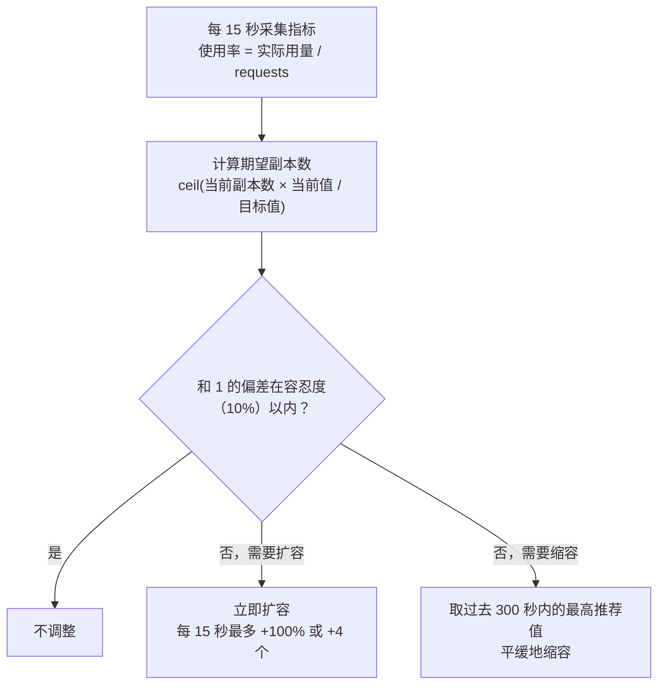

**Java 应用的坑**

| 问题 | 原因 | 对策 |
| --- | --- | --- |
| 新 Pod 刚启动就推高了平均 CPU，引发连锁扩容 | JVM 启动和 JIT 编译时 CPU 很高 | HPA 默认在 Pod 启动后的 5 分钟内，只采用 Pod 就绪之后采集的 CPU 数据；配合启动探针、启动优化（04-19）进一步缓解 |
| 按内存扩缩容：扩了就缩不回去 | JVM 的堆扩大后很少归还给操作系统，流量下降后内存用量也不降 | 不要用内存作为 Java 应用的扩缩容指标 |
| 扩容跟不上流量突增 | 指标采集、Pod 调度、拉镜像、JVM 预热都需要时间，扩容之后还要预热才能真正分担流量 | 保留余量，设置合理的最小副本数；可预测的高峰（大促、整点活动）提前扩容 |
| CPU 使用率不能代表负载 | 服务的瓶颈在 IO、下游或者线程池 | 用 QPS、延迟、消息积压量等自定义指标；按消息积压扩缩容可以用 KEDA |

**追问链**

1. **HPA 和 VPA 能一起用吗？** 不要让它们基于同一个指标（例如都看 CPU）同时调整：VPA 改变了 requests，HPA 按 requests 算出的使用率也随之变化，两者会互相干扰。常见的做法是 VPA 只给出推荐值，人工调整 requests，扩缩容交给 HPA。
2. **能缩容到 0 吗？** HPA 的 `minReplicas` 默认为 1，正常情况下不会缩到 0。需要在没有请求时缩到 0，可以用 KEDA 或 Knative，代价是第一个请求要等待冷启动（41-19）。

---

## 三、配置、安全与运维

### 41-16 ConfigMap 和 Secret 怎么用？Secret 安全吗？Pod 怎样获得云资源的权限？

> ★★ ｜ 资深 ｜ 中频

**考察意图**：知道配置注入的方式和更新行为，知道 Secret 默认的安全边界在哪里。配置中心的对比见[《13 配置中心》](../03-分布式与微服务/13-配置中心.md)，密钥管理见[《39 网络安全》](../08-计算机基础/39-网络安全.md)39-17。

**30 秒版回答**

- **ConfigMap** 存放普通配置，**Secret** 存放敏感数据。两者都可以注入为环境变量，或者挂载成文件。
- **更新行为不同**：

| 注入方式 | 修改 ConfigMap / Secret 之后 |
| --- | --- |
| 挂载为卷（文件） | kubelet 会最终更新文件内容，延迟可能是 kubelet 的同步周期加上缓存的传播时间 |
| 用 `subPath` 挂载单个文件 | **不会更新** |
| 环境变量 | 只在容器启动时读取，**需要重启 Pod** |

- 文件更新了，应用也不一定会重新读取。Spring Boot 可以用 `spring.config.import=configtree:` 读取挂载的目录，但要在运行中生效，还需要刷新机制。很多团队选择"修改配置后滚动重启"，行为更可预测。

**Secret 安全吗？**

- Secret 中的值只是 **Base64 编码，不是加密**。Kubernetes 文档明确说明：
  - Secret 默认**未加密**地保存在 etcd 中，能访问 API 或 etcd 的人都能读取和修改；
  - 能在某个命名空间中**创建 Pod** 的人，就能读取这个命名空间中的所有 Secret（包括通过创建 Deployment 这类间接的方式）。
- 文档建议的措施：开启 etcd 的静态加密；用 RBAC 按最小权限控制对 Secret 的访问；只把 Secret 挂载给需要它的容器；考虑使用外部的密钥存储（如通过 Secrets Store CSI Driver 对接 Vault 或云厂商的密钥服务）。

**Pod 怎样获得云资源（对象存储、消息队列）的权限？**

- 最差的做法是把云账号的长期 AccessKey 放进镜像或者 Secret 中：泄露后长期有效，也很难追查。
- 推荐的做法是**工作负载身份**：

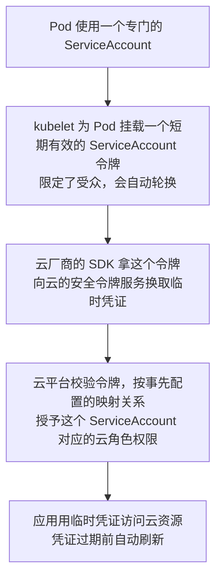

- 各家云厂商都提供了这种机制（例如 AWS 的 EKS Pod Identity / IRSA、Google Cloud 的 Workload Identity）。不同的服务使用不同的 ServiceAccount，只授予各自需要的最小权限。

**追问链**

1. **Secret 能不能放进 Git 仓库？** 明文的 Secret 文件不能。用 GitOps 管理时（41-20），可以只在仓库中保存对外部密钥存储的引用（例如 External Secrets 这类工具），或者保存加密后的内容（例如 Sealed Secrets、SOPS），由集群内的组件解密。
2. **不可变的 ConfigMap 和 Secret 有什么用？** 设置 `immutable: true` 后内容不能修改，只能删除重建。好处是防止误修改导致故障；集群很大时，kubelet 不需要监听这些对象，能显著减轻 API Server 的负担。

---

### 41-17 怎样保证 Kubernetes 上的服务高可用？

> ★★★ ｜ 架构师 ｜ 中频

**考察意图**：Kubernetes 的自愈能力不等于高可用，要能从副本分布、主动维护、发布、容量几个方面系统地设计。高可用的通用思路见[《26 高可用》](../06-三高与架构/26-高可用.md)。

**30 秒版回答**

| 风险 | 措施 |
| --- | --- |
| 单个节点、单个可用区故障 | 至少 2~3 个副本，并且**分散**到不同的节点和可用区：`topologySpreadConstraints`（按 `topologyKey` 控制分布的偏差 `maxSkew`）或 Pod 反亲和性 |
| 节点维护、集群升级时把副本一起驱逐了 | **PodDisruptionBudget**（PDB）：限制主动驱逐时最多同时有几个副本不可用。`kubectl drain` 会遵守它 |
| 发布导致可用的副本不够 | 滚动更新设置 `maxUnavailable: 0`，新 Pod 就绪后再下线旧 Pod；就绪探针要准确（41-09）；配合优雅终止（41-10） |
| 发布了有问题的版本 | 灰度发布，监控指标自动判断，出问题时回滚（见 26-14） |
| 一个可用区挂掉后，剩下的容量扛不住 | 按"挂掉一个可用区"预留容量；关键服务设置较高的 `PriorityClass`，资源紧张时优先保证 |
| 整个集群或地域出问题 | 多集群、多地域部署，由上层的流量调度做切换（见 26 中的多活部分） |

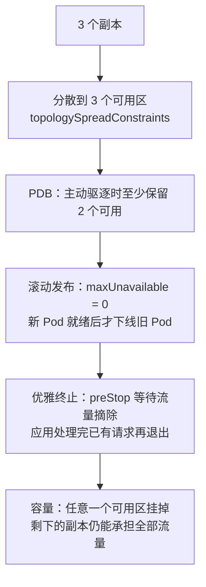

**追问链**

1. **PDB 能防止节点宕机导致的副本丢失吗？** 不能。PDB 只限制**主动的**中断（驱逐、节点排空、集群升级），节点宕机、内核 OOM 这类被动的中断不受它约束，这些要靠多副本和跨可用区分布来应对。另外，PDB 的 `minAvailable` 设得等于副本数，会导致节点永远无法排空，集群升级被卡住。
2. **Pod 反亲和性和拓扑分布约束怎么选？** 反亲和性只能表达"不要放在一起"，副本数多于节点或可用区时，要么调度不上去（硬性要求），要么无法保证均匀（软性要求）。拓扑分布约束可以直接表达"各个可用区之间的副本数差距不超过 1"，更适合多副本的均匀分布。

---

### 41-18 Pod 起不来或者反复重启，怎么排查？

> ★★ ｜ 资深 ｜ 高频

**考察意图**：有一套按现象分类的排查路径，而不是到处翻日志。JVM 层面的问题见[《33 线上问题排查》](../07-工程实践与稳定性/33-线上问题排查.md)。

**30 秒版回答**：先看 Pod 的状态和事件（`kubectl get pod`、`kubectl describe pod`），再按状态分类处理：

| 现象 | 先看什么 | 常见原因 |
| --- | --- | --- |
| `Pending` | `describe` 中的事件 | 资源不够、节点选择器或亲和性不满足、节点有污点、PVC 绑定不上 |
| `ImagePullBackOff` / `ErrImagePull` | 事件中的拉取错误 | 镜像名或标签写错、私有仓库没有配置 `imagePullSecrets`、节点访问不了仓库 |
| `CreateContainerConfigError` | 事件 | 引用的 ConfigMap、Secret 或其中的键不存在 |
| `CrashLoopBackOff` | `kubectl logs --previous`（上一次运行的日志）和上一次的退出码 | 应用启动失败、配置错误、依赖连不上、被 OOMKilled。重启间隔默认从 10 秒开始翻倍，最长 5 分钟；容器正常运行 10 分钟后重新计时 |
| `Running` 但一直不是 Ready | 事件中的探针失败信息 | 就绪探针的路径、端口写错，或者依赖检查失败（41-09） |
| `Running` 并且 Ready，但访问不通 | Service 的 EndpointSlice 是否为空 | Service 的标签选择器和 Pod 的标签不匹配、`targetPort` 写错 |

**退出码怎么看**

- `1` 等：应用自己退出，看日志；
- `137`（128 + 9，被 SIGKILL 杀死）：如果上一次终止的原因是 `OOMKilled`，是内存超限（41-03）；如果不是，常见原因是存活探针失败后，应用在宽限期内没能退出而被强制杀死；
- `143`（128 + 15）：收到 SIGTERM 后正常退出，通常是被删除、被驱逐，或者存活探针失败后被重启。

**访问不通时，沿着请求的路径逐段检查**

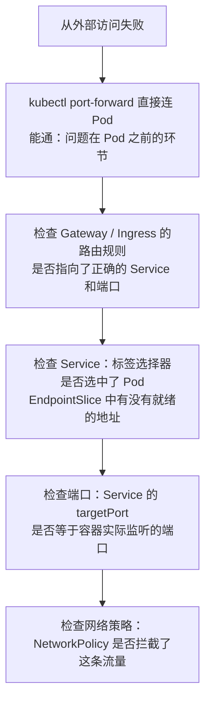

**追问链**

1. **镜像中没有 shell 和排查工具（例如 distroless 镜像），怎么进去排查？** 用 `kubectl debug` 给 Pod 添加一个临时容器（ephemeral container），用一个带工具的镜像，并共享目标容器的进程命名空间，这样就能看到目标容器中的进程，用 `jcmd` 等工具排查（见 33）。
2. **应用启动时报错退出，日志一闪而过怎么办？** 用 `kubectl logs --previous` 查看上一次运行的日志；同时要把日志输出到标准输出，由节点上的采集组件收集，不要只写在容器内的文件中（见[《32 日志与可观测性》](../07-工程实践与稳定性/32-日志与可观测性.md)）。

---

## 四、云与交付

### 41-19 IaaS、PaaS、SaaS、FaaS 怎么区分？Serverless 适合 Java 吗？

> ★★ ｜ 架构师 ｜ 中频

**考察意图**：分清各种云服务模型的责任边界，客观评估 Serverless 对 Java 的利弊。

**30 秒版回答**：区别在于**云厂商替你管到哪一层**：

| 模型 | 云厂商负责 | 你负责 | 例子 |
| --- | --- | --- | --- |
| IaaS | 机房、硬件、虚拟化 | 操作系统、运行环境、应用、数据 | 云服务器、云硬盘 |
| 容器服务 | 再加上 Kubernetes 控制平面（托管集群） | 节点（使用无服务器节点时不用管）、镜像、应用 | 托管的 Kubernetes 服务 |
| PaaS | 再加上操作系统和运行环境 | 应用和数据 | 应用托管平台、托管数据库 |
| FaaS | 再加上实例的创建、扩缩容 | 一个个函数 | AWS Lambda、各云的函数计算 |
| SaaS | 全部 | 只是使用 | 在线办公、CRM |

- **Serverless** 通常指 FaaS 加上一系列按用量计费的托管服务（对象存储、托管数据库、消息队列）：不用管服务器，按调用次数和执行时间计费，没有请求时可以缩到 0。
- 它的限制：冷启动；单次执行有时间上限；函数是无状态的；调试和本地测试麻烦；和云厂商绑定；**持续高负载时的费用可能比自己运行实例更高**。

**Java 的冷启动问题**

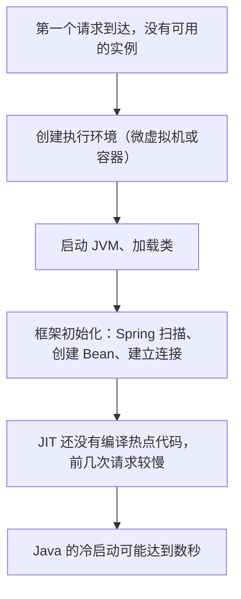

| 优化手段 | 原理 | 注意 |
| --- | --- | --- |
| AWS Lambda SnapStart | 发布函数版本时完成初始化，对执行环境的内存和磁盘做快照；之后从快照恢复，而不是从头初始化。支持 Java 11 及以上 | 初始化时生成的唯一值（ID、随机数种子）、网络连接、临时凭证在恢复后可能重复或失效，要在恢复后重新生成或检查 |
| 预置并发 | 预先保持一定数量已初始化的实例 | 按预置的数量持续收费 |
| GraalVM Native Image | 提前编译成本地可执行文件，启动快、内存小 | 构建慢；反射、动态代理需要额外配置（见[《04 JVM》](../01-Java核心/04-JVM.md)04-19） |
| JDK 的 AOT 缓存、CRaC | 复用类加载和链接的结果，或者从检查点恢复整个进程 | 见 04-19 |

**追问链**

1. **什么样的业务适合 Serverless？** 事件驱动、流量波动大或者大部分时间空闲的场景：文件上传后的处理、定时任务、消息触发的处理、内部工具。持续高并发、对延迟敏感、需要长连接的核心服务，用常驻的实例更合适，成本也更可控。
2. **在 Kubernetes 上能做 Serverless 吗？** 可以，例如 Knative：按请求自动扩缩容，可以缩到 0。代价同样是冷启动，所以 Java 应用通常要配合上面的启动优化手段。

---

### 41-20 Java 服务的 CI/CD 流水线怎么设计？GitOps 是什么？

> ★★ ｜ 架构师 ｜ 中频

**考察意图**：能设计一条安全、可追溯、可回滚的交付流水线。依赖管理、分支模型见[《36 Maven·Git·IDEA》](../07-工程实践与稳定性/36-Maven·Git·IDEA.md)，安全扫描见[《39 网络安全》](../08-计算机基础/39-网络安全.md)39-18。

**30 秒版回答**

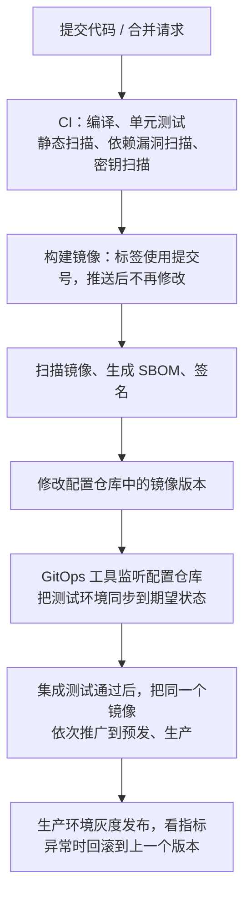

- **构建一次，到处部署**：测试、预发、生产使用**同一个镜像**（最好按摘要引用），而不是每个环境重新构建一次，否则测试过的和上线的可能不是同一个东西。环境之间的差异放在配置中。
- **GitOps**：把"集群应该是什么样子"以声明式的配置文件保存在 Git 仓库中，由集群中的工具（如 Argo CD、Flux）**主动拉取**并持续对比、纠正。OpenGitOps 总结了四条原则：声明式、版本化且不可变、自动拉取、持续协调。

| 对比 | 传统的推送式部署 | GitOps 拉取式部署 |
| --- | --- | --- |
| 谁来改集群 | CI 流水线直接执行 `kubectl apply` 或 `helm upgrade` | 集群内的 GitOps 工具从仓库拉取后同步 |
| 集群的凭证 | 要放在 CI 系统中 | 不需要交给 CI |
| 有人手工修改了集群 | 不知道 | 能发现配置漂移，并自动纠正或告警 |
| 审计和回滚 | 要查流水线的记录 | Git 的提交历史就是变更记录，回滚就是还原一次提交 |

**追问链**

1. **数据库表结构的变更怎么纳入流水线？** 用 Flyway、Liquibase 这类工具把变更脚本和代码一起管理，在发布前或者应用启动时执行。变更要**向前兼容**：例如先加新的列、新旧版本的代码都能工作，确认之后再删除旧的列。因为滚动发布期间，新旧两个版本的代码会同时运行。
2. **流水线中的扫描发现了高危漏洞，要阻断发布吗？** 对新引入的高危漏洞阻断；已有的问题设定修复期限，避免流水线因为历史问题长期无法发布（见 39-18）。紧急修复的发布要有经过审批的例外通道。

---

### 41-21 数据库、消息队列这类有状态服务，要不要放进 Kubernetes？

> ★★ ｜ 架构师 ｜ 低频

**考察意图**：能权衡运维能力、可靠性和成本，而不是简单地"全部上 Kubernetes"或者"一律不上"。

**30 秒版回答**

- **StatefulSet 只解决了一部分问题**：固定的名字、固定的网络标识、每个副本独立的存储。但主从切换、备份恢复、扩容时的数据迁移、版本升级这些**运维知识**，它都不懂。
- **Operator** 把这些运维知识写成了控制器：例如 CloudNativePG（PostgreSQL）、Strimzi（Kafka）。在 Kubernetes 上运行有状态服务，基本上要依赖成熟的 Operator。
- 还要考虑存储和调度的限制：
  - 云硬盘一般只能挂载到同一个可用区内的节点上，Pod 只能在这个可用区内重建；
  - 本地盘性能好，但数据和节点绑定，节点故障时要依靠应用自身的副本机制恢复；
  - 和其他 Pod 共享节点时的资源争抢、CPU 节流（41-02），对延迟敏感的数据库影响很大。

**怎么选**

| 情况 | 建议 |
| --- | --- |
| 生产环境的核心数据库 | 优先使用云厂商的托管服务：高可用、备份、监控、升级由厂商负责，团队可以专注于业务 |
| 有成熟的 Operator，团队有相应的运维能力 | 可以放进 Kubernetes，例如 Kafka、Redis 集群；要做好存储、反亲和、PDB、备份恢复演练 |
| 开发、测试环境 | 很适合放进 Kubernetes：快速创建和销毁，节省成本 |
| 规模很大、多云部署、成本敏感 | 自建（无论是否在 Kubernetes 上）可能更划算，但要有专门的团队 |

**追问链**

1. **有状态服务放进 Kubernetes 后，集群升级要注意什么？** 节点排空时，PDB 保证同时只中断一个副本；要等这个副本重新加入并同步完数据，再处理下一个节点。Operator 一般会处理这些顺序，但必须在测试环境中演练过。
2. **应用本身要怎么配合？** 尽量让应用服务无状态：会话放进 Redis，文件放进对象存储，本地只保存可以丢弃的缓存。这样绝大多数服务都可以用 Deployment 部署，有状态的部分集中交给专门的服务。
