# 42 · 编程题

> 适用岗位：Java 资深开发（重点：线程协作、手写线程池和锁、LRU / LFU、常见算法的边界条件）、Java 架构师（重点：并行聚合与降级、防止缓存击穿、攒批写入、重试的适用边界，以及手写代码和成熟实现之间的差距）
> 版本基线：JDK 25。代码只用到 JDK 17 及以上的语法，以及 JDK 19 新增的 `HashMap.newHashMap`，没有使用预览特性。为了能直接运行，代码不依赖第三方库，日志用 JDK 自带的 `System.Logger`，项目中换成 Slf4j 即可（例如 `log.error("task failed, worker={}", name, e)`）
> 事实核对：
> - JDK 25 源码（`lib/src.zip`）：
>   - `java.util.concurrent` 的包文档说明：`Lock.unlock`、`Semaphore.release` 之前的操作，happens-before 之后成功的 `lock`、`acquire` 之后的操作；
>   - `AbstractQueuedSynchronizer` 的类注释给出了不可重入互斥锁 `Mutex` 和 `BooleanLatch` 两个示例；
>   - `ThreadPoolExecutor`：用一个原子整数 `ctl` 同时保存运行状态和线程数；`shutdown` 只中断空闲的线程（用 `w.tryLock()` 判断是否空闲）；任务抛出异常时工作线程退出，再补充一个新线程（`processWorkerExit`）；
>   - `ConcurrentHashMap.computeIfAbsent` 的注释说明，计算期间其他线程对这个 Map 的部分更新可能被阻塞，所以计算应当简短；检测到递归更新时抛出 `IllegalStateException("Recursive update")`；
>   - `CompletableFuture.cancel` 的 `mayInterruptIfRunning` 参数不起作用；`StructuredTaskScope` 在 JDK 25 中仍是预览 API；
>   - `Arrays.binarySearch` 用 `(low + high) >>> 1` 计算中点，并且说明有重复元素时不保证返回哪一个。
> - 本机运行（macOS 27.2、Apple M1 Max、JDK 25，默认线程栈 2MB）：本类每一段代码都用 `java 文件名.java` 直接运行过。数据结构和算法题还做了随机对比测试（和 JDK 自带实现或者暴力解法比较结果）。运行输出附在各题中，文中的代码就是运行过的代码，只省略了 `main` 中的测试部分。
> 相关分类：[《02 集合类》](../01-Java核心/02-集合类.md)（HashMap、LinkedHashMap 实现 LRU、PriorityQueue 与 TopK）、[《03 Java 并发》](../01-Java核心/03-Java并发.md)（AQS、Condition、线程池、CompletableFuture）、[《18 本地缓存》](../04-数据存储/18-本地缓存.md)（Caffeine）、[《26 高可用》](../06-三高与架构/26-高可用.md)（限流、重试）、[《40 数据结构》](../08-计算机基础/40-数据结构.md)

## 知识地图

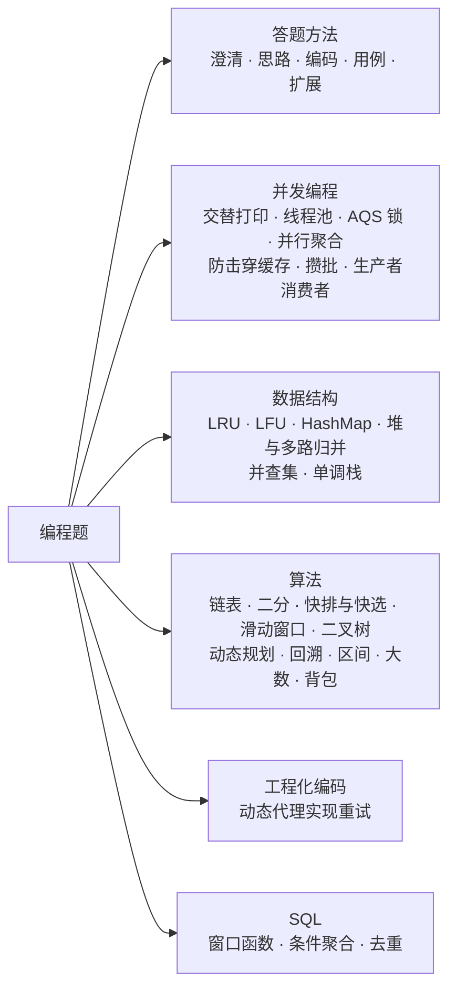

## 题目索引

| 编号 | 题目 | 难度 | 层级 |
| --- | --- | --- | --- |
| 42-01 | 现场手写代码，面试官在看什么？怎么答？ | ★ | 资深 / 架构师 |
| 42-02 | 三个线程按顺序循环打印 ABC | ★★ | 资深 |
| 42-03 | 手写一个简易线程池 | ★★★ | 资深 |
| 42-04 | 用 AQS 实现一个互斥锁 | ★★★ | 资深 |
| 42-05 | 并行调用多个下游服务，怎么控制总超时并对可选数据降级？ | ★★★ | 资深 / 架构师 |
| 42-06 | 手写一个带过期时间、防止缓存击穿的本地缓存 | ★★★ | 资深 / 架构师 |
| 42-07 | 手写攒批处理：凑满 N 条或等待 T 毫秒就提交一批 | ★★ | 资深 / 架构师 |
| 42-20 | 生产者消费者：多个生产者和消费者，怎么不丢数据地停下来？ | ★★ | 资深 |
| 42-08 | 不用 LinkedHashMap，手写 LRU 缓存 | ★★ | 资深 |
| 42-09 | 手写 O(1) 的 LFU 缓存 | ★★★ | 资深 |
| 42-10 | 手写一个简易 HashMap | ★★ | 资深 |
| 42-11 | 手写小顶堆，并用它合并 K 个有序数组 | ★★ | 资深 |
| 42-21 | 手写并查集：省份数量、冗余连接 | ★★ | 资深 |
| 42-22 | 单调栈和单调队列：每日温度、柱状图最大矩形、滑动窗口最大值 | ★★★ | 资深 |
| 42-12 | 反转链表、每 K 个一组反转链表 | ★★ | 资深 |
| 42-13 | 判断链表是否有环，并找到环的入口 | ★★ | 资深 |
| 42-14 | 二分查找的边界怎么写才不出错？ | ★★ | 资深 |
| 42-15 | 快速排序和快速选择：怎么避免退化？ | ★★ | 资深 |
| 42-16 | 滑动窗口：最长无重复子串、最小覆盖子串 | ★★ | 资深 |
| 42-17 | 二叉树的层序遍历和最近公共祖先 | ★★ | 资深 |
| 42-18 | 动态规划怎么推导？以零钱兑换为例 | ★★ | 资深 |
| 42-23 | 回溯怎么写？全排列、子集、组合总和 | ★★ | 资深 |
| 42-24 | 区间问题：合并区间、最少需要几间会议室 | ★★ | 资深 |
| 42-25 | 大数相加和大数相乘 | ★ | 资深 |
| 42-26 | 背包问题：0-1 背包、完全背包，以及怎么识别背包模型 | ★★★ | 资深 |
| 42-19 | 用动态代理给接口加上重试 | ★★★ | 资深 / 架构师 |
| 42-27 | SQL 手写题：分组取前 N、连续登录、行转列、去重、累计与环比 | ★★ | 资深 |

**题库中其他分类已有的手写代码**（这里不再重复）：

| 内容 | 位置 |
| --- | --- |
| 用 LinkedHashMap 实现 LRU | 02-10 |
| DCL 单例 | 03-03、30-03 |
| 用 Condition 实现有界缓冲区（生产者和消费者）；停止方式见本类 42-20 | 03-08 |
| 按固定顺序加锁，避免转账死锁 | 03-11 |
| 运行时调整线程池大小、优雅关闭线程池 | 03-13、03-14 |
| 用 Semaphore 限制对下游的并发调用 | 03-17 |
| Redis 分布式锁、雪花算法、接口幂等 | 09-13、09-16、09-17 |
| 高频计数的本地聚合 | 24-13 |
| 令牌桶限流 | 26-03 |
| 开放平台的签名校验 | 29-15 |
| 责任链 | 30-12 |
| 在线程池中传递 MDC | 32-04 |
| 伪共享的对比实验、用拓扑排序检测循环依赖 | 40-04、40-14 |

---

## 一、答题方法

### 42-01 现场手写代码，面试官在看什么？怎么答？

> ★ ｜ 资深 / 架构师 ｜ 高频

**考察意图**：手写代码考的不只是"能不能写对"，还有沟通、拆解问题、处理边界和工程意识。资深岗位和初级岗位的差别，主要体现在后三项上。

**30 秒版回答**：按五个步骤来，不要一上来就埋头写。

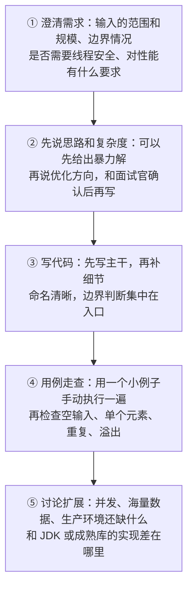

| 面试官看什么 | 具体表现 |
| --- | --- |
| 沟通 | 先确认需求和约束，而不是自己假设；卡住时说出正在考虑什么 |
| 拆解问题 | 能说清思路、为什么这样做、复杂度是多少 |
| 代码质量 | 命名、结构清晰；没有重复代码；先写对，再优化 |
| 边界和正确性 | 主动检查边界；能用例子证明代码是对的 |
| 工程意识 | 知道代码离生产还差什么：线程安全、异常处理、超时、监控、资源释放 |

**边界用例清单**（写完后逐项检查）：

| 类型 | 例子 |
| --- | --- |
| 空和极小 | `null`、空数组、空字符串、只有一个元素、容量为 0 |
| 重复和相等 | 全部元素相同、目标值出现多次 |
| 极值 | `Integer.MAX_VALUE` 相加溢出、负数、取模结果为负 |
| 特殊顺序 | 已经有序、完全逆序（容易让快排退化） |
| 并发 | 多个线程同时调用、中断、超时、关闭的同时还在提交 |
| 规模 | 递归深度太大导致栈溢出、数据放不进内存 |

**追问链**

1. **想不出最优解怎么办？** 先把暴力解写出来并说明复杂度，再分析瓶颈在哪里（重复计算 → 缓存或动态规划；反复查找 → 哈希表；需要有序 → 排序或堆）。能写出正确的暴力解，比写出一个有错误的"最优解"更好。
2. **资深和架构师岗位为什么还考算法题？** 主要看基本功和严谨程度。对资深岗位，更有区分度的是本类的并发题和工程题：同样是写一个缓存，能不能主动想到并发加载、失败不缓存、过期和容量控制，体现的是生产经验。

---

## 二、并发编程

### 42-02 三个线程按顺序循环打印 ABC

> ★★ ｜ 资深 ｜ 高频

**考察意图**：线程之间如何协作，以及等待和通知的正确写法。

**30 秒版回答**

- 本质是**把执行权按顺序传给下一个线程**。
- **写法一：信号量**。每个线程一个信号量，只有第一个的初始许可是 1。线程拿到自己的许可后打印，再给下一个线程的信号量释放一个许可。代码最短，也不容易写错。
- **写法二：锁 + 条件**。一个共享的 `turn` 变量表示轮到谁，每个线程一个 `Condition`。线程在 `while` 循环中等待，直到轮到自己；打印后修改 `turn`，只唤醒下一个线程。

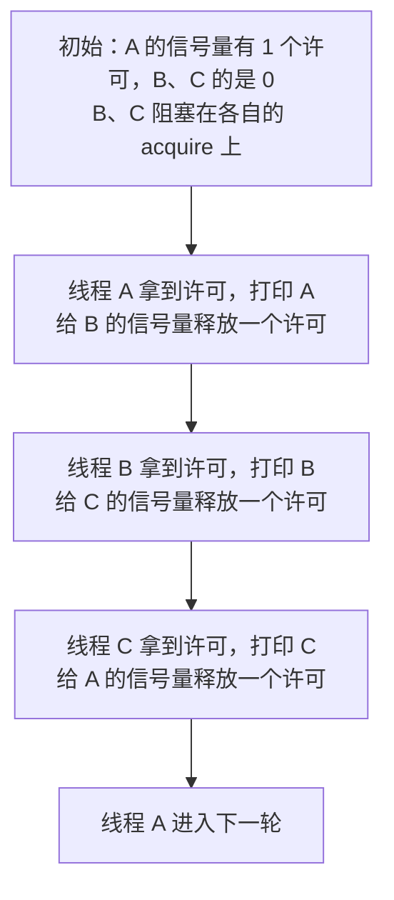

```java
import java.util.concurrent.Semaphore;
import java.util.concurrent.locks.Condition;
import java.util.concurrent.locks.ReentrantLock;

/**
 * 三个线程按 A → B → C 的顺序循环打印 ROUNDS 轮
 */
public class PrintAbc {
    private static final int ROUNDS = 3;
    private static final String[] NAMES = {"A", "B", "C"};

    public static void main(String[] args) throws InterruptedException {
        System.out.println("semaphore: " + bySemaphore());
        System.out.println("condition: " + byCondition());
    }

    /** 写法一：每个线程一个信号量，打印完把许可"交给"下一个线程 */
    static String bySemaphore() throws InterruptedException {
        int n = NAMES.length;
        Semaphore[] turns = new Semaphore[n];
        for (int i = 0; i < n; i++) {
            turns[i] = new Semaphore(i == 0 ? 1 : 0);   // 只有第一个线程一开始有许可
        }
        // 同一时刻只有持有许可的线程在写；release 与下一次 acquire 之间有 happens-before，保证可见性
        StringBuilder out = new StringBuilder();
        Thread[] threads = new Thread[n];
        for (int i = 0; i < n; i++) {
            int me = i;
            threads[i] = new Thread(() -> {
                try {
                    for (int r = 0; r < ROUNDS; r++) {
                        turns[me].acquire();
                        out.append(NAMES[me]);
                        turns[(me + 1) % n].release();   // 把执行权交给下一个线程
                    }
                } catch (InterruptedException e) {
                    Thread.currentThread().interrupt();   // 恢复中断标记，让调用方知道线程被中断
                }
            }, "printer-" + NAMES[i]);
            threads[i].start();
        }
        for (Thread t : threads) {
            t.join();
        }
        return out.toString();
    }

    /** 写法二：一把锁 + 一个"轮到谁"的状态 + 每个线程一个等待队列 */
    static String byCondition() throws InterruptedException {
        int n = NAMES.length;
        ReentrantLock lock = new ReentrantLock();
        Condition[] myTurn = new Condition[n];
        for (int i = 0; i < n; i++) {
            myTurn[i] = lock.newCondition();
        }
        int[] turn = {0};                         // 受 lock 保护：当前轮到第几个线程
        StringBuilder out = new StringBuilder();
        Thread[] threads = new Thread[n];
        for (int i = 0; i < n; i++) {
            int me = i;
            threads[i] = new Thread(() -> {
                for (int r = 0; r < ROUNDS; r++) {
                    lock.lock();
                    try {
                        while (turn[0] != me) {           // 必须用 while：被唤醒后要重新检查条件
                            myTurn[me].awaitUninterruptibly();
                        }
                        out.append(NAMES[me]);
                        turn[0] = (me + 1) % n;
                        myTurn[turn[0]].signal();         // 只唤醒下一个线程，不惊动其他线程
                    } finally {
                        lock.unlock();
                    }
                }
            }, "printer-" + NAMES[i]);
            threads[i].start();
        }
        for (Thread t : threads) {
            t.join();
        }
        return out.toString();
    }
}
```

本机运行输出：

```text
semaphore: ABCABCABC
condition: ABCABCABC
```

**常见错误**

| 错误 | 后果 |
| --- | --- |
| 等待条件用 `if` 而不是 `while` | 线程可能被虚假唤醒，或者被唤醒时条件已经被别的线程改变，没有重新检查就继续执行 |
| 用 `wait / notify` 时调用 `notify` 而不是 `notifyAll` | 一个对象只有一个等待队列，`notify` 唤醒的可能是还没轮到的线程，它检查条件后又睡下，真正该运行的线程没有被唤醒，最终所有线程都在等待 |
| 用一个普通变量忙等：`while (turn != me) {}` | 没有 `volatile` 时可能一直看不到其他线程的修改；即使能看到，也会空转浪费 CPU |
| 捕获 `InterruptedException` 后什么都不做 | 吞掉了中断信号，调用方无法停止这些线程 |

**追问链**

1. **信号量版本中，多个线程都写同一个 `StringBuilder`，为什么不需要加锁？** 同一时刻只有一个线程持有许可，写操作是串行的。可见性由 `Semaphore` 保证：`release` 之前的写入，对之后成功 `acquire` 的线程可见（JDK 的 `java.util.concurrent` 包文档写明了这一点）。
2. **改成 N 个线程轮流打印 1 到 100 呢？** 结构不变：信号量数组的长度改成 N，每个线程打印后把许可交给 `(i + 1) % N`。打印的数字放在共享计数器中，由持有许可的线程读写。

---

### 42-03 手写一个简易线程池

> ★★★ ｜ 资深 ｜ 中频

**考察意图**：是否理解线程池就是"有界队列 + 一组循环取任务的线程 + 拒绝策略 + 关闭流程"，以及其中的并发细节。线程池的完整原理见[《03 Java 并发》](../01-Java核心/03-Java并发.md)03-12。

**30 秒版回答**

- **线程复用**：工作线程不会结束，而是循环从队列中取 `Runnable`，直接调用它的 `run()`（普通的方法调用）。
- **有界队列和拒绝策略**：队列满了不能无限堆积，交给拒绝策略处理（抛异常、由调用方线程执行、丢弃等）。
- **任务异常**：单个任务抛异常，不能让工作线程退出，否则线程会越来越少。
- **优雅关闭**：关闭后不再接收新任务，已经入队的任务继续执行完，然后线程退出。
- **并发细节**：提交和关闭同时发生时，任务可能刚入队，工作线程就全部退出了，所以入队后要再检查一次。

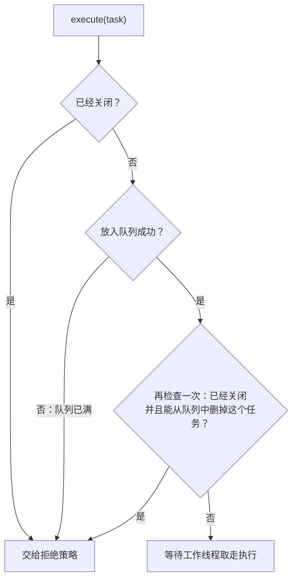

```java
import java.util.ArrayList;
import java.util.List;
import java.util.concurrent.ArrayBlockingQueue;
import java.util.concurrent.BlockingQueue;
import java.util.concurrent.CountDownLatch;
import java.util.concurrent.RejectedExecutionException;
import java.util.concurrent.TimeUnit;
import java.util.concurrent.atomic.AtomicInteger;

/**
 * 固定线程数的简易线程池：工作线程 + 有界队列 + 拒绝策略 + 优雅关闭
 */
public final class SimpleThreadPool {
    private static final System.Logger LOG = System.getLogger(SimpleThreadPool.class.getName());
    /** 工作线程空闲时每次最多等待多久，用来定期检查是否已经关闭 */
    private static final long POLL_TIMEOUT_MS = 100;

    /** 队列满或已关闭时如何处理新任务，由使用方决定 */
    @FunctionalInterface
    public interface RejectHandler {
        void reject(Runnable task, SimpleThreadPool pool);
    }

    /** 默认拒绝策略：直接抛异常，让调用方感知到过载 */
    public static final RejectHandler ABORT = (task, pool) -> {
        throw new RejectedExecutionException("pool is full or shut down");
    };

    private final BlockingQueue<Runnable> queue;
    private final List<Thread> workers = new ArrayList<>();
    private final RejectHandler rejectHandler;
    private volatile boolean shutdown;

    public SimpleThreadPool(int threads, int queueCapacity, RejectHandler rejectHandler) {
        this.queue = new ArrayBlockingQueue<>(queueCapacity);
        this.rejectHandler = rejectHandler;
        for (int i = 0; i < threads; i++) {
            Thread t = new Thread(this::workLoop, "simple-pool-" + i);
            workers.add(t);
            t.start();
        }
    }

    /** 提交任务：已关闭或队列已满时交给拒绝策略 */
    public void execute(Runnable task) {
        if (shutdown || !queue.offer(task)) {
            rejectHandler.reject(task, this);
            return;
        }
        // 二次检查：入队的同时线程池被关闭，工作线程可能已经全部退出，任务会永远没人执行
        if (shutdown && queue.remove(task)) {
            rejectHandler.reject(task, this);
        }
    }

    /** 不再接收新任务，已经入队的任务会继续执行完 */
    public void shutdown() {
        shutdown = true;
    }

    public boolean awaitTermination(long timeout, TimeUnit unit) throws InterruptedException {
        long deadline = System.nanoTime() + unit.toNanos(timeout);
        for (Thread t : workers) {
            long leftMs = TimeUnit.NANOSECONDS.toMillis(deadline - System.nanoTime());
            if (leftMs <= 0) {
                return false;
            }
            t.join(leftMs);
            if (t.isAlive()) {
                return false;
            }
        }
        return true;
    }

    private void workLoop() {
        while (true) {
            Runnable task;
            try {
                task = queue.poll(POLL_TIMEOUT_MS, TimeUnit.MILLISECONDS);
            } catch (InterruptedException e) {
                Thread.currentThread().interrupt();
                return;
            }
            if (task == null) {
                if (shutdown) {
                    return;              // 已关闭并且队列已空：线程退出
                }
                continue;
            }
            try {
                task.run();
            } catch (RuntimeException e) {
                // 单个任务失败不能让工作线程退出，否则线程池会越来越小
                LOG.log(System.Logger.Level.ERROR, () -> "task failed, worker=" + Thread.currentThread().getName(), e);
            }
        }
    }
}
```

测试场景：2 个工作线程、队列容量 2。先提交 2 个阻塞的任务占住两个线程，再提交 3 个任务（2 个入队，1 个被拒绝），再提交 1 个（队列满，被拒绝）；放行后再提交一个会抛异常的任务和一个正常任务；关闭后再提交 1 个（被拒绝）。

```text
completed=5 rejected=3 terminated=true
```

完成 5 个、拒绝 3 个，和预期一致；抛异常的任务只输出了一条 error 日志，工作线程继续处理了后面的任务。

**和 ThreadPoolExecutor 的差距**

| 方面 | 简易版 | `ThreadPoolExecutor` |
| --- | --- | --- |
| 线程数 | 固定，构造时全部启动 | 核心线程和最大线程两级，按需创建，空闲超时后回收 |
| 队列满时 | 直接拒绝 | 先尝试创建非核心线程，达到最大线程数才拒绝 |
| 任务抛异常 | 记录日志，线程继续运行 | 线程退出，再补充一个新线程；`afterExecute` 可以拿到异常 |
| 关闭 | 只有 `shutdown` | `shutdown`、`shutdownNow`、`awaitTermination`，状态从 RUNNING 经过 SHUTDOWN、STOP、TIDYING 到 TERMINATED |
| 状态的一致性 | 关闭标志和队列是两个独立的东西，靠二次检查弥补 | 用一个原子整数 `ctl` 同时保存状态和线程数，一次 CAS 就能同时检查和修改两者 |

**追问链**

1. **工作线程为什么用 `poll(超时)`，而不是 `take()`？** `take()` 阻塞时只能用中断唤醒，但如果线程正在执行任务，中断会影响任务本身。用 `poll` 超时后检查关闭标志，代价是关闭最多延迟 100 毫秒。`ThreadPoolExecutor` 的做法是：`shutdown` 时只中断**空闲**的线程，判断空闲的方法是尝试获取每个 Worker 自身的锁（执行任务期间这把锁一直被持有）。
2. **怎么实现 `shutdownNow`？** 设置停止标志，中断所有工作线程，用 `drainTo` 取出队列中还没执行的任务，返回给调用方处理。

---

### 42-04 用 AQS 实现一个互斥锁

> ★★★ ｜ 资深 ｜ 中频

**考察意图**：理解 AQS 的模板方法设计：子类只定义"状态是什么含义、什么情况下算获取成功"，排队、阻塞、唤醒全部由 AQS 完成。AQS 的原理见 03-07、03-08。

**30 秒版回答**

- AQS 维护一个 `volatile int state` 和一个等待队列。
- 子类实现 `tryAcquire` / `tryRelease`（独占模式），或者 `tryAcquireShared` / `tryReleaseShared`（共享模式）。
- AQS 的 `acquire`、`release` 负责：获取失败时入队、阻塞，释放后唤醒队列中的下一个线程，以及超时和中断。
- JDK 中的同步器都是这样实现的，区别只在 `state` 的含义：

| 同步器 | `state` 的含义 |
| --- | --- |
| `ReentrantLock` | 持有锁的线程重入了几次，0 表示空闲 |
| `Semaphore` | 剩余的许可数 |
| `CountDownLatch` | 还需要倒数几次 |
| `ReentrantReadWriteLock` | 高 16 位是读锁的持有数，低 16 位是写锁的重入次数 |

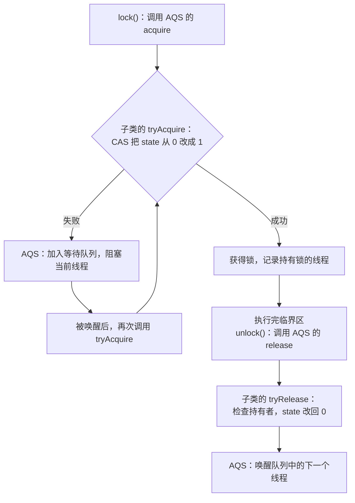

```java
import java.util.concurrent.TimeUnit;
import java.util.concurrent.locks.AbstractQueuedSynchronizer;
import java.util.concurrent.locks.Condition;
import java.util.concurrent.locks.Lock;

/**
 * 基于 AQS 的不可重入互斥锁：state = 0 表示空闲，1 表示被占用。
 * 排队、阻塞、唤醒、超时、中断全部由 AQS 完成，这里只定义"什么情况下算拿到锁"
 */
public final class SimpleMutex implements Lock {
    private static final int FREE = 0;
    private static final int HELD = 1;

    private static final class Sync extends AbstractQueuedSynchronizer {
        @Override
        protected boolean tryAcquire(int ignored) {
            if (compareAndSetState(FREE, HELD)) {           // CAS 抢锁，失败由 AQS 负责入队等待
                setExclusiveOwnerThread(Thread.currentThread());
                return true;
            }
            return false;
        }

        @Override
        protected boolean tryRelease(int ignored) {
            if (getExclusiveOwnerThread() != Thread.currentThread()) {
                throw new IllegalMonitorStateException("current thread does not hold the lock");
            }
            setExclusiveOwnerThread(null);
            setState(FREE);          // volatile 写放在最后：之前的修改对下一个拿到锁的线程可见
            return true;             // 返回 true，AQS 会唤醒队列中的下一个线程
        }

        @Override
        protected boolean isHeldExclusively() {
            return getState() == HELD && getExclusiveOwnerThread() == Thread.currentThread();
        }

        Condition newCondition() {
            return new ConditionObject();
        }
    }

    private final Sync sync = new Sync();

    @Override public void lock() { sync.acquire(HELD); }
    @Override public void lockInterruptibly() throws InterruptedException { sync.acquireInterruptibly(HELD); }
    @Override public boolean tryLock() { return sync.tryAcquire(HELD); }
    @Override public boolean tryLock(long time, TimeUnit unit) throws InterruptedException {
        return sync.tryAcquireNanos(HELD, unit.toNanos(time));
    }
    @Override public void unlock() { sync.release(HELD); }
    @Override public Condition newCondition() { return sync.newCondition(); }
}
```

测试：4 个线程各自在锁内把同一个计数器加 10 万次；再验证不可重入，以及没有持有锁时调用 `unlock` 会抛异常。

```text
counter=400000 expected=400000
reentrant tryLock=false
unlock without holding: current thread does not hold the lock
```

**追问链**

1. **怎么改成可重入锁？** `tryAcquire` 中，如果当前线程已经是持有者，就把 `state` 加 1；`tryRelease` 中把 `state` 减 1，减到 0 才清除持有者并返回 `true`。
2. **公平锁和非公平锁的区别体现在哪里？** 公平锁在 `tryAcquire` 中先调用 `hasQueuedPredecessors()`，队列中有人在等就不去抢；非公平锁直接 CAS 抢，抢不到才排队。非公平锁减少了线程切换，吞吐量通常更高。
3. **共享模式怎么用？** 例如一次性的闸门：`state` 为 1 表示已经打开。`tryAcquireShared` 在打开时返回 1、否则返回 -1；`tryReleaseShared` 把 `state` 设为 1 并返回 `true`，AQS 会依次唤醒所有等待的线程。AQS 类注释中的 `BooleanLatch` 就是这个例子。

---

### 42-05 并行调用多个下游服务，怎么控制总超时并对可选数据降级？

> ★★★ ｜ 资深 / 架构师 ｜ 高频

**考察意图**：能否正确使用 CompletableFuture 组合并行调用，区分必需和可选的数据，并且知道超时和取消的真实效果。CompletableFuture 的常见问题见 03-20。

**30 秒版回答**

- 三个调用用**专用的线程池**并行执行，不用公共的 ForkJoinPool。
- **可选的数据**（例如推荐）单独设置较短的超时，超时或失败都返回空结果：`completeOnTimeout` + `exceptionally`。
- **整体**用 `allOf` 等待全部完成，再用 `orTimeout` 控制总的时间预算。必需的数据失败或者总时间超了，整个请求失败。
- **取消不会中断正在执行的调用**：`CompletableFuture.cancel` 只改变 Future 的状态，下游调用还会继续占用线程。所以每个下游客户端必须有自己的超时，并且小于总预算（见 09-18）。

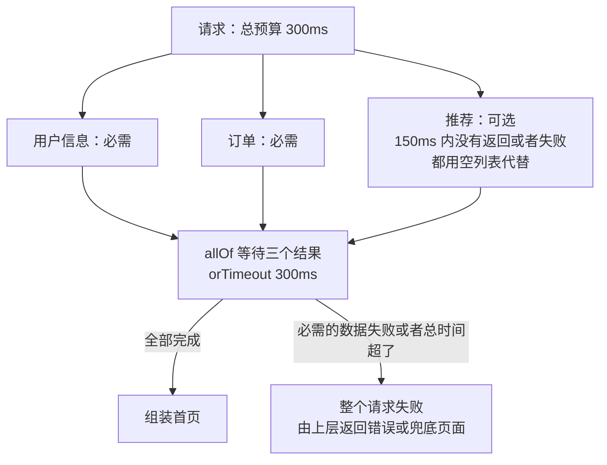

```java
import java.util.List;
import java.util.concurrent.CompletableFuture;
import java.util.concurrent.CompletionException;
import java.util.concurrent.ExecutorService;
import java.util.concurrent.Executors;
import java.util.concurrent.TimeUnit;

/**
 * 首页聚合：并行调用三个下游。用户信息、订单是必需的，推荐是可选的。
 * 规则：必需的调用失败或超时，整体失败；可选的调用失败或超时，返回空列表降级
 */
public final class HomePageAggregator {
    private static final System.Logger LOG = System.getLogger(HomePageAggregator.class.getName());
    private static final long TOTAL_TIMEOUT_MS = 300;     // 整个接口的时间预算
    private static final long OPTIONAL_TIMEOUT_MS = 150;  // 可选数据最多等多久

    public record HomePage(String user, List<String> orders, List<String> recommends) {}

    /** 下游客户端：真实项目中是 RPC 或 HTTP 调用，并且自己也要设置超时 */
    public interface Downstream {
        String user(long userId);
        List<String> orders(long userId);
        List<String> recommends(long userId);
    }

    private final Downstream downstream;
    private final ExecutorService ioPool;    // 专用线程池，不用公共的 ForkJoinPool

    public HomePageAggregator(Downstream downstream, ExecutorService ioPool) {
        this.downstream = downstream;
        this.ioPool = ioPool;
    }

    public HomePage load(long userId) {
        CompletableFuture<String> user =
                CompletableFuture.supplyAsync(() -> downstream.user(userId), ioPool);
        CompletableFuture<List<String>> orders =
                CompletableFuture.supplyAsync(() -> downstream.orders(userId), ioPool);
        CompletableFuture<List<String>> recommends = CompletableFuture
                .supplyAsync(() -> downstream.recommends(userId), ioPool)
                .completeOnTimeout(List.of(), OPTIONAL_TIMEOUT_MS, TimeUnit.MILLISECONDS)   // 超时：用空列表
                .exceptionally(e -> {                                                       // 失败：记录后降级
                    LOG.log(System.Logger.Level.ERROR, () -> "load recommends failed, userId=" + userId, e);
                    return List.of();
                });
        try {
            return CompletableFuture.allOf(user, orders, recommends)
                    .orTimeout(TOTAL_TIMEOUT_MS, TimeUnit.MILLISECONDS)
                    .thenApply(ignored -> new HomePage(user.join(), orders.join(), recommends.join()))
                    .join();
        } catch (CompletionException e) {
            // 注意：cancel 不会中断已经在执行的下游调用，下游自己的超时才能真正释放线程
            user.cancel(false);
            orders.cancel(false);
            // e.getCause() 是真正的原因：TimeoutException（整体超时）或下游抛出的异常
            throw new IllegalStateException("load home page failed, userId=" + userId, e.getCause());
        }
    }
}
```

测试场景：① 推荐接口要 500ms，150ms 时降级为空列表，整体不到 200ms 返回；② 推荐接口抛异常，降级并输出一条 error 日志；③ 订单接口要 1 秒，300ms 时整体超时失败。

```text
HomePage[user=u-1001, orders=[o-1, o-2], recommends=[]] costMs<200=true
HomePage[user=u-1002, orders=[o-1, o-2], recommends=[]]
load home page failed, userId=1003, cause=TimeoutException
```

**追问链**

1. **`exceptionally` 中拿到的异常是什么类型？** 是 `CompletionException`，真正的异常在它的 `getCause()` 中（本机运行的日志中可以看到这层包装）。按异常类型做不同处理时，要先拆开。
2. **能不能用虚拟线程？** 可以，下游调用都是 IO 操作，可以用 `Executors.newVirtualThreadPerTaskExecutor()`。但虚拟线程没有数量限制，仍然要用信号量之类的手段限制对每个下游的并发（见 03-23）。
3. **结构化并发能做得更好吗？** `StructuredTaskScope` 把子任务的生命周期绑定在一个代码块中：一个子任务失败或者超时，其他子任务会被取消（中断），离开代码块时保证所有子任务都已结束，不会有任务在后台继续运行。但它在 JDK 25 中仍是预览 API（见 03-24），生产代码中还要谨慎使用。

---

### 42-06 手写一个带过期时间、防止缓存击穿的本地缓存

> ★★★ ｜ 资深 / 架构师 ｜ 中频

**考察意图**：并发下怎么保证同一个 key 只加载一次，以及过期、加载失败这些细节。直接用 `ConcurrentHashMap` 做缓存的问题见 18-02。

**30 秒版回答**

- **缓存中存的不是值，而是代表"加载结果"的 Future**。第一个未命中的线程用 `putIfAbsent`（或者 `replace` 替换过期的条目）放入一个还没完成的 Future，并负责加载；其他线程拿到同一个 Future，等待它完成。这样同一个 key 同时只有一次加载。
- **加载在 Map 的锁之外执行**。如果直接用 `computeIfAbsent(key, loader)`，加载期间会锁住这个桶，其他线程对同一个桶的更新会被阻塞；加载函数内部也不能再修改这个 Map，否则会抛出 `IllegalStateException("Recursive update")`。
- **加载失败不缓存**：删除占位的条目，再把异常传给所有正在等待的线程，下一次访问重新加载。
- **过期**：只判断已经加载完成的条目，正在加载的不算过期，否则加载较慢时会重复加载。

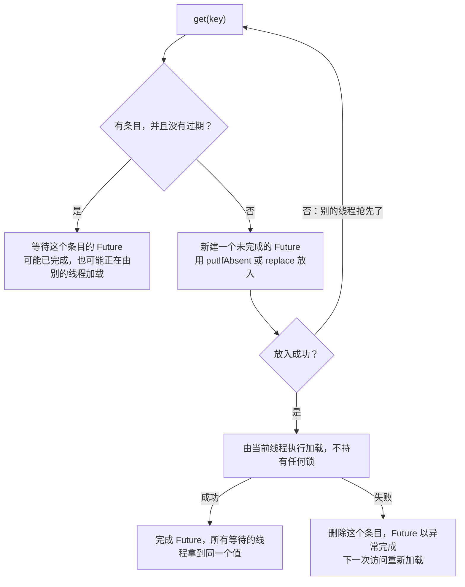

```java
import java.util.concurrent.CompletableFuture;
import java.util.concurrent.CompletionException;
import java.util.concurrent.ConcurrentHashMap;
import java.util.concurrent.CountDownLatch;
import java.util.concurrent.atomic.AtomicInteger;
import java.util.concurrent.atomic.AtomicLong;
import java.util.function.Function;
import java.util.function.LongSupplier;

/**
 * 带过期时间的本地缓存：同一个 key 同时未命中时只加载一次，其他线程等待同一个结果。
 * 加载失败不缓存异常，下一次访问重新加载
 */
public final class LoadingCache<K, V> {
    /** 缓存条目：future 代表"正在加载或已经加载好"的值；过期时间从开始加载时算起 */
    private record Entry<V>(CompletableFuture<V> future, long expireAtNanos) {
        boolean expired(long now) {
            return future.isDone() && now - expireAtNanos >= 0;   // 正在加载的条目不算过期
        }
    }

    private final ConcurrentHashMap<K, Entry<V>> map = new ConcurrentHashMap<>();
    private final Function<K, V> loader;
    private final long ttlNanos;
    private final LongSupplier clock;          // 注入时钟，测试时可以手动推进时间

    public LoadingCache(Function<K, V> loader, long ttlNanos, LongSupplier clock) {
        this.loader = loader;
        this.ttlNanos = ttlNanos;
        this.clock = clock;
    }

    public V get(K key) {
        while (true) {
            Entry<V> current = map.get(key);
            long now = clock.getAsLong();
            if (current != null && !current.expired(now)) {
                return await(current);                    // 命中，或者等待别的线程正在进行的加载
            }
            Entry<V> fresh = new Entry<>(new CompletableFuture<>(), now + ttlNanos);
            // 只有一个线程能把新条目放进去，放进去的线程负责加载
            boolean won = current == null
                    ? map.putIfAbsent(key, fresh) == null
                    : map.replace(key, current, fresh);
            if (!won) {
                continue;                                  // 被其他线程抢先，重新读取
            }
            try {
                fresh.future().complete(loader.apply(key));    // 在锁外加载，不阻塞其他 key
            } catch (RuntimeException e) {
                map.remove(key, fresh);                    // 不缓存失败结果
                fresh.future().completeExceptionally(e);   // 唤醒正在等待的线程，让它们也看到失败
            }
            return await(fresh);
        }
    }

    private static <V> V await(Entry<V> entry) {
        try {
            return entry.future().join();
        } catch (CompletionException e) {
            throw e.getCause() instanceof RuntimeException re ? re : e;
        }
    }
}
```

测试场景：10 个虚拟线程同时读取同一个 key（加载要 100ms）；推进时钟让它过期后再读；读取一个加载会失败的 key 两次。

```text
10 concurrent gets -> loads=1 value=sku-1@v1
after ttl -> value=sku-1@v2 loads=2
failed: db error, key=bad-1 loads=3
failed: db error, key=bad-1 loads=4
```

10 个并发读取只加载了 1 次；过期后重新加载 1 次；加载失败的 key 每次访问都重新加载，没有把异常缓存起来。

**追问链**

1. **生产中用什么？** 用 Caffeine，不要自己写。它同样保证同一个 key 同时只加载一次，还提供了容量淘汰、多种过期方式和异步刷新（见 18-03、18-05、18-06）。它的 `AsyncLoadingCache` 中存放的就是 `CompletableFuture`，和本题的思路一致。
2. **服务部署了多个实例，同时过期时还是会有多次加载？** 是的，本地的"只加载一次"只能把并发加载降到"每个实例一次"。对数据库来说压力是实例数量级的，通常可以接受。如果加载的代价非常高，再考虑分布式锁，或者在过期之前提前刷新（见 17-13）。
3. **条目过期的那一刻，读请求都要等待重新加载吗？** 本实现中是的。更好的做法是**提前异步刷新**：快要过期时由一个线程在后台重新加载，期间其他线程继续拿到旧值，例如 Caffeine 的 `refreshAfterWrite`。

---

### 42-07 手写攒批处理：凑满 N 条或等待 T 毫秒就提交一批

> ★★ ｜ 资深 / 架构师 ｜ 中频

**考察意图**：在吞吐量和延迟之间取得平衡，正确使用 BlockingQueue 的 API，关闭时不丢数据。高并发写入的整体设计见[《24 高并发》](../06-三高与架构/24-高并发.md)。

**30 秒版回答**

- 两个触发条件：**数量**达到 `maxBatch`，或者**时间**达到 `maxWait`（从这一批的第一条到达时开始计算）。
- 用 `drainTo` 一次性取走已经到达的数据，减少加锁次数；数量不够时，用 `poll(剩余时间)` 等待，等到截止时间就提交。
- 队列**有界**，满了让调用方决定怎么处理；关闭时停止接收，把队列中剩余的数据处理完再退出。
- Kafka 生产者也是这样做的：`batch.size` 和 `linger.ms` 就是"数量"和"时间"两个条件（见 21-06）。

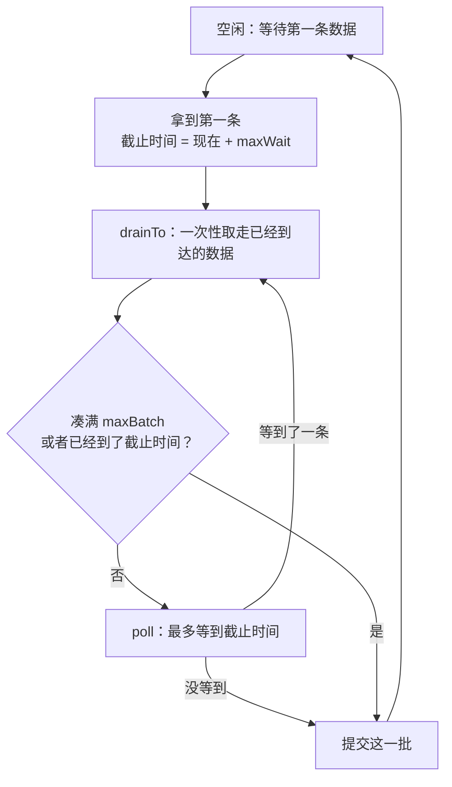

```java
import java.util.ArrayList;
import java.util.List;
import java.util.concurrent.ArrayBlockingQueue;
import java.util.concurrent.BlockingQueue;
import java.util.concurrent.CopyOnWriteArrayList;
import java.util.concurrent.TimeUnit;
import java.util.function.Consumer;

/**
 * 攒批消费：凑满 maxBatch 条，或者第一条到达后等了 maxWait，就提交一批。
 * 适合把大量单条写入合并成批量写入（数据库批量插入、批量发送消息）
 */
public final class BatchingConsumer<T> implements AutoCloseable {
    private static final System.Logger LOG = System.getLogger(BatchingConsumer.class.getName());
    private static final long IDLE_POLL_MS = 100;     // 空闲时每次等待多久，用来检查是否已关闭

    private final BlockingQueue<T> queue;
    private final int maxBatch;
    private final long maxWaitNanos;
    private final Consumer<List<T>> sink;
    private final Thread worker;
    private volatile boolean running = true;

    public BatchingConsumer(int capacity, int maxBatch, long maxWait, TimeUnit unit, Consumer<List<T>> sink) {
        this.queue = new ArrayBlockingQueue<>(capacity);
        this.maxBatch = maxBatch;
        this.maxWaitNanos = unit.toNanos(maxWait);
        this.sink = sink;
        this.worker = Thread.ofPlatform().name("batching-consumer").start(this::loop);
    }

    /** 队列满时返回 false，由调用方决定是丢弃、降级同步写，还是限流 */
    public boolean offer(T item) {
        return running && queue.offer(item);
    }

    private void loop() {
        List<T> batch = new ArrayList<>(maxBatch);
        while (running || !queue.isEmpty()) {
            try {
                T first = queue.poll(IDLE_POLL_MS, TimeUnit.MILLISECONDS);   // 空闲时阻塞等待第一条
                if (first == null) {
                    continue;
                }
                batch.add(first);
                long deadline = System.nanoTime() + maxWaitNanos;            // 从第一条到达开始计时
                while (batch.size() < maxBatch) {
                    queue.drainTo(batch, maxBatch - batch.size());           // 先一次性取走已经到达的
                    long left = deadline - System.nanoTime();
                    if (batch.size() >= maxBatch || left <= 0) {
                        break;
                    }
                    T next = queue.poll(left, TimeUnit.NANOSECONDS);         // 不够一批，最多再等到截止时间
                    if (next == null) {
                        break;
                    }
                    batch.add(next);
                }
                flush(batch);
            } catch (InterruptedException e) {
                Thread.currentThread().interrupt();
                flush(batch);
                return;
            }
        }
    }

    private void flush(List<T> batch) {
        if (batch.isEmpty()) {
            return;
        }
        try {
            sink.accept(List.copyOf(batch));
        } catch (RuntimeException e) {
            // 真实项目中：重试几次，仍然失败就写入失败表或死信队列，不能静默丢弃
            LOG.log(System.Logger.Level.ERROR, () -> "flush batch failed, size=" + batch.size(), e);
        } finally {
            batch.clear();
        }
    }

    /** 停止接收，把队列中剩余的数据处理完再返回 */
    @Override
    public void close() throws InterruptedException {
        running = false;
        worker.join();
    }
}
```

测试场景：`maxBatch` 为 100，`maxWait` 为 50ms。一次涌入 250 条，等待 200ms 后再来零星的 7 条，最后关闭。

```text
batch sizes=[100, 100, 50, 7]
```

连续运行 3 次结果相同：250 条分成 100、100、50 三批（最后一批等满 50ms 后提交），零星的 7 条在 50ms 后作为一批提交。

**追问链**

1. **进程崩溃时，内存队列中的数据怎么办？** 会丢失。不能丢的数据，要先写入消息队列或者本地的预写日志，再异步批量处理。内存中的攒批只适合可以容忍少量丢失的数据（例如访问统计），或者上游可以重新发送的场景。
2. **批量写入数据库失败怎么办？** 整批重试的前提是写入幂等（有唯一键，用"不存在才插入"或者"存在则更新"）。重试仍然失败，可以把这一批拆成两半分别重试，定位出有问题的数据，写入失败表后人工处理，不能让一条坏数据阻塞整个队列。

---

### 42-20 生产者消费者：多个生产者和消费者，怎么不丢数据地停下来？

> ★★ ｜ 资深 ｜ 高频

**考察意图**：有界缓冲区本身（`Lock` 加两个 `Condition`）在[《03 Java 并发》](../01-Java核心/03-Java并发.md)03-08 已经写过，这里不重复。面试官在这道题上真正的追问点是后半段：生产结束之后，阻塞在队列上的消费者怎么退出，而且不能丢下队列里还没处理的数据。

**30 秒版回答**

- 实际项目里缓冲区直接用 `BlockingQueue`，并且**必须有界**：队列满了生产者被阻塞，生产速度自动被消费速度限制。
- 难点在停止。消费者平时阻塞在 `take()` 上，生产者结束了它并不知道。两种不丢数据的停止方式：
  1. **毒丸**：生产者全部结束后，往队列里放入特殊的结束标记，消费者取到就退出。有几个消费者就放几颗。标记排在所有数据后面，所以取到它时前面的数据一定已经被取走；
  2. **停止标志加带超时的 `poll`**：消费者每次最多等一小段时间，超时后检查标志。退出条件是"**已经要求停止，并且这次没取到数据**"，两个条件缺一不可。
- 直接 `interrupt()` 消费者线程也能让它退出，但队列里剩下的数据会被丢下，只适合"可以丢"的场景。
- 用线程池管理消费者时，对应的做法是 `shutdown()` 加 `awaitTermination()`：不再接收新任务，把已提交的任务执行完，见[《03 Java 并发》](../01-Java核心/03-Java并发.md)03-14。

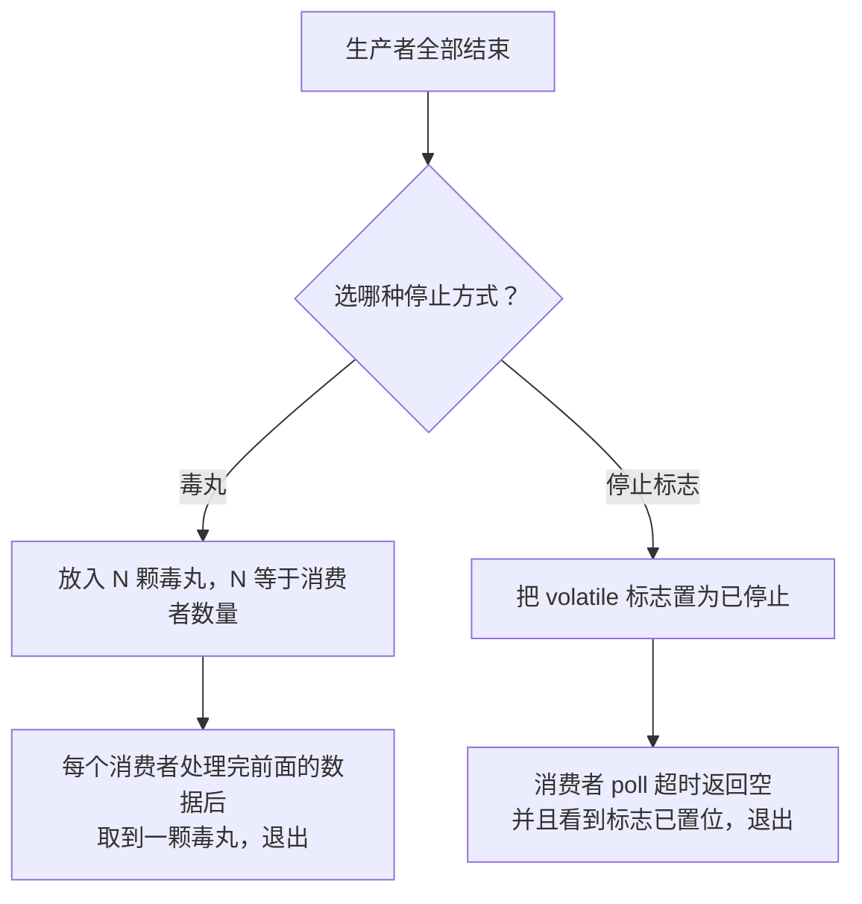

```java
import java.util.concurrent.ArrayBlockingQueue;
import java.util.concurrent.BlockingQueue;
import java.util.concurrent.TimeUnit;
import java.util.concurrent.atomic.AtomicLong;

/**
 * 多个生产者、多个消费者，重点演示两种"不丢数据的停止方式"：毒丸、停止标志 + 带超时的 poll
 */
public final class ProducerConsumer {

    private static final System.Logger LOG = System.getLogger(ProducerConsumer.class.getName());
    private static final int CAPACITY = 8;
    private static final int PRODUCERS = 3;
    private static final int CONSUMERS = 2;
    private static final int ITEMS_PER_PRODUCER = 10_000;
    private static final long POLL_TIMEOUT_MILLIS = 50L;
    /** 毒丸：消费者取到它就退出。业务数据都是正数，用负数不会和正常数据混淆 */
    private static final int POISON_PILL = -1;

    /** 方式一：毒丸。生产者全部结束后，给每个消费者放一颗 */
    static long runWithPoisonPill() throws InterruptedException {
        BlockingQueue<Integer> queue = new ArrayBlockingQueue<>(CAPACITY);
        AtomicLong sum = new AtomicLong();
        Thread[] consumers = new Thread[CONSUMERS];
        for (int i = 0; i < CONSUMERS; i++) {
            consumers[i] = new Thread(() -> {
                try {
                    while (true) {
                        int v = queue.take();
                        if (v == POISON_PILL) {
                            return;                      // 毒丸排在所有数据之后，取到它说明没有数据了
                        }
                        sum.addAndGet(v);
                    }
                } catch (InterruptedException e) {
                    Thread.currentThread().interrupt();
                    LOG.log(System.Logger.Level.INFO, "consumer interrupted, thread={0}", Thread.currentThread().getName());
                }
            }, "consumer-" + i);
            consumers[i].start();
        }
        Thread[] producers = startProducers(queue);
        for (Thread p : producers) {
            p.join();
        }
        for (int i = 0; i < CONSUMERS; i++) {
            queue.put(POISON_PILL);                      // 每个消费者只会取走一颗，所以要放 CONSUMERS 颗
        }
        for (Thread c : consumers) {
            c.join();
        }
        return sum.get();
    }

    /** 方式二：停止标志。消费者用带超时的 poll，只有"已经要求停止，并且队列已空"才退出 */
    static final class StopFlag {
        private volatile boolean stopped;

        void stop() {
            stopped = true;
        }

        boolean isStopped() {
            return stopped;
        }
    }

    static long runWithStopFlag() throws InterruptedException {
        BlockingQueue<Integer> queue = new ArrayBlockingQueue<>(CAPACITY);
        AtomicLong sum = new AtomicLong();
        StopFlag flag = new StopFlag();
        Thread[] consumers = new Thread[CONSUMERS];
        for (int i = 0; i < CONSUMERS; i++) {
            consumers[i] = new Thread(() -> {
                try {
                    while (true) {
                        Integer v = queue.poll(POLL_TIMEOUT_MILLIS, TimeUnit.MILLISECONDS);
                        if (v != null) {
                            sum.addAndGet(v);
                        } else if (flag.isStopped()) {
                            return;                      // 超时没取到，并且已经要求停止：队列确实空了
                        }
                    }
                } catch (InterruptedException e) {
                    Thread.currentThread().interrupt();
                    LOG.log(System.Logger.Level.INFO, "consumer interrupted, thread={0}", Thread.currentThread().getName());
                }
            }, "consumer-" + i);
            consumers[i].start();
        }
        Thread[] producers = startProducers(queue);
        for (Thread p : producers) {
            p.join();
        }
        flag.stop();                                     // 必须在生产者全部结束之后再置位
        for (Thread c : consumers) {
            c.join();
        }
        return sum.get();
    }

    private static Thread[] startProducers(BlockingQueue<Integer> queue) {
        Thread[] producers = new Thread[PRODUCERS];
        for (int i = 0; i < PRODUCERS; i++) {
            producers[i] = new Thread(() -> {
                try {
                    for (int v = 1; v <= ITEMS_PER_PRODUCER; v++) {
                        queue.put(v);                    // 队列满时阻塞，生产速度自动被消费速度限制
                    }
                } catch (InterruptedException e) {
                    Thread.currentThread().interrupt();
                }
            }, "producer-" + i);
            producers[i].start();
        }
        return producers;
    }

    public static void main(String[] args) throws InterruptedException {
        long expected = (long) PRODUCERS * ITEMS_PER_PRODUCER * (ITEMS_PER_PRODUCER + 1) / 2;
        long sum1 = runWithPoisonPill();
        System.out.println("poison pill: sum=" + sum1 + " expected=" + expected + " ok=" + (sum1 == expected));
        long sum2 = runWithStopFlag();
        System.out.println("stop flag:   sum=" + sum2 + " expected=" + expected + " ok=" + (sum2 == expected));
    }
}
```

本机运行输出（3 个生产者各放入 1 到 10000，2 个消费者求和，用总和校验有没有丢数据或重复消费）：

```text
poison pill: sum=150015000 expected=150015000 ok=true
stop flag:   sum=150015000 expected=150015000 ok=true
```

**追问链**

1. **停止标志的写法里，为什么不能一看到标志就退出？**
   标志置位时队列里可能还有数据。如果循环写成 `while (!stopped) { take... }`，消费者处理完手头这一条就退出了，队列里剩下的数据没人处理。必须是"标志已置位**并且** `poll` 超时没取到"才退出。同样的道理，标志必须在**生产者全部结束之后**再置位，否则消费者退出后生产者还在往队列里放数据。
2. **毒丸有什么局限？**
   - 生产者必须知道消费者有几个，数量变了就会有人收不到；
   - 多个生产者时，要等**所有**生产者都结束后再放毒丸，否则某个生产者的数据会排在毒丸后面；
   - 队列是无界的还好，有界队列满了的时候，放毒丸的线程也会被阻塞。
   生产者、消费者的数量固定且由同一处代码管理时用毒丸最简单；数量会变化、或者停止命令来自外部（比如应用关闭的钩子）时，用停止标志更灵活。
3. **消费者处理某条数据时抛了异常，会怎样？**
   如果异常没有被捕获，这个消费者线程就退出了，剩下的消费者要承担全部工作；所有消费者都退出后，生产者会永远阻塞在 `put()` 上。循环体里必须捕获处理单条数据时的异常，记录日志（带上这条数据的关键标识）后继续消费下一条。反复失败的数据应该转到单独的队列或表里，不要无限重试堵住后面的数据。
4. **`ArrayBlockingQueue` 和 `LinkedBlockingQueue` 选哪个？**
   `ArrayBlockingQueue` 用一把锁加两个 Condition，放入和取出互相竞争，但不产生额外的对象；`LinkedBlockingQueue` 放入和取出各用一把锁，吞吐更高，但每个元素要分配一个节点，而且**默认容量是 `Integer.MAX_VALUE`**，不指定容量就等于无界。详见[《03 Java 并发》](../01-Java核心/03-Java并发.md)03-18。

**生产实践 / 踩坑**

- **应用关闭时队列里的数据丢失**：进程收到终止信号后直接退出，内存队列里还没消费的数据全部丢失。要注册关闭钩子：先停止接收新数据，再等消费者把队列处理完，并且给这个等待设置上限。不能丢的数据不应该只放在内存队列里，要用消息队列或者先落库。
- **消费者数量超过了下游的承受能力**：为了消费得更快把消费者开得很多，结果把数据库连接池占满。消费者的并发度应该由下游的处理能力决定，见[《24 高并发》](../06-三高与架构/24-高并发.md)24-10。

---

## 三、数据结构

### 42-08 不用 LinkedHashMap，手写 LRU 缓存

> ★★ ｜ 资深 ｜ 高频

**考察意图**：02-10 的追问。能否设计出 get 和 put 都是 O(1) 的结构，并且想到线程安全和生产中的替代方案。

**30 秒版回答**

- **HashMap + 双向链表**：HashMap 保存 key 到链表节点的映射，负责 O(1) 查找；链表按访问时间排序，头部是最久未使用的，尾部是最近使用的。
- **get**：命中后把节点移到尾部。
- **put**：已存在就更新值并移到尾部；不存在时，如果已满，先删除头部节点，**同时从 HashMap 中删除**（所以节点中必须保存 key），再把新节点加到尾部。
- 用**头尾两个哨兵节点**，链表永远不为空，插入和删除不需要判断边界。

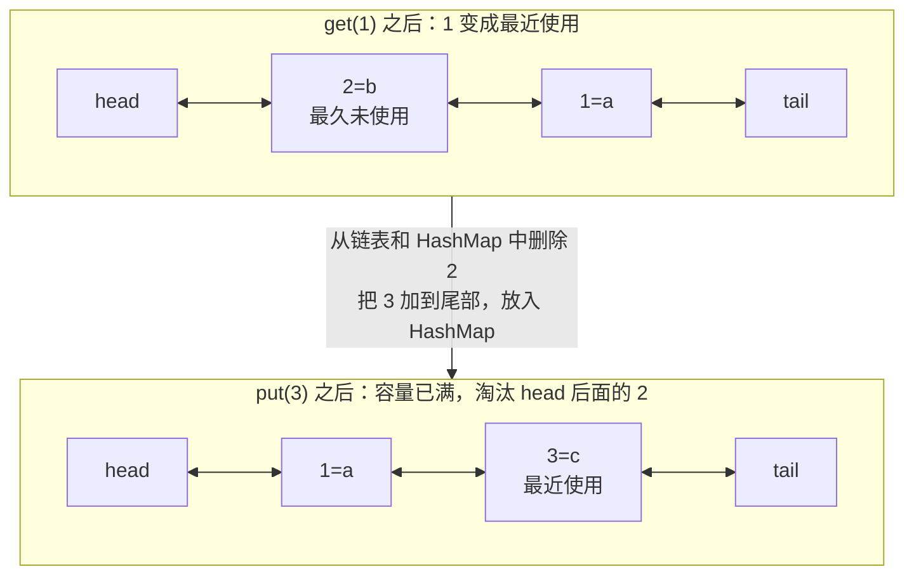

```java
@@CODE:LruCache|cut=    @Override@@
```

本机运行输出（容量为 2）：

```text
get(1)=a order=[2=b, 1=a]
get(2)=null order=[1=a, 3=c]
get(1)=null get(3)=c get(4)=d order=[3=c, 4=d]
```

**追问链**

1. **为什么必须是双向链表？** 要在 O(1) 时间内删除链表中间的任意节点，需要知道它的前一个节点。单向链表要从头遍历才能找到前驱。
2. **怎么做成线程安全的？** `get` 也会修改链表，所以不能用读写锁让读操作并发。最简单的办法是所有方法共用一把锁，但并发高时锁竞争会成为瓶颈。可以按 key 的哈希分成多段，每段一个独立的 LRU 和一把锁，代价是只能做到近似的 LRU。生产中直接用 Caffeine：读操作先记录在缓冲区中，再批量、异步地调整顺序，淘汰算法也比 LRU 更好（见 18-04）。
3. **容量按条数限制有什么问题？** 值的大小差别很大时，内存占用无法控制。Caffeine 可以用 `maximumWeight` 加上计算权重的函数，按估算的大小限制容量。

---

### 42-09 手写 O(1) 的 LFU 缓存

> ★★★ ｜ 资深 ｜ 中频

**考察意图**：在 LRU 的基础上再多维护一个维度（访问次数），并且仍然保持 O(1)。

**30 秒版回答**：维护三样东西：

- `nodes`：key → 节点（节点中保存值和访问次数）；
- `buckets`：访问次数 → 这个次数的所有节点。用 `LinkedHashSet` 保存，保持加入的顺序，第一个就是这个次数中最久未使用的；
- `minFreq`：当前最小的访问次数。

操作：

- **访问一次**：把节点从"次数 f"的集合移到"次数 f+1"的集合。如果原来的集合空了，并且 f 正好是 `minFreq`，`minFreq` 加 1；
- **新增**：如果已满，从 `minFreq` 对应的集合中删除第一个节点；新节点的次数是 1，`minFreq` 重置为 1。

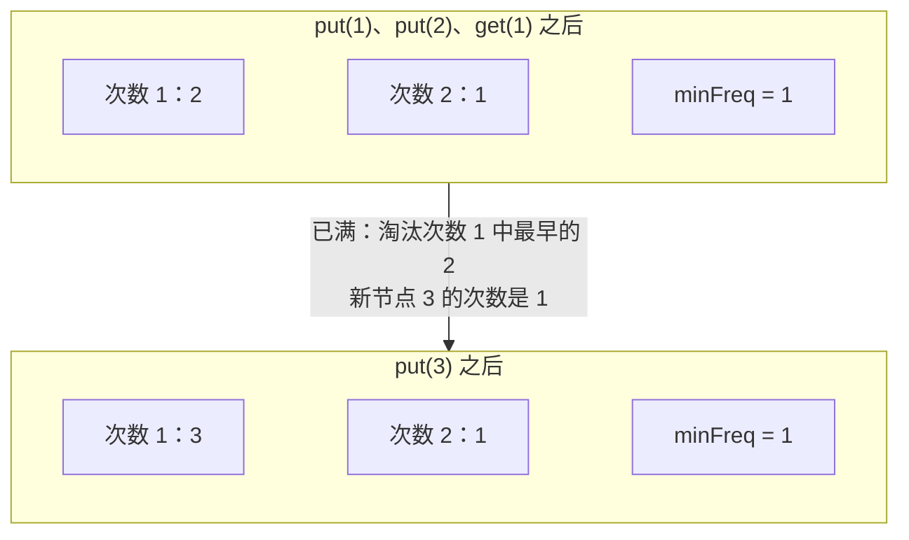

```java
import java.util.HashMap;
import java.util.LinkedHashSet;
import java.util.Map;

/**
 * LFU 缓存：淘汰访问次数最少的；次数相同时，淘汰其中最久未使用的。get 和 put 都是 O(1)。非线程安全
 */
public final class LfuCache<K, V> {
    private static final int INITIAL_FREQ = 1;

    private static final class Node<K, V> {
        final K key;
        V value;
        int freq = INITIAL_FREQ;

        Node(K key, V value) {
            this.key = key;
            this.value = value;
        }
    }

    private final int capacity;
    private final Map<K, Node<K, V>> nodes;
    /** 访问次数 → 这个次数的所有节点。LinkedHashSet 保持加入顺序，第一个就是最久未使用的 */
    private final Map<Integer, LinkedHashSet<Node<K, V>>> buckets = new HashMap<>();
    private int minFreq;                       // 当前最小的访问次数，淘汰时直接定位

    public LfuCache(int capacity) {
        if (capacity <= 0) {
            throw new IllegalArgumentException("capacity must be positive, capacity=" + capacity);
        }
        this.capacity = capacity;
        this.nodes = HashMap.newHashMap(capacity);
    }

    public V get(K key) {
        Node<K, V> node = nodes.get(key);
        if (node == null) {
            return null;
        }
        touch(node);
        return node.value;
    }

    public void put(K key, V value) {
        Node<K, V> node = nodes.get(key);
        if (node != null) {
            node.value = value;
            touch(node);
            return;
        }
        if (nodes.size() == capacity) {
            evict();
        }
        node = new Node<>(key, value);
        nodes.put(key, node);
        buckets.computeIfAbsent(INITIAL_FREQ, f -> new LinkedHashSet<>()).add(node);
        minFreq = INITIAL_FREQ;                // 新节点的次数一定是最小的
    }

    /** 访问一次：从原来的桶移到次数加一的桶 */
    private void touch(Node<K, V> node) {
        LinkedHashSet<Node<K, V>> bucket = buckets.get(node.freq);
        bucket.remove(node);
        if (bucket.isEmpty()) {
            buckets.remove(node.freq);
            if (node.freq == minFreq) {
                minFreq++;                     // 最小次数的桶空了，最小次数只可能是它加一
            }
        }
        node.freq++;
        buckets.computeIfAbsent(node.freq, f -> new LinkedHashSet<>()).add(node);
    }

    private void evict() {
        LinkedHashSet<Node<K, V>> bucket = buckets.get(minFreq);
        Node<K, V> victim = bucket.iterator().next();      // 次数最少的里面最久未使用的
        bucket.remove(victim);
        if (bucket.isEmpty()) {
            buckets.remove(minFreq);           // 马上会放入新节点并把 minFreq 设为 1，这里不用更新
        }
        nodes.remove(victim.key);
    }
}
```

本机运行输出（容量为 2）：

```text
get(1)=a
get(2)=null get(3)=c
get(1)=null get(3)=c get(4)=d
```

最后一步放入 4 时，1 和 3 的访问次数都是 2，淘汰的是更久没有被访问的 1。

**追问链**

1. **为什么 `minFreq` 只需要加 1，不用重新查找最小值？** 被访问的节点次数从 `minFreq` 变成 `minFreq + 1`，它刚被放进这个次数的集合，所以这个集合一定不为空。淘汰时不需要更新 `minFreq`，因为紧接着就会放入一个次数为 1 的新节点。
2. **LFU 在生产中有什么问题？** 过去访问很多、现在已经不再访问的数据，次数很高，会长期占着缓存；新数据的次数是 1，最容易被淘汰。改进的办法是让访问次数随时间衰减。Caffeine 使用的 W-TinyLFU 用 Count-Min Sketch 估算访问频率，定期把所有计数减半，并且用一个小的 LRU 窗口来接纳新数据（见 18-04、40-07）。

---

### 42-10 手写一个简易 HashMap

> ★★ ｜ 资深 ｜ 中频

**考察意图**：把 HashMap 的关键设计写成代码：哈希扰动、按位与计算下标、负载因子、扩容时拆分链表。原理见 02-04 到 02-07。

**30 秒版回答**

- 结构是**数组 + 链表**，容量是 2 的幂，下标 = `hash & (容量 - 1)`，相当于取模，但更快。
- **扰动**：`h ^ (h >>> 16)`，让哈希值的高位也参与下标计算。
- 查找时**先比较哈希值，再调用 `equals`**，减少 `equals` 的调用次数。
- 元素个数超过 `容量 × 0.75` 时扩容为两倍。扩容时每个节点只看哈希值中的一个比特（`hash & 旧容量`）：是 0 就留在原来的下标，是 1 就移到"原下标 + 旧容量"。链表的顺序保持不变。
- 本题省略了链表转红黑树（02-07）、迭代器和 fail-fast。

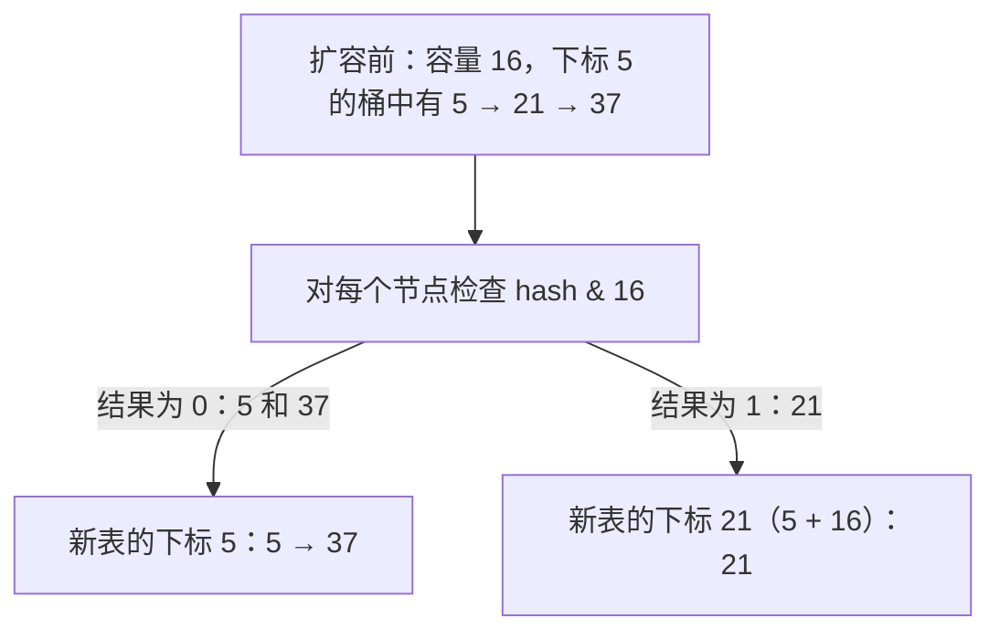

```java
import java.util.HashMap;
import java.util.Map;
import java.util.Objects;
import java.util.concurrent.ThreadLocalRandom;

/**
 * 简易 HashMap：数组 + 链表，容量是 2 的幂，负载因子 0.75，扩容时链表一分为二。
 * 省略了树化、迭代器和 fail-fast，非线程安全
 */
public final class SimpleHashMap<K, V> {
    private static final int DEFAULT_CAPACITY = 16;
    private static final float LOAD_FACTOR = 0.75f;

    private static final class Node<K, V> {
        final int hash;          // 缓存哈希值：扩容和比较时不用重新计算
        final K key;
        V value;
        Node<K, V> next;

        Node(int hash, K key, V value, Node<K, V> next) {
            this.hash = hash;
            this.key = key;
            this.value = value;
            this.next = next;
        }
    }

    private Node<K, V>[] table = newTable(DEFAULT_CAPACITY);
    private int size;
    private int threshold = (int) (DEFAULT_CAPACITY * LOAD_FACTOR);

    /** 扰动：高 16 位异或到低 16 位，让高位也参与下标计算 */
    static int hash(Object key) {
        int h;
        return key == null ? 0 : (h = key.hashCode()) ^ (h >>> 16);
    }

    public V get(K key) {
        int h = hash(key);
        for (Node<K, V> n = table[h & (table.length - 1)]; n != null; n = n.next) {
            if (n.hash == h && Objects.equals(n.key, key)) {    // 先比哈希值，再比 equals
                return n.value;
            }
        }
        return null;
    }

    public V put(K key, V value) {
        int h = hash(key);
        int i = h & (table.length - 1);                        // 容量是 2 的幂，与运算等价于取模
        Node<K, V> tailNode = null;
        for (Node<K, V> n = table[i]; n != null; n = n.next) {
            if (n.hash == h && Objects.equals(n.key, key)) {
                V old = n.value;
                n.value = value;
                return old;
            }
            tailNode = n;
        }
        Node<K, V> node = new Node<>(h, key, value, null);
        if (tailNode == null) {
            table[i] = node;
        } else {
            tailNode.next = node;                              // 尾插，保持插入顺序
        }
        if (++size > threshold) {
            resize();
        }
        return null;
    }

    public V remove(K key) {
        int h = hash(key);
        int i = h & (table.length - 1);
        Node<K, V> prev = null;
        for (Node<K, V> n = table[i]; n != null; prev = n, n = n.next) {
            if (n.hash == h && Objects.equals(n.key, key)) {
                if (prev == null) {
                    table[i] = n.next;
                } else {
                    prev.next = n.next;
                }
                size--;
                return n.value;
            }
        }
        return null;
    }

    public int size() {
        return size;
    }

    /** 容量翻倍。每个节点要么留在原下标 i，要么移到 i + oldCap，只看 hash 的一个比特 */
    private void resize() {
        Node<K, V>[] old = table;
        int oldCap = old.length;
        Node<K, V>[] next = newTable(oldCap << 1);
        for (int i = 0; i < oldCap; i++) {
            Node<K, V> loHead = null, loTail = null, hiHead = null, hiTail = null;
            for (Node<K, V> n = old[i]; n != null; n = n.next) {
                if ((n.hash & oldCap) == 0) {                  // 这一位是 0：下标不变
                    if (loTail == null) loHead = n; else loTail.next = n;
                    loTail = n;
                } else {                                       // 这一位是 1：下标加 oldCap
                    if (hiTail == null) hiHead = n; else hiTail.next = n;
                    hiTail = n;
                }
            }
            if (loTail != null) { loTail.next = null; next[i] = loHead; }
            if (hiTail != null) { hiTail.next = null; next[i + oldCap] = hiHead; }
        }
        table = next;
        threshold = (int) (next.length * LOAD_FACTOR);
    }

    @SuppressWarnings("unchecked")
    private static <K, V> Node<K, V>[] newTable(int capacity) {
        return (Node<K, V>[]) new Node[capacity];
    }
}
```

测试：用随机的 20 万次 `put`、`get`、`remove` 和 `java.util.HashMap` 对比返回值，全部一致；再验证扩容后 5 留在下标 5，21 移到了下标 21。

```text
random ops matched, size=2502 expectedSize=2502 get(null)=-1 tableLength=4096
cap16 bucket5=true
cap=32 bucket5Key=5 bucket21Key=21
```

**追问链**

1. **容量为什么必须是 2 的幂？** 一是可以用按位与代替取模；二是扩容时只需要看一个比特就能决定节点的新位置，不用重新计算下标。如果构造时传入的容量不是 2 的幂，JDK 会向上取到最近的 2 的幂。
2. **为什么采用尾插法？** 保持链表原来的顺序。JDK 7 用头插法，扩容时链表顺序会反转，多线程同时扩容可能形成环形链表，之后的 `get` 会陷入死循环（见 02-06）。JDK 8 改成了尾插法，但 HashMap 仍然不是线程安全的（见 02-08）。

---

### 42-11 手写小顶堆，并用它合并 K 个有序数组

> ★★ ｜ 资深 ｜ 中频

**考察意图**：能写出堆的上浮和下沉，并把堆用在"多路归并"上。这也是外部排序和数据库合并有序结果的基本操作。

**30 秒版回答**

- **堆**：用数组保存一棵完全二叉树，下标 i 的子节点是 `2i+1`、`2i+2`，父节点是 `(i-1)/2`。小顶堆中每个节点都不大于它的子节点。
  - 插入：放到末尾，再和父节点比较，**上浮**；
  - 取出堆顶：用最后一个元素填到堆顶，再和较小的子节点比较，**下沉**；
  - 两个操作都是 O(log n)。
- **K 路归并**：每个数组当前最小的元素放进一个大小为 K 的小顶堆；每次取出堆顶输出，再补入同一个数组的下一个元素。总共 N 个元素，时间 O(N log K)，额外空间 O(K)。

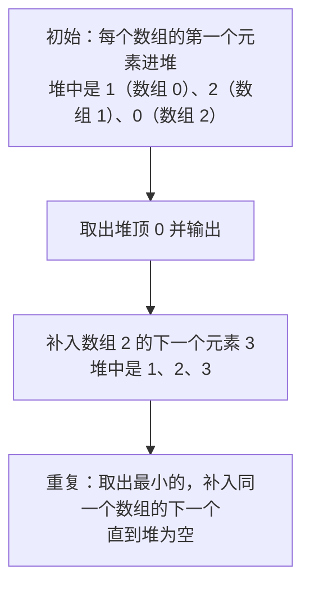

```java
import java.util.Arrays;
import java.util.Comparator;
import java.util.NoSuchElementException;

/**
 * 手写二叉小顶堆，并用它合并 K 个有序数组（外部排序的归并阶段就是这个过程）
 */
public final class KWayMerge {

    /** 数组实现的小顶堆：下标 i 的子节点是 2i+1 和 2i+2，父节点是 (i-1)/2 */
    static final class MinHeap<E> {
        private Object[] items;
        private int size;
        private final Comparator<? super E> cmp;

        MinHeap(int initialCapacity, Comparator<? super E> cmp) {
            this.items = new Object[Math.max(1, initialCapacity)];
            this.cmp = cmp;
        }

        void offer(E e) {
            if (size == items.length) {
                items = Arrays.copyOf(items, size << 1);
            }
            items[size] = e;
            siftUp(size++);
        }

        E poll() {
            if (size == 0) {
                throw new NoSuchElementException("heap is empty");
            }
            E top = at(0);
            items[0] = items[--size];         // 用最后一个元素填到堆顶，再往下调整
            items[size] = null;               // 帮助 GC
            if (size > 0) {
                siftDown(0);
            }
            return top;
        }

        int size() {
            return size;
        }

        /** 新元素从底部上浮：比父节点小就交换 */
        private void siftUp(int i) {
            E x = at(i);
            while (i > 0) {
                int parent = (i - 1) >>> 1;
                if (cmp.compare(x, at(parent)) >= 0) {
                    break;
                }
                items[i] = items[parent];     // 父节点下移，最后再放 x，减少一半的赋值
                i = parent;
            }
            items[i] = x;
        }

        /** 堆顶元素下沉：和较小的子节点比较，比它大就交换 */
        private void siftDown(int i) {
            E x = at(i);
            int half = size >>> 1;            // 下标 >= half 的都是叶子
            while (i < half) {
                int child = 2 * i + 1;
                if (child + 1 < size && cmp.compare(at(child + 1), at(child)) < 0) {
                    child++;
                }
                if (cmp.compare(x, at(child)) <= 0) {
                    break;
                }
                items[i] = items[child];
                i = child;
            }
            items[i] = x;
        }

        @SuppressWarnings("unchecked")
        private E at(int i) {
            return (E) items[i];
        }
    }

    /** 游标：指向第 k 个数组中当前待输出的元素 */
    private record Cursor(int[] array, int pos) {
        int value() { return array[pos]; }
        boolean hasNext() { return pos + 1 < array.length; }
        Cursor next() { return new Cursor(array, pos + 1); }
    }

    /** 合并 K 个升序数组。堆中最多 K 个游标，时间 O(N log K)，额外空间 O(K) */
    static int[] merge(int[][] arrays) {
        int total = 0;
        MinHeap<Cursor> heap = new MinHeap<>(arrays.length, Comparator.comparingInt(Cursor::value));
        for (int[] a : arrays) {
            total += a.length;
            if (a.length > 0) {
                heap.offer(new Cursor(a, 0));            // 每个数组的第一个元素进堆
            }
        }
        int[] out = new int[total];
        int k = 0;
        while (heap.size() > 0) {
            Cursor c = heap.poll();                       // 所有数组当前元素中最小的
            out[k++] = c.value();
            if (c.hasNext()) {
                heap.offer(c.next());                     // 从同一个数组补充下一个元素
            }
        }
        return out;
    }
}
```

测试：合并一个固定的例子，再随机生成 1000 组输入，和"全部拼起来再排序"的结果对比。

```text
[0, 1, 2, 3, 4, 5, 6, 7, 8, 9]
1000 random rounds matched
```

**追问链**

1. **外部排序是怎么做的？** 文件太大放不进内存时，先分成多块，每块读进内存排好序后写回磁盘；再用 K 路归并把这些有序的块合并成一个文件。K 太大时，可以分多轮归并（见 40-15）。
2. **求最大的 K 个数，用大顶堆还是小顶堆？** 用大小为 K 的**小顶堆**：堆顶是目前第 K 大的数，新来的数比堆顶大才替换，时间 O(n log K)（见 02-15）。
3. **`siftUp` 中为什么不每次交换，而是先把父节点往下移，最后才放入？** 每次交换要赋值 3 次，这样写每层只赋值 1 次，最后一次放入目标位置。JDK 的 `PriorityQueue` 也是这样写的。

---

### 42-21 手写并查集：省份数量、冗余连接

> ★★ ｜ 资深 ｜ 中频

**考察意图**：并查集的代码很短，但"路径压缩"和"按大小合并"这两个优化缺一个，最坏情况就会退化。面试官想看你能否写对，并识别出哪些问题可以转化成"动态连通性"。

**30 秒版回答**

- 并查集解决的问题：一批元素被不断地**合并**成组，随时要回答"这两个元素在不在同一组""一共有多少组"。
- 表示方法：每组是一棵树，用数组 `parent[i]` 记录父节点，**根节点就是这一组的代表**。两个元素的根相同，就在同一组。
- 两个优化：
  - **路径压缩**：查找时顺手把沿途的节点挂得离根更近，树越查越扁；
  - **按大小合并**：合并时把小树挂到大树下面，避免树变高。
- 两个优化都用上之后，每次操作的均摊时间接近常数。
- 适用信号：题目里出现"连通""朋友圈""属于同一个集合""加一条边后是否成环"。

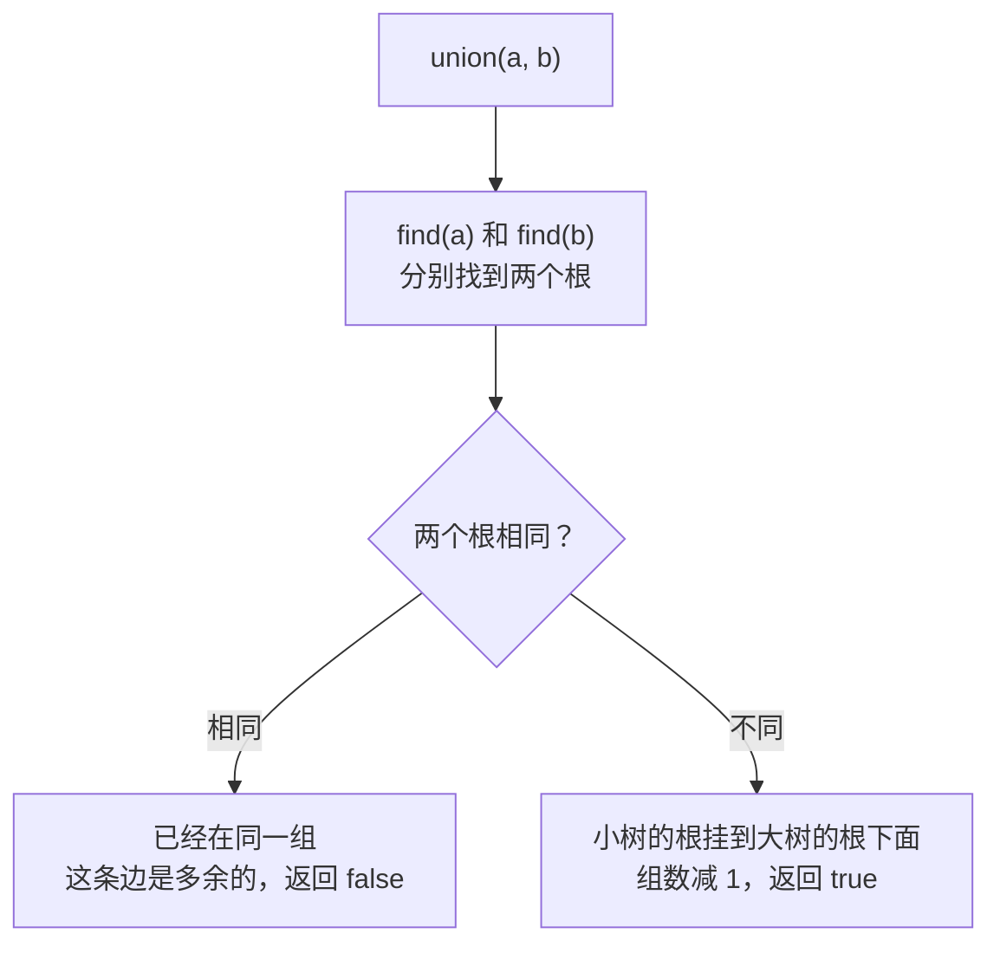

```java
import java.util.Arrays;

/**
 * 并查集：维护"哪些元素属于同一组"，支持合并两组、查询两个元素是否同组
 */
public final class UnionFindDemo {

    static final class UnionFind {
        private final int[] parent;   // parent[i] 是 i 的父节点，根节点的父节点是自己
        private final int[] size;     // 只对根节点有意义：这棵树有多少个节点
        private int components;       // 当前一共有多少组

        UnionFind(int n) {
            parent = new int[n];
            size = new int[n];
            components = n;
            for (int i = 0; i < n; i++) {
                parent[i] = i;
                size[i] = 1;
            }
        }

        /** 找到 x 所在组的代表（根）。路径压缩：沿途的节点直接挂到祖父节点上，树越查越扁 */
        int find(int x) {
            while (parent[x] != x) {
                parent[x] = parent[parent[x]];
                x = parent[x];
            }
            return x;
        }

        /** 合并 a 和 b 所在的组。已经在同一组时返回 false */
        boolean union(int a, int b) {
            int rootA = find(a);
            int rootB = find(b);
            if (rootA == rootB) {
                return false;
            }
            if (size[rootA] < size[rootB]) {         // 按大小合并：小树挂到大树下面，控制树高
                int tmp = rootA;
                rootA = rootB;
                rootB = tmp;
            }
            parent[rootB] = rootA;
            size[rootA] += size[rootB];
            components--;
            return true;
        }

        boolean connected(int a, int b) {
            return find(a) == find(b);
        }

        int components() {
            return components;
        }
    }

    /** 省份数量：isConnected[i][j] == 1 表示城市 i 和 j 直接相连，求连通块的个数 */
    static int countProvinces(int[][] isConnected) {
        int n = isConnected.length;
        UnionFind uf = new UnionFind(n);
        for (int i = 0; i < n; i++) {
            for (int j = i + 1; j < n; j++) {
                if (isConnected[i][j] == 1) {
                    uf.union(i, j);
                }
            }
        }
        return uf.components();
    }

    /** 冗余连接：一棵树多加了一条边，找出这条边。加边时两端已经连通，这条边就是多余的 */
    static int[] findRedundantConnection(int[][] edges) {
        UnionFind uf = new UnionFind(edges.length + 1);   // 节点编号从 1 开始
        for (int[] edge : edges) {
            if (!uf.union(edge[0], edge[1])) {
                return edge;
            }
        }
        return new int[0];
    }

    public static void main(String[] args) {
        int[][] cities = {{1, 1, 0, 0}, {1, 1, 0, 0}, {0, 0, 1, 1}, {0, 0, 1, 1}};
        System.out.println("countProvinces = " + countProvinces(cities));
        int[][] edges = {{1, 2}, {2, 3}, {3, 4}, {1, 4}, {1, 5}};
        System.out.println("redundant edge = " + Arrays.toString(findRedundantConnection(edges)));

        int n = 1_000_000;
        UnionFind uf = new UnionFind(n);
        long start = System.nanoTime();
        for (int i = 0; i + 1 < n; i++) {
            uf.union(i, i + 1);                      // 把 100 万个元素连成一组
        }
        boolean same = uf.connected(0, n - 1);
        System.out.println("1,000,000 unions: components=" + uf.components() + " connected(0,n-1)=" + same
                + " costMs=" + (System.nanoTime() - start) / 1_000_000);
    }
}
```

本机运行输出：

```text
countProvinces = 2
redundant edge = [1, 4]
1,000,000 unions: components=1 connected(0,n-1)=true costMs=7
```

最后一行是把 100 万个元素依次合并成一组的耗时（毫秒级，具体数值和机器有关）。

**追问链**

1. **只做路径压缩、不按大小合并，会怎样？**
   正确性不受影响，但存在让树退化成链表的合并顺序，这时第一次查找最深的节点是 O(n)。两个优化的作用互补：按大小合并保证树高不超过 log n，路径压缩让后续的查找越来越快。
2. **这道题用 DFS 或 BFS 也能做，并查集的优势在哪？**
   图是**一次性给定**的，DFS / BFS 和并查集都可以，复杂度相近。并查集的优势在**边是陆续到达的**场景：每来一条边就要回答一次连通性，DFS 每次都要重新遍历，并查集只需要一次近似常数时间的合并。它的短板是**不支持删除边**。
3. **并查集能记录更多信息吗？**
   能，在根节点上维护附加信息即可：这一组的大小（上面的 `size` 数组）、最大值、总和。还可以在边上维护"到父节点的关系"，这叫带权并查集，用来解决"A 是 B 的两倍，B 是 C 的三倍，问 A 是 C 的几倍"这类问题。
4. **工程里哪些地方用到并查集？**
   - 最小生成树的 Kruskal 算法：按权重从小到大加边，用并查集判断会不会成环；
   - **账号归并**：两个账号只要有一个相同的手机号、设备号或证件号，就认为是同一个人，这是风控和用户画像里的常见需求；
   - 图像处理里的连通区域标记；编译器里的类型合一和等价类划分。

---

### 42-22 单调栈和单调队列：每日温度、柱状图最大矩形、滑动窗口最大值

> ★★★ ｜ 资深 ｜ 中频

**考察意图**：这三道题的暴力解都是 O(n²)，用单调栈或单调队列能降到 O(n)。面试官看的是你能否说清"栈里维护的是什么、为什么弹出的元素不会再被用到"。

**30 秒版回答**

- **单调栈**解决"对每个元素，找它左边或右边第一个比它大（或小）的元素"。
  - 做法：从左到右扫描，栈里保存**还没找到答案的元素的下标**，并保持栈内的值单调。新元素到来时，把栈顶所有"被它打破单调性"的元素弹出，新元素就是这些被弹出元素的答案。
  - 每个元素最多入栈一次、出栈一次，总时间 O(n)。
- **单调队列**解决"滑动窗口内的最大值（或最小值）"。
  - 做法：队列里保存**可能成为最大值的元素的下标**，保持值从队头到队尾递减。新元素进来时，从队尾弹出所有不比它大的元素；队头滑出窗口时从队头弹出。队头始终是当前窗口的最大值。
- 判断用哪一个：要找的是"下一个更大 / 更小"，用单调栈；要找的是"一段范围内的最值，且范围在移动"，用单调队列。

```java
import java.util.ArrayDeque;
import java.util.Arrays;
import java.util.Deque;
import java.util.Random;

/**
 * 单调栈和单调队列：栈（队列）里的元素始终保持单调，用来在 O(n) 内找"下一个更大 / 更小的元素"和"窗口内的最值"
 */
public final class MonotonicStack {

    private static final int RANDOM_ROUNDS = 2_000;
    private static final int MAX_LENGTH = 30;
    private static final int MAX_VALUE = 50;
    private static final long SEED = 42L;

    /** 每日温度：对每一天，求要等几天才有更高的温度，没有则为 0 */
    static int[] dailyTemperatures(int[] temps) {
        int[] answer = new int[temps.length];
        Deque<Integer> stack = new ArrayDeque<>();   // 存下标；栈里的温度从栈底到栈顶递减
        for (int i = 0; i < temps.length; i++) {
            // 当前温度比栈顶那天高：栈顶那天等到了答案，出栈
            while (!stack.isEmpty() && temps[i] > temps[stack.peek()]) {
                int prev = stack.pop();
                answer[prev] = i - prev;
            }
            stack.push(i);
        }
        return answer;                               // 留在栈里的都没等到更高的温度，保持 0
    }

    /** 柱状图中最大的矩形：以每根柱子为高，向左右扩展到第一根更矮的柱子为止 */
    static int largestRectangleArea(int[] heights) {
        Deque<Integer> stack = new ArrayDeque<>();   // 存下标；栈里的高度从栈底到栈顶递增
        int best = 0;
        for (int i = 0; i <= heights.length; i++) {
            int current = (i == heights.length) ? 0 : heights[i];   // 末尾补一根高度为 0 的柱子，把栈清空
            while (!stack.isEmpty() && current < heights[stack.peek()]) {
                int height = heights[stack.pop()];
                // 弹出后新的栈顶是左边第一根更矮的柱子，i 是右边第一根更矮的柱子
                int left = stack.isEmpty() ? -1 : stack.peek();
                best = Math.max(best, height * (i - left - 1));
            }
            stack.push(i);
        }
        return best;
    }

    /** 滑动窗口最大值：单调队列，队头始终是当前窗口的最大值 */
    static int[] maxSlidingWindow(int[] nums, int k) {
        int[] result = new int[nums.length - k + 1];
        Deque<Integer> deque = new ArrayDeque<>();   // 存下标；队列里的值从队头到队尾递减
        for (int i = 0; i < nums.length; i++) {
            if (!deque.isEmpty() && deque.peekFirst() <= i - k) {
                deque.pollFirst();                   // 队头已经滑出窗口
            }
            while (!deque.isEmpty() && nums[deque.peekLast()] <= nums[i]) {
                deque.pollLast();                    // 比新元素小的旧元素不可能再成为最大值
            }
            deque.offerLast(i);
            if (i >= k - 1) {
                result[i - k + 1] = nums[deque.peekFirst()];
            }
        }
        return result;
    }

    /** 暴力解，只用来对拍 */
    private static int bruteRectangle(int[] h) {
        int best = 0;
        for (int i = 0; i < h.length; i++) {
            int min = Integer.MAX_VALUE;
            for (int j = i; j < h.length; j++) {
                min = Math.min(min, h[j]);
                best = Math.max(best, min * (j - i + 1));
            }
        }
        return best;
    }

    private static int[] bruteWindow(int[] nums, int k) {
        int[] result = new int[nums.length - k + 1];
        for (int i = 0; i + k <= nums.length; i++) {
            int max = Integer.MIN_VALUE;
            for (int j = i; j < i + k; j++) {
                max = Math.max(max, nums[j]);
            }
            result[i] = max;
        }
        return result;
    }

    public static void main(String[] args) {
        System.out.println("dailyTemperatures = " + Arrays.toString(dailyTemperatures(new int[]{73, 74, 75, 71, 69, 72, 76, 73})));
        System.out.println("largestRectangleArea([2,1,5,6,2,3]) = " + largestRectangleArea(new int[]{2, 1, 5, 6, 2, 3}));
        System.out.println("maxSlidingWindow k=3 = " + Arrays.toString(maxSlidingWindow(new int[]{1, 3, -1, -3, 5, 3, 6, 7}, 3)));

        Random random = new Random(SEED);
        for (int round = 0; round < RANDOM_ROUNDS; round++) {
            int[] data = random.ints(1 + random.nextInt(MAX_LENGTH), 0, MAX_VALUE).toArray();
            int k = 1 + random.nextInt(data.length);
            if (largestRectangleArea(data) != bruteRectangle(data) || !Arrays.equals(maxSlidingWindow(data, k), bruteWindow(data, k))) {
                throw new AssertionError("mismatch on " + Arrays.toString(data) + ", k=" + k);
            }
        }
        System.out.println(RANDOM_ROUNDS + " random rounds matched brute force");
    }
}
```

本机运行输出：

```text
dailyTemperatures = [1, 1, 4, 2, 1, 1, 0, 0]
largestRectangleArea([2,1,5,6,2,3]) = 10
maxSlidingWindow k=3 = [3, 3, 5, 5, 6, 7]
2000 random rounds matched brute force
```

**追问链**

1. **为什么栈里存下标而不是值？**
   因为答案通常和**位置**有关：等了几天、矩形有多宽、元素是否已经滑出窗口。有了下标随时可以取到值，反过来不行。
2. **柱状图那道题，为什么要在末尾补一根高度为 0 的柱子？**
   如果柱子一路递增，循环结束时栈里还留着一批没结算的柱子。补一根高度为 0 的柱子，能把栈里剩下的全部弹出并结算，省掉循环之后再写一段几乎相同的代码。这类"哨兵"技巧在链表题里也常用（虚拟头节点）。
3. **滑动窗口最大值用堆可以吗？**
   可以，把"值和下标"放进大顶堆，取堆顶时先丢掉下标已经滑出窗口的元素。时间复杂度是 O(n log n)，比单调队列的 O(n) 慢，但更容易想到。面试时可以先说堆的做法，再优化到单调队列。
4. **工程里有对应的场景吗？**
   - 监控系统里"最近 N 秒的最大延迟""最近一段时间的最小可用连接数"，就是滑动窗口最值；
   - 股票行情里"今天之后第一次超过当前价格是哪一天""价格跨度"，是单调栈的典型应用；
   - TCP 的 BBR 拥塞控制算法需要"最近一段时间内的最大带宽和最小延迟"，内核用一个只保留少量候选值的窗口最值过滤器来维护，思路和单调队列相同：不可能再成为最值的旧样本直接丢弃。

---

## 四、算法

### 42-12 反转链表、每 K 个一组反转链表

> ★★ ｜ 资深 ｜ 高频

**考察意图**：指针操作是否清晰，能否用哑节点统一边界处理。

**30 秒版回答**

- **反转**：用 `prev`、`cur` 两个指针，每一步先保存 `cur.next`，再把 `cur.next` 指向 `prev`，然后两个指针一起前进。时间 O(n)，空间 O(1)。
- **K 个一组反转**：在头部前面加一个**哑节点**，让第一组和其他组的处理方式一样。每次先往后数 k 个节点，不足 k 个就结束；够 k 个就反转这一段，再把这一段接回链表。

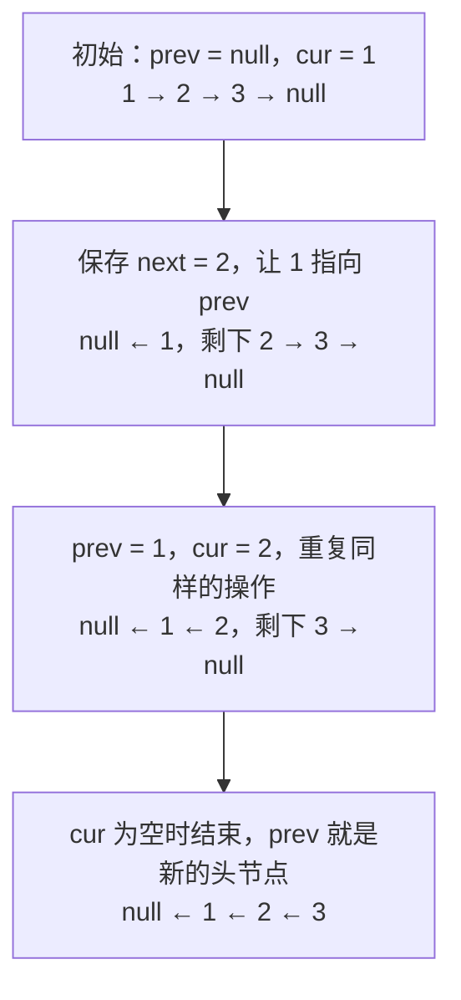

```java
import java.util.StringJoiner;

/**
 * 链表高频题：反转、K 个一组反转、判环并找环的入口
 */
public final class LinkedListAlgos {
    static final class Node {
        final int val;
        Node next;

        Node(int val, Node next) {
            this.val = val;
            this.next = next;
        }
    }

    /** 迭代反转：每一步把 cur.next 指回 prev，三个指针一起前进 */
    static Node reverse(Node head) {
        Node prev = null;
        Node cur = head;
        while (cur != null) {
            Node next = cur.next;     // 先保存后继，否则改指针后就找不到了
            cur.next = prev;
            prev = cur;
            cur = next;
        }
        return prev;
    }

    /** 每 k 个节点反转一次，最后不足 k 个的保持原样 */
    static Node reverseKGroup(Node head, int k) {
        Node dummy = new Node(0, head);          // 哑节点：第一组和其他组的处理方式一致
        Node groupPrev = dummy;
        while (true) {
            Node kth = groupPrev;
            for (int i = 0; i < k && kth != null; i++) {
                kth = kth.next;                  // 找到这一组的第 k 个节点
            }
            if (kth == null) {
                return dummy.next;               // 剩余不足 k 个
            }
            Node groupNext = kth.next;
            Node prev = groupNext;               // 反转后，这一组的第一个节点要接到下一组
            Node cur = groupPrev.next;
            while (cur != groupNext) {
                Node next = cur.next;
                cur.next = prev;
                prev = cur;
                cur = next;
            }
            Node newGroupTail = groupPrev.next;  // 原来的第一个节点，反转后变成这一组的最后一个
            groupPrev.next = kth;
            groupPrev = newGroupTail;
        }
    }

    /** Floyd 判环：快指针每次两步、慢指针每次一步；相遇后一个回到头部，同速前进，再次相遇处就是环的入口 */
    static Node detectCycle(Node head) {
        Node slow = head;
        Node fast = head;
        while (fast != null && fast.next != null) {
            slow = slow.next;
            fast = fast.next.next;
            if (slow == fast) {
                Node p = head;
                while (p != slow) {
                    p = p.next;
                    slow = slow.next;
                }
                return p;
            }
        }
        return null;                             // 快指针走到了末尾：无环
    }
}
```

本机运行输出（第 42-13 题的判环也在其中）：

```text
reverse:   5 -> 4 -> 3 -> 2 -> 1
k=2:       2 -> 1 -> 4 -> 3 -> 5
k=3:       3 -> 2 -> 1 -> 4 -> 5
empty:     
cycle entry=2
no cycle=null
```

**追问链**

1. **递归写法有什么问题？** 递归的深度等于链表的长度，链表很长时会栈溢出（42-17 中的二叉树实测：10 万层递归在默认 2MB 的线程栈上溢出）。迭代写法只用常数空间。
2. **怎么判断一个链表是不是回文？** 用快慢指针找到中点，反转后半段，再从两头往中间比较。比较完后最好把后半段反转回来，不要修改调用方传进来的数据。

---

### 42-13 判断链表是否有环，并找到环的入口

> ★★ ｜ 资深 ｜ 中频

**考察意图**：能写出快慢指针，并且能证明为什么"一个指针回到头部、同速前进，会在入口相遇"。

**30 秒版回答**

- 快指针每次走两步，慢指针每次走一步。没有环时快指针会先走到末尾；有环时，两个指针都进入环后，快指针每走一次就把距离缩小 1，一定会追上慢指针，不会跳过去。
- 相遇后，让一个指针回到头部，两个指针每次各走一步，再次相遇的位置就是环的入口。

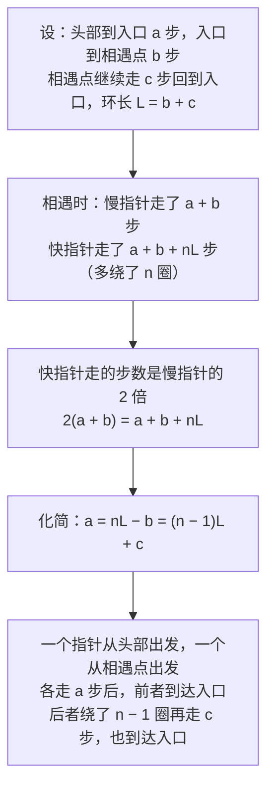

代码见上一题的 `detectCycle`。测试用例中 -4 指回 2，输出的入口是 2；没有环时返回 `null`。

**追问链**

1. **为什么慢指针进入环后，一圈之内一定会被追上？** 慢指针进入环时，快指针已经在环中，两者在环上的距离小于环长 L。之后每走一次距离缩小 1，最多 L − 1 次就会相遇，这时慢指针在环中还没走完一圈，所以慢指针走过的距离是 a + b，且 b 小于 L。
2. **工程中在哪里会遇到"环"？** JDK 7 的 HashMap 在并发扩容时可能形成环形链表，导致 `get` 死循环（见 02-06）；服务之间、Bean 之间的循环依赖，是图中的环，用拓扑排序或深度优先搜索检测（见 40-14）。
3. **怎么找到两个单链表的第一个公共节点？** 两个指针分别从两个链表的头部出发，走到末尾后转到另一个链表的头部继续走。两者走过的总长度相同（a + c + b = b + c + a），会在第一个公共节点相遇；没有公共节点时会同时走到 `null`。

---

### 42-14 二分查找的边界怎么写才不出错？

> ★★ ｜ 资深 ｜ 高频

**考察意图**：二分查找的思路很简单，但边界很容易写错：死循环、漏掉元素、下标越界。能否用"区间定义 + 不变量"的方法写出可证明正确的代码。

**30 秒版回答**

- **先定义清楚区间**，例如左闭右开 `[lo, hi)`，再写出**不变量**：`[0, lo)` 中的元素都小于目标值，`[hi, n)` 中的元素都大于等于目标值。每次更新 `lo`、`hi` 都要保持这个不变量，循环结束时 `lo == hi`，就是第一个大于等于目标值的位置。
- **中点用 `(lo + hi) >>> 1`**：`lo + hi` 可能超过 `int` 的最大值变成负数，无符号右移仍然能得到正确的结果。JDK 的 `Arrays.binarySearch` 就是这样写的。
- 有了"第一个大于等于"（lowerBound）和"第一个大于"（upperBound），就能解决查找左右边界、统计出现次数、找插入位置等一系列问题。

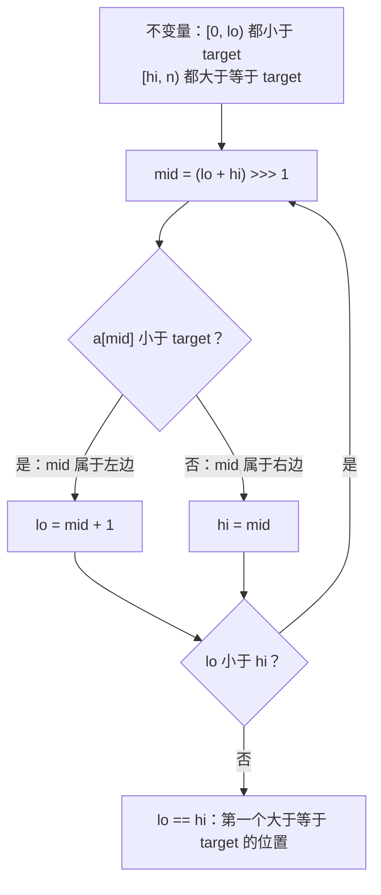

```java
import java.util.Arrays;
import java.util.Random;

/**
 * 二分查找：用"左闭右开 + 不变量"统一写法，求左边界、右边界，以及在旋转数组中查找
 */
public final class BinarySearch {

    /**
     * 第一个 >= target 的下标；全部小于 target 时返回 a.length。
     * 不变量：[0, lo) 都 < target，[hi, n) 都 >= target。循环结束时 lo == hi 就是答案
     */
    static int lowerBound(int[] a, int target) {
        int lo = 0;
        int hi = a.length;
        while (lo < hi) {
            int mid = (lo + hi) >>> 1;           // 无符号右移：lo + hi 溢出成负数时结果仍然正确
            if (a[mid] < target) {
                lo = mid + 1;                    // mid 属于左边部分
            } else {
                hi = mid;                        // mid 属于右边部分
            }
        }
        return lo;
    }

    /** 第一个 > target 的下标。只是把比较改成 <= */
    static int upperBound(int[] a, int target) {
        int lo = 0;
        int hi = a.length;
        while (lo < hi) {
            int mid = (lo + hi) >>> 1;
            if (a[mid] <= target) {
                lo = mid + 1;
            } else {
                hi = mid;
            }
        }
        return lo;
    }

    /** 有序数组中 target 出现的区间 [first, last]，不存在时返回 [-1, -1] */
    static int[] searchRange(int[] a, int target) {
        int first = lowerBound(a, target);
        if (first == a.length || a[first] != target) {
            return new int[]{-1, -1};
        }
        return new int[]{first, upperBound(a, target) - 1};
    }

    /** 无重复元素的升序数组被旋转过（如 [4,5,6,7,0,1,2]），查找 target 的下标 */
    static int searchRotated(int[] a, int target) {
        int lo = 0;
        int hi = a.length - 1;
        while (lo <= hi) {
            int mid = (lo + hi) >>> 1;
            if (a[mid] == target) {
                return mid;
            }
            if (a[lo] <= a[mid]) {               // 左半段 [lo, mid] 是有序的
                if (a[lo] <= target && target < a[mid]) {
                    hi = mid - 1;
                } else {
                    lo = mid + 1;
                }
            } else {                             // 右半段 [mid, hi] 是有序的
                if (a[mid] < target && target <= a[hi]) {
                    lo = mid + 1;
                } else {
                    hi = mid - 1;
                }
            }
        }
        return -1;
    }
}
```

本机运行输出：

```text
range(2)=[1, 3] range(4)=[-1, -1] lowerBound(9)=6
rotated find 0 -> 4, find 3 -> -1
(lo+hi)/2=-97483648 (lo+hi)>>>1=2050000000
10000 random rounds matched
```

第三行就是中点溢出的例子：`(lo + hi) / 2` 得到了负数。

**追问链**

1. **`Arrays.binarySearch` 能用来找左边界吗？** 不能。它的文档说明，数组中有多个相同的元素时，不保证返回哪一个。找不到时返回 `-(插入位置) - 1`。
2. **左闭右闭的写法可以吗？** 可以：`while (lo <= hi)`，更新时用 `hi = mid - 1`。两种写法都对，关键是在一种写法中，区间的定义、循环条件和更新方式要保持一致，不要混用。
3. **旋转数组中有重复元素怎么办？** `a[lo] == a[mid]` 时无法判断哪一半是有序的，只能 `lo++` 缩小范围，最坏情况退化为 O(n)。
4. **工程中哪里用到二分？** 一致性哈希在环上找第一个大于等于哈希值的节点（`TreeMap.ceilingEntry`，见 09-19）；按时间戳在有序的日志或数据中定位；`git bisect` 定位引入问题的提交；"二分答案"，例如找满足吞吐量要求的最少机器数。

---

### 42-15 快速排序和快速选择：怎么避免退化？

> ★★ ｜ 资深 ｜ 高频

**考察意图**：能写出切分（partition），并且知道快排在什么输入下会退化，以及怎么避免。

**30 秒版回答**

- 快排的核心是**切分**：选一个基准值，把小于它的放到左边、大于它的放到右边，再分别处理两边。平均 O(n log n)。
- **退化成 O(n²)** 的两种典型情况：
  - 固定选第一个或最后一个元素作为基准，输入又已经有序：每次只切掉一个元素；
  - 大量相同的元素，用二路切分：相同的元素都被分到同一边。
- 改进：**随机选基准**；**三路切分**（小于、等于、大于三段，等于的部分不再处理）；**先递归较短的一边**，较长的一边用循环处理，栈的深度不超过 O(log n)。
- **快速选择**：找第 k 大的数时，切分后只需要处理答案所在的那一边，期望 O(n)。

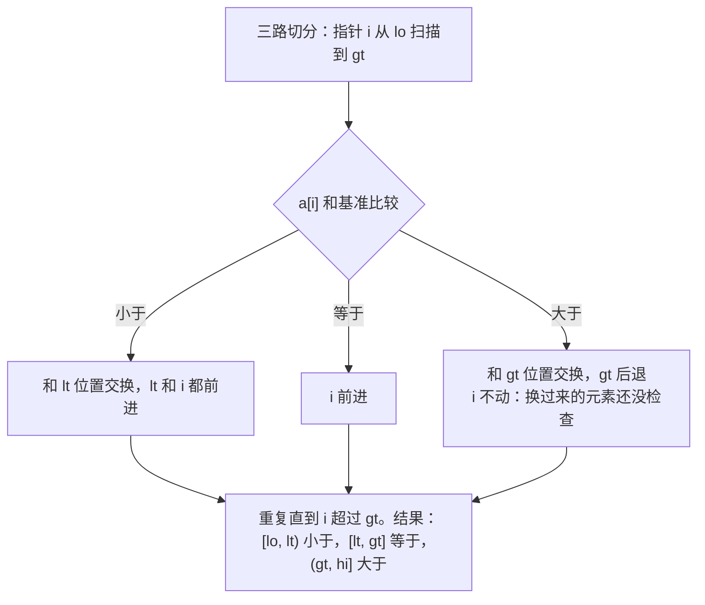

```java
import java.util.Arrays;
import java.util.Random;
import java.util.concurrent.ThreadLocalRandom;

/**
 * 快速排序（随机基准 + 三路切分）与快速选择（第 k 大）
 */
public final class QuickSortSelect {

    /** 三路切分：[lo, lt) < pivot，[lt, gt] == pivot，(gt, hi] > pivot。等于基准的元素不再参与递归 */
    static void quickSort(int[] a, int lo, int hi) {
        while (lo < hi) {
            int pivot = a[ThreadLocalRandom.current().nextInt(lo, hi + 1)];   // 随机基准：避免有序输入退化
            int lt = lo;
            int gt = hi;
            int i = lo;
            while (i <= gt) {
                if (a[i] < pivot) {
                    swap(a, lt++, i++);
                } else if (a[i] > pivot) {
                    swap(a, i, gt--);            // 换过来的元素还没看过，i 不前进
                } else {
                    i++;
                }
            }
            // 先递归较短的一边，较长的一边用循环处理：递归深度不超过 O(log n)
            if (lt - lo < hi - gt) {
                quickSort(a, lo, lt - 1);
                lo = gt + 1;
            } else {
                quickSort(a, gt + 1, hi);
                hi = lt - 1;
            }
        }
    }

    /** 第 k 大的元素（k 从 1 开始）。期望 O(n)，会修改数组 */
    static int kthLargest(int[] a, int k) {
        int target = a.length - k;               // 第 k 大 = 升序排序后下标为 n - k 的元素
        int lo = 0;
        int hi = a.length - 1;
        while (true) {
            int pivot = a[ThreadLocalRandom.current().nextInt(lo, hi + 1)];
            int lt = lo;
            int gt = hi;
            int i = lo;
            while (i <= gt) {
                if (a[i] < pivot) {
                    swap(a, lt++, i++);
                } else if (a[i] > pivot) {
                    swap(a, i, gt--);
                } else {
                    i++;
                }
            }
            if (target < lt) {
                hi = lt - 1;                     // 答案在左边，只处理一边
            } else if (target > gt) {
                lo = gt + 1;
            } else {
                return pivot;                    // 落在等于基准的区间内
            }
        }
    }

    /** 反例：教科书式的 Lomuto 切分（固定取最后一个元素做基准，二路切分，直接递归） */
    static void lomutoSort(int[] a, int lo, int hi) {
        if (lo >= hi) {
            return;
        }
        int pivot = a[hi];
        int p = lo;
        for (int i = lo; i < hi; i++) {
            if (a[i] <= pivot) {
                swap(a, p++, i);
            }
        }
        swap(a, p, hi);
        lomutoSort(a, lo, p - 1);
        lomutoSort(a, p + 1, hi);
    }

    private static void swap(int[] a, int i, int j) {
        int t = a[i];
        a[i] = a[j];
        a[j] = t;
    }
}
```

本机运行输出：

```text
2000 random rounds matched
3-way, 1000000 equal elements: 1.0 ms
3-way, 1000000 already sorted elements: 46.6 ms
lomuto, 100000 equal elements: StackOverflowError
lomuto, 20000 already sorted elements: 36.0 ms
```

| 输入 | 三路切分 + 随机基准 | 固定基准 + 二路切分（Lomuto） |
| --- | --- | --- |
| 100 万个相同的元素 | 约 1 毫秒，一次切分就结束 | 10 万个相同元素就栈溢出：每次只切掉一个元素，递归深度等于元素个数 |
| 已经有序 | 100 万个元素约 45 毫秒 | 2 万个元素就要约 36 毫秒，元素个数是左边的 1/50，耗时却差不多，这就是 O(n²) |

（耗时为本机连续运行 3 次的结果，只用来对比数量级，不是严格的基准测试。）

**追问链**

1. **JDK 的 `Arrays.sort` 用的是什么算法？** 基本类型用双轴快排，递归太深时改用堆排序，最坏情况仍是 O(n log n)；对象用 TimSort，它是稳定的排序（见 02-20）。
2. **TopK 用快速选择还是堆？** 数据能一次放进内存、并且允许修改数组时，快速选择期望 O(n) 更快；数据是流式到达的、量太大，或者不能修改原数组时，用大小为 K 的堆，O(n log K)（见 40-15）。

---

### 42-16 滑动窗口：最长无重复子串、最小覆盖子串

> ★★ ｜ 资深 ｜ 高频

**考察意图**：能否把"枚举所有子串"的 O(n²) 优化成 O(n) 的双指针，并处理好窗口收缩的条件。

**30 秒版回答**

- 用 `[left, right]` 表示当前窗口，右指针不断向右扩张；窗口不满足条件时，移动左指针收缩。每个元素最多进入和离开窗口各一次，所以是 O(n)。
- 两类题：
  - **求最长**：窗口不满足条件时收缩，例如最长的无重复字符子串；
  - **求最短**：窗口满足条件时尽量收缩，例如包含所有指定字符的最短子串。

以最长无重复子串为例，输入 `abba` 时：

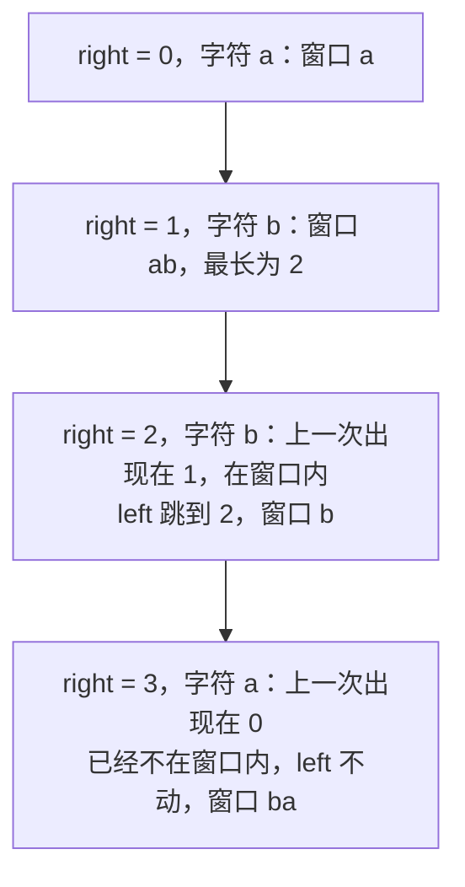

最后一步是最容易错的地方：如果不判断"上一次出现的位置是否还在窗口内"，`left` 会退回到 1，得到错误的答案 3。

```java
import java.util.HashMap;
import java.util.Map;

/**
 * 滑动窗口：右边界不断扩张，窗口不满足条件时收缩左边界
 */
public final class SlidingWindow {

    /** 最长的不含重复字符的子串长度 */
    static int longestUniqueSubstring(String s) {
        Map<Character, Integer> lastSeen = new HashMap<>();   // 字符 → 最近一次出现的下标
        int best = 0;
        int left = 0;                                         // 窗口是 [left, right]
        for (int right = 0; right < s.length(); right++) {
            Integer prev = lastSeen.put(s.charAt(right), right);
            if (prev != null && prev >= left) {
                left = prev + 1;                              // 重复字符在窗口内：左边界跳到它后面
            }
            best = Math.max(best, right - left + 1);
        }
        return best;
    }

    /** 最小覆盖子串：s 中包含 t 的全部字符（含重复）的最短子串，不存在返回空串 */
    static String minWindow(String s, String t) {
        Map<Character, Integer> need = new HashMap<>();
        for (char c : t.toCharArray()) {
            need.merge(c, 1, Integer::sum);
        }
        int missing = t.length();                             // 还差多少个字符没有覆盖
        int bestStart = 0;
        int bestLen = Integer.MAX_VALUE;
        int left = 0;
        for (int right = 0; right < s.length(); right++) {
            char c = s.charAt(right);
            if (need.containsKey(c) && need.merge(c, -1, Integer::sum) >= 0) {
                missing--;                                    // 这个字符是"需要的"，而不是多余的
            }
            while (missing == 0) {                            // 已经全部覆盖：尽量收缩左边界
                if (right - left + 1 < bestLen) {
                    bestStart = left;
                    bestLen = right - left + 1;
                }
                char out = s.charAt(left++);
                if (need.containsKey(out) && need.merge(out, 1, Integer::sum) > 0) {
                    missing++;                                // 移出了一个必需的字符，窗口不再满足
                }
            }
        }
        return bestLen == Integer.MAX_VALUE ? "" : s.substring(bestStart, bestStart + bestLen);
    }
}
```

本机运行输出：

```text
longest("abcabcbb")=3
longest("bbbbb")=1
longest("pwwkew")=3
longest("")=0
longest("abba")=2
minWindow=BANC minWindow(aa)=true
```

**追问链**

1. **字符只有 ASCII 时能更快吗？** 可以用长度为 128 的 `int` 数组代替 HashMap，避免装箱和哈希计算。
2. **工程中的"滑动窗口"是一回事吗？** 思想相同：只维护最近一段范围内的状态，随着时间或数据向前移动。例如滑动窗口限流（26-03）、TCP 的滑动窗口（37-03）、监控中"最近 5 分钟"的指标。

---

### 42-17 二叉树的层序遍历和最近公共祖先

> ★★ ｜ 资深 ｜ 高频

**考察意图**：广度优先和深度优先两种遍历方式，以及递归时"子树向上返回什么信息"的设计。

**30 秒版回答**

- **层序遍历**：用队列做广度优先遍历。每一层开始时先记下队列的长度，再一次处理这么多个节点，就能把不同的层分开。
- **最近公共祖先**：后序遍历，每个子树向上返回"在这个子树中找到的 p 或 q"：
  - 当前节点就是 p 或 q，直接返回当前节点；
  - 左右子树各找到一个，说明 p、q 分别在两边，当前节点就是答案；
  - 只有一边找到，就把那一边的结果继续往上返回。

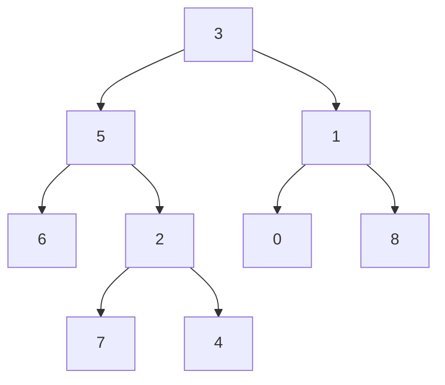

在这棵树中：7 和 8 的最近公共祖先是 3；5 和 4 的最近公共祖先是 5，因为一个节点也算它自己的祖先。

```java
import java.util.ArrayDeque;
import java.util.ArrayList;
import java.util.List;
import java.util.Queue;

/**
 * 二叉树：层序遍历、最近公共祖先
 */
public final class BinaryTreeAlgos {
    static final class TreeNode {
        final int val;
        TreeNode left;
        TreeNode right;

        TreeNode(int val) {
            this.val = val;
        }
    }

    /** 层序遍历：队列中每次先记下当前层的节点数，再一次性处理这一层 */
    static List<List<Integer>> levelOrder(TreeNode root) {
        List<List<Integer>> levels = new ArrayList<>();
        if (root == null) {
            return levels;
        }
        Queue<TreeNode> queue = new ArrayDeque<>();     // ArrayDeque 不接受 null，入队前要判断
        queue.offer(root);
        while (!queue.isEmpty()) {
            int count = queue.size();
            List<Integer> level = new ArrayList<>(count);
            for (int i = 0; i < count; i++) {
                TreeNode node = queue.poll();
                level.add(node.val);
                if (node.left != null) queue.offer(node.left);
                if (node.right != null) queue.offer(node.right);
            }
            levels.add(level);
        }
        return levels;
    }

    /**
     * 最近公共祖先（p、q 都在树中）。后序遍历：
     * 左右子树各找到一个 → 当前节点就是答案；只有一边找到 → 把那一边的结果往上返回
     */
    static TreeNode lowestCommonAncestor(TreeNode root, TreeNode p, TreeNode q) {
        if (root == null || root == p || root == q) {
            return root;
        }
        TreeNode left = lowestCommonAncestor(root.left, p, q);
        TreeNode right = lowestCommonAncestor(root.right, p, q);
        if (left != null && right != null) {
            return root;
        }
        return left != null ? left : right;
    }
}
```

本机运行输出：

```text
levels=[[3], [5, 1], [6, 2, 0, 8], [7, 4]]
lca(5,1)=3 lca(5,4)=5 lca(7,8)=3
deep tree (100000 levels): StackOverflowError
deep tree levelOrder size=100000
```

一棵退化成链表的树（10 万层），递归求最近公共祖先时在默认的 2MB 线程栈上发生了栈溢出；用队列实现的层序遍历不受影响。

**追问链**

1. **如果是二叉搜索树呢？** 利用有序性，从根节点往下走：p、q 都比当前节点小就往左，都比当前节点大就往右，否则当前节点就是答案。不需要遍历整棵树。
2. **树很深时怎么办？** 改用显式的栈或队列实现迭代版本。如果节点有指向父节点的指针，问题就变成了"两个链表的第一个公共节点"（42-13 的追问）。
3. **工程中的例子？** 组织架构中两个员工最近的共同上级、商品类目树中两个类目最近的共同父类目。数据在数据库中时，通常先查出两个节点到根的路径，再比较两条路径。

---

### 42-18 动态规划怎么推导？以零钱兑换为例

> ★★ ｜ 资深 ｜ 中频

**考察意图**：能否按固定的步骤推导出状态和转移，而不是背题；能否说明贪心为什么不对。

**30 秒版回答**：题目是"给定几种面值的硬币，每种数量不限，凑出某个金额最少需要几枚"。

```mermaid
flowchart TD
    A["① 定义状态：dp[x] 表示凑出金额 x 最少需要几枚"] --> B["② 找转移：假设最后一枚的面值是 c<br/>剩下的 x − c 也必须是最优的<br/>dp[x] = min(dp[x − c] + 1)"]
    B --> C["③ 初始值：dp[0] = 0，其他先设为不可达"]
    C --> D["④ 计算顺序：x 从小到大<br/>保证用到的 dp[x − c] 已经算好"]
    D --> E["⑤ 答案：dp[amount]，仍然不可达就返回 −1"]
```

- 时间 O(金额 × 硬币种数)，空间 O(金额)。
- **贪心不总是对的**：面值是 1、3、4，凑 6 时，贪心先拿 4，再拿两个 1，共 3 枚；最优解是 3 + 3，只要 2 枚。

| x | 0 | 1 | 2 | 3 | 4 | 5 | 6 |
| --- | --- | --- | --- | --- | --- | --- | --- |
| dp[x] | 0 | 1 | 2 | 1 | 1 | 2 | 2 |
| 最后一枚 | — | 1 | 1 | 3 | 4 | 4（或 1） | 3 |

```java
import java.util.Arrays;

/**
 * 动态规划：零钱兑换
 */
public final class CoinChange {

    /** 凑出 amount 最少需要几枚硬币，凑不出返回 -1。每种硬币数量不限 */
    static int minCoins(int[] coins, int amount) {
        int unreachable = amount + 1;                   // 硬币面值至少为 1，所以答案不会超过 amount
        int[] dp = new int[amount + 1];                 // dp[x]：凑出 x 最少要几枚
        Arrays.fill(dp, unreachable);
        dp[0] = 0;                                      // 凑出 0 不需要硬币
        for (int x = 1; x <= amount; x++) {
            for (int c : coins) {
                if (c <= x && dp[x - c] + 1 < dp[x]) {
                    dp[x] = dp[x - c] + 1;              // 最后一枚用面值 c，前面的部分已经算好了
                }
            }
        }
        return dp[amount] == unreachable ? -1 : dp[amount];
    }

    /** 贪心：每次拿不超过余额的最大面值。只对部分面值体系正确 */
    static int greedy(int[] coins, int amount) {
        int[] sorted = coins.clone();
        Arrays.sort(sorted);
        int count = 0;
        for (int i = sorted.length - 1; i >= 0 && amount > 0; i--) {
            count += amount / sorted[i];
            amount %= sorted[i];
        }
        return amount == 0 ? count : -1;
    }

    /** 组合数：{1,2} 和 {2,1} 算同一种。外层循环硬币，保证每种组合只按一种顺序被计数 */
    static long combinations(int[] coins, int amount) {
        long[] ways = new long[amount + 1];
        ways[0] = 1;
        for (int c : coins) {
            for (int x = c; x <= amount; x++) {
                ways[x] += ways[x - c];
            }
        }
        return ways[amount];
    }

    /** 排列数：{1,2} 和 {2,1} 算两种。外层循环金额，最后一枚可以是任意面值 */
    static long permutations(int[] coins, int amount) {
        long[] ways = new long[amount + 1];
        ways[0] = 1;
        for (int x = 1; x <= amount; x++) {
            for (int c : coins) {
                if (c <= x) {
                    ways[x] += ways[x - c];
                }
            }
        }
        return ways[amount];
    }
}
```

本机运行输出：

```text
coins=[1,3,4] amount=6: dp=2 greedy=3
coins=[2] amount=3: dp=-1
coins=[1,2,5] amount=5: combinations=4 permutations=9
coins=[186,419,83,408] amount=6249: dp=20 (0.7 ms)
```

**追问链**

1. **求"有多少种凑法"时，两层循环的顺序有什么区别？** 外层循环硬币、内层循环金额，算的是**组合数**：每种组合只会按"硬币出现的顺序"被计算一次，1+2 和 2+1 算同一种。外层循环金额、内层循环硬币，最后一枚可以是任意面值，算的是**排列数**，1+2 和 2+1 算两种。上面的输出中，用 1、2、5 凑 5，组合数是 4，排列数是 9。
2. **每种硬币只能用一次呢？** 这就是 0-1 背包：外层循环硬币，内层的金额要**从大到小**遍历，保证计算 `dp[x]` 时用到的 `dp[x - c]` 还是"没有使用这枚硬币"时的值。
3. **记忆化搜索和递推有什么区别？** 状态和转移是一样的。记忆化搜索是从目标往下递归，只计算用得到的状态，写起来更直观，但有栈深度的问题；递推按顺序把所有状态算一遍，没有递归的开销。

---

### 42-23 回溯怎么写？全排列、子集、组合总和

> ★★ ｜ 资深 ｜ 高频

**考察意图**：回溯题的变体很多，但骨架只有一个。面试官看你是否掌握这个骨架，以及去重和剪枝这两个最容易出错的地方。

**30 秒版回答**

- 回溯就是在**决策树**上做深度优先搜索：每一层做一次选择，走到底得到一个结果，然后**撤销这次选择**，回到上一层换另一个选项。
- 统一的骨架只有三步：**做选择 → 递归 → 撤销选择**。写之前先想清楚三件事：
  1. **路径**：已经做了哪些选择；
  2. **选择列表**：当前这一层还能选什么；
  3. **结束条件**：什么时候把路径记入结果。
- 三类题的区别只在"选择列表"怎么定：

| 题型 | 选择列表 | 怎么避免重复 |
| --- | --- | --- |
| 排列 | 所有还没用过的元素 | 用 `used` 数组标记 |
| 子集、组合 | 只能从当前位置往后选 | 用 `start` 参数 |
| 元素可重复使用的组合 | 从当前位置开始（包含自己） | 递归时传 `i` 而不是 `i + 1` |

- 输入里有重复元素时，**先排序**，然后规定"同一层里，相同的值只让第一个去尝试"。
- 把路径加入结果时**必须拷贝**，因为路径这个列表后面还会被修改。

```mermaid
flowchart TD
    R["[ ]"] --> A["[1]"]
    R --> B["[2]"]
    R --> C["[3]"]
    A --> A1["[1,2]"]
    A --> A2["[1,3]"]
    B --> B1["[2,3]"]
    A1 --> A11["[1,2,3]"]
```

上图是求 `[1,2,3]` 所有子集时的决策树：每个节点都是一个子集，每条边是"再选一个更靠后的元素"。

```java
import java.util.ArrayList;
import java.util.Arrays;
import java.util.List;

/**
 * 回溯的统一写法：在决策树上做深度优先搜索，"做选择 → 递归 → 撤销选择"
 */
public final class Backtracking {

    /** 全排列（元素可能重复）：结果不能有重复的排列 */
    static List<List<Integer>> permuteUnique(int[] nums) {
        int[] sorted = nums.clone();
        Arrays.sort(sorted);                         // 排序后相同的数挨在一起，才能去重
        List<List<Integer>> result = new ArrayList<>();
        permute(sorted, new boolean[sorted.length], new ArrayList<>(), result);
        return result;
    }

    private static void permute(int[] nums, boolean[] used, List<Integer> path, List<List<Integer>> result) {
        if (path.size() == nums.length) {
            result.add(new ArrayList<>(path));        // 必须拷贝：path 后面还会被修改
            return;
        }
        for (int i = 0; i < nums.length; i++) {
            if (used[i]) {
                continue;
            }
            // 同一层里，相同的数只让第一个没用过的去尝试，否则会产生重复的排列
            if (i > 0 && nums[i] == nums[i - 1] && !used[i - 1]) {
                continue;
            }
            used[i] = true;
            path.add(nums[i]);
            permute(nums, used, path, result);
            path.remove(path.size() - 1);            // 撤销选择
            used[i] = false;
        }
    }

    /** 子集：每个元素选或不选。用 start 保证只往后选，避免 [1,2] 和 [2,1] 重复 */
    static List<List<Integer>> subsets(int[] nums) {
        List<List<Integer>> result = new ArrayList<>();
        subsets(nums, 0, new ArrayList<>(), result);
        return result;
    }

    private static void subsets(int[] nums, int start, List<Integer> path, List<List<Integer>> result) {
        result.add(new ArrayList<>(path));            // 决策树上的每个节点都是一个子集
        for (int i = start; i < nums.length; i++) {
            path.add(nums[i]);
            subsets(nums, i + 1, path, result);
            path.remove(path.size() - 1);
        }
    }

    /** 组合总和：候选数都是正数、互不相同、可以重复使用，找出所有和为 target 的组合 */
    static List<List<Integer>> combinationSum(int[] candidates, int target) {
        int[] sorted = candidates.clone();
        Arrays.sort(sorted);                         // 排序是为了剪枝
        List<List<Integer>> result = new ArrayList<>();
        combine(sorted, 0, target, new ArrayList<>(), result);
        return result;
    }

    private static void combine(int[] nums, int start, int remain, List<Integer> path, List<List<Integer>> result) {
        if (remain == 0) {
            result.add(new ArrayList<>(path));
            return;
        }
        for (int i = start; i < nums.length; i++) {
            if (nums[i] > remain) {
                break;                               // 剪枝：后面的数更大，不可能再凑出来
            }
            path.add(nums[i]);
            combine(nums, i, remain - nums[i], path, result);   // 传 i 而不是 i + 1：同一个数可以再用
            path.remove(path.size() - 1);
        }
    }

    public static void main(String[] args) {
        System.out.println("permuteUnique([1,1,2]) = " + permuteUnique(new int[]{1, 1, 2}));
        System.out.println("permuteUnique([1,2,3]) 个数 = " + permuteUnique(new int[]{1, 2, 3}).size());
        System.out.println("subsets([1,2,3]) = " + subsets(new int[]{1, 2, 3}));
        System.out.println("combinationSum([2,3,6,7], 7) = " + combinationSum(new int[]{2, 3, 6, 7}, 7));
        System.out.println("combinationSum([2,3,5], 8) = " + combinationSum(new int[]{2, 3, 5}, 8));
    }
}
```

本机运行输出：

```text
permuteUnique([1,1,2]) = [[1, 1, 2], [1, 2, 1], [2, 1, 1]]
permuteUnique([1,2,3]) 个数 = 6
subsets([1,2,3]) = [[], [1], [1, 2], [1, 2, 3], [1, 3], [2], [2, 3], [3]]
combinationSum([2,3,6,7], 7) = [[2, 2, 3], [7]]
combinationSum([2,3,5], 8) = [[2, 2, 2, 2], [2, 3, 3], [3, 5]]
```

**追问链**

1. **去重条件 `!used[i - 1]` 是什么意思？**
   两个相同的数 `1a`、`1b`，如果不加限制，`[1a, 1b, 2]` 和 `[1b, 1a, 2]` 会被当成两个排列。规定"`1b` 只能在 `1a` 已经被使用的情况下才能选"，就等于给相同的数规定了一个固定的先后顺序，重复自然消失。`!used[i - 1]` 表示前一个相同的数在当前路径里没被使用，这时选 `nums[i]` 就违反了这个顺序，跳过。
2. **回溯的时间复杂度是多少？**
   由结果的数量决定，这类问题本身就是指数级的：n 个不同元素的全排列有 n! 个，子集有 2ⁿ 个。回溯已经是最优的量级，能优化的只有剪枝，也就是尽早放弃不可能得到结果的分支。组合总和里先排序、遇到比剩余值大的数就 `break`，就是一次剪枝。
3. **回溯和动态规划怎么区分？**
   要**列出所有方案**时用回溯；只要**方案数或者最优值**时优先考虑动态规划。比如"凑出金额 8 的所有组合"用回溯，"凑出金额 8 有多少种方法"或"最少用几个硬币"用动态规划，见 42-18 和 42-26。
4. **递归太深会栈溢出吗？**
   回溯的递归深度等于决策树的高度，一般就是输入的规模（几十以内），不会有问题。真正的风险在结果数量：n 稍大一点，结果就多到内存放不下。工程里遇到这种情况，应该改成"边生成边处理"，而不是把所有结果收集到一个列表里。

---

### 42-24 区间问题：合并区间、最少需要几间会议室

> ★★ ｜ 资深 ｜ 高频

**考察意图**：区间题在业务里很常见（排班、预约、时间段冲突检测）。面试官看你是否知道"先排序再扫描"这个通用思路，以及端点相等时的边界处理。

**30 秒版回答**

- 区间题的通用套路：**按起点排序，然后从左到右扫描一遍**。排序之后，能和当前区间重叠的只可能是它前面那个"已合并的区间"，不需要两两比较。
- **合并区间**：维护结果里的最后一个区间。当前区间的起点不超过它的终点，就重叠，把终点更新为两者中较大的那个；否则新开一个区间。
- **最少会议室数**：等于**同一时刻最多有多少场会议在进行**。两种写法：
  - 小顶堆保存各会议室的结束时间：新会议开始时，如果最早结束的那间已经空了就复用，否则新开一间；
  - 扫描线：把所有开始时间和结束时间分别排序，按时间推进，遇到开始加一、遇到结束减一，记录出现过的最大值。
- 两个边界：
  1. 合并时终点要取 `max`，因为后一个区间可能被前一个完全包含；
  2. 端点相等算不算重叠，取决于区间的开闭。**先向面试官确认**。

```java
import java.util.ArrayList;
import java.util.Arrays;
import java.util.Comparator;
import java.util.List;
import java.util.PriorityQueue;

/**
 * 区间问题：先排序，再线性扫描
 */
public final class Intervals {

    /** 合并所有重叠的区间。区间是闭区间，[1,4] 和 [4,5] 算重叠 */
    static int[][] merge(int[][] intervals) {
        int[][] sorted = intervals.clone();
        Arrays.sort(sorted, Comparator.comparingInt(a -> a[0]));      // 按起点排序
        List<int[]> merged = new ArrayList<>();
        for (int[] current : sorted) {
            int[] last = merged.isEmpty() ? null : merged.get(merged.size() - 1);
            if (last == null || current[0] > last[1]) {
                merged.add(new int[]{current[0], current[1]});        // 和上一个不重叠，新开一个
            } else {
                last[1] = Math.max(last[1], current[1]);              // 重叠：只需要更新右端点。注意要取最大值
            }
        }
        return merged.toArray(new int[0][]);
    }

    /** 最少需要几间会议室。区间是左闭右开，[0,30) 和 [30,40) 可以用同一间 */
    static int minMeetingRooms(int[][] meetings) {
        int[][] sorted = meetings.clone();
        Arrays.sort(sorted, Comparator.comparingInt(a -> a[0]));
        PriorityQueue<Integer> endTimes = new PriorityQueue<>();      // 小顶堆：正在使用的会议室各自的结束时间
        for (int[] meeting : sorted) {
            if (!endTimes.isEmpty() && endTimes.peek() <= meeting[0]) {
                endTimes.poll();                                      // 最早结束的那间已经空出来了，复用它
            }
            endTimes.offer(meeting[1]);
        }
        return endTimes.size();
    }

    /** 同一个问题的另一种做法：把开始和结束拆成事件，按时间扫描，同时进行的最大场数就是答案 */
    static int minMeetingRoomsBySweep(int[][] meetings) {
        int n = meetings.length;
        int[] starts = new int[n];
        int[] ends = new int[n];
        for (int i = 0; i < n; i++) {
            starts[i] = meetings[i][0];
            ends[i] = meetings[i][1];
        }
        Arrays.sort(starts);
        Arrays.sort(ends);
        int rooms = 0;
        int best = 0;
        int e = 0;
        for (int s = 0; s < n; s++) {
            while (e < n && ends[e] <= starts[s]) {                   // 在这场开始之前已经结束的，先释放
                rooms--;
                e++;
            }
            rooms++;
            best = Math.max(best, rooms);
        }
        return best;
    }

    public static void main(String[] args) {
        System.out.println("merge = " + Arrays.deepToString(merge(new int[][]{{1, 3}, {8, 10}, {2, 6}, {15, 18}, {17, 20}})));
        System.out.println("merge 包含关系 = " + Arrays.deepToString(merge(new int[][]{{1, 10}, {2, 3}, {4, 5}})));
        System.out.println("merge 端点相接 = " + Arrays.deepToString(merge(new int[][]{{1, 4}, {4, 5}})));
        int[][] meetings = {{0, 30}, {5, 10}, {15, 20}, {30, 40}};
        System.out.println("minMeetingRooms = " + minMeetingRooms(meetings) + ", bySweep = " + minMeetingRoomsBySweep(meetings));
    }
}
```

本机运行输出：

```text
merge = [[1, 6], [8, 10], [15, 20]]
merge 包含关系 = [[1, 10]]
merge 端点相接 = [[1, 5]]
minMeetingRooms = 2, bySweep = 2
```

**追问链**

1. **为什么按起点排序，而不是按终点？**
   合并区间需要保证"后面的区间不会比已处理的区间开始得更早"，这样才能只和最后一个区间比较，所以按起点排。另一类题要按终点排：**最多能安排多少个互不重叠的区间**（活动选择问题），贪心策略是每次选结束最早的，给后面留出最多的时间。
2. **扫描线的写法里，同一时刻既有开始又有结束，先处理哪个？**
   取决于区间的开闭。会议是左闭右开的（10 点结束的会议和 10 点开始的会议可以用同一间），所以**先处理结束**，代码里体现为 `ends[e] <= starts[s]` 用的是小于等于。如果是闭区间（两端都占用），就要先处理开始，条件改成严格小于。
3. **业务里怎么判断"新预约和已有预约冲突"？**
   两个区间 `[s1, e1)` 和 `[s2, e2)` 重叠的充要条件是 `s1 < e2 AND s2 < e1`。对应的 SQL 是 `WHERE start_time < #{newEnd} AND end_time > #{newStart}`。并发预约时，光查询不够，两个请求可能同时查到"没有冲突"然后都插入成功，需要对资源（会议室、医生）加锁，或者把时间切成固定的格子并在格子上建唯一索引。
4. **区间非常多，而且要反复查询"和某个区间重叠的有哪些"，怎么办？**
   每次都扫描是 O(n)。需要用专门的结构：区间树或线段树，查询是 O(log n + 结果数)。数据库里对应的是范围类型上的索引；只有 B+ 树索引时，`start_time < ? AND end_time > ?` 这种条件只能用上其中一列，数据量大时要靠时间分区或者格子化来缩小范围。

---

### 42-25 大数相加和大数相乘

> ★ ｜ 资深 ｜ 高频

**考察意图**：思路没有难度，考的是细节：进位、长度不等、前导零、最后一位进位。能一次写对并主动构造边界用例，说明基本功扎实。

**30 秒版回答**

- 数字超过 `long` 的范围（约 9.2 × 10¹⁸）时，用字符串或数组保存每一位，**模拟竖式计算**。
- **加法**：两个指针从末尾往前走，每一位相加再加上进位。循环条件要写成"任意一个数还有剩余的位，**或者还有进位**"，这样最高位的进位不会丢。结果是从低位往高位生成的，最后反转。
- **乘法**：m 位乘 n 位的结果最多 m + n 位。第一个数的第 i 位乘第二个数的第 j 位，结果落在结果数组的 `i + j` 和 `i + j + 1` 两个位置上。把所有乘积累加到对应位置并处理进位，最后去掉前导零。
- 边界用例：一方是 0、两个数长度相差很大、全是 9（连续进位）、结果的位数比两个加数都多。
- 生产代码直接用 `BigInteger` 和 `BigDecimal`。面试时用它们来**对拍**，证明自己的实现是对的。

```java
import java.math.BigInteger;
import java.util.Random;

/**
 * 大数运算：数字太长，超出 long 的范围，用字符串按位模拟竖式计算
 */
public final class BigNumber {

    private static final int RADIX = 10;
    private static final int RANDOM_ROUNDS = 5_000;
    private static final int MAX_DIGITS = 60;
    private static final long SEED = 7L;

    /** 两个非负整数相加 */
    static String add(String a, String b) {
        StringBuilder sb = new StringBuilder(Math.max(a.length(), b.length()) + 1);
        int i = a.length() - 1;
        int j = b.length() - 1;
        int carry = 0;
        while (i >= 0 || j >= 0 || carry > 0) {      // 最后还有进位时也要再走一轮
            int sum = carry;
            if (i >= 0) {
                sum += a.charAt(i--) - '0';
            }
            if (j >= 0) {
                sum += b.charAt(j--) - '0';
            }
            sb.append((char) ('0' + sum % RADIX));
            carry = sum / RADIX;
        }
        return sb.reverse().toString();              // 是从低位往高位追加的，最后反转
    }

    /** 两个非负整数相乘：a 的第 i 位乘 b 的第 j 位，结果落在 i + j 和 i + j + 1 两个位置上 */
    static String multiply(String a, String b) {
        if ("0".equals(a) || "0".equals(b)) {
            return "0";
        }
        int[] digits = new int[a.length() + b.length()];   // m 位乘 n 位，结果最多 m + n 位
        for (int i = a.length() - 1; i >= 0; i--) {
            for (int j = b.length() - 1; j >= 0; j--) {
                int product = (a.charAt(i) - '0') * (b.charAt(j) - '0') + digits[i + j + 1];
                digits[i + j + 1] = product % RADIX;
                digits[i + j] += product / RADIX;
            }
        }
        StringBuilder sb = new StringBuilder(digits.length);
        for (int d : digits) {
            if (sb.length() == 0 && d == 0) {
                continue;                            // 跳过前导零
            }
            sb.append((char) ('0' + d));
        }
        return sb.toString();
    }

    private static String randomNumber(Random random) {
        int length = 1 + random.nextInt(MAX_DIGITS);
        StringBuilder sb = new StringBuilder(length);
        sb.append((char) ('1' + random.nextInt(RADIX - 1)));          // 首位不为 0
        for (int i = 1; i < length; i++) {
            sb.append((char) ('0' + random.nextInt(RADIX)));
        }
        return random.nextInt(RADIX) == 0 ? "0" : sb.toString();      // 偶尔生成 0
    }

    public static void main(String[] args) {
        System.out.println("add = " + add("99999999999999999999", "1"));
        System.out.println("multiply = " + multiply("123456789", "987654321"));
        System.out.println("Long.MAX_VALUE + 1 = " + add(String.valueOf(Long.MAX_VALUE), "1")
                + "，直接用 long 相加 = " + (Long.MAX_VALUE + 1));
        Random random = new Random(SEED);
        for (int round = 0; round < RANDOM_ROUNDS; round++) {
            String a = randomNumber(random);
            String b = randomNumber(random);
            BigInteger x = new BigInteger(a);
            BigInteger y = new BigInteger(b);
            if (!add(a, b).equals(x.add(y).toString()) || !multiply(a, b).equals(x.multiply(y).toString())) {
                throw new AssertionError("mismatch: " + a + ", " + b);
            }
        }
        System.out.println(RANDOM_ROUNDS + " random rounds matched BigInteger");
    }
}
```

本机运行输出：

```text
add = 100000000000000000000
multiply = 121932631112635269
Long.MAX_VALUE + 1 = 9223372036854775808，直接用 long 相加 = -9223372036854775808
5000 random rounds matched BigInteger
```

第三行是 `long` 溢出的例子：结果直接变成了负数，而且没有任何异常。

**追问链**

1. **怎么在溢出时得到异常而不是错误的结果？**
   用 `Math.addExact`、`Math.multiplyExact`、`Math.toIntExact`，溢出时抛 `ArithmeticException`。金额、库存、计数器这类不允许出错的整数运算，应该用它们代替 `+` 和 `*`。
2. **乘法的时间复杂度是多少？还能更快吗？**
   竖式乘法是 O(m × n)。位数很大时有更快的算法：Karatsuba 把一次大乘法拆成三次规模减半的乘法，复杂度约 O(n^1.585)。JDK 的 `BigInteger.multiply` 会根据位数自动切换算法，数字足够大时使用 Karatsuba 以及更高阶的 Toom-Cook。
3. **要支持负数和小数怎么办？**
   - 负数：把符号和绝对值分开处理。同号相加，异号转成"大的绝对值减小的绝对值"，再单独确定符号，所以还需要实现减法和绝对值比较；
   - 小数：先把小数点对齐（位数少的补零），按整数计算，最后在正确的位置放回小数点。
   这也正是 `BigDecimal` 内部的做法：一个任意精度的整数加上一个表示小数位数的标度，见[《01 Java 基础》](../01-Java核心/01-Java基础.md)01-20。
4. **按位一个一个算太慢，能不能一次多算几位？**
   能。把字符串每 9 位切成一段，每段存进一个 `int`，相当于用 10⁹ 进制。这样循环次数降到原来的九分之一，单段的乘积用 `long` 保存不会溢出。`BigInteger` 内部用的是 2³² 进制的 `int` 数组，原理相同。

---

### 42-26 背包问题：0-1 背包、完全背包，以及怎么识别背包模型

> ★★★ ｜ 资深 ｜ 中频

**考察意图**：42-18 用零钱兑换讲了动态规划的推导方法，这道题考的是另一个能力：识别出一道题本质上是背包，并且说清一维写法里遍历顺序的含义。

**30 秒版回答**

- 背包模型：有若干件物品，每件有重量和价值；背包有容量上限；求能装下的最大价值（或者能否恰好装满、有多少种装法）。
- 状态定义：`dp[i][c]` 表示**只考虑前 i 件物品、容量为 c 时**的最优结果。对第 i 件物品只有两个选择：
  - 不选：`dp[i - 1][c]`；
  - 选：`dp[i - 1][c - w] + v`（0-1 背包），或者 `dp[i][c - w] + v`（完全背包）。
- 两者的区别就在"选了之后还能不能再选"：0-1 背包转移到**上一行**，完全背包转移到**当前行**。
- 压缩成一维数组后，这个区别体现为**容量的遍历方向**：
  - **0-1 背包：从大到小**。保证用到的 `dp[c - w]` 还是上一轮的值，也就是还没放过当前物品；
  - **完全背包：从小到大**。用到的 `dp[c - w]` 可能已经放过当前物品，正好表示可以重复选。
- 识别信号：题目里有"一组数，每个选或不选（或选多次），凑出某个目标值"。零钱兑换是完全背包，分割等和子集、目标和是 0-1 背包。

```mermaid
flowchart TD
    A["dp[i][c]：前 i 件物品、容量 c"] --> B{"选不选第 i 件？"}
    B -->|"不选"| C["dp[i-1][c]"]
    B -->|"选，0-1 背包"| D["dp[i-1][c-w] + v<br/>来自上一行：这件只能用一次"]
    B -->|"选，完全背包"| E["dp[i][c-w] + v<br/>来自当前行：这件还可以再选"]
```

```java
import java.util.Arrays;

/**
 * 背包问题：一类"在容量限制下做选择"的动态规划
 */
public final class Knapsack {

    /** 0-1 背包：每件物品最多选一次，求不超过容量时的最大价值。二维写法，便于理解状态转移 */
    static int zeroOne2D(int[] weights, int[] values, int capacity) {
        int n = weights.length;
        // dp[i][c]：只考虑前 i 件物品、容量为 c 时的最大价值
        int[][] dp = new int[n + 1][capacity + 1];
        for (int i = 1; i <= n; i++) {
            int w = weights[i - 1];
            int v = values[i - 1];
            for (int c = 0; c <= capacity; c++) {
                dp[i][c] = dp[i - 1][c];                               // 不选第 i 件
                if (c >= w) {
                    dp[i][c] = Math.max(dp[i][c], dp[i - 1][c - w] + v);   // 选第 i 件
                }
            }
        }
        return dp[n][capacity];
    }

    /** 0-1 背包的一维写法：容量必须从大到小遍历，保证用到的 dp[c - w] 还是上一轮（没选过当前物品）的值 */
    static int zeroOne(int[] weights, int[] values, int capacity) {
        int[] dp = new int[capacity + 1];
        for (int i = 0; i < weights.length; i++) {
            for (int c = capacity; c >= weights[i]; c--) {
                dp[c] = Math.max(dp[c], dp[c - weights[i]] + values[i]);
            }
        }
        return dp[capacity];
    }

    /** 完全背包：每件物品可以选无限次。和 0-1 背包唯一的区别是容量从小到大遍历 */
    static int complete(int[] weights, int[] values, int capacity) {
        int[] dp = new int[capacity + 1];
        for (int i = 0; i < weights.length; i++) {
            for (int c = weights[i]; c <= capacity; c++) {
                dp[c] = Math.max(dp[c], dp[c - weights[i]] + values[i]);   // dp[c - w] 可能已经选过当前物品
            }
        }
        return dp[capacity];
    }

    /** 分割等和子集：能否把数组分成和相等的两部分。等价于"能否恰好装满容量为总和一半的 0-1 背包" */
    static boolean canPartition(int[] nums) {
        int total = Arrays.stream(nums).sum();
        if (total % 2 != 0) {
            return false;
        }
        int target = total / 2;
        boolean[] dp = new boolean[target + 1];       // dp[c]：能否恰好凑出和为 c
        dp[0] = true;
        for (int num : nums) {
            for (int c = target; c >= num; c--) {
                dp[c] = dp[c] || dp[c - num];
            }
        }
        return dp[target];
    }

    public static void main(String[] args) {
        int[] weights = {1, 3, 4};
        int[] values = {15, 20, 30};
        int capacity = 4;
        System.out.println("0-1 背包（二维）= " + zeroOne2D(weights, values, capacity)
                + "，（一维）= " + zeroOne(weights, values, capacity));
        System.out.println("完全背包 = " + complete(weights, values, capacity));
        System.out.println("canPartition([1,5,11,5]) = " + canPartition(new int[]{1, 5, 11, 5})
                + "，canPartition([1,2,3,5]) = " + canPartition(new int[]{1, 2, 3, 5}));
    }
}
```

本机运行输出（物品重量 1、3、4，价值 15、20、30，容量 4）：

```text
0-1 背包（二维）= 35，（一维）= 35
完全背包 = 60
canPartition([1,5,11,5]) = true，canPartition([1,2,3,5]) = false
```

0-1 背包的最优解是选重量 1 和 3 的两件，价值 35；完全背包可以把重量 1 的物品选 4 次，价值 60。

**追问链**

1. **0-1 背包的一维写法，容量从小到大遍历会怎样？**
   会把同一件物品放进去多次，结果变成了完全背包的答案。以上面的数据为例，从小到大遍历时，`dp[2]` 用到的 `dp[1]` 已经放过一次重量 1 的物品，于是这件物品被放了两次。这是背包题最常见的错误。
2. **"求最大价值""能否恰好装满""有多少种方案"，写法有什么不同？**
   状态转移的结构一样，区别在初始化和合并方式：
   - 最大价值：`dp` 全部初始化为 0，取 `max`；
   - 能否恰好装满：`dp[0] = true`，其余为 false，用"或"合并；
   - 方案数：`dp[0] = 1`，其余为 0，用加法合并。
   求方案数时还要分清**组合数**和**排列数**：外层遍历物品、内层遍历容量，得到的是组合数（1+2 和 2+1 算一种）；内外层对调，得到的是排列数。
3. **背包的时间复杂度是 O(n × 容量)，这算多项式时间吗？**
   不算，它是**伪多项式**的：复杂度取决于容量的**数值**大小，而不是输入的长度。容量从 1000 变成 10 亿，输入只多了几个字符，计算量却大了一百万倍。所以容量很大、物品很少时应该改用搜索（折半枚举）；容量和物品数都很大时，背包是 NP 难问题，只能用近似算法。
4. **工程里有什么对应的场景？**
   - **预算分配**：在总预算内选择投放哪些广告、上哪些活动，使预期收益最大；
   - **资源装箱**：把一批任务或容器分配到机器上，使资源利用率最高。Kubernetes 的调度本质上是多维的装箱问题，实际用的是打分排序的贪心策略而不是精确求解；
   - **优惠券组合**：一笔订单有多张可叠加的优惠券，选哪几张最划算。数量少时直接枚举，数量多时就是背包。

---

## 五、工程化编码

### 42-19 用动态代理给接口加上重试

> ★★★ ｜ 资深 / 架构师 ｜ 中频

**考察意图**：动态代理的用法和细节，以及重试的工程边界：哪些操作能重试、哪些异常值得重试、怎么退避。动态代理的原理见 01-13，重试的设计见 09-18 和 26-07。

**30 秒版回答**

- `Proxy.newProxyInstance` 在运行时生成一个实现了指定接口的类，对代理对象的所有调用都会进入 `InvocationHandler.invoke`。在这里读取方法上的注解，决定是否重试。
- **必须拆开 `InvocationTargetException`**：反射调用时，业务异常被包装在它里面。如果直接抛出，调用方收到的是 `UndeclaredThrowableException`，而不是原来的异常。
- **只重试幂等的操作**、只重试**明确可以重试**的异常（例如超时、连接失败）。参数错误、余额不足这类业务异常，重试多少次结果都一样。
- **退避和抖动**：第 n 次重试前等待 `base × 2^(n-1)`，不超过上限，再在 `[0, 这个值]` 中随机取一个时间，避免大量客户端在同一时刻一起重试。

```mermaid
sequenceDiagram
    participant C as 调用方
    participant H as 重试处理器
    participant T as 真实的客户端
    C->>H: queryStock(sku-1)<br/>经过代理对象进入 invoke
    H->>T: 第 1 次调用
    T-->>H: TransientException
    H->>H: 随机等待 0 ~ 100ms
    H->>T: 第 2 次调用
    T-->>H: TransientException
    H->>H: 随机等待 0 ~ 200ms
    H->>T: 第 3 次调用
    T-->>H: 42
    H-->>C: 42
```

```java
import java.lang.annotation.ElementType;
import java.lang.annotation.Retention;
import java.lang.annotation.RetentionPolicy;
import java.lang.annotation.Target;
import java.lang.reflect.InvocationHandler;
import java.lang.reflect.InvocationTargetException;
import java.lang.reflect.Method;
import java.lang.reflect.Proxy;
import java.util.ArrayList;
import java.util.List;
import java.util.concurrent.ThreadLocalRandom;
import java.util.concurrent.atomic.AtomicInteger;

/**
 * 用 JDK 动态代理给接口方法加上重试：只重试标注了 @Retryable 的方法，
 * 只重试指定的异常，指数退避 + 随机抖动
 */
public final class RetryProxy implements InvocationHandler {

    @Retention(RetentionPolicy.RUNTIME)
    @Target(ElementType.METHOD)
    public @interface Retryable {
        int maxAttempts() default 3;              // 总次数，包括第一次
        long baseDelayMs() default 100;
        long maxDelayMs() default 2_000;
        Class<? extends Throwable>[] retryOn();   // 必须显式声明：哪些异常值得重试
    }

    /** 等待的方式：生产中是 Thread.sleep，测试中替换掉，不用真的等 */
    @FunctionalInterface
    public interface Sleeper {
        void sleep(long ms) throws InterruptedException;
    }

    private final Object target;
    private final Sleeper sleeper;

    private RetryProxy(Object target, Sleeper sleeper) {
        this.target = target;
        this.sleeper = sleeper;
    }

    @SuppressWarnings("unchecked")
    public static <T> T wrap(Class<T> iface, T target, Sleeper sleeper) {
        return (T) Proxy.newProxyInstance(iface.getClassLoader(), new Class<?>[]{iface},
                new RetryProxy(target, sleeper));
    }

    @Override
    public Object invoke(Object proxy, Method method, Object[] args) throws Throwable {
        Retryable retry = method.getAnnotation(Retryable.class);   // 注解写在接口方法上
        int maxAttempts = retry == null ? 1 : retry.maxAttempts();  // 没有注解：不重试（包括 toString 等方法）
        for (int attempt = 1; ; attempt++) {
            try {
                return method.invoke(target, args);
            } catch (InvocationTargetException e) {
                Throwable cause = e.getCause();          // 反射把业务异常包了一层，必须拆开再抛
                if (attempt >= maxAttempts || !shouldRetry(retry, cause)) {
                    throw cause;
                }
                long backoff = Math.min(retry.maxDelayMs(), retry.baseDelayMs() << (attempt - 1));
                // 完全抖动：在 [0, backoff] 中随机取值，避免大量客户端在同一时刻一起重试
                sleeper.sleep(ThreadLocalRandom.current().nextLong(backoff + 1));
            }
        }
    }

    private static boolean shouldRetry(Retryable retry, Throwable cause) {
        for (Class<? extends Throwable> type : retry.retryOn()) {
            if (type.isInstance(cause)) {
                return true;
            }
        }
        return false;
    }

    // ---------------- 演示 ----------------

    static final class TransientException extends RuntimeException {
        TransientException(String msg) { super(msg); }
    }

    public interface StockClient {
        @Retryable(maxAttempts = 4, baseDelayMs = 100, retryOn = TransientException.class)
        int queryStock(String sku);               // 查询是幂等的，可以重试

        void deduct(String sku, int count);       // 扣减不是幂等的，不加注解，不重试
    }
}
```

测试场景：查询接口前两次抛出 `TransientException`，第三次成功；参数错误时抛出的 `IllegalArgumentException` 不重试；没有注解的扣减方法也不重试。等待用一个只记录时间的函数代替，不真的等待。

```text
queryStock=42 calls=3 sleeps=[78, 199]
not retried: sku is blank calls=1
deduct not retried, calls=1
```

`sleeps` 是两次重试前随机选择的等待时间，分别在 0 到 100、0 到 200 毫秒之间，每次运行都不一样。

**追问链**

1. **为什么 JDK 动态代理只能代理接口？** 生成的代理类已经继承了 `java.lang.reflect.Proxy`，Java 不支持多继承，所以只能实现接口。要代理普通的类，需要用 CGLIB 或 ByteBuddy 生成子类，Spring AOP 就是这样做的（见 01-13、05-09）。
2. **同一个类中的方法互相调用，注解会生效吗？** 不会。`this.method()` 直接调用目标对象的方法，没有经过代理对象，所以重试、事务这类基于代理的功能都会失效（见 05-12）。
3. **生产中自己写吗？** 不建议，用现成的实现：Spring Framework 7 内置了 `@Retryable`（见 05-21），或者用 Resilience4j。更重要的是重试策略本身：只重试幂等操作；只在调用链的一层重试，避免每一层都重试导致请求数成倍放大；所有重试加起来不能超过调用方的超时；下游持续失败时由熔断器停止重试（见 26-07）。

---

## 六、SQL

### 42-27 SQL 手写题：分组取前 N、连续登录、行转列、去重、累计与环比

> ★★ ｜ 资深 ｜ 高频

**考察意图**：后端面试经常让现场写一两条 SQL。这五类覆盖了绝大多数题目，核心工具是**窗口函数**和**条件聚合**。面试官看的是你能否写对，并说清每个函数的语义。

**30 秒版回答**

| 题型 | 核心写法 |
| --- | --- |
| 每组取前 N 条 | `ROW_NUMBER() OVER (PARTITION BY 分组列 ORDER BY 排序列)`，外层过滤序号 |
| 连续 N 天 | 去重后，`日期 − 行号` 相同的行属于同一段连续区间，再按它分组计数 |
| 行转列 | `MAX(CASE WHEN 条件 THEN 值 END)` 配合 `GROUP BY` |
| 查重复、去重 | `GROUP BY ... HAVING COUNT(*) > 1`；删除时保留每组 `MIN(id)` |
| 累计、环比 | `SUM() OVER (ORDER BY ...)` 求累计，`LAG()` 取上一行 |

- 窗口函数和 `GROUP BY` 的根本区别：`GROUP BY` 把多行**合并成一行**；窗口函数**不减少行数**，只是为每一行额外计算一个"和它同组的其他行有关"的值。
- 窗口函数在 `WHERE` 之后才计算，所以**不能在同一层的 `WHERE` 里过滤窗口函数的结果**，必须包一层子查询。
- MySQL 8.0 起支持窗口函数和公用表表达式（`WITH`）。

说明：本机没有 MySQL 服务端，下面的 SQL 在本机 SQLite 3.54 上实际运行过，结果原样贴出。除了第二题的日期运算，其余写法都是标准 SQL，在 MySQL 8 上可以直接使用；差异处单独标注。

**测试数据**

```sql
CREATE TABLE orders (id INTEGER PRIMARY KEY, user_id INT, amount INT, order_date TEXT);
INSERT INTO orders VALUES
 (1, 101, 300, '2026-10-01'), (2, 101, 500, '2026-10-03'), (3, 101, 500, '2026-10-05'), (4, 101, 100, '2026-11-02'),
 (5, 102, 800, '2026-10-02'), (6, 102, 200, '2026-11-08'), (7, 103, 50, '2026-11-09');

CREATE TABLE login_log (user_id INT, login_date TEXT);
INSERT INTO login_log VALUES
 (101, '2026-11-01'), (101, '2026-11-02'), (101, '2026-11-03'), (101, '2026-11-05'),
 (102, '2026-11-01'), (102, '2026-11-03'), (102, '2026-11-04'),
 (103, '2026-11-06'), (103, '2026-11-07'), (103, '2026-11-08'), (103, '2026-11-09'),
 (101, '2026-11-03');

CREATE TABLE score (student TEXT, subject TEXT, score INT);
INSERT INTO score VALUES ('张三', '语文', 80), ('张三', '数学', 95), ('张三', '英语', 70),
 ('李四', '语文', 88), ('李四', '数学', 60);

CREATE TABLE member (id INTEGER PRIMARY KEY, email TEXT);
INSERT INTO member VALUES (1, 'a@x.com'), (2, 'b@x.com'), (3, 'a@x.com'), (4, 'c@x.com'), (5, 'a@x.com'), (6, 'b@x.com');
```

**一、每组取前 N 条**

```sql
-- 每个用户金额最高的 2 笔订单；金额相同时，下单早的排前面
SELECT user_id, id, amount, order_date
FROM (
    SELECT o.*,
           ROW_NUMBER() OVER (PARTITION BY user_id ORDER BY amount DESC, order_date) AS rn
    FROM orders o
) t
WHERE rn <= 2
ORDER BY user_id, rn;
```

```text
user_id  id  amount  order_date
-------  --  ------  ----------
    101   2     500  2026-10-03
    101   3     500  2026-10-05
    102   5     800  2026-10-02
    102   6     200  2026-11-08
    103   7      50  2026-11-09
```

三个排名函数的区别，看用户 101 的四笔订单（金额 500、500、300、100）：

```sql
-- 三个排名函数的区别：用户 101 的订单按金额从高到低排名
SELECT amount,
       ROW_NUMBER() OVER w AS rn,
       RANK()       OVER w AS rk,
       DENSE_RANK() OVER w AS drk
FROM orders
WHERE user_id = 101
WINDOW w AS (ORDER BY amount DESC);
```

```text
amount  rn  rk  drk
------  --  --  ---
   500   1   1    1
   500   2   1    1
   300   3   3    2
   100   4   4    3
```

- `ROW_NUMBER`：序号连续且不重复，并列时谁排前面由 `ORDER BY` 决定，排序条件不唯一时结果不确定；
- `RANK`：并列的名次相同，后面的名次**跳过**（1、1、3）；
- `DENSE_RANK`：并列的名次相同，后面的名次**不跳**（1、1、2）。

题目说"取前两名，并列的都要"，用 `DENSE_RANK`；说"每组只要两条"，用 `ROW_NUMBER`。

**二、连续登录 3 天及以上的用户**

```sql
-- 连续登录 3 天及以上的用户，以及每一段连续登录的起止日期
SELECT user_id, MIN(login_date) AS start_date, MAX(login_date) AS end_date, COUNT(*) AS days
FROM (
    SELECT user_id, login_date,
           -- 日期减去行号：连续的日期会得到同一个值，可以当作分组标识
           DATE(login_date, '-' || ROW_NUMBER() OVER (PARTITION BY user_id ORDER BY login_date) || ' days') AS grp
    FROM (SELECT DISTINCT user_id, login_date FROM login_log) d   -- 同一天登录多次要先去重
) t
GROUP BY user_id, grp
HAVING COUNT(*) >= 3
ORDER BY user_id;
```

```text
user_id  start_date   end_date   days
-------  ----------  ----------  ----
    101  2026-11-01  2026-11-03     3
    103  2026-11-06  2026-11-09     4
```

原理：同一个用户的登录日期排好序后，如果日期是连续的，那么"日期"和"行号"每次都同时加 1，两者的差保持不变；一旦中间断了一天，差就变了。所以这个差可以当作"连续段"的标识。

测试数据里用户 101 在 11 月 3 日登录了两次。**不先去重的话**，重复的那一行会多占一个行号，把后面的差值全部打乱。

MySQL 8 里把日期运算换成 `DATE_SUB(login_date, INTERVAL 行号 DAY)`，其余不变。

**三、行转列**

```sql
-- 行转列：每个学生一行，每门课一列
SELECT student,
       MAX(CASE WHEN subject = '语文' THEN score END) AS chinese,
       MAX(CASE WHEN subject = '数学' THEN score END) AS math,
       MAX(CASE WHEN subject = '英语' THEN score END) AS english,
       SUM(score) AS total
FROM score
GROUP BY student
ORDER BY total DESC;
```

```text
student  chinese  math  english  total
-------  -------  ----  -------  -----
张三          80    95       70    245
李四          88    60             148
```

`CASE WHEN` 不满足条件时返回 NULL，聚合函数会忽略 NULL，所以每一列只取到了对应科目的那个值。李四没有英语成绩，结果是 NULL；想显示成 0，在外面套一层 `COALESCE(..., 0)`。

**四、查重复、去重**

```sql
-- 找出重复的邮箱
SELECT email, COUNT(*) AS cnt, MIN(id) AS keep_id
FROM member
GROUP BY email
HAVING COUNT(*) > 1;

-- 删除重复的记录，每个邮箱只保留 id 最小的一条
DELETE FROM member
WHERE id NOT IN (
    SELECT keep_id FROM (SELECT MIN(id) AS keep_id FROM member GROUP BY email) t
);

SELECT * FROM member ORDER BY id;
```

```text
 email   cnt  keep_id
-------  ---  -------
a@x.com    3        1
b@x.com    2        2

id   email
--  -------
 1  a@x.com
 2  b@x.com
 4  c@x.com
```

`DELETE` 的子查询里多包了一层 `SELECT keep_id FROM (...) t`，是为 MySQL 准备的：MySQL 不允许在 `DELETE` / `UPDATE` 的子查询里直接查询正在被修改的那张表，包一层派生表可以绕开这个限制。

**五、累计与环比**

```sql
-- 每个月的销售额、累计销售额、环比增长额
SELECT month, amount,
       SUM(amount) OVER (ORDER BY month) AS running_total,
       amount - LAG(amount) OVER (ORDER BY month) AS diff_from_last_month
FROM (
    SELECT SUBSTR(order_date, 1, 7) AS month, SUM(amount) AS amount
    FROM orders
    GROUP BY SUBSTR(order_date, 1, 7)
) m
ORDER BY month;
```

```text
 month   amount  running_total  diff_from_last_month
-------  ------  -------------  --------------------
2026-10    2100           2100
2026-11     350           2450                 -1750
```

第一个月没有"上一个月"，`LAG` 返回 NULL。MySQL 里按月分组用 `DATE_FORMAT(order_date, '%Y-%m')`。

**追问链**

1. **`WHERE` 和 `HAVING` 有什么区别？一条 SQL 各个子句的执行顺序是什么？**
   逻辑上的执行顺序是：`FROM / JOIN` → `WHERE` → `GROUP BY` → `HAVING` → 窗口函数 → `SELECT` → `DISTINCT` → `ORDER BY` → `LIMIT`。`WHERE` 在分组之前过滤**行**，不能使用聚合函数；`HAVING` 在分组之后过滤**组**。能写在 `WHERE` 里的条件不要写在 `HAVING` 里，先过滤能减少参与分组的数据量。这个顺序也解释了为什么 `WHERE` 里不能用 `SELECT` 里定义的别名和窗口函数的结果。
2. **不用窗口函数（比如 MySQL 5.7），每组取前 N 条怎么写？**
   用相关子查询：对每一行，统计同组里比它大的有多少行，少于 N 就保留。

   ```sql
   SELECT o.*
   FROM orders o
   WHERE (SELECT COUNT(*) FROM orders x
          WHERE x.user_id = o.user_id AND x.amount > o.amount) < 2;
   ```

   它对外层的每一行都要执行一次子查询，数据量大时很慢；而且并列时的行为相当于 `RANK`，可能返回多于 N 行。能用窗口函数就用窗口函数。
3. **窗口函数的"窗口范围"是什么？为什么累计求和不用写范围？**
   窗口函数可以指定计算时看哪些行，比如 `ROWS BETWEEN 2 PRECEDING AND CURRENT ROW` 表示"当前行和前两行"，用来算移动平均。**写了 `ORDER BY` 却没写范围时，默认范围是"从分区的第一行到当前行"**，所以 `SUM() OVER (ORDER BY month)` 得到的是累计值而不是总和。这里有一个坑：默认范围是按**值**划定的，排序列有重复值时，这些并列的行会被一起算进去，得到相同的累计值。要严格地逐行累计，显式写 `ROWS BETWEEN UNBOUNDED PRECEDING AND CURRENT ROW`。
4. **这些 SQL 在大表上性能如何？**
   窗口函数需要按分区列和排序列排序。如果有一个"分区列 + 排序列"的联合索引，可以省掉排序；否则就是一次 filesort，见[《15 MySQL》](../04-数据存储/15-MySQL.md)。在线业务里"每个用户最近的 N 条"这种查询，通常是带着具体的用户 ID 查，走索引取前 N 条即可，不需要对全表开窗；对全表开窗的统计类查询应该放到从库或数仓执行。

**生产实践 / 踩坑**

- **排序条件不唯一导致结果不稳定**：`ROW_NUMBER() OVER (ORDER BY amount DESC)` 遇到金额相同的行，每次执行的序号可能不同，分页或取前 N 条时就会出现时有时无的数据。排序条件的最后加上主键。
- **去重前没有确认保留哪一条**：直接保留 `MIN(id)` 不一定符合业务，可能应该保留最近更新的或者信息最完整的。删除前先把要删的行查出来备份，确认影响行数，再执行删除，见[《最佳实践 · 项目工程开发》](../最佳实践/01-项目工程开发最佳实践.md)。
- **`COUNT(DISTINCT ...)` 和窗口函数混用**：多数数据库不支持在窗口函数里用 `DISTINCT`。需要"窗口内去重计数"时，先用 `DENSE_RANK` 或者子查询去重，再聚合。
