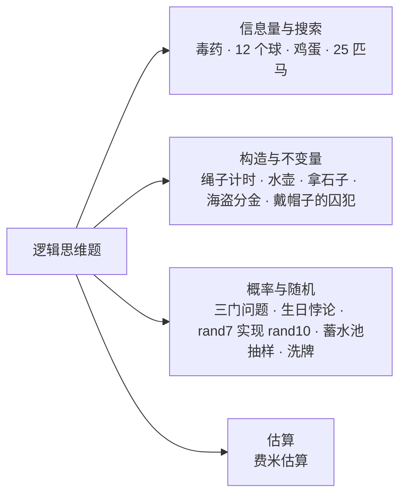
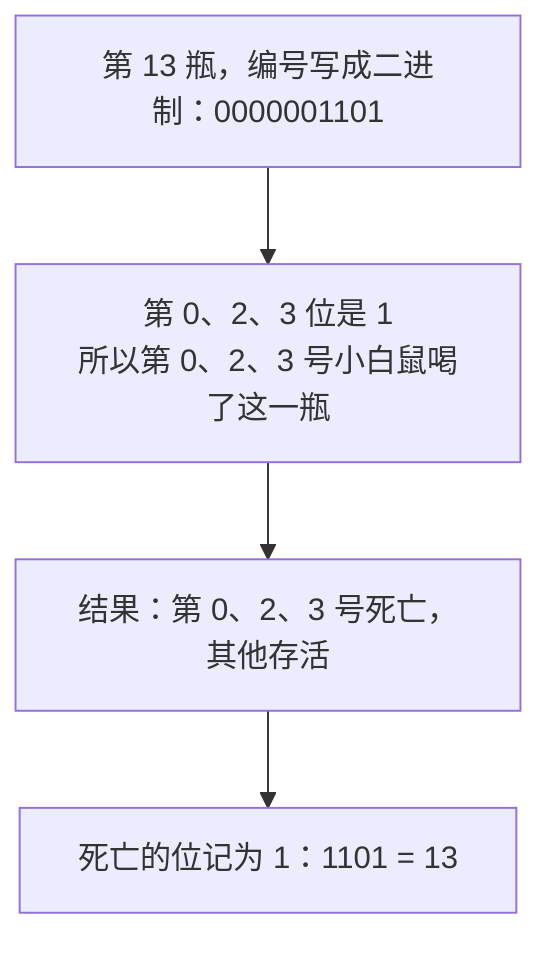
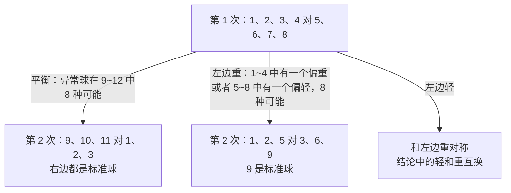
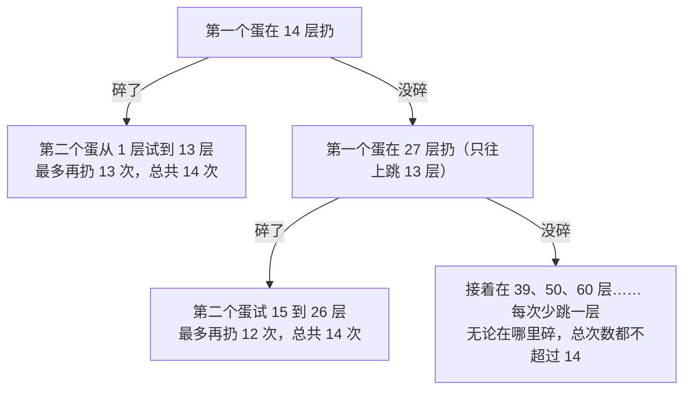
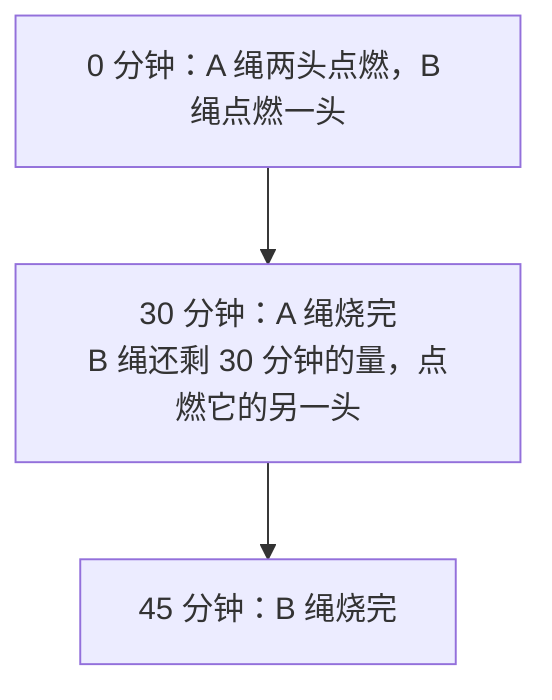
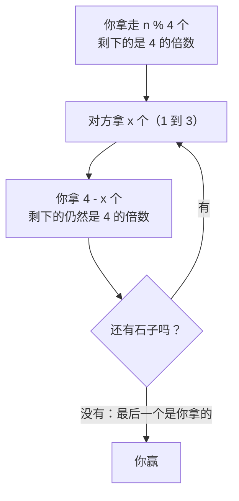
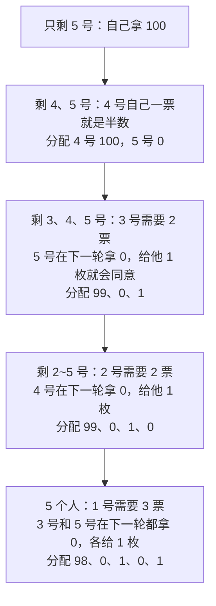
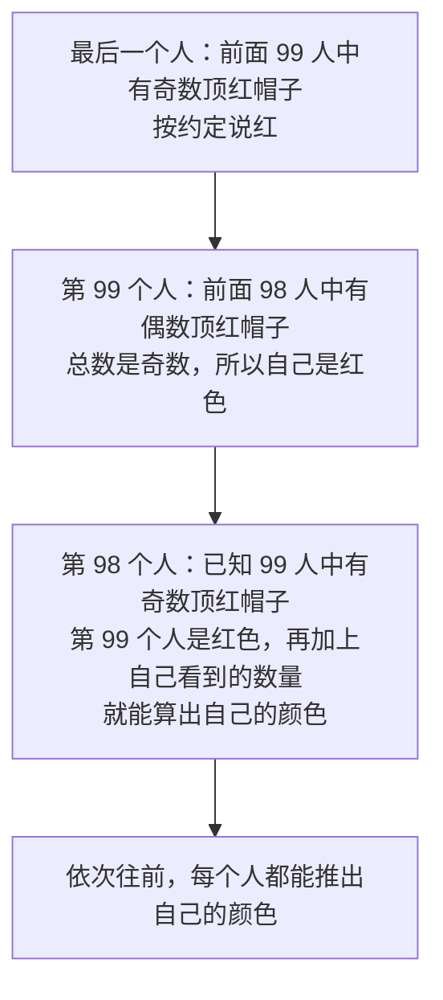
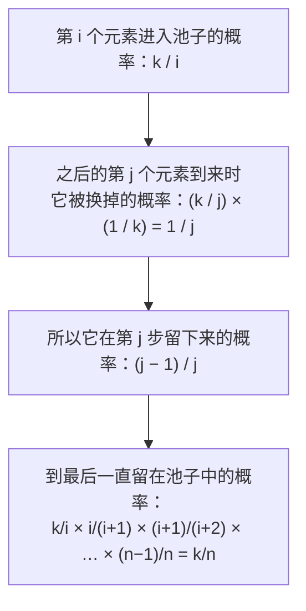
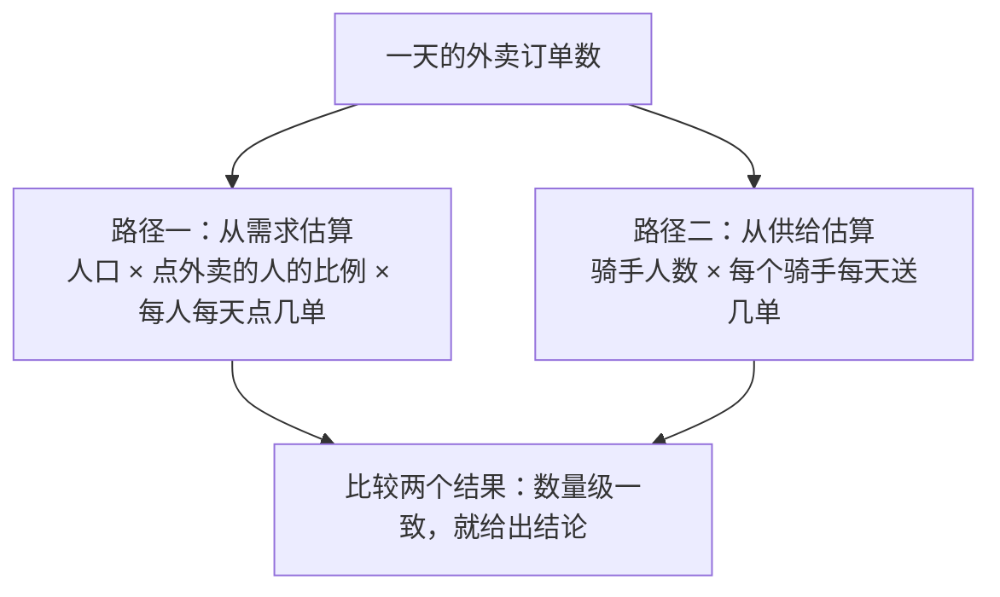

# 43 · 逻辑思维题

> 适用岗位：Java 资深开发、Java 架构师。逻辑题在资深和架构师面试中出现得不多，主要出现在笔试或一部分公司的面试中。本类只选了 15 道高频题，并且每道题都说明它对应的工程问题：面试官问这类题，想看的是拆解问题、找约束和下界、验证结论的能力，而不是你有没有背过答案。
> 版本基线：数学结论与版本无关；验证程序在 JDK 25 上运行。
> 事实核对：
> - 本机验证（macOS 27.2、Apple M1 Max、JDK 25）：
>   - 穷举：1000 瓶药水全部能识别；12 个球的 24 种情况都能在 3 次内找出；鸡蛋问题、水壶问题、拿石子、海盗分金用动态规划或广度优先搜索算出答案；
>   - 模拟：25 匹马的 7 场方案在 10 万次随机测试中全部正确；戴帽子的囚犯在 1 万次随机测试中每次至少 99 人答对；三门问题、`rand7` 实现 `rand10`、取模偏差、蓄水池抽样、洗牌各模拟 30 万到 100 万次。
> - JDK 25 源码（`lib/src.zip`）：`Collections.shuffle` 从最后一个元素往前，把当前位置和"第一个元素到当前位置"之间随机的一个交换；`Random.nextInt(bound)` 在 bound 不是 2 的幂时会拒绝一部分随机值，避免取模偏差。
> 相关分类：[《24 高并发》](../06-三高与架构/24-高并发.md)（容量估算）、[《29 场景题》](../06-三高与架构/29-场景题.md)（短链）、[《40 数据结构》](../08-计算机基础/40-数据结构.md)（布隆过滤器、TopK）、[《42 编程题》](42-编程题.md)

## 知识地图



## 题目索引

| 编号 | 题目 | 对应的工程问题 | 难度 |
| --- | --- | --- | --- |
| 43-01 | 1000 瓶药水中有 1 瓶毒药，最少用几只小白鼠一次找出来？ | 二进制编码、信息量下界 | ★ |
| 43-02 | 12 个球中有 1 个重量不同，用天平称 3 次找出它并判断轻重 | 用信息量判断方案是否存在 | ★★ |
| 43-03 | 两个鸡蛋、100 层楼，最少扔几次能确定临界楼层？ | 失败代价高时的搜索、动态规划 | ★★ |
| 43-04 | 25 匹马、5 条赛道、没有计时器，最少几场找出前三名？ | 剪枝、分布式 TopK | ★★ |
| 43-05 | 两根燃烧不均匀的绳子，怎么量出 45 分钟？ | 只依赖可靠的性质 | ★ |
| 43-06 | 3 升和 5 升的水壶，怎么量出 4 升？ | 状态空间搜索 | ★ |
| 43-07 | 轮流拿石子，每次 1 到 3 个，拿到最后一个的赢，怎么必胜？ | 不变量 | ★ |
| 43-08 | 海盗分金：最资深的海盗应该怎么提方案？ | 逆向推导、先确认规则 | ★★ |
| 43-09 | 100 个戴帽子的囚犯，怎么保证至少 99 人说对自己帽子的颜色？ | 奇偶校验 | ★★ |
| 43-10 | 三门问题：换不换？ | 条件概率、用模拟验证直觉 | ★ |
| 43-11 | 生日悖论和哈希冲突：多少个元素时冲突的概率超过一半？ | 估算哈希、短码、ID 的冲突 | ★★ |
| 43-12 | 用 rand7 实现 rand10；为什么不能直接取模？ | 拒绝采样、取模偏差 | ★★ |
| 43-13 | 从长度未知的数据流中等概率抽取 k 个 | 蓄水池抽样、日志采样 | ★★ |
| 43-14 | 怎么写一个等概率的洗牌算法？ | Fisher-Yates、随机比较器的坑 | ★★ |
| 43-15 | 费米估算：怎么估算一个你完全不知道答案的数？ | 系统设计前的量级判断 | ★★ |

---

## 一、信息量与搜索

### 43-01 1000 瓶药水中有 1 瓶毒药，最少用几只小白鼠一次找出来？

> ★ ｜ 资深 ｜ 高频

题目：小白鼠喝了毒药一段时间后才会死，时间只够做一轮测试。

**考察意图**：能否想到二进制编码，并用信息量证明这是下界。

**30 秒版回答**：**10 只**。

- 给药水编号 1 到 1000，写成 10 位二进制。第 i 只小白鼠喝下"编号的第 i 位是 1"的所有药水。
- 一轮之后，死掉的小白鼠对应的位记为 1，拼起来就是毒药的编号。
- 为什么不能更少：每只小白鼠只有"死"和"活"两种结果，k 只最多区分 2^k 种情况。要区分 1000 种可能，需要 2^k ≥ 1000，所以 k 至少是 10（2^10 = 1024）。



本机穷举了 1000 种情况（毒药分别是第 1 到第 1000 瓶），10 只小白鼠全部能正确找出。

**对应的工程问题**

- **用最少的比特表示状态**：权限、开关用位掩码保存；布隆过滤器、位图都是"用位编码信息"。
- **合并检测**：把多个样本合在一起测，没问题就一次排除一大批。排查问题时把配置项、代码提交分组验证，也是同样的思路。

**追问链**

1. **如果时间够做两轮测试呢？** 每只小白鼠有三种结果：第一轮死、第二轮死、一直活着，于是可以用三进制编码。编号写成三进制，某一位是 1 的在第一轮喝，是 2 的在第二轮喝（只给还活着的喝）。3^7 = 2187 ≥ 1000，只要 7 只。
2. **如果有 2 瓶毒药呢？** 二进制编码就不够了：两瓶毒药的位会合在一起，无法分开。需要更多的小白鼠，或者改成多轮测试。

---

### 43-02 12 个球中有 1 个重量不同，用天平称 3 次找出它并判断轻重

> ★★ ｜ 资深 ｜ 中频

题目：12 个外观相同的球，其中一个比其他的轻或者重（不知道是轻还是重），只有一架没有砝码的天平。

**考察意图**：能否先用信息量判断"有没有解"，再设计每一次称量，让结果尽量平均地分开所有可能。

**30 秒版回答**

- **先算信息量**：可能的情况有 12 × 2 = 24 种（哪个球、偏轻还是偏重）。天平每次有三种结果（左重、右重、平衡），3 次最多区分 3^3 = 27 种，大于 24，所以**有可能**做到。
- **设计原则**：每次称量后，剩下的可能不能超过后续称量能区分的数量：第 1 次后不超过 9 种，第 2 次后不超过 3 种。
- 第 1 次称 4 个对 4 个：平衡时，异常球在剩下的 4 个中，有 8 种可能；不平衡时，"左边 4 个中有一个偏重，或者右边 4 个中有一个偏轻"，也是 8 种可能。



| 第 2 次的结果 | 剩下的可能 | 第 3 次 |
| --- | --- | --- |
| A 分支平衡 | 12 偏重或偏轻 | 12 对 1，判断轻重 |
| A 分支不平衡 | 9、10、11 中有一个，并且已经知道偏重还是偏轻 | 9 对 10，不平衡时按已知的轻重判断；平衡则是 11 |
| B 分支左边重 | 1 偏重、2 偏重、6 偏轻 | 1 对 2，重的那个就是；平衡则是 6 偏轻 |
| B 分支右边重 | 3 偏重、5 偏轻 | 3 对 9，不平衡则是 3 偏重；平衡则是 5 偏轻 |
| B 分支平衡 | 4 偏重、7 偏轻、8 偏轻 | 7 对 8，轻的那个就是；平衡则是 4 偏重 |

本机把这套方案写成程序，穷举了 24 种情况，全部在 3 次内找出了异常球并判断出轻重。

**对应的工程问题**：先用信息量判断方案是否可能存在，可以避免在不可能的方向上浪费时间。例如：n 个元素有 n! 种排列，每次比较只有两种结果，所以基于比较的排序至少要 log2(n!) 次比较，也就是 O(n log n)。

**追问链**

1. **13 个球能不能 3 次称出来并判断轻重？** 不能保证。13 × 2 = 26 种可能，虽然不超过 27，但第 1 次无论怎么分都不平均：4 对 4 时，平衡分支剩下 5 个球、10 种可能，超过了后两次能区分的 9 种；5 对 5 时，不平衡分支也有 10 种可能。（只要求找出是哪个球、不要求判断轻重，是可以做到的。）

---

### 43-03 两个鸡蛋、100 层楼，最少扔几次能确定临界楼层？

> ★★ ｜ 资深 / 架构师 ｜ 高频

题目：从某一层及以上扔鸡蛋会碎，以下不会碎。碎了的鸡蛋不能再用。求最坏情况下最少需要扔几次。

**考察意图**：失败的代价很高（只能失败两次）时，二分查找不再适用，要找最坏情况下最优的策略。

**30 秒版回答**：**14 次**。

- 如果用二分：第一次在 50 层扔就碎了，第二个蛋只能从 1 层开始一层一层试，最坏要 50 次。
- 正确的思路：设最多扔 x 次。第一个蛋在第 x 层扔，碎了就用第二个蛋试 1 到 x-1 层，总共不超过 x 次；没碎，就只剩 x-1 次，所以下一次只能往上跳 x-1 层……
- 能覆盖的楼层是 x + (x-1) + … + 1 = x(x+1)/2，要求不少于 100，最小的 x 是 14。



换一个角度更容易推广：有 k 个蛋、最多扔 m 次，最多能确定多少层？在某一层扔一次，碎了就用 k-1 个蛋和 m-1 次处理下面的楼层，没碎就用 k 个蛋和 m-1 次处理上面的楼层，所以 f(k, m) = f(k-1, m-1) + f(k, m-1) + 1。

```java
import java.util.ArrayList;
import java.util.List;

/**
 * 鸡蛋掉落：换个角度问——有 k 个鸡蛋、最多扔 m 次，最多能确定多少层楼？
 * f(k, m) = f(k - 1, m - 1) + f(k, m - 1) + 1
 * 在某层扔一次：碎了，用剩下的 k-1 个蛋和 m-1 次处理下面的楼层；没碎，用 k 个蛋和 m-1 次处理上面的楼层
 */
public class EggDrop {
    static int minDrops(int eggs, int floors) {
        int[] f = new int[eggs + 1];          // f[k]：k 个蛋、当前次数下最多能确定的楼层数
        int m = 0;
        while (f[eggs] < floors) {
            m++;
            for (int k = eggs; k >= 1; k--) {  // 倒序：f[k - 1] 还是上一轮（m - 1 次）的值
                f[k] = f[k - 1] + f[k] + 1;
            }
        }
        return m;
    }
}
```

本机运行输出：

```text
2 eggs, 100 floors: 14 drops
3 eggs, 100 floors: 9 drops
1 egg, 100 floors: 100 drops
first egg floors: [14, 27, 39, 50, 60, 69, 77, 84, 90, 95, 99, 100]
```

**对应的工程问题**

- **试错的代价决定了搜索策略**。可以无限次试错时用二分；每次失败代价很高时，要控制失败次数。例如压测时找系统能承受的最大 QPS，把系统压垮一次的代价很高，就不能一开始就用二分直接跳到很高的流量，而是先大步、再小步逐渐逼近。
- 状态转移 f(k, m) 是典型的动态规划：先换一个更容易递推的问法，再写转移方程（见 42-18）。

**追问链**

1. **有 3 个蛋呢？** 9 次（见上面的输出）。只有 1 个蛋时只能一层一层往上试，要 100 次。

---

### 43-04 25 匹马、5 条赛道、没有计时器，最少几场找出前三名？

> ★★ ｜ 资深 ｜ 高频

**考察意图**：能否利用已经知道的先后关系排除不可能的候选，减少比较次数。

**30 秒版回答**：**7 场**。

- 第 1~5 场：分成 5 组，每组比一场，得到组内的排名。
- 第 6 场：5 个小组第一比一场。按结果把组排序为 A、B、C、D、E，A1 就是总冠军。
- 第 7 场：第二、三名只可能在 A2、A3、B1、B2、C1 中，这 5 匹正好比一场，前两名就是总的第二、三名。

| 组（按第 6 场的名次） | 第 1 名 | 第 2 名 | 第 3 名 | 第 4、5 名 |
| --- | --- | --- | --- | --- |
| A | A1：总冠军 | A2：候选 | A3：候选 | 排除 |
| B | B1：候选 | B2：候选 | 排除：A1、B1、B2 都比它快 | 排除 |
| C | C1：候选 | 排除：A1、B1、C1 都比它快 | 排除 | 排除 |
| D、E | 排除：D1 已经比 A1、B1、C1 慢 | 排除 | 排除 | 排除 |

本机用 10 万组随机速度测试这个方案，每次找出的前三名都正确。

**对应的工程问题**：**分布式 TopK**。数据分在多个分片上，要求全局前 K 个时，每个分片必须返回自己的前 K 个，而不是只返回第一名：就像 A2、A3 虽然不是小组第一，但仍然可能是总的第二、三名。汇总时再从这些候选中选出前 K 个（见 40-15）。

**追问链**

1. **为什么第 6 场之后还不知道第二名？** 第二名可能是 A2（和 A1 同组，没有和 B1 比过），也可能是 B1，两者没有比过，所以必须再比一场。

---

## 二、构造与不变量

### 43-05 两根燃烧不均匀的绳子，怎么量出 45 分钟？

> ★ ｜ 资深 ｜ 中频

题目：每根绳子从一头点燃都要烧 1 小时，但燃烧的速度不均匀（例如前一半可能只烧 10 分钟）。

**考察意图**：能否放弃不可靠的假设（均匀燃烧），只利用确定的性质（总时长）。

**30 秒版回答**

- 0 分钟：A 绳**两头同时点燃**，B 绳只点燃一头。
- 30 分钟：A 绳烧完。两头同时烧，无论速度是否均匀，两团火都会在 30 分钟时相遇。此时 B 绳还剩"30 分钟的量"，立刻点燃 B 绳的另一头。
- 45 分钟：B 绳烧完，剩下的 30 分钟的量从两头烧，用 15 分钟。



**对应的工程问题**：设计时只依赖可靠的性质。例如分布式系统中不同机器的时钟不能保证一致，所以判断事件的先后要用版本号、逻辑时钟或者单调递增的 ID，而不是比较两台机器上的时间戳（见 09-07）。

---

### 43-06 3 升和 5 升的水壶，怎么量出 4 升？

> ★ ｜ 资深 ｜ 中频

**考察意图**：能否把问题抽象成"状态 + 转移"，用搜索找到最短的操作步骤，并说明什么情况下无解。

**30 秒版回答**

- 把"两个壶中各有多少水"看作一个状态，装满、倒空、互相倒水是状态之间的转移。从 (0, 0) 出发做广度优先搜索，第一次到达目标时就是最少的步数。
- 最少 6 步：(0, 0) → 装满 5 升壶 (0, 5) → 倒进 3 升壶 (3, 2) → 倒空 3 升壶 (0, 2) → 把 2 升倒进 3 升壶 (2, 0) → 装满 5 升壶 (2, 5) → 倒满 3 升壶 (3, 4)。
- **什么时候无解**：能量出的水量一定是两个壶容量的最大公约数的倍数。4 升和 6 升的壶，最大公约数是 2，永远量不出 3 升。

```java
import java.util.ArrayDeque;
import java.util.ArrayList;
import java.util.Collections;
import java.util.HashMap;
import java.util.List;
import java.util.Map;
import java.util.Queue;

/**
 * 水壶问题：容量 A、B 的两个壶，量出 target 升。
 * 把 (A 中水量, B 中水量) 当作图中的一个节点，每种操作是一条边，用广度优先搜索找最少步数
 */
public class WaterJug {
    record State(int a, int b) {}

    static List<State> solve(int capA, int capB, int target) {
        State start = new State(0, 0);
        Map<State, State> parent = new HashMap<>();   // 记录从哪个状态来，用来还原路径
        parent.put(start, start);
        Queue<State> queue = new ArrayDeque<>(List.of(start));
        while (!queue.isEmpty()) {
            State s = queue.poll();
            if (s.a() == target || s.b() == target) {
                List<State> path = new ArrayList<>();
                for (State x = s; !x.equals(start); x = parent.get(x)) {
                    path.add(x);
                }
                path.add(start);
                Collections.reverse(path);
                return path;
            }
            int pourAB = Math.min(s.a(), capB - s.b());   // A 倒向 B 能倒多少
            int pourBA = Math.min(s.b(), capA - s.a());
            for (State next : List.of(
                    new State(capA, s.b()), new State(s.a(), capB),           // 装满 A、装满 B
                    new State(0, s.b()), new State(s.a(), 0),                 // 倒空 A、倒空 B
                    new State(s.a() - pourAB, s.b() + pourAB),                // A 倒向 B
                    new State(s.a() + pourBA, s.b() - pourBA))) {             // B 倒向 A
                if (parent.putIfAbsent(next, s) == null) {                   // 第一次到达：就是最短路径
                    queue.offer(next);
                }
            }
        }
        return List.of();                                                     // 无解
    }
}
```

本机运行输出：

```text
3L & 5L -> 4L: [State[a=0, b=0], State[a=0, b=5], State[a=3, b=2], State[a=0, b=2], State[a=2, b=0], State[a=2, b=5], State[a=3, b=4]]
4L & 6L -> 3L: impossible
```

**对应的工程问题**：很多问题都可以抽象成"状态 + 转移"的图，再用搜索解决：检查状态机中某个状态是否可以到达、是否存在走不出去的状态（见 30-13）；求从一个配置变更到另一个配置的最少步骤。

---

### 43-07 轮流拿石子，每次 1 到 3 个，拿到最后一个的赢，怎么必胜？

> ★ ｜ 资深 ｜ 中频

**考察意图**：能否找出一个"每一轮都保持不变"的性质，用它构造必胜的策略。

**30 秒版回答**

- **石子数是 4 的倍数时，先拿的人必输；否则先拿的人必赢。**
- 必胜的方法：先拿走 n % 4 个，让剩下的数量是 4 的倍数。之后对方拿 x 个，你就拿 4 - x 个。每一轮结束时剩下的都是 4 的倍数，最后一定是你拿完。
- 本机用动态规划算了 1 到 20 个石子的情况，先手必输的正好是 4、8、12、16、20。



**对应的工程问题**：**不变量**是证明正确性的基本工具。42-14 的二分查找就是靠"区间两边各自满足某个条件"这个不变量写对的；业务中，"库存总数 = 可售 + 冻结 + 已售"这类等式，也可以作为对账和监控的依据。

**追问链**

1. **每次最多拿 m 个呢？** 把 4 换成 m + 1。
2. **拿到最后一个的人输呢？** 剩下的石子数除以 4 余 1 时，轮到的人必输。必胜的方法是让对方面对"除以 4 余 1"的局面。

---

### 43-08 海盗分金：最资深的海盗应该怎么提方案？

> ★★ ｜ 资深 / 架构师 ｜ 中频

题目：5 个海盗分 100 枚金币。最资深的海盗提出分配方案，所有人（包括他自己）投票，同意的人数达到要求就按方案分；否则他被扔进海里，由下一个最资深的海盗提方案。每个海盗都足够聪明，首先想活命，其次想多拿金币，金币一样多时更愿意把别人扔进海里。

**考察意图**：能否从最简单的终局往回推；以及能否意识到**规则的细节会改变答案**，先确认规则再作答。

**30 秒版回答**：先问清楚"达到要求"是**半数**就行，还是必须**超过半数**。

按"半数同意即可通过"推导，从只剩 1 个海盗开始倒推：



- **半数同意即可**：1 号拿 98，分配是 98、0、1、0、1。
- **必须超过半数**：只剩 2 个人时，提方案的人一定会被扔下海，所以他在 3 个人时会无条件支持 3 号。最后 1 号的方案是 97、0、1、2、0（或者 97、0、1、0、2，3 号和 4 号的价码一样，选谁都可以）。

本机用程序按两种规则分别倒推，结果和上面一致。

**对应的工程问题**

- **从终局往回推**就是动态规划的思路：先解决最小的问题，再用它的结果解决更大的问题。
- **同一道题，规则差一点，答案完全不同**。工作中也是这样：需求中"超过""达到""不少于"这类细节，必须在动手之前确认。

---

### 43-09 100 个戴帽子的囚犯，怎么保证至少 99 人说对自己帽子的颜色？

> ★★ ｜ 资深 ｜ 中频

题目：100 个囚犯排成一列，每人戴一顶红色或蓝色的帽子，每人只能看到前面所有人的帽子，看不到自己和后面的。从最后一个人开始，依次说出一个颜色，所有人都能听到。事先可以商量策略。

**考察意图**：能否想到用 1 位信息（奇偶性）传递足够的信息。

**30 秒版回答**

- 约定：**最后一个人**数一数前面 99 个人中红帽子的数量，奇数就说"红"，偶数就说"蓝"。他自己说对的概率是一半。
- **其他每个人**都知道三样东西：最后一个人报出的奇偶性、身后的人已经说出的颜色（他们都说对了）、自己前面能看到的红帽子数。三者一合，就能推出自己的帽子是什么颜色。
- 所以至少 99 人说对。本机随机模拟了 1 万次，每次都至少有 99 人说对。



**对应的工程问题**：这就是**奇偶校验**：用 1 位冗余信息，恢复 1 个未知的值。RAID 5 把同一条带上各个数据块按位异或，得到校验块，任意一块盘坏了，用其他盘上的数据异或就能算出丢失的那一块。

---

## 三、概率与随机

### 43-10 三门问题：换不换？

> ★ ｜ 资深 ｜ 中频

题目：三扇门后有一辆汽车和两只山羊。你选了一扇门，主持人（知道汽车在哪里）打开另外两扇中的一扇，后面是山羊，然后问你要不要换成剩下的那一扇。

**考察意图**：能否正确使用条件概率，以及在直觉和计算矛盾时用模拟验证。

**30 秒版回答**：**换**。换了以后中奖的概率是 2/3，不换是 1/3。

- 你第一次选中汽车的概率是 1/3，主持人开门并不会改变这一点。
- 关键在于主持人**知道答案，并且一定会打开一扇山羊的门**。你第一次选错（概率 2/3）时，他只能打开另一扇山羊门，剩下的那一扇一定是汽车。

| 你第一次选的 | 概率 | 主持人打开 | 换的结果 |
| --- | --- | --- | --- |
| 汽车 | 1/3 | 两扇山羊门中的任意一扇 | 换到山羊 |
| 山羊 1 | 1/3 | 只能是山羊 2 | 换到汽车 |
| 山羊 2 | 1/3 | 只能是山羊 1 | 换到汽车 |

本机模拟 100 万次的结果：

```text
monty hall: stay 0.3341, switch 0.6659
birthday: 23 people 0.5073, 50 people 0.9704, 70 people 0.9992
50% collision: 32-bit hash ~77,163 items, 6-char base62 ~280,610 items, UUIDv4 ~2.71e+18 items
32-bit hash, 100,000 items: collision probability 0.6878
6-char base62, 1,000,000 items: expected colliding pairs 8.8
```

（第一行是三门问题；后面几行是下一题的结果。）

**对应的工程问题**：直觉和计算对不上时，写一段模拟程序验证（蒙特卡洛方法），这比争论更快。另外要注意"信息来源是否有偏向"：主持人是有意挑选的，所以他的行为带有信息。分析监控数据、A/B 测试结果时也一样，先确认样本是怎么被挑出来的。

---

### 43-11 生日悖论和哈希冲突：多少个元素时冲突的概率超过一半？

> ★★ ｜ 资深 / 架构师 ｜ 中频

**考察意图**：能否估算出"随机值发生冲突"的概率，用来评估哈希、短码、随机 ID 的长度是否足够。

**30 秒版回答**

- 23 个人中，至少两人生日相同的概率就超过 50%（约 50.7%）；50 个人时约 97%。
- 原因是要比较的是**每一对人**：23 个人有 253 对，冲突的机会比直觉多得多。
- 一般规律：n 个元素随机落进 N 个位置，没有冲突的概率是 (1 − 1/N)(1 − 2/N)…(1 − (n−1)/N)，约等于 e^(−n²/2N)。**n 大约到 1.18 × √N 时，冲突的概率就达到一半**。

| 取值空间 | 冲突概率达到 50% 时的元素个数 |
| --- | --- |
| 365 天 | 23 |
| 32 位哈希值（约 43 亿） | 约 7.7 万 |
| 6 位 Base62 短码（约 568 亿） | 约 28 万 |
| UUID v4（122 位随机） | 约 2.7 × 10^18 |

计算代码（前半部分是上一题三门问题的模拟，`collision` 和 `halfCollision` 用于本题，输出见上一题）：

```java
import java.util.Random;

/**
 * 三门问题模拟、生日悖论与哈希冲突的计算
 */
public class ProbabilityChecks {
    public static void main(String[] args) {
        montyHall();
        birthday();
    }

    static void montyHall() {
        Random random = new Random(3);
        int trials = 1_000_000;
        int stayWins = 0;
        int switchWins = 0;
        for (int t = 0; t < trials; t++) {
            int car = random.nextInt(3);
            int pick = random.nextInt(3);
            int open;                                  // 主持人打开一扇：不是你选的，也不是汽车
            do {
                open = random.nextInt(3);
            } while (open == pick || open == car);
            int switched = 3 - pick - open;            // 剩下的那一扇
            if (pick == car) stayWins++;
            if (switched == car) switchWins++;
        }
        System.out.printf("monty hall: stay %.4f, switch %.4f%n", stayWins / (double) trials, switchWins / (double) trials);
    }

    /** n 个元素随机落入 space 个位置，至少有两个相同的概率 */
    static double collision(long n, double space) {
        double logNoCollision = 0;
        for (long i = 0; i < n; i++) {
            logNoCollision += Math.log1p(-i / space);  // 用对数累加，避免连乘下溢
        }
        return 1 - Math.exp(logNoCollision);
    }

    /** 冲突概率达到 50% 时大约需要多少个元素：sqrt(2 ln2 · space) */
    static double halfCollision(double space) {
        return Math.sqrt(2 * Math.log(2) * space);
    }
}
```

**对应的工程问题**

- **32 位哈希值不能当作唯一标识**：10 万个元素时，出现冲突的概率已经约 69%。
- **随机生成的短码必须检查是否重复**：6 位 Base62 的空间有 568 亿，看起来很大，但生成 100 万个时，平均会有约 8.8 对重复（见 29-09）。
- 布隆过滤器的误判率、分布式 ID 中随机部分要多少位，也是用同样的方法估算的（见 40-06）。

---

### 43-12 用 rand7 实现 rand10；为什么不能直接取模？

> ★★ ｜ 资深 ｜ 高频

题目：已知 `rand7()` 等概率返回 1 到 7，用它实现等概率返回 1 到 10 的 `rand10()`。

**考察意图**：能否构造出均匀分布，以及能否发现取模带来的偏差。

**30 秒版回答**

- 调用两次 `rand7()`，组合成 `(a − 1) × 7 + b`，等概率得到 1 到 49。
- 只保留 1 到 40，大于 40 的丢掉重来（**拒绝采样**）。1 到 40 对 10 取模后，每个结果正好对应 4 个值，是均匀的。
- 不能直接用 1 到 49 取模：49 不是 10 的倍数，1 到 9 会比 10 多出一次机会。
- 平均每次 `rand10()` 要调用 2 × 49 / 40 = 2.45 次 `rand7()`。

```java
import java.util.Arrays;
import java.util.HashMap;
import java.util.Iterator;
import java.util.Map;
import java.util.Random;
import java.util.stream.IntStream;

/**
 * 随机算法：用 rand7 实现 rand10、取模偏差、蓄水池抽样、洗牌
 */
public class RandomAlgos {
    private static final Random RANDOM = new Random(7);
    private static long rand7Calls;

    /** 题目给定的工具：等概率返回 1~7 */
    static int rand7() {
        rand7Calls++;
        return RANDOM.nextInt(7) + 1;
    }

    /** 拒绝采样：两次 rand7 组合出等概率的 1~49，只保留 1~40，再映射到 1~10 */
    static int rand10() {
        while (true) {
            int x = (rand7() - 1) * 7 + rand7();     // 1~49，每个值的概率都是 1/49
            if (x <= 40) {
                return (x - 1) % 10 + 1;             // 1~40 中，1~10 的每个结果恰好对应 4 个值
            }
            // 41~49 直接丢弃重来：否则 1~9 会比 10 多出一次机会
        }
    }
}
```

本机运行输出（包括后面两题的结果）：

```text
rand10 counts=[100771, 100458, 100277, 99363, 100547, 99839, 99548, 99682, 99780, 99735] rand7 calls per rand10=2.450
uniform(0..15) % 10 counts=[124834, 125152, 124594, 125259, 125011, 124929, 62388, 62270, 62819, 62744]
reservoir k=3 of 10, pick rate: 0.299 0.300 0.301 0.300 0.301 0.300 0.301 0.300 0.298 0.300
fisher-yates: {[1, 2, 3]=100276, [1, 3, 2]=100446, [2, 1, 3]=99382, [2, 3, 1]=100104, [3, 1, 2]=99685, [3, 2, 1]=100107}
naive:        {[1, 2, 3]=88807, [1, 3, 2]=111022, [2, 1, 3]=111507, [2, 3, 1]=111130, [3, 1, 2]=88596, [3, 2, 1]=88938}
```

第二行是取模偏差的例子：0 到 15 均匀分布的随机数对 10 取模，0 到 5 出现的次数是 6 到 9 的两倍。

**对应的工程问题**

- **不要用 `random.nextInt() % n`**：除了取模偏差，`nextInt()` 可能是负数，取模结果也是负数；用 `Math.abs` 也不行，`Math.abs(Integer.MIN_VALUE)` 仍然是负数（本机已验证）。应该直接用 `random.nextInt(n)`，JDK 的实现在 n 不是 2 的幂时会拒绝一部分值，保证均匀。
- **按哈希值分片**：`hash % 分片数` 也有同样的问题。哈希值的范围远大于分片数时，偏差可以忽略，但负数的问题必须处理，可以用 `Math.floorMod(hash, n)`，或者先 `hash & 0x7fffffff` 再取模。

---

### 43-13 从长度未知的数据流中等概率抽取 k 个

> ★★ ｜ 资深 / 架构师 ｜ 中频

**考察意图**：在只能遍历一次、内存有限的条件下设计随机算法，并能证明它是等概率的。

**30 秒版回答**：**蓄水池抽样**。

- 前 k 个元素直接放进"池子"。
- 第 i 个元素（i > k）以 k/i 的概率留下：生成一个 0 到 i−1 的随机数 j，如果 j < k，就用它替换池子中的第 j 个。
- 遍历结束时，每个元素留在池子中的概率都是 k/n，而整个过程不需要事先知道 n。只遍历一次，内存 O(k)。



```java
import java.util.Arrays;
import java.util.HashMap;
import java.util.Iterator;
import java.util.Map;
import java.util.Random;
import java.util.stream.IntStream;

/**
 * 随机算法：用 rand7 实现 rand10、取模偏差、蓄水池抽样、洗牌
 */
public class RandomAlgos {
    private static final Random RANDOM = new Random(7);
    private static long rand7Calls;

    /** 题目给定的工具：等概率返回 1~7 */
    static int rand7() {
        rand7Calls++;
        return RANDOM.nextInt(7) + 1;
    }

    /** 拒绝采样：两次 rand7 组合出等概率的 1~49，只保留 1~40，再映射到 1~10 */
    static int rand10() {
        while (true) {
            int x = (rand7() - 1) * 7 + rand7();     // 1~49，每个值的概率都是 1/49
            if (x <= 40) {
                return (x - 1) % 10 + 1;             // 1~40 中，1~10 的每个结果恰好对应 4 个值
            }
            // 41~49 直接丢弃重来：否则 1~9 会比 10 多出一次机会
        }
    }

    /** 蓄水池抽样：从长度未知的数据流中等概率抽取 k 个，只遍历一次，内存 O(k) */
    static int[] reservoir(Iterator<Integer> stream, int k, Random random) {
        int[] pool = new int[k];
        int seen = 0;
        while (stream.hasNext()) {
            int x = stream.next();
            seen++;
            if (seen <= k) {
                pool[seen - 1] = x;                  // 前 k 个直接放入
            } else {
                int j = random.nextInt(seen);        // 第 seen 个元素以 k / seen 的概率留下
                if (j < k) {
                    pool[j] = x;                     // 替换掉池中随机的一个
                }
            }
        }
        return seen < k ? Arrays.copyOf(pool, seen) : pool;
    }
}
```

（上面的代码中也包含了上一题的 `rand10`。）本机从 10 个元素中抽 3 个，重复 30 万次，每个元素被抽中的比例都约为 0.300（见上一题的输出第三行）。

**对应的工程问题**：日志和链路的采样（事先不知道总共有多少条）；从一个很大的文件中随机抽取若干行做分析，不需要先数一遍有多少行。

**追问链**

1. **数据分布在多台机器上怎么办？** 每台机器各自做蓄水池抽样，同时记录自己处理了多少条。汇总时，按每台机器的数据量加权，从各台的样本中再抽一次。

---

### 43-14 怎么写一个等概率的洗牌算法？

> ★★ ｜ 资深 ｜ 中频

**考察意图**：能写出 Fisher-Yates 洗牌，并且能说明常见的错误写法为什么不均匀。

**30 秒版回答**

- **Fisher-Yates**：从最后一个位置往前，第 i 个位置和 0 到 i 中随机的一个位置交换。最后一个位置得到任意一个元素的概率都是 1/n，倒数第二个位置从剩下的 n−1 个中等概率选……最终 n! 种排列的概率都相同。JDK 的 `Collections.shuffle` 就是这样实现的。
- **常见的错误写法**：每个位置都和**整个数组**中随机的一个位置交换。一共有 n^n 种等概率的执行路径，要平均分给 n! 种排列；n = 3 时是 27 种路径分给 6 种排列，27 不能被 6 整除，所以一定不均匀。

`shuffle` 和 `naiveShuffle` 的代码见上一题。本机对 [1, 2, 3] 各洗 60 万次（上一题输出的最后两行）：Fisher-Yates 的 6 种排列都约 10 万次；错误写法中有 3 种约 8.9 万次（4/27），另外 3 种约 11.1 万次（5/27）。

**对应的工程问题**

- 抽奖、随机分配这类对公平性有要求的场景，直接用 `Collections.shuffle`；对安全性有要求时（例如防止别人预测结果），传入 `SecureRandom`。
- **不要用随机的比较器来"打乱"**，例如 `list.sort((a, b) -> random.nextInt(3) - 1)`。它违反了比较器的约定，结果不均匀，还可能抛出 "Comparison method violates its general contract" 异常（见 02-20）。

---

## 四、估算

### 43-15 费米估算：怎么估算一个你完全不知道答案的数？

> ★★ ｜ 架构师 ｜ 中频

题目示例："一个 2000 万人口的城市，一天大概有多少外卖订单？"

**考察意图**：能否把一个未知的大问题，拆成几个能凭常识估计的小量，并且清楚地说出每个假设。系统设计中的容量估算用的是同样的方法（见 24-03）。

**30 秒版回答**

- **拆分**：把目标拆成几个可以估计的因子相乘。
- **说出假设**：每个因子用一个整数估计，说清楚依据。
- **交叉验证**：换一条完全不同的路径再估一次，两个结果在同一个数量级，结论才可信。
- **结论给出数量级**，而不是精确数字。



下面的数字都是**为了演示方法而做的假设**，不是真实的统计数据：

| 路径 | 拆分 | 假设 | 结果 |
| --- | --- | --- | --- |
| 需求 | 2000 万人 × 30% 的人经常点外卖 × 平均每人每天 0.5 单 | 比例和单数凭常识估计 | 300 万单 |
| 供给 | 10 万名骑手 × 每人每天 30 单 | 骑手人数和单量凭常识估计 | 300 万单 |

结论："大约是百万量级"。面试官更看重拆分是否合理、假设是否说清楚，而不是数字是否准确。

**对应的工程问题**：做系统设计之前，先估出数据量和请求量的数量级，再决定方案：单表能不能放下、要不要分库分表、单机能不能扛住、缓存要多大。数量级差 10 倍，方案往往就完全不同（见 24-03）。
