# S01 · 秒杀系统

> 适用岗位：Java 资深开发、Java 架构师。「场景设计」模块每个文件讲透一道系统设计题，按面试的推进顺序拆成子题：先澄清需求、估算容量，再给出整体架构，然后逐个深挖难点。这道题的速查版见[《29 场景题》](../06-三高与架构/29-场景题.md)的 29-02。
> 版本基线：JDK 21 / 25、Redis 7.x / 8.x、RocketMQ 5.x、MySQL 8.4。
> 事实核对：
> - Redis 脚本：[Scripting with Lua](https://redis.io/docs/latest/develop/programmability/eval-intro/)。核对了以下几点：
>   - 脚本原子执行，执行期间服务端的其他活动全部被阻塞；
>   - 脚本只应访问通过 KEYS 参数传入的 Key；
>   - 脚本缓存不持久化，重启或主从切换后可能丢失，此时 EVALSHA 返回 NOSCRIPT；
>   - 7.0 起提供 Functions。
> - Redis [WAIT](https://redis.io/docs/latest/commands/wait/)：核对了"WAIT 不能让 Redis 变成强一致存储"。
> - RocketMQ 的事务消息回查参数和定时消息最长延时，沿用[《22 RocketMQ》](../05-消息队列/22-RocketMQ.md)中对照 5.5.0 源码核对的结论。
> - 本机运行（macOS 27.2、Apple M1 Max、JDK 25、Redis 6.2.6）：
>   - 6 段代码只依赖 JDK，文中贴的都是实际运行输出。
>   - 其中 Redis 扣减脚本连接本机临时启动的 Redis 实际执行。Java 程序直接按 RESP 协议通信，没有引入客户端库。脚本吞吐量用 redis-benchmark 实测。
>   - 本机 Redis 是 6.2.6，低于版本基线。本文用到的脚本行为（原子执行、NOSCRIPT），官方文档对 7.x、8.x 同样适用。
>   - 本机只有 MySQL 客户端、没有服务端，文中的 SQL 都没有实际执行。
> 相关分类：[《29 场景题》](../06-三高与架构/29-场景题.md)、[《24 高并发》](../06-三高与架构/24-高并发.md)（容量估算、库存扣减、削峰）、[《26 高可用》](../06-三高与架构/26-高可用.md)（限流、隔离、重试）、[《22 RocketMQ》](../05-消息队列/22-RocketMQ.md)（事务消息、定时消息）、[《20 MQ 通用与选型》](../05-消息队列/20-MQ通用与选型.md)（幂等）、[《17 Redis》](../04-数据存储/17-Redis.md)、[《12 Spring Cloud》](../03-分布式与微服务/12-SpringCloud.md)（网关限流）

## 45 分钟答题版

面试时按下面的顺序推进，每一步都和面试官确认，再进入下一步：

| 时间 | 做什么 | 要讲出的关键点 | 子题 |
| --- | --- | --- | --- |
| 0～5 分钟 | 澄清需求 | 库存多少、多少人抢、限购几件、多久内支付；**绝不超卖，可以短暂少卖，不能影响主站** | S01-01 |
| 5～10 分钟 | 估算容量 | 写入只有"库存数"那么多，压力全在"读和拒绝"上；按层估算每一层的请求量 | S01-02 |
| 10～20 分钟 | 画整体架构 | 漏斗式分层过滤：CDN → 网关限流 → 秒杀服务 → Redis 原子扣减 → MQ 异步下单 → 数据库兜底 | S01-03、S01-04 |
| 20～35 分钟 | 深挖 2～3 个难点 | 原子扣减与限购；热点 Key；Redis 与订单的一致性；超时取消与库存回补 | S01-05 ～ S01-11 |
| 35～40 分钟 | 流量与防刷 | 多层限流、动态地址、验证码、风控；排队和结果轮询 | S01-12 ～ S01-14 |
| 40～45 分钟 | 高可用与总结 | 隔离、Redis 故障预案、压测与监控；业务上用预约抽签消除峰值 | S01-15 ～ S01-18 |

## 知识地图

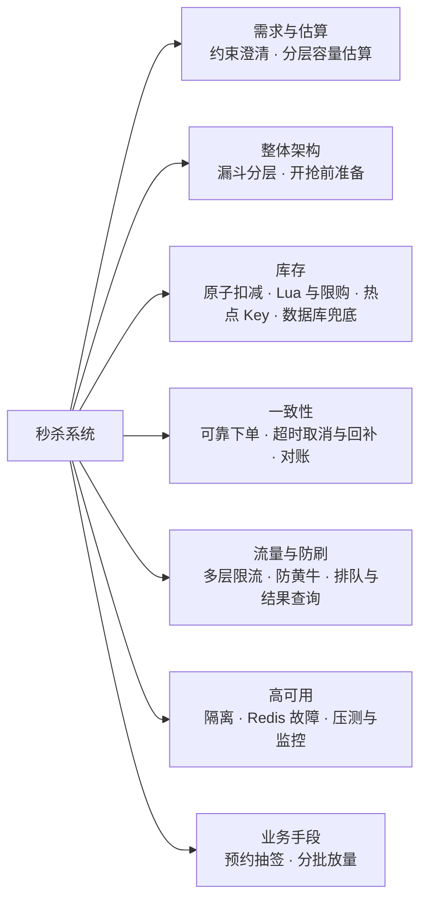

## 题目索引

| 编号 | 题目 | 难度 |
| --- | --- | --- |
| S01-01 | 秒杀和普通下单有什么不同？需求要澄清哪些问题？ | ★★ |
| S01-02 | 容量怎么估算？每一层要扛多少请求？ | ★★ |
| S01-03 | 整体架构怎么设计？请求在每一层被过滤掉多少？ | ★★★ |
| S01-04 | 开抢前要做哪些准备？ | ★★ |
| S01-05 | 超卖是怎么发生的？库存扣减怎么做到原子？ | ★★★ |
| S01-06 | Redis Lua 扣减脚本怎么写？限购怎么一起保证？ | ★★★ |
| S01-07 | 单个库存 Key 成了热点怎么办？ | ★★★ |
| S01-08 | 有了 Redis，数据库层还要做什么？ | ★★ |
| S01-09 | Redis 扣减成功后，订单怎么可靠地创建出来？ | ★★★ |
| S01-10 | 用户抢到了不付款怎么办？库存怎么回补才不会多补？ | ★★★ |
| S01-11 | 怎么判断有没有超卖、少卖？对账怎么做？ | ★★ |
| S01-12 | 限流放在哪几层？阈值怎么定？ | ★★ |
| S01-13 | 怎么防黄牛和脚本？ | ★★ |
| S01-14 | 用户怎么知道抢没抢到？排队和结果查询怎么做？ | ★★ |
| S01-15 | 怎么隔离，才能不拖垮主站？ | ★★★ |
| S01-16 | Redis 主从切换或者宕机了怎么办？ | ★★★ |
| S01-17 | 上线前怎么压测？活动中要盯哪些指标？ | ★★ |
| S01-18 | 能不能从业务上避免"所有人同一秒抢"？ | ★★ |

---

## 一、需求与估算

### S01-01 秒杀和普通下单有什么不同？需求要澄清哪些问题？

> ★★ ｜ 资深 / 架构师 ｜ 高频

**考察意图**：动手设计之前，能不能先把决定架构的约束问清楚。尤其是"能不能少卖""会不会影响主站"这两条，答案不同，方案的复杂度差别很大。

**30 秒版回答**：

秒杀的本质是"大量请求争抢少量资源"。瞬时请求量是库存的成千上万倍，绝大多数请求注定失败。它和普通下单的区别在于：

- 普通下单的压力随业务量平滑增长，每个请求都想成功，系统要尽量让它成功；
- 秒杀的压力集中在开抢后的几秒钟，99.99% 的请求注定失败，**系统要做的是尽快、尽量便宜地拒绝它们**。

需要先确认的约束：

- **硬约束**：绝不超卖；不能影响主站的正常交易；对用户公平，能挡住黄牛和脚本。
- **软约束**：尽量不少卖；用户能很快知道结果。

**深入剖析**

要向面试官澄清的问题，以及本文后面采用的假设：

| 问题 | 为什么要问 | 本文的假设 |
| --- | --- | --- |
| 有几个商品？每个多少件？ | 决定最终的写入量 | 1 个商品，100 件 |
| 多少人参与？怎么开抢？ | 决定峰值有多高、多陡 | 100 万人在线，整点开抢 |
| 每人限购几件？ | 决定校验逻辑 | 每人限购 1 件 |
| 抢到后多久内要支付？ | 决定库存锁定多久、什么时候回补 | 15 分钟内支付，超时取消 |
| 能不能容忍少卖？ | 决定一致性方案的强度 | 可以短暂少卖，事后补回；绝不能超卖 |
| 库存和主站共用吗？ | 决定库存是否要单独划出 | 秒杀库存提前从主站库存中划出，单独管理 |
| 能不能改成排队或抽签？ | 业务上削峰，可能大幅降低技术难度 | 先按实时抢购设计，最后讨论抽签（S01-18） |

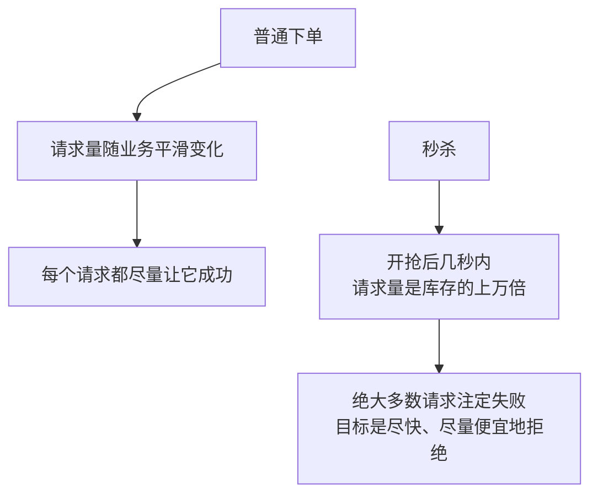

**追问链**

1. **为什么超卖绝对不行，少卖却可以容忍？**
   - **超卖**相当于承诺了交付不了的商品，只能赔付或取消订单，会带来资损和客诉。
   - **少卖**只是活动结束时剩下几件，可以补回去再卖，或者转为普通商品销售。

   所以整套设计的方向是"**宁可少卖，不能超卖**"：每一道防线出错时，都应该往"库存变少"的方向错，而不是往"多卖"的方向错。后面的 S01-09、S01-16 都会用到这个原则。
2. **商品有多个规格（颜色、尺码）怎么办？** 库存按 SKU 管理，每个 SKU 一个库存 Key；限购按"活动 + 用户"计算，不区分 SKU。

**架构师加分点**

- 把澄清的结果写成一份"设计约束清单"，比如"C1 不超卖、C2 不影响主站……"，后面每个设计决策都说明它对应哪一条约束。这样面试官能清楚地看到，你的每个设计都是由需求推出来的，而不是在堆砌技术。

---

### S01-02 容量怎么估算？每一层要扛多少请求？

> ★★ ｜ 资深 / 架构师 ｜ 高频

**考察意图**：能不能从用户行为出发，按层推算出请求量，并用估算结果来决定每一层需要什么手段，而不是报一个笼统的"百万 QPS"。

**30 秒版回答**：

从用户行为出发，逐层估算：

- **开抢前**：100 万人停留在详情页，假设每 5 秒刷新一次，约 20 万 QPS。这部分全是静态内容，交给 CDN。
- **开抢瞬间**：假设 100 万人在 2 秒内每人点 2 次，秒杀接口就有约 100 万 QPS，网关要在这里拒绝掉绝大部分。
- **到达 Redis 的请求**：取决于网关放行多少，通常是每秒几万次。售罄后，靠本地售罄标记降到接近 0。
- **写入**：只有 100 个请求能成功，MQ 和数据库的写入量只有 100。

结论：**写入量极小，压力全在"读和拒绝"上。** 设计的重点不是怎么扛住 100 万次写入，而是怎么便宜地拒绝 99.99% 的请求。

**深入剖析**

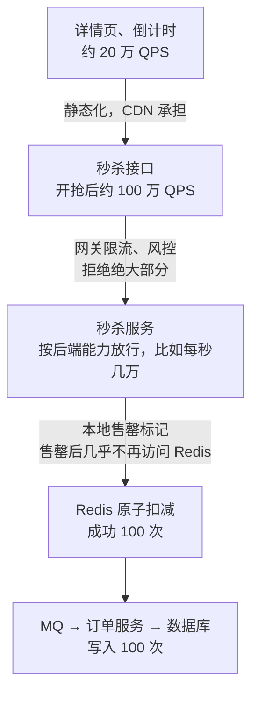

每一层的估算和对应的手段：

| 层 | 估算 | 结论 |
| --- | --- | --- |
| 详情页 | 100 万人 ÷ 每 5 秒刷新一次 = 20 万 QPS | 页面静态化，放到 CDN，不打到源站 |
| 秒杀接口 | 100 万人 × 2 次 ÷ 2 秒 = 100 万 QPS | 网关做总量限流和按用户限流 |
| 网关带宽 | 100 万 QPS × 每次请求和响应约 500 字节 ≈ 500 MB/s，约 4 Gbit/s | 请求和响应要尽量小，网关要能扛住这个量级的带宽 |
| Redis | 放行量取决于后端的压测能力；本机实测单实例执行扣减脚本约 9.6 万次/秒（S01-06） | 一个库存 Key 通常够用，不够再考虑分段（S01-07） |
| MQ、数据库 | 100 条消息，100 次写入 | 完全没有压力，异步处理即可 |

估算的方法论（QPS、峰值系数、单机能力）见[《24 高并发》](../06-三高与架构/24-高并发.md)的 24-03。

**追问链**

1. **估算的数字不准怎么办？** 估算只用来判断数量级，以及瓶颈在哪一层，最终要以压测结果为准（S01-17）。容量规划时还要留出余量，因为真实流量的尖峰往往比假设更陡。
2. **为什么网关的放行量不直接设成"能扛多少放多少"？** 只有 100 个请求能成功，放 5 万个进来和放 1000 个进来，最终结果一样。所以放行量可以按"库存的若干倍"来设，进一步降低后端压力（S01-12）。这是秒杀和普通高并发系统的一个重要区别。

---

## 二、整体架构

### S01-03 整体架构怎么设计？请求在每一层被过滤掉多少？

> ★★★ ｜ 资深 / 架构师 ｜ 高频

**考察意图**：能不能给出一个分层清晰、职责明确的架构，并说清每一层拦住什么、出错了怎么办。

**30 秒版回答**：

架构是一个**漏斗**：越靠前的层处理成本越低，拒绝的请求越多；越往后，请求越少，处理越重。

1. **客户端与 CDN**：页面静态化；开抢前按钮置灰；秒杀地址在开抢时才下发。
2. **网关**：总量限流、按用户限流、黑名单、风控，拦住绝大部分请求。
3. **秒杀服务**（独立部署）：校验秒杀令牌和活动状态；用本地售罄标记直接拒绝。
4. **Redis**：用 Lua 脚本原子地完成"校验限购 + 扣减库存"。
5. **MQ**：扣减成功的请求发消息，立即返回"排队中"。
6. **订单服务**：按自己的能力消费消息；在数据库里用条件更新扣库存，用唯一索引保证一人一单。
7. **结果查询与支付**：用户轮询下单结果，然后去支付；超时未支付就取消订单、回补库存。

**深入剖析**

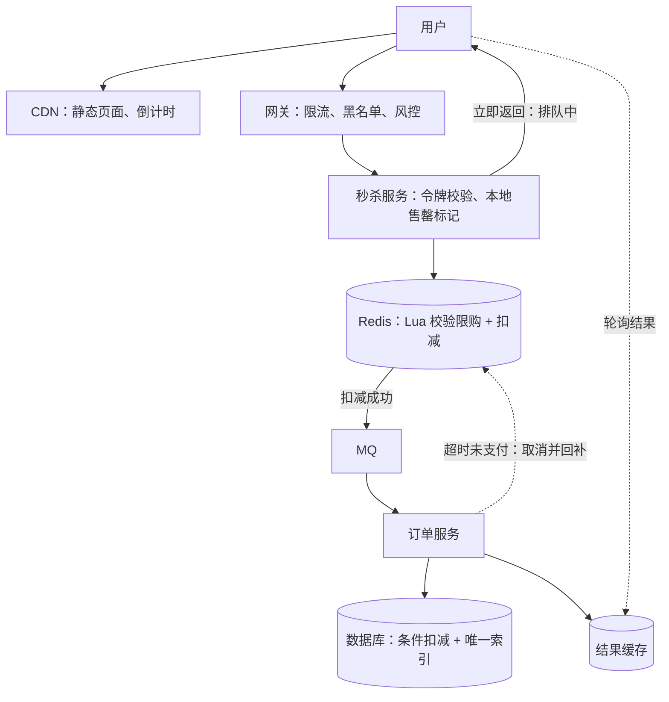

一次成功请求的完整时序：

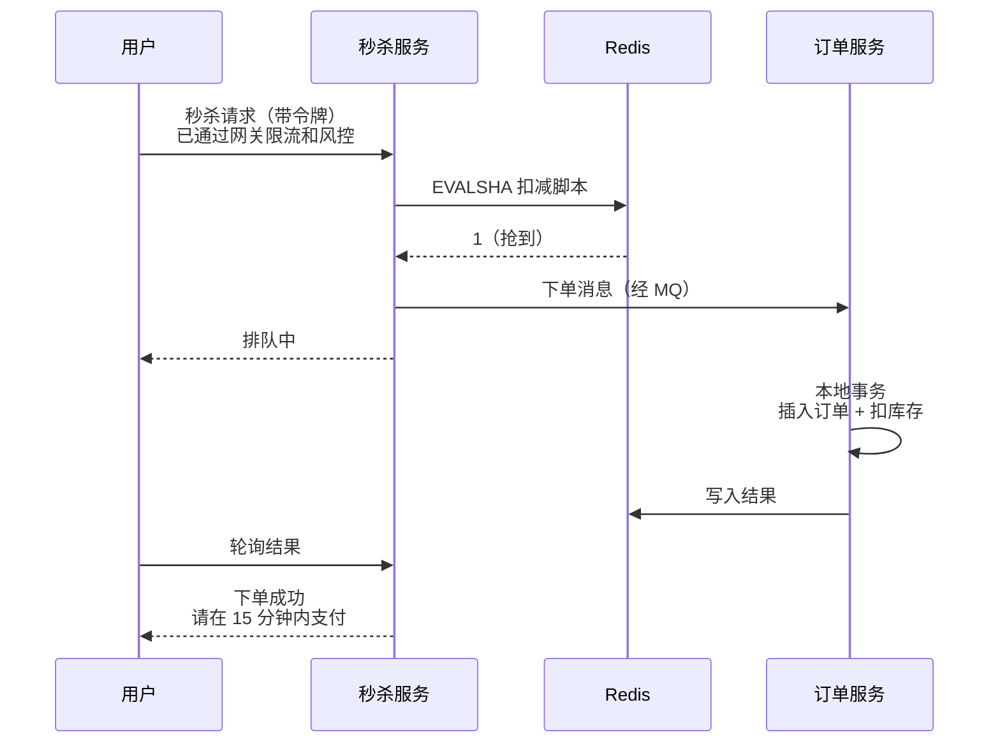

每一层的职责和失败时的处理：

| 层 | 拒绝什么 | 这一层出问题会怎样 |
| --- | --- | --- |
| CDN | 详情页刷新流量 | CDN 回源，源站压力上升；所以源站也要限流 |
| 网关 | 超出总阈值的请求、刷接口的用户和 IP | 网关是入口，要按峰值扩容并做好降级 |
| 秒杀服务 | 无效令牌、活动未开始或已结束、已售罄 | 无状态，可以水平扩容 |
| Redis | 库存不足、重复购买 | 见 S01-16 |
| MQ | 不拒绝，只削峰 | 发送失败要回补，见 S01-09 |
| 数据库 | 兜底，拒绝超出实际库存的扣减 | 只有 100 次写入，压力很小 |

**追问链**

1. **为什么不直接在数据库里扣库存？** 所有请求都会去更新同一行库存，行锁让这些更新完全串行。大量请求排队等锁，连接池很快就会被占满，而且这个数据库通常还和主站业务有关联。Redis 把"判断能不能买"挪到了内存里完成，数据库只处理最终成功的那 100 次写入。
2. **为什么要用 MQ 异步下单，而不是同步创建订单？** 三个原因：
   - 秒杀接口可以在扣减成功后立即返回，不用等订单创建完成；
   - 订单服务可以按自己的能力匀速消费，不被瞬时流量冲垮；
   - 创建订单的链路（查用户、算价格、写库）比较长，放在同步链路里会拖慢整个接口。

   代价是用户要等一会儿才能知道最终结果，所以需要结果查询（S01-14）。
3. **秒杀服务要不要单独拆出来？** 要。它的流量特征和普通交易完全不同，必须独立部署、独立扩容，出问题时不能影响主站（S01-15）。

**架构师加分点**

- 用一句话概括设计思想：**把"判断资格"和"执行下单"拆开**。判断资格要扛住全部流量，所以放在内存里，用原子操作完成；执行下单只处理极少量请求，所以可以走完整、可靠但较慢的链路。

---

### S01-04 开抢前要做哪些准备？

> ★★ ｜ 资深 ｜ 中频

**考察意图**：是否有过真实的大促或秒杀活动经验。很多问题不是靠架构解决的，而是靠活动开始前的准备工作。

**30 秒版回答**：

- **数据预热**：商品信息加载到本地缓存和 Redis；库存写入 Redis，并和数据库核对一致；扣减脚本提前用 `SCRIPT LOAD` 加载。
- **页面与 CDN**：详情页静态化，提前推送到 CDN。
- **秒杀地址**：开抢前不暴露真实的下单接口地址，开抢时才下发带签名的一次性令牌。
- **应用预热**：提前扩容，并用预热流量让 JIT 编译热点代码、建好连接池，避免刚扩容的实例被首波流量打满。
- **压测与预案**：全链路压测，确认各层阈值；准备好降级开关、限流阈值的调整方案、故障时的处理流程和负责人。
- **时间**：开抢与否以服务端时间为准，服务器之间做好时间同步。

**深入剖析**

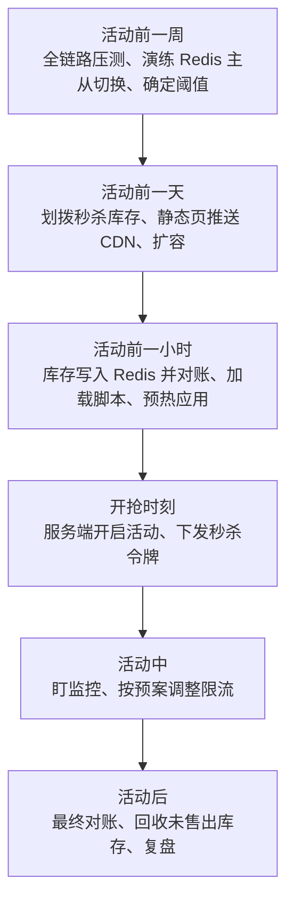

秒杀令牌的一种做法：开抢时，用户通过"获取令牌"接口拿到一个签名，比如 `token = HMAC(secret, activityId + userId + 过期时间)`。下单接口先校验令牌，再进入扣减流程。这样有三个效果：

- 开抢前拿不到有效令牌，脚本不能提前发请求；
- 令牌和用户绑定，不能分发给其他账号使用；
- 获取令牌这一步可以加上验证码或风控（S01-13），在扣减之前多过滤一层。

**追问链**

1. **前端倒计时用客户端时间行吗？** 只能用来展示。用户可以修改本机时间，所以活动是否开始、令牌能否下发，都必须由服务端判断。前端可以在进入页面时获取一次服务端时间，校准本地的倒计时。
2. **库存什么时候写入 Redis？** 活动开始前写入，并和数据库核对一次。注意不能在活动开始后再按需加载，否则开抢瞬间大量请求同时发现 Redis 里没有库存，一起去查数据库（缓存击穿）。

**生产实践 / 踩坑**

- 脚本提前加载，并不意味着活动中就不会出现 `NOSCRIPT`：主从切换后脚本缓存可能丢失。所以客户端必须能处理 `NOSCRIPT`，自动重新加载（S01-06 的代码演示了这个过程）。

---

## 三、库存

### S01-05 超卖是怎么发生的？库存扣减怎么做到原子？

> ★★★ ｜ 资深 ｜ 高频

**考察意图**：能不能讲清超卖的根因是"检查"和"扣减"之间的并发窗口，并给出在分布式环境下真正有效的原子方案。

**30 秒版回答**：

超卖的根因是**"先查库存、判断够了再扣减"不是原子操作**。两个请求同时查到"还剩 1 件"，都判断可以买，然后都去扣减，库存就变成了 -1。

解决办法是把"判断"和"扣减"合成一个原子操作，并且这个操作必须在**所有实例共享的存储**上执行：

- **Redis**：用 Lua 脚本，整段脚本原子执行（S01-06）。
- **数据库**：用条件更新 `UPDATE ... SET stock = stock - 1 WHERE ... AND stock >= 1`，根据影响行数判断是否成功（S01-08）。

JVM 里的 `synchronized`、`AtomicInteger` 只在单个实例内有效，多实例部署时没有意义。分布式锁也不推荐，它会把所有请求串行化，吞吐量太低。

**深入剖析**

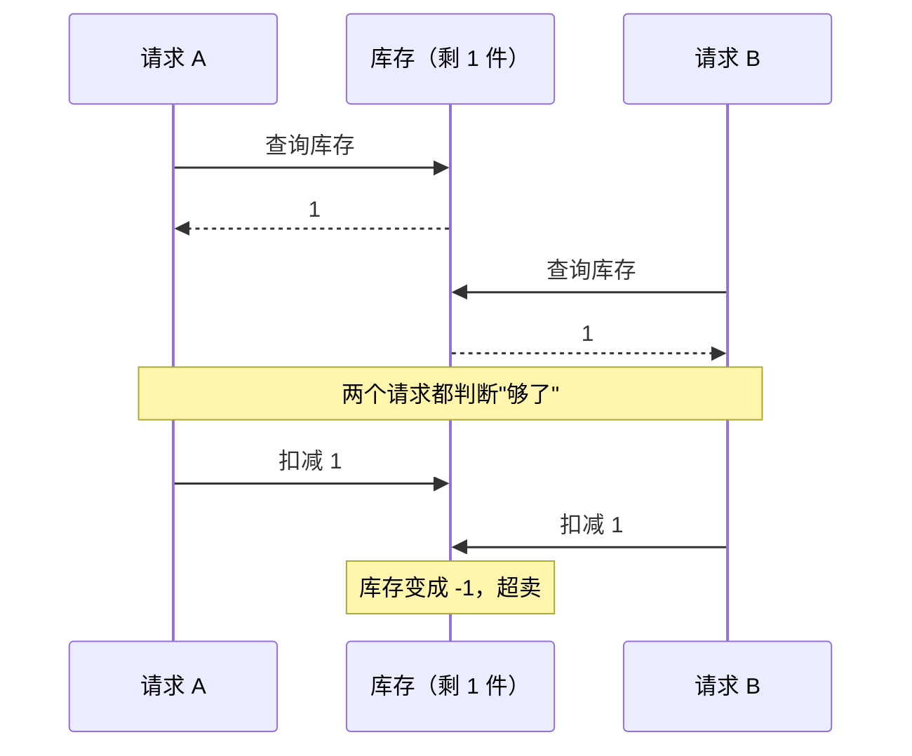

下面的代码用 1000 个并发请求抢 100 件库存。错误写法在"查询"和"扣减"之间等待 5 毫秒，模拟一次数据库或 RPC 往返；正确写法同样有 5 毫秒的耗时，但判断和扣减是一个原子操作：

```java
import java.time.Duration;
import java.util.concurrent.CountDownLatch;
import java.util.concurrent.ExecutorService;
import java.util.concurrent.Executors;
import java.util.concurrent.atomic.AtomicInteger;

/**
 * 超卖是怎么发生的：100 件库存，1000 个请求同时到达。
 * 错误写法先查库存、再扣减，两步之间隔着一次数据库或 RPC 往返；
 * 正确写法把"判断"和"扣减"合成一个原子操作，相当于 UPDATE ... WHERE stock >= 1，或者 Redis Lua 脚本。
 */
public class OversellDemo {

    static final int STOCK = 100;
    static final int REQUESTS = 1000;
    static final Duration GAP = Duration.ofMillis(5);   // 模拟查询和扣减之间的一次远程调用

    interface Inventory {
        boolean tryDeduct() throws InterruptedException;

        int remaining();
    }

    /** 错误：先检查再扣减。即使库存本身是原子类，两个原子操作组合起来也不是原子的 */
    static final class CheckThenAct implements Inventory {
        private final AtomicInteger stock = new AtomicInteger(STOCK);

        public boolean tryDeduct() throws InterruptedException {
            if (stock.get() <= 0) {
                return false;
            }
            Thread.sleep(GAP);
            stock.decrementAndGet();
            return true;
        }

        public int remaining() {
            return stock.get();
        }
    }

    /** 正确：判断和扣减在同一个原子操作里完成；远程调用的耗时同样存在，但放在了原子操作之外 */
    static final class AtomicConditional implements Inventory {
        private final AtomicInteger stock = new AtomicInteger(STOCK);

        public boolean tryDeduct() throws InterruptedException {
            Thread.sleep(GAP);
            return stock.getAndUpdate(s -> s > 0 ? s - 1 : s) > 0;
        }

        public int remaining() {
            return stock.get();
        }
    }

    static void run(String name, Inventory inventory) {
        AtomicInteger success = new AtomicInteger();
        CountDownLatch start = new CountDownLatch(1);
        try (ExecutorService executor = Executors.newVirtualThreadPerTaskExecutor()) {
            for (int i = 0; i < REQUESTS; i++) {
                executor.submit(() -> {
                    start.await();                      // 所有请求在同一时刻放行
                    if (inventory.tryDeduct()) {
                        success.incrementAndGet();
                    }
                    return null;
                });
            }
            start.countDown();
        }
        System.out.printf("%-18s success=%d remaining=%d oversold=%s%n",
                name, success.get(), inventory.remaining(), success.get() > STOCK);
    }

    public static void main(String[] args) {
        System.out.println("stock=" + STOCK + ", concurrent requests=" + REQUESTS);
        run("check-then-act", new CheckThenAct());
        run("atomic-conditional", new AtomicConditional());
    }
}
```

本机运行输出：

```text
stock=100, concurrent requests=1000
check-then-act     success=570 remaining=-470 oversold=true
atomic-conditional success=100 remaining=0 oversold=false
```

- **先查再扣**：100 件库存卖出了 570 件，库存变成 -470。这个数字每次运行都不一样，取决于线程调度，但必然超卖。值得注意的是，库存本身用的是 `AtomicInteger`，"查"和"扣"各自都是原子的，但两个原子操作组合起来就不是原子的了。
- **原子的条件扣减**：不管怎么调度，都正好卖出 100 件。

**追问链**

1. **直接用 Redis 的 `DECR`，判断返回值小于 0 就算失败、再 `INCR` 加回去，行不行？** 能防超卖，但有三个问题：
   - 库存会短暂变成负数，在这段时间里读到库存的其他逻辑会出错；
   - 售罄后的每个请求都要"减一次、再加回来"，多了大量无用的写操作；
   - 加上限购校验后要执行多个命令，还是需要 Lua 脚本才能保证原子性。
2. **为什么不用分布式锁？** 锁把所有请求串行化，每个请求都要经过"加锁、扣减、解锁"三次网络往返，吞吐量比一次 Lua 调用低得多。而且锁有过期时间：持有锁的请求因为 GC 停顿等原因超时后，锁会被别人拿走，两个请求可能同时以为自己持有锁。Lua 脚本本身就是原子的，不需要额外加锁。
3. **乐观锁（版本号）呢？** 冲突少的时候很好用。但在秒杀场景下，几乎每次更新都会冲突，大量请求失败后重试，重试又继续冲突，效果很差。

**架构师加分点**

- 判断一个方案能不能防超卖，只问一个问题："判断和扣减是不是在同一个原子操作里，并且这个操作作用在所有实例共享的数据上？"两个条件都满足才算数。数据库条件更新、Redis Lua 脚本都满足；JVM 锁不满足第二条；先查再扣不满足第一条。几种扣减方案的完整对比见[《24 高并发》](../06-三高与架构/24-高并发.md)的 24-12。

---

### S01-06 Redis Lua 扣减脚本怎么写？限购怎么一起保证？

> ★★★ ｜ 资深 ｜ 高频

**考察意图**：能不能写出一个正确的扣减脚本，并且知道脚本在生产环境中的几个关键约束：Key 的传递方式、集群下的槽位、脚本缓存会丢失、脚本必须短小。

**30 秒版回答**：

脚本在一次原子执行中完成三件事：

1. 查询用户是否已经买过（限购）；
2. 查询库存是否大于 0；
3. 扣减库存，并记录这个用户已购买。

返回值区分三种结果：抢到、已售罄、重复购买。

使用时要注意：

- **Key 必须通过 KEYS 参数传入**，不能在脚本里拼接 Key 名。在 Redis Cluster 中，同一个脚本访问的 Key 要落在同一个槽里，用 hash tag 实现，比如 `{sk:1001}:stock` 和 `{sk:1001}:buyers`。
- **用 `EVALSHA` 调用**，但要处理 `NOSCRIPT` 错误：脚本缓存不持久化，重启或主从切换后可能丢失，这时要重新加载。
- **脚本要短**：脚本执行期间，Redis 会阻塞其他所有命令。

**深入剖析**

下面的代码连接本机临时启动的 Redis（6.2.6），模拟 1000 个用户每人连点 2 次，一共 2000 个请求，通过 50 个连接并发执行扣减脚本，抢 100 件库存。程序只依赖 JDK，按 RESP 协议直接和 Redis 通信。最后还用 `SCRIPT FLUSH` 模拟脚本缓存丢失，验证 `NOSCRIPT` 的处理：

```java
import java.io.BufferedInputStream;
import java.io.BufferedOutputStream;
import java.io.ByteArrayOutputStream;
import java.io.Closeable;
import java.io.IOException;
import java.io.InputStream;
import java.io.OutputStream;
import java.net.Socket;
import java.nio.charset.StandardCharsets;
import java.util.ArrayList;
import java.util.List;
import java.util.Set;
import java.util.concurrent.ArrayBlockingQueue;
import java.util.concurrent.BlockingQueue;
import java.util.concurrent.ConcurrentHashMap;
import java.util.concurrent.CountDownLatch;
import java.util.concurrent.ExecutorService;
import java.util.concurrent.Executors;
import java.util.concurrent.Future;
import java.util.concurrent.atomic.AtomicInteger;

/**
 * 在真实的 Redis 上验证秒杀扣减脚本：1000 个用户每人连点 2 次，共 2000 个请求，并发抢 100 件库存。
 * 只依赖 JDK：用 Socket 直接按 RESP 协议和 Redis 通信，不引入任何客户端库。
 */
public class RedisSeckillDemo {

    static final String HOST = "127.0.0.1";
    static final int PORT = 6390;
    static final int STOCK = 100;
    static final int USERS = 1000;
    static final int CLICKS_PER_USER = 2;
    static final int CONNECTIONS = 50;
    // 两个 Key 带同一个 hash tag {sk:1001}，在 Redis Cluster 中落在同一个槽，脚本才能同时操作它们
    static final String STOCK_KEY = "{sk:1001}:stock";
    static final String BUYERS_KEY = "{sk:1001}:buyers";
    static final long SUCCESS = 1;

    /** 校验限购 + 扣减库存，整段脚本原子执行。返回 1 抢到，0 已售罄，2 重复购买 */
    static final String SCRIPT = """
            if redis.call('SISMEMBER', KEYS[2], ARGV[1]) == 1 then
                return 2
            end
            local stock = tonumber(redis.call('GET', KEYS[1]) or '0')
            if stock <= 0 then
                return 0
            end
            redis.call('DECR', KEYS[1])
            redis.call('SADD', KEYS[2], ARGV[1])
            return 1
            """;

    record RedisError(String message) {}

    /** 极简 RESP 客户端：一个连接同一时间只给一个线程使用 */
    static final class Conn implements Closeable {
        private final Socket socket;
        private final InputStream in;
        private final OutputStream out;

        Conn() throws IOException {
            socket = new Socket(HOST, PORT);
            in = new BufferedInputStream(socket.getInputStream());
            out = new BufferedOutputStream(socket.getOutputStream());
        }

        Object call(String... args) throws IOException {
            ByteArrayOutputStream buf = new ByteArrayOutputStream();
            buf.writeBytes(("*" + args.length + "\r\n").getBytes(StandardCharsets.UTF_8));
            for (String arg : args) {
                byte[] bytes = arg.getBytes(StandardCharsets.UTF_8);
                buf.writeBytes(("$" + bytes.length + "\r\n").getBytes(StandardCharsets.UTF_8));
                buf.writeBytes(bytes);
                buf.writeBytes("\r\n".getBytes(StandardCharsets.UTF_8));
            }
            out.write(buf.toByteArray());
            out.flush();
            return read();
        }

        private Object read() throws IOException {
            int type = in.read();
            String line = readLine();
            return switch (type) {
                case '+' -> line;
                case '-' -> new RedisError(line);
                case ':' -> Long.parseLong(line);
                case '$' -> {
                    int len = Integer.parseInt(line);
                    if (len < 0) {
                        yield null;
                    }
                    byte[] data = in.readNBytes(len);
                    in.readNBytes(2);
                    yield new String(data, StandardCharsets.UTF_8);
                }
                case '*' -> {
                    int n = Integer.parseInt(line);
                    List<Object> items = new ArrayList<>();
                    for (int i = 0; i < n; i++) {
                        items.add(read());
                    }
                    yield items;
                }
                default -> throw new IOException("unexpected reply type: " + (char) type);
            };
        }

        private String readLine() throws IOException {
            ByteArrayOutputStream line = new ByteArrayOutputStream();
            int b;
            while ((b = in.read()) != '\r') {
                line.write(b);
            }
            in.read();   // 跳过 \n
            return line.toString(StandardCharsets.UTF_8);
        }

        @Override
        public void close() throws IOException {
            socket.close();
        }
    }

    public static void main(String[] args) throws Exception {
        try (Conn admin = new Conn()) {
            String info = (String) admin.call("INFO", "server");
            String version = info.lines().filter(l -> l.startsWith("redis_version:")).findFirst().orElse("?");
            admin.call("DEL", STOCK_KEY, BUYERS_KEY);
            admin.call("SET", STOCK_KEY, String.valueOf(STOCK));
            String sha = (String) admin.call("SCRIPT", "LOAD", SCRIPT);

            BlockingQueue<Conn> pool = new ArrayBlockingQueue<>(CONNECTIONS);
            for (int i = 0; i < CONNECTIONS; i++) {
                pool.add(new Conn());
            }
            AtomicInteger success = new AtomicInteger();
            AtomicInteger rejected = new AtomicInteger();
            Set<String> winners = ConcurrentHashMap.newKeySet();
            List<Future<Object>> futures = new ArrayList<>();
            CountDownLatch start = new CountDownLatch(1);
            try (ExecutorService executor = Executors.newVirtualThreadPerTaskExecutor()) {
                for (int u = 1; u <= USERS; u++) {
                    String userId = "u" + u;
                    for (int c = 0; c < CLICKS_PER_USER; c++) {
                        futures.add(executor.submit(() -> {
                            start.await();
                            Conn conn = pool.take();
                            try {
                                long r = (Long) conn.call("EVALSHA", sha, "2", STOCK_KEY, BUYERS_KEY, userId);
                                if (r == SUCCESS) {
                                    success.incrementAndGet();
                                    winners.add(userId);
                                } else {
                                    rejected.incrementAndGet();
                                }
                            } finally {
                                pool.put(conn);
                            }
                            return null;
                        }));
                    }
                }
                start.countDown();
            }
            for (Future<Object> f : futures) {
                f.get();   // 有任何请求抛异常，这里会直接报出来
            }
            for (Conn conn : pool) {
                conn.close();
            }

            long remaining = Long.parseLong((String) admin.call("GET", STOCK_KEY));
            long buyers = (Long) admin.call("SCARD", BUYERS_KEY);
            System.out.printf("%s, stock=%d, %d users x %d clicks = %d requests, %d connections%n",
                    version, STOCK, USERS, CLICKS_PER_USER, USERS * CLICKS_PER_USER, CONNECTIONS);
            System.out.printf("success=%d rejected=%d%n", success.get(), rejected.get());
            System.out.printf("remaining stock=%d, buyers in set=%d, distinct winners=%d, oversold=%s%n",
                    remaining, buyers, winners.size(), success.get() > STOCK);

            // 脚本缓存不持久化：重启、主从切换后会丢失。用 SCRIPT FLUSH 模拟这种情况
            admin.call("SCRIPT", "FLUSH");
            Object reply = admin.call("EVALSHA", sha, "2", STOCK_KEY, BUYERS_KEY, "u9999");
            System.out.println("after SCRIPT FLUSH, EVALSHA -> " + ((RedisError) reply).message());
            admin.call("SCRIPT", "LOAD", SCRIPT);
            System.out.println("reload with SCRIPT LOAD and retry -> "
                    + admin.call("EVALSHA", sha, "2", STOCK_KEY, BUYERS_KEY, "u9999") + " (0 = sold out)");
            admin.call("DEL", STOCK_KEY, BUYERS_KEY);
        }
    }
}
```

本机运行输出：

```text
redis_version:6.2.6, stock=100, 1000 users x 2 clicks = 2000 requests, 50 connections
success=100 rejected=1900
remaining stock=0, buyers in set=100, distinct winners=100, oversold=false
after SCRIPT FLUSH, EVALSHA -> NOSCRIPT No matching script. Please use EVAL.
reload with SCRIPT LOAD and retry -> 0 (0 = sold out)
```

从输出可以确认：

- 2000 个请求中正好 100 个成功，剩余库存为 0，买家集合里有 100 个用户，成功的 100 个请求来自 100 个不同的用户。也就是说，既没有超卖，也没有人买到第 2 件。
- 清空脚本缓存后，`EVALSHA` 返回 `NOSCRIPT`。重新 `SCRIPT LOAD` 后，同一个 SHA1 可以继续使用，因为 SHA1 只由脚本内容决定。

用 redis-benchmark 在本机测这个脚本的吞吐量（库存设为 10 亿，避免中途售罄；`u__rand_int__` 会被替换成随机的用户 ID）：

```text
$ redis-benchmark -p 6390 -n 200000 -c 1 -r 100000000 -q EVALSHA <sha> 2 {sk:bench}:stock {sk:bench}:buyers u__rand_int__
EVALSHA: 27620.49 requests per second, p50=0.031 msec
$ redis-benchmark -p 6390 -n 200000 -c 50 -r 100000000 -q EVALSHA <sha> 2 {sk:bench}:stock {sk:bench}:buyers u__rand_int__
EVALSHA: 95739.59 requests per second, p50=0.407 msec
$ redis-benchmark -p 6390 -n 200000 -c 50 -q -t get
GET: 97276.27 requests per second, p50=0.295 msec
```

- 只有 1 个连接时约 2.8 万次/秒，因为每次调用都要等一个往返，受延迟限制。
- 50 个并发连接时约 9.6 万次/秒，和最简单的 `GET` 命令（约 9.7 万次/秒）几乎一样。说明这个脚本的执行本身不是瓶颈，单个实例的上限主要取决于网络和命令处理。
- 这是本机回环网络上的测试结果，只能作为量级参考。生产环境中有真实的网络延迟、持久化、主从复制，数字会不同，要以自己环境的压测结果为准。

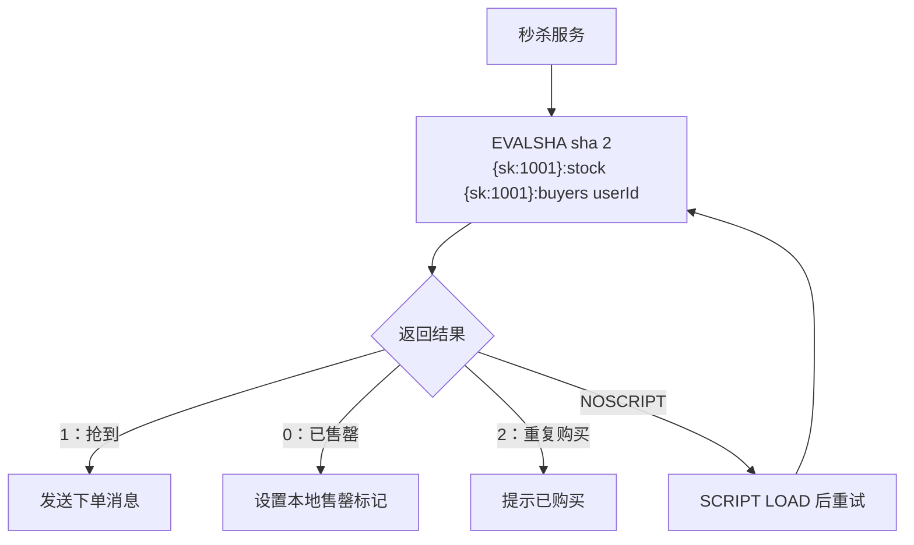

**追问链**

1. **限购用一个 Set 记录所有买家，库存很大时会不会占用太多内存？** 100 件库存，Set 里最多 100 个成员。如果库存有几十万件，Set 也会有几十万个成员，内存要提前估算。另一种做法是每个用户一个 Key，比如 `{sk:1001}:u:123`，设置过期时间，活动结束后自动清理。注意 Key 名要带上同一个 hash tag，否则在 Cluster 中会和库存 Key 落在不同的槽，脚本无法同时访问。
2. **脚本执行时间要控制在多短？** 越短越好。脚本执行期间，这个 Redis 实例上的其他所有命令都在等待。脚本里不能有遍历大集合、大量循环这类操作。超过 Redis 配置的最长执行时间后，Redis 会开始响应 BUSY 错误；修改过数据的脚本不能用 `SCRIPT KILL` 中止，只能关闭服务器。
3. **Redis 7 的 Functions 和 EVAL 有什么区别？** 官方文档对 EVAL 脚本的定位是"客户端应用的一部分"：脚本不命名、不版本化、不持久化，所以客户端随时要准备重新加载。7.0 起提供的 Functions 把逻辑作为服务端的一部分来加载和管理，可以避免每个客户端都要处理脚本加载。扣减逻辑本身是一样的。

**生产实践 / 踩坑**

- 不要用 `EVAL` 动态生成脚本，比如把用户 ID 直接拼进脚本源码。每个不同的脚本都会进入脚本缓存，会把内存耗尽。参数一律通过 KEYS 和 ARGV 传入。

---

### S01-07 单个库存 Key 成了热点怎么办？

> ★★★ ｜ 资深 / 架构师 ｜ 高频

**考察意图**：能不能先判断热点是否真的存在，再给出有效的治理手段，并说清每种手段的代价，尤其是分段库存带来的"少卖"问题。

**30 秒版回答**：

先判断是不是真的热点。一个库存 Key 只在一个 Redis 分片上，加 Redis 节点没有帮助。但到达 Redis 的请求已经被网关限流过，S01-06 实测单实例每秒能执行约 9.6 万次扣减脚本，很多情况下已经够用。

不够时，按以下顺序处理：

1. **本地售罄标记**：脚本返回"已售罄"后，秒杀服务在本地内存中打上标记，后续请求直接拒绝，不再访问 Redis。售罄后的流量基本都被挡在这一层。
2. **限制放行量**：既然只有 100 个请求能成功，网关可以只放行"库存的若干倍"的请求进入后端。
3. **分段库存**：把库存拆成 N 段，放到不同分片的 N 个 Key 上，压力分散到 N 个分片。代价是会出现"某一段卖完了，其他段还有货"，处理不好就会少卖。

**深入剖析**

下面的代码把 1000 件库存拆成 10 段，用 1100 个请求（只比库存多 10%）来抢。对比三种处理方式：

- 只认自己被分到的那一段；
- 自己的段卖完后，按顺序尝试其他段；
- 在第二种的基础上，用本地售罄标记跳过已知卖完的段。

```java
import java.util.Arrays;
import java.util.Random;

/**
 * 分段库存：把 1000 件库存拆成 10 段，放到 10 个 Key（分布在不同的 Redis 分片）上，缓解单个 Key 的热点。
 * 代价是"某一段卖完了、其他段还有货"：请求如果只认自己被分到的那一段，就会出现有人被拒绝、库存却没卖完（少卖）。
 * 对比三种处理方式：不重试；按顺序尝试其他段；用本地售罄标记跳过已知卖完的段。
 */
public class SegmentedStockDemo {

    static final int TOTAL = 1000;
    static final int SEGMENTS = 10;
    static final int REQUESTS = 1100;   // 需求只比库存多 10%，少卖的问题最明显

    enum Strategy { NO_RETRY, TRY_OTHER_SEGMENTS, SKIP_SOLD_OUT_SEGMENTS }

    static void run(Strategy strategy) {
        int[] stock = new int[SEGMENTS];
        Arrays.fill(stock, TOTAL / SEGMENTS);
        boolean[] soldOutFlag = new boolean[SEGMENTS];   // 应用节点本地的售罄标记
        Random random = new Random(7);                   // 固定种子，每次运行结果相同
        int sold = 0;
        int redisCalls = 0;
        int rejectedWhileStockLeft = 0;
        for (int i = 0; i < REQUESTS; i++) {
            int home = random.nextInt(SEGMENTS);         // 按用户哈希分到某一段
            boolean ok = false;
            int attempts = strategy == Strategy.NO_RETRY ? 1 : SEGMENTS;
            for (int k = 0; k < attempts && !ok; k++) {
                int seg = (home + k) % SEGMENTS;
                if (strategy == Strategy.SKIP_SOLD_OUT_SEGMENTS && soldOutFlag[seg]) {
                    continue;                            // 本地已知卖完，不再访问 Redis
                }
                redisCalls++;
                if (stock[seg] > 0) {
                    stock[seg]--;
                    ok = true;
                } else {
                    soldOutFlag[seg] = true;
                }
            }
            if (ok) {
                sold++;
            } else if (Arrays.stream(stock).sum() > 0) {
                rejectedWhileStockLeft++;
            }
        }
        System.out.printf("%-24s sold=%d left=%d rejectedWhileStockLeft=%d redisCalls=%d%n",
                strategy, sold, Arrays.stream(stock).sum(), rejectedWhileStockLeft, redisCalls);
    }

    public static void main(String[] args) {
        System.out.println("total=" + TOTAL + ", segments=" + SEGMENTS + ", requests=" + REQUESTS);
        for (Strategy s : Strategy.values()) {
            run(s);
        }
    }
}
```

本机运行输出：

```text
total=1000, segments=10, requests=1100
NO_RETRY                 sold=995 left=5 rejectedWhileStockLeft=105 redisCalls=1100
TRY_OTHER_SEGMENTS       sold=1000 left=0 rejectedWhileStockLeft=0 redisCalls=2117
SKIP_SOLD_OUT_SEGMENTS   sold=1000 left=0 rejectedWhileStockLeft=0 redisCalls=1010
```

三种方式的对比：

- **不重试**：最终剩下 5 件没卖出去，但有 105 个请求在"明明还有货"的时候被拒绝了。这就是分段库存的少卖问题，而且对用户也不公平：同一时刻，有人因为被分到了卖完的段而失败。
- **尝试其他段**：库存全部卖完，但访问 Redis 的次数达到 2117 次，接近请求数的两倍。后期大部分段都卖完了，每个请求都要逐段试一遍。
- **跳过已售罄的段**：库存全部卖完，访问 Redis 的次数降到 1010 次。

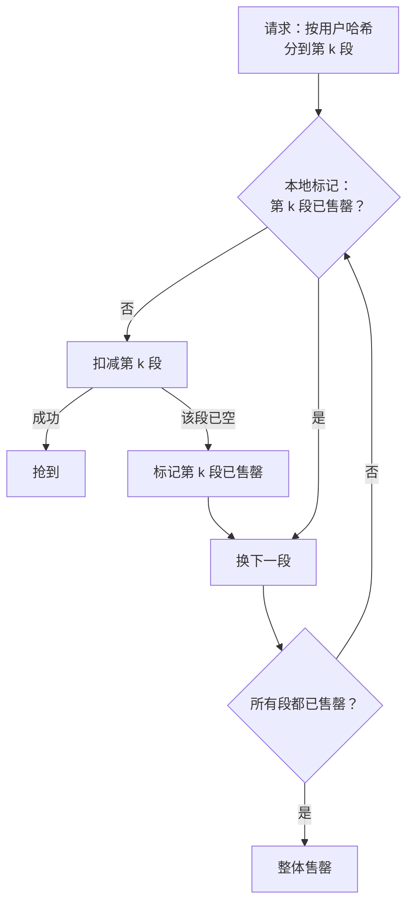

**追问链**

1. **本地售罄标记有什么坑？** 库存可能被回补：超时未支付的订单取消后，库存会加回来（S01-10）。如果售罄标记一直不清除，回补的库存就永远卖不出去，造成少卖。两种处理办法：
   - 给标记设置一个较短的有效期，比如 1 秒，过期后再去 Redis 确认一次；
   - 回补库存时广播一条消息，各实例收到后清除标记。
2. **分段后，限购还能保证吗？** 要小心。如果买家记录也按段存储，用户在 A 段被拒后去 B 段尝试，B 段的买家记录里没有他，他就可能在两个段各买到一件。所以限购记录不能跟着库存分段：要么按用户 ID 单独存放，在扣减前先占位、扣减失败再释放；要么只在数据库层用唯一索引做最终保证，代价是有少量重复抢购的请求会在下单时才被拒绝。
3. **还有其他办法吗？** 有"请求合并"：在秒杀服务里把一小段时间内（比如 10 毫秒）的扣减请求攒起来，一次性扣减 N 件，再把结果分发给各个请求。它能把 Redis 的调用次数降低一个数量级，但实现复杂，还会增加延迟，一般在前面几种方法都不够时才考虑。

**架构师加分点**

- 热点治理的顺序应该是：**先减少到达热点的请求，再考虑拆分热点**。本地售罄标记和限制放行量几乎没有成本，能解决大部分问题；分段库存会带来少卖、限购、对账这一系列新问题，要在压测证明单 Key 确实不够用之后再引入。

---

### S01-08 有了 Redis，数据库层还要做什么？

> ★★ ｜ 资深 ｜ 中频

**考察意图**：是否理解 Redis 只是"闸门"，数据库才是库存的最终事实来源，以及数据库层的扣减和下单应该怎么写。

**30 秒版回答**：

Redis 的扣减结果可能出错：主从切换丢了数据、运维误操作、代码有 bug。所以数据库层要再做两道兜底：

- **条件扣减**：`UPDATE ... SET stock = stock - 1 WHERE ... AND stock >= 1`。Redis 放进来的请求比实际库存多时，多出来的请求在这里失败，**保证不超卖**。
- **唯一索引**：订单表在（活动 ID，用户 ID）上建唯一索引，**保证一人一单**，同时让重复消息天然幂等。

插入订单和扣减库存放在同一个本地事务里，并且**把扣库存这条热点行的更新放在事务的最后**，尽量缩短持有行锁的时间。

**深入剖析**

示意 SQL，没有在本机执行：

```sql
-- 订单服务消费一条下单消息，在同一个本地事务中完成
BEGIN;
-- 1. 先插入订单：uk_activity_user 冲突说明是重复消息，直接按成功处理
INSERT INTO t_seckill_order (order_no, activity_id, user_id, sku_id, status, pay_deadline)
VALUES (?, ?, ?, ?, 'UNPAID', ?);
-- 2. 最后扣库存：热点行的锁只在事务末尾持有很短的时间；影响行数为 0 说明库存不足，回滚
UPDATE t_seckill_stock SET stock = stock - 1
WHERE activity_id = ? AND sku_id = ? AND stock >= 1;
COMMIT;
```

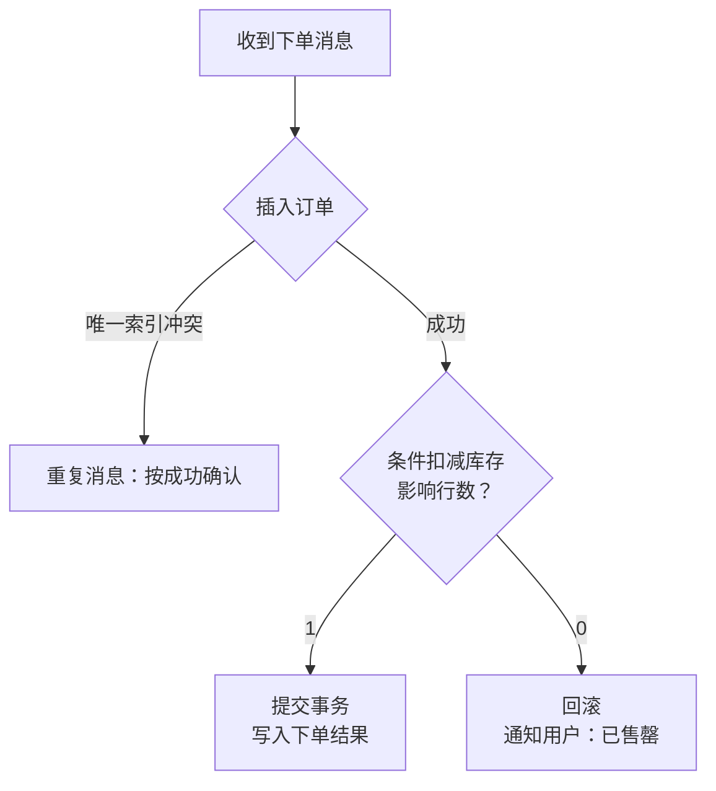

为什么先插入订单、后扣库存？行锁要到事务提交时才释放。如果先扣库存再插入订单，这条热点行的锁会在"插入订单"期间一直被持有，后面的事务都在排队等待。反过来写，热点行的锁只在提交前的一小段时间里持有。

**追问链**

1. **只有 100 次写入，数据库会有热点问题吗？** 100 件库存不会有。但如果库存有 10 万件，订单服务消费时同样会集中更新这一行。处理方法有两种：
   - 批量消费：一次取 N 条消息，合并成一次 `stock = stock - N` 的扣减；
   - 把库存拆成多行，思路和 Redis 的分段库存一样。
2. **秒杀库存为什么要单独一张表？** 和主站库存隔离。活动开始前，从主站库存中划拨一部分到秒杀库存表；活动结束后，把没卖完的部分归还。秒杀过程中对这张表的锁竞争，不会影响主站商品的正常扣减。

---

## 四、一致性

### S01-09 Redis 扣减成功后，订单怎么可靠地创建出来？

> ★★★ ｜ 资深 / 架构师 ｜ 高频

**考察意图**：能不能识别"Redis 扣减 → 发消息 → 创建订单"这条链路上的每一个失败点，并给出对应的处理方式，最终保证不超卖、不重复、不长期少卖。

**30 秒版回答**：

这条链路跨了 Redis、MQ、数据库三个系统，没有一个能覆盖全部的事务。所以思路是**每一步都考虑失败，用"补偿 + 幂等 + 对账"组合起来保证最终一致**：

| 失败点 | 后果 | 处理方式 |
| --- | --- | --- |
| 发送 MQ 失败 | Redis 扣了库存，却没有订单（少卖） | 同步重试几次；仍然失败就回补 Redis：恢复库存并删除买家记录，在一个 Lua 脚本中完成 |
| 回补也失败，或者进程恰好重启 | 同上 | 对账任务兜底（S01-11） |
| 消息重复投递 | 可能重复下单 | 订单表唯一索引，重复的消息直接按成功确认 |
| 消费失败 | 订单延迟创建 | MQ 自动重试；多次失败进入死信队列并告警 |
| 数据库扣减失败 | Redis 放进来的请求比实际库存多（比如主从切换后） | 通知用户"未抢到"，以数据库为准 |

还有一种做法是用 RocketMQ 的事务消息：先发半消息，再执行 Lua 扣减，根据结果提交或回滚；Broker 回查时，查询 Redis 的买家记录里有没有这个用户。

**深入剖析**

下面的代码在单线程中模拟整条链路，用固定的随机种子注入三类故障：

- 15% 的消息发送失败；
- 发送失败后，有一半的回补没有执行；
- 10% 的消息重复投递。

然后验证三道防线：数据库条件扣减、唯一索引、对账。

```java
import java.util.ArrayDeque;
import java.util.Deque;
import java.util.HashMap;
import java.util.HashSet;
import java.util.List;
import java.util.Map;
import java.util.Random;
import java.util.Set;

/**
 * Redis 预扣减 → MQ → 数据库创建订单，这条链路上每一步都可能失败。
 * 注入三类故障：发送 MQ 失败；失败后的回补也没执行（比如进程恰好重启）；消息重复投递。
 * 验证三道防线：数据库条件扣减保证不超卖；唯一索引保证一人一单；对账把"扣了 Redis 却没有订单"的库存补回来，避免少卖。
 * 用单线程 + 固定随机种子模拟，每次运行结果相同；并发下的原子性见 OversellDemo 和 RedisSeckillDemo。
 */
public class OrderConsistencyDemo {

    static final int STOCK = 100;
    static final double SEND_FAIL_RATE = 0.15;
    static final double COMPENSATE_FAIL_RATE = 0.5;
    static final double DUPLICATE_RATE = 0.1;

    private final Random random = new Random(2026);
    // Redis：库存和已购用户
    private int redisStock = STOCK;
    private final Set<String> redisBuyers = new HashSet<>();
    // MQ
    private final Deque<String> mq = new ArrayDeque<>();
    // 数据库：库存行 + 订单表（user_id 上有唯一索引）
    private int dbStock = STOCK;
    private final Map<String, Integer> orders = new HashMap<>();
    // 统计
    private int sendFailed;
    private int compensated;
    private int compensateFailed;
    private int duplicateIgnored;

    /** 对应 Lua 脚本：校验限购 + 扣减，原子执行 */
    private boolean redisDeduct(String user) {
        if (redisBuyers.contains(user) || redisStock <= 0) {
            return false;
        }
        redisStock--;
        redisBuyers.add(user);
        return true;
    }

    /** 秒杀服务：Redis 扣减成功后发消息；发送失败要回补 Redis */
    void seckill(String user, boolean injectFaults) {
        if (!redisDeduct(user)) {
            return;
        }
        if (injectFaults && random.nextDouble() < SEND_FAIL_RATE) {
            sendFailed++;
            if (random.nextDouble() < COMPENSATE_FAIL_RATE) {
                compensateFailed++;                    // 回补没执行：Redis 少了一件，却没有对应的订单
                return;
            }
            redisStock++;
            redisBuyers.remove(user);
            compensated++;
            return;
        }
        mq.add(user);
        if (injectFaults && random.nextDouble() < DUPLICATE_RATE) {
            mq.add(user);                              // 消息重复投递
        }
    }

    /** 订单服务：消费消息，先查唯一索引幂等，再用条件更新扣数据库库存 */
    void consumeAll() {
        while (!mq.isEmpty()) {
            String user = mq.poll();
            if (orders.containsKey(user)) {
                duplicateIgnored++;                    // 相当于插入时触发唯一索引冲突，直接当作成功
                continue;
            }
            if (dbStock >= 1) {                        // UPDATE ... SET stock = stock - 1 WHERE ... AND stock >= 1
                dbStock--;
                orders.put(user, orders.size() + 1);
            }
        }
    }

    /** 对账：以数据库为准。Redis 记录的买家里，没有订单、也没有在途消息的，判定为丢失，回补库存 */
    int reconcile() {
        List<String> lost = redisBuyers.stream().filter(u -> !orders.containsKey(u) && !mq.contains(u)).toList();
        for (String user : lost) {
            redisBuyers.remove(user);
            redisStock++;
        }
        return lost.size();
    }

    public static void main(String[] args) {
        OrderConsistencyDemo d = new OrderConsistencyDemo();
        for (int u = 1; u <= 300; u++) {
            d.seckill("u" + u, true);
        }
        d.consumeAll();
        System.out.println("wave 1: 300 users, faults injected");
        System.out.printf("  mq send failed=%d (compensated=%d, compensation lost=%d), duplicates ignored=%d%n",
                d.sendFailed, d.compensated, d.compensateFailed, d.duplicateIgnored);
        System.out.printf("  orders=%d, db stock=%d, redis stock=%d -> undersold by %d%n",
                d.orders.size(), d.dbStock, d.redisStock, STOCK - d.orders.size());
        int restored = d.reconcile();
        System.out.printf("reconcile: restored %d to redis, redis stock=%d%n", restored, d.redisStock);
        for (int u = 301; u <= 350; u++) {
            d.seckill("u" + u, false);
        }
        d.consumeAll();
        System.out.println("wave 2: 50 more users, no faults");
        System.out.printf("final: orders=%d, db stock=%d, redis stock=%d, oversold=%s%n",
                d.orders.size(), d.dbStock, d.redisStock, d.orders.size() > STOCK);
    }
}
```

本机运行输出：

```text
wave 1: 300 users, faults injected
  mq send failed=17 (compensated=8, compensation lost=9), duplicates ignored=8
  orders=91, db stock=9, redis stock=0 -> undersold by 9
reconcile: restored 9 to redis, redis stock=9
wave 2: 50 more users, no faults
final: orders=100, db stock=0, redis stock=0, oversold=false
```

从输出可以看到整个过程：

1. **第一波 300 个用户**：17 次消息发送失败，其中 8 次成功回补，回补的库存又被后面的用户买走了；另外 9 次回补没有执行，Redis 的库存已经是 0，但实际只生成了 91 个订单，少卖了 9 件。重复投递的 8 条消息被唯一索引挡住，没有产生重复订单。
2. **对账**：以数据库为准，发现 Redis 记录的买家中有 9 个既没有订单、也没有在途消息，把这 9 件库存补回 Redis。
3. **第二波 50 个用户**：买走补回的 9 件，最终正好 100 个订单。数据库库存为 0，Redis 库存为 0，没有超卖。

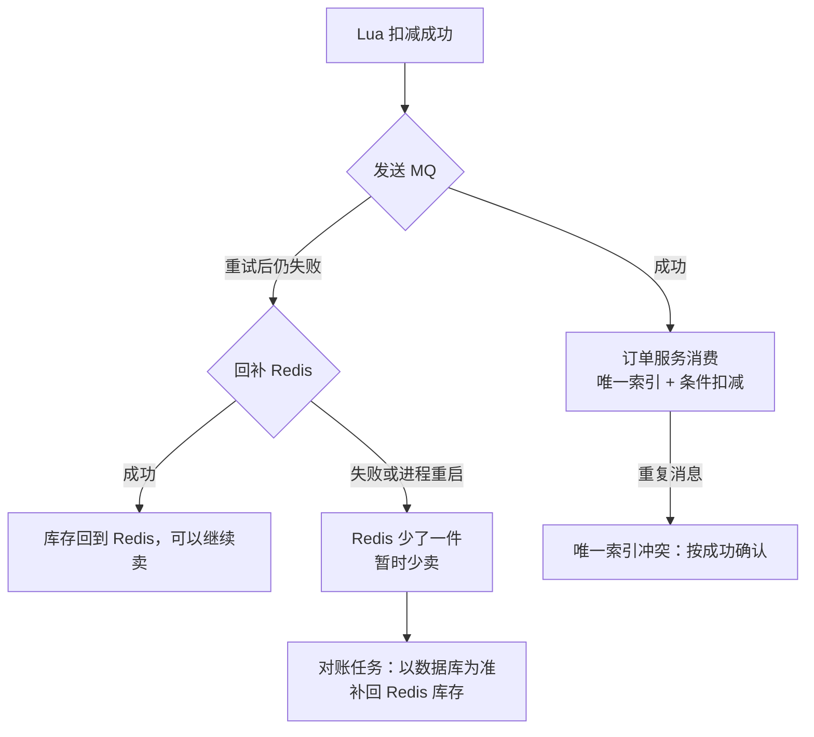

**追问链**

1. **Lua 扣减成功后，能直接告诉用户"抢到了"吗？** 不能。这时订单还没创建，后面还可能失败（比如 Redis 主从切换后放进来的请求在数据库层被拒绝）。应该返回"排队中"，等订单创建成功后，再通过结果查询告诉用户（S01-14）。
2. **用事务消息有什么好处？代价是什么？** 好处是不用自己处理"发送失败后回补"的逻辑：半消息发送失败，就不会执行 Lua 扣减；Lua 执行后进程崩溃，Broker 会回查。回查接口查询 Redis 的买家记录：有记录就提交，没有就回滚。代价是依赖 RocketMQ，并且要实现回查接口。另外，如果 Redis 主从切换丢了这条买家记录，回查的结果是回滚，订单不会创建。但 Redis 的库存扣减也一起丢了，两边仍然是一致的。事务消息的原理见[《22 RocketMQ》](../05-消息队列/22-RocketMQ.md)的 22-07。
3. **回补 Redis 时，为什么要删除买家记录？** 否则这个用户会被当成"已经买过"，再也无法购买，但他实际上并没有订单。恢复库存和删除买家记录要在同一个 Lua 脚本中完成，保证原子性。

**架构师加分点**

- 这条链路的设计原则是：**以数据库为最终事实来源，Redis 只是一个可以随时修正的闸门**。Redis 上的任何错误，要么被数据库的条件扣减挡住（防超卖），要么被对账修正（防长期少卖）。理解了这一点，各种故障场景的处理方式都能推出来。

---

### S01-10 用户抢到了不付款怎么办？库存怎么回补才不会多补？

> ★★★ ｜ 资深 ｜ 高频

**考察意图**：能不能设计出可靠的超时取消机制，并处理好"支付回调和超时取消同时到达""取消消息重复投递"这两个并发问题，保证库存只回补一次。

**30 秒版回答**：

- **超时取消**：订单创建时发送一条定时消息（比如 15 分钟后投递）。到期后检查订单状态，仍未支付就取消，并回补库存。RocketMQ 5.x 支持任意时间的定时消息，默认最长 3 天（见[《22 RocketMQ》](../05-消息队列/22-RocketMQ.md)的 22-08）。另外要有一个低频的扫表任务兜底，防止消息丢失。
- **状态变更必须是条件更新**：`UPDATE t_order SET status = 'CANCELLED' WHERE id = ? AND status = 'UNPAID'`。只有影响行数为 1 时，才执行回补库存；支付回调同理。这样同一笔订单最终只有一个结果，库存也只会回补一次。
- **回补顺序**：先在数据库里回补（事实来源），再回补 Redis。Redis 回补失败，由对账任务修正。回补后还要清除各实例的本地售罄标记（S01-07）。

**深入剖析**

下面的代码模拟 1000 笔订单。每笔订单同时收到 1 个支付回调和 2 条超时取消消息（重复投递），对比"先读状态再写"和"条件更新"两种写法：

```java
import java.time.Duration;
import java.util.Map;
import java.util.concurrent.ConcurrentHashMap;
import java.util.concurrent.CountDownLatch;
import java.util.concurrent.ExecutorService;
import java.util.concurrent.Executors;
import java.util.concurrent.atomic.AtomicInteger;
import java.util.concurrent.atomic.AtomicIntegerArray;
import java.util.stream.IntStream;

/**
 * 支付回调和超时取消同时到达，超时取消消息还被重复投递了一次：同一笔订单只能有一个结果，库存只能回补一次。
 * 错误写法：先读状态，判断后再写；
 * 正确写法：带条件的状态更新，相当于 UPDATE t_order SET status = ? WHERE id = ? AND status = 'UNPAID'，
 * 根据影响行数决定要不要执行后续动作（发货或回补库存）。
 */
public class PayCancelRaceDemo {

    enum Status { UNPAID, PAID, CANCELLED }

    static final int ORDERS = 1000;
    static final Duration GAP = Duration.ofMillis(2);   // 读状态和写状态之间的一次数据库往返

    interface OrderStore {
        boolean transit(int orderId, Status target) throws InterruptedException;

        Status status(int orderId);
    }

    /** 错误：读、判断、写分成了三步 */
    static final class ReadThenWrite implements OrderStore {
        private final Map<Integer, Status> table = new ConcurrentHashMap<>();

        ReadThenWrite() {
            IntStream.range(0, ORDERS).forEach(i -> table.put(i, Status.UNPAID));
        }

        public boolean transit(int orderId, Status target) throws InterruptedException {
            if (table.get(orderId) != Status.UNPAID) {
                return false;
            }
            Thread.sleep(GAP);
            table.put(orderId, target);
            return true;
        }

        public Status status(int orderId) {
            return table.get(orderId);
        }
    }

    /** 正确：比较并替换，只有当前状态还是 UNPAID 时才能改，只有一个请求会成功 */
    static final class ConditionalUpdate implements OrderStore {
        private final Map<Integer, Status> table = new ConcurrentHashMap<>();

        ConditionalUpdate() {
            IntStream.range(0, ORDERS).forEach(i -> table.put(i, Status.UNPAID));
        }

        public boolean transit(int orderId, Status target) throws InterruptedException {
            Thread.sleep(GAP);
            return table.replace(orderId, Status.UNPAID, target);
        }

        public Status status(int orderId) {
            return table.get(orderId);
        }
    }

    static void run(String name, OrderStore store) {
        AtomicIntegerArray shipped = new AtomicIntegerArray(ORDERS);    // 支付成功后执行的动作次数
        AtomicIntegerArray restored = new AtomicIntegerArray(ORDERS);   // 取消后回补库存的次数
        AtomicInteger restoredStock = new AtomicInteger();
        CountDownLatch start = new CountDownLatch(1);
        try (ExecutorService executor = Executors.newVirtualThreadPerTaskExecutor()) {
            for (int i = 0; i < ORDERS; i++) {
                int id = i;
                executor.submit(() -> {                     // 支付回调
                    start.await();
                    if (store.transit(id, Status.PAID)) {
                        shipped.incrementAndGet(id);
                    }
                    return null;
                });
                for (int copy = 0; copy < 2; copy++) {      // 超时取消消息，投递了两次
                    executor.submit(() -> {
                        start.await();
                        if (store.transit(id, Status.CANCELLED)) {
                            restored.incrementAndGet(id);
                            restoredStock.incrementAndGet();
                        }
                        return null;
                    });
                }
            }
            start.countDown();
        }
        int paid = 0;
        int cancelled = 0;
        int paidAndRestored = 0;
        int restoredTwice = 0;
        for (int i = 0; i < ORDERS; i++) {
            if (store.status(i) == Status.PAID) paid++;
            if (store.status(i) == Status.CANCELLED) cancelled++;
            if (shipped.get(i) > 0 && restored.get(i) > 0) paidAndRestored++;
            if (restored.get(i) > 1) restoredTwice++;
        }
        System.out.printf("%-18s paid=%d cancelled=%d | paid but stock restored=%d, restored twice=%d, restored stock=%d%n",
                name, paid, cancelled, paidAndRestored, restoredTwice, restoredStock.get());
    }

    public static void main(String[] args) {
        System.out.println(ORDERS + " orders, each gets 1 pay callback + 2 timeout-cancel messages at the same time");
        run("read-then-write", new ReadThenWrite());
        run("conditional-update", new ConditionalUpdate());
    }
}
```

本机运行输出：

```text
1000 orders, each gets 1 pay callback + 2 timeout-cancel messages at the same time
read-then-write    paid=143 cancelled=857 | paid but stock restored=993, restored twice=994, restored stock=1992
conditional-update paid=623 cancelled=377 | paid but stock restored=0, restored twice=0, restored stock=377
```

- **先读再写**：同一笔订单的三个请求几乎同时读到"未支付"，然后各自执行了后续动作。结果是 993 笔订单既执行了支付成功的动作（比如发货），又回补了库存；994 笔订单的库存被回补了两次。1000 笔订单（每笔 1 件）一共回补了 1992 件库存，这些多出来的库存如果再卖出去，就是超卖。
- **条件更新**：每笔订单只有一个请求能把状态从"未支付"改掉，没有任何冲突，回补的库存数正好等于被取消的订单数（377）。
- 两种写法中，支付和取消各占多少，取决于线程调度，每次运行都不一样；但条件更新这一行的冲突数始终为 0。

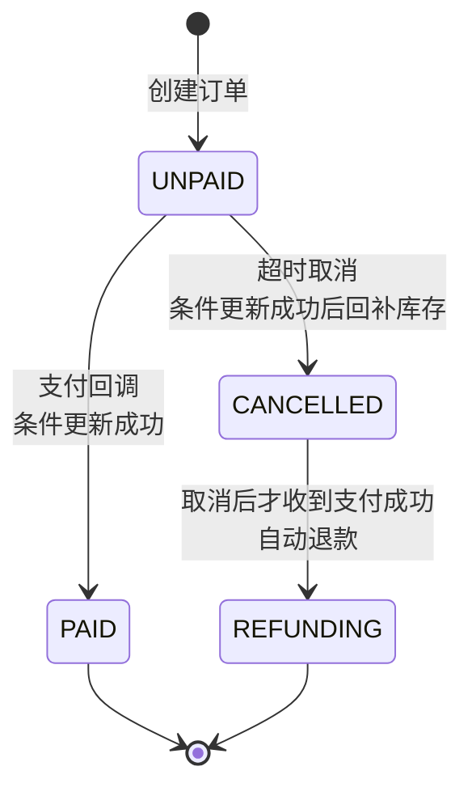

**追问链**

1. **支付成功的回调在订单取消之后才到，怎么办？** 支付回调的条件更新会失败，因为订单已经是"已取消"。这时说明用户的钱已经扣了，但订单作废了，必须自动发起退款并告警，不能简单地忽略。也可以在取消之前先向支付渠道查询一次支付状态，减少这种情况。
2. **被取消的订单，用户还能再抢吗？** 这是业务规则，要问产品。如果允许，回补库存时也要把这个用户从 Redis 的买家记录中删除；如果不允许，就只回补库存。
3. **为什么还需要扫表兜底？** 定时消息也可能出问题：发送失败、Broker 故障。低频扫描"超过支付期限仍未支付"的订单，处理漏掉的部分。扫表和消息处理用的是同一个条件更新，即使两边都处理了同一笔订单，也不会重复回补。定时任务的设计见[《34 定时任务》](../07-工程实践与稳定性/34-定时任务.md)。

---

### S01-11 怎么判断有没有超卖、少卖？对账怎么做？

> ★★ ｜ 资深 / 架构师 ｜ 中频

**考察意图**：能不能用可以计算的"不变式"来定义正确性，并设计出能在活动中持续运行的对账机制。

**30 秒版回答**：

先定义几个任何时候都应该成立的**不变式**：

1. **数据库**：初始库存 = 数据库剩余库存 + 有效订单数（未支付 + 已支付）。
2. **Redis**：Redis 已扣减数（初始库存 - Redis 剩余库存）= 有效订单数 + 在途消息数。
3. **限购**：每个用户的有效订单数不超过限购数量。

对账任务在活动中每分钟跑一次，活动结束后再跑一次最终对账：

- 不变式 1 或 3 不成立，说明数据库层出了问题，属于严重故障，要立即告警，并暂停活动。
- 不变式 2 不成立，说明 Redis 和数据库不一致，以数据库为准修正 Redis。Redis 扣多了就是少卖，补回去；Redis 扣少了，说明 Redis 放进来的请求会多于实际库存，也要修正（数据库的条件扣减会兜住，不会超卖）。

**深入剖析**

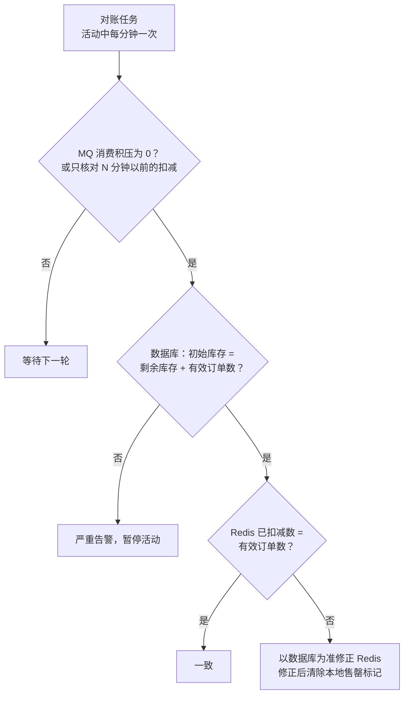

对账最难处理的是"**在途**"的状态：消息已经发出，订单还没创建。这时 Redis 已经扣了，数据库还没扣，直接比较会误判为"少卖"，然后错误地把库存补回去，造成超卖。两种处理办法：

- 只在 MQ 的消费积压为 0 时对账；
- 只核对 N 分钟以前的扣减，N 要大于消息的最长处理时间。

S01-09 的演示代码中，对账时会检查"有没有在途消息"，就是这个原因。

**追问链**

1. **对账发现 Redis 少了一件，补回去之后又被卖掉了，但这时候迟到的消息到了，会不会超卖？** 不会。迟到的消息在数据库层做条件扣减，库存不够就失败，用户收到"未抢到"。这正是"宁可少卖、不能超卖"原则的体现：Redis 上的错误只能导致"放进来的人多了"或"少了"，最终能不能下单，由数据库决定。
2. **活动结束后还要做什么？** 最终对账；把没卖完的秒杀库存归还主站；核对支付金额和订单金额（支付对账见[《29 场景题》](../06-三高与架构/29-场景题.md)的 29-05）；清理 Redis 中的活动数据。

---

## 五、流量与防刷

### S01-12 限流放在哪几层？阈值怎么定？

> ★★ ｜ 资深 ｜ 高频

**考察意图**：能不能把限流分配到合适的层，每一层的阈值都有依据，并且知道分布式限流在百万 QPS 下自身也会成为瓶颈。

**30 秒版回答**：

限流按漏斗分层，越靠前越便宜：

1. **客户端**：开抢前按钮置灰；点击后禁用几秒；被拒绝后随机等待一段时间才允许再点。这一层能被绕过，但能挡住大部分正常用户的重复点击。
2. **CDN / WAF**：按 IP 限速，拦截明显的爬虫。
3. **网关**：总量限流 + 按用户限流。
4. **秒杀服务**：单机限流兜底，再用信号量限制同时访问 Redis 的请求数；售罄后直接用本地标记拒绝。

阈值的来源只有两个：**下游的压测容量**，和**业务上需要放进来多少请求**。取两者中较小的那个。秒杀的特殊之处在于，后者往往比前者小得多：只有 100 件库存，每秒放进来几千个请求就足够卖完了。

**深入剖析**

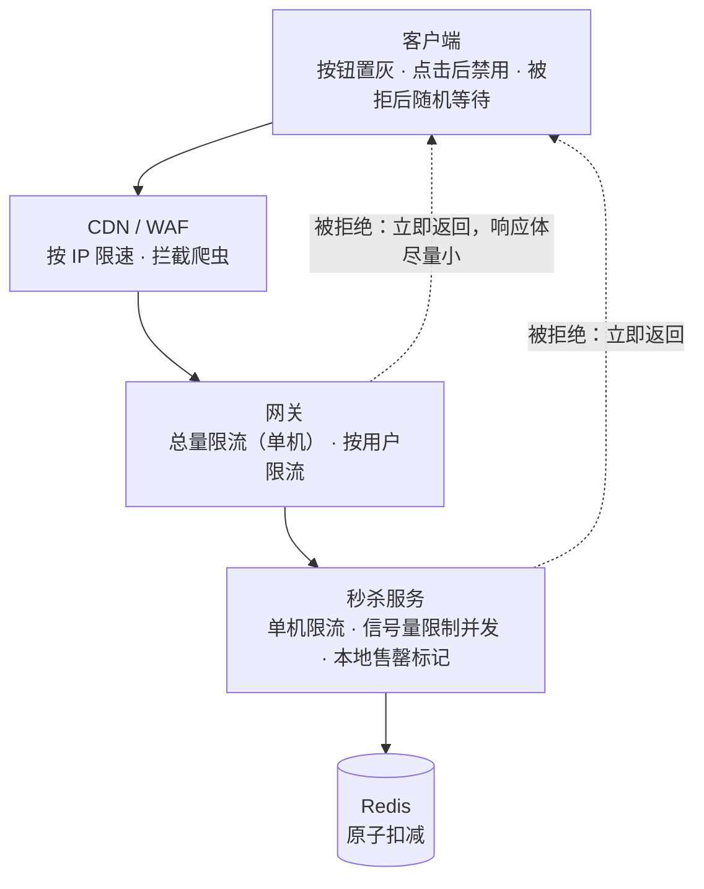

每一层的阈值怎么来：

| 层 | 阈值的依据 | 说明 |
| --- | --- | --- |
| 网关总量 | min（秒杀服务集群的压测容量，库存 × N）÷ 网关节点数 | 用单机限流实现，见下面的追问 1 |
| 网关按用户 | 正常人的点击频率 | 比如每个用户每秒 1～2 次 |
| 秒杀服务单机 | 单实例压测容量 × 安全系数 | 网关限流失效时的兜底 |
| 秒杀服务并发 | 到 Redis 的连接池大小 | 信号量拿不到就立即拒绝，不排队 |

"库存 × N"里的 N 要覆盖后面会失败的请求：重复购买、风控拒绝、抢到后不付款被取消。N 取多少没有通用答案，要结合往期活动的数据来定。N 取得太小，放进来的请求不够，就会少卖。

**追问链**

1. **网关限流用 Spring Cloud Gateway 的 `RequestRateLimiter` 可以吗？** 它是 Redis + Lua 实现的令牌桶，每个请求都要执行一次 Redis 脚本（见[《12 Spring Cloud》](../03-分布式与微服务/12-SpringCloud.md)的 12-08）。在 100 万 QPS 下要注意两点：
   - **按用户限流**：每个用户一个 Key，分散在集群的各个分片上，不会形成热点。但限流本身就需要一个能承受百万次脚本调用的 Redis 集群，而且必须和库存 Redis 分开部署，否则限流流量会把库存 Redis 打垮。
   - **总量限流**：不能用一个全局 Key，否则这个 Key 本身就成了新的热点。用单机限流，把总阈值除以网关节点数即可。代价是网关节点的负载要均衡，扩缩容后要调整单机阈值（见[《26 高可用》](../06-三高与架构/26-高可用.md)的 26-04）。
2. **被拒绝的用户怎么处理？** 立即返回"活动太火爆，请稍后再试"，响应体尽量小。不能让客户端立即自动重试，否则被拒绝的请求会变成成倍的重试流量，形成重试风暴（见[《26 高可用》](../06-三高与架构/26-高可用.md)的 26-07）。客户端应该随机等待一段时间后再允许用户点击。
3. **秒杀服务为什么还要用信号量？** 限流控制的是速率，信号量控制的是同时在途的请求数。Redis 一旦变慢，同样的速率会积压出更多的在途请求，最终占满线程和连接。信号量拿不到就直接拒绝，保证 Redis 变慢时秒杀服务不会被拖垮。

**架构师加分点**

- 秒杀的限流和普通系统有一个本质区别：普通系统的限流是"在能力范围内尽量多放"，秒杀的限流是"**只放足够卖完库存的量**"。因为放进来的请求再多，成功的也只有库存那么多，多放进来的只会增加后端的压力。限流算法的细节见[《26 高可用》](../06-三高与架构/26-高可用.md)的 26-03。

---

### S01-13 怎么防黄牛和脚本？

> ★★ ｜ 资深 / 架构师 ｜ 中频

**考察意图**：是否理解防刷的手段是分层的，每一层都有它挡不住的东西；以及技术手段的边界在哪里。

**30 秒版回答**：

先区分两类对手：

- **不登录、直接刷接口的脚本**：用秒杀令牌（和用户绑定、开抢时才下发）、动态地址、验证码就能挡住。
- **用真实账号 + 自动化工具的黄牛**：请求在协议上和正常用户完全一样，签名、令牌都能正常拿到。只能靠**账号、设备、行为**三个维度的风控来识别，再加上订单层面的限购和发货前复核。

所以防刷要分层，每一层都承认自己挡不住什么，由下一层来补。

**深入剖析**

| 层 | 手段 | 能挡住 | 挡不住 |
| --- | --- | --- | --- |
| 账号 | 实名认证；注册时长、会员等级、历史消费；新注册的账号不能参加 | 批量注册的小号 | 收购来的真实老账号 |
| 资格 | 提前预约，只有预约过的用户才能参加 | 临时起意的脚本 | 提前准备好的账号 |
| 请求 | 秒杀令牌、开抢时才下发地址、获取令牌时加验证码 | 不登录直接刷接口、提前发请求 | 真实账号 + 自动化工具；人工打码 |
| 设备与网络 | 设备指纹；同一设备、同一 IP 下的账号数 | 一台设备控制大量账号 | 大量真实设备、代理 IP 池 |
| 行为 | 页面停留时间、点击时间的分布、操作轨迹 | 机械化的脚本 | 高度仿真的自动化 |
| 订单 | 同一收货地址、手机号、身份证限购；发货前复核 | 绕过前面各层的黄牛 | — |

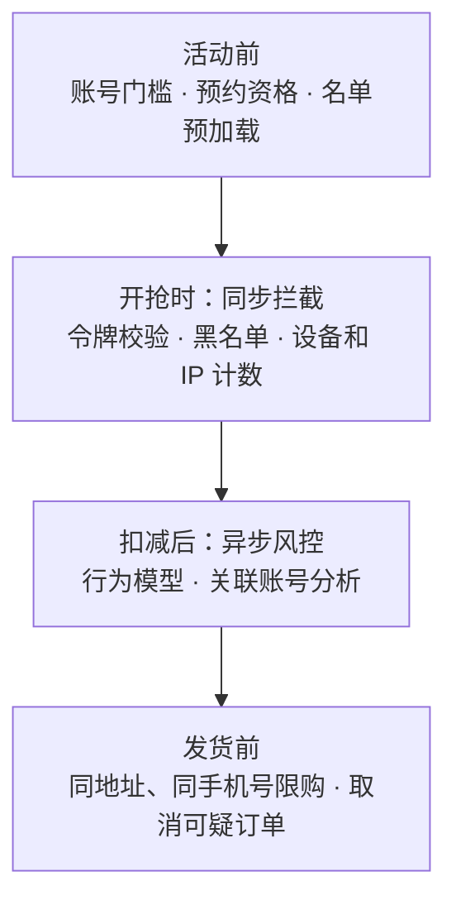

**追问链**

1. **验证码会影响正常用户的体验，放在哪里？** 放在"获取令牌"这一步，而不是下单这一步。它除了增加脚本的成本，还有一个作用：用户输入验证码需要几秒钟，请求在时间上被打散了，起到了削峰的效果。风控评分低的用户可以免验证码，减少对正常用户的打扰。
2. **风控是同步还是异步？** 同步链路只做能在本地或缓存中快速判断的轻量规则，比如黑名单、设备和 IP 的计数，不能让风控调用拖慢秒杀接口。复杂的模型放在扣减之后异步执行，在发货前取消可疑的订单，取消后库存按 S01-10 的流程回补。
3. **误伤了正常用户怎么办？** 这是风控阈值的取舍，宁可放过还是宁可误伤，要由业务方来决定。技术上要做的是：拦截时给出明确的提示和申诉入口；记录每次拦截的原因，便于事后复核和调整规则。

**架构师加分点**

- 防刷是一场成本对抗：目标不是"完全挡住"，而是让黄牛的成本（账号、设备、人工）高于他的收益。所以除了技术手段，还要配合业务规则，比如实名购买、限制转售、中签后才能购买（S01-18），从收益一侧降低黄牛的动力。

---

### S01-14 用户怎么知道抢没抢到？排队和结果查询怎么做？

> ★★ ｜ 资深 ｜ 中频

**考察意图**：异步下单之后，结果怎么回到用户手里；能不能控制住结果查询这一部分流量。

**30 秒版回答**：

- 秒杀接口只返回三种结果：**未抢到**（库存不足、重复购买、被限流）、**排队中**（扣减成功，订单正在创建）、**系统繁忙**。只有"排队中"的用户需要继续查询，人数大约等于库存数。
- 订单服务创建订单后，把结果写入 Redis 的结果 Key：成功时带上订单号和支付截止时间，失败时带上原因。
- 用户端按递增的间隔轮询，比如 1 秒、2 秒、3 秒，到达最长等待时间后提示"结果确认中，请稍后在订单列表查看"。
- 查询时先看结果 Key；没有结果，就查 Redis 的买家记录：在记录里说明还在排队，不在说明没抢到（比如 S01-09 中消息发送失败后被回补了）。

**深入剖析**

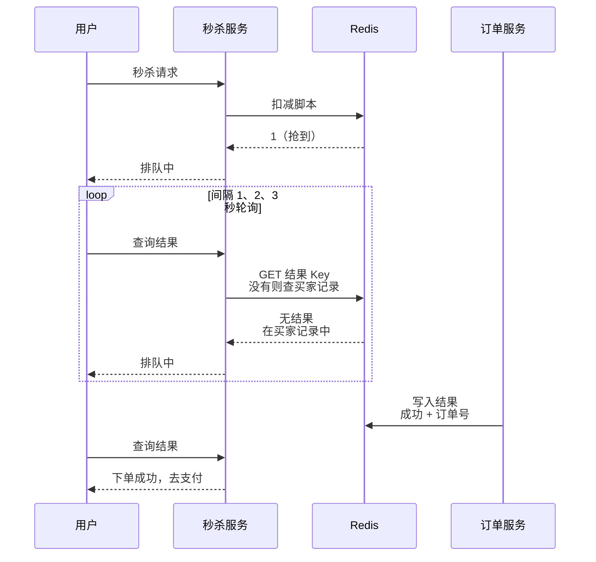

结果 Key 的设计：

- Key 名比如 `sk:result:1001:123`（活动 ID 和用户 ID），**不要带上活动的 hash tag**。库存和买家记录用 hash tag 是为了让 Lua 脚本能同时访问它们；结果 Key 不需要和它们在一起，分散到各个分片上更好。
- 设置过期时间，覆盖活动时长和支付期限即可，比如 1 天。
- 订单服务写结果和创建订单不在一个事务里：如果订单已经创建、结果没有写进去，用户会一直看到"排队中"。所以在到达最长等待时间后，还要用（活动 ID，用户 ID）去订单表查一次，这时查询的人数很少，数据库可以承受。

**追问链**

1. **轮询会不会又形成一个流量高峰？** 不会。被拒绝的用户直接拿到了最终结果，不需要轮询。需要轮询的只有拿到"排队中"的用户，人数和库存是同一个量级。所以 100 件库存的活动，用轮询就足够了。
2. **什么时候需要推送？** 库存很大（比如几十万件）时，轮询的量也会很大，可以改成长连接或 App 推送，订单创建后主动通知用户。推送平台的设计见[《29 场景题》](../06-三高与架构/29-场景题.md)的 29-14。即使有推送，也要保留查询接口，因为推送可能丢失。
3. **用户等了很久还是"排队中"，可以直接告诉他失败吗？** 不可以。消息可能只是积压了，订单最终还是会创建成功。如果提前告诉用户"失败"，他稍后却收到了支付通知，体验更差。正确的做法是提示"结果确认中"，最终以订单列表为准；同时要监控消费积压，从源头上缩短排队时间（S01-17）。

---

## 六、高可用与运维

### S01-15 怎么隔离，才能不拖垮主站？

> ★★★ ｜ 架构师 ｜ 高频

**考察意图**：是否理解故障是通过共享的资源传播的，能不能把秒杀和主站之间所有共享的资源都找出来，逐个隔离。

**30 秒版回答**：

秒杀出问题时，故障是通过**共享资源**传给主站的：同一个网关、同一个 Redis、同一个数据库、同一个 MQ，以及秒杀服务对主站服务的同步调用。所以隔离就是把这些共享点逐个切开：

- **入口**：独立的二级域名和 CDN 配置，必要时可以单独切断秒杀入口；
- **网关和应用**：秒杀服务独立部署、独立扩容，网关使用独立的集群，或者至少使用独立的路由和限流配置；
- **Redis**：秒杀使用独立的 Redis 集群，不和主站缓存共用；
- **MQ**：独立的 Topic 和消费组，订单服务限速消费；
- **数据库**：秒杀库存单独一张表，最好单独一个库；
- **依赖调用**：活动中不实时调用主站服务。用户资格、商品信息提前加载到本地缓存或 Redis；必须调用的依赖要设置超时和熔断。

最后还要有一个**一键关闭活动**的开关：秒杀入口切换成静态的"活动已结束"页面，后端直接拒绝。

**深入剖析**

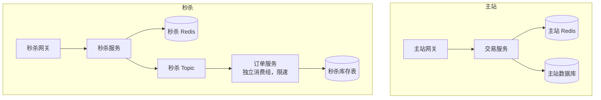

| 共享点 | 不隔离会怎样 | 隔离方式 |
| --- | --- | --- |
| 网关 | 秒杀流量占满网关的线程和带宽，主站请求进不来 | 独立网关集群，或独立路由 + 限流 |
| Redis | 秒杀的热点 Key 打满 CPU，主站缓存跟着变慢 | 独立集群 |
| MQ | 秒杀消息积压，影响主站消息的投递 | 独立 Topic、独立消费组，必要时独立集群 |
| 数据库 | 秒杀库存行的锁竞争、连接池被占满 | 独立的秒杀库存表，最好独立库 |
| 同步调用 | 秒杀服务的调用量打垮用户服务、商品服务 | 活动前预加载，活动中不调用 |

**追问链**

1. **订单服务是主站和秒杀共用的，怎么隔离？** 秒杀订单的写入量只有库存数那么多，共用订单表没有问题。需要隔离的是消费这一侧：秒杀使用独立的消费组和独立的线程池，限制消费速度，保证秒杀消息再多，也不会占满订单服务处理主站请求的资源。舱壁模式的做法见[《26 高可用》](../06-三高与架构/26-高可用.md)的 26-06。
2. **隔离到什么程度合适？** 看成本和活动的规模。大促级别的秒杀，Redis、网关、MQ 都用独立集群；平时的小规模活动，可以共用集群，但要有独立的线程池、独立的限流配置和独立的降级开关。判断标准是：秒杀这部分出现最坏的情况时，主站的核心交易不受影响。

**架构师加分点**

- 隔离的检查方法：画出秒杀请求经过的每一个资源，问"这个资源主站也在用吗"。凡是共享的，都要回答两个问题："秒杀把它打满时，主站会怎样""有没有办法单独切断秒杀"。这比泛泛地说"做好隔离"更有说服力。

---

### S01-16 Redis 主从切换或者宕机了怎么办？

> ★★★ ｜ 架构师 ｜ 高频

**考察意图**：是否清楚 Redis 主从切换会丢数据，以及前面设计的各道防线在这种情况下怎么配合，保证不超卖。

**30 秒版回答**：

**主从切换**：Redis 的主从复制是异步的，主库宕机前最后一小段写入可能还没同步到从库（见[《17 Redis》](../04-数据存储/17-Redis.md)的 17-12）。切换后会出现三种情况，前面的设计都能兜住：

- **扣减丢失**，Redis 的库存比实际的多，会多放进来一些请求：这些请求在数据库的条件扣减上失败，**不会超卖**。
- **买家记录丢失**，用户可以再抢一次：重复的订单被唯一索引拒绝。
- **脚本缓存丢失**：`EVALSHA` 返回 `NOSCRIPT`，客户端重新加载脚本。

切换完成后，等 MQ 的消息消费完，以数据库为准对账，修正 Redis 中的库存和买家记录（S01-11）。

**整个 Redis 不可用**：暂停活动，返回"活动太火爆"。**不要降级到数据库扣减**，数据库扛不住秒杀的流量，而且会把故障扩散到主站。然后用数据库中的数据在新的 Redis 上重建库存和买家记录，再恢复活动。

**深入剖析**

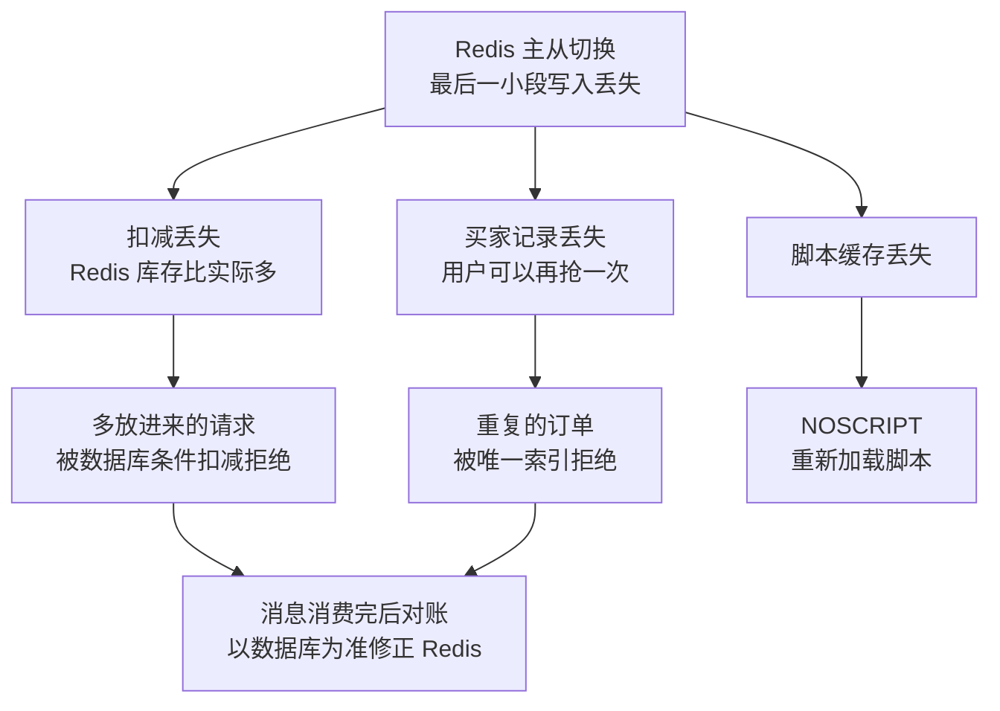

重建 Redis 的数据量很小：库存只是一个数字，买家记录最多和库存数一样多。所以只要提前写好重建脚本并演练过，从暂停到恢复可以控制在几分钟内。重建的步骤：

1. 秒杀入口暂停，返回"活动太火爆"；
2. 等 MQ 中秒杀 Topic 的消息全部消费完，此时数据库就是完整的事实；
3. Redis 库存 = 数据库剩余库存；买家记录 = 数据库中有效订单的用户；
4. 加载扣减脚本，清除各实例的本地售罄标记，恢复入口。

**追问链**

1. **能不能用 `WAIT` 保证扣减不丢？** 扣减成功后调用 `WAIT 1 50`，等待至少 1 个从库确认，最多等 50 毫秒。只有扣减成功的请求需要等待，次数和库存数一样多，代价不大。但官方文档明确说明，WAIT 不能让 Redis 变成强一致的存储，同步复制过的写入在故障转移时仍然可能丢失。比如被选为新主库的从库，恰好不是确认过这次写入的那一个。所以 `WAIT` 只能缩小丢失的窗口，防超卖仍然要靠数据库。
2. **用户已经看到"排队中"，结果在数据库层被拒绝了，怎么办？** 这是切换带来的副作用：Redis 多放进来的那部分用户，会先看到"排队中"，再看到"未抢到"。这正是 S01-09 强调扣减成功后不能直接告诉用户"抢到了"的原因。体验上有损，但结果是正确的。
3. **用 Redis Cluster 能避免这个问题吗？** 不能。一个库存 Key 只在一个分片上，这个分片的主从切换和单独的主从架构是一样的，会丢失同样的数据。Cluster 解决的是容量问题，不是单个 Key 的一致性问题。
4. **`min-replicas-to-write` 能用吗？** 它能限制脑裂时旧主库继续接收写入，但从库故障或者网络抖动时，主库会直接拒绝写入，秒杀就停了。活动期间是否开启，要和"暂停活动"的预案一起权衡（见[《17 Redis》](../04-数据存储/17-Redis.md)的 17-12）。

**架构师加分点**

- 回到 S01-01 定下的原则："宁可少卖，不能超卖"。Redis 上的任何错误，结果都只能是"多放进来一些请求"或"少放进来一些请求"：前者被数据库挡住，后者被对账修正。所以面试官问"Redis 出问题了怎么办"时，不用逐个罗列故障，而是说明**正确性由数据库保证，Redis 只影响效率和体验**。

---

### S01-17 上线前怎么压测？活动中要盯哪些指标？

> ★★ ｜ 资深 / 架构师 ｜ 中频

**考察意图**：是否有真实的大促保障经验：压测的流量是不是接近真实情况，监控能不能及时发现超卖，预案是不是演练过。

**30 秒版回答**：

- **压测**：全链路压测，从 CDN 回源、网关一直压到数据库。流量形态要模拟真实的开抢瞬间：一个脉冲，而不是平稳上升，并且包括重复点击、刷新、失败后的重试。压测流量打上标记，写入影子表和影子 Topic，不污染真实的库存和订单（见[《24 高并发》](../06-三高与架构/24-高并发.md)的 24-15）。压测的目的是找到每一层的拐点，作为限流阈值的依据。
- **演练**：Redis 主从切换、MQ Broker 宕机、订单服务变慢、限流阈值热更新、一键关闭活动，每个预案都要实际执行一遍。
- **监控**：入口流量和拒绝率；Redis 的 CPU 和主从延迟；MQ 的消费积压；以及最重要的**业务指标**：Redis 库存、数据库库存、订单数，以及 S01-11 中的不变式检查结果。

**深入剖析**

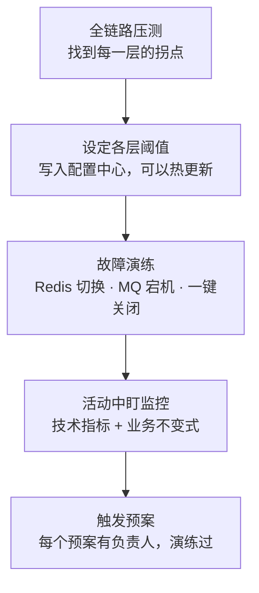

活动中的监控大盘：

| 位置 | 指标 | 回答什么问题 |
| --- | --- | --- |
| 入口（CDN、网关） | QPS、限流拒绝数、错误率、p99 延迟、带宽 | 流量是否超出预期？限流是否生效？ |
| 秒杀服务 | CPU、GC 停顿、信号量拒绝数、本地售罄标记的状态 | 实例是否打满？售罄后是否停止访问 Redis？ |
| Redis | 命令 QPS、CPU、慢日志、主从复制延迟 | 热点是否打满？切换时会丢多少？ |
| MQ | 发送失败数、消费积压、消费延迟、死信数 | 下单是否卡住？ |
| 订单与数据库 | 下单成功数和失败数、行锁等待、连接池 | 写入是否正常？ |
| 业务 | Redis 库存、数据库库存、订单数、支付数、对账结果 | 有没有超卖？有没有少卖？ |

预案示例：

| 现象 | 动作 |
| --- | --- |
| 入口流量远超预期，后端延迟上升 | 通过配置中心收紧网关阈值 |
| Redis CPU 打满 | 收紧放行量；检查本地售罄标记是否生效 |
| MQ 消费积压 | 扩容消费者；用户端提示"结果确认中" |
| 对账发现超卖（不变式不成立） | 立即暂停活动，人工介入 |
| Redis 不可用 | 暂停活动，按 S01-16 的步骤重建 |
| 发现黄牛集中下单 | 封禁账号，发货前取消订单 |

**追问链**

1. **压测时 Redis 里用什么数据？** 用压测专用的活动和商品，库存 Key、买家记录、结果 Key 都和真实活动分开。压测结束后要清理。最好在活动开始前，用压测专用的活动完整地跑一遍"开抢、售罄、取消回补、对账"的流程。
2. **为什么业务指标比技术指标更重要？** 技术指标正常，不代表结果正确。比如脚本写错了、对账有 bug，技术指标都看不出来，只有库存、订单数、不变式这些业务指标能发现问题。超卖是这个系统最严重的故障，必须有专门的告警。

---

## 七、业务手段

### S01-18 能不能从业务上避免"所有人同一秒抢"？

> ★★ ｜ 架构师 ｜ 中频

**考察意图**：是否会质疑需求本身。很多技术难题，换一个业务形式就不存在了。

**30 秒版回答**：

能。秒杀的技术难度，全部来自"所有人在同一秒争抢"这个业务形式。换成下面几种形式，峰值会大幅降低：

- **预约抽签**：用户提前几天报名，截止后统一抽签，中签的用户在规定时间内购买。报名请求分散在几天里，抽签是一次离线计算，几乎没有峰值。
- **分批放量**：把库存分成几批，在不同的时间点放出，每一批的峰值都比一次放完小。
- **虚拟排队**：开抢时用户进入排队页面，系统按固定的速度放人进入购买页面，峰值被排队页面削平。

这几种方案要由业务方来选：实时抢购带来的热度，有时候正是营销想要的效果。技术方的责任是把各种方案的代价讲清楚。

**深入剖析**

| 方案 | 峰值 | 公平感 | 用户体验 | 技术难度 | 适合 |
| --- | --- | --- | --- | --- | --- |
| 实时抢购 | 极高 | 拼手速和网络，黄牛占优 | 刺激，但多数人失败 | 高 | 营销需要制造热度 |
| 预约抽签 | 几乎没有 | 结果可以公开验证 | 要等结果，但过程透明 | 低 | 限量发售、高价值商品 |
| 分批放量 | 降为每一批的峰值 | 一般 | 有多次机会 | 中 | 库存较多 |
| 虚拟排队 | 被排队页面削平 | 先到先得或随机 | 能看到排队进度 | 中 | 必须实时购买的场景 |

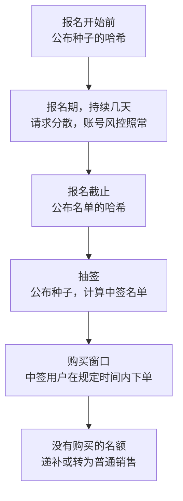

抽签最容易被质疑的是公平性：用户怎么相信平台没有内定？下面的代码用"先承诺、后公开"的做法：

- 报名开始前，公布种子的哈希；
- 报名截止时，公布报名名单的哈希；
- 抽签时公布种子本身。每个用户的排名 = SHA-256（种子 + 用户 ID），排名最小的 N 个中签。

种子在看到名单之前就已经固定了，平台无法在看到名单之后，再挑选一个对某些人有利的种子。任何人拿到种子和名单，都能重新算一遍。

```java
import java.nio.charset.StandardCharsets;
import java.security.MessageDigest;
import java.security.NoSuchAlgorithmException;
import java.util.Comparator;
import java.util.HexFormat;
import java.util.List;
import java.util.stream.IntStream;

/**
 * 预约抽签：把"开抢那一秒的争抢"改成"提前报名、统一抽签"。
 * 公平性靠"先承诺、后公开"：报名开始前先公布种子的哈希；截止时公布报名名单的哈希；之后再公布种子本身。
 * 每个用户的排名 = SHA-256(种子 + ":" + 用户 ID)，取排名最小的 N 个中签。
 * 任何人拿到种子和名单都能重算一遍；平台在看到名单之后，已经无法更换种子来挑选中签的人。
 */
public class LotteryDemo {

    static final int RESERVATIONS = 100_000;
    static final int WINNERS = 100;
    // 生产中应使用安全随机数生成的 256 位种子；这里写死，方便复现
    static final String SEED = "draw-seed-7f3a9c1e";

    record Ticket(String user, String rank) {
    }

    static String sha256(String text) {
        try {
            MessageDigest md = MessageDigest.getInstance("SHA-256");
            return HexFormat.of().formatHex(md.digest(text.getBytes(StandardCharsets.UTF_8)));
        } catch (NoSuchAlgorithmException e) {
            throw new IllegalStateException(e);
        }
    }

    /** 抽签：只依赖种子和报名名单，没有任何其他输入 */
    static List<String> draw(String seed, List<String> users) {
        return users.stream()
                .map(u -> new Ticket(u, sha256(seed + ":" + u)))
                .sorted(Comparator.comparing(Ticket::rank))
                .limit(WINNERS)
                .map(Ticket::user)
                .toList();
    }

    public static void main(String[] args) {
        List<String> users = IntStream.rangeClosed(1, RESERVATIONS).mapToObj(i -> "u" + i).toList();
        String seedCommitment = sha256(SEED);                      // 报名开始前公布
        String listDigest = sha256(String.join(",", users));      // 报名截止时公布
        System.out.println("before sign-up, publish sha256(seed)  = " + seedCommitment.substring(0, 16) + "...");
        System.out.println("at deadline, publish sha256(list)     = " + listDigest.substring(0, 16) + "...");

        List<String> winners = draw(SEED, users);                   // 平台抽签
        System.out.println("reservations=" + RESERVATIONS + ", winners=" + winners.size()
                + ", first 5 = " + winners.subList(0, 5));

        // 第三方核验：公开种子后，核对承诺，再独立重算一遍
        boolean seedMatches = sha256(SEED).equals(seedCommitment);
        boolean listMatches = sha256(String.join(",", users)).equals(listDigest);
        boolean sameWinners = draw(SEED, users).equals(winners);
        System.out.println("third party: seed matches commitment=" + seedMatches
                + ", list matches digest=" + listMatches + ", recomputed winners identical=" + sameWinners);
    }
}
```

本机运行输出：

```text
before sign-up, publish sha256(seed)  = 2a5b389fb4da5709...
at deadline, publish sha256(list)     = 56f344e2517b306c...
reservations=100000, winners=100, first 5 = [u1984, u47469, u12460, u49882, u88069]
third party: seed matches commitment=true, list matches digest=true, recomputed winners identical=true
```

10 万人报名、100 人中签。第三方用公开的种子和名单重新计算，种子和名单都与之前公布的哈希一致，中签名单也完全相同。

**追问链**

1. **中签的用户没有购买怎么办？** 购买窗口结束后，没有购买的名额按排名顺序递补给后面的用户，或者转为普通销售。递补也用同一个种子计算出的排名，同样可以验证。
2. **平台能不能往名单里加入自己的账号？** 能，"先承诺、后公开"只能证明种子没有被操纵，证明不了名单是干净的。所以报名名单要能被核查：比如每个用户都能查到自己在名单中，必要时由第三方审计名单中的账号。
3. **改成抽签后，还需要防刷吗？** 更需要。黄牛会用大量账号报名来提高中签率，所以 S01-13 中的账号门槛和设备风控在报名阶段同样适用，而且是这种模式下最主要的对抗手段。

**架构师加分点**

- 技术方案只能扛住峰值，业务方案可以消除峰值。在面试的最后提出这个方向，说明你不会把所有问题都当成技术问题来解决：同样是"让 100 件商品公平地卖给 100 个人"，换一个业务形式，系统的复杂度可以降低一个数量级。
