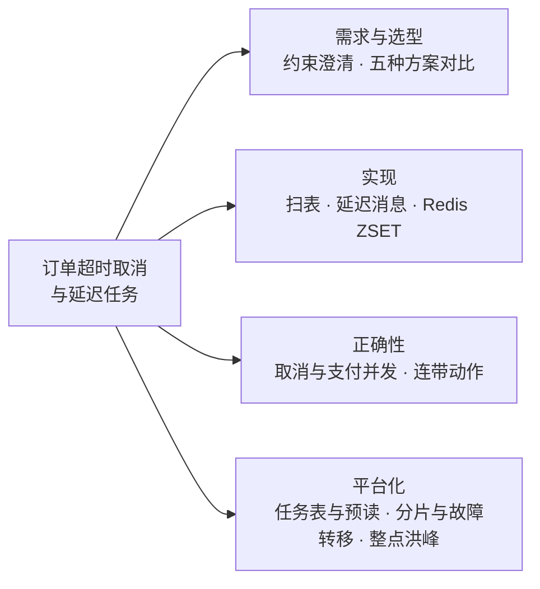
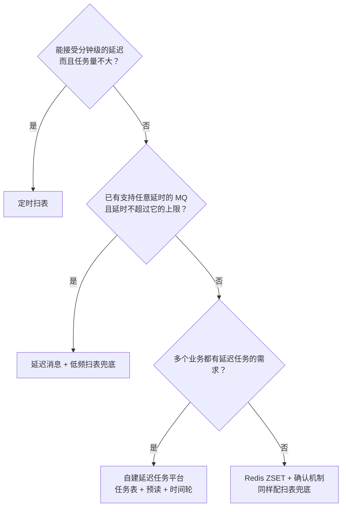
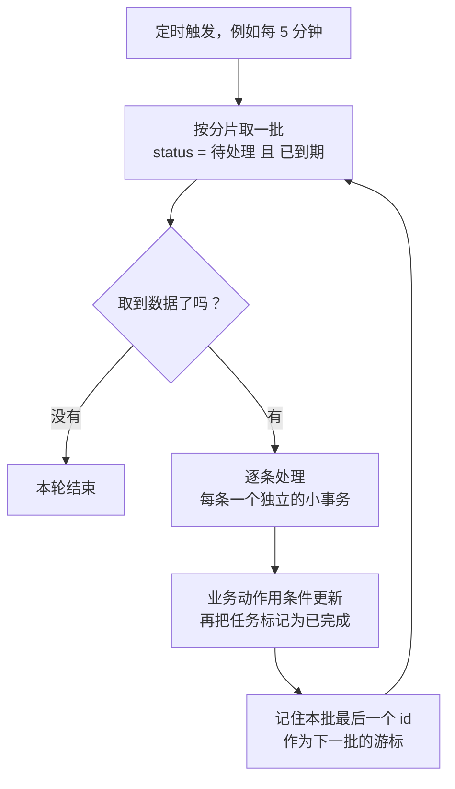
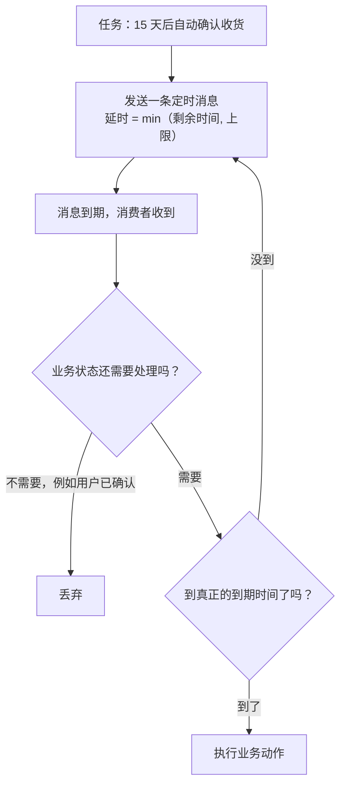
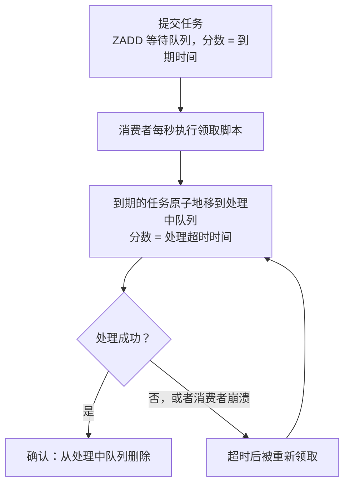
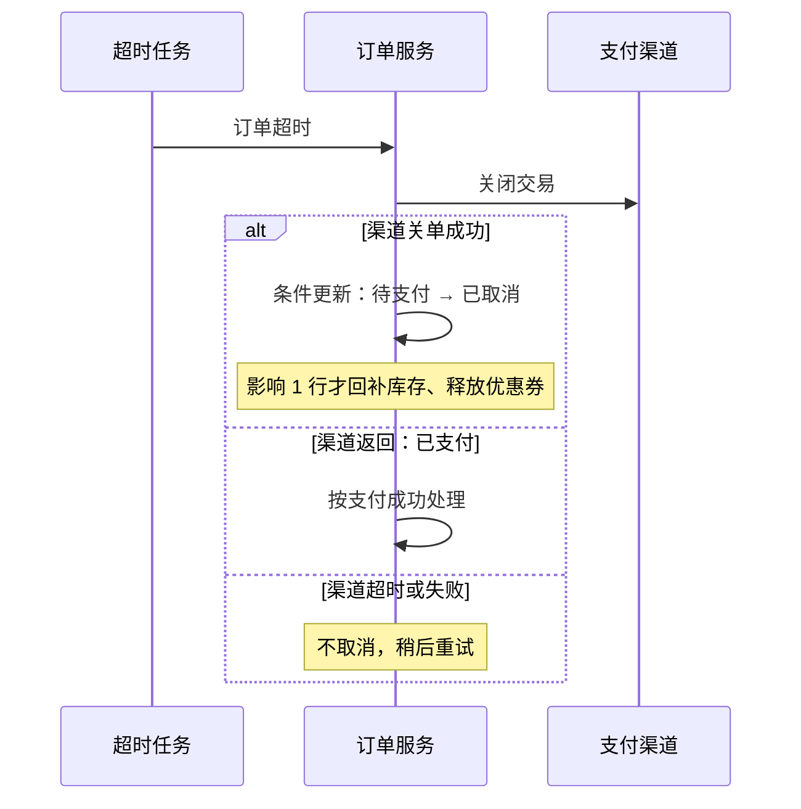
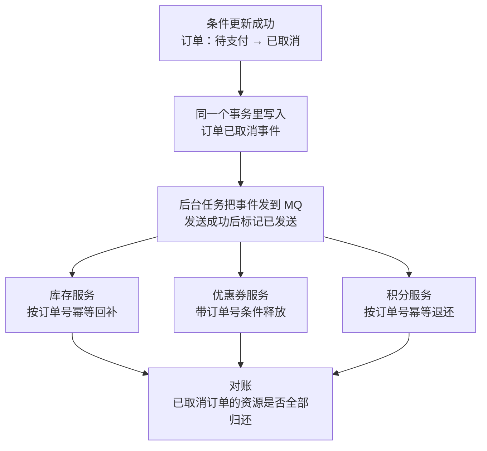
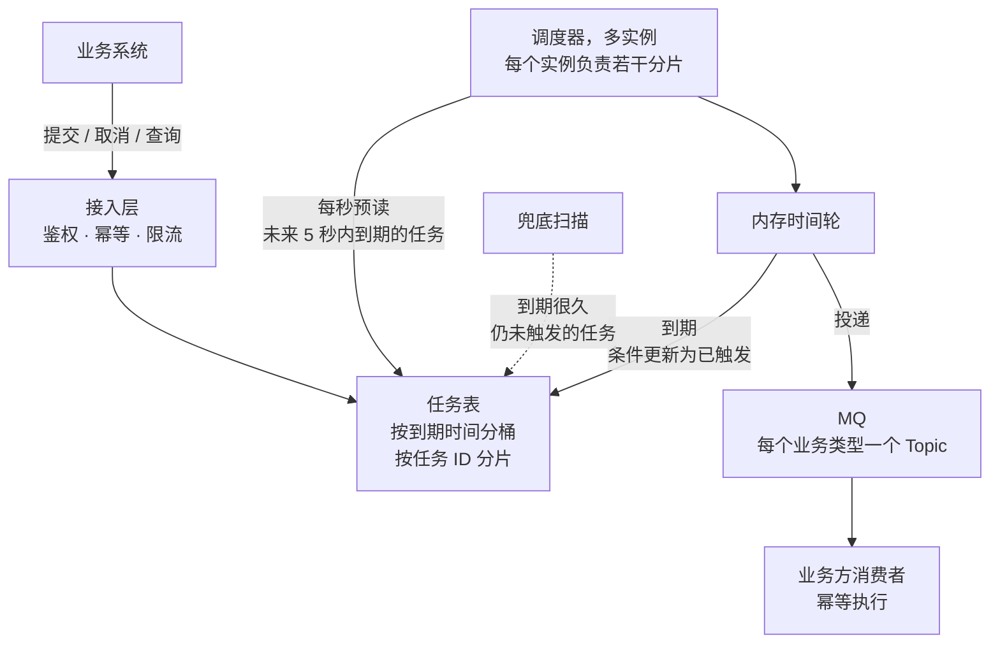
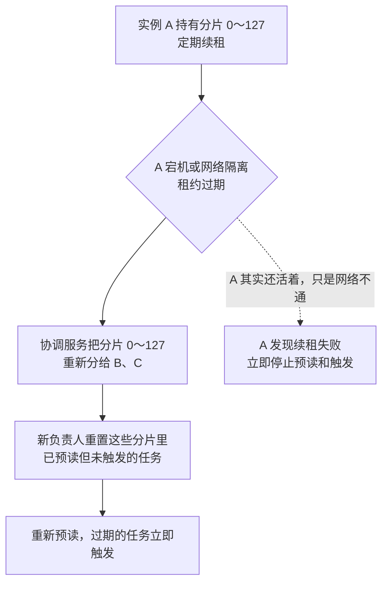

# S02 · 订单超时取消与延迟任务

> 适用岗位：Java 资深开发、Java 架构师。本文把两道经常连着问的题放在一起：先解决"订单超时未支付自动取消"这个具体问题，再把它推广成一个通用的延迟任务平台。速查版见[《29 场景题》](../06-三高与架构/29-场景题.md)的 29-03。
> 版本基线：JDK 21 / 25、RocketMQ 5.x、Redis 7.x / 8.x、MySQL 8.4。
> 事实核对：
> - RocketMQ 5.x 定时消息的精度（默认 1 秒）和最长延时（默认 3 天），沿用[《22 RocketMQ》](../05-消息队列/22-RocketMQ.md)22-08 中对照 5.5.0 源码核对的结论。
> - Netty `HashedWheelTimer` 的默认参数、Kafka 多层时间轮、XXL-JOB 的 5 秒预读，沿用[《34 定时任务》](../07-工程实践与稳定性/34-定时任务.md)34-06、34-07、34-10 中对照源码核对的结论。
> - Redis 过期事件不可靠的依据：[Redis keyspace notifications](https://redis.io/docs/latest/develop/pubsub/keyspace-notifications/)。
> - 本机运行（macOS 27.2、Apple M1 Max、JDK 25、Redis 6.2.6）：
>   - 2 段 Java 代码只依赖 JDK，文中贴的是实际运行输出；
>   - Redis 领取脚本在本机临时启动的 Redis 6.2.6 上用 redis-cli 实际执行；
>   - 本机没有 MySQL 服务端，文中的 SQL 都没有实际执行。
> 相关分类：[《34 定时任务》](../07-工程实践与稳定性/34-定时任务.md)（时间轮、分布式调度）、[《20 MQ 通用与选型》](../05-消息队列/20-MQ通用与选型.md)（延迟消息、幂等）、[《22 RocketMQ》](../05-消息队列/22-RocketMQ.md)、[《17 Redis》](../04-数据存储/17-Redis.md)、[《S01 秒杀系统》](S01-秒杀系统.md)（超时取消后的库存回补）

## 45 分钟答题版

| 时间 | 做什么 | 要讲出的关键点 | 子题 |
| --- | --- | --- | --- |
| 0～5 分钟 | 澄清需求 | 多久超时、精度要求、订单量；**不能漏取消，也不能错取消已支付的订单** | S02-01 |
| 5～12 分钟 | 方案对比 | 扫表、延迟消息、Redis ZSET、时间轮、过期事件各自的问题；结论是**延迟消息为主 + 低频扫表兜底** | S02-02 |
| 12～25 分钟 | 深挖实现 | 扫表怎么不拖垮数据库；延迟消息的限制；ZSET 怎么做到不丢不重 | S02-03 ～ S02-05 |
| 25～35 分钟 | 正确性 | 取消和支付并发；先关渠道交易再取消；取消后的回补动作怎么保证都做完 | S02-06、S02-07 |
| 35～45 分钟 | 平台化 | 通用延迟任务平台：任务表 + 预读 + 时间轮；分片与故障转移；整点洪峰 | S02-08 ～ S02-10 |

## 知识地图



## 题目索引

| 编号 | 题目 | 难度 |
| --- | --- | --- |
| S02-01 | 订单超时取消要澄清哪些需求？在途任务有多少？ | ★★ |
| S02-02 | 延迟任务有哪几种实现？怎么选？ | ★★ |
| S02-03 | 定时扫表怎么写，才不会拖垮数据库？ | ★★ |
| S02-04 | 用延迟消息有哪些限制？延时超过上限、任务要取消时怎么办？ | ★★★ |
| S02-05 | 用 Redis ZSET 做延迟队列，怎么保证不丢、不重复领取？ | ★★★ |
| S02-06 | 取消和支付同时发生怎么办？ | ★★★ |
| S02-07 | 取消之后要回补库存、退券、退积分，怎么保证都做完？ | ★★ |
| S02-08 | 把它做成通用的延迟任务平台，架构怎么设计？ | ★★★ |
| S02-09 | 调度器怎么分片？一个实例挂了，它的任务谁来接？ | ★★★ |
| S02-10 | 大量任务在同一时刻到期怎么办？要监控哪些指标？ | ★★ |

---

## 一、需求与选型

### S02-01 订单超时取消要澄清哪些需求？在途任务有多少？

> ★★ ｜ 资深 / 架构师 ｜ 高频

**考察意图**：能不能先把"准时到什么程度""量有多大""错了会怎样"问清楚。这三个答案决定了后面选哪种方案。

**30 秒版回答**：

- **功能**：订单创建后一段时间内没有支付，自动取消，并释放它占用的库存、优惠券等资源。
- **要问清的约束**：
  - **超时时间**是固定的还是每单不同（普通订单 30 分钟，秒杀订单 15 分钟，预售订单几天）；
  - **精度**：晚几秒取消通常没问题，晚几分钟库存就被白白占着；
  - **量级**：每天多少订单，峰值多高；
  - **正确性**：**不能漏**（库存一直被占）；**不能错**（用户付了钱，订单却被取消）。
- **估算**：任意时刻"等着被取消"的任务数 ≈ 每秒下单数 × 超时秒数。日均 1000 万单时约 21 万个，大促峰值可以到几百万个。

**深入剖析**

| 问题 | 为什么要问 | 本文的假设 |
| --- | --- | --- |
| 超时时间多长？是否每单不同？ | 决定能不能用"固定延时"的简单方案 | 默认 30 分钟，不同业务可以不同 |
| 允许晚多久？ | 决定用秒级的延迟消息还是分钟级的扫表 | 到期后 5 秒内取消；兜底路径 5 分钟内 |
| 每天多少订单？ | 决定在途任务数和扫表的成本 | 日均 1000 万单，大促峰值是平均值的 10 倍以上 |
| 多少订单会走到超时？ | 决定取消动作本身的压力 | 约 20% 的订单最终超时取消 |
| 用户能不能主动取消、中途支付？ | 任务需要"作废" | 都可以，到期时以订单的当前状态为准 |

在途任务数的估算：

- 日均 1000 万单 ÷ 86400 秒 ≈ 116 单/秒；
- 每单的任务存活 30 分钟（1800 秒）：116 × 1800 ≈ **21 万个**在途任务；
- 大促峰值 5000 单/秒持续半小时：5000 × 1800 = **900 万个**在途任务，并且它们会在半小时后以 5000 个/秒的速度到期。

这组数字说明两件事：在途任务的总量不大，任何一种方案都存得下；真正的压力在**到期的速率**，它等于半小时前的下单速率，下单高峰会原样变成取消高峰。

**追问链**

1. **只有订单取消需要延迟任务吗？** 不是。电商里常见的还有：发货后 N 天自动确认收货、确认收货后自动好评、支付前的催付提醒、退款超时自动同意、失败后按退避间隔重试。它们的共同点是"在未来某个时间点做一件事，而且这件事可能被提前取消"，所以值得抽象成平台（S02-08）。
2. **晚取消和错取消，哪个更严重？** 错取消更严重：用户付了款却没有订单，要退款、赔付、处理投诉。晚取消只是库存晚释放一会儿。所以设计上宁可晚，不能错：到期时必须重新检查订单状态，并且用条件更新（S02-06）。

---

### S02-02 延迟任务有哪几种实现？怎么选？

> ★★ ｜ 资深 ｜ 高频

**考察意图**：不是背出五种方案，而是能说出每种方案在"准时、不丢、规模、运维"上的短板，并给出一个组合方案。

**30 秒版回答**：

| 方案 | 准时 | 不丢 | 适用规模 | 主要问题 |
| --- | --- | --- | --- | --- |
| 定时扫表 | 取决于扫描间隔，分钟级 | 数据在库里，不会丢 | 中等 | 扫描间隔和数据库压力是一对矛盾 |
| 延迟消息 | 秒级 | 取决于 MQ 的可靠性 | 大 | 有最长延时；不能删除已发出的消息 |
| Redis ZSET | 秒级 | 要自己实现确认和重试 | 中等 | 可靠性靠自己保证；Redis 丢数据就丢任务 |
| 内存时间轮 | 毫秒级 | **进程重启就丢** | 单机百万级 | 不能单独使用，只能作为持久化方案的加速层 |
| Redis 过期事件 | 不保证 | **不保证送达** | — | 不要用 |

- 结论：**延迟消息为主，低频扫表兜底**。延迟消息负责准时，扫表负责不漏。
- 已经有 RocketMQ 5.x 就直接用它的定时消息；没有支持任意延时的 MQ 时，用"任务表 + 预读 + 内存时间轮"自己实现（S02-08）。

**深入剖析**



为什么**不能用 Redis 的 Key 过期事件**：

- 过期事件在 Key **真正被删除**的时候才产生，不是在 TTL 到的那一刻。Redis 删除过期 Key 靠两种方式：访问时发现过期、后台定期抽样。一个没人访问的 Key，可能在过期之后很久才被删除。
- 事件通过 Pub/Sub 发出，**不持久化、不重发**。应用重启、网络抖动的那段时间里，事件直接丢失。

为什么**时间轮不能单独用**：它把任务放在内存里，添加和取消都是 O(1)，非常高效，但进程一重启任务就没了。它适合做"最后一公里"：任务先持久化，快到期时才加载进时间轮。原理见[《34 定时任务》](../07-工程实践与稳定性/34-定时任务.md)34-06。

**追问链**

1. **既然有扫表兜底，为什么不干脆只用扫表？** 精度和成本不可兼得。想把延迟控制在 5 秒以内，就得每隔几秒扫一次；订单量大时，这种高频的范围查询本身就会成为数据库的负担。兜底的扫表可以放宽到 5 分钟一次，因为绝大多数订单已经被延迟消息处理掉了，扫出来的只是极少数漏网的。
2. **延迟消息到期时，订单已经支付了怎么办？** 什么都不做。延迟消息只是一个"提醒"，消费时必须重新读取订单的当前状态，只有仍然是"待支付"才取消。所以用户支付之后**不需要去撤回那条消息**。

---

## 二、实现

### S02-03 定时扫表怎么写，才不会拖垮数据库？

> ★★ ｜ 资深 ｜ 高频

**考察意图**：扫表是最常用的兜底手段，写不好会变成慢 SQL 的来源。看你是否考虑了索引、分页、并发和锁。

**30 秒版回答**：

- **不要扫订单大表，扫一张小的任务表**：下单时在同一个事务里写一条超时任务；任务处理完就标记完成并定期归档，任务表里始终只有少量待处理的数据。
- **索引**建在 `(status, fire_time)` 上，查询条件是"状态为待处理且到期时间早于现在"。
- **分页用主键游标**，不用 `LIMIT offset`：每次取 `id > 上一批最后一个 id` 的一批。
- **多实例并行**：按任务 ID 取模分片，每个实例只扫自己的分片；或者用 `FOR UPDATE SKIP LOCKED` 让多个实例各自领取不同的行。
- **每条任务单独提交事务**，取消订单本身用条件更新。不要在一个大事务里处理一整批。

**深入剖析**

任务表的结构：

```sql
CREATE TABLE t_delay_task (
    id          BIGINT       NOT NULL PRIMARY KEY,
    biz_type    VARCHAR(32)  NOT NULL COMMENT '业务类型，例如 ORDER_TIMEOUT',
    biz_id      VARCHAR(64)  NOT NULL COMMENT '业务主键，例如订单号',
    fire_time   DATETIME(3)  NOT NULL COMMENT '到期时间',
    status      TINYINT      NOT NULL COMMENT '0 待处理 1 已完成 2 已取消 3 失败待人工处理',
    retry_count INT          NOT NULL DEFAULT 0,
    create_time DATETIME(3)  NOT NULL,
    update_time DATETIME(3)  NOT NULL,
    UNIQUE KEY uk_biz (biz_type, biz_id),
    KEY idx_status_fire (status, fire_time)
);
```

扫描语句：

```sql
SELECT id, biz_type, biz_id
FROM t_delay_task
WHERE status = 0 AND fire_time <= NOW(3) AND id > ?
ORDER BY id
LIMIT 200;
```



几个容易忽略的点：

- **为什么是任务表而不是订单表**：订单表有几亿行，"待支付且超时"的只占极小一部分，但 `status` 这一列的区分度很低，索引的效果不稳定；订单表还可能已经分库分表，扫描要遍历所有分片。任务表小而且生命周期短，扫描成本可控。
- **`SKIP LOCKED`**：MySQL 8.0 起支持 `SELECT ... FOR UPDATE SKIP LOCKED`，被其他事务锁住的行直接跳过。多个实例用它领取任务，不会互相等待，也不会领到同一条。
- **读从库、写主库**：扫描可以走从库以减轻主库压力。从库有延迟不要紧，因为真正的取消动作是在主库上做条件更新，状态以主库为准。

**追问链**

1. **任务处理失败了怎么办？** `retry_count` 加 1，把 `fire_time` 推后一个退避间隔，下一轮再处理。超过最大次数后把状态改为"失败待人工处理"并告警，避免一条坏数据永远卡在队首。
2. **订单表已经分库分表了，任务表放哪？** 和订单放在同一个库里，这样"创建订单"和"写超时任务"可以在同一个本地事务里完成。扫描时遍历每个库，每个库的任务表都很小。
3. **处理大批量数据的定时任务还有哪些通用要点？** 分片、限速、断点续跑、幂等，见[《34 定时任务》](../07-工程实践与稳定性/34-定时任务.md)34-12。

**生产实践 / 踩坑**

- **扫描间隔短于执行时间**：上一轮还没处理完，下一轮又开始，两轮处理同一批数据。调度框架要设置成"上一次没结束就不启动下一次"，业务动作本身也必须幂等。
- **已完成的任务一直不清理**：任务表慢慢变成大表，`(status, fire_time)` 索引也跟着变大。定期把已完成的任务归档或删除。

---

### S02-04 用延迟消息有哪些限制？延时超过上限、任务要取消时怎么办？

> ★★★ ｜ 资深 / 架构师 ｜ 高频

**考察意图**：延迟消息不是"发出去就不用管"。看你是否了解它的上限、不可撤回的特点，以及消息丢失时的兜底。

**30 秒版回答**：

- **不同 MQ 的支持程度不同**：RocketMQ 5.x 支持任意时间的定时消息，精度默认 1 秒，最长延时默认 3 天；RocketMQ 4.x 只有 18 个固定级别；Kafka 没有原生的延迟消息。对比见[《20 MQ 通用与选型》](../05-消息队列/20-MQ通用与选型.md)20-08。
- **延时超过上限**（例如 15 天后自动确认收货）：不要把上限调大，用**接力**：先发一条上限以内的消息，到期后发现还没到真正的时间，就再发下一条。或者这类长周期的任务直接用任务表 + 扫描。
- **不能撤回**：消息发出去之后没有可靠的办法删除它。任务要取消时什么都不用做，**消费时检查业务状态**，状态已经变了就直接丢弃。
- **消息可能丢、可能重复**：所以要有扫表兜底，消费逻辑要幂等。
- **发送要和下单保持一致**：订单创建成功但消息没发出去，这个订单就永远不会被取消。用事务消息或本地消息表保证，或者依靠扫表兜底。

**深入剖析**

下单和发送延迟消息的三种做法：

| 做法 | 过程 | 问题 |
| --- | --- | --- |
| 事务提交后直接发送 | 订单事务提交 → 发送定时消息 | 提交之后、发送之前进程崩溃，消息就没了 |
| 本地消息表 | 订单和"待发送的消息"在同一个事务里写入；后台线程负责发送和重试 | 多一张表、一个发送任务 |
| 直接依赖兜底 | 尽力发送，发送失败只记日志；由扫表保证不漏 | 漏掉的订单会晚取消，最晚一个扫描周期 |

多数团队选第三种：延迟消息和扫表本来就同时存在，极少数没发出去的消息由扫表处理，换来的是实现简单。本地事务和消息一致性的通用解法见 20-09。

接力的过程：



**追问链**

1. **RocketMQ 5.x 的定时消息是怎么实现的？** 定时消息先写入内部 Topic，由 Broker 里的时间轮调度，到期后再恢复到原来的 Topic，消费者这时才看得到它。细节见[《22 RocketMQ》](../05-消息队列/22-RocketMQ.md)22-08。
2. **消费延迟消息时，订单服务挂了怎么办？** 消费失败，MQ 按重试策略重新投递；超过重试次数进入死信队列并告警。即使这条消息最终被丢弃，扫表兜底仍然会处理这个订单。
3. **Kafka 上怎么做延迟？** 没有原生支持。常见做法是按延时等级建几个 Topic，由一个转发程序拉取消息，没到期就暂停这个分区的消费，到期后转发到真正的业务 Topic。实现和运维都比较复杂，所以用 Kafka 的团队更多选择任务表或者独立的延迟任务服务。

**生产实践 / 踩坑**

- **把消息当成"事实"而不是"提醒"**：消费者收到消息就直接取消订单，不检查当前状态，结果把已经支付的订单取消了。消息里只放订单号，到期时一切以数据库的当前状态为准。
- **大促时消费跟不上**：半小时前的下单高峰变成现在的取消高峰，取消又要调用库存、优惠券等多个下游。消费者要限速，并且预先按下单峰值来评估取消链路的容量。

---

### S02-05 用 Redis ZSET 做延迟队列，怎么保证不丢、不重复领取？

> ★★★ ｜ 资深 ｜ 中频

**考察意图**："`ZRANGEBYSCORE` 取出来再 `ZREM`"谁都会说。看你是否意识到这两步之间有并发问题，以及取出之后消费者崩溃会丢任务。

**30 秒版回答**：

- **基本结构**：一个 ZSET，成员是任务 ID，分数是到期时间戳。消费者定时取出分数小于等于当前时间的成员。
- **问题一：多个消费者取到同一个任务**。"查询"和"删除"是两条命令，中间别的消费者也能查到。用 **Lua 脚本**把两步合成一个原子操作。
- **问题二：取出之后消费者崩溃，任务丢失**。取出时不直接删除，而是**移到一个"处理中"队列**，分数设为处理超时的时间；处理成功后再从处理中队列删除（确认）；超时没有确认的任务，会被重新领取。
- **问题三：单个 ZSET 太大**。按任务 ID 哈希拆成多个 ZSET，每个消费者负责其中几个。
- **它的上限**：Redis 主从是异步复制，主节点宕机可能丢失最近写入的任务。所以任务必须先写数据库，Redis 只做调度加速，并且仍然需要扫表兜底。

**深入剖析**

领取脚本（已在本机 Redis 6.2.6 上执行）：

```lua
-- KEYS[1]：等待队列（ZSET，score = 到期时间）  KEYS[2]：处理中队列（ZSET，score = 处理超时时间）
-- ARGV[1]：当前时间  ARGV[2]：处理超时时间  ARGV[3]：一次最多取多少条
local due = redis.call('ZRANGEBYSCORE', KEYS[1], '-inf', ARGV[1], 'LIMIT', 0, ARGV[3])
for _, id in ipairs(due) do
    redis.call('ZREM', KEYS[1], id)
    redis.call('ZADD', KEYS[2], ARGV[2], id)
end
return due
```

执行过程：

```text
# 3 个任务：a、b 在第 100 秒到期，c 在第 200 秒到期
3
# 第 100 秒领取，处理超时时间设为第 130 秒
a
b
# 另一个实例同时来领取：拿不到重复的任务

# a 处理成功后确认；b 的消费者崩溃了，没有确认
1
# 第 131 秒：把处理中队列里超时的任务领回来重试（同一个脚本，源队列换成处理中队列）
b
# 等待队列里只剩 c
c
200
```

（以上输出里，`#` 开头的行是说明，其余是 redis-cli 的返回。）

要点：

- 第二个实例同时来领取时返回空，因为第一个实例的脚本已经把 a、b 移走了。脚本在 Redis 里是原子执行的，中间不会插入别的命令。
- b 的消费者没有确认，到第 131 秒时被重新领取。这是**至少一次**的语义：消费者可能其实已经处理完、只是没来得及确认，所以**业务处理必须幂等**。
- 两个 Key 用了相同的哈希标签 `{delay}`，保证在 Redis Cluster 里落在同一个槽位，否则脚本无法同时访问它们。



**追问链**

1. **为什么不用 `BZPOPMIN` 阻塞弹出？** 它弹出的是分数最小的成员，不管有没有到期。弹出来发现没到期，还得放回去，放回之前进程崩溃任务就丢了。
2. **轮询间隔怎么定？** 间隔就是精度。1 秒轮询一次，任务最多晚 1 秒。没有任务时每次轮询只是一次很轻的 `ZRANGEBYSCORE`，对 Redis 的压力很小。
3. **ZSET 的成员里要不要放任务的完整内容？** 不要。成员只放任务 ID，内容放在数据库或者一个单独的 Hash 里。成员越大，ZSET 占用的内存越多，移动的成本也越高。
4. **Redisson 的延迟队列是怎么做的？** 思路相同：用 ZSET 保存到期时间，到期后把元素转移到一个普通队列，消费者从普通队列阻塞获取。使用时同样要自己考虑确认和重试。

---

## 三、正确性

### S02-06 取消和支付同时发生怎么办？

> ★★★ ｜ 资深 / 架构师 ｜ 高频

**考察意图**：这是这道题里最容易出资损的地方。看你是否知道用条件更新决定胜负，以及"订单取消后钱又到了"怎么处理。

**30 秒版回答**：

- 第 29 分 59 秒用户点了支付，第 30 分 00 秒超时任务到期。两个动作谁先谁后不确定，但**结果只能有一个**。
- **用条件更新代替"先查再改"**：取消和支付都带上 `WHERE status = '待支付'`，数据库保证只有一个能更新成功。影响行数为 1 的一方才继续后面的动作。
- **先关闭支付渠道的交易，再取消订单**。否则订单取消之后，用户仍然可以在支付页面上付款成功。
- **订单已经取消，钱还是到了**：订单不能复活（库存可能已经卖给别人了），**自动退款**并记录，交给对账核查。

**深入剖析**



两条 SQL 的条件相同，谁先执行谁生效：

```sql
-- 超时取消
UPDATE t_order SET status = 'CANCELLED', update_time = NOW(3)
WHERE order_id = ? AND status = 'WAIT_PAY';

-- 支付成功回调
UPDATE t_order SET status = 'PAID', pay_time = NOW(3), update_time = NOW(3)
WHERE order_id = ? AND status = 'WAIT_PAY';
```

用 JDK 模拟两万个订单各自被"支付回调"和"超时取消"同时争抢，`compareAndSet` 相当于上面的条件更新（本机 JDK 25 运行）：

```java
import java.util.concurrent.CountDownLatch;
import java.util.concurrent.ExecutorService;
import java.util.concurrent.Executors;
import java.util.concurrent.atomic.AtomicInteger;
import java.util.concurrent.atomic.AtomicReference;

/**
 * 支付回调和超时取消同时到达同一个订单：用"条件更新"保证只有一个生效。
 * compareAndSet 对应 SQL：UPDATE t_order SET status = ? WHERE order_id = ? AND status = 'WAIT_PAY'
 */
public class CancelVsPayDemo {

    private static final int ORDER_COUNT = 20_000;

    enum OrderStatus { WAIT_PAY, PAID, CANCELLED }

    public static void main(String[] args) throws InterruptedException {
        AtomicInteger paid = new AtomicInteger();
        AtomicInteger cancelled = new AtomicInteger();
        AtomicInteger stockRestored = new AtomicInteger();
        AtomicInteger refundNeeded = new AtomicInteger();

        try (ExecutorService pool = Executors.newFixedThreadPool(2)) {
            for (int i = 0; i < ORDER_COUNT; i++) {
                AtomicReference<OrderStatus> status = new AtomicReference<>(OrderStatus.WAIT_PAY);
                CountDownLatch start = new CountDownLatch(1);
                CountDownLatch done = new CountDownLatch(2);

                // 支付回调
                pool.execute(() -> {
                    await(start);
                    if (status.compareAndSet(OrderStatus.WAIT_PAY, OrderStatus.PAID)) {
                        paid.incrementAndGet();
                    } else {
                        // 订单已经取消，钱却收到了：订单不能复活，登记自动退款
                        refundNeeded.incrementAndGet();
                    }
                    done.countDown();
                });
                // 超时取消
                pool.execute(() -> {
                    await(start);
                    if (status.compareAndSet(OrderStatus.WAIT_PAY, OrderStatus.CANCELLED)) {
                        cancelled.incrementAndGet();
                        // 只有影响行数为 1，才执行回补库存等后续动作
                        stockRestored.incrementAndGet();
                    }
                    done.countDown();
                });
                start.countDown();
                done.await();
            }
        }

        System.out.println("orders          = " + ORDER_COUNT);
        System.out.println("paid            = " + paid.get());
        System.out.println("cancelled       = " + cancelled.get());
        System.out.println("paid+cancelled  = " + (paid.get() + cancelled.get()));
        System.out.println("stock restored  = " + stockRestored.get() + " (must equal cancelled)");
        System.out.println("refund needed   = " + refundNeeded.get() + " (must equal cancelled)");
    }

    private static void await(CountDownLatch latch) {
        try {
            latch.await();
        } catch (InterruptedException e) {
            Thread.currentThread().interrupt();
            throw new IllegalStateException(e);
        }
    }
}
```

```text
orders          = 20000
paid            = 19941
cancelled       = 59
paid+cancelled  = 20000
stock restored  = 59 (must equal cancelled)
refund needed   = 59 (must equal cancelled)
```

每个订单都只有一个结果，两者之和等于订单总数；库存回补的次数等于取消成功的次数，没有多补。支付和取消各赢多少次与线程调度有关，每次运行都不一样，不变的是这几个等式。

为什么**渠道关单失败时不能取消**：关单请求超时，不知道渠道那边到底关了没有。如果这时取消订单，用户仍然可能付款成功，就产生了"订单已取消、钱已收到"的情况。稳妥的做法是保持待支付，把任务推后重试；渠道关单接口通常是幂等的，可以放心重试。

**追问链**

1. **为什么不用分布式锁把支付和取消串行化？** 可以，但没有必要。分布式锁多一次网络调用，锁本身还有超时和误释放的问题；而条件更新靠数据库的行锁和事务，本身就是原子的。能用数据库的原子操作解决，就不要引入额外的锁。
2. **支付回调更新订单时影响 0 行，怎么判断该不该退款？** 再查一次订单：状态是"已支付"说明是重复回调，直接返回成功；状态是"已取消"才发起退款。退款以支付单号作为幂等键，同一笔支付不会被退两次。
3. **如果订单系统没有接入渠道的关单接口呢？** 那就只能接受"取消之后又收到支付成功"的可能，靠自动退款处理。也可以把支付页面的有效期设得比订单超时时间短一点（例如订单 30 分钟超时，支付链接 29 分钟失效），减少这种情况出现的概率。

**架构师加分点**

- 把"订单的状态流转"收敛在订单聚合内部：对外只暴露 `cancelByTimeout()`、`markPaid()` 这样的方法，每个方法内部都是一条条件更新，并返回是否成功。调用方不允许自己读状态再决定要不要改。这样正确性由一个地方保证，而不是散落在各个调用点。

---

### S02-07 取消之后要回补库存、退券、退积分，怎么保证都做完？

> ★★ ｜ 资深 ｜ 中频

**考察意图**：取消订单不是改一个状态。看你是否把后续的多个动作当成一个需要可靠完成的流程，而不是几次"尽力而为"的远程调用。

**30 秒版回答**：

- 取消成功后要做的事：**回补库存、释放优惠券、退还积分或余额、通知用户**。这些动作在不同的服务里，无法放进一个数据库事务。
- 做法：订单状态更新成功的**同一个本地事务**里，写一条"订单已取消"的事件（本地消息表）；事件可靠地发到 MQ；库存、优惠券、积分各自订阅并处理。
- **每个下游都必须幂等**：以"订单号 + 动作类型"为唯一键。事件可能重复投递，但库存只能回补一次。
- **下游失败就重试**，重试多次仍失败则告警，人工介入。**不回滚订单的取消**。
- 最后用**对账**兜底：已取消的订单，库存是否已回补、优惠券是否已释放。

**深入剖析**



各下游的幂等写法：

| 下游 | 幂等手段 |
| --- | --- |
| 库存 | 库存流水表以"订单号 + 类型（回补）"为唯一键，插入成功才加库存，两步在同一个事务里 |
| 优惠券 | `UPDATE ... SET status = '未使用' WHERE id = ? AND status = '锁定' AND order_id = ?`，带上订单号条件 |
| 积分、余额 | 流水表以"订单号 + 类型（退还）"为唯一键 |

优惠券释放时为什么要带订单号：一条迟到的取消事件，可能在这张券已经被另一个订单锁定之后才到达。只判断"状态是锁定"会把别的订单的券释放掉。

**追问链**

1. **为什么不用分布式事务（比如 Seata）把这些动作包起来？** 取消之后的这些动作**不需要回滚**：订单已经确定取消了，库存早晚都要补回去，失败了重试就行。这种"只要求最终都完成"的流程，用可靠事件加幂等最简单。分布式事务适合"要么都成功、要么都撤销"的场景，见[《09 分布式理论》](../03-分布式与微服务/09-分布式理论.md)09-08。
2. **秒杀订单取消时，库存是回补到 Redis 还是数据库？** 两边都要，并且要防止多补，见[《S01 秒杀系统》](S01-秒杀系统.md)S01-10。
3. **各个下游的处理顺序重要吗？** 通常不重要，它们彼此独立。需要注意的是它们和"取消"之间的顺序：必须在订单状态确定为已取消之后才触发，所以事件要和状态更新在同一个事务里产生，而不是在更新之前发出去。

---

## 四、平台化

### S02-08 把它做成通用的延迟任务平台，架构怎么设计？

> ★★★ ｜ 架构师 ｜ 中频

**考察意图**：能否把一个具体问题抽象成平台：定义清楚对外的契约，并且在"可靠"和"高效"之间给出一个分层的方案。

**30 秒版回答**：

- **对外三个接口**：提交任务（业务类型、业务主键、到期时间、回调方式）、取消任务、查询任务。提交按"业务类型 + 业务主键"幂等。
- **核心思路是冷热分层**：
  - 所有任务**先落库**，保证不丢；
  - 调度器**只把马上到期的任务预读进内存时间轮**（例如未来 5 秒内到期的），保证准时；
  - 到期后**投递到 MQ**，由业务方的消费者执行。平台只负责"到点通知"，不执行业务逻辑。
- **语义**：至少投递一次，业务方幂等；到期时间不早于设定值，正常情况下延迟在秒级。
- **任务的取消**：改任务表的状态即可。已经预读进内存的任务，在触发前会再用条件更新确认一次状态。

**深入剖析**



下面用不到 150 行 JDK 代码实现"任务表 + 预读 + 时间轮"的骨架，并模拟一次调度器崩溃。时间用循环变量模拟，一个循环代表一秒（本机 JDK 25 运行）：

```java
import java.util.ArrayList;
import java.util.Iterator;
import java.util.LinkedHashMap;
import java.util.List;
import java.util.Map;

/**
 * 延迟任务平台的最小骨架：任务先落库，调度器只把"马上到期"的任务预读进内存时间轮。
 * 用虚拟时钟推进（一个循环代表一秒），结果可以复现。
 */
public class DelayPlatformDemo {

    /** 时间轮格数，每格 1 秒。预读窗口必须小于一圈，这样不需要记录圈数 */
    private static final int WHEEL_SIZE = 8;
    /** 预读窗口：只把未来 5 秒内到期的任务加载进内存 */
    private static final long PRELOAD_SECONDS = 5;

    enum Status { WAITING, LOADED, DONE, CANCELLED }

    static final class Task {
        final String id;
        final long fireAt;
        Status status = Status.WAITING;

        Task(String id, long fireAt) {
            this.id = id;
            this.fireAt = fireAt;
        }
    }

    /** 模拟任务表。真实实现是一张按 (status, fire_at) 建索引的表，下面每个方法对应一条条件更新 */
    static final class TaskStore {
        private final Map<String, Task> rows = new LinkedHashMap<>();

        void save(Task task) {
            rows.put(task.id, task);
        }

        /** 预读：WAITING 且在窗口内到期的任务改为 LOADED，并返回它们 */
        List<Task> preload(long now) {
            List<Task> loaded = new ArrayList<>();
            for (Task task : rows.values()) {
                if (task.status == Status.WAITING && task.fireAt <= now + PRELOAD_SECONDS) {
                    task.status = Status.LOADED;
                    loaded.add(task);
                }
            }
            return loaded;
        }

        /** 只有 LOADED 才能变成 DONE，已取消的任务在这里被挡住 */
        boolean markDone(String id) {
            Task task = rows.get(id);
            if (task.status != Status.LOADED) {
                return false;
            }
            task.status = Status.DONE;
            return true;
        }

        boolean cancel(String id) {
            Task task = rows.get(id);
            if (task.status == Status.DONE || task.status == Status.CANCELLED) {
                return false;
            }
            task.status = Status.CANCELLED;
            return true;
        }

        /** 调度器重启后：内存里的任务已经丢了，把 LOADED 改回 WAITING 重新预读 */
        int resetLoaded() {
            int count = 0;
            for (Task task : rows.values()) {
                if (task.status == Status.LOADED) {
                    task.status = Status.WAITING;
                    count++;
                }
            }
            return count;
        }
    }

    /** 单层时间轮：只在内存里，进程重启就清空 */
    static final class Wheel {
        private final List<List<Task>> slots = new ArrayList<>();

        Wheel() {
            for (int i = 0; i < WHEEL_SIZE; i++) {
                slots.add(new ArrayList<>());
            }
        }

        void add(Task task, long now) {
            // 已经过期的任务（比如停机期间到期的）放进当前格，下一次推进时立即触发
            long fireAt = Math.max(task.fireAt, now);
            slots.get((int) (fireAt % WHEEL_SIZE)).add(task);
        }

        List<Task> advance(long now) {
            List<Task> due = new ArrayList<>();
            Iterator<Task> it = slots.get((int) (now % WHEEL_SIZE)).iterator();
            while (it.hasNext()) {
                Task task = it.next();
                if (task.fireAt <= now) {
                    due.add(task);
                    it.remove();
                }
            }
            return due;
        }
    }

    private static void tick(long now, TaskStore store, Wheel wheel) {
        for (Task task : store.preload(now)) {
            wheel.add(task, now);
            System.out.println("t=" + now + "  preload " + task.id + " (fireAt=" + task.fireAt + ")");
        }
        for (Task task : wheel.advance(now)) {
            boolean fired = store.markDone(task.id);
            System.out.println("t=" + now + "  " + (fired ? "fire " : "skip ") + task.id
                    + (fired ? ", late by " + (now - task.fireAt) + "s" : ", status=" + task.status));
        }
    }

    public static void main(String[] args) {
        TaskStore store = new TaskStore();
        Wheel wheel = new Wheel();
        store.save(new Task("A", 3));
        store.save(new Task("B", 6));
        store.save(new Task("C", 12));
        store.save(new Task("D", 6));

        for (long now = 0; now <= 7; now++) {
            if (now == 4) {
                System.out.println("t=4  cancel D -> " + store.cancel("D"));
            }
            if (now == 5) {
                store.save(new Task("E", 9));
            }
            tick(now, store, wheel);
        }

        // 第 8 秒调度器崩溃：时间轮里的 C、E 丢失，但任务表里还在
        System.out.println("t=8  scheduler crashed, tasks in memory are lost");
        wheel = new Wheel();
        long restartAt = 10;
        System.out.println("t=" + restartAt + " scheduler restarted, reset LOADED -> WAITING: " + store.resetLoaded());
        for (long now = restartAt; now <= 12; now++) {
            tick(now, store, wheel);
        }
    }
}
```

```text
t=0  preload A (fireAt=3)
t=1  preload B (fireAt=6)
t=1  preload D (fireAt=6)
t=3  fire A, late by 0s
t=4  cancel D -> true
t=5  preload E (fireAt=9)
t=6  fire B, late by 0s
t=6  skip D, status=CANCELLED
t=7  preload C (fireAt=12)
t=8  scheduler crashed, tasks in memory are lost
t=10 scheduler restarted, reset LOADED -> WAITING: 2
t=10  preload C (fireAt=12)
t=10  preload E (fireAt=9)
t=10  fire E, late by 1s
t=12  fire C, late by 0s
```

从输出里能看到三件事：

- **预读**：C 在第 12 秒到期，第 7 秒才被加载进内存。内存里永远只有未来几秒的任务，占用和总任务量无关。
- **取消**：D 在第 1 秒已经被预读进时间轮，第 4 秒被取消。平台没有去时间轮里找它，而是在第 6 秒触发时用条件更新发现它已经取消，直接跳过。
- **崩溃恢复**：第 8 秒调度器崩溃，内存里的 C、E 丢失。第 10 秒重启后，把"已预读但未触发"的任务改回待处理、重新预读。E 本该在第 9 秒触发，晚了 1 秒；C 没有受影响。**任务没有丢，只是停机期间到期的任务会晚一些。**

预读窗口的取舍：

| 窗口 | 好处 | 代价 |
| --- | --- | --- |
| 小（1～2 秒） | 内存占用小；任务取消后很少白白加载 | 一次预读查询稍慢，任务就会晚 |
| 大（几十秒） | 对数据库的抖动不敏感 | 内存里任务多；调度器崩溃后要重置的任务多 |

XXL-JOB 的调度线程用的也是同样的思路：每轮预读未来 5 秒内要触发的任务，放进时间轮，见[《34 定时任务》](../07-工程实践与稳定性/34-定时任务.md)34-10。

**追问链**

1. **平台为什么不直接回调业务方的接口，而是投递到 MQ？** 直接回调时，平台要自己处理业务方超时、失败、限流、重试，一个慢的业务方会拖住调度线程。投递到 MQ 之后，这些问题由 MQ 的重试和消费者自己的并发度解决，平台的职责只剩"准时把消息发出去"。
2. **任务表怎么分库分表？** 写入按任务 ID 分片；预读要按到期时间查询，所以再加一个**时间桶**字段（例如到期时间按分钟取整），索引建在 `(分片号, 时间桶, 状态)` 上。调度器按"我负责的分片 + 当前和下一个时间桶"查询，不需要扫描全表。
3. **已经触发的任务什么时候删除？** 保留几天供排查问题，然后归档或删除。按天分区的表可以直接删除分区，比逐行删除快得多，也不会产生大量的 binlog。

**架构师加分点**

- 平台对外的承诺要写清楚，而且要**少**：至少一次投递、不早于设定时间、延迟的分位数目标（例如 99% 的任务在到期后 3 秒内投递）。不要承诺"恰好一次""精确到毫秒"，这些承诺要么做不到，要么代价过高。业务方按"至少一次"来设计幂等，系统整体反而更可靠。

---

### S02-09 调度器怎么分片？一个实例挂了，它的任务谁来接？

> ★★★ ｜ 架构师 ｜ 中频

**考察意图**：调度器是有状态的（内存里有预读的任务）。看你是否能设计出既不重复触发、又不漏触发的分片和故障转移方案。

**30 秒版回答**：

- **分片**：任务按 ID 哈希到固定数量的逻辑分片（例如 256 个），每个调度器实例负责其中一部分。同一个分片同一时刻只属于一个实例，这样不会有两个实例预读同一批任务。
- **分配**：用注册中心或协调服务（ZooKeeper、etcd、Nacos）维护"分片 → 实例"的映射；实例通过**租约**（带过期时间的心跳）持有分片。
- **故障转移**：实例宕机，租约过期，它的分片被分给其他实例。新的负责人把这些分片里"已预读但未触发"的任务改回待处理，重新预读。
- **防止重复触发**：触发前用条件更新把任务从"已预读"改为"已触发"，影响 1 行才投递。即使出现短暂的"两个实例都认为自己负责这个分片"，一个任务也只会被投递一次。

**深入剖析**



两种"脑裂"情况以及防线：

| 情况 | 会发生什么 | 防线 |
| --- | --- | --- |
| A 网络隔离，但进程还在跑，时间轮里的任务继续到期 | A 和新负责人都想触发同一个任务 | A 续租失败后主动停止；触发前的条件更新保证只有一方成功 |
| A 长时间 GC 停顿后恢复，不知道自己的租约已经过期 | 同上 | 条件更新里带上**分片的版本号**（每次重新分配加 1），旧负责人的更新会失败 |

第二种防线就是分布式系统里常说的 fencing token（防护令牌）：单靠"我以为我还持有锁"是不可靠的，要让存储层拒绝过期持有者的写入，见[《09 分布式理论》](../03-分布式与微服务/09-分布式理论.md)09-14。

**追问链**

1. **能不能不分片，所有实例都去抢？** 可以，用 `FOR UPDATE SKIP LOCKED` 或者 Redis 的原子领取，每个实例谁抢到谁处理。这种"竞争式"的方案实现简单，没有分片分配的复杂度，缺点是所有实例都在查同一批数据，数据库的压力随实例数增长。任务量不大时它是更好的选择。
2. **扩容时分片怎么迁移？** 逻辑分片数固定，扩容只是改变"分片 → 实例"的映射。一个分片从 A 移给 B 时，A 先停止预读这个分片并等内存里的任务触发完（或者直接重置），B 再开始预读。
3. **调度器全部挂了会怎样？** 任务都在数据库里，不会丢。恢复之后，停机期间到期的任务会集中触发，要按 S02-10 的方式限速。

---

### S02-10 大量任务在同一时刻到期怎么办？要监控哪些指标？

> ★★ ｜ 资深 / 架构师 ｜ 中频

**考察意图**：延迟任务会把过去的流量"搬运"到未来的某个时间点。看你是否意识到这种集中到期，以及平台需要哪些可观测性。

**30 秒版回答**：

- **来源**：大促零点的下单高峰，30 分钟后变成取消高峰；运营设置的"今晚 8 点统一推送"；调度器停机恢复后积压的任务。
- **对策**：
  - **投递限速**：调度器按固定速率向 MQ 投递，超出的部分排队。任务会晚一些，但不会冲垮下游；
  - **到期时间加随机偏移**：对精度不敏感的任务（提醒、自动好评），提交时把到期时间随机打散到一个区间内；
  - **按业务类型隔离**：每个业务类型有独立的 Topic 和限速配额，一个业务的洪峰不影响其他业务；
  - **下游按峰值准备容量**：取消高峰的大小是可以提前算出来的（等于下单高峰 × 超时比例）。
- **核心监控**：**到期未触发的任务数**和**触发延迟的分布**。这两个指标直接对应平台的承诺。

**深入剖析**

| 指标 | 含义 | 告警条件示例 |
| --- | --- | --- |
| 到期未触发的任务数 | 到期时间已过、状态仍是待处理或已预读 | 持续增长，或超过阈值 |
| 触发延迟 | 实际投递时间 − 设定的到期时间，看 P50 / P99 | P99 超过承诺值 |
| 提交速率、触发速率 | 每秒提交和触发的任务数 | 触发速率长时间低于到期速率 |
| 预读耗时 | 每次预读查询花的时间 | 接近预读间隔 |
| 分片的持有情况 | 每个分片当前由谁负责 | 存在没有负责人的分片 |
| 下游消费积压 | 业务方 Topic 的堆积量 | 积压超过阈值 |

"到期未触发的任务数"最重要，而且要**由独立的程序统计**，不能依赖调度器自己上报：调度器挂了的时候，它恰恰报不出数据。定时任务的监控思路见[《34 定时任务》](../07-工程实践与稳定性/34-定时任务.md)34-14。

**追问链**

1. **限速之后任务晚了，业务能接受吗？** 要按业务区分。订单取消晚几十秒可以接受；"支付倒计时结束后立刻关闭入口"这种强时效的需求，不应该只依赖延迟任务，前端和下单接口都要按到期时间自己判断。
2. **服务器时钟不一致有什么影响？** 调度器按自己的时钟判断是否到期，时钟偏快的实例会提前触发。所有实例要开启时间同步；到期判断统一用数据库时间或者一个时间服务，可以进一步减少偏差。时钟回拨的影响见 34-15。
3. **怎么验证平台真的不丢任务？** 持续跑一个"探针"业务：每分钟提交一批已知数量的任务，到期后由探针的消费者核对是否全部收到、延迟是多少。它同时是一份实时的可用性数据。

**生产实践 / 踩坑**

- **所有业务共用一个 Topic 和一组消费者**：一个业务的消费者变慢，所有业务的延迟任务都被堵住。按业务类型隔离。
- **到期时间用了本地时区的字符串**：跨时区部署或者夏令时切换时，任务整体早一小时或晚一小时。到期时间统一存 UTC 时间戳。
- **延迟任务被当成定时任务来用**：每次触发后再提交下一次，用它实现"每天 8 点执行"。一旦某一次提交失败，这个周期任务就永远停了。周期性的任务应该用调度系统，见 34-11。
