# S03 · 支付系统

> 适用岗位：Java 资深开发、Java 架构师。本文讨论的是公司内部的**支付中心**：对接多个外部支付渠道，为订单、会员等业务系统提供统一的支付、退款能力。速查版见[《29 场景题》](../06-三高与架构/29-场景题.md)的 29-04。
> 版本基线：JDK 21 / 25、MySQL 8.4、RocketMQ 5.x。
> 事实核对：
> - 本文不依赖某一家支付渠道的具体接口。回调的重试间隔、关单接口的行为、对账文件的格式，各渠道不同，接入时以渠道的官方文档为准，文中提到时都写的是"通常"。
> - 本机运行（macOS 27.2、Apple M1 Max、JDK 25）：1 段状态机代码只依赖 JDK，文中贴的是实际运行输出。
> - 本机没有 MySQL 服务端，文中的 SQL 都没有实际执行。
> 相关分类：[《09 分布式理论》](../03-分布式与微服务/09-分布式理论.md)（幂等、分布式事务）、[《20 MQ 通用与选型》](../05-消息队列/20-MQ通用与选型.md)（本地消息表、事务消息）、[《26 高可用》](../06-三高与架构/26-高可用.md)（熔断、隔离）、[《39 网络安全》](../08-计算机基础/39-网络安全.md)（签名、密钥）、[《S02 订单超时取消与延迟任务》](S02-订单超时取消与延迟任务.md)、[《S04 对账系统》](S04-对账系统.md)

## 45 分钟答题版

| 时间 | 做什么 | 要讲出的关键点 | 子题 |
| --- | --- | --- | --- |
| 0～5 分钟 | 澄清范围 | 是支付中心，不是清算机构；**资金正确性 > 可用性 > 性能** | S03-01 |
| 5～15 分钟 | 模型与架构 | 业务订单、支付单、渠道流水、退款单分开；网关、核心、路由、渠道适配、回调、通知 | S03-02、S03-03 |
| 15～30 分钟 | 正确性 | 状态机 + 条件更新；三处幂等；**超时不等于失败**，回调 + 查询 + 对账三条路径 | S03-04 ～ S03-07 |
| 30～38 分钟 | 退款与通知 | 独立的退款单；累计退款不超过支付金额；可靠通知业务方 | S03-08、S03-09 |
| 38～45 分钟 | 渠道、账务、安全、高可用 | 渠道路由与熔断；复式记账；验签与金额校验；对账兜底 | S03-10 ～ S03-13 |

## 知识地图

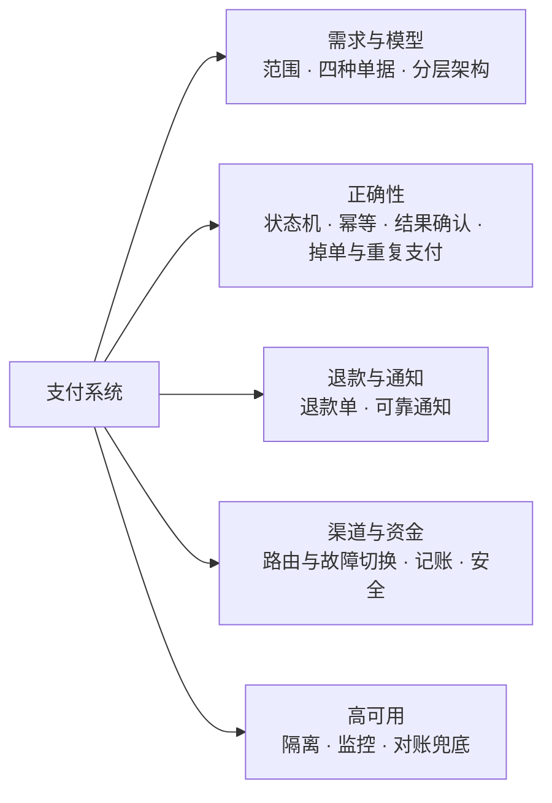

## 题目索引

| 编号 | 题目 | 难度 |
| --- | --- | --- |
| S03-01 | 支付系统的范围是什么？要澄清哪些需求？ | ★★ |
| S03-02 | 业务订单、支付单、渠道流水、退款单怎么划分？ | ★★★ |
| S03-03 | 整体架构怎么分层？ | ★★★ |
| S03-04 | 支付单的状态机怎么设计？怎么防止状态被改乱？ | ★★★ |
| S03-05 | 幂等要做在哪几个地方？ | ★★★ |
| S03-06 | 调用渠道超时了，怎么确认支付结果？ | ★★★ |
| S03-07 | 用户付了钱却显示未支付怎么办？同一个订单付了两次怎么办？ | ★★★ |
| S03-08 | 退款怎么设计？ | ★★★ |
| S03-09 | 支付成功后，怎么可靠地通知业务系统？ | ★★ |
| S03-10 | 渠道路由怎么做？渠道出故障怎么切换？ | ★★★ |
| S03-11 | 账怎么记？为什么要复式记账？ | ★★ |
| S03-12 | 支付系统在安全上要注意什么？ | ★★ |
| S03-13 | 支付系统的高可用怎么做？要盯哪些指标？ | ★★★ |

---

## 一、需求与模型

### S03-01 支付系统的范围是什么？要澄清哪些需求？

> ★★ ｜ 资深 / 架构师 ｜ 高频

**考察意图**："支付系统"可以大到一家清算机构，也可以小到一个接了第三方支付的接口。先划定范围，再谈设计。

**30 秒版回答**：

- **范围**：公司内部的支付中心。向上为各个业务系统提供统一的接口，向下对接多家支付渠道（第三方支付、银行）。**不做**清算机构那一层的事（银行间的资金划拨）。
- **功能**：创建支付、接收支付结果、查询、关闭、退款、通知业务方、对账。
- **非功能的优先级**：**资金正确 > 可用 > 性能**。宁可让一笔支付停在"处理中"，也不能给出错误的结果。
- **要问的问题**：支持哪些支付方式、是否有余额和组合支付、每天多少笔、有没有跨境和多币种、要不要分账。

**深入剖析**

| 问题 | 为什么要问 | 本文的假设 |
| --- | --- | --- |
| 接入哪些渠道？ | 决定渠道适配层的复杂度 | 2～3 家第三方支付 + 若干银行，接口各不相同 |
| 有没有余额、组合支付？ | 有余额就需要内部账户体系 | 先只做外部渠道支付；账户见《S09 账务与钱包》 |
| 每天多少笔？峰值多少？ | 决定分库分表和容量 | 日均 1000 万笔，峰值每秒 2000 笔 |
| 多币种吗？ | 金额模型要带币种，涉及汇率 | 单一币种，金额以分为单位 |
| 业务方有哪些？ | 决定通知机制和隔离 | 订单、会员、充值等十几个业务 |

估算：

- 日均 1000 万笔 ÷ 86400 ≈ 116 笔/秒，大促峰值按 2000 笔/秒设计；
- 每笔支付产生 1 条支付单、1～2 条渠道流水、若干条状态变更记录。一年约 36 亿条支付单，必须分库分表；
- 支付的耗时主要花在**等待渠道和用户**：调用渠道接口通常是几百毫秒，用户完成付款要几秒到几分钟。所以整个流程必然是**异步**的，不能假设"一次调用就有结果"。

**追问链**

1. **为什么说可用性排在正确性后面？** 支付不可用，用户稍后重试，损失的是一部分订单；支付结果出错（没收到钱却发了货、收了两次钱），损失的是真金白银和用户信任，还可能有合规问题。所以遇到不确定的状态时，系统选择"不给结论、稍后确认"，而不是猜一个结果让流程走下去。
2. **支付中心和订单系统的边界在哪？** 支付中心只关心"这笔钱收没收到、退没退成功"，不关心买的是什么。业务系统只关心"我的订单付没付"，不关心走的是哪家渠道。两边通过业务订单号和支付结果通知连接。

---

### S03-02 业务订单、支付单、渠道流水、退款单怎么划分？

> ★★★ ｜ 资深 / 架构师 ｜ 高频

**考察意图**：单据模型是支付系统的地基。把"订单"和"支付"混成一张表，后面的重复支付、换渠道重试、部分退款都没法做。

**30 秒版回答**：

- **业务订单**：在业务系统里，表示用户买了什么、该付多少钱。
- **支付单**：在支付中心里，表示"为某个业务订单发起的一次收款"。一个业务订单可以有多张支付单（用户换了支付方式、上一次超时关闭了），但**最多只有一张成功**。
- **渠道流水**：支付中心和渠道的每一次交互（下单、查询、回调、关单）各记一条，保留原始报文。它是排查问题和对账的依据。
- **退款单**：独立于支付单，有自己的状态机。一张支付单可以对应多张退款单（部分退款），累计金额不超过支付金额。

**深入剖析**

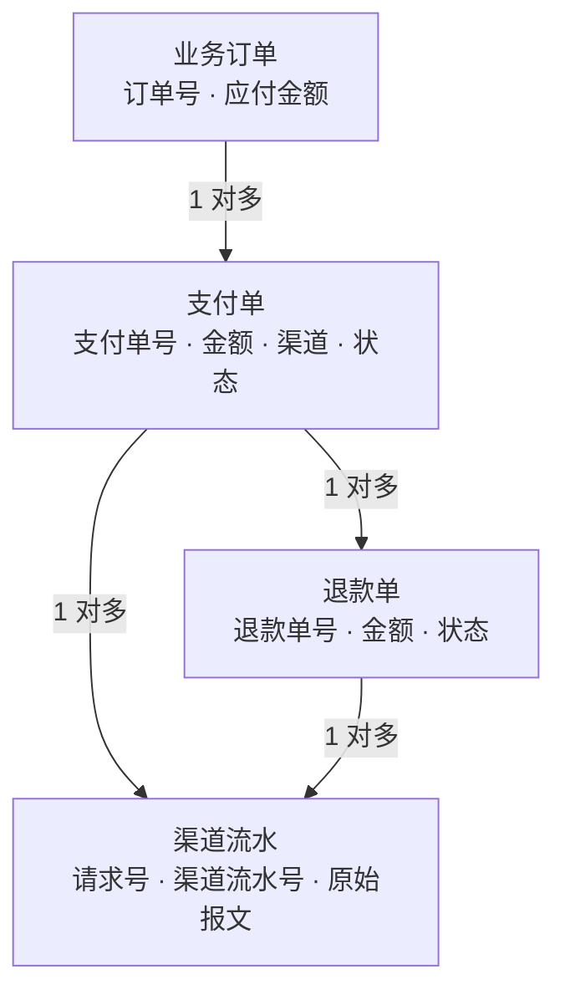

几个号的设计：

| 号 | 谁生成 | 作用 |
| --- | --- | --- |
| 业务订单号 | 业务系统 | 业务方的主键；创建支付单时的幂等键之一 |
| 支付单号 | 支付中心 | 支付中心内部的主键；作为"商户订单号"发给渠道 |
| 渠道流水号 | 渠道 | 渠道那一侧的主键；对账时用它匹配 |
| 请求号 | 支付中心 | 每一次调用渠道的唯一标识，用于渠道侧的幂等 |

为什么发给渠道的是**支付单号**而不是业务订单号：同一个业务订单可能发起多次支付，如果每次都用业务订单号，渠道会认为是同一笔交易。用支付单号，每次支付在渠道那边都是独立的一笔，可以分别查询、关闭、对账。

支付单表的关键字段：

```sql
CREATE TABLE t_pay_order (
    pay_no          VARCHAR(32)  NOT NULL PRIMARY KEY COMMENT '支付单号',
    biz_type        VARCHAR(32)  NOT NULL COMMENT '业务方标识',
    biz_order_no    VARCHAR(64)  NOT NULL COMMENT '业务订单号',
    amount          BIGINT       NOT NULL COMMENT '支付金额，单位分',
    refunded_amount BIGINT       NOT NULL DEFAULT 0 COMMENT '累计已退款金额，单位分',
    channel         VARCHAR(32)  NOT NULL COMMENT '支付渠道',
    channel_trade_no VARCHAR(64) NULL COMMENT '渠道流水号，支付成功后回填',
    status          VARCHAR(16)  NOT NULL COMMENT 'WAIT_PAY / PAYING / SUCCESS / FAIL / CLOSED',
    expire_time     DATETIME(3)  NOT NULL COMMENT '支付截止时间',
    success_time    DATETIME(3)  NULL,
    create_time     DATETIME(3)  NOT NULL,
    update_time     DATETIME(3)  NOT NULL,
    KEY idx_biz (biz_type, biz_order_no),
    KEY idx_status_create (status, create_time)
);
```

**追问链**

1. **怎么保证一个业务订单最多只有一张成功的支付单？** 两层保证。第一层：创建新的支付单之前，把这个业务订单下还没结束的旧支付单关闭（包括调用渠道关单）。第二层：即使两张支付单都付成功了（关单没来得及），第二张成功时发现业务订单已经有成功的支付单，就自动退款（S03-07）。第一层是预防，第二层是兜底。
2. **金额为什么用分为单位的整数？** `double` 不能精确表示大多数十进制小数，累加之后会出现一分钱的误差，而账上差一分钱也是差错。用 `long` 存"分"，或者用 `BigDecimal`。多币种时还要注意不同货币的最小单位不同，金额要和币种一起保存。
3. **分库分表按什么分？** 按支付单号分片，因为回调、查询、退款都带着支付单号。"按业务订单号查支付单"的需求，可以把业务订单号的分片信息编进支付单号（基因法，见[《16 分库分表》](../04-数据存储/16-分库分表.md)16-04），或者维护一张"业务订单号 → 支付单号"的映射表。

---

### S03-03 整体架构怎么分层？

> ★★★ ｜ 架构师 ｜ 高频

**考察意图**：能否把"对内稳定、对外多变"分开：业务方看到的接口是稳定的，渠道的差异被隔离在适配层里。

**30 秒版回答**：

- **支付网关**：面向业务方。鉴权、参数校验、幂等、限流。
- **支付核心**：支付单、退款单的状态机，以及流程编排。它不知道任何渠道的细节。
- **渠道路由**：根据支付方式、金额、渠道的健康状况，决定这一笔走哪个渠道。
- **渠道适配层**：每个渠道一个适配器，把渠道千差万别的接口、报文、签名方式转换成内部统一的模型。
- **回调处理**：接收渠道的异步通知，验签、校验，再交给支付核心。
- **结果通知**：支付成功后可靠地通知业务方。
- **旁路**：账务（记账）、对账、风控、监控。

**深入剖析**

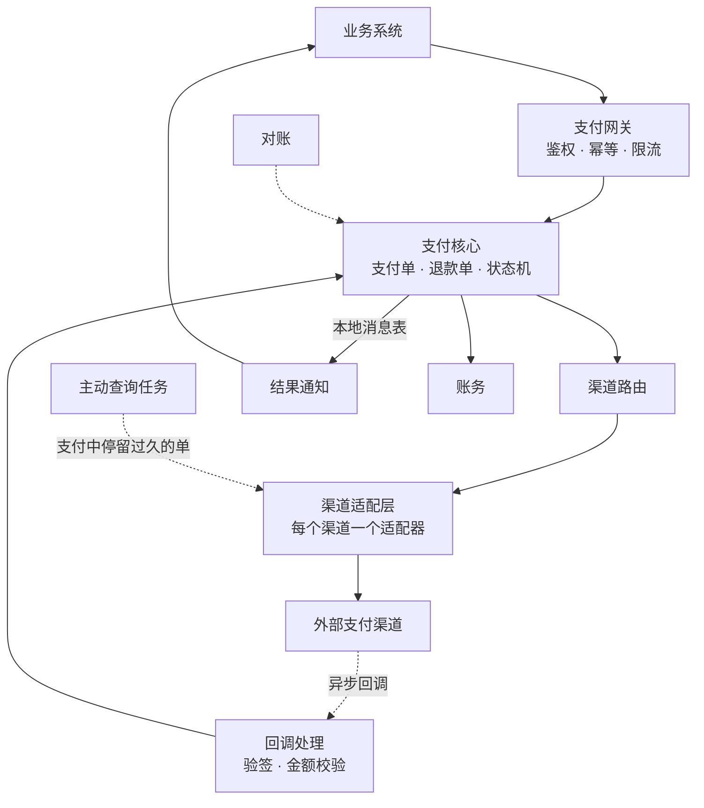

一次支付的主流程：

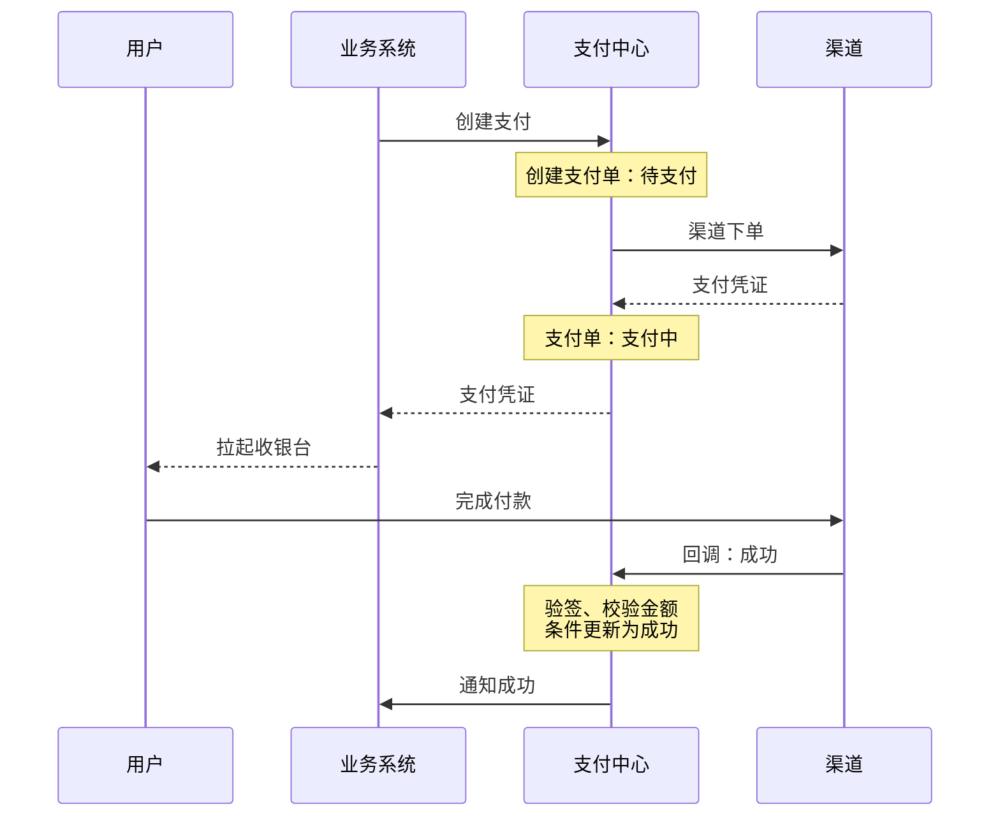

渠道适配层要统一的东西：

| 差异点 | 适配层的做法 |
| --- | --- |
| 接口协议、报文格式 | 定义内部统一的请求和响应模型，适配器负责转换 |
| 签名和加密方式 | 每个适配器自己实现签名、验签 |
| 状态码 | 映射成内部的三种结果：**成功、失败、未知** |
| 金额单位 | 有的用元、有的用分，统一转换成分 |
| 回调的格式和应答方式 | 适配器解析回调，并按渠道要求的格式应答 |

其中最重要的是**状态码的映射**。渠道返回的错误码有几十上百种，适配器必须明确把每一种归到"成功、失败、未知"之一。**没有明确归类的，一律算未知**，绝不能默认当成失败。

**追问链**

1. **新接入一个渠道要改哪些地方？** 理想情况下只新增一个适配器，再加上路由配置。支付核心不需要改。如果每接一个渠道都要改核心流程，说明渠道的差异泄漏到核心里了。
2. **回调处理为什么单独拆出来？** 回调接口暴露在公网，是攻击面；它的流量由渠道决定，不受自己控制；它还必须快速应答，否则渠道会认为通知失败而反复重发。单独部署便于做网络隔离、单独限流和扩容。

---

## 二、正确性

### S03-04 支付单的状态机怎么设计？怎么防止状态被改乱？

> ★★★ ｜ 资深 / 架构师 ｜ 高频

**考察意图**：支付的正确性大部分落在状态机上。看你是否把"哪些流转合法"写成了明确的规则，并且用数据库的原子操作来执行。

**30 秒版回答**：

- **状态**：待支付 → 支付中 →（成功 / 失败 / 已关闭）。成功、失败、已关闭是**终态**，进入之后不能再变。
- **合法的流转写成一张表**，代码里不允许出现表之外的状态变更。
- **所有变更都用条件更新**：`UPDATE ... SET status = 新状态 WHERE pay_no = ? AND status = 旧状态`，根据影响行数判断是否成功。回调、查询、关单同时到达时，数据库保证只有一个生效。
- **只有让状态真正发生变化的那一次**，才执行后续动作（通知业务方、记账）。
- 退款**不改变**支付单的状态，只累加已退款金额（S03-08）。

**深入剖析**

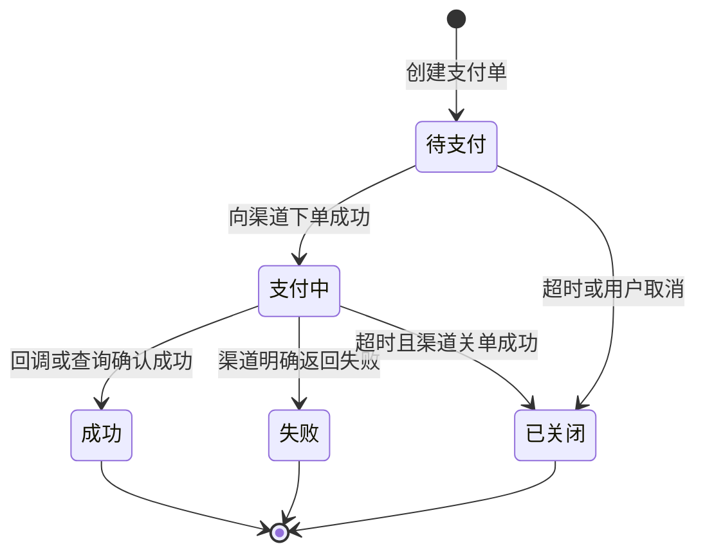

用 JDK 模拟一万笔支付单，每一笔同时收到 3 次重复回调、1 次主动查询的结果和 1 次超时关单（本机 JDK 25 运行）：

```java
import java.util.EnumMap;
import java.util.EnumSet;
import java.util.Map;
import java.util.Set;
import java.util.concurrent.CountDownLatch;
import java.util.concurrent.ExecutorService;
import java.util.concurrent.Executors;
import java.util.concurrent.atomic.AtomicInteger;
import java.util.concurrent.atomic.AtomicReference;

/**
 * 支付单状态机：合法的流转写成一张表，所有变更都走"条件更新"。
 * 模拟同一笔支付同时收到 3 次渠道回调、1 次主动查询结果和 1 次超时关单。
 */
public class PayStateMachineDemo {

    private static final int PAY_ORDER_COUNT = 10_000;
    private static final int DUPLICATE_CALLBACKS = 3;
    private static final long ORDER_AMOUNT_CENT = 9_900L;

    enum PayStatus { WAIT_PAY, PAYING, SUCCESS, FAIL, CLOSED }

    /** 状态流转表：没有列出的流转一律拒绝。SUCCESS、FAIL、CLOSED 是终态 */
    private static final Map<PayStatus, Set<PayStatus>> TRANSITIONS = new EnumMap<>(PayStatus.class);

    static {
        TRANSITIONS.put(PayStatus.WAIT_PAY, EnumSet.of(PayStatus.PAYING, PayStatus.CLOSED));
        TRANSITIONS.put(PayStatus.PAYING, EnumSet.of(PayStatus.SUCCESS, PayStatus.FAIL, PayStatus.CLOSED));
        TRANSITIONS.put(PayStatus.SUCCESS, EnumSet.noneOf(PayStatus.class));
        TRANSITIONS.put(PayStatus.FAIL, EnumSet.noneOf(PayStatus.class));
        TRANSITIONS.put(PayStatus.CLOSED, EnumSet.noneOf(PayStatus.class));
    }

    static final class PayOrder {
        private final long amountCent;
        private final AtomicReference<PayStatus> status = new AtomicReference<>(PayStatus.PAYING);

        PayOrder(long amountCent) {
            this.amountCent = amountCent;
        }

        /** 对应 SQL：UPDATE t_pay_order SET status = #{to} WHERE pay_no = ? AND status = #{from} */
        boolean transit(PayStatus from, PayStatus to) {
            if (!TRANSITIONS.get(from).contains(to)) {
                throw new IllegalStateException("illegal transition " + from + " -> " + to);
            }
            return status.compareAndSet(from, to);
        }

        /** 渠道确认支付成功（回调和主动查询共用）。返回 true 表示这一次调用让支付单变成了成功 */
        boolean confirmSuccess(long paidAmountCent) {
            if (paidAmountCent != amountCent) {
                throw new IllegalArgumentException("amount mismatch, expected=" + amountCent + ", actual=" + paidAmountCent);
            }
            return transit(PayStatus.PAYING, PayStatus.SUCCESS);
        }

        boolean closeByTimeout() {
            return transit(PayStatus.PAYING, PayStatus.CLOSED);
        }
    }

    public static void main(String[] args) throws InterruptedException {
        AtomicInteger success = new AtomicInteger();
        AtomicInteger closed = new AtomicInteger();
        AtomicInteger notifyBiz = new AtomicInteger();
        AtomicInteger ignored = new AtomicInteger();
        int workers = DUPLICATE_CALLBACKS + 2;

        try (ExecutorService pool = Executors.newFixedThreadPool(workers)) {
            for (int i = 0; i < PAY_ORDER_COUNT; i++) {
                PayOrder order = new PayOrder(ORDER_AMOUNT_CENT);
                CountDownLatch start = new CountDownLatch(1);
                CountDownLatch done = new CountDownLatch(workers);
                // 3 次重复的渠道回调 + 1 次主动查询的结果
                for (int j = 0; j < DUPLICATE_CALLBACKS + 1; j++) {
                    pool.execute(() -> {
                        await(start);
                        if (order.confirmSuccess(ORDER_AMOUNT_CENT)) {
                            success.incrementAndGet();
                            notifyBiz.incrementAndGet();   // 只有真正完成流转的那一次才通知业务
                        } else {
                            ignored.incrementAndGet();     // 重复的确认：直接返回成功，不再处理
                        }
                        done.countDown();
                    });
                }
                // 超时关单
                pool.execute(() -> {
                    await(start);
                    if (order.closeByTimeout()) {
                        closed.incrementAndGet();
                    }
                    done.countDown();
                });
                start.countDown();
                done.await();
            }
        }

        System.out.println("pay orders       = " + PAY_ORDER_COUNT);
        System.out.println("success          = " + success.get());
        System.out.println("closed           = " + closed.get());
        System.out.println("success + closed = " + (success.get() + closed.get()));
        System.out.println("notify business  = " + notifyBiz.get() + " (must equal success)");
        System.out.println("ignored confirms = " + ignored.get());

        PayOrder order = new PayOrder(ORDER_AMOUNT_CENT);
        order.confirmSuccess(ORDER_AMOUNT_CENT);
        try {
            order.transit(PayStatus.SUCCESS, PayStatus.CLOSED);
        } catch (IllegalStateException e) {
            System.out.println("rejected: " + e.getMessage());
        }
        try {
            new PayOrder(ORDER_AMOUNT_CENT).confirmSuccess(1L);
        } catch (IllegalArgumentException e) {
            System.out.println("rejected: " + e.getMessage());
        }
    }

    private static void await(CountDownLatch latch) {
        try {
            latch.await();
        } catch (InterruptedException e) {
            Thread.currentThread().interrupt();
            throw new IllegalStateException(e);
        }
    }
}
```

```text
pay orders       = 10000
success          = 9997
closed           = 3
success + closed = 10000
notify business  = 9997 (must equal success)
ignored confirms = 30003
rejected: illegal transition SUCCESS -> CLOSED
rejected: amount mismatch, expected=9900, actual=1
```

- 每笔支付单只有一个终态，成功数加关闭数等于总数；
- 通知业务方的次数等于成功数：4 次确认里只有 1 次完成了流转，其余 3 次被识别为重复，直接返回；
- 终态之后的变更（成功 → 关闭）被流转表拒绝；金额对不上的确认被拒绝。

**追问链**

1. **"已关闭"的支付单又收到了支付成功的回调，怎么办？** 这说明关单时渠道那边其实已经支付成功（或者关单没有真正生效）。状态机不允许从"已关闭"回到"成功"，这笔钱按"多收"处理：登记一笔异常，自动原路退款。不要为了"让数据好看"而放开终态。
2. **为什么不用乐观锁版本号，而是用状态做条件？** 两者都可以保证并发安全。用状态做条件的好处是语义直接：SQL 本身就表达了"只有处于某个状态才允许这样改"。版本号只能说明"数据被别人改过"，接下来还要重新读取、重新判断。
3. **状态变更要不要留历史？** 要。每次变更写一条流转记录（从什么状态到什么状态、时间、触发来源是回调还是查询还是人工），和状态更新放在同一个事务里。出问题时，它是还原现场的依据。

**架构师加分点**

- 人工修改支付状态的入口也必须走同一套状态机，不能在数据库里直接改。运营后台的"手工置为成功"本质上是一次"确认成功"，同样要校验流转是否合法、同样触发通知和记账。很多资金事故来自绕过状态机的手工操作。

---

### S03-05 幂等要做在哪几个地方？

> ★★★ ｜ 资深 ｜ 高频

**考察意图**："做幂等"不是一句话。支付链路上每一段都可能重复，每一段的幂等键和做法都不一样。

**30 秒版回答**：

| 环节 | 为什么会重复 | 幂等键 | 做法 |
| --- | --- | --- | --- |
| 业务方创建支付 | 业务方超时重试、用户重复点击 | 业务方标识 + 业务订单号 + 请求号 | 唯一索引；重复请求返回第一次的结果 |
| 支付中心调用渠道 | 调用超时后重试 | 支付单号、请求号 | 同一个请求号重试，由渠道保证幂等 |
| 渠道回调 | 渠道没收到应答会重复通知 | 支付单号 + 当前状态 | 状态机的条件更新 |
| 通知业务方 | 通知超时后重发 | 支付单号 | 业务方自己幂等 |
| 退款 | 业务方重试 | 业务方的退款请求号 | 唯一索引 |

- 幂等的通用设计见[《09 分布式理论》](../03-分布式与微服务/09-分布式理论.md)09-17。

**深入剖析**

**创建支付的幂等**。业务方用同一个请求号重试时，要返回和第一次**完全相同**的结果，而不是报"重复请求"：

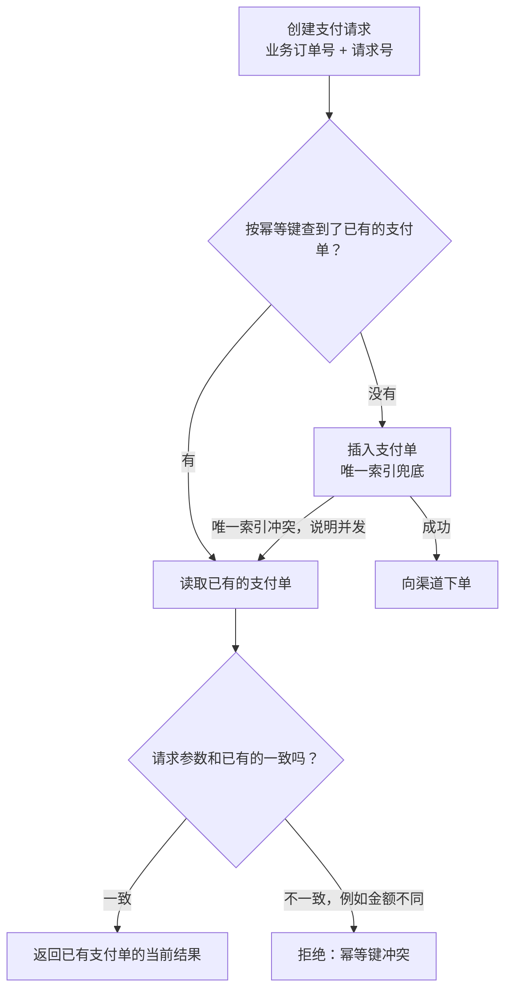

"先查再插"不是原子的，两个并发请求可能都查不到。所以**唯一索引是真正的保证**，"先查"只是为了让多数情况走得快。

**回调的幂等**。渠道的回调可能重复，也可能乱序。处理顺序是：

1. 验签，失败直接拒绝；
2. 根据支付单号查支付单，校验金额、商户号是否一致；
3. 条件更新 `支付中 → 成功`；
4. 影响 1 行：同一个事务里写状态流转记录、写待通知的消息；
5. 影响 0 行：再读一次状态。已经是成功，说明是重复回调，**按成功应答渠道**；是其他终态，按异常处理（S03-04 的追问 1）；
6. 快速应答渠道。

**追问链**

1. **重复回调时为什么要应答成功？** 渠道判断"通知是否送达"的依据就是你的应答。应答失败，它会继续重发。重复的回调已经处理过了，应答成功才是如实反映了"我已经收到"。
2. **调用渠道超时后重试，会不会让用户付两次？** 用**同一个支付单号和请求号**重试就不会，渠道会识别为同一笔交易。危险的做法是超时后**新建一张支付单**，或者**换一个渠道**再发一次：这样在渠道看来是两笔独立的交易，用户可能两边都付成功。
3. **幂等记录要保留多久？** 至少覆盖业务方可能重试的最长时间。支付单本身长期保存，所以用支付单表上的唯一索引做幂等，不存在"过期"的问题。如果是用 Redis 做去重，就要注意过期之后重复请求会被当成新请求。

---

### S03-06 调用渠道超时了，怎么确认支付结果？

> ★★★ ｜ 资深 / 架构师 ｜ 高频

**考察意图**：分布式系统里的第三种结果"不知道"。看你是否把它当成一种正常的状态来设计，而不是归到成功或失败里。

**30 秒版回答**：

- 调用渠道有三种结果：**成功、失败、未知**（超时、网络错误、渠道返回"处理中"）。**未知不等于失败**。
- 结果未知时，支付单保持"支付中"，通过三条路径确认，一条比一条慢，一条比一条可靠：
  1. **渠道回调**：最快，但可能丢、可能迟到；
  2. **主动查询**：支付单在"支付中"停留超过一定时间，按退避间隔去渠道查询；
  3. **对账**：第二天用渠道的对账文件核对，是最后的兜底（[《S04 对账系统》](S04-对账系统.md)）。
- 回调和查询的结果走**同一个入口**（确认成功 / 确认失败），由状态机保证只生效一次。
- **不能以前端的跳转结果为准**：用户付完款跳回页面，只能说明"可能成功了"，前端的参数是可以伪造的。页面应该去查询服务端的支付单状态。

**深入剖析**

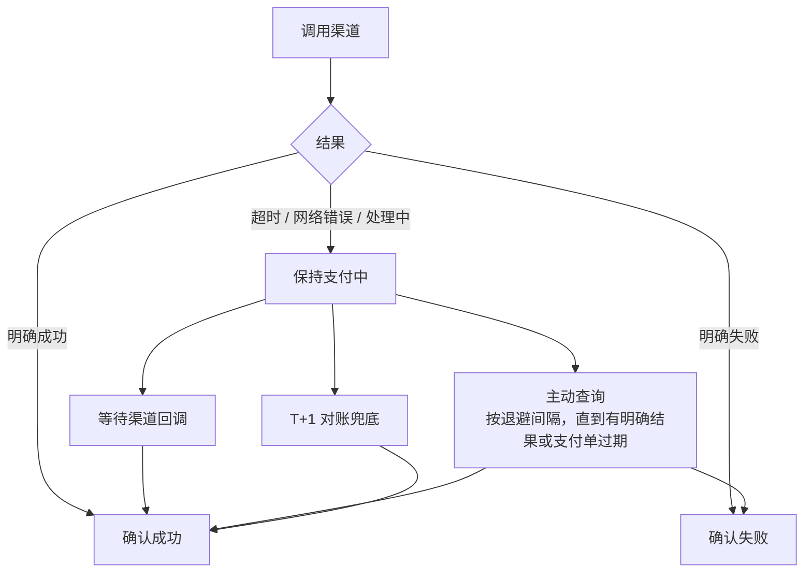

主动查询的调度：

- 用延迟任务实现（[《S02 订单超时取消与延迟任务》](S02-订单超时取消与延迟任务.md)）。支付单进入"支付中"时，提交一个几秒后的查询任务；
- 查到明确结果就结束；仍是处理中，就按**递增的间隔**（例如 5 秒、15 秒、30 秒、1 分钟、3 分钟……）提交下一次；
- 一直查到支付单的过期时间。过期后调用渠道关单：关单成功才把支付单改为已关闭；渠道说"已支付"，就按成功处理。

为什么查询间隔要递增：大多数支付在几秒内完成，前几次查询要密集，用户才不用等；长时间没有结果的，多半是用户放弃了，没必要一直高频查询，既浪费资源，也可能触发渠道的限流。

**追问链**

1. **渠道的查询接口也超时了怎么办？** 继续保持支付中，下一个间隔再查。只要没有拿到明确的结果，就不改变状态。
2. **支付单一直停在"支付中"，对用户怎么展示？** 展示"支付处理中，请稍候"，并提供刷新入口。不要展示"支付失败，请重新支付"：用户可能已经付了，再付一次就是重复支付。
3. **渠道返回的错误码看不懂，算失败吗？** 算未知。适配层里只有**明确列出**的错误码才映射为失败（例如余额不足、卡被冻结），其余一律当作未知，走查询确认。把未知当失败的后果是：系统认为没收到钱，其实收到了。

**生产实践 / 踩坑**

- **把读超时当成失败并立即重新发起**：用户的钱被扣了两次。超时后只能用原来的支付单号查询或重试，不能新建交易。
- **只依赖回调**：回调地址配置错误、防火墙规则变更、渠道故障，都会让回调整批丢失。没有主动查询的系统，这时会出现大面积的"付了钱但订单未支付"。

---

### S03-07 用户付了钱却显示未支付怎么办？同一个订单付了两次怎么办？

> ★★★ ｜ 资深 ｜ 高频

**考察意图**：掉单和重复支付是支付系统里最常见的两类线上问题。看你是否知道它们的成因，以及系统应该怎样自动处理。

**30 秒版回答**：

- **掉单**（渠道扣款成功，支付中心不是成功状态）：
  - 成因：回调丢失；回调到了但处理失败（验签配置错误、数据库异常、发布过程中请求被中断）；回调到的时候支付单已经被关闭。
  - 处理：主动查询会发现并补上；对账兜底。支付单还是"支付中"的，直接补成成功；已经关闭的，自动退款。
- **重复支付**（同一个业务订单，两张支付单都成功）：
  - 成因：用户在两个渠道或两个页面各付了一次；上一张支付单关单失败。
  - 处理：第二张支付单成功时，发现业务订单已经有成功的支付单，**自动原路退款**。
- 这两类问题都不能完全避免，设计的目标是**能自动发现、自动处理、留下记录**。

**深入剖析**

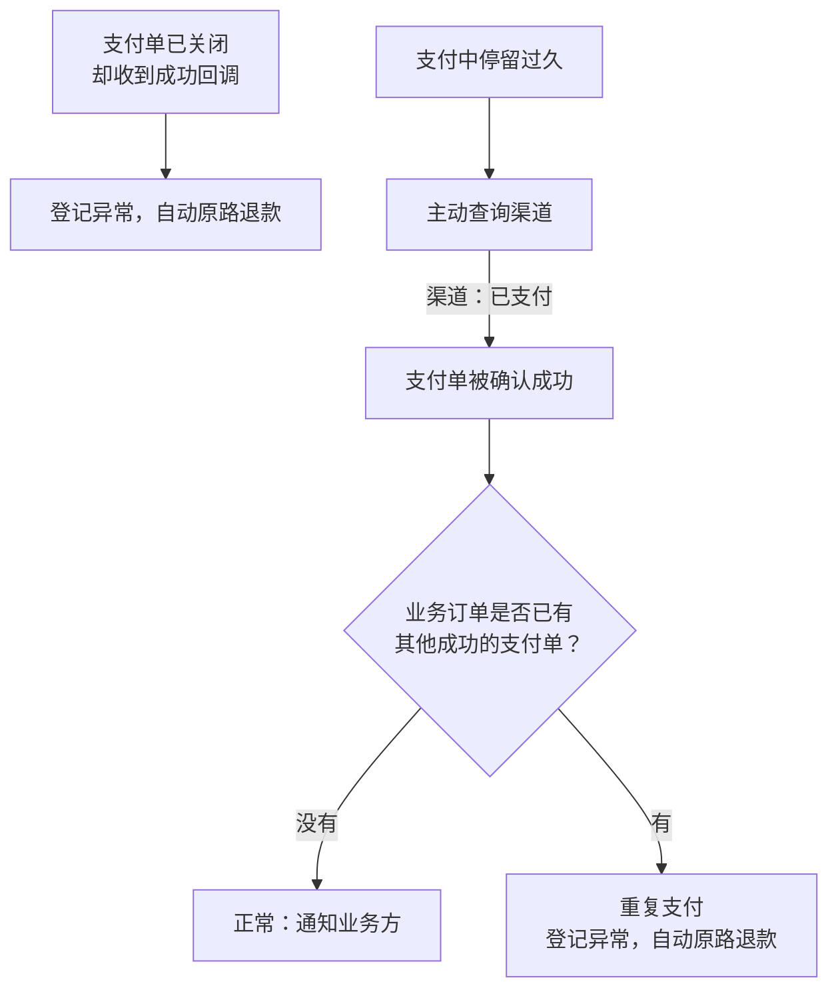

"业务订单是否已有成功的支付单"这个判断同样要防并发：两张支付单可能同时成功。做法是在业务订单维度加一个约束，例如一张表以"业务方 + 业务订单号"为唯一键，记录"成功的支付单号"；谁插入成功，谁是有效的那一笔；插入失败的一方走退款。

掉单的排查路径：

| 现象 | 查什么 |
| --- | --- |
| 渠道流水里没有回调记录 | 回调地址是否正确、网络是否可达、渠道侧的通知记录 |
| 有回调记录，但验签失败 | 证书或密钥是否过期、是否更换过 |
| 回调处理报错 | 应用日志，数据库、依赖服务是否异常 |
| 回调时支付单已关闭 | 关单和支付的时间顺序，关单接口是否返回成功 |

**追问链**

1. **自动退款会不会退错？** 所以要设置边界：只有满足明确规则的情况才自动退（重复支付、已关闭后到账），并且有单笔金额和每日总额的上限，超过上限转人工审核。每一笔自动退款都要有记录，可以追溯。
2. **用户说付了钱但没收到货，客服怎么查？** 用业务订单号查出所有的支付单，再看每张支付单的状态流转记录和渠道流水。这就是 S03-02 里要保留渠道流水和原始报文的原因：不用去翻日志，直接能看到和渠道的每一次交互。
3. **怎么提前发现大面积掉单？** 监控"支付中"状态的支付单数量和停留时间的分布，以及"通过主动查询补成成功"的数量。后者平时很少，突然上升说明回调出了问题。

---

## 三、退款与通知

### S03-08 退款怎么设计？

> ★★★ ｜ 资深 / 架构师 ｜ 高频

**考察意图**：退款是"往外出钱"，比收款更敏感。看你是否处理了部分退款、并发退款、退款结果未知这几个问题。

**30 秒版回答**：

- **独立的退款单**：有自己的单号和状态机（处理中 → 成功 / 失败）。支付单的状态不因为退款而改变。
- **一笔支付可以多次部分退款**，累计退款金额不能超过支付金额。用**一条条件更新**同时完成校验和累加，防止两个并发的退款加起来超额。
- **退款同样是异步的**：渠道受理不等于到账。结果的确认方式和支付一样：回调 + 主动查询 + 对账。
- **幂等**：以业务方的退款请求号为唯一键。
- **退款失败**（例如渠道侧商户余额不足）：把预占的退款额度释放回去，通知业务方，可以稍后重试或者转人工。

**深入剖析**

预占退款额度的条件更新：

```sql
UPDATE t_pay_order
SET refunded_amount = refunded_amount + #{refundAmount}, update_time = NOW(3)
WHERE pay_no = #{payNo}
  AND status = 'SUCCESS'
  AND refunded_amount + #{refundAmount} <= amount;
```

影响行数为 1 才创建退款单并调用渠道，这两步和上面的更新放在同一个事务里。影响行数为 0，说明支付单不是成功状态，或者这次退款会超额。

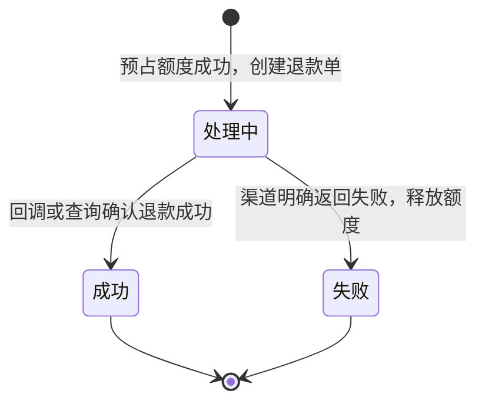

释放额度同样用条件更新，并且以退款单的状态流转作为前提：只有成功地把退款单从"处理中"改为"失败"的那一次，才去扣减 `refunded_amount`。这样重复的失败通知不会让额度被释放两次。

**追问链**

1. **为什么不在支付单上加"已退款""部分退款"这样的状态？** 支付单的状态回答的是"这笔钱收到没有"，退款是另一件事。把退款状态揉进支付单，状态数量会成倍增加（部分退款中、部分退款成功、全额退款中……），而且一笔支付可以同时有多笔退款在进行，一个状态字段表达不了。需要展示"是否已退款"时，根据 `refunded_amount` 计算即可。
2. **退款时渠道提示"余额不足"是怎么回事？** 有些渠道的退款是从商户当天未结算的收入里扣的。当天收入已经结算走了，或者当天退款多于收入，就会失败。对策是保留一定的备付金，或者使用渠道提供的垫资退款能力；系统上要能自动重试，并在失败时告警。
3. **用户已经收到退款，系统里退款单还是"处理中"怎么办？** 和支付掉单一样：主动查询、对账兜底。退款的"掉单"同样要监控。
4. **优惠券、积分抵扣的部分怎么退？** 那不是支付中心的职责。支付中心只退"实际通过渠道支付的金额"。券和积分的退还由业务系统按自己的规则处理，分摊规则见[《S05 优惠券系统》](S05-优惠券系统.md)S05-07。

**生产实践 / 踩坑**

- **退款接口没有做权限和额度控制**：退款是资金流出，一个被滥用的内部接口就能造成直接损失。调用方要鉴权，要有单笔和每日的限额，大额退款要有审批。
- **先调用渠道，后预占额度**：两个并发的退款请求都调用了渠道，都成功了，累计金额超过了支付金额。必须先在本地预占，预占成功才向渠道发起。

---

### S03-09 支付成功后，怎么可靠地通知业务系统？

> ★★ ｜ 资深 ｜ 高频

**考察意图**：支付单成功了，业务订单却没变成已支付，对用户来说就是掉单。看你是否保证了"状态变更"和"发出通知"的一致性。

**30 秒版回答**：

- **不能在更新完支付单之后直接调用业务方**：调用失败或者进程崩溃，通知就丢了。
- **本地消息表**：条件更新支付单成功的**同一个事务**里，插入一条"待通知"的记录。后台任务负责发送，成功后标记完成，失败按退避间隔重试。
- **发送方式**：发到 MQ 由业务方订阅，或者回调业务方提供的接口。内部系统优先用 MQ，业务方可以自己控制消费速度。
- **业务方必须幂等**：通知是"至少一次"的，同一笔支付可能通知多次。
- **业务方还要能主动查询**：通知是推的，查询是拉的。业务方在通知迟迟不到时，自己来查支付单的状态。

**深入剖析**

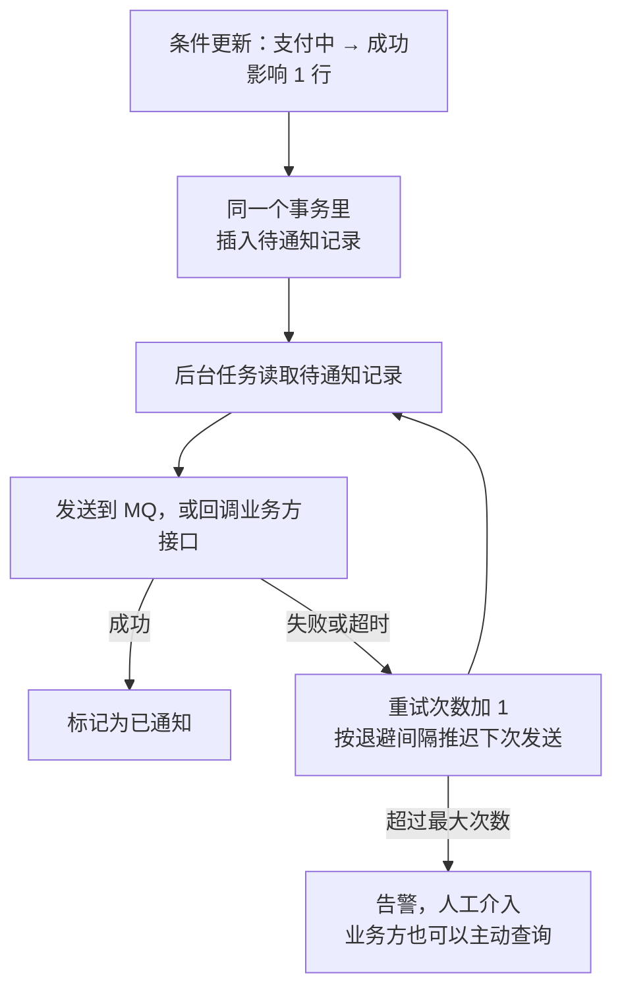

本地消息表和事务消息的对比见[《20 MQ 通用与选型》](../05-消息队列/20-MQ通用与选型.md)20-09。支付中心用本地消息表的原因是：它只依赖自己的数据库，不要求 MQ 支持事务消息，也便于人工查询"哪些通知还没发出去"。

通知内容：只放**不可变的事实**，例如支付单号、业务订单号、金额、渠道、成功时间。不要把"订单应该变成什么状态"这类业务逻辑放进去，那是业务方自己的事。

**追问链**

1. **业务方收到通知后处理失败了怎么办？** 用 MQ 时，消费失败由 MQ 重试；用接口回调时，业务方返回失败，支付中心稍后重发。业务方的处理逻辑要保证"重复通知时结果一样"，典型写法是把订单从"待支付"条件更新为"已支付"，影响 0 行就说明处理过了。
2. **通知的顺序有要求吗？** 同一笔支付的"支付成功"和后来的"退款成功"是有先后的。如果用 MQ，按业务订单号作为分区键可以保证同一个订单的消息有序；业务方也应该根据自己的状态判断，而不是完全依赖到达顺序。
3. **业务方很多，其中一个处理很慢，会拖累别的吗？** 用 MQ 时每个业务方有自己的消费组，互不影响。用接口回调时，要按业务方隔离线程池和重试队列，否则一个慢的业务方会占满通知线程。

---

## 四、渠道与资金

### S03-10 渠道路由怎么做？渠道出故障怎么切换？

> ★★★ ｜ 架构师 ｜ 中频

**考察意图**：接入多个渠道不只是为了多几种支付方式，也是为了成本和可用性。看你是否清楚"能切换"和"不能切换"的边界。

**30 秒版回答**：

- **路由的输入**：用户选择的支付方式、金额、业务类型，以及各渠道的状态。
- **路由的规则**，按优先级：
  1. **硬约束**：渠道是否支持这种支付方式、金额是否在单笔和每日限额内、渠道是否在维护；
  2. **可用性**：渠道最近一段时间的成功率、响应时间。健康度低的降低权重，过低的直接熔断；
  3. **成本**：在可用的渠道里，优先选费率低的。
- **故障切换**：熔断故障渠道，**新的支付请求**走备用渠道。
- **已经发出去的支付单不能切换**：它在原渠道的结果是未知的，换一个渠道重发可能造成重复扣款。只能等原渠道的结果，或者关单成功后再新建支付单。

**深入剖析**

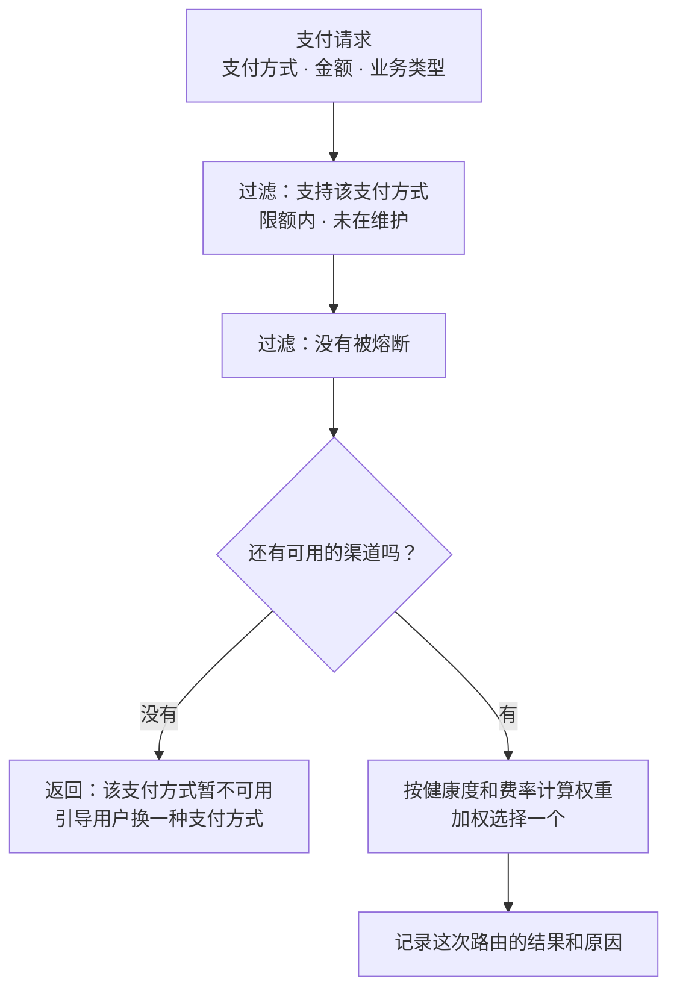

渠道健康度的统计：

- 用滑动窗口统计每个渠道最近几分钟的**下单成功率、支付成功率、平均响应时间、超时率**；
- 区分**渠道的问题**和**用户的问题**：余额不足、密码错误是用户原因，不应该计入渠道的失败；超时、系统错误才是渠道原因。分类不清，会在用户普遍余额不足的时候（比如月底）把一个健康的渠道熔断掉；
- 熔断之后用少量的真实请求探测，恢复后逐步放量。熔断器的原理见[《12 Spring Cloud》](../03-分布式与微服务/12-SpringCloud.md)12-09。

**追问链**

1. **用户选了某个支付方式，系统能偷偷换成另一个吗？** 不能。用户选的是"用哪个钱包、哪张卡付"，这是用户的决定。路由能选择的是**同一种支付方式背后的不同通道**，比如同一家银行的快捷支付，可以走直连，也可以走聚合的通道。
2. **支付成功率怎么定义？** 要分开看：**下单成功率**（调用渠道下单接口的成功比例）反映渠道接口的可用性；**支付成功率**（发起支付后最终付款成功的比例）还受用户行为影响。路由和熔断主要看前者，后者用来发现体验问题。
3. **路由规则放在哪里？** 配置中心，可以动态调整，变更要有审核和灰度。渠道临时维护、费率调整都是常态，不应该为此发版。

**架构师加分点**

- 路由决策要**可解释**：每一笔支付记录"当时有哪些候选渠道、每个渠道的权重是多少、为什么选了这个"。成功率下降时，才能回答"是渠道变差了，还是路由把流量导到了差的渠道上"。

---

### S03-11 账怎么记？为什么要复式记账？

> ★★ ｜ 架构师 ｜ 中频

**考察意图**：支付单记录的是"交易"，账务记录的是"钱在哪"。看你是否知道两者是分开的，以及复式记账怎样帮助发现错误。

**30 秒版回答**：

- **支付单**回答"这笔交易成功了吗"；**账务**回答"每个账户里现在有多少钱、每一分钱从哪来到哪去"。
- **复式记账**：每一笔资金变动至少记两条分录，一借一贷，金额相等。任何时刻，所有分录的借方合计都等于贷方合计。
- **好处**：单边漏记、金额记错都会让借贷不平，可以被程序自动检查出来（试算平衡）。只记"余额加了多少"的单式记账做不到这一点。
- **实现要点**：分录只增不改，写错了用一笔反向的分录冲正；余额的更新和分录的写入在同一个事务里。
- 账户、余额、流水的详细设计见《S09 账务与钱包》。

**深入剖析**

用户通过渠道支付 100 元购买商品，渠道手续费 0.6 元，各环节的分录（金额单位：元）：

| 事件 | 借方 | 贷方 | 含义 |
| --- | --- | --- | --- |
| 支付成功 | 渠道待清算款 100 | 商户待结算款 100 | 钱还在渠道那里，但已经确认要给商户 |
| 渠道结算到账 | 银行存款 99.4、渠道手续费 0.6 | 渠道待清算款 100 | 渠道扣掉手续费后把钱打过来 |
| 给商户结算 | 商户待结算款 100 | 银行存款 100 | 把钱付给商户 |

"渠道待清算款"这个科目，在支付成功时增加 100，在渠道结算时减少 100，最终归零。如果某一天它的余额不是零，就说明**有的钱渠道还没给**，或者**记账漏了**。这正是和渠道做资金对账时要核对的东西。

**追问链**

1. **记账要和支付成功同步完成吗？** 不需要在同一个事务里（它们通常是不同的系统），但必须可靠地完成：支付成功的事件可靠地送达账务系统，账务以支付单号为幂等键记账。两边的一致性用内部对账保证。
2. **账记错了怎么改？** 不改也不删原来的分录，补一笔方向相反的分录把它冲掉，再记一笔正确的。这样账本始终是"只追加"的，每一次修正都留有痕迹，审计时可以还原全过程。

---

### S03-12 支付系统在安全上要注意什么？

> ★★ ｜ 资深 / 架构师 ｜ 中频

**考察意图**：支付系统是攻击者的首要目标。看你是否知道几个必须有的校验，尤其是回调和金额。

**30 秒版回答**：

- **回调必须验签**：回调接口在公网上，任何人都能伪造一个"支付成功"的请求。验签通过，才能认为它来自渠道。
- **金额以服务端为准**：创建支付时，金额由业务系统的服务端传给支付中心，不能用前端传来的金额；回调时，校验渠道返回的金额、商户号与支付单一致。
- **密钥和证书**：放在密钥管理系统里，不进代码仓库和配置文件；按渠道、按环境隔离；有轮换机制，并监控证书的到期时间。
- **防重放**：对业务方的接口要求带时间戳和随机串并签名，过期的、重复的请求拒绝。
- **敏感数据**：银行卡号、证件号等不落库，或者加密存储、脱敏展示；日志里不打印。
- **内部风险**：退款、手工改状态、修改路由配置等操作要有权限控制、双人复核和操作审计。

**深入剖析**

回调处理必须按这个顺序做，任何一步不通过就拒绝：

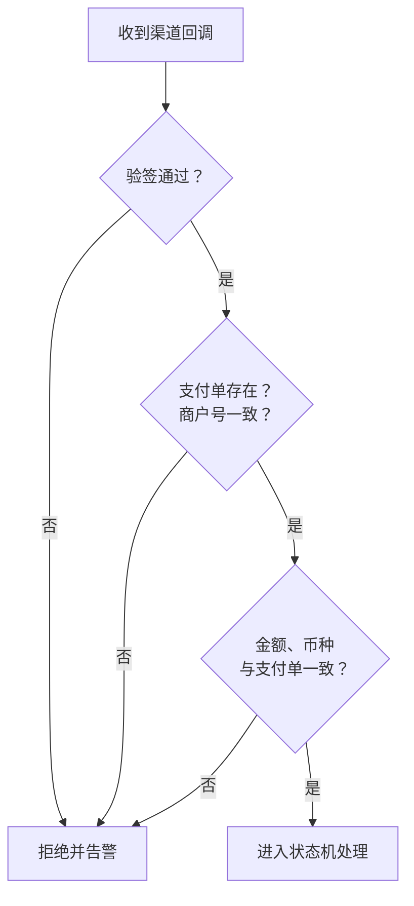

"只验签不验金额"的后果：攻击者自己发起一笔 1 分钱的真实支付，拿到一个签名合法的回调，再想办法让它被用在另一张大额的支付单上。所以验签之后，还要确认这个回调对应的正是这张支付单、金额完全一致。

签名、加密、摘要分别解决什么问题见[《39 网络安全》](../08-计算机基础/39-网络安全.md)39-13。

**追问链**

1. **前端跳转回来带着"支付成功"的参数，能直接用吗？** 不能。那是浏览器里的参数，用户可以随意修改。页面收到后应该调用服务端的查询接口，以支付单的状态为准。
2. **测试环境和生产环境的密钥要注意什么？** 完全隔离。测试环境使用渠道的沙箱和测试密钥，绝不配置生产的密钥；生产密钥的读取权限只给生产环境的服务账号。

---

## 五、高可用

### S03-13 支付系统的高可用怎么做？要盯哪些指标？

> ★★★ ｜ 架构师 ｜ 中频

**考察意图**：在"正确性优先"的前提下谈高可用：哪些可以降级，哪些绝对不能；出了问题怎么最快发现。

**30 秒版回答**：

- **数据层**：支付单是资金数据，不能丢。数据库主从之间用半同步复制或者基于多数派的方案，主库故障切换后不丢已提交的事务；Redis 只做缓存和限流，不存放唯一的资金数据。
- **渠道隔离**：每个渠道独立的线程池（或信号量）和超时设置。一个渠道变慢，不能耗尽调用其他渠道的线程。
- **可以降级的**：营销展示、支付方式的推荐排序、风控的非核心规则。**不能降级的**：验签、金额校验、幂等、状态机。
- **核心链路尽量短**：创建支付的同步路径上只有"落库 + 调用渠道"，记账、通知、统计全部异步。
- **多活**：支付单按单号路由到固定的单元，同一笔支付的所有请求（包括回调）都要回到同一个单元处理。
- **最后的兜底是对账**：前面所有机制都失效时，对账保证问题在第二天被发现和修复。

**深入剖析**

| 指标 | 含义 | 异常时说明什么 |
| --- | --- | --- |
| 下单成功率（按渠道） | 调用渠道下单接口的成功比例 | 渠道接口故障，或者自己的签名、配置出了问题 |
| 支付成功率（按渠道、支付方式） | 发起后最终成功的比例 | 渠道体验变差，或者收银台有问题 |
| "支付中"的数量和停留时间 | 结果未知的支付单 | 回调或查询链路出了问题 |
| 查询补单的数量 | 靠主动查询才确认成功的支付单 | 平时很少，突增说明回调丢失 |
| 待通知记录的积压 | 还没通知到业务方的成功支付 | 通知链路或业务方出了问题 |
| 回调验签失败的次数 | — | 证书过期、配置错误，或者有人在伪造回调 |
| 自动退款的笔数和金额 | 重复支付、关单后到账 | 突增说明关单逻辑或前端的重复提交有问题 |
| 对账差错的笔数和金额 | — | 资金正确性的最终指标 |

**追问链**

1. **数据库主库宕机时，正在进行的支付会怎样？** 创建支付会失败，业务方按同一个幂等键重试即可。回调会处理失败，渠道稍后重发。主动查询的任务在恢复后继续。只要已经提交的数据不丢，流程都可以自己恢复。真正危险的是**主从切换丢数据**：支付单已经改成成功并通知了业务方，切换后却回到了"支付中"。所以支付库对复制的可靠性要求高于一般的业务库。
2. **大促前要做哪些准备？** 和渠道确认容量和限流阈值；压测创建支付和回调处理两条链路，回调的压测要用模拟的渠道；提前扩容；核对各个渠道的证书有效期；准备好渠道故障时的切换预案并演练。
3. **回调量太大处理不过来怎么办？** 回调接口只做验签和基本校验，然后把报文落库（或写入 MQ）并立即应答，状态机的处理放到异步。这样对渠道的应答始终很快，不会因为超时引发更多的重复通知。

**架构师加分点**

- 支付系统的设计原则可以归纳成一句话：**宁可慢，不可错；宁可停在中间状态，不可猜测结果**。每一个"不确定"的地方都有三道防线：实时的回调、准实时的主动查询、T+1 的对账。面试时把这三道防线讲清楚，比罗列多少种技术组件都更有说服力。
