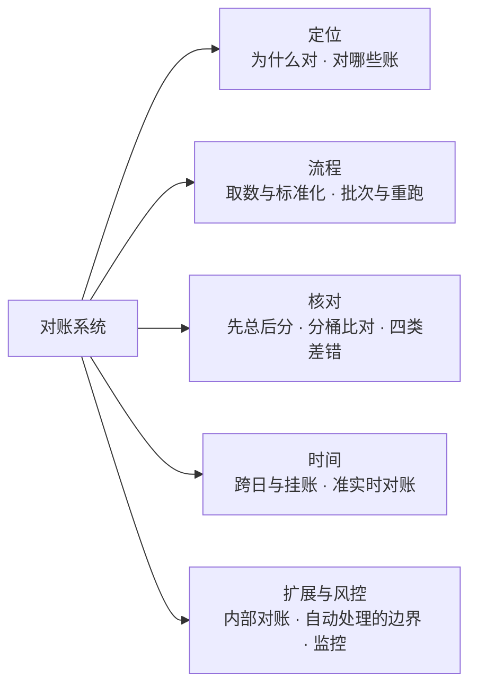
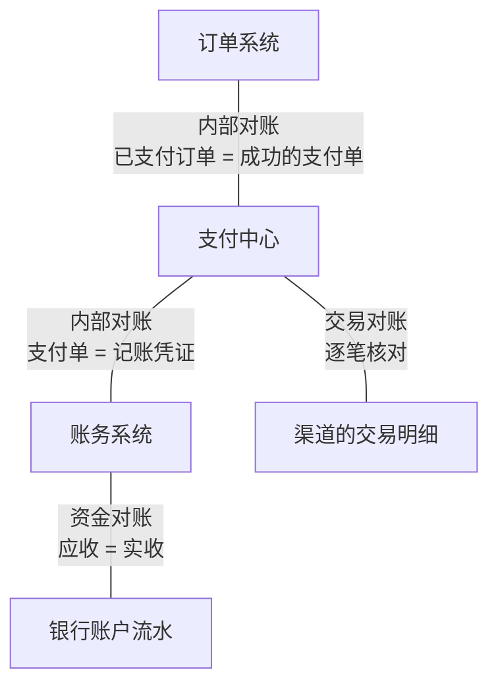
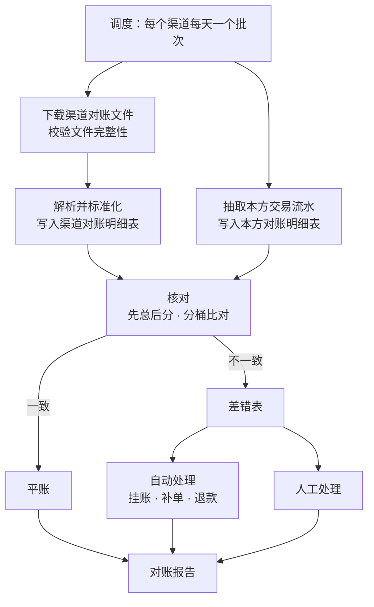
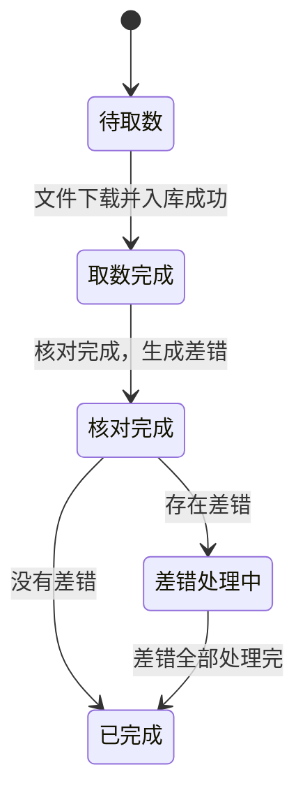
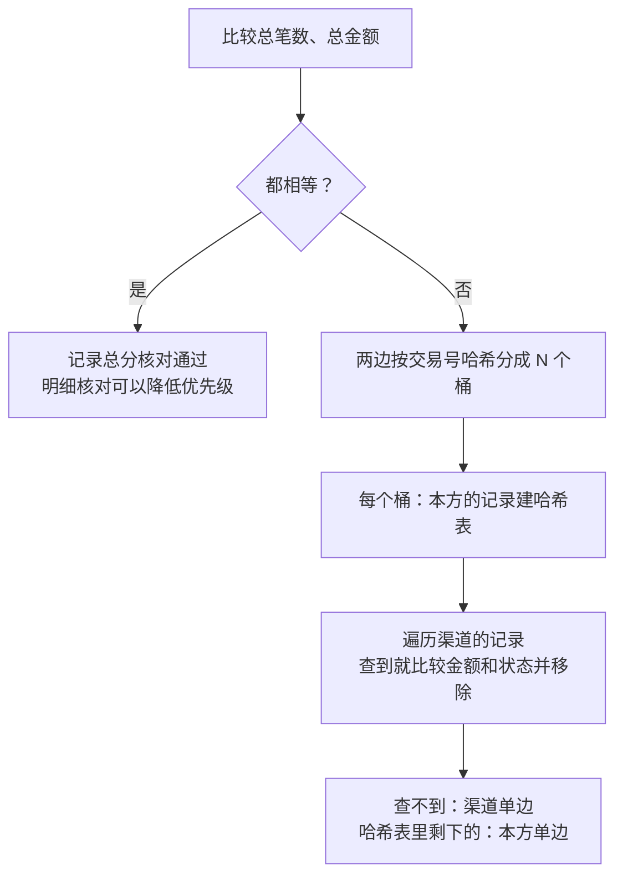
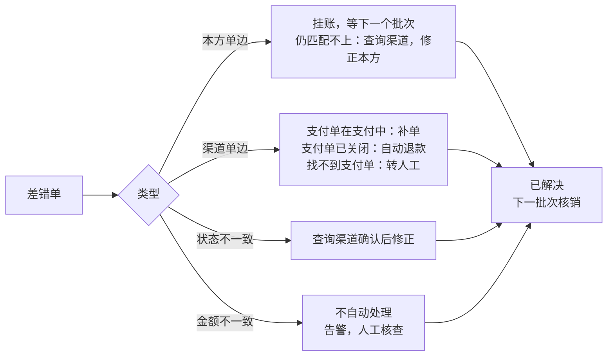
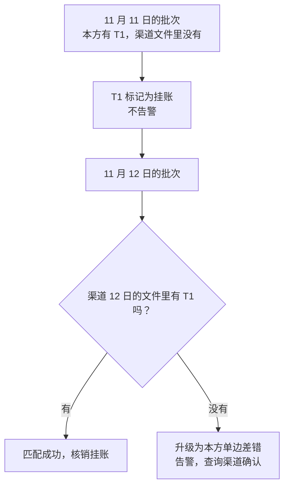
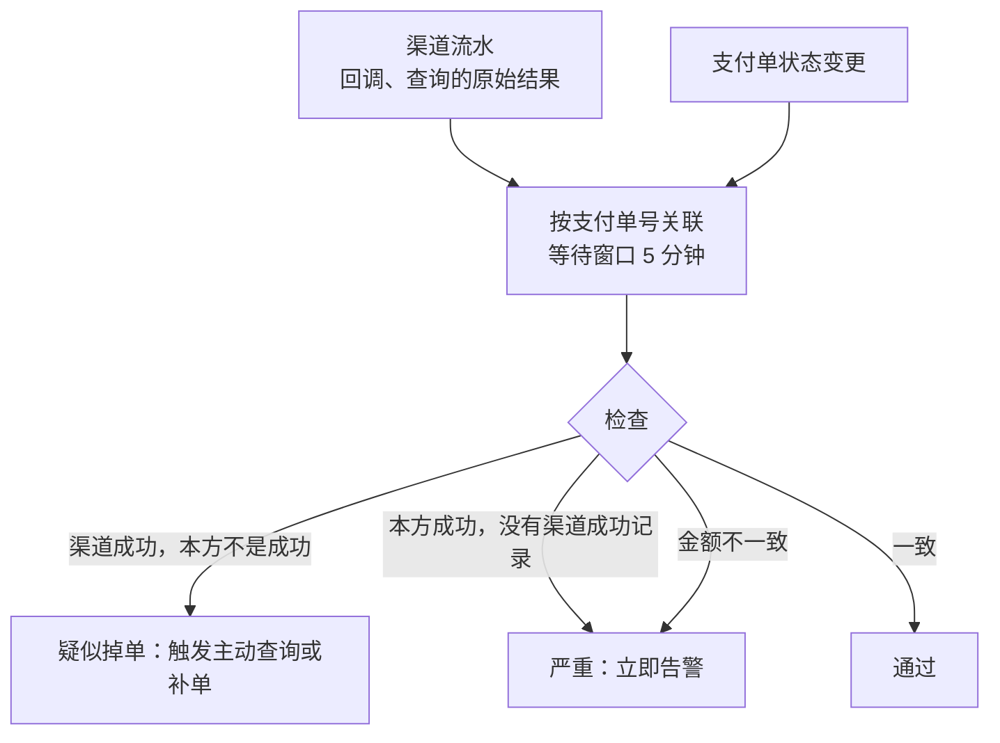
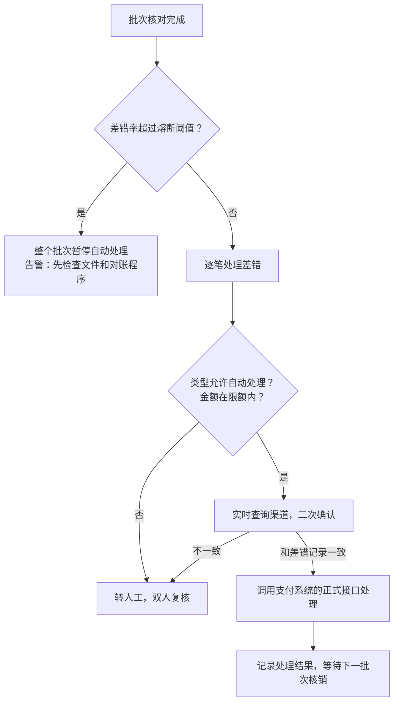

# S04 · 对账系统

> 适用岗位：Java 资深开发、Java 架构师。对账是资金类系统的最后一道防线：前面的幂等、重试、主动查询都可能有遗漏，对账负责把遗漏找出来并修复。速查版见[《29 场景题》](../06-三高与架构/29-场景题.md)的 29-05。
> 版本基线：JDK 21 / 25、MySQL 8.4。
> 事实核对：
> - 对账文件的提供时间、格式、字段，各支付渠道不同，文中写的是通常的情况，接入时以渠道的官方文档为准。
> - 本机运行（macOS 27.2、Apple M1 Max、JDK 25）：1 段分桶对账的代码只依赖 JDK，数据由程序生成，文中贴的是实际运行输出。
> - 本机没有 MySQL 服务端，文中的 SQL 都没有实际执行。
> 相关分类：[《S03 支付系统》](S03-支付系统.md)（支付单、渠道流水、掉单）、[《09 分布式理论》](../03-分布式与微服务/09-分布式理论.md)（最终一致性、幂等）、[《34 定时任务》](../07-工程实践与稳定性/34-定时任务.md)（大批量数据处理）、[《35 文件处理》](../07-工程实践与稳定性/35-文件处理.md)（大文件解析）

## 45 分钟答题版

| 时间 | 做什么 | 要讲出的关键点 | 子题 |
| --- | --- | --- | --- |
| 0～5 分钟 | 为什么要对账 | 最终一致性的兜底；对的是"两方各自的记录"；分清交易对账、资金对账、内部对账 | S04-01 |
| 5～12 分钟 | 整体流程 | 取数 → 标准化 → 核对 → 差错 → 处理 → 报告；每一步可重跑 | S04-02、S04-03 |
| 12～25 分钟 | 核对算法与差错 | 先总后分；分桶比对；四类差错各自的原因和处理 | S04-04、S04-05 |
| 25～33 分钟 | 时间问题 | 跨日、日切、挂账；T+1 太晚就加准实时对账 | S04-06、S04-07 |
| 33～45 分钟 | 扩展与风控 | 内部对账；自动处理差错的边界；重跑、监控 | S04-08 ～ S04-10 |

## 知识地图



## 题目索引

| 编号 | 题目 | 难度 |
| --- | --- | --- |
| S04-01 | 为什么需要对账？要对哪几类账？ | ★★ |
| S04-02 | 对账的整体流程和架构是什么？ | ★★★ |
| S04-03 | 渠道的对账文件怎么获取和标准化？ | ★★ |
| S04-04 | 每天几千万笔交易，怎么核对？ | ★★★ |
| S04-05 | 差错有哪几类？分别怎么处理？ | ★★★ |
| S04-06 | 跨日的交易怎么处理？什么是挂账？ | ★★★ |
| S04-07 | T+1 才发现问题太晚了，怎么做准实时对账？ | ★★ |
| S04-08 | 除了和渠道对，内部系统之间要对哪些账？ | ★★ |
| S04-09 | 差错可以自动处理吗？怎么防止对账程序自己造成资损？ | ★★★ |
| S04-10 | 对账任务失败了怎么重跑？要监控什么？ | ★★ |

---

## 一、定位与流程

### S04-01 为什么需要对账？要对哪几类账？

> ★★ ｜ 资深 / 架构师 ｜ 高频

**考察意图**：是否理解对账不是"财务的事"，而是分布式系统里保证最终一致性的一个必要环节。

**30 秒版回答**：

- **为什么**：支付涉及多个独立的系统（自己的支付中心、渠道、银行），它们之间靠网络通信，各自记各自的账。超时、丢消息、程序错误、人工操作，都会让两边的记录不一样。实时的手段（幂等、重试、主动查询）能处理大部分，但没法证明"没有遗漏"。对账是用**事后全量比较**的方式给出这个证明。
- **对账的本质**：拿两份**独立产生**的记录逐笔比较。如果两份数据其实是同一个来源，对出来永远是平的，没有意义。
- **三类账**：
  - **交易对账**：我方的支付单、退款单，对渠道的交易明细。回答"每一笔交易两边的记录一致吗"；
  - **资金对账**：渠道应该结算给我的金额，对银行账户实际到账的金额。回答"钱真的到了吗"；
  - **内部对账**：订单对支付、支付对账务、账务内部的借贷平衡。回答"自己的各个系统之间一致吗"。

**深入剖析**



三类对账发现的问题不同：

| 类型 | 能发现什么 | 发现不了什么 |
| --- | --- | --- |
| 交易对账 | 掉单、多收、少收、状态不一致 | 渠道确认了交易，但钱没有打过来 |
| 资金对账 | 渠道少结算、手续费算错、结算延迟 | 具体是哪一笔交易的问题（要回到交易对账查） |
| 内部对账 | 通知丢失、记账遗漏、内部程序错误 | 自己和外部不一致 |

**追问链**

1. **实时链路已经很可靠了，对账还有必要吗？** 有。可靠不等于没有遗漏：一次发布引入的 bug、一个新渠道的状态码映射错误，都可能让一批交易的状态是错的，而实时链路自己不会发现。对账的价值恰恰在于它**不信任实时链路**，用另一条独立的路径重新核实一遍。
2. **对账的结果给谁用？** 技术上，驱动差错的修复（补单、退款、修正状态）；财务上，作为收入确认和结算的依据；管理上，对账的差错率是衡量支付系统质量的一个指标。

---

### S04-02 对账的整体流程和架构是什么？

> ★★★ ｜ 架构师 ｜ 高频

**考察意图**：能否把对账拆成几个职责清楚、可以独立重跑的阶段，而不是一个从头跑到尾的大脚本。

**30 秒版回答**：

对账按**批次**进行，一个批次通常是"某个渠道、某一天"。每个批次经过六个阶段：

1. **取数**：下载渠道的对账文件；抽取本方同一时间范围的交易流水。
2. **标准化**：把各渠道不同格式的文件，转换成统一的对账明细结构，入库。
3. **核对**：先比总数和总金额，再按交易号逐笔匹配，比较金额和状态。
4. **差错生成**：不一致的记录写入差错表，标明类型。
5. **差错处理**：按类型自动处理（补单、退款、挂账），或者转人工。
6. **报告**：输出这个批次的对账结果，通知相关人员。

每个阶段的输入和输出都落库，阶段之间靠批次的状态衔接，任何一个阶段失败都可以单独重跑。

**深入剖析**



批次的状态机：



为什么本方的数据也要**抽取成一份快照**，而不是直接拿支付单表去比：

- 支付单表是在线库，对账的大范围扫描会影响线上交易；
- 支付单的状态还在变化，对账需要一个**固定的时间切面**，否则同一个批次跑两次的结果不一样；
- 统一成和渠道明细相同的结构之后，核对逻辑只需要写一套。

**追问链**

1. **对账系统和支付系统是什么关系？** 对账系统是独立的。它只读支付系统的数据（通过从库、数据同步或者导出），发现差错后通过支付系统的**正式接口**发起修正（比如"确认成功""发起退款"），不直接改支付系统的表。这样修正动作同样经过状态机和幂等的保护。
2. **一个渠道一天一个批次，粒度够吗？** 交易量很大时，可以再按商户号或者时间段拆成子批次并行处理。拆分的前提是渠道的文件也能按同样的维度拆开，否则只能在标准化之后再按交易号分桶（S04-04）。

---

### S04-03 渠道的对账文件怎么获取和标准化？

> ★★ ｜ 资深 ｜ 中频

**考察意图**：和外部打交道的地方最容易出意外：文件晚到、不完整、格式变了、重复下载。看你是否考虑了这些情况。

**30 秒版回答**：

- **获取方式**：渠道通常在第二天的某个时间之后提供前一天的对账文件，通过接口下载或者推送到指定的位置。
- **文件可能晚到**：定时任务不能只跑一次。没取到就按间隔重试，超过截止时间仍然没有，告警并转人工。
- **校验完整性**：很多渠道的文件带有汇总信息（总笔数、总金额），或者提供摘要值。解析之后先核对汇总和明细是否一致，不一致说明文件不完整，不能进入核对。
- **幂等**：同一个批次重复下载、重复入库，结果必须一样。入库前先清除这个批次的旧数据，或者以"批次号 + 渠道流水号"为唯一键。
- **标准化**：每个渠道一个解析器，输出统一的结构：渠道流水号、商户订单号、交易类型、金额、手续费、状态、交易时间。

**深入剖析**

标准化之后的明细表（本方和渠道各一张，结构相同）：

```sql
CREATE TABLE t_recon_channel_detail (
    id               BIGINT       NOT NULL PRIMARY KEY,
    batch_no         VARCHAR(32)  NOT NULL COMMENT '批次号：渠道 + 账期',
    channel_trade_no VARCHAR(64)  NOT NULL COMMENT '渠道流水号',
    pay_no           VARCHAR(32)  NOT NULL COMMENT '本方的支付单号或退款单号',
    trade_type       VARCHAR(16)  NOT NULL COMMENT 'PAY / REFUND',
    amount           BIGINT       NOT NULL COMMENT '金额，单位分',
    fee              BIGINT       NOT NULL COMMENT '手续费，单位分',
    status           VARCHAR(16)  NOT NULL,
    trade_time       DATETIME(3)  NOT NULL,
    bucket           INT          NOT NULL COMMENT '按 pay_no 哈希得到的桶号',
    UNIQUE KEY uk_batch_trade (batch_no, channel_trade_no, trade_type),
    KEY idx_batch_bucket (batch_no, bucket)
);
```

解析器要统一的差异：

| 差异 | 例子 | 处理 |
| --- | --- | --- |
| 文件格式 | CSV、定长文本、压缩包里多个文件 | 每个渠道独立的解析器 |
| 字符编码 | GBK、UTF-8 | 按渠道配置，解析前转换 |
| 金额单位 | 有的是元、有的是分 | 统一成分；元转分要用 `BigDecimal`，不能用浮点数乘 100 |
| 退款的表示 | 负数金额，或者单独的交易类型 | 统一成"交易类型 + 正数金额" |
| 时间 | 时区、格式不同 | 统一成同一时区 |
| 状态 | 各渠道的状态值不同 | 映射成统一的几种状态 |

大文件的解析要**流式读取**，一行一行处理，分批写入数据库，不要一次把整个文件读进内存，见[《35 文件处理》](../07-工程实践与稳定性/35-文件处理.md)。

**追问链**

1. **渠道的文件格式变了怎么办？** 解析器对格式要做严格校验：列数不对、必填字段为空、金额不是数字，都直接报错并中止这个批次，而不是跳过坏行继续。跳过坏行会让这些交易变成"渠道没有"，产生一批假的差错。
2. **文件里只有成功的交易吗？** 多数渠道的对账文件只包含成功的支付和成功的退款。所以本方抽取数据时，也只抽取成功状态的记录；本方"支付中""失败"的记录如果出现在渠道文件里，那就是差错。

---

## 二、核对与差错

### S04-04 每天几千万笔交易，怎么核对？

> ★★★ ｜ 资深 / 架构师 ｜ 高频

**考察意图**：两个大数据集求差异，是对账的核心算法。看你是否有"先总后分"的意识，以及内存放不下时怎么办。

**30 秒版回答**：

- **先总后分**：先比较两边的总笔数和总金额。都相等，这个批次大概率是平的，可以只做抽样或者低优先级的明细核对；不相等，再逐笔找差异。
- **数据量小**（几十万笔以内）：一边加载到哈希表里，另一边逐条查找、匹配后移除。最后哈希表里剩下的，是这一边独有的。
- **数据量大**：**分桶**。两边按同一个规则（交易号的哈希值对 N 取模）分到 N 个桶，同一个交易号一定落在两边的同一个桶里。每个桶分别用上面的办法比对，桶之间互不相关，可以并行。
- **不要**在 MySQL 里对两张千万级的表做全外连接：这会产生巨大的临时结果，执行时间不可控。
- 数据量再大（上亿笔），交给 Spark 这类离线计算引擎，思路仍然是"按键分区 + 分区内比对"。

**深入剖析**



用 JDK 实现这个过程。20 万笔交易，人为制造了 5 笔差错（本机 JDK 25 运行）：

```java
import java.util.ArrayList;
import java.util.HashMap;
import java.util.List;
import java.util.Map;
import java.util.Random;
import java.util.TreeMap;

/**
 * 对账的核心算法：先比总数和总金额，不平再按交易号分桶，逐桶在内存里比明细。
 * 数据是程序生成的，并且人为制造了四类差错。
 */
public class ReconDemo {

    private static final int TRADE_COUNT = 200_000;
    private static final int BUCKET_COUNT = 16;
    private static final long RANDOM_SEED = 20261112L;

    enum Status { SUCCESS, REFUNDED }

    enum DiffType { LOCAL_ONLY, CHANNEL_ONLY, AMOUNT_MISMATCH, STATUS_MISMATCH }

    record Trade(String tradeNo, long amountCent, Status status) { }

    record Diff(DiffType type, String tradeNo, String detail) { }

    public static void main(String[] args) {
        List<Trade> local = new ArrayList<>(TRADE_COUNT);
        List<Trade> channel = new ArrayList<>(TRADE_COUNT);
        Random random = new Random(RANDOM_SEED);
        for (int i = 0; i < TRADE_COUNT; i++) {
            Trade trade = new Trade("T" + (100_000_000 + i), 100 + random.nextInt(100_000), Status.SUCCESS);
            local.add(trade);
            channel.add(trade);
        }
        // 人为制造差错
        channel.remove(199_999);                                              // 本方有、渠道没有（跨日）
        channel.remove(5_000);                                                // 本方有、渠道没有
        local.remove(77);                                                     // 渠道有、本方没有（回调丢失）
        Trade t1 = local.get(1_000);
        local.set(1_000, new Trade(t1.tradeNo(), t1.amountCent() + 1, t1.status()));   // 金额差 1 分
        Trade t2 = local.get(2_000);
        local.set(2_000, new Trade(t2.tradeNo(), t2.amountCent(), Status.REFUNDED));   // 本方已退款，渠道未退

        // 第一步：总分核对。总笔数和总金额都相等，通常就不需要比明细了
        System.out.println("local   : count=" + local.size() + ", sum=" + sum(local));
        System.out.println("channel : count=" + channel.size() + ", sum=" + sum(channel));

        // 第二步：两边按同一个哈希规则分桶，同一个交易号一定落在同一个桶里
        List<List<Trade>> localBuckets = partition(local);
        List<List<Trade>> channelBuckets = partition(channel);
        List<Diff> diffs = new ArrayList<>();
        int maxBucketSize = 0;
        for (int i = 0; i < BUCKET_COUNT; i++) {
            maxBucketSize = Math.max(maxBucketSize, localBuckets.get(i).size());
            diffs.addAll(compare(localBuckets.get(i), channelBuckets.get(i)));
        }
        System.out.println("buckets=" + BUCKET_COUNT + ", largest bucket=" + maxBucketSize + " records");

        Map<DiffType, Integer> summary = new TreeMap<>();
        diffs.forEach(diff -> summary.merge(diff.type(), 1, Integer::sum));
        System.out.println("diff summary: " + summary);
        diffs.stream().sorted((a, b) -> a.tradeNo().compareTo(b.tradeNo()))
                .forEach(diff -> System.out.println("  " + diff.type() + "  " + diff.tradeNo() + "  " + diff.detail()));
    }

    private static long sum(List<Trade> trades) {
        return trades.stream().mapToLong(Trade::amountCent).sum();
    }

    private static List<List<Trade>> partition(List<Trade> trades) {
        List<List<Trade>> buckets = new ArrayList<>();
        for (int i = 0; i < BUCKET_COUNT; i++) {
            buckets.add(new ArrayList<>());
        }
        for (Trade trade : trades) {
            buckets.get(Math.floorMod(trade.tradeNo().hashCode(), BUCKET_COUNT)).add(trade);
        }
        return buckets;
    }

    /** 单个桶的比对：一边建哈希表，另一边逐条查找并移除，最后剩下的就是单边账 */
    private static List<Diff> compare(List<Trade> localBucket, List<Trade> channelBucket) {
        Map<String, Trade> remaining = new HashMap<>();
        localBucket.forEach(trade -> remaining.put(trade.tradeNo(), trade));
        List<Diff> diffs = new ArrayList<>();
        for (Trade theirs : channelBucket) {
            Trade ours = remaining.remove(theirs.tradeNo());
            if (ours == null) {
                diffs.add(new Diff(DiffType.CHANNEL_ONLY, theirs.tradeNo(), "channel amount=" + theirs.amountCent()));
            } else if (ours.amountCent() != theirs.amountCent()) {
                diffs.add(new Diff(DiffType.AMOUNT_MISMATCH, theirs.tradeNo(),
                        "local=" + ours.amountCent() + ", channel=" + theirs.amountCent()));
            } else if (ours.status() != theirs.status()) {
                diffs.add(new Diff(DiffType.STATUS_MISMATCH, theirs.tradeNo(),
                        "local=" + ours.status() + ", channel=" + theirs.status()));
            }
        }
        remaining.values().forEach(ours ->
                diffs.add(new Diff(DiffType.LOCAL_ONLY, ours.tradeNo(), "local amount=" + ours.amountCent())));
        return diffs;
    }
}
```

```text
local   : count=199999, sum=10036768869
channel : count=199998, sum=10036655569
buckets=16, largest bucket=13080 records
diff summary: {LOCAL_ONLY=2, CHANNEL_ONLY=1, AMOUNT_MISMATCH=1, STATUS_MISMATCH=1}
  CHANNEL_ONLY  T100000077  channel amount=438
  AMOUNT_MISMATCH  T100001001  local=69279, channel=69278
  STATUS_MISMATCH  T100002001  local=REFUNDED, channel=SUCCESS
  LOCAL_ONLY  T100005000  local amount=91251
  LOCAL_ONLY  T100199999  local amount=22486
```

- 第一步就发现了问题：两边差 1 笔、差 113300 分。但总数只能告诉你"不平"，不能告诉你是哪几笔。实际上有 5 笔差错，它们的笔数和金额互相抵消了一部分。
- 分成 16 个桶之后，最大的桶只有约 1.3 万条记录。桶的数量按"每个桶能轻松放进内存"来定。
- 5 笔差错都被找了出来，并且分好了类型。

为什么总数相等也**不能完全省掉**明细核对：两笔方向相反的差错可以恰好抵消。比如本方多记了一笔 100 元、少记了另一笔 100 元，总笔数和总金额都相等。所以总分核对通过只是降低了风险，重要的渠道仍然要做明细核对。

**追问链**

1. **用什么做匹配的键？** 用**本方的支付单号**（也就是发给渠道的商户订单号），它在两边都有。不要用渠道流水号做主键：掉单的情况下，本方可能根本没有记录到渠道流水号。
2. **桶数怎么定？** 总记录数 ÷ 单个桶的目标大小。单个桶的目标大小取决于内存：一条明细在内存里占几百字节，十万条约几十 MB。5000 万笔交易分成 512 个桶，每个桶约 10 万条。
3. **分桶是在数据库里做还是在程序里做？** 入库时就把桶号算好存进去（见 S04-03 的 `bucket` 字段），核对时按"批次号 + 桶号"查询，一次取一个桶的数据。这样不同的桶可以分给不同的线程或者不同的机器。

---

### S04-05 差错有哪几类？分别怎么处理？

> ★★★ ｜ 架构师 ｜ 高频

**考察意图**：发现差错只是开始。看你是否清楚每类差错背后的原因，以及哪些可以自动处理。

**30 秒版回答**：

| 类型 | 含义 | 常见原因 | 处理 |
| --- | --- | --- | --- |
| **本方单边** | 本方是成功，渠道文件里没有 | 跨日；本方状态错误 | 先挂账，下一个批次再匹配；仍然匹配不上，查询渠道确认，修正本方 |
| **渠道单边** | 渠道有，本方没有或者不是成功 | 回调丢失、处理失败；关单后到账 | 支付单仍在支付中：补单；支付单已关闭：退款 |
| **金额不一致** | 两边都有，金额不同 | 程序错误；数据被篡改；币种或单位处理错误 | 不自动处理，立即告警，人工核查 |
| **状态不一致** | 例如本方已退款，渠道未退款 | 退款回调丢失；退款实际失败 | 查询渠道确认后修正 |

- 每一笔差错都是一条**差错单**，有自己的状态：待处理 → 处理中 → 已解决 / 已核销。
- 处理差错必须通过支付系统的**正式接口**，不能直接改库。

**深入剖析**



**渠道单边**是最常见、也最要紧的一类：用户的钱已经被扣了，但本方不认。处理得越晚，投诉越多。

**本方单边**排除跨日之后，是最危险的一类：本方认为收到了钱（可能已经发货），渠道说没有这笔交易。这要么是本方的状态被错误地改成了成功，要么是有人伪造了回调。

**追问链**

1. **补单会不会和正常流程冲突？** 补单调用的是支付系统的"确认成功"接口，和回调、主动查询走的是同一个入口，由状态机的条件更新保证只生效一次（[《S03 支付系统》](S03-支付系统.md)S03-04）。如果对账期间回调恰好到了，两者只有一个会成功。
2. **差错单处理完，怎么确认真的平了？** 差错处理完成之后，在**下一个批次**里它应该正常出现并匹配上（比如补的退款会出现在第二天的渠道文件里）。差错单要记录"预期在哪个批次核销"，到时候自动核销；没有如期核销的，再次告警。
3. **手续费要不要核对？** 要。渠道的文件里通常有每笔的手续费，按合同约定的费率重新计算一遍，核对是否一致。手续费的差异单笔很小，累计起来可能很大，而且除了对账没有别的途径能发现。

---

## 三、时间问题

### S04-06 跨日的交易怎么处理？什么是挂账？

> ★★★ ｜ 资深 / 架构师 ｜ 中频

**考察意图**：对账里最常见的"假差错"来自两边对"这笔交易算哪一天"的认定不同。看你是否知道怎么消除这种噪声。

**30 秒版回答**：

- **现象**：23:59:59 发起的支付，本方记的成功时间是当天；渠道实际完成处理是第二天 00:00:01，把它放进了第二天的文件。当天对账时，这笔交易是"本方有、渠道没有"。
- **根因**：两边的**日切时间点**和**用来归属日期的时间字段**不同。本方可能按创建时间，渠道按完成时间；两边的时钟也有偏差。
- **做法：挂账**。单边账先不判定为差错，标记为"挂账"，带到下一个批次再匹配一次。下一批匹配上了，自动核销；还匹配不上，才升级为真正的差错。
- **减少跨日**：本方抽取数据时，时间范围比账期**前后各多取一段**（比如多取 10 分钟），多取的部分只用于匹配，不产生差错。

**深入剖析**



实现上，核对时把**上一个批次遗留的挂账记录**和本批次的数据合在一起参与匹配：

- 本批次的渠道明细，先和本批次的本方明细匹配；
- 匹配不上的渠道明细，再和**挂账池**里的本方记录匹配；
- 本批次匹配不上的本方明细，进入挂账池；
- 挂账池里超过期限（通常是一到两个批次）的记录，升级为差错。

反过来也一样：渠道有、本方当天的快照里没有的，可能是本方把它归到了前一天或者后一天，同样先到相邻批次的数据里找。

**追问链**

1. **挂账期间，这笔交易算平还是不平？** 算"待定"。对账报告里要把挂账的笔数和金额单独列出来：批次的结果是"平账 X 笔，挂账 Y 笔，差错 Z 笔"。挂账的金额如果异常大，本身就是一个信号。
2. **为什么不干脆让本方按渠道的规则来归属日期？** 做不到完全一致。本方不知道渠道内部是哪一刻完成处理的，回调里的完成时间和渠道账单里用的时间也未必是同一个字段。能做的是尽量接近（用渠道回调里的完成时间作为本方的交易时间），剩下的靠挂账消除。
3. **节假日渠道不出文件怎么办？** 有些渠道节假日不提供文件，节后一次性提供多天的。批次的调度要能处理"文件晚到几天"：批次保持"待取数"的状态，文件到了再继续。这期间准实时对账（S04-07）就显得更重要。

---

### S04-07 T+1 才发现问题太晚了，怎么做准实时对账？

> ★★ ｜ 架构师 ｜ 中频

**考察意图**：T+1 对账的弱点是晚。看你是否能在不依赖渠道文件的前提下，把发现问题的时间提前。

**30 秒版回答**：

- **T+1 的问题**：今天上午出的 bug，要到明天下午才被对账发现，中间已经错了一整天的交易。
- **准实时对账的思路**：不等渠道的文件，用**交易过程中已经拿到的渠道数据**（回调报文、主动查询的结果）和本方的状态做比较，延迟从一天缩短到分钟级。
- **做法**：
  - 把渠道流水（每一次回调、查询的原始结果）和支付单的状态变更，作为两条事件流；
  - 用流处理（Flink，或者一个简单的定时任务）按支付单号把两边关联起来；
  - 在一个时间窗口内（比如 5 分钟）检查：渠道说成功了，本方是不是成功；金额是否一致；本方成功的，有没有对应的渠道成功记录。
- **它不能替代 T+1**：准实时对账用的渠道数据是本方自己收到的，回调如果整个丢了，它也看不到。**文件对账仍然是最终的依据**。

**深入剖析**



两种对账的分工：

| | 准实时对账 | T+1 文件对账 |
| --- | --- | --- |
| 数据来源 | 本方收到的渠道回调和查询结果 | 渠道提供的对账文件 |
| 延迟 | 分钟级 | 一天 |
| 能发现 | 本方内部处理的错误：回调收到了但没处理对 | 所有不一致，包括回调完全没收到的 |
| 作用 | 尽早发现、尽早止损 | 最终依据、财务确认 |

**追问链**

1. **没有流处理平台，怎么做？** 用定时任务也可以：每几分钟扫描一次"最近一段时间有渠道成功记录、但支付单不是成功"的数据，以及"支付单成功、但没有渠道成功流水"的数据。这其实就是把主动查询和补单的逻辑再检查一遍。
2. **除了逐笔核对，还有什么实时的手段？** **总量监控**：按分钟统计本方的成功笔数和金额，与渠道回调的成功笔数和金额比较，两条曲线应该基本重合。出现明显的缺口，不需要等逐笔核对就能发现问题。

---

## 四、扩展与风控

### S04-08 除了和渠道对，内部系统之间要对哪些账？

> ★★ ｜ 资深 / 架构师 ｜ 中频

**考察意图**：是否把"对账"理解成一种通用的一致性保障手段，而不仅是支付的专属。

**30 秒版回答**：

凡是**跨系统的最终一致**，都应该有对账兜底：

| 对账的双方 | 核对什么 | 不一致说明什么 |
| --- | --- | --- |
| 订单 ↔ 支付 | 已支付的订单，都有成功的支付单；反之亦然 | 支付成功的通知丢了；重复支付没有退款 |
| 支付 ↔ 账务 | 每张成功的支付单、退款单，都有对应的记账凭证 | 记账遗漏或者重复 |
| 账务内部 | 所有分录的借方合计 = 贷方合计；账户余额 = 流水累计 | 记账程序错误 |
| 订单 ↔ 库存 | 已支付订单占用的库存 = 库存流水的扣减量 | 超卖、少卖、回补出错 |
| 营销 ↔ 订单 | 已核销的优惠券，都有对应的订单；优惠金额不超过预算 | 券被重复使用；预算超发 |
| 缓存 ↔ 数据库 | Redis 里的库存、余额，与数据库一致 | 异步落库失败 |

**深入剖析**

内部对账和渠道对账的区别：

- **数据都在自己手里**，不用等文件，可以做得更频繁（每小时，甚至每几分钟）；
- 双方的数据都在变化，要选一个**稳定的时间范围**：只核对"N 分钟之前"的数据，给异步流程留出完成的时间。否则会把"还没来得及同步"的记录都当成差错；
- 差错的处理通常是**重新驱动一次**：重新发送通知、重新触发记账，下游幂等处理。

账务系统自己的两个恒等式，是最容易自动化的对账：

- **试算平衡**：任意时间范围内，所有分录的借方合计等于贷方合计；
- **余额核对**：每个账户，期初余额 + 这段时间的流水合计 = 期末余额。

这两个等式不依赖任何外部数据，可以每天全量检查一次。不平，就说明记账的程序有 bug。

**追问链**

1. **每一对系统都写一套对账程序，成本太高怎么办？** 抽象成通用的对账平台：每个对账任务配置"两边的数据源、匹配的键、要比较的字段、时间范围、差错的处理方式"，核对引擎是同一套。新增一种对账只需要加配置。
2. **业务系统的数据没有保留流水，对不了怎么办？** 这是设计阶段的问题：只保存当前状态、不保存变更流水的系统，出了问题没有东西可以核对。库存、余额、优惠券这类"数量会变"的数据，必须有流水表，每次变更记一条，带上业务单号。

**架构师加分点**

- 把"可对账"作为设计评审的一项要求：新系统上线前要回答"它和上下游之间靠什么核对一致性""流水保存在哪里""多久对一次"。等到出了资损再补对账，往往已经没有历史数据可以比了。

---

### S04-09 差错可以自动处理吗？怎么防止对账程序自己造成资损？

> ★★★ ｜ 架构师 ｜ 中频

**考察意图**：自动补单、自动退款是在"动钱"。对账程序本身也是程序，也会有 bug。看你是否给自动化设了边界。

**30 秒版回答**：

- **可以自动处理的**：原因明确、处理动作确定、可以撤销或影响有限的差错。例如挂账、支付中的掉单补成功、关单后到账的自动退款。
- **不能自动处理的**：金额不一致、本方有而渠道确认没有、找不到支付单的渠道记录。这些要人工核查原因。
- **给自动处理设边界**：
  - **单笔金额上限**和**每个批次的总笔数、总金额上限**。超过上限，停止自动处理，转人工；
  - **差错率熔断**：一个批次的差错比例异常高（比如超过 1%），几乎可以肯定是对账本身出了问题（文件不完整、解析错误），这时**整个批次都不自动处理**；
  - **处理前二次确认**：自动补单或退款之前，再实时查询一次渠道，确认当前的真实状态；
  - **全部走正式接口**，有幂等、有审计。
- **人工处理**要有双人复核和完整的操作记录。

**深入剖析**



为什么**差错率熔断**这么重要：假设某一天渠道的文件只下载了一半，核对的结果是一半的交易都是"本方单边"。如果程序照常处理，会把大量正常的交易判定为"渠道没有"，接着修正状态、甚至取消订单。**大面积的差错几乎总是对账流程自己的问题**，正确的反应是停下来检查，而不是加速处理。

**追问链**

1. **自动退款退错了怎么追回？** 很难，这就是为什么要有限额和二次确认。退款是资金流出，一旦到了用户账户，追回要靠协商。所以自动退款的规则要保守，宁可多转几笔人工，也不要放开。
2. **谁来"对"对账系统的账？** 对账系统自己的处理结果要可验证：每个批次有处理前后的统计（多少笔平账、多少笔差错、处理了多少笔、金额是多少），自动处理的每一笔都对应一条可追溯的记录。最终，下一个批次的核销情况就是对它的检验：处理正确的差错，会在后续的批次里消失。

---

### S04-10 对账任务失败了怎么重跑？要监控什么？

> ★★ ｜ 资深 ｜ 中频

**考察意图**：对账是每天都跑的批处理任务，一定会遇到失败。看你是否把"可重跑"当成设计要求，而不是出事后的手工补救。

**30 秒版回答**：

- **按阶段、按批次重跑**：每个批次记录走到了哪个阶段。重跑时从失败的阶段开始，不需要从头下载文件。
- **每个阶段都幂等**：
  - 入库：以"批次号 + 流水号"为唯一键，或者先删除这个批次的旧数据再写；
  - 核对：重新核对前，清除这个批次**未处理**的差错单；已经处理过的差错单保留，不能再处理一次；
  - 差错处理：差错单有状态，处理动作有幂等键。
- **重跑不能影响已经确认的结果**：财务已经确认过的批次要锁定，重跑需要审批。
- **监控**：批次是否按时完成、差错的笔数和金额、挂账的规模、差错的处理时长。

**深入剖析**

| 指标 | 含义 | 告警条件示例 |
| --- | --- | --- |
| 批次完成时间 | 每个渠道的批次是否在截止时间前完成 | 超过截止时间仍未完成 |
| 文件到达时间 | 渠道文件是否按时提供 | 比平时晚很多 |
| 总分核对结果 | 总笔数、总金额的差值 | 差值不为零 |
| 差错率 | 差错笔数 ÷ 总笔数 | 高于历史水平 |
| 各类差错的笔数和金额 | 分类型统计 | 金额不一致类型只要出现就告警 |
| 挂账的笔数和金额 | 等待下一个批次匹配的记录 | 明显高于平时 |
| 未解决差错的存量和最长处理时间 | 差错单的积压 | 超过规定的处理时限 |
| 自动处理的笔数和金额 | 自动补单、自动退款 | 接近限额 |

对账任务本身是一个典型的大批量数据处理任务，分片、限速、断点续跑的通用做法见[《34 定时任务》](../07-工程实践与稳定性/34-定时任务.md)34-12。

**追问链**

1. **对账任务跑得太慢，赶不上第二天的业务怎么办？** 先找出慢在哪个阶段。文件解析慢：流式解析、批量写入、并行处理多个文件。核对慢：增加桶数并行比对。数据抽取慢：从专门的从库或数据仓库抽取，按主键范围分段并行。
2. **对账的数据要保留多久？** 对账明细量很大，保留几个月后可以归档；差错单和对账报告是财务和审计的依据，按合规要求长期保存。

**生产实践 / 踩坑**

- **对账读的是有延迟的从库**：从库延迟期间，一些刚成功的交易还没同步过来，被当成"渠道单边"。抽取数据前检查从库的延迟，或者只抽取"足够早"的数据。
- **元和分的转换用了浮点数**：`19.99 * 100` 在浮点数下得到 1998.9999999999998，取整后变成 1998，每一笔这样的交易都会报金额不一致。金额解析必须用 `BigDecimal`。
- **重跑时重复处理了差错**：第一次已经对一笔渠道单边账做了补单，重跑又生成了一条新的差错单并再次处理。差错单要以"批次号 + 交易号 + 差错类型"为唯一键，重跑时已有的差错单不重复生成。
