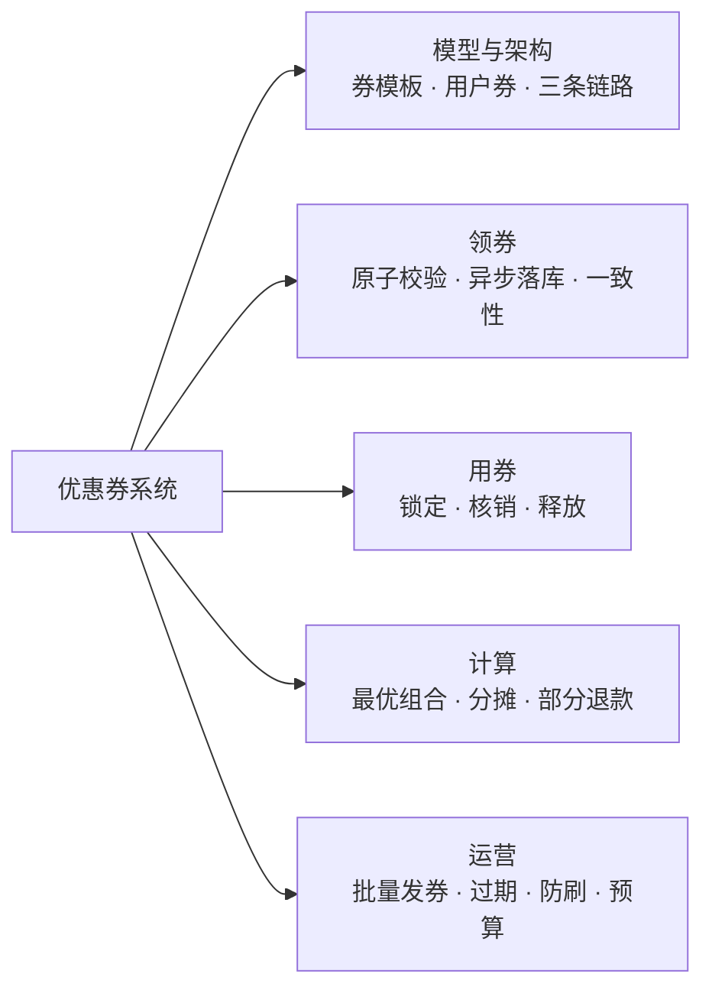
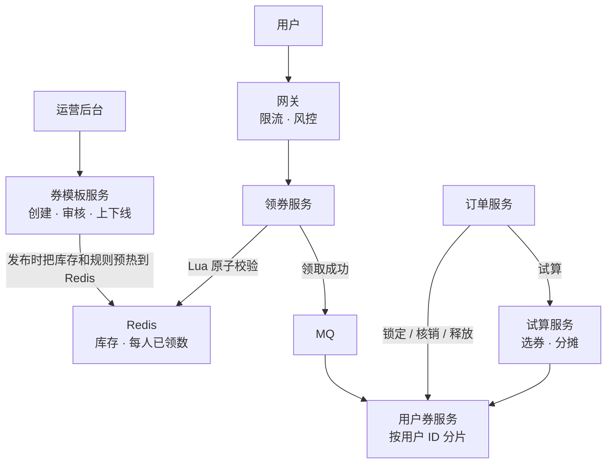
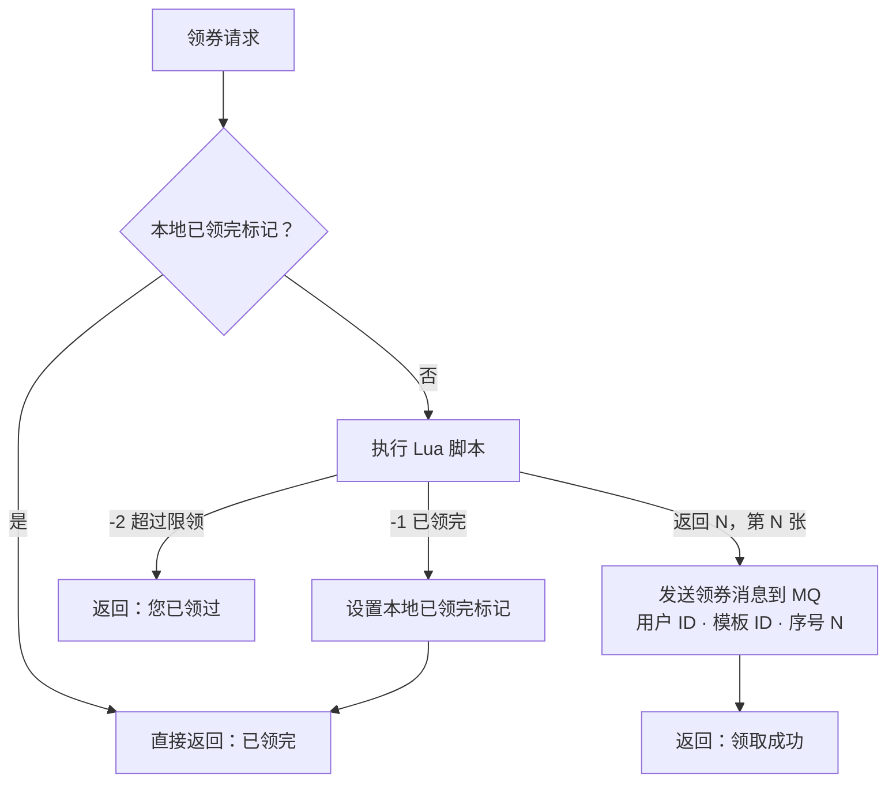
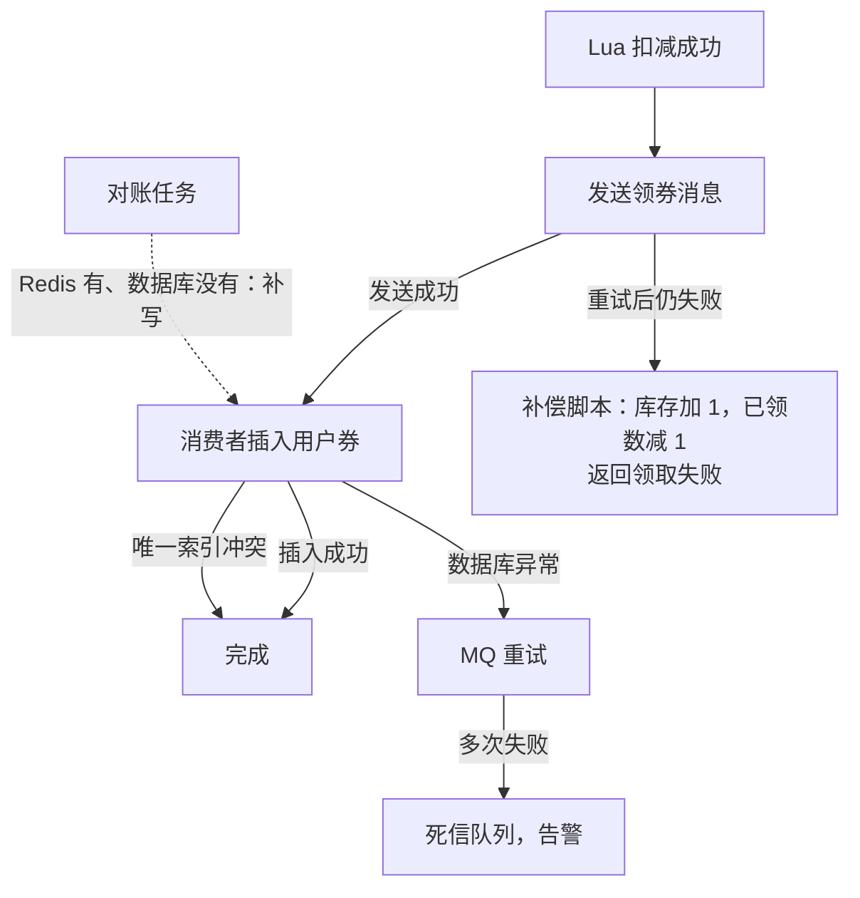
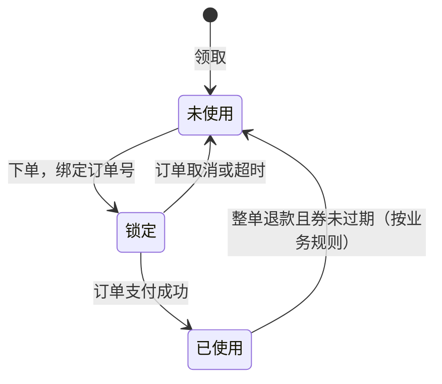
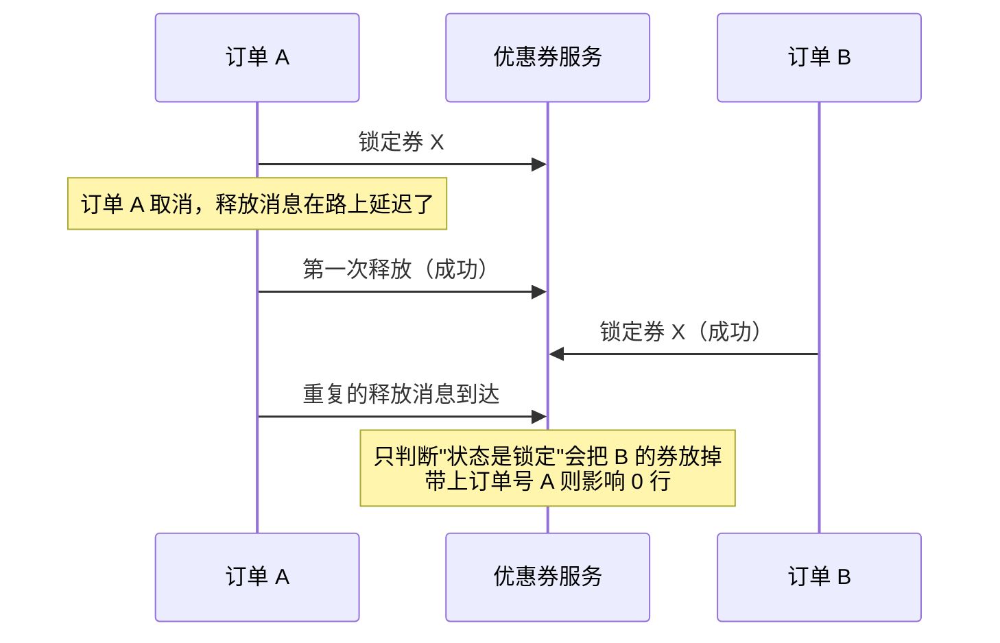
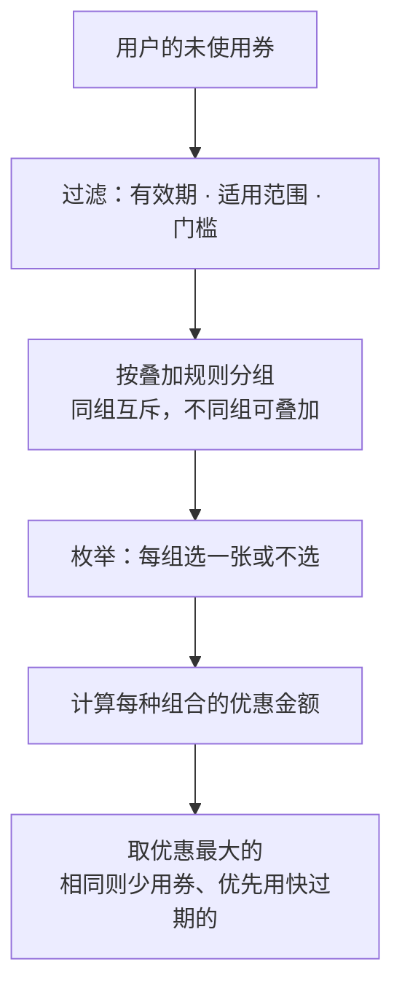
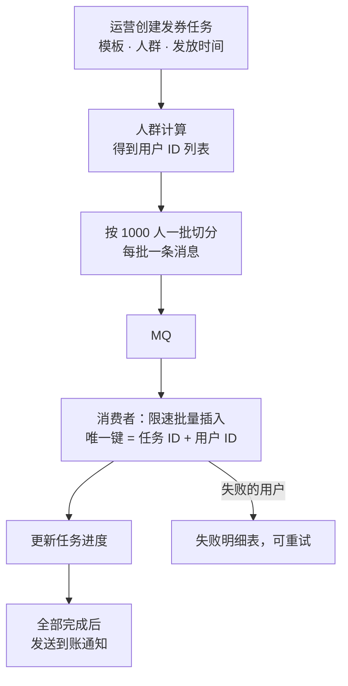
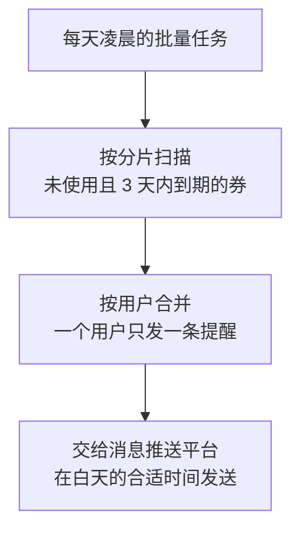

# S05 · 优惠券系统

> 适用岗位：Java 资深开发、Java 架构师。优惠券系统同时考察三件事：高并发下的发放（不超发）、与订单的状态协同（不重复使用）、金额计算（选券和分摊）。速查版见[《29 场景题》](../06-三高与架构/29-场景题.md)的 29-06。
> 版本基线：JDK 21 / 25、Redis 7.x / 8.x、MySQL 8.4、RocketMQ 5.x。
> 事实核对：
> - Redis 脚本的原子性、Cluster 下多个 Key 必须在同一个槽位，沿用[《S01 秒杀系统》](S01-秒杀系统.md)中对照 Redis 官方文档核对的结论。
> - 本机运行（macOS 27.2、Apple M1 Max、JDK 25、Redis 6.2.6）：
>   - 1 段选券和分摊的代码只依赖 JDK，文中贴的是实际运行输出；
>   - 领券脚本在本机临时启动的 Redis 6.2.6 上，用 20 个并发的 redis-cli 进程发了 200 个请求实测；
>   - 本机没有 MySQL 服务端，文中的 SQL 都没有实际执行。
> 相关分类：[《S01 秒杀系统》](S01-秒杀系统.md)（原子扣减、可靠落库）、[《S02 订单超时取消与延迟任务》](S02-订单超时取消与延迟任务.md)（取消后的释放）、[《17 Redis》](../04-数据存储/17-Redis.md)、[《20 MQ 通用与选型》](../05-消息队列/20-MQ通用与选型.md)（幂等）、[《16 分库分表》](../04-数据存储/16-分库分表.md)

## 45 分钟答题版

| 时间 | 做什么 | 要讲出的关键点 | 子题 |
| --- | --- | --- | --- |
| 0～5 分钟 | 澄清需求 | 券的类型、发放方式、叠加规则；**不超发、不重复使用、算得对** | S05-01 |
| 5～12 分钟 | 模型与架构 | 券模板和用户券分开；发放、使用、计算三条链路 | S05-02 |
| 12～25 分钟 | 领券 | Redis Lua 原子校验库存和限领；MQ 异步落库；唯一索引防重 | S05-03、S05-04 |
| 25～33 分钟 | 用券 | 未使用 → 锁定 → 已使用；条件更新带订单号；取消时释放 | S05-05 |
| 33～40 分钟 | 计算 | 最优券组合；优惠分摊到商品；部分退款 | S05-06、S05-07 |
| 40～45 分钟 | 运营侧 | 批量发券、过期、防刷、预算与对账 | S05-08 ～ S05-10 |

## 知识地图



## 题目索引

| 编号 | 题目 | 难度 |
| --- | --- | --- |
| S05-01 | 优惠券系统要澄清哪些需求？ | ★★ |
| S05-02 | 数据模型和整体架构怎么设计？ | ★★★ |
| S05-03 | 高并发领券，怎么做到不超发、不超领？ | ★★★ |
| S05-04 | Redis 里领到了，数据库怎么可靠落库？两边不一致怎么办？ | ★★★ |
| S05-05 | 下单用券的状态怎么流转？订单取消时怎么释放？ | ★★★ |
| S05-06 | 下单时怎么帮用户选出最优的券组合？ | ★★ |
| S05-07 | 优惠金额怎么分摊到每个商品？部分退款时怎么退？ | ★★★ |
| S05-08 | 给 1000 万用户每人发一张券，怎么做？ | ★★ |
| S05-09 | 券过期怎么处理？要不要定时任务去改状态？ | ★★ |
| S05-10 | 怎么防刷？怎么控制预算？要对哪些账？ | ★★ |

---

## 一、需求与模型

### S05-01 优惠券系统要澄清哪些需求？

> ★★ ｜ 资深 / 架构师 ｜ 高频

**考察意图**：优惠券的规则千变万化。看你能不能抓住决定技术方案的那几个问题，而不是陷进业务规则的细节里。

**30 秒版回答**：

- **券的类型**：满减、折扣、无门槛（立减）、运费券。类型决定计算规则。
- **发放方式**：用户主动领取（可能是抢）、系统批量发放、下单或注册后赠送、兑换码。发放方式决定并发模型。
- **使用规则**：适用范围（全场、品类、店铺、单品）、门槛、能不能叠加、有效期是固定日期还是领取后 N 天。
- **三条硬约束**：
  1. **不超发**：发出去的张数不超过发行量，每个人不超过限领数；
  2. **不重复使用**：一张券只能用在一个订单上；
  3. **算得对**：优惠金额、分摊、退款时的退还，每一分钱都能对上。
- **量级**：券模板不多（几千到几万个），用户券是亿级。读多写少，但抢券时写入非常集中。

**深入剖析**

| 问题 | 为什么要问 | 本文的假设 |
| --- | --- | --- |
| 有没有"限时抢券"？ | 决定领券是不是高并发场景 | 有，热门券几秒内被抢完 |
| 每人限领几张？ | 决定限领的校验方式 | 每个模板每人限领 1～N 张，可配置 |
| 券能叠加吗？ | 决定下单时的计算复杂度 | 平台券和店铺券可以各用一张，同类互斥 |
| 有效期怎么算？ | 决定用户券上存什么 | 两种都支持，用户券上保存算好的起止时间 |
| 订单部分退款时券怎么办？ | 决定是否需要分摊 | 按分摊金额退款，券不退还；整单退款且未过期时退还 |
| 用户量和发券量？ | 决定存储和分片 | 1 亿用户，用户券累计几十亿张 |

估算：

- 用户券表：1 亿用户 × 平均每人每年领 30 张 = 每年 30 亿行，必须分库分表，按用户 ID 分片；
- 抢券峰值：一张发行 10 万张的热门券，几十万人同时点击，峰值每秒几万到十几万次请求，其中只有 10 万次能成功；
- "我的优惠券"和下单页"可用券"是最频繁的读，都是按用户 ID 查询，落在单个分片上。

**追问链**

1. **优惠券和秒杀有什么相同和不同？** 抢券和秒杀的并发模型几乎一样：大量请求争抢有限的数量，方案也相通（[《S01 秒杀系统》](S01-秒杀系统.md)）。不同的是优惠券后面还有很长的生命周期：领到之后要保存、查询、使用、退还、过期，而秒杀抢到之后就是一个普通订单了。
2. **优惠券、满减活动、红包、积分，是一个系统吗？** 它们都属于"营销"，但模型不同。优惠券是发到用户手里的一张**凭证**，有归属、有状态；满减活动是一条**规则**，不发给任何人，满足条件自动生效。面试时先说明讨论的是凭证类的优惠券，规则类的活动在计算环节（S05-06）一并考虑即可。

---

### S05-02 数据模型和整体架构怎么设计？

> ★★★ ｜ 资深 / 架构师 ｜ 高频

**考察意图**：能否把"规则"和"实例"分开建模，并按读写特征拆分链路。

**30 秒版回答**：

- **券模板**（规则，数量少）：类型、面额或折扣、门槛、适用范围、有效期规则、发行总量、每人限领数、状态。运营在后台创建和审核。
- **用户券**（实例，数量大）：用户 ID、模板 ID、状态、有效期起止时间、使用它的订单号、领取的批次或序号。按用户 ID 分片。
- **三条链路**：
  - **发放**：高并发写。Redis 做原子校验，MQ 异步落库；
  - **使用**：和订单协同。锁定、核销、释放，全部是数据库的条件更新；
  - **计算**：无状态的试算服务。输入购物车和用户的券，输出最优方案和分摊结果。
- 用户券上**冗余一份模板的关键规则**（面额、门槛、有效期），模板后来被修改，不影响已经发出去的券。

**深入剖析**



用户券表：

```sql
CREATE TABLE t_user_coupon (
    id               BIGINT       NOT NULL PRIMARY KEY,
    user_id          BIGINT       NOT NULL,
    template_id      BIGINT       NOT NULL,
    receive_seq      INT          NOT NULL COMMENT '该用户领取这个模板的第几张',
    status           VARCHAR(16)  NOT NULL COMMENT 'UNUSED / LOCKED / USED',
    coupon_type      VARCHAR(16)  NOT NULL COMMENT '冗余模板的类型',
    threshold_amount BIGINT       NOT NULL COMMENT '冗余模板的门槛，单位分',
    discount_amount  BIGINT       NOT NULL COMMENT '冗余模板的面额，单位分',
    valid_start_time DATETIME(3)  NOT NULL,
    valid_end_time   DATETIME(3)  NOT NULL,
    order_id         VARCHAR(32)  NULL COMMENT '锁定或使用它的订单号',
    receive_time     DATETIME(3)  NOT NULL,
    update_time      DATETIME(3)  NOT NULL,
    UNIQUE KEY uk_user_tpl_seq (user_id, template_id, receive_seq),
    KEY idx_user_status_end (user_id, status, valid_end_time)
);
```

- `uk_user_tpl_seq` 是防止重复发放的最后一道保证（S05-04）；
- `idx_user_status_end` 支撑"我的可用券"：某个用户、未使用、还没过期的券。

**追问链**

1. **为什么要在用户券上冗余模板的规则？** 运营可能在活动中途修改模板（比如把面额从 10 元调成 8 元）。已经发到用户手里的券，应该按领取时的规则兑现，否则就是对用户违约。冗余之后，模板的修改只影响之后新发的券。更严格的做法是模板不可变，修改就生成一个新的版本。
2. **适用范围（品类、店铺、商品）这种复杂规则存在哪？** 存在模板上，用结构化的字段或者 JSON 表达。用户券上只存模板 ID，试算时读取模板的范围规则。模板数量少、读多写少，适合放在本地缓存里，见[《18 本地缓存》](../04-数据存储/18-本地缓存.md)。
3. **"某张券被谁领了"这种按模板维度的查询怎么支持？** 用户券按用户 ID 分片，按模板查要扫所有分片。这类查询属于运营分析，走数据仓库或者 Elasticsearch，不走在线库。

---

## 二、领券

### S05-03 高并发领券，怎么做到不超发、不超领？

> ★★★ ｜ 资深 / 架构师 ｜ 高频

**考察意图**：两个校验（库存够不够、这个人领没领过）加一个扣减，必须是一个原子操作。看你是否清楚为什么，以及怎么实现。

**30 秒版回答**：

- **超发是怎么发生的**：两个请求同时读到"剩余 1 张"，都判断可以领，都扣减，结果发出去 2 张。**超领**同理：同一个用户的两个请求同时读到"已领 0 张"。
- **做法**：把"判断库存、判断限领、扣库存、记已领数"写进一个 **Redis Lua 脚本**。脚本在 Redis 里原子执行，中间不会插入别的命令。
- **数据结构**：一个 String 存剩余库存；一个 Hash 存每个用户已领的张数。
- **脚本的返回值是"这是该用户领的第几张"**，落库时作为唯一索引的一部分，用来防止重复落库。
- Redis 之前还有两层：网关按用户限流；领完之后，在应用本地设一个"已领完"的标记，后面的请求直接返回，不再访问 Redis。

**深入剖析**

领券脚本（已在本机 Redis 6.2.6 上并发测试）：

```lua
-- KEYS[1]：券模板剩余库存  KEYS[2]：用户已领数量（Hash：用户 ID → 已领张数）
-- ARGV[1]：用户 ID  ARGV[2]：每人限领张数
local stock = tonumber(redis.call('GET', KEYS[1]) or '0')
if stock <= 0 then
    return -1  -- 已领完
end
local received = tonumber(redis.call('HGET', KEYS[2], ARGV[1]) or '0')
if received >= tonumber(ARGV[2]) then
    return -2  -- 超过每人限领
end
redis.call('DECR', KEYS[1])
-- 返回这是该用户领取的第几张，落库时作为唯一键的一部分
return redis.call('HINCRBY', KEYS[2], ARGV[1], 1)
```

测试方法：库存 30 张，每人限领 1 张；50 个用户每人发 4 个请求，共 200 个请求，由 20 个并发的 redis-cli 进程发出。结果：

```text
requests           = 200
received (1)       = 30
sold out (-1)      = 83
over limit (-2)    = 87
stock left         = 0
users with coupon  = 30
max per user       = 1
```

- 成功 30 次，正好等于库存，没有超发；
- 30 个用户领到了券，每人最多 1 张，没有超领；
- 其余 170 个请求分别因为"已领完"和"超过限领"被拒绝。两者各占多少取决于请求到达的顺序，每次运行不同，但成功数和每人上限不变。



Redis Cluster 下，脚本访问的多个 Key 必须落在同一个槽位。两个 Key 都带上相同的哈希标签，例如 `{coupon:9}:stock` 和 `{coupon:9}:received`。

**追问链**

1. **为什么不用数据库的条件更新？** `UPDATE ... SET stock = stock - 1 WHERE id = ? AND stock > 0` 同样能防超发，普通的领券用它就够了。问题在热门券：几万个请求同时更新同一行，全部在行锁上排队，数据库的连接很快被占满，连带影响其他业务。Redis 单线程执行脚本没有锁竞争，本机实测单实例每秒可以执行约 9.6 万次扣减脚本（[《S01 秒杀系统》](S01-秒杀系统.md)S01-06）。
2. **已领数的 Hash 会不会成为大 Key？** 会。一张券被 100 万人领取，Hash 里就有 100 万个字段。处理办法：按用户 ID 的哈希值把 Hash 拆成多个（和库存 Key 用同一个哈希标签）；活动结束后及时删除，删除大 Key 用 `UNLINK` 而不是 `DEL`。大 Key 的治理见[《17 Redis》](../04-数据存储/17-Redis.md)17-07。
3. **每人限领的校验能不能只靠数据库的唯一索引？** 能保证正确，但所有请求都要打到数据库才知道结果。Redis 里的校验是为了把绝大多数重复请求挡在前面，唯一索引是最后的保证。两层都要有。

---

### S05-04 Redis 里领到了，数据库怎么可靠落库？两边不一致怎么办？

> ★★★ ｜ 资深 / 架构师 ｜ 高频

**考察意图**：Redis 扣减成功之后，到用户券真正写进数据库之间，有好几个可能失败的地方。看你是否逐个考虑过。

**30 秒版回答**：

- **流程**：Lua 扣减成功 → 发 MQ 消息 → 消费者写用户券表。
- **消息重复**：以 `(用户 ID, 模板 ID, 领取序号)` 为唯一索引。同一条消息消费两次，第二次插入冲突，按成功处理。
- **消息发送失败**：Redis 已经扣了，消息没发出去，用户就"领到了但看不到"。做法：发送失败时**同步重试**几次；仍然失败，就在 Redis 里执行补偿脚本把库存和已领数还回去，并告诉用户领取失败。
- **消费失败**：MQ 重试；多次失败进入死信队列并告警，人工或者程序补发。
- **兜底**：定期对账。Redis 里记录的"已领用户和张数"与数据库里的用户券逐一比较，数据库少了就补写。
- **原则**：以数据库为准。Redis 是为了抗并发的"预扣"，用户最终有没有这张券，看数据库。

**深入剖析**



可能出现的不一致，以及影响：

| 情况 | 结果 | 影响 | 处理 |
| --- | --- | --- | --- |
| Redis 扣了，消息没发出去，补偿也失败 | Redis 少了一张库存，没有人拿到 | 少发一张（可以接受） | 对账发现后补写或者回补库存 |
| 消息消费延迟 | 用户领成功了，"我的券"里暂时看不到 | 体验问题 | 前端提示"发放中"；领取成功后短时间内从 Redis 读取已领记录来展示 |
| Redis 主从切换丢了最近的扣减 | Redis 的库存比实际多 | 可能**超发** | 见追问 1 |

所有失败的方向里，只有最后一种会导致超发，其余都是少发。

**追问链**

1. **Redis 主从切换丢数据导致超发，怎么办？** Redis 的主从复制是异步的，主节点宕机时，最近的几次扣减可能没有同步到从节点，从节点升为主节点之后库存"回到了过去"。防线在数据库：消费者落库时，用一条条件更新给模板的已发数量加 1（`WHERE issued_count < total_count`），更新失败就不发这张券，并通知用户领取失败。这样即使 Redis 多放了几个请求进来，数据库这一层也能挡住。对普通的优惠券，少量超发的损失通常可以接受，是否加这道防线取决于券的价值。
2. **为什么不用事务消息？** 事务消息解决的是"本地数据库事务"和"发消息"的一致性。这里的第一步是 Redis 操作，不是数据库事务，用不上。Redis 的扣减也没法"回查"得很可靠。所以采用的是"发送失败就补偿 + 对账兜底"。
3. **可以先写数据库再扣 Redis 吗？** 那样数据库就要承受全部的并发请求，Redis 就失去了意义。顺序必须是先用 Redis 筛出少量成功的请求，再让这些请求去写数据库。

---

## 三、用券

### S05-05 下单用券的状态怎么流转？订单取消时怎么释放？

> ★★★ ｜ 资深 / 架构师 ｜ 高频

**考察意图**：券和订单是两个系统。看你是否保证了"一张券只被一个订单使用"，以及取消、超时、消息乱序时不出错。

**30 秒版回答**：

- **状态**：未使用 → 锁定 → 已使用。
  - **下单**时锁定：把券和订单号绑定；
  - **支付成功**后核销：锁定 → 已使用；
  - **订单取消或超时**时释放：锁定 → 未使用。
- **每一步都是条件更新**，根据影响行数判断成败。
- **锁定时**同时校验：券属于这个用户、状态是未使用、在有效期内。
- **核销和释放时必须带上订单号**：防止一条迟到的消息，操作了已经被另一个订单锁定的券。
- 为什么要有"锁定"这个中间状态：下单到支付之间有一段时间。直接标记"已使用"，用户不付款的话还要改回来，而且区分不了"真的用了"和"占着没付"。

**深入剖析**



三条 SQL：

```sql
-- 下单时锁定：归属、状态、有效期一起校验
UPDATE t_user_coupon
SET status = 'LOCKED', order_id = #{orderId}, update_time = NOW(3)
WHERE id = #{couponId} AND user_id = #{userId}
  AND status = 'UNUSED' AND valid_start_time <= NOW(3) AND valid_end_time > NOW(3);

-- 支付成功后核销
UPDATE t_user_coupon
SET status = 'USED', update_time = NOW(3)
WHERE id = #{couponId} AND status = 'LOCKED' AND order_id = #{orderId};

-- 订单取消后释放
UPDATE t_user_coupon
SET status = 'UNUSED', order_id = NULL, update_time = NOW(3)
WHERE id = #{couponId} AND status = 'LOCKED' AND order_id = #{orderId};
```

释放时不带订单号会出什么问题：



**追问链**

1. **下单流程里，锁券和创建订单的顺序是什么？失败了怎么办？** 下单时依次：锁定优惠券、扣减库存、创建订单。它们在不同的服务里。任何一步失败，都要把前面已经完成的步骤撤销（释放券、回补库存）。撤销动作本身可能失败，所以要可靠地重试：把"需要撤销"记录下来，或者依靠订单的超时取消流程统一释放（[《S02 订单超时取消与延迟任务》](S02-订单超时取消与延迟任务.md)S02-07）。这其实是一个 TCC 或 Saga 的场景，见[《09 分布式理论》](../03-分布式与微服务/09-分布式理论.md)09-10、09-11。
2. **锁了券但订单没创建成功，这张券会不会永远锁着？** 会，如果没有兜底的话。做法是先生成订单号再锁券，这样券上记录了订单号；再用一个定时任务检查"锁定超过一定时间、而对应订单不存在或者已取消"的券，把它们释放。
3. **支付成功了，核销却失败了怎么办？** 支付成功的事件通过 MQ 通知优惠券服务，失败就重试。核销是幂等的：再执行一次，影响 0 行，再查一下状态已经是"已使用"，就按成功处理。
4. **用户退款，券要不要退？** 这是业务规则，常见的约定是：整单退款并且券还在有效期内，就退还；部分退款不退还；券已经过期也不退还。技术上要支持"已使用 → 未使用"这个流转，同样带上订单号条件。

---

## 四、计算

### S05-06 下单时怎么帮用户选出最优的券组合？

> ★★ ｜ 资深 ｜ 中频

**考察意图**：能否把"选券"拆成过滤和组合两个步骤，并判断出在真实的数据规模下不需要复杂的算法。

**30 秒版回答**：

- **第一步，过滤**：从用户的未使用券里，筛出对这个订单可用的：在有效期内、商品在适用范围内、适用商品的金额达到门槛。
- **第二步，组合**：按叠加规则枚举可行的组合，计算每种组合的优惠金额，取最大的。
- **规模很小**：一个用户对一个订单可用的券通常是个位数到几十张。叠加规则把它们分成几组（比如平台券一组、店铺券一组），每组最多选一张，组合数就是各组数量的乘积，直接枚举即可。
- **试算服务是无状态的**：输入是购物车和券，输出是方案。它只读不写，可以随意扩容。购物车页、结算页、下单时都调用它，**下单时必须在服务端重新计算一遍**，不能相信前端传来的优惠金额。

**深入剖析**

规则：平台券和店铺券可以叠加，每类最多用一张。下面的代码枚举所有组合，并把结果分摊到商品上（分摊在 S05-07 讲）。本机 JDK 25 运行：

```java
import java.util.ArrayList;
import java.util.List;

/**
 * 两个计算：
 * 1. 从用户的可用券里选出优惠最大的组合（规则：平台券、店铺券各最多用一张，可以叠加）；
 * 2. 把优惠金额分摊到每个商品上，保证分摊之和严格等于优惠总额。
 * 金额单位都是分。
 */
public class CouponCalcDemo {

    enum Kind { PLATFORM, SHOP }

    record Item(String sku, long priceCent) { }

    record Coupon(String id, Kind kind, long thresholdCent, long discountCent) {
        boolean usable(long orderAmountCent) {
            return orderAmountCent >= thresholdCent;
        }
    }

    record Plan(List<Coupon> coupons, long discountCent) { }

    /** 枚举"平台券选一张或不选" × "店铺券选一张或不选"，取优惠最大的；优惠相同时少用券 */
    static Plan best(long orderAmountCent, List<Coupon> coupons) {
        List<Coupon> platform = new ArrayList<>();
        List<Coupon> shop = new ArrayList<>();
        platform.add(null);
        shop.add(null);
        for (Coupon coupon : coupons) {
            if (coupon.usable(orderAmountCent)) {
                (coupon.kind() == Kind.PLATFORM ? platform : shop).add(coupon);
            }
        }
        Plan best = new Plan(List.of(), 0);
        for (Coupon p : platform) {
            for (Coupon s : shop) {
                List<Coupon> chosen = new ArrayList<>();
                long discount = 0;
                if (p != null) {
                    chosen.add(p);
                    discount += p.discountCent();
                }
                if (s != null) {
                    chosen.add(s);
                    discount += s.discountCent();
                }
                // 优惠不能超过订单金额，至少要付 1 分钱由业务规则决定，这里只封顶
                discount = Math.min(discount, orderAmountCent);
                boolean better = discount > best.discountCent()
                        || (discount == best.discountCent() && chosen.size() < best.coupons().size());
                if (better) {
                    best = new Plan(chosen, discount);
                }
            }
        }
        return best;
    }

    /** 按商品金额占比分摊，每份向下取整，余下的尾差给金额最大的商品 */
    static long[] allocate(List<Item> items, long discountCent) {
        long total = items.stream().mapToLong(Item::priceCent).sum();
        long[] shares = new long[items.size()];
        long allocated = 0;
        int largest = 0;
        for (int i = 0; i < items.size(); i++) {
            shares[i] = discountCent * items.get(i).priceCent() / total;
            allocated += shares[i];
            if (items.get(i).priceCent() > items.get(largest).priceCent()) {
                largest = i;
            }
        }
        shares[largest] += discountCent - allocated;
        return shares;
    }

    public static void main(String[] args) {
        List<Item> items = List.of(new Item("phone-case", 3_990), new Item("charger", 8_900), new Item("cable", 2_990));
        long orderAmount = items.stream().mapToLong(Item::priceCent).sum();
        List<Coupon> coupons = List.of(
                new Coupon("P1 平台满 100 减 10", Kind.PLATFORM, 10_000, 1_000),
                new Coupon("P2 平台满 150 减 25", Kind.PLATFORM, 15_000, 2_500),
                new Coupon("P3 平台满 200 减 40", Kind.PLATFORM, 20_000, 4_000),
                new Coupon("S1 店铺满 50 减 5", Kind.SHOP, 5_000, 500),
                new Coupon("S2 店铺无门槛 8 元", Kind.SHOP, 0, 800));

        Plan plan = best(orderAmount, coupons);
        System.out.println("order amount = " + orderAmount + " cents");
        plan.coupons().forEach(coupon -> System.out.println("use   " + coupon.id()));
        System.out.println("discount     = " + plan.discountCent() + " cents");

        long[] shares = allocate(items, plan.discountCent());
        long sum = 0;
        for (int i = 0; i < items.size(); i++) {
            Item item = items.get(i);
            sum += shares[i];
            System.out.println("item " + item.sku() + ": price=" + item.priceCent() + ", share=" + shares[i]
                    + ", pay=" + (item.priceCent() - shares[i]));
        }
        System.out.println("sum of shares = " + sum + " (must equal " + plan.discountCent() + ")");

        // 反例：每份四舍五入，合计可能对不上
        List<Item> equal = List.of(new Item("a", 10_000), new Item("b", 10_000), new Item("c", 10_000));
        long naive = 0;
        for (Item item : equal) {
            naive += Math.round(1_000 * (double) item.priceCent() / 30_000);
        }
        long[] fixed = allocate(equal, 1_000);
        System.out.println("3 equal items, discount 1000: round each = " + naive
                + ", allocate = " + (fixed[0] + fixed[1] + fixed[2]) + " " + java.util.Arrays.toString(fixed));
    }
}
```

```text
order amount = 15880 cents
use   P2 平台满 150 减 25
use   S2 店铺无门槛 8 元
discount     = 3300 cents
item phone-case: price=3990, share=829, pay=3161
item charger: price=8900, share=1850, pay=7050
item cable: price=2990, share=621, pay=2369
sum of shares = 3300 (must equal 3300)
3 equal items, discount 1000: round each = 999, allocate = 1000 [334, 333, 333]
```

订单金额 158.80 元。平台券里"满 200 减 40"门槛不够被过滤掉，"满 150 减 25"优于"满 100 减 10"；店铺券里无门槛 8 元优于满 50 减 5。最优组合是优惠 33 元。



**追问链**

1. **门槛是按原价算，还是按用了其他券之后的价格算？** 这是业务规则，两种都有，而且会影响结果：按"用券之后的价格"计算门槛，叠加的顺序就变得重要了，先用哪张券会影响后一张够不够门槛。枚举时要把顺序也考虑进去。面试时主动指出这一点，并说明代码里采用的是哪种约定。
2. **券很多、规则很复杂时，枚举会不会太慢？** 理论上"选若干张券使优惠最大"可以变成背包问题，但实际的规则（同类互斥、最多叠加几张）把组合数限制得很小。真正要防的是异常数据：某个用户有几千张券。对可用券的数量设一个上限（比如按面额取前 50 张），保证计算时间可控。
3. **折扣券和满减券同时用，先算哪个？** 也是业务规则。先打折再满减，和先满减再打折，结果不同。通常会规定一个固定的顺序，并写进规则里，试算服务严格按顺序计算。
4. **优惠金额的最终结果谁说了算？** 服务端。结算页展示的金额是试算服务算的；用户点下单时，订单服务再调用一次试算，用这次的结果创建订单。两次结果不一致（比如券在这期间过期了），提示用户重新确认。

---

### S05-07 优惠金额怎么分摊到每个商品？部分退款时怎么退？

> ★★★ ｜ 资深 / 架构师 ｜ 中频

**考察意图**：分摊是很多人没想到、但真实系统里必须有的环节。看你是否知道为什么要分摊，以及怎么处理除不尽的尾差。

**30 秒版回答**：

- **为什么要分摊**：一个订单有 3 件商品，用了一张 33 元的券。用户只退其中一件，应该退多少钱？必须知道这 33 元里有多少是"属于"这件商品的。所以下单时就要把优惠金额分到每个商品上，记录每个商品的**实付金额**。
- **怎么分**：按每个商品的金额占比。
- **尾差**：除不尽时每份向下取整，会剩下几分钱。把剩下的加到某一个商品上（通常是金额最大的，或者最后一个），保证**各商品的分摊之和严格等于优惠总额**。
- **不要每份四舍五入**：四舍五入之后的合计可能多 1 分或少 1 分，账就对不上了。
- **部分退款**：按这个商品的实付金额退。券本身不退还。

**深入剖析**

上面代码的分摊结果：

| 商品 | 价格（分） | 按比例计算 | 向下取整 | 最终分摊 | 实付 |
| --- | --- | --- | --- | --- | --- |
| phone-case | 3990 | 829.16 | 829 | 829 | 3161 |
| charger | 8900 | 1849.50 | 1849 | **1850** | 7050 |
| cable | 2990 | 621.35 | 621 | 621 | 2369 |
| 合计 | 15880 | — | 3299 | 3300 | 12580 |

向下取整之后合计是 3299，差 1 分，加给了金额最大的 charger。

输出的最后一行是反例：3 件价格相同的商品分摊 1000 分，每份是 333.33。每份四舍五入得到 333，合计 999，少了 1 分；用"取整 + 尾差"的方法，结果是 334、333、333，合计正好 1000。

多张券的分摊：每张券**只在它适用的商品范围内**分摊。店铺券只分给这个店铺的商品，品类券只分给这个品类的商品。所以分摊要按券逐张进行，每个商品最后的优惠是它从各张券分到的金额之和。

**追问链**

1. **商品数量大于 1 时怎么处理？** 先分摊到商品行（SKU × 数量），再在行内分摊到每一件。行内同样有尾差：一行 3 件分摊 100 分，是 34、33、33。退 1 件时退哪个金额，要有确定的规则，比如总是先退分摊金额小的，最后一件退剩余的全部。
2. **全部商品分多次退完，退款总额会不会和实付总额差几分钱？** 如果每次退款都是独立计算（按比例重新算一遍），就可能。正确做法是：分摊结果在下单时算好并**保存下来**，退款时直接读取；最后一次退款用"实付总额 − 已退金额"，而不是再算一次。这和红包拆分里"最后一个人拿走剩余的全部"是同一个思路。
3. **部分退款之后，剩下的商品不满足券的门槛了，怎么办？** 这是业务规则的选择。常见的两种：不追究，按分摊金额退款即可（简单，对用户友好）；或者把券的优惠"收回"，退款金额 = 退货商品的原价 − 整张券的面额（防止用户凑单领券后再退货）。技术上两种都基于分摊数据计算，需要在规则里明确。
4. **分摊数据存在哪？** 订单的商品明细上：原价、各类优惠的分摊金额、实付金额。它属于订单的数据，由订单服务保存，试算服务只负责计算。

**架构师加分点**

- 分摊不只服务于退款。财务上，每个商品的收入要按实付金额确认；商家结算时，平台券和店铺券的成本由不同的主体承担（平台券由平台出，店铺券由商家出）。所以分摊结果要**按券的出资方分别记录**，而不是只存一个"优惠合计"。这是优惠券系统和结算系统之间的接口。

---

## 五、运营

### S05-08 给 1000 万用户每人发一张券，怎么做？

> ★★ ｜ 资深 ｜ 中频

**考察意图**：批量任务的基本功：拆分、限速、幂等、可重试、可观测。

**30 秒版回答**：

- **不能同步循环**：一次请求里循环 1000 万次，会超时，中途失败也不知道发到了哪里。
- **拆成批次任务**：
  1. 创建一个发券任务，记录模板、目标人群、状态；
  2. 把目标用户分批（例如每批 1000 人），每批生成一条 MQ 消息；
  3. 消费者批量插入用户券。
- **幂等**：以"发券任务 ID + 用户 ID"为唯一键。消息重复消费、任务重跑，都不会多发。
- **限速**：控制消费的并发和速率。1000 万次插入按每秒 5000 条写，需要半个多小时，不能让它影响线上的领券和下单。
- **可观测**：任务有进度（已发、失败、总数），失败的用户记录下来，可以单独重试。

**深入剖析**



批量发券和用户领券的区别：

| | 用户领券 | 批量发券 |
| --- | --- | --- |
| 触发方 | 用户 | 系统 |
| 并发特征 | 瞬时高并发，不可控 | 总量大，但速率自己控制 |
| 是否需要 Redis 校验 | 需要 | 不需要，人群是确定的，没有争抢 |
| 幂等键 | 用户 ID + 模板 ID + 领取序号 | 任务 ID + 用户 ID |
| 库存 | 实时扣减 | 创建任务时一次性占用预算 |

**追问链**

1. **用户券是分库分表的，批量插入怎么做？** 一批 1000 个用户分布在不同的分片上。消费者先按分片把用户分组，每个分片一条批量 `INSERT`。更好的做法是切分批次时就按分片来分，一条消息里的用户都在同一个分片，一次批量插入完成。
2. **发到一半要停止怎么办？** 任务有"暂停"和"取消"的状态，消费者处理每一批之前先检查任务状态。已经发出去的券，可以按任务 ID 批量作废（未使用的改为失效）。
3. **发券的同时要给用户推送通知吗？** 通知和发券分开。券发完之后，由消息推送平台按它自己的限速规则发送，见[《29 场景题》](../06-三高与架构/29-场景题.md)29-14。把通知耦合在发券的循环里，通知服务慢了会拖慢发券。

---

### S05-09 券过期怎么处理？要不要定时任务去改状态？

> ★★ ｜ 资深 ｜ 中频

**考察意图**："过期"是一个由时间推导出来的状态。看你是否知道不需要把它物化，以及物化会带来什么问题。

**30 秒版回答**：

- **不需要定时任务去把状态改成"已过期"**。券是否过期，由"当前时间"和"有效期结束时间"比较得出。查询和使用时带上时间条件即可。
- **好处**：没有"时间到了但状态还没改"的窗口；不需要对几十亿张券做批量更新。
- **"我的券"里的三个页签**：
  - 可用：`status = 未使用 AND valid_end_time > 现在`；
  - 已使用：`status = 已使用`；
  - 已过期：`status = 未使用 AND valid_end_time <= 现在`。
- **归档**：过期和已使用很久的券，定期迁移到历史表，保持在线表的大小。
- **过期提醒**：到期前几天提醒用户，是一个延迟任务或者每天一次的批量任务。

**深入剖析**

把过期状态物化（用定时任务改状态）的问题：

| 问题 | 说明 |
| --- | --- |
| 有延迟 | 任务每小时跑一次，券在过期后最长一小时内仍然显示可用，使用时又被拒绝 |
| 批量更新的压力 | 大促之后几亿张券在同一天过期，要更新几亿行 |
| 仍然要判断时间 | 下单锁券时为了正确，还是得校验有效期，状态字段成了冗余 |

所以锁券的 SQL 里直接带着 `valid_end_time > NOW(3)`（S05-05），它就是过期判断的唯一依据。

过期提醒的做法：



扫描用的是 `(user_id, status, valid_end_time)` 这个索引的话效率不高，因为条件里没有用户 ID。可以另建一个 `(valid_end_time, status)` 的索引专门给这个任务用，或者把这个任务放到数据仓库里做。

**追问链**

1. **订单锁定了一张券，支付之前券过期了，怎么办？** 锁定时已经校验过有效期，之后的核销不再校验时间：用户下单的那一刻券是有效的，这个承诺要兑现。否则用户会遇到"下单时有优惠，付款时没了"。
2. **订单取消释放了一张已经过期的券，状态是什么？** 状态回到"未使用"，但有效期已过，在查询里它自然落到"已过期"的页签。不需要特殊处理，这正是"过期由时间推导"的好处。
3. **有效期是"领取后 7 天"，存什么？** 领取时把起止时间算出来存在用户券上，而不是存"7 天"让每次查询去计算。这样所有按时间的查询都可以用索引。

---

### S05-10 怎么防刷？怎么控制预算？要对哪些账？

> ★★ ｜ 资深 / 架构师 ｜ 中频

**考察意图**：优惠券是直接发钱。看你是否考虑了被薅羊毛、预算失控，以及事后怎么核对。

**30 秒版回答**：

- **防刷**：
  - 领券接口：登录态校验、按用户和设备限流、风控评分（新注册的账号、同一设备多个账号、代理 IP）；
  - 高价值的券：要求实名、绑定手机号，或者限定人群（比如只发给有过购买记录的用户）；
  - 使用环节：同一个收货地址、同一个支付账号大量使用同一种券，进行拦截或人工审核。
- **预算控制**：
  - 发行量是第一道限制；
  - 更重要的是**核销金额**：券发出去不花钱，被使用才花钱。监控已核销的金额和预算的消耗速度；
  - 达到预算上限时自动停止发放，或者让未使用的券失效（要事先在活动规则里约定）。
- **对账**：发放量、落库量、核销量、订单里的优惠金额，互相要对得上。

**深入剖析**

| 对账的双方 | 等式 | 不平说明什么 |
| --- | --- | --- |
| Redis 已领数 ↔ 数据库用户券 | 每个用户在 Redis 里的已领张数 = 数据库里的张数 | 异步落库有丢失 |
| 模板的已发数量 ↔ 用户券的行数 | 相等，并且不超过发行总量 | 超发 |
| 已使用的券 ↔ 已支付的订单 | 每张已使用的券，都对应一个已支付并且使用了它的订单 | 核销错误、券被重复使用 |
| 锁定的券 ↔ 待支付的订单 | 每张锁定的券，对应的订单存在并且是待支付 | 释放遗漏，券被永久锁住 |
| 订单的优惠金额 ↔ 券的面额 | 订单上各商品的分摊之和 = 所用券的优惠金额 | 试算或分摊有错误 |
| 核销金额 ↔ 预算 | 累计核销金额不超过预算 | 预算失控 |

预算的消耗是**滞后**的：券今天发出去，可能下周才被使用。所以预算监控要同时看两个数：已经核销的金额（确定花掉的），和已发放未使用的券的总面额乘以预估的核销率（可能还要花的）。

**追问链**

1. **发现一批券被羊毛党领走了，怎么补救？** 券在未使用之前可以作废：按风控识别出的账号，把它们的未使用券批量改为失效。已经使用并且支付的订单，按规则取消或者拦截发货。这要求系统支持"按条件批量作废"，并且在活动规则里事先声明平台有这个权利。
2. **运营配错了券（比如面额多写了一个零），怎么快速止损？** 模板要有紧急下线的开关，下线后立即停止发放；已发放的券按模板批量作废。预防措施更重要：模板的创建和修改要有审批，面额、发行量超过阈值要二次确认，上线前先小范围灰度。
3. **优惠券的效果怎么评估？** 核销率、带来的订单金额、每一块钱的优惠带来多少销售额。这些指标来自数据仓库，优惠券系统要做的是把每张券的领取、使用和对应的订单完整地记录下来。

**生产实践 / 踩坑**

- **优惠金额由前端计算并传给后端**：用户改一下请求参数就能"自定义"优惠。金额一律由服务端重新计算。
- **释放券时没有带订单号**：一条延迟的取消消息，把已经被新订单锁定的券释放了，同一张券被两个订单使用。
- **模板改了，已发的券跟着变**：用户券没有冗余规则，运营调整了模板的面额，用户手里的券价值变了，引发投诉。
