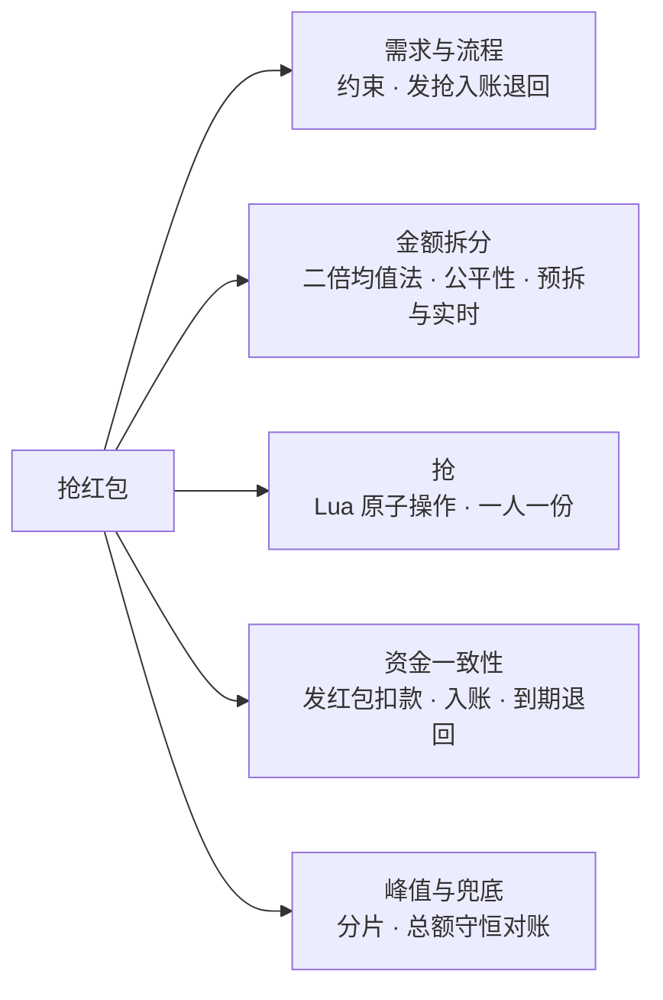
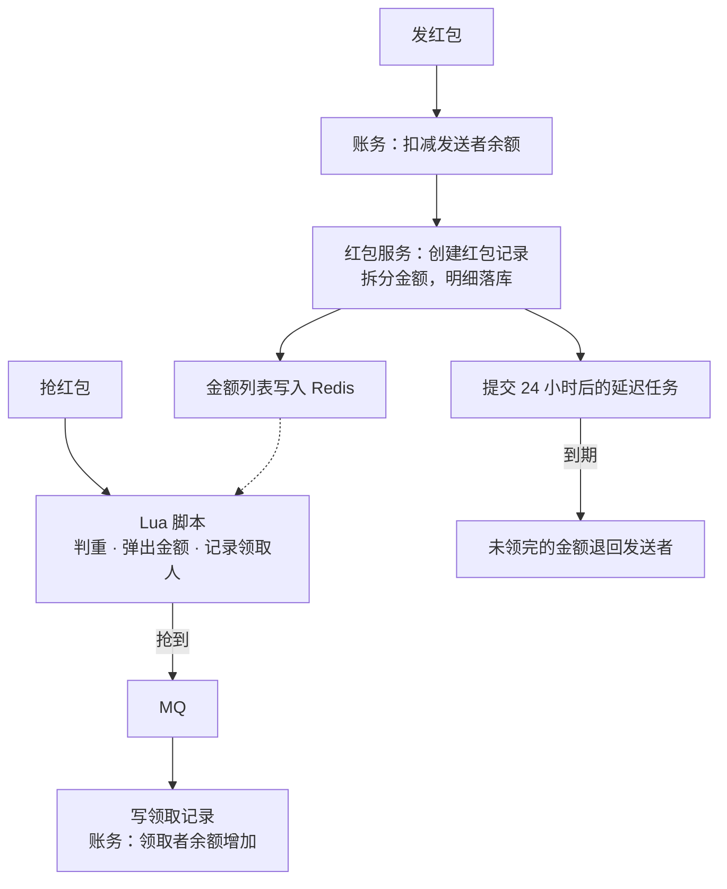
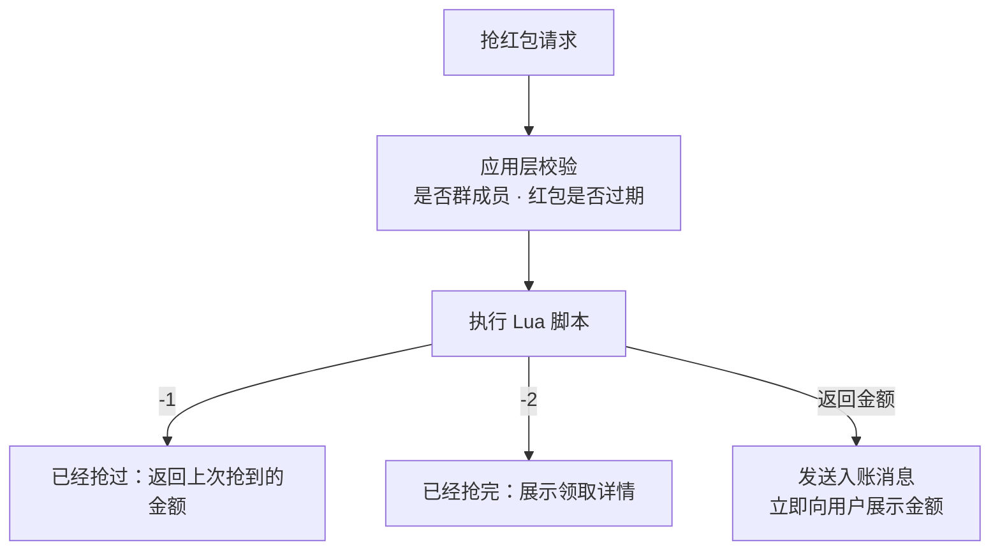
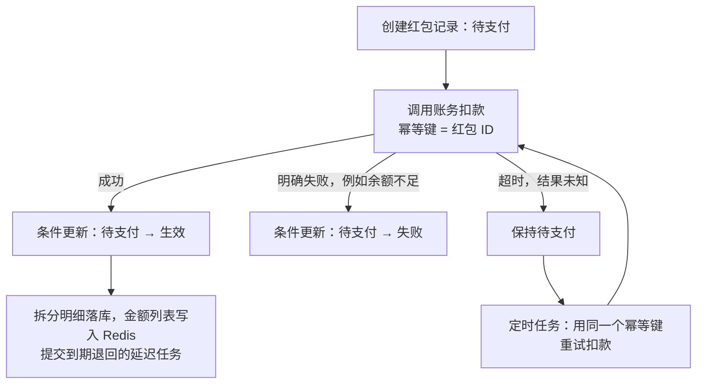
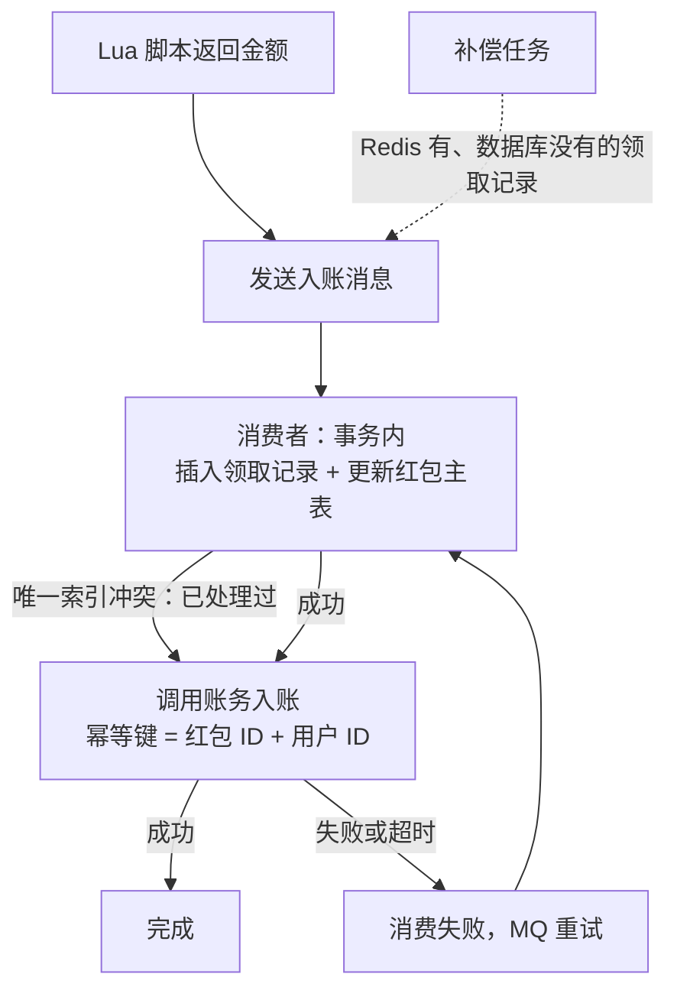
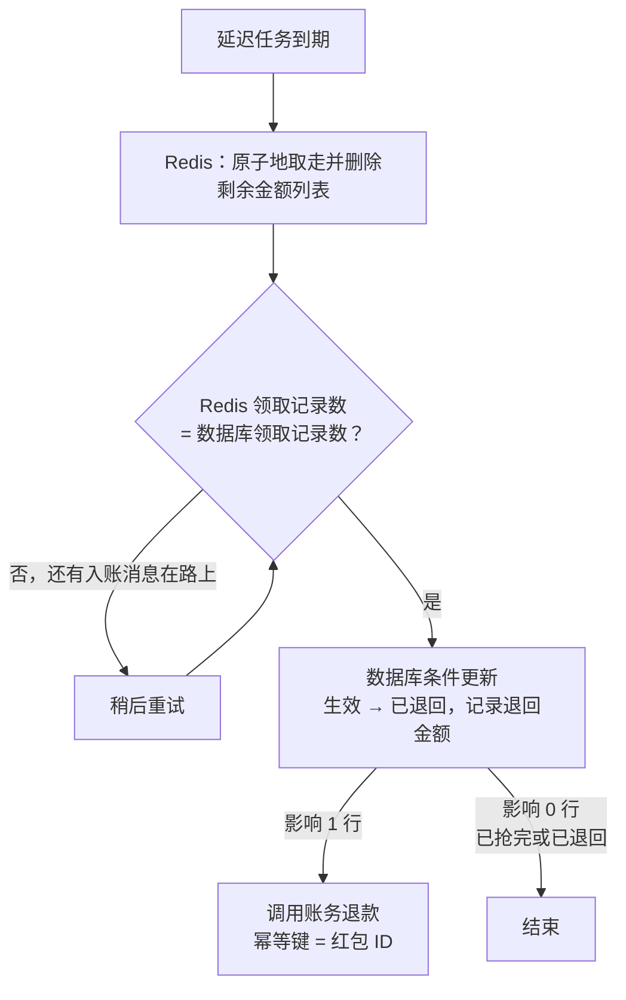
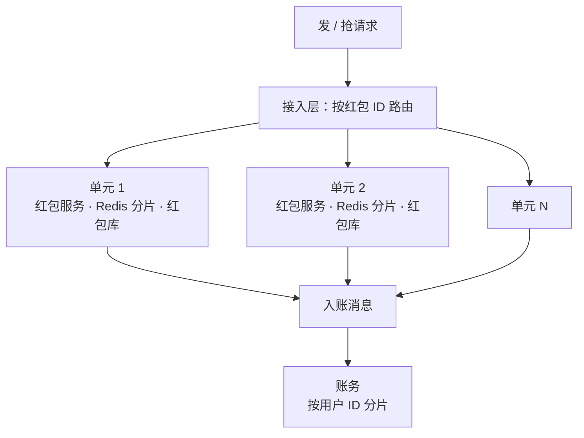

# S06 · 抢红包

> 适用岗位：Java 资深开发、Java 架构师。抢红包把三个问题压在了一起：金额怎么拆才公平、高并发下怎么保证一人一份不多发、钱从发送者到领取者的每一步怎么保证不丢不错。速查版见[《29 场景题》](../06-三高与架构/29-场景题.md)的 29-07。
> 版本基线：JDK 21 / 25、Redis 7.x / 8.x、MySQL 8.4、RocketMQ 5.x。
> 事实核对：
> - 本文讨论的是通用的设计方法，不是对某一款产品内部实现的还原。文中提到"常见的做法"时，指的是公开技术分享中反复出现的思路，具体参数以各自的系统为准。
> - 本机运行（macOS 27.2、Apple M1 Max、JDK 25、Redis 6.2.6）：
>   - 1 段拆分算法的对比代码只依赖 JDK，随机数种子固定，文中贴的是实际运行输出；
>   - 抢红包脚本在本机临时启动的 Redis 6.2.6 上，用 20 个并发的 redis-cli 进程发了 55 个请求实测；
>   - 本机没有 MySQL 服务端，文中的 SQL 都没有实际执行。
> 相关分类：[《S01 秒杀系统》](S01-秒杀系统.md)（原子扣减）、[《S02 订单超时取消与延迟任务》](S02-订单超时取消与延迟任务.md)（到期退回）、[《S04 对账系统》](S04-对账系统.md)、[《17 Redis》](../04-数据存储/17-Redis.md)、[《43 逻辑思维题》](../10-编码与思维/43-逻辑思维题.md)（概率）

## 45 分钟答题版

| 时间 | 做什么 | 要讲出的关键点 | 子题 |
| --- | --- | --- | --- |
| 0～5 分钟 | 澄清需求 | 拼手气还是普通红包；**总额不多不少、一人一份、钱不能丢** | S06-01 |
| 5～12 分钟 | 整体流程 | 发、抢、入账、退回四个阶段；Redis 抗并发，数据库保资金 | S06-02 |
| 12～22 分钟 | 金额拆分 | 二倍均值法；期望公平但方差不同；预拆还是实时算 | S06-03 ～ S06-05 |
| 22～30 分钟 | 抢的原子性 | Lua 脚本：判重、弹出、记录，一步完成 | S06-06 |
| 30～40 分钟 | 资金一致性 | 发红包的扣款；抢到后的入账；到期退回与并发 | S06-07 ～ S06-09 |
| 40～45 分钟 | 峰值与兜底 | 按红包 ID 分片；总额守恒的对账 | S06-10 |

## 知识地图



## 题目索引

| 编号 | 题目 | 难度 |
| --- | --- | --- |
| S06-01 | 抢红包要澄清哪些需求？有哪些硬约束？ | ★★ |
| S06-02 | 整体流程和架构怎么设计？ | ★★★ |
| S06-03 | 拼手气红包的金额怎么拆？ | ★★★ |
| S06-04 | 二倍均值法公平吗？先抢和后抢有区别吗？ | ★★★ |
| S06-05 | 金额是发红包时预先拆好，还是抢的时候再算？ | ★★ |
| S06-06 | 怎么保证一人只能抢一次、红包不会多发？ | ★★★ |
| S06-07 | 发红包时，扣款和创建红包怎么保持一致？ | ★★★ |
| S06-08 | 抢到之后钱怎么入账？Redis 里抢到了、入账失败怎么办？ | ★★★ |
| S06-09 | 24 小时没抢完怎么退回？退回和抢同时发生怎么办？ | ★★★ |
| S06-10 | 除夕那样的峰值怎么扛？资金怎么对账？ | ★★★ |

---

## 一、需求与流程

### S06-01 抢红包要澄清哪些需求？有哪些硬约束？

> ★★ ｜ 资深 ｜ 中频

**考察意图**：红包看起来是个小功能，实际是一个资金系统。看你能不能一开始就把"钱"的约束列出来。

**30 秒版回答**：

- **玩法**：群里发一个红包，指定总金额和个数。**拼手气红包**每个人金额随机；**普通红包**每个人金额相同。
- **硬约束**：
  1. **总额守恒**：所有人抢到的金额之和，加上退回的金额，严格等于红包总额。不能多一分，也不能少一分；
  2. **每份至少 1 分钱**；
  3. **一人只能抢一次**；
  4. **不能多发**：发了 10 个，就只有 10 个人能抢到；
  5. **钱不能丢**：发送者扣了款，这笔钱要么到了领取者那里，要么退回给发送者。
- **体验约束**：点开红包要快；抢到的金额立刻可见，到账可以稍晚。
- **要问的**：红包个数的上限、金额的上下限、多久没抢完退回、峰值有多高。

**深入剖析**

| 问题 | 为什么要问 | 本文的假设 |
| --- | --- | --- |
| 一个红包最多多少份？ | 决定单个红包的并发上限和数据量 | 最多 100 份（不超过群人数） |
| 单个红包的金额上限？ | 风控和合规 | 单个红包最多 200 元 × 份数 |
| 多久退回？ | 决定延迟任务的时长 | 24 小时 |
| 峰值多高？ | 决定是否需要特殊的架构 | 平时每秒几千个红包；除夕峰值高出两个数量级 |
| 钱从哪里扣、到哪里去？ | 决定和账务、支付的关系 | 从发送者的余额扣，进入领取者的余额 |

抢红包和秒杀的区别：

| | 秒杀 | 抢红包 |
| --- | --- | --- |
| 单个"商品"的并发 | 几十万到上百万人抢一个商品 | 一个红包只有群里的几十、几百人抢 |
| "商品"的数量 | 很少 | 极多，每秒几千到几十万个红包 |
| 难点 | 单个热点的极限并发 | 海量小热点的总体吞吐，加上资金的一致性 |

所以抢红包的架构重点不是"怎么让一个 Key 扛住百万并发"，而是"怎么把海量的红包分散开，并且每一个都算对"。

**追问链**

1. **普通红包和拼手气红包在实现上差别大吗？** 只有金额的来源不同：普通红包每份是"总额 ÷ 个数"，拼手气红包是随机拆分。抢、入账、退回的流程完全一样。所以把拆分算法做成一个可替换的策略即可。
2. **为什么"到账可以稍晚"？** 用户最关心的是"抢到了多少"，这一步要立刻有结果。钱进入余额晚几秒，用户基本感知不到。把"抢"和"入账"分开，抢的那一步就可以只操作 Redis，速度很快；入账走可靠的异步流程。

---

### S06-02 整体流程和架构怎么设计？

> ★★★ ｜ 资深 / 架构师 ｜ 中频

**考察意图**：能否把流程拆成几个阶段，并说清楚每个阶段数据存在哪、以谁为准。

**30 秒版回答**：

四个阶段：

1. **发红包**：扣减发送者的余额 → 创建红包记录 → 拆分金额并写入 Redis → 提交一个 24 小时后的延迟任务。
2. **抢红包**：Redis Lua 脚本原子地完成"判断是否抢过 → 弹出一份金额 → 记录领取人"。
3. **入账**：抢到之后发 MQ 消息，消费者写领取记录、给领取者的余额加钱。
4. **退回**：延迟任务到期，把没抢完的金额退给发送者。

数据的分工：**数据库是资金的唯一依据**，红包的总额、每一份的金额、每一笔领取和退回都在数据库里；**Redis 只是为了让"抢"这一步足够快**，它丢了数据可以从数据库重建。

**深入剖析**



红包相关的表：

```sql
-- 红包主表：一个红包一行
CREATE TABLE t_red_packet (
    packet_id      BIGINT       NOT NULL PRIMARY KEY,
    sender_id      BIGINT       NOT NULL,
    total_amount   BIGINT       NOT NULL COMMENT '总金额，单位分',
    total_count    INT          NOT NULL COMMENT '总份数',
    grabbed_amount BIGINT       NOT NULL DEFAULT 0 COMMENT '已入账的金额',
    grabbed_count  INT          NOT NULL DEFAULT 0 COMMENT '已入账的份数',
    status         VARCHAR(16)  NOT NULL COMMENT 'ACTIVE / FINISHED / REFUNDED',
    expire_time    DATETIME(3)  NOT NULL,
    create_time    DATETIME(3)  NOT NULL
);

-- 领取记录：每个人领到的一份
CREATE TABLE t_red_packet_grab (
    id          BIGINT       NOT NULL PRIMARY KEY,
    packet_id   BIGINT       NOT NULL,
    user_id     BIGINT       NOT NULL,
    amount      BIGINT       NOT NULL COMMENT '单位分',
    create_time DATETIME(3)  NOT NULL,
    UNIQUE KEY uk_packet_user (packet_id, user_id)
);
```

`uk_packet_user` 保证同一个人对同一个红包只有一条领取记录，是"一人一份"在数据库层面的保证。

**追问链**

1. **红包服务和账务是一个系统吗？** 不是。红包服务管的是"红包这个业务对象"：谁发的、分了几份、谁抢到了哪一份。账务管的是"钱在哪个账户"。红包服务通过账务的接口扣款和入账，自己不直接改余额。账务的设计见[《S09 账务与钱包》](S09-账务与钱包.md)。
2. **发送者用银行卡发红包（没有余额）怎么办？** 先走一次支付，支付成功后才创建红包。这时"发红包"的第一步从"扣余额"变成"等待支付成功的通知"，后面的流程不变。

---

## 二、金额拆分

### S06-03 拼手气红包的金额怎么拆？

> ★★★ ｜ 资深 ｜ 高频

**考察意图**：手写一个正确的拆分算法。重点不在随机，而在边界：总和必须严格相等，每份不能少于 1 分。

**30 秒版回答**：

- **二倍均值法**：每次分出一份时，在 **[1 分, 剩余金额 ÷ 剩余个数 × 2]** 之间随机取一个值；最后一个人拿走剩余的全部。
- **为什么是 2 倍**：在 0 到"剩余均值的 2 倍"之间均匀随机，期望正好是剩余均值。这样每个位置的期望都接近总均值。
- **两个必须处理的边界**：
  1. 上限除了"剩余均值 × 2"，还要保证**给后面的人每人至少留 1 分**；
  2. 最后一份不随机，直接取剩余金额，保证总和严格相等。
- **全程用整数（分）计算**，不用浮点数表示金额。

**深入剖析**

```java
import java.util.ArrayList;
import java.util.List;
import java.util.Random;
import java.util.TreeSet;
import java.util.function.BiFunction;

/**
 * 两种红包拆分算法的对比：二倍均值法、线段切割法。
 * 各模拟 20 万轮"100 元拆 10 份"，统计每个位置的平均值、标准差和成为"手气最佳"的概率。
 */
public class RedPacketDemo {

    private static final long MIN_AMOUNT_CENT = 1L;
    private static final long TOTAL_CENT = 10_000L;
    private static final int COUNT = 10;
    private static final int ROUNDS = 200_000;
    private static final long RANDOM_SEED = 20261112L;

    /** 二倍均值法：每次在 [1 分, 剩余均值 × 2] 之间随机，同时给后面的人每人至少留 1 分 */
    static List<Long> doubleMean(long totalCent, int count, Random random) {
        List<Long> amounts = new ArrayList<>(count);
        long remainAmount = totalCent;
        for (int remainCount = count; remainCount > 1; remainCount--) {
            long upper = Math.min(remainAmount * 2 / remainCount,
                    remainAmount - (remainCount - 1) * MIN_AMOUNT_CENT);
            long amount = MIN_AMOUNT_CENT + (long) (random.nextDouble() * upper);
            amount = Math.min(amount, upper);
            amounts.add(amount);
            remainAmount -= amount;
        }
        amounts.add(remainAmount);
        return amounts;
    }

    /** 线段切割法：在 (0, total) 上随机切 count-1 刀，相邻两刀之间的长度就是一份的金额 */
    static List<Long> cutLine(long totalCent, int count, Random random) {
        TreeSet<Long> cuts = new TreeSet<>();
        while (cuts.size() < count - 1) {
            // 切点取 1 ～ total-1 的整数且互不相同，保证每一段至少 1 分
            cuts.add(1 + (long) (random.nextDouble() * (totalCent - 1)));
        }
        List<Long> amounts = new ArrayList<>(count);
        long previous = 0;
        for (long cut : cuts) {
            amounts.add(cut - previous);
            previous = cut;
        }
        amounts.add(totalCent - previous);
        return amounts;
    }

    private static void simulate(String name, BiFunction<Long, Integer, List<Long>> splitter) {
        double[] sum = new double[COUNT];
        double[] squareSum = new double[COUNT];
        int[] luckiest = new int[COUNT];
        long globalMax = 0;
        for (int round = 0; round < ROUNDS; round++) {
            List<Long> amounts = splitter.apply(TOTAL_CENT, COUNT);
            long total = 0;
            int best = 0;
            for (int i = 0; i < COUNT; i++) {
                long amount = amounts.get(i);
                if (amount < MIN_AMOUNT_CENT) {
                    throw new IllegalStateException("amount below minimum: " + amounts);
                }
                total += amount;
                sum[i] += amount;
                squareSum[i] += (double) amount * amount;
                if (amount > amounts.get(best)) {
                    best = i;
                }
                globalMax = Math.max(globalMax, amount);
            }
            if (total != TOTAL_CENT) {
                throw new IllegalStateException("total mismatch: " + amounts);
            }
            luckiest[best]++;
        }
        System.out.println(name + "  (max single amount = " + globalMax / 100.0 + " yuan)");
        for (int i : new int[] {0, 4, 8, 9}) {
            double mean = sum[i] / ROUNDS;
            double stddev = Math.sqrt(squareSum[i] / ROUNDS - mean * mean);
            System.out.printf("  position %2d: mean=%.2f yuan, stddev=%.2f yuan, luckiest=%.1f%%%n",
                    i + 1, mean / 100, stddev / 100, luckiest[i] * 100.0 / ROUNDS);
        }
    }

    public static void main(String[] args) {
        Random random = new Random(RANDOM_SEED);
        System.out.println("sample (double mean): " + doubleMean(TOTAL_CENT, COUNT, random));
        System.out.println("sample (cut line)   : " + cutLine(TOTAL_CENT, COUNT, random));
        System.out.println("3 cents, 3 packets  : " + doubleMean(3, 3, random));
        simulate("double mean", (total, count) -> doubleMean(total, count, random));
        simulate("cut line", (total, count) -> cutLine(total, count, random));
    }
}
```

本机运行输出（JDK 25，随机数种子固定）：

```text
sample (double mean): [1129, 298, 2000, 1872, 182, 418, 929, 751, 764, 1657]
sample (cut line)   : [640, 2151, 113, 384, 1721, 2045, 855, 1398, 5, 688]
3 cents, 3 packets  : [1, 1, 1]
double mean  (max single amount = 64.53 yuan)
  position  1: mean=10.01 yuan, stddev=5.77 yuan, luckiest=10.0%
  position  5: mean=10.00 yuan, stddev=6.06 yuan, luckiest=8.9%
  position  9: mean=10.00 yuan, stddev=7.67 yuan, luckiest=12.2%
  position 10: mean=9.98 yuan, stddev=7.66 yuan, luckiest=12.1%
cut line  (max single amount = 80.1 yuan)
  position  1: mean=10.02 yuan, stddev=9.06 yuan, luckiest=10.1%
  position  5: mean=9.97 yuan, stddev=9.02 yuan, luckiest=9.9%
  position  9: mean=10.01 yuan, stddev=9.04 yuan, luckiest=10.0%
  position 10: mean=10.02 yuan, stddev=9.06 yuan, luckiest=10.0%
```

先看前三行：

- 100 元拆 10 份的一个样例，每份在 1.82 元到 20 元之间，合计正好 10000 分；
- **3 分钱拆 3 份**，结果只能是每人 1 分。这是检验上限是否正确的用例：如果上限只取"剩余均值 × 2 = 2 分"，第一个人就可能拿到 2 分，剩下 1 分要分给 2 个人，不满足每人至少 1 分。代码里 `upper` 的第二项 `remainAmount - (remainCount - 1) * MIN_AMOUNT_CENT` 就是为了排除这种情况。

程序在 20 万轮模拟里对每一轮都做了两个检查（总和等于总额、每份不少于 1 分），任何一轮不满足都会抛出异常。两种算法都跑完了，说明这两个约束始终成立。

**追问链**

1. **为什么不直接"每次在 1 分到剩余金额之间随机"？** 这样第一个人的期望是总额的一半，第二个人是剩下的一半……越往后越少，对后抢的人极不公平。10 个人抢 100 元，第一个人平均拿 50 元，最后几个人平均只有几分钱。
2. **随机数用什么生成？** 服务端的随机数生成器即可，种子不能被用户预测或影响。金额在服务端计算并保存，客户端只是展示。演示代码用固定种子是为了让输出可以复现，生产环境不要固定种子。
3. **代码里为什么对 `amount` 再取一次 `Math.min`？** `random.nextDouble()` 的范围是 [0, 1)，乘以 `upper` 再取整，结果在 0 到 `upper - 1` 之间，加上 1 分之后不会超过 `upper`。这一行是防御性的，保证即使以后有人修改了随机的写法，也不会超过上限。

---

### S06-04 二倍均值法公平吗？先抢和后抢有区别吗？

> ★★★ ｜ 资深 / 架构师 ｜ 中频

**考察意图**："公平"有不同的含义。看你能不能区分期望和方差，并用数据说话。

**30 秒版回答**：

- **期望上公平**：每个位置的平均金额都接近总均值。先抢后抢，平均能拿到的钱基本一样。
- **方差上不同**：越靠后的位置，金额的波动越大。后抢的人更容易拿到很多，也更容易拿到很少。
- **成为"手气最佳"的概率不同**：最后两个位置略高。
- 对比**线段切割法**（在总金额上随机切 N−1 刀）：每个位置的分布完全相同，是严格公平的；但它的波动整体更大，更容易出现"一个人拿走大部分"的情况。
- 选哪种是产品决定。二倍均值法的金额更"温和"，单份不会超过剩余均值的两倍。

**深入剖析**

上一题输出的后半部分，是两种算法各 20 万轮的统计（100 元拆 10 份，均值 10 元）：

| 位置 | 二倍均值法：平均 | 标准差 | 手气最佳 | 线段切割法：平均 | 标准差 | 手气最佳 |
| --- | --- | --- | --- | --- | --- | --- |
| 第 1 个 | 10.01 元 | 5.77 元 | 10.0% | 10.02 元 | 9.06 元 | 10.1% |
| 第 5 个 | 10.00 元 | 6.06 元 | 8.9% | 9.97 元 | 9.02 元 | 9.9% |
| 第 9 个 | 10.00 元 | 7.67 元 | 12.2% | 10.01 元 | 9.04 元 | 10.0% |
| 第 10 个 | 9.98 元 | 7.66 元 | 12.1% | 10.02 元 | 9.06 元 | 10.0% |
| 单份的最大值 | 64.53 元 | | | 80.10 元 | | |

读这张表：

- **平均值**：两种算法的每个位置都在 10 元左右，期望上都公平；
- **标准差**：二倍均值法从 5.77 元逐渐增大到 7.67 元，后面的位置波动更大；线段切割法每个位置都是 9 元左右，彼此相同，但都比二倍均值法大；
- **手气最佳**：线段切割法每个位置都是 10%；二倍均值法最后两个位置是 12% 左右，中间位置略低于 10%；
- **极端值**：20 万轮里，二倍均值法单份最多 64.53 元，线段切割法出现过 80.10 元。

为什么二倍均值法后面的波动更大：第一个人的上限固定是 20 元（总均值的 2 倍）。到后面，"剩余均值"本身已经是一个随机数，前面的人拿得少，后面的剩余均值就高，上限也跟着变高。不确定性一路累积到了后面。

**追问链**

1. **第 1 个人的标准差 5.77 元能算出来吗？** 能。第 1 个人的金额近似在 0 到 20 元之间均匀分布，均匀分布的标准差是"区间长度 ÷ √12"，即 20 ÷ 3.46 ≈ 5.77 元，和模拟结果一致。能把模拟结果和理论值对上，是验证代码正确的一个好办法。
2. **想让每个位置完全公平，又不想让波动太大，怎么办？** 先用二倍均值法（或其他方法）把金额全部拆好，再把这个列表**随机打乱**。打乱之后，每个位置拿到列表中任何一份的概率相同，位置之间就完全对称了，同时单份金额的分布仍然是"温和"的那种。这只有在预先拆分时才能做（S06-05）。
3. **用户能不能通过"晚一点抢"来提高收益？** 期望上不能，平均值是一样的。能改变的只是波动：后抢的人结果更分散。对"想拿手气最佳"的人来说，最后的位置概率略高，但同时拿到最少的概率也更高，而且晚抢可能就抢不到了。

---

### S06-05 金额是发红包时预先拆好，还是抢的时候再算？

> ★★ ｜ 资深 ｜ 中频

**考察意图**：两种做法都能实现功能。看你能不能从正确性、可审计、性能几个角度比较。

**30 秒版回答**：

| | 预先拆分 | 抢的时候实时计算 |
| --- | --- | --- |
| 做法 | 发红包时一次算出所有金额，存起来 | 抢的时候根据"剩余金额、剩余个数"算出这一份 |
| 抢的操作 | 从列表里弹出一个，非常简单 | 要在原子操作里做读取、随机、计算、更新 |
| 可审计 | 每一份的金额在发红包时就确定并落库，事后可以核对 | 金额在抢的那一刻才产生 |
| 存储 | 每个红包要存 N 个金额 | 只存剩余金额和剩余个数 |
| 能否打乱顺序 | 可以，拆完之后随机打乱 | 不可以 |
| Redis 数据丢失后 | 从数据库的拆分明细重建剩余列表 | 从数据库的"总额 − 已领取"重建剩余金额 |

- 推荐**预先拆分**：抢的那一步越简单，越不容易出错；每份金额有据可查。
- 实时计算适合红包数量极大、要尽量节省存储的场景。它同样正确，只是把计算逻辑放进了原子操作里。

**深入剖析**

预先拆分时，**拆分的明细要落库**，而不是只放在 Redis 里：

```sql
CREATE TABLE t_red_packet_slice (
    packet_id BIGINT NOT NULL,
    seq       INT    NOT NULL COMMENT '第几份',
    amount    BIGINT NOT NULL COMMENT '单位分',
    PRIMARY KEY (packet_id, seq)
);
```

有了这张表：

- Redis 丢了数据，用"全部份额 − 已经有领取记录的份额"就能重建剩余的金额列表；
- 对账时可以逐份核对：每一份要么被某个人领走，要么在退回的金额里；
- 用户质疑"为什么我只抢到 1 分钱"，可以证明金额是发红包时就定好的，不是针对他临时算的。

**追问链**

1. **实时计算在 Redis 里怎么做？** 用 Lua 脚本读出剩余金额和剩余个数，在脚本里算出这一份的金额，再更新剩余值。随机数建议在应用里生成，作为参数传进脚本，脚本只做确定性的计算：这样脚本的行为容易测试，也不依赖 Redis 的版本（老版本把脚本原文复制给从节点执行，脚本里带随机性会让主从的结果不同；Redis 5 起默认改为复制脚本产生的写命令，7.0 起只保留这种方式）。
2. **预先拆分的存储成本高吗？** 一个红包平均十几份，每份一行几十个字节。数据量主要来自红包的数量。红包的明细有明确的生命周期，过期一段时间之后可以归档。

---

## 三、抢

### S06-06 怎么保证一人只能抢一次、红包不会多发？

> ★★★ ｜ 资深 / 架构师 ｜ 高频

**考察意图**：三个动作（判断抢过没有、取一份金额、记下是谁）必须合成一个原子操作。看你是否清楚拆开执行会出什么问题。

**30 秒版回答**：

- **拆开执行的问题**：
  - 先查"有没有抢过"，再去取金额：同一个用户的两个请求同时查，都发现没抢过，各取走一份；
  - 先看"还有没有剩余"，再去取：两个人同时看到剩 1 份，都去取。
- **做法**：一个 **Lua 脚本**完成三步：`HEXISTS` 判断这个用户是否已经在领取记录里 → `LPOP` 从金额列表弹出一份 → `HSET` 记录"用户 → 金额"。
- **数据结构**：一个 List 存还没被抢走的金额；一个 Hash 存已经抢到的用户和金额。
- **数据库再保证一次**：领取记录表上"红包 ID + 用户 ID"的唯一索引。
- 脚本之前先做轻量的校验：用户是不是群成员、红包有没有过期。这些不需要原子性，放在应用里做。

**深入剖析**

抢红包的脚本（已在本机 Redis 6.2.6 上并发测试）：

```lua
-- KEYS[1]：预先拆好的金额列表  KEYS[2]：领取记录（Hash：用户 ID → 金额）
-- ARGV[1]：用户 ID
if redis.call('HEXISTS', KEYS[2], ARGV[1]) == 1 then
    return -1  -- 已经领过
end
local amount = redis.call('LPOP', KEYS[1])
if not amount then
    return -2  -- 已经领完
end
redis.call('HSET', KEYS[2], ARGV[1], amount)
return tonumber(amount)
```

测试方法：一个红包拆成 3 份（3.50 元、1.20 元、5.30 元，共 10 元）；50 个用户各抢一次，其中 5 个用户多点了一次，共 55 个请求，由 20 个并发的 redis-cli 进程发出。结果：

```text
requests            = 55
grabbed             = 3
already grabbed(-1) = 3
empty (-2)          = 49
amounts left        = 0
winners             = 3
sum of grabbed      = 1000 (must equal 1000)
```

- 3 份金额恰好被 3 个人抢到，没有多发；
- 抢到的金额合计 1000 分，等于红包总额；
- 3 个请求因为"已经领过"被拒绝，49 个因为"已经领完"被拒绝。这两个数字取决于请求到达的顺序，每次运行可能不同，前两条结论不变。



**追问链**

1. **用户重复点击，应该返回什么？** 返回他已经抢到的金额，而不是报错。脚本返回 −1 之后，应用再从 Hash 里读出这个用户的金额。对用户来说，点一次和点多次看到的结果一样，这就是接口的幂等。
2. **为什么判重用 Hash 而不是 Set？** 需要同时记住"谁"和"抢到多少"。入账的消息如果丢了，可以根据 Hash 里的记录重新发送；展示"领取详情"时也能直接从 Hash 里读。
3. **一个红包的并发最多就是群人数，直接用数据库行不行？** 单看一个红包，可以：对红包记录加行锁，在事务里完成判重、分配、写领取记录。问题在总量：除夕时每秒有几十万个红包被打开，每一次都是一个带行锁的事务，数据库撑不住。Redis 承担"抢"这一步，数据库只处理抢成功之后的写入，压力小得多。
4. **Redis Cluster 下要注意什么？** 脚本里的两个 Key 必须在同一个槽位。用红包 ID 做哈希标签：`{rp:1001}:amounts` 和 `{rp:1001}:grabbed`。这样一个红包的数据都在同一个节点上，不同的红包自然分散到各个节点。

---

## 四、资金一致性

### S06-07 发红包时，扣款和创建红包怎么保持一致？

> ★★★ ｜ 资深 / 架构师 ｜ 中频

**考察意图**：发红包的第一步就涉及两个系统（账务和红包服务）。看你是否保证了"钱扣了，红包一定存在"。

**30 秒版回答**：

- **目标**：不能出现"钱扣了但红包没发出去"，也不能出现"红包发出去了但钱没扣"。
- **顺序：先扣款，后让红包可抢**。宁可钱扣了红包暂时不可见（之后补上或退款），也不能让一个没有资金支持的红包被人抢走。
- **做法**：
  1. 红包服务先创建红包记录，状态是"**待支付**"，生成红包 ID；
  2. 调用账务扣款，以**红包 ID 作为幂等键**；
  3. 扣款成功，把红包改为"**生效**"，写入 Redis，提交退回的延迟任务；
  4. 扣款失败，红包改为"失败"。扣款结果未知（超时），红包保持待支付，由定时任务用同一个幂等键查询或重试。
- 红包在"生效"之前，Redis 里没有它的数据，不可能被抢。

**深入剖析**



为什么不是"先扣款，再创建红包记录"：扣款成功之后进程崩溃，账务里有一笔扣款，红包服务里却什么都没有，没有任何线索知道这笔钱是干什么的。先创建一条"待支付"的记录，等于先留下了一个凭据，后面无论在哪一步失败，都能根据这条记录继续推进或者退款。

第 3 步里"改为生效"之后、"写入 Redis"之前进程崩溃怎么办：红包在数据库里是生效的，Redis 里没有。抢的时候发现 Redis 里没有这个红包，就**从数据库加载**：读出拆分明细和已有的领取记录，重建金额列表。这和 Redis 丢数据后的恢复是同一条路径。

**追问链**

1. **一直是"待支付"的红包怎么处理？** 定时任务扫描待支付超过一定时间的红包，向账务查询扣款结果：扣了就推进到生效，没扣就改为失败。账务的扣款接口支持按幂等键查询，是这一切的前提。
2. **能不能用分布式事务？** 可以用 TCC：账务先"冻结"金额，红包创建成功后"确认扣款"，失败则"解冻"。它的好处是在红包生效之前钱只是被冻结，没有真正扣走。代价是账务要提供冻结、确认、取消三个接口。上面的方案更简单，本质上是一个靠状态机和幂等推进的 Saga，见[《09 分布式理论》](../03-分布式与微服务/09-分布式理论.md)09-11。

---

### S06-08 抢到之后钱怎么入账？Redis 里抢到了、入账失败怎么办？

> ★★★ ｜ 资深 / 架构师 ｜ 高频

**考察意图**：Redis 里的"抢到了"只是一个承诺，钱真正到账要经过 MQ 和账务。看你是否保证了这个承诺一定兑现，而且只兑现一次。

**30 秒版回答**：

- **流程**：Lua 脚本返回金额 → 发送入账消息（红包 ID、用户 ID、金额）→ 消费者处理。
- **消费者做三件事**，前两件在红包库的同一个事务里：
  1. 插入领取记录（唯一索引：红包 ID + 用户 ID）；
  2. 更新红包主表的已领金额和已领份数；
  3. 调用账务给领取者入账，幂等键是"红包 ID + 用户 ID"。
- **重复消息**：唯一索引冲突说明已经处理过，跳过前两步，但**仍然要确认入账完成**（再调用一次账务，账务幂等）。
- **消息没发出去**（Redis 里抢到了，应用在发消息之前崩溃）：Redis 的 Hash 里有这条记录。一个补偿任务比较"Redis 里的领取记录"和"数据库里的领取记录"，把缺的补发。
- **最终保证**：对账，红包总额 = 已入账 + 已退回。

**深入剖析**



更新红包主表时用条件更新，既是累加，也是一道防线：

```sql
UPDATE t_red_packet
SET grabbed_amount = grabbed_amount + #{amount},
    grabbed_count  = grabbed_count + 1,
    status = CASE WHEN grabbed_count + 1 = total_count THEN 'FINISHED' ELSE status END
WHERE packet_id = #{packetId}
  AND status = 'ACTIVE'
  AND grabbed_count < total_count
  AND grabbed_amount + #{amount} <= total_amount;
```

影响 0 行，说明这个红包已经领完、已经退回，或者再加上这一笔就超额了。这时**不能入账**，要告警并人工核查：正常情况下 Redis 已经保证不会多发，走到这里说明 Redis 的数据出过问题（例如主从切换后数据回退，同一份金额被弹出了两次）。

**追问链**

1. **领取记录和入账不在一个事务里，中间失败了怎么办？** 领取记录写成功、入账失败，消息会重试。重试时领取记录已经存在（唯一索引冲突），于是直接走入账这一步。账务按幂等键保证不重复加钱。所以流程是"可重入"的：无论在哪一步失败，重新执行一遍都能走到终点。
2. **入账为什么不直接在抢的请求里同步完成？** 同步调用账务会让"抢"的耗时从一次 Redis 操作变成一次 Redis 加一次数据库事务，高峰期账务的压力也会直接传导给用户。异步之后，抢的体验只取决于 Redis；账务按自己的节奏消费。
3. **用户看到"抢到了 5.30 元"，但余额没变，怎么解释？** 产品上展示"已存入零钱"这类文案时，实际上是"正在存入"。延迟通常在秒级。入账消息的积压量要监控，积压变大时要能在界面上给出提示，而不是让用户以为钱丢了。

**生产实践 / 踩坑**

- **入账的幂等键只用了红包 ID**：同一个红包的不同领取者互相覆盖，只有第一个人入账成功。幂等键必须是"红包 ID + 用户 ID"。
- **消费者先调用账务入账，再写领取记录**：入账成功、写记录失败后重试，如果账务没有做幂等，钱就加了两次。顺序和幂等两者都要保证，不能只靠其中一个。

---

### S06-09 24 小时没抢完怎么退回？退回和抢同时发生怎么办？

> ★★★ ｜ 资深 / 架构师 ｜ 中频

**考察意图**：退回是红包生命周期的终点，也是总额守恒能否成立的关键一步。看你是否处理了"过期的那一刻还有人在抢"以及"抢到了但还没入账"这两种情况。

**30 秒版回答**：

- **触发**：发红包时提交一个 24 小时后的延迟任务，再加一个低频的扫表兜底（[《S02 订单超时取消与延迟任务》](S02-订单超时取消与延迟任务.md)）。
- **先让红包不能再被抢，再算退多少**：
  1. 在 Redis 里把剩余的金额列表**原子地取走并删除**。从这一刻起，新的抢红包请求都会得到"已抢完"；
  2. 等待**已经抢到但还没入账**的记录处理完（Redis 的领取 Hash 里的记录数 = 数据库里的领取记录数）；
  3. 数据库里用条件更新把红包状态从"生效"改为"已退回"，退回金额 = 总额 − 已入账金额；
  4. 调用账务把钱退给发送者，幂等键是红包 ID。
- **退回金额以数据库为准**，用"总额 − 已入账"计算，不用 Redis 里剩余列表的合计。
- 应用层抢之前也会检查过期时间，过期的红包直接拒绝，这是第一道拦截。

**深入剖析**



为什么第 2 步不能省：假设红包剩 1 份，过期前的最后一秒有人抢到了，入账消息还在 MQ 里。如果这时直接按数据库里的"总额 − 已入账"计算退回金额，会把这最后一份的钱也退给发送者；随后入账消息到达，又给领取者加了一次钱。同一笔钱出去了两次。

防止这种情况有两层：

- **流程上**：先关闭 Redis 里的入口，再等在途的入账全部完成，然后才计算退回金额；
- **数据上**：S06-08 里入账的条件更新带着 `status = 'ACTIVE'`。红包一旦改为"已退回"，迟到的入账消息会影响 0 行，不会入账，并触发告警。

第二层是兜底：即使流程上的等待有疏漏，也只会出现"用户看到抢到了但没到账"（少给，可以人工补），不会出现"钱出去了两次"（多给，难以追回）。**出错时让它往少给的方向错**，这和秒杀里"宁可少卖，不能超卖"是同一个原则。

**追问链**

1. **退回时发送者的账户被冻结了怎么办？** 退款失败，重试；多次失败转人工。这笔钱在此期间留在平台的中间账户里，账务上有明确的记录，不会消失。
2. **红包被抢完了，延迟任务到期时做什么？** 条件更新影响 0 行（状态已经是"已抢完"），直接结束。延迟任务不需要在抢完时取消，这和订单超时任务的处理方式一样。
3. **能不能在抢完时立即把状态改成"已抢完"，而不是等入账？** 可以在 Redis 里知道"抢完了"（列表空了），用来展示。数据库里的"已抢完"状态要等所有份额都入账之后才改，因为它代表的是资金层面的完成。两者的含义不同，不要混用。

---

## 五、峰值与兜底

### S06-10 除夕那样的峰值怎么扛？资金怎么对账？

> ★★★ ｜ 架构师 ｜ 中频

**考察意图**：从"一个红包怎么做对"上升到"海量红包怎么撑住"。看你是否抓住了这个场景适合水平拆分的特点。

**30 秒版回答**：

- **这个场景的特点**：单个红包的并发很小（最多群人数），红包之间**完全独立**。所以它天然适合水平拆分，不存在全局热点。
- **按红包 ID 分片**：
  - Redis：一个红包的两个 Key 用红包 ID 做哈希标签，落在同一个节点，不同的红包分散到整个集群；
  - 数据库：红包主表、拆分明细、领取记录都按红包 ID 分库分表，一个红包的所有数据在同一个库，更新它们是本地事务；
  - 单元化：按红包 ID（或发送者）路由到不同的部署单元，一个单元故障只影响这个单元里的红包。
- **削峰**：入账本来就是异步的。高峰期可以让入账延迟变长，优先保证"发"和"抢"。
- **降级**：高峰期关闭领取详情的实时刷新等非核心功能。
- **对账**：每个红包都满足 **总额 = 已入账金额 + 已退回金额**；红包系统的入账、退回记录，与账务的流水逐笔一致。

**深入剖析**



"我收到的红包""我发出的红包"是按用户维度的查询，和按红包 ID 分片的方向不一致。做法和订单的多维度查询相同：领取记录异步同步一份按用户 ID 分片的副本，专门支撑这类查询，见[《29 场景题》](../06-三高与架构/29-场景题.md)29-08。

对账要检查的等式：

| 等式 | 检查的范围 | 不平说明什么 |
| --- | --- | --- |
| 拆分明细之和 = 红包总额 | 每个红包，发出时 | 拆分算法有错误 |
| 已入账金额 = 领取记录的金额之和 | 每个红包 | 主表的累加和明细不一致 |
| 总额 = 已入账 + 已退回 | 每个已结束的红包 | 有钱没有去处，或者多出去了 |
| 红包的入账、退回记录 = 账务流水 | 逐笔 | 入账遗漏或者重复 |
| Redis 的领取记录 = 数据库的领取记录 | 进行中的红包 | 入账消息丢失 |
| 红包中间账户的余额 = 所有未结束红包的"总额 − 已入账" | 全局 | 整体的资金不平 |

最后一条是全局的检查：发红包时钱从发送者进入平台的一个中间账户，抢到或退回时再从中间账户出去。任意时刻，中间账户里的钱应该正好等于"所有还没结束的红包里剩下的钱"。这一个数字不平，就说明某个地方有问题，再逐个红包去查。

**追问链**

1. **Redis 节点宕机，上面的红包怎么办？** 主从切换后，可能丢失最近几次抢的记录（异步复制）。丢失的后果是某一份金额"回到"了列表里，可能被再抢一次。数据库的防线会拦住：入账的条件更新里有"已领份数小于总份数、已领金额加上这一份不超过总额"的条件。更彻底的做法是切换后把这个节点上进行中的红包标记为"需要从数据库重建"，重建完成之前暂停抢。
2. **高峰期入账延迟到几分钟，用户不能接受怎么办？** 这是容量问题：入账的消费能力要按峰值的"抢成功数"来准备，而不是按请求数。抢成功的数量远小于请求数（大多数点击是"已抢完"），所以入账的压力比入口的压力低一个数量级以上。
3. **怎么压测？** 红包之间独立，可以用大量模拟的群和用户并发地发和抢，压测数据写入影子库。要特别验证的不是吞吐量，而是压测结束后**上面的对账等式全部成立**：高并发下的正确性比性能更重要。

**架构师加分点**

- 这道题的方案可以用三句话概括：**Redis 的原子操作保证"抢"这一步不多发；数据库的唯一索引和条件更新保证每一份钱只入账一次；总额守恒的对账保证前两者万一有疏漏也能被发现**。每一层都假设上一层可能出错。面试时按这三层来组织回答，比罗列组件更能体现对资金系统的理解。
