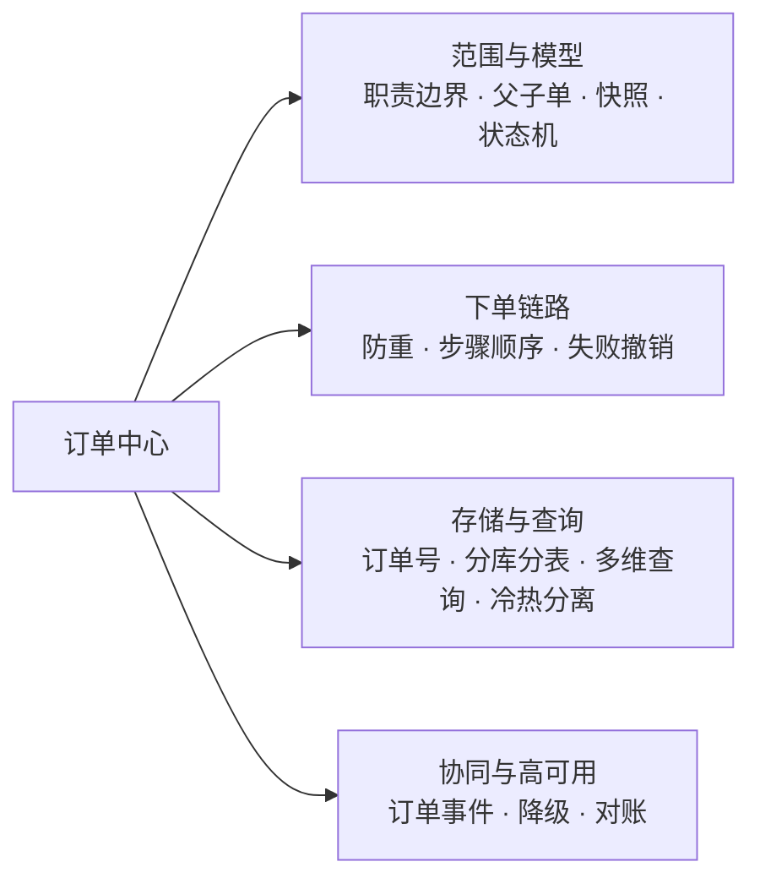
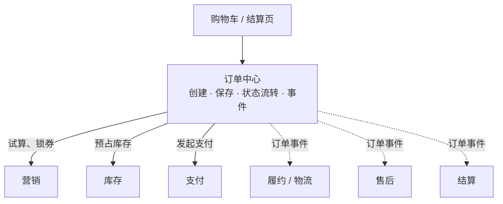
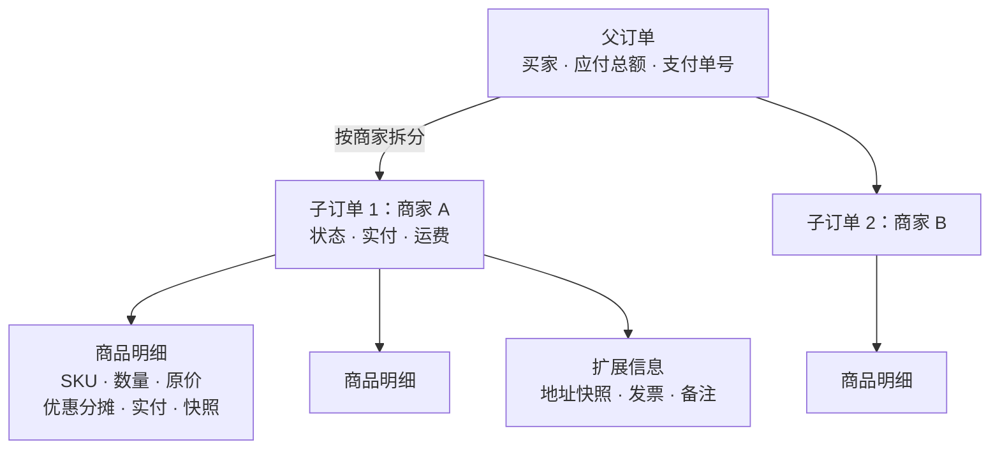
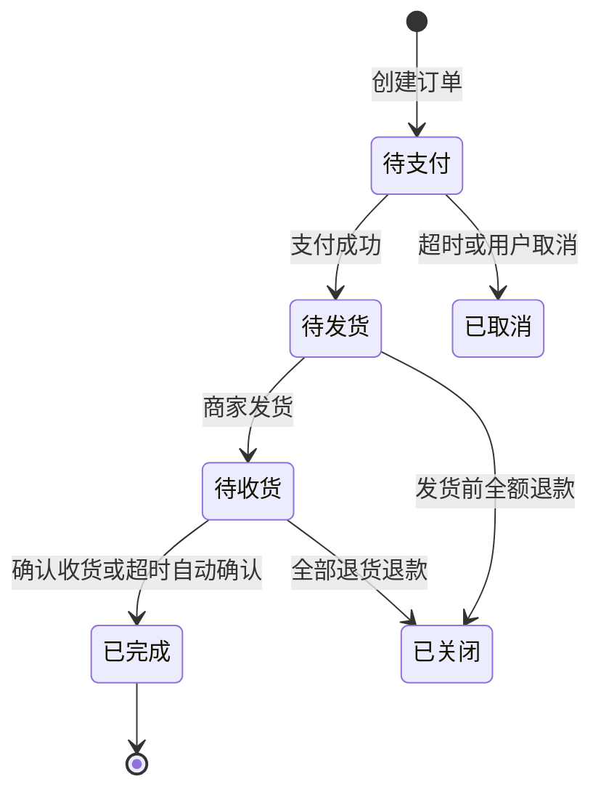
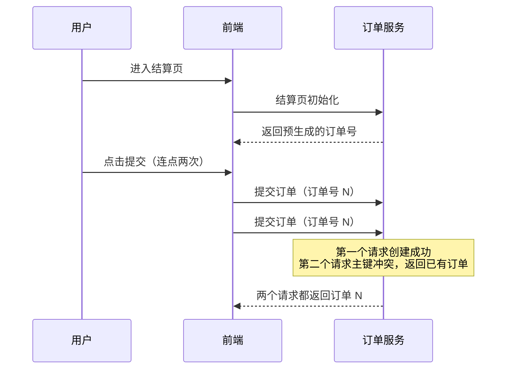
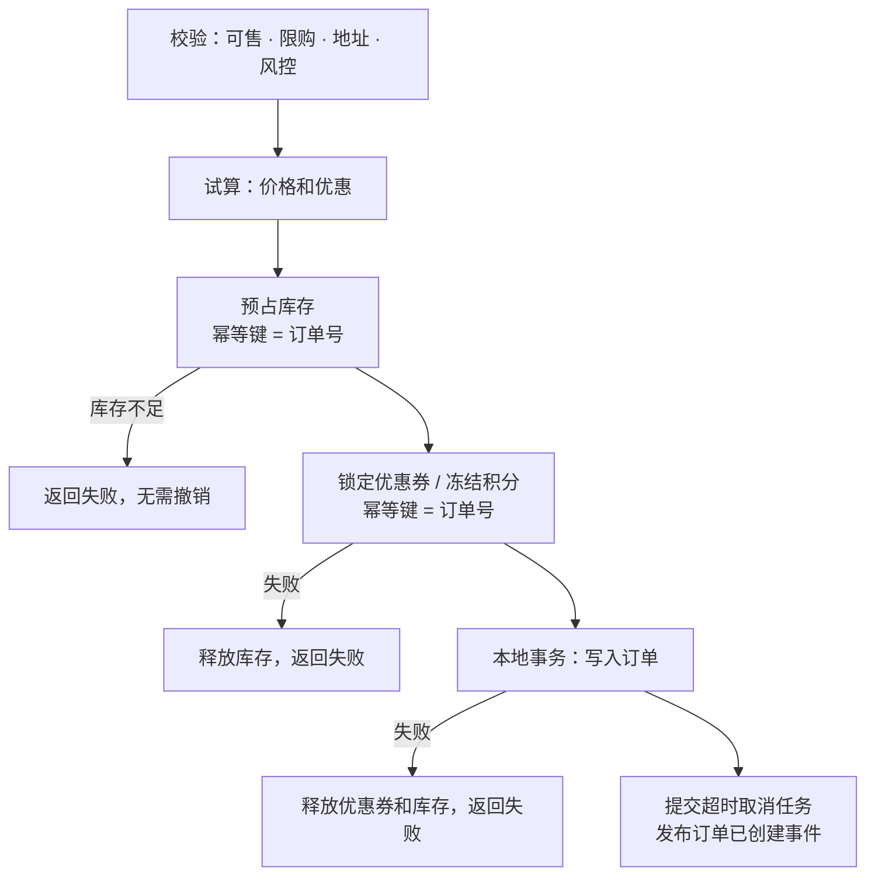
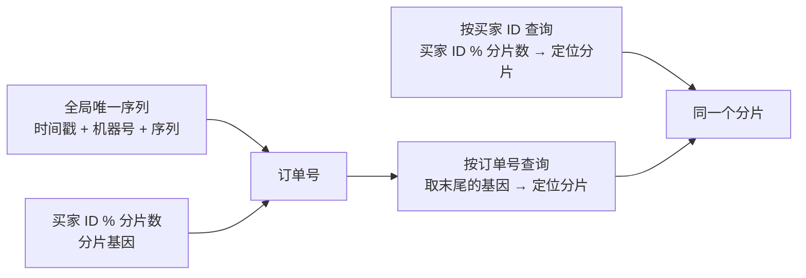
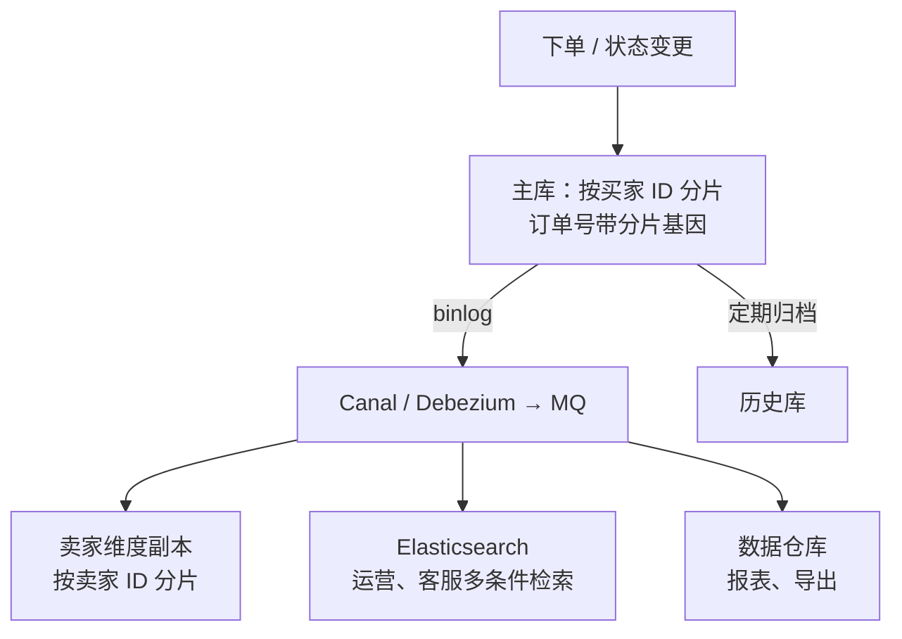
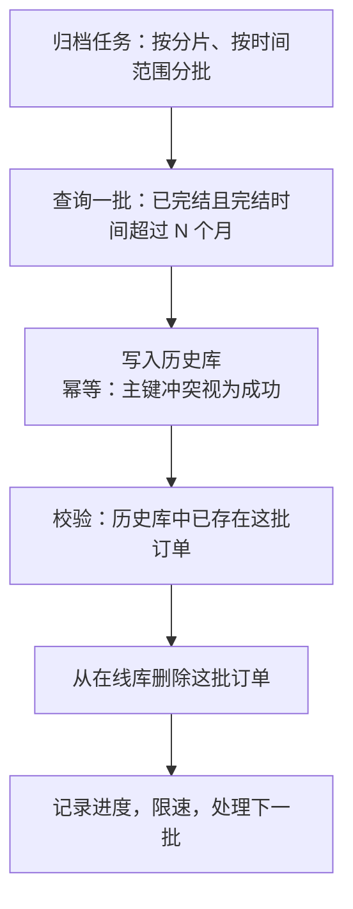
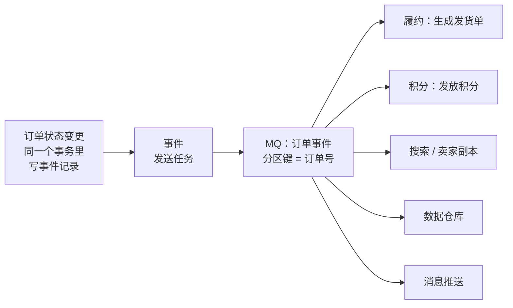

# S07 · 订单中心

> 适用岗位：Java 资深开发、Java 架构师。订单是交易系统的核心单据：上游连着购物车、营销、库存，下游连着支付、履约、售后、结算。这道题考察的是模型设计、下单链路的一致性，以及数据量上来之后的存储和查询。其中"分库分表后的多维度查询"的速查版见[《29 场景题》](../06-三高与架构/29-场景题.md)的 29-08。
> 版本基线：JDK 21 / 25、MySQL 8.4、RocketMQ 5.x、Elasticsearch 9.x。
> 事实核对：
> - 基因法、非分片键查询、跨分片分页、数据倾斜、归档的原理，沿用[《16 分库分表》](../04-数据存储/16-分库分表.md)16-04、16-05、16-06、16-12、16-14 的结论。
> - 本机运行（macOS 27.2、Apple M1 Max、JDK 25）：1 段订单号生成与路由的代码只依赖 JDK，文中贴的是实际运行输出。
> - 本机没有 MySQL 服务端，文中的 SQL 都没有实际执行。
> 相关分类：[《16 分库分表》](../04-数据存储/16-分库分表.md)、[《27 DDD》](../06-三高与架构/27-DDD.md)（聚合、领域事件）、[《09 分布式理论》](../03-分布式与微服务/09-分布式理论.md)（Saga、幂等、分布式 ID）、[《S02 订单超时取消与延迟任务》](S02-订单超时取消与延迟任务.md)、[《S03 支付系统》](S03-支付系统.md)、[《S05 优惠券系统》](S05-优惠券系统.md)、[《S08 库存中心》](S08-库存中心.md)

## 45 分钟答题版

| 时间 | 做什么 | 要讲出的关键点 | 子题 |
| --- | --- | --- | --- |
| 0～5 分钟 | 澄清范围 | 订单中心管什么、不管什么；日订单量和保存年限 | S07-01 |
| 5～15 分钟 | 模型 | 父单与子单、商品明细、金额明细；快照；正向和逆向分开 | S07-02、S07-03 |
| 15～27 分钟 | 下单链路 | 防重复下单；试算、锁券、占库存、建单的顺序；失败时的撤销 | S07-04、S07-05 |
| 27～38 分钟 | 存储与查询 | 订单号带分片基因；按买家分片；卖家副本、ES；冷热分离 | S07-06 ～ S07-08 |
| 38～45 分钟 | 协同与高可用 | 订单事件驱动下游；下单链路的降级；与支付、库存的对账 | S07-09、S07-10 |

## 知识地图



## 题目索引

| 编号 | 题目 | 难度 |
| --- | --- | --- |
| S07-01 | 订单中心的职责边界在哪？要澄清哪些需求？ | ★★ |
| S07-02 | 订单的数据模型怎么设计？什么时候要拆单？ | ★★★ |
| S07-03 | 订单的状态机怎么设计？售后要不要放进订单状态里？ | ★★★ |
| S07-04 | 怎么防止用户重复下单？ | ★★ |
| S07-05 | 下单要调用营销、库存等多个服务，顺序怎么排？失败了怎么撤销？ | ★★★ |
| S07-06 | 订单号怎么生成？ | ★★★ |
| S07-07 | 订单表分库分表后，买家、卖家、运营的查询怎么支撑？ | ★★★ |
| S07-08 | 订单数据越来越多，冷热分离和归档怎么做？ | ★★ |
| S07-09 | 订单状态变化后，下游系统怎么知道？ | ★★ |
| S07-10 | 下单链路的高可用怎么做？和哪些系统对账？ | ★★★ |

---

## 一、范围与模型

### S07-01 订单中心的职责边界在哪？要澄清哪些需求？

> ★★ ｜ 资深 / 架构师 ｜ 高频

**考察意图**：订单很容易变成一个什么都往里放的"大泥球"。看你是否能说清楚它该管什么、不该管什么。

**30 秒版回答**：

- **订单中心管的**：订单的创建、订单数据的保存和查询、订单状态的流转、对外发布订单事件。
- **订单中心不管的**：价格和优惠怎么算（营销）、库存够不够（库存）、钱收没收到（支付）、货怎么发（履约）、退货怎么审（售后）。这些系统各自负责自己的规则，订单只**记录结果**并**协调流程**。
- **一句话**：订单是一份"契约"的记录——谁、在什么时间、以什么价格、买了什么，以及这份契约目前执行到了哪一步。
- **要问的**：日订单量和峰值、保存多久、有没有多商家（要不要拆单）、有哪些查询方、有没有预售和虚拟商品这类特殊流程。

**深入剖析**

| 问题 | 为什么要问 | 本文的假设 |
| --- | --- | --- |
| 日订单量？峰值？ | 决定分库分表和下单链路的容量 | 日均 1000 万单，大促峰值每秒 5 万单 |
| 订单保存多久？ | 决定总数据量和归档策略 | 3 年，约 110 亿条 |
| 平台模式还是自营？ | 多商家就要拆单，还有卖家维度的查询 | 平台模式，一次结算可以包含多个商家的商品 |
| 有哪些查询方？ | 决定分片键和异构存储 | 买家、卖家、客服、运营 |
| 有哪些订单类型？ | 不同类型的流程不同 | 普通实物订单为主，预留虚拟商品、预售的扩展 |



**追问链**

1. **为什么不把价格计算放在订单里？** 价格和优惠的规则变化最频繁（每次大促都有新玩法）。放在订单里，每一次营销规则的调整都要改订单系统，而订单是最需要稳定的系统。订单只保存"算出来的结果"：每个商品的原价、各项优惠的分摊、实付金额（[《S05 优惠券系统》](S05-优惠券系统.md)S05-07）。
2. **"订单中心"和"交易系统"是一回事吗？** 不同公司的叫法不同。常见的划分是：交易系统负责下单这个**过程**的编排（调营销、调库存、建单），订单中心负责订单这个**数据**的保存、查询和状态管理。规模不大时两者是一个服务，这里合在一起讲，在 S07-05 里会区分"编排"和"建单"这两个职责。

---

### S07-02 订单的数据模型怎么设计？什么时候要拆单？

> ★★★ ｜ 资深 / 架构师 ｜ 高频

**考察意图**：能否设计出支持多商家、多商品、多种优惠的模型，并且知道哪些信息必须在下单时固化。

**30 秒版回答**：

- **父订单**：一次结算一个，对应一次支付。记录买家、应付总额。
- **子订单**：按**商家**（以及仓库、发货方式）拆分。每个子订单独立地发货、收货、售后、结算。用户在"我的订单"里看到的通常是子订单。
- **订单商品明细**：子订单下的每一行商品。记录 SKU、数量、原价、各项优惠分摊、实付金额。
- **订单扩展信息**：收货地址、发票、备注等，和主表分开存放。
- **快照**：商品的名称、图片、规格、价格，收货地址，在下单时**复制一份**存在订单里。商品之后改了名字、调了价，订单里看到的仍然是下单时的样子。
- **为什么要拆单**：不同商家的商品，发货、售后、结算都是分开的。只有一张单的话，"A 商家已发货、B 商家还没发"这种状态没法表达。

**深入剖析**



子订单表的关键字段：

```sql
CREATE TABLE t_order (
    order_no        BIGINT       NOT NULL PRIMARY KEY COMMENT '子订单号，末尾带买家的分片基因',
    parent_order_no BIGINT       NOT NULL COMMENT '父订单号',
    buyer_id        BIGINT       NOT NULL,
    seller_id       BIGINT       NOT NULL,
    status          VARCHAR(16)  NOT NULL,
    total_amount    BIGINT       NOT NULL COMMENT '商品原价合计，单位分',
    discount_amount BIGINT       NOT NULL COMMENT '优惠合计',
    freight_amount  BIGINT       NOT NULL COMMENT '运费',
    pay_amount      BIGINT       NOT NULL COMMENT '应付 = 原价 - 优惠 + 运费',
    pay_time        DATETIME(3)  NULL,
    create_time     DATETIME(3)  NOT NULL,
    update_time     DATETIME(3)  NOT NULL,
    KEY idx_buyer_create (buyer_id, create_time),
    KEY idx_parent (parent_order_no)
);
```

金额必须满足的等式，创建订单时就要校验：

- 每个商品明细：实付 = 原价 × 数量 − 各项优惠分摊之和；
- 每个子订单：应付 = 商品明细的实付之和 + 运费；
- 父订单：应付总额 = 各子订单应付之和 = 支付单的金额。

**追问链**

1. **拆单是在下单时拆，还是支付之后再拆？** 两种都有。下单时拆：用户支付前就看到多个子订单，模型简单，后续流程都基于子订单。支付后再拆：下单时不知道从哪个仓发货，等支付成功后由履约系统根据库存分布再拆成多个发货单。常见的做法是结合起来：**按商家在下单时拆成子订单**，**按仓库在履约阶段拆成发货单**。发货单属于履约系统，不是订单的一部分。
2. **快照存什么、存在哪？** 商品快照存展示和纠纷处理需要的字段：名称、主图、规格、单价、类目。存在商品明细表里，或者单独的快照表里按内容的哈希值去重（同一个商品版本被很多订单引用，只存一份）。不要只存商品 ID 然后实时去查商品系统：商品下架或者修改之后，订单详情就不是下单时的内容了。
3. **父订单和子订单用同一张表吗？** 分开两张表更清晰：父订单的字段很少，主要用于支付；子订单承载状态和大部分业务。两张表用相同的分片规则（买家 ID），保证同一次下单的数据在同一个库，可以用本地事务写入。

---

### S07-03 订单的状态机怎么设计？售后要不要放进订单状态里？

> ★★★ ｜ 资深 / 架构师 ｜ 高频

**考察意图**：订单状态最容易失控：每加一个业务就加几个状态。看你是否懂得把正向流程和逆向流程分开。

**30 秒版回答**：

- **正向主状态**（少而稳定）：待支付 → 待发货 → 待收货 → 已完成；任何未完成的阶段都可能进入**已取消**或**已关闭**。
- **逆向流程不放进订单状态**：退款、退货、换货是独立的**售后单**，有自己的状态机，通过订单号和商品明细关联到订单。一个订单可以有多个售后单（不同商品分别退），这不是一个状态字段能表达的。
- **订单上只保留一个售后的概要**：例如"是否有进行中的售后""已退款金额"，用于展示和控制流程（比如有售后进行中时暂不自动确认收货）。
- **状态流转由订单聚合自己控制**：对外提供 `pay()`、`ship()`、`confirmReceive()`、`cancel()` 这样的方法，内部用条件更新实现，不允许外部直接改状态字段。
- **每次变更记录流转日志**：从什么状态到什么状态、时间、操作者、原因。

**深入剖析**



"已取消"和"已关闭"的区别：取消发生在支付之前，没有资金往来；关闭发生在支付之后，伴随着退款。分开两个状态，财务和统计都更清楚。

把售后揉进订单状态会怎样：订单有 3 件商品，第 1 件申请退款中，第 2 件退货已寄回，第 3 件正常收货。订单的状态应该是什么？无论叫什么都不准确。把售后拆成独立的单据之后，订单的主状态仍然只反映正向的进度，每个售后单反映各自的进度。

**追问链**

1. **虚拟商品、预售订单的流程不一样，怎么办？** 状态集合尽量共用，流转规则按订单类型配置。虚拟商品没有"待收货"：支付成功后直接到已完成。预售订单的"待支付"分成定金和尾款两个阶段，可以用子状态或者两张支付单来表达，而不是为它新增一套主状态。原则是主状态保持稳定，差异用"类型 + 流转规则表"来承载。
2. **状态字段用数字还是字符串？** 都可以，关键是代码里用枚举，不出现字面值。数字省空间，字符串在查库排障时更直观。无论哪种，新增状态都要评估所有读取这个字段的下游（报表、搜索、其他系统），所以主状态才要尽量少变。
3. **部分发货怎么表达？** 发货的最小单位是发货单（包裹），属于履约系统。订单上可以用"待收货"加一个"部分发货"的标记，或者让订单状态在所有包裹都发出之后才流转。更细的进度展示从履约系统查询。

**架构师加分点**

- 订单的状态机体现的是**单一职责**：订单只回答"这份契约执行到哪了"。每当有人提出"在订单上加一个状态来表示 X"，先问 X 是不是另一个流程（售后、履约、结算、风控审核）的状态。是的话，它应该在自己的单据上，订单最多保留一个引用或标记。

---

## 二、下单链路

### S07-04 怎么防止用户重复下单？

> ★★ ｜ 资深 ｜ 高频

**考察意图**：区分"重复提交同一次下单"和"用户真的想再买一次"。前者要拦住，后者不能误拦。

**30 秒版回答**：

- **重复的来源**：用户连点提交按钮；网络慢，用户刷新后重新提交；网关或客户端超时后自动重试。
- **做法：下单令牌（幂等键）**。
  1. 进入结算页时，服务端生成一个唯一的令牌返回给前端；
  2. 提交订单时带上这个令牌；
  3. 服务端用令牌做去重：同一个令牌只能成功创建一次订单。
- **去重的实现**：直接把令牌作为**父订单号**（进入结算页时就预先生成订单号），依靠订单表的主键唯一保证；或者把令牌作为一个唯一索引字段。
- **重复提交时返回第一次的结果**（已创建的订单），而不是报错。
- 前端按钮置灰只是体验优化，不是保证。

**深入剖析**



"预先生成订单号"的好处不止去重：

- 下单过程中调用营销、库存时，都可以带上这个订单号作为它们的幂等键和业务凭据（锁券时记录订单号、预占库存时记录订单号）。即使订单最终没创建成功，也能根据订单号找到并释放这些资源；
- 重试时用的是同一个订单号，整条链路都是幂等的。

不同去重方式的比较：

| 方式 | 做法 | 问题 |
| --- | --- | --- |
| 前端按钮置灰 | 点击后禁用按钮 | 挡不住刷新、重试、脚本 |
| Redis 令牌 | 进入结算页时写入令牌，提交时原子地删除，删除成功才继续 | 令牌删除后下单失败，用户要重新进入结算页；Redis 不可用时要有降级 |
| 预生成订单号 + 主键唯一 | 订单号作为幂等键 | 依赖数据库，最可靠 |
| 按内容去重 | 同一用户、相同商品、短时间内只允许一单 | 会误拦用户真的想再买一次的情况，只适合作为风控规则 |

**追问链**

1. **令牌有效期多长？** 和结算页的有效期一致，比如 30 分钟。超过之后结算页的价格、库存信息也可能过期了，应该让用户重新进入结算页。
2. **两个并发请求，第一个还在处理中，第二个来了怎么办？** 第二个请求插入订单时主键冲突，这时订单可能还没完全创建好（事务未提交时第二个请求会等待行锁）。等到第一个事务提交，第二个请求得到冲突错误，然后查询并返回已有的订单。如果第一个事务回滚了，第二个请求的插入会成功，相当于正常的重试。
3. **幂等的通用设计？** 见[《09 分布式理论》](../03-分布式与微服务/09-分布式理论.md)09-17。

---

### S07-05 下单要调用营销、库存等多个服务，顺序怎么排？失败了怎么撤销？

> ★★★ ｜ 资深 / 架构师 ｜ 高频

**考察意图**：下单是一个典型的跨服务流程。看你是否有清晰的步骤顺序、每一步的幂等和撤销方案，而不是笼统地说"用分布式事务"。

**30 秒版回答**：

- **步骤**：
  1. **校验**：商品是否可售、是否限购、收货地址是否可配送、风控；
  2. **试算**：调用营销计算价格和优惠，服务端的计算结果才是最终金额；
  3. **占用资源**：锁定优惠券、预占库存、冻结积分；
  4. **创建订单**：父订单、子订单、商品明细，在一个本地事务里写入；
  5. **后续**：提交超时取消的延迟任务，发布"订单已创建"事件。
- **顺序的原则**：**只读的校验在前，占用资源在后；越容易失败、越容易撤销的越靠前**。库存最容易不足，所以放在锁券之前还是之后，取决于哪个撤销更便宜，通常先占库存。
- **失败的撤销**：第 3 步中任何一个失败，把已经占用的资源逐个释放；第 4 步失败，释放全部资源。每个占用和释放都以**订单号**为幂等键。
- **撤销本身也可能失败**：所以要有兜底。一个定时任务扫描"资源已占用、但订单不存在或已取消"的记录并释放。
- 这是一个 **Saga**：每一步有对应的补偿动作，靠幂等和重试保证最终一致。

**深入剖析**



最棘手的情况是**超时**：调用库存预占超时，不知道占没占上。

- 当成失败直接返回：如果库存其实占上了，这份库存就被白白占着，直到兜底任务释放；
- 所以超时后要**主动发起一次释放**（释放是幂等的，没占上时释放也不会出错）。库存服务要能正确处理"释放先于预占到达"的情况：记录这个订单号已经被释放过，之后迟到的预占请求直接拒绝。这就是 TCC 里说的**空回滚**和**防悬挂**，见[《09 分布式理论》](../03-分布式与微服务/09-分布式理论.md)09-10。

兜底任务检查的内容：

| 资源 | 检查条件 | 动作 |
| --- | --- | --- |
| 库存预占记录 | 预占超过 N 分钟，对应的订单不存在或者已取消 | 释放 |
| 锁定的优惠券 | 锁定超过 N 分钟，对应的订单不存在或者已取消 | 释放 |
| 冻结的积分 | 同上 | 解冻 |

**追问链**

1. **为什么不用 Seata 这类分布式事务框架？** 可以用。AT 模式对代码的侵入小，但它依赖全局锁，在下单这种高并发链路上会成为瓶颈；TCC 模式性能好，但本质上就是上面说的"预占、确认、释放"，只是由框架来驱动。无论用不用框架，每个参与方的幂等、空回滚、防悬挂都要自己实现。方案的选择见 09-08。
2. **创建订单能不能异步？** 秒杀这种极端场景会这样做：先返回"排队中"，订单异步创建（[《S01 秒杀系统》](S01-秒杀系统.md)S01-09）。普通下单不建议：用户提交之后需要立刻拿到订单号去支付，异步会让体验和流程都变复杂。普通下单的优化方向是**缩短同步链路**：非必要的步骤（发通知、写统计、更新推荐）全部放到订单创建之后的事件里。
3. **预占的库存什么时候变成真正的扣减？** 支付成功之后。订单取消或超时，预占释放。详见[《S08 库存中心》](S08-库存中心.md)S08-02。

**生产实践 / 踩坑**

- **先建订单，再占库存**：订单已经存在了，库存却不够，只能再把订单取消。用户看到的是"下单成功又被取消"。占用资源必须在建单之前。
- **撤销写在 catch 块里就认为万事大吉**：进程在 catch 之前崩溃，或者撤销的调用本身超时，资源就泄漏了。必须有独立的兜底任务。

---

## 三、存储与查询

### S07-06 订单号怎么生成？

> ★★★ ｜ 资深 ｜ 高频

**考察意图**：订单号不只是一个唯一的数字。看你是否考虑了全局唯一、不泄露业务信息、带路由信息这几个要求。

**30 秒版回答**：

- **要求**：
  1. **全局唯一**；
  2. **不能是连续的自增数字**：否则别人可以通过订单号的差值推算出你一天有多少订单，也可以遍历订单号来探测数据；
  3. **大致按时间递增**：作为主键时，插入是顺序写，索引的页分裂少；
  4. **带分片信息**：订单按买家 ID 分片，订单号里编入买家 ID 的分片位（**基因法**），这样只有订单号时也能直接定位到分片。
- **结构**：时间戳 + 机器或号段标识 + 序列号 + 买家分片基因。前半部分由雪花算法或号段模式生成，见[《09 分布式理论》](../03-分布式与微服务/09-分布式理论.md)09-16。
- 长度控制在 `BIGINT` 能表示的范围内（最多 19 位十进制数），存储和索引都更高效。

**深入剖析**

用 JDK 验证基因法：生成 100 万个订单号，检查"按买家 ID 路由"和"按订单号路由"的结果是否一致（本机 JDK 25 运行）：

```java
import java.util.Random;

/**
 * 订单号的"基因法"：把买家 ID 的分片位编进订单号的末尾。
 * 这样按买家 ID 和按订单号，都能直接算出订单在哪个分片，不需要查映射表。
 */
public class OrderNoDemo {

    /** 分片总数：8 个库 × 16 张表 */
    private static final int SHARD_COUNT = 128;
    private static final int DB_COUNT = 8;
    /** 订单号末尾留 3 位十进制数存放分片号（0 ～ 127） */
    private static final long GENE_SPACE = 1_000L;
    private static final int ORDER_COUNT = 1_000_000;
    private static final long RANDOM_SEED = 20261112L;

    /** 按买家 ID 路由 */
    static int shardOfUser(long userId) {
        return (int) (userId % SHARD_COUNT);
    }

    /** 生成订单号：全局唯一序列 + 买家的分片号。序列在生产环境来自雪花算法或号段 */
    static long newOrderNo(long sequence, long userId) {
        return sequence * GENE_SPACE + shardOfUser(userId);
    }

    /** 按订单号路由：取出末尾的基因 */
    static int shardOfOrderNo(long orderNo) {
        return (int) (orderNo % GENE_SPACE);
    }

    public static void main(String[] args) {
        Random random = new Random(RANDOM_SEED);
        long sequence = 2_611_120_000_000L;
        int[] perShard = new int[SHARD_COUNT];
        int mismatch = 0;
        long sampleUser = 0;
        long sampleOrderNo = 0;
        for (int i = 0; i < ORDER_COUNT; i++) {
            long userId = 10_000_000L + random.nextInt(50_000_000);
            long orderNo = newOrderNo(sequence++, userId);
            int byUser = shardOfUser(userId);
            int byOrderNo = shardOfOrderNo(orderNo);
            if (byUser != byOrderNo) {
                mismatch++;
            }
            perShard[byUser]++;
            if (i == 0) {
                sampleUser = userId;
                sampleOrderNo = orderNo;
            }
        }
        int shard = shardOfOrderNo(sampleOrderNo);
        System.out.println("userId=" + sampleUser + " -> shard " + shardOfUser(sampleUser));
        System.out.println("orderNo=" + sampleOrderNo + " -> shard " + shard
                + " = db_" + (shard / (SHARD_COUNT / DB_COUNT)) + ".t_order_" + shard);
        System.out.println("orders=" + ORDER_COUNT + ", route mismatch=" + mismatch);

        int min = Integer.MAX_VALUE;
        int max = 0;
        for (int count : perShard) {
            min = Math.min(min, count);
            max = Math.max(max, count);
        }
        System.out.println("orders per shard: min=" + min + ", max=" + max + ", avg=" + ORDER_COUNT / SHARD_COUNT);

        // 一个大买家（比如企业采购账号）的全部订单都落在同一个分片
        long bigBuyer = 10_000_077L;
        System.out.println("big buyer " + bigBuyer + ": all orders go to shard " + shardOfUser(bigBuyer));
    }
}
```

```text
userId=21847513 -> shard 89
orderNo=2611120000000089 -> shard 89 = db_5.t_order_89
orders=1000000, route mismatch=0
orders per shard: min=7609, max=8066, avg=7812
big buyer 10000077: all orders go to shard 77
```

- 买家 21847513 的分片号是 89，他的订单号末三位就是 089，按订单号也路由到 89 号分片；
- 100 万个订单，两种路由方式的结果**全部一致**；
- 订单在 128 个分片上分布均匀，每个分片 7600 到 8100 个；
- 最后一行提示了基因法的代价：一个买家的所有订单都在同一个分片。订单量特别大的买家（比如企业采购账号）会让这个分片成为热点，见 S07-07。



**追问链**

1. **以后分片数从 128 扩到 256，订单号里的基因怎么办？** 基因位是按当前分片数算的，扩容后旧订单号里的基因对应的是旧的分片规则。常见的做法是按 2 的倍数扩容，并且让基因位保存"买家 ID 对一个更大的数（比如 1024）取模"的结果：分片数是 128 时用它再对 128 取模，扩到 256 时对 256 取模，订单号本身不用改。演示代码为了直观直接存了分片号，生产环境要预留扩容的空间。不停机扩容的步骤见[《16 分库分表》](../04-数据存储/16-分库分表.md)16-11。
2. **父订单号和子订单号是什么关系？** 各自独立生成，都带着买家的基因，所以都落在同一个分片。子订单上保存父订单号。不建议用"父订单号 + 序号"拼出子订单号：长度不固定，而且泄露了一次下单拆成几单的信息。
3. **雪花算法的时钟回拨怎么处理？** 见 09-16。订单号生成是下单的必经步骤，ID 生成服务不可用就无法下单，所以它要有本地缓存的号段或者多个可用的生成节点。

---

### S07-07 订单表分库分表后，买家、卖家、运营的查询怎么支撑？

> ★★★ ｜ 资深 / 架构师 ｜ 高频

**考察意图**：分片键只能照顾一个维度。看你能不能为其余的维度各自找到合适的方案，并说清每种方案的一致性代价。

**30 秒版回答**：

- **分片键选买家 ID**：买家的查询最频繁（我的订单），而且每个买家的订单量小且均匀。订单号带买家的基因，按订单号也能路由。
- **卖家查询**：通过 binlog 同步一份**按卖家 ID 分片**的订单副本。卖家查的是副本。
- **运营、客服的多条件查询**：同步到 **Elasticsearch**。按手机号、收货人、时间范围、状态的任意组合检索。
- **报表和大批量导出**：走数据仓库，不碰在线库。
- **代价**：副本和 ES 都是异步同步的，有秒级的延迟。需要强一致的场景（比如卖家点进订单详情准备发货），用订单号回主库查。
- **大卖家的数据倾斜**：少数头部卖家的订单量极大，卖家副本里要对他们单独处理。

**深入剖析**



| 查询方 | 典型查询 | 走哪里 | 一致性 |
| --- | --- | --- | --- |
| 买家 | 我的订单列表、订单详情 | 主库，按买家 ID 或订单号路由 | 强一致 |
| 卖家 | 店铺订单列表、按状态筛选 | 卖家副本 | 秒级延迟 |
| 卖家 | 某个订单的详情、发货操作 | 主库，按订单号路由 | 强一致 |
| 客服 | 按订单号查 | 主库 | 强一致 |
| 客服 | 按手机号、收货人查 | ES 查出订单号，再回主库取详情 | 检索有延迟，详情强一致 |
| 运营 | 多条件组合筛选 | ES | 秒级延迟 |
| 运营 | 大批量导出、报表 | 数据仓库 | 小时级或 T+1 |

"ES 查出订单号，再回主库取详情"是一个通用的模式：ES 只负责**找到是哪些订单**，展示的数据从主库读。这样 ES 里不需要存完整的订单，同步延迟也只影响"能不能搜到"，不影响"看到的数据对不对"。

大卖家的倾斜：

- 现象：按卖家 ID 取模分片，一个头部卖家每天几十万单，他所在的分片比别的分片大几十倍；
- 做法：维护一份大卖家名单。名单内的卖家使用**独立的分片**，并且在分片内按时间再拆分（比如按月分表）；普通卖家仍然取模；
- 路由时先查名单，命中就走专属规则。名单放在配置中心里。数据倾斜的通用处理见[《16 分库分表》](../04-数据存储/16-分库分表.md)16-12。

**追问链**

1. **买家的订单列表怎么分页？** 一个买家的数据在同一个分片里，不存在跨分片分页。用"上一页最后一条的创建时间 + 订单号"作为游标：`WHERE buyer_id = ? AND (create_time, order_no) < (?, ?) ORDER BY create_time DESC, order_no DESC LIMIT 20`。不用 `LIMIT offset`，翻到很后面也不会变慢。
2. **卖家副本的同步丢了数据怎么办？** binlog 同步链路要有监控（延迟、堆积）和校验：定期按时间段比对主库和副本的订单数量、抽样比对内容，不一致就重新同步这个时间段。同步的消费要幂等，按订单号和更新时间（或版本号）判断，旧的变更不能覆盖新的。
3. **为什么不让应用双写主库和卖家副本？** 双写要处理"一个成功一个失败"的情况，而且每个写订单的地方都要记得写两份，容易遗漏。基于 binlog 的同步对业务代码没有侵入，主库里的任何变更都会被捕获。代价是异步带来的延迟。
4. **能不能直接用分布式数据库，省掉这些异构副本？** 分布式数据库解决了分片和扩容对应用透明的问题，也支持二级索引的跨节点查询。但"按卖家查询"在它内部仍然是一次跨多个节点的操作，延迟和资源消耗比单分片查询高；复杂的多条件检索仍然更适合 ES。选型的权衡见 16-15。

---

### S07-08 订单数据越来越多，冷热分离和归档怎么做？

> ★★ ｜ 资深 / 架构师 ｜ 中频

**考察意图**：是否意识到订单的访问有极强的时间局部性，并利用这一点控制在线库的规模。

**30 秒版回答**：

- **访问规律**：绝大部分的读写集中在最近几个月的订单上。已完成很久的订单几乎不再修改，偶尔被查看。
- **冷热分离**：在线库只保留**最近 N 个月**的订单（以及所有未完结的订单）；更早的已完结订单迁移到**历史库**。
- **历史库**：只读或者极少写入，可以用更便宜的存储（更大的分片、压缩率更高的引擎，或者列式存储、对象存储）。
- **迁移过程**：定时任务按批次"先写历史库，确认成功，再删在线库"，限速进行，可以重跑。
- **产品上配合**：订单列表默认展示近期的订单，"查看更早的订单"是一个单独的入口，查询历史库。
- 估算：日均 1000 万单保存 3 年约 110 亿条。在线库只留 6 个月约 18 亿条，按单表 2000 万以内需要约 90 张表，取 128 张。

**深入剖析**



要注意的细节：

- **什么订单能归档**：必须是终态（已完成、已取消、已关闭），并且**没有进行中的售后**、已经过了售后期。否则归档之后还要修改，就得跨库操作；
- **归档的原子性**：写历史库和删在线库不在一个事务里。顺序是先写后删，中间失败可以重跑：重跑时写入遇到主键冲突就跳过，然后继续删除。任何时候，一条订单至少在一个库里；
- **删除的影响**：大批量删除会产生大量的 binlog，可能造成主从延迟，下游的 binlog 消费者（卖家副本、ES）也会收到大量的删除事件。归档任务要限速，下游要能识别"归档删除"并做相应处理（卖家副本和 ES 可以有各自的保留策略）；
- **归档之后的查询**：按订单号查询时，路由层先查在线库，查不到再查历史库。或者根据订单号里的时间信息直接判断该去哪个库。

归档的通用设计见[《16 分库分表》](../04-数据存储/16-分库分表.md)16-14。

**追问链**

1. **按时间分区（分区表）能不能代替归档？** 分区表可以直接删除整个分区，比逐行删除快得多。但订单不适合简单地按创建时间删分区：同一个月创建的订单，有的早就完成了，有的还在售后中。可以把分区表用在历史库里（历史数据不再变化，按月分区，到期直接删除分区）。分区表的限制见 16-13。
2. **历史订单用户还要申请售后怎么办？** 过了售后期的订单才归档，正常情况下不会发生。特殊情况（比如质保期内的维修）由客服走单独的流程，在历史库上只读查询订单信息，售后单在售后系统里新建。

---

## 四、协同与高可用

### S07-09 订单状态变化后，下游系统怎么知道？

> ★★ ｜ 资深 / 架构师 ｜ 中频

**考察意图**：订单的下游非常多。看你是否用事件解耦，并保证事件可靠、有序、可重放。

**30 秒版回答**：

- **不要让订单服务去逐个调用下游**：下游有履约、物流、积分、会员、推荐、搜索、数据仓库……每加一个，订单服务就要改一次，而且任何一个下游变慢都会拖累下单。
- **发布订单事件**：订单创建、支付成功、发货、确认收货、取消等，每次状态变化发布一个事件。下游各自订阅自己关心的。
- **可靠性**：事件和状态变更必须一致。用**本地消息表**（状态变更的同一个事务里写一条事件记录，后台发送）或者基于 **binlog** 的变更捕获。不能在事务提交后"顺手发一条消息"。
- **顺序**：同一个订单的事件要有序。用订单号作为 MQ 的分区键；事件里带上**状态的版本号**，下游遇到比自己已处理的版本更旧的事件就丢弃。
- **事件内容**：带上关键的业务数据，但下游需要完整信息时应该**回查订单**，以回查的结果为准。

**深入剖析**



两种产生事件的方式：

| | 本地消息表 | 基于 binlog |
| --- | --- | --- |
| 做法 | 业务代码在事务里显式写事件 | 监听订单表的数据变更，转换成事件 |
| 事件的语义 | 明确，是业务含义的事件（"订单已支付"） | 是数据变更（"status 从 A 变成 B"），需要再转换 |
| 对代码的侵入 | 有，每个变更点都要写 | 无 |
| 会不会遗漏 | 忘了写就漏了 | 不会，任何变更都能捕获 |
| 适合 | 需要明确业务语义的下游（履约、积分） | 数据同步类的下游（副本、ES、数仓） |

两者经常同时存在：业务事件走本地消息表，数据同步走 binlog。

**追问链**

1. **下游处理事件失败了怎么办？** 这是下游自己的责任：MQ 重试，仍然失败进入死信队列并告警。订单服务不关心也不等待下游的处理结果。对于"必须成功"的下游（比如支付成功后必须生成发货单），用对账兜底：已支付的订单是否都有发货单。
2. **事件里应该放多少数据？** 太少，每个下游都要回查，订单服务的读压力大；太多，事件体积大，而且事件里的数据是"发送那一刻"的，可能已经过时。折中是放**稳定的关键字段**（订单号、买家、卖家、金额、状态、时间），可变的或者详细的数据由下游按需回查。
3. **新接入的下游想要历史数据怎么办？** MQ 里的消息有保留期限，不能当作历史数据源。历史数据从数据仓库或者订单库的只读副本里初始化，然后再接上实时事件。两者的衔接点要重叠一段时间，靠幂等去重。

---

### S07-10 下单链路的高可用怎么做？和哪些系统对账？

> ★★★ ｜ 架构师 ｜ 中频

**考察意图**：下单是交易的入口，它不可用就没有收入。看你是否区分了强依赖和弱依赖，并为每个依赖准备了降级方案。

**30 秒版回答**：

- **区分依赖**：
  - **强依赖**（失败则不能下单）：库存预占、订单库、订单号生成；
  - **可以降级的依赖**：营销（降级为不使用优惠或者只用基础价格）、风控（降级为事后审核）、地址校验（降级为下单后校验）；
  - **不应该在同步链路上的**：通知、统计、推荐。它们订阅事件即可。
- **每个依赖都有超时、熔断、隔离**：一个依赖变慢不能占满下单的线程。
- **读写分离**：下单（写）和订单查询（读）分开部署。大促时查询量很大，不能挤占下单的资源。
- **数据库**：按买家分片后，单个分片故障只影响部分用户；主从切换不能丢已提交的订单。
- **限流**：按后端的处理能力限制下单的速率，超出的请求快速失败并提示重试，而不是排队到超时。
- **对账**：订单与支付、订单与库存、订单与营销、订单与履约，各有一个等式。

**深入剖析**

| 依赖 | 故障时的处理 | 用户感受到的 |
| --- | --- | --- |
| 库存 | 不能降级，返回失败 | "系统繁忙，请稍后再试" |
| 订单库的某个分片 | 该分片的用户不能下单 | 部分用户受影响 |
| 营销试算 | 熔断后按"无优惠"下单，或者提示优惠暂不可用让用户选择 | 优惠暂时用不了 |
| 风控 | 熔断后放行，订单标记为"待风控审核"，事后拦截 | 无感知 |
| 地址、运费 | 用缓存的规则计算，或者下单后再校验 | 无感知 |
| 订单号生成 | 使用本地预取的号段 | 无感知 |
| 事件发送 | 本地消息表里堆积，恢复后补发 | 下游的处理延迟 |

对账的等式：

| 双方 | 等式 | 不平说明什么 |
| --- | --- | --- |
| 订单 ↔ 支付 | 已支付的订单 = 成功的支付单，金额一致 | 支付通知丢失；金额被篡改 |
| 订单 ↔ 库存 | 待支付订单占用的数量 = 库存的预占量；已支付订单的数量 = 库存的实际扣减量 | 预占泄漏；重复扣减 |
| 订单 ↔ 营销 | 订单使用的券 = 锁定或已核销的券；订单的优惠金额 = 券的优惠金额 | 券没有释放或者被重复使用 |
| 订单 ↔ 履约 | 已支付的实物订单都有发货单 | 订单事件丢失 |
| 订单内部 | 父订单金额 = 子订单金额之和；子订单金额 = 商品明细之和 + 运费 | 拆单或分摊的计算错误 |

对账的通用方法见[《S04 对账系统》](S04-对账系统.md)S04-08。

**追问链**

1. **大促零点的下单峰值怎么准备？** 用全链路压测得出下单链路的真实容量（见[《24 高并发》](../06-三高与架构/24-高并发.md)24-15）；按压测结果设置限流阈值；提前扩容并预热（连接池、本地缓存、JIT）；非核心功能提前降级；营销规则提前锁定，活动期间不做变更。
2. **订单库主从切换时会发生什么？** 切换的几十秒内，这个分片不可写，下单失败，用户重试。风险在于切换时丢失主库上已提交、但还没同步到从库的订单：用户已经看到下单成功，订单却不见了。交易库要使用半同步复制或者基于多数派的高可用方案，把这个风险降到最低；资源占用（库存、优惠券）上记录的订单号，也可以帮助在事后发现这种"消失的订单"。
3. **订单服务本身要不要做单元化、多活？** 订单按买家分片，天然适合按买家把流量和数据划分到不同的单元：一个买家的下单、支付、查询都在同一个单元内闭环。难点在跨单元的数据：卖家维度的数据（一个卖家的订单分布在所有单元）、库存（全局共享）。多活的设计见[《26 高可用》](../06-三高与架构/26-高可用.md)26-11。

**架构师加分点**

- 把订单中心的设计收敛成三条不变的原则：**订单只记录契约和进度，规则留在各自的领域里**；**下单是一个靠幂等和补偿推进的流程，订单号是贯穿全程的幂等键**；**主库只为一个维度优化，其余维度用可以重建的派生数据来支撑**。面试时每讲一个具体设计，都可以回到这三条中的一条。
